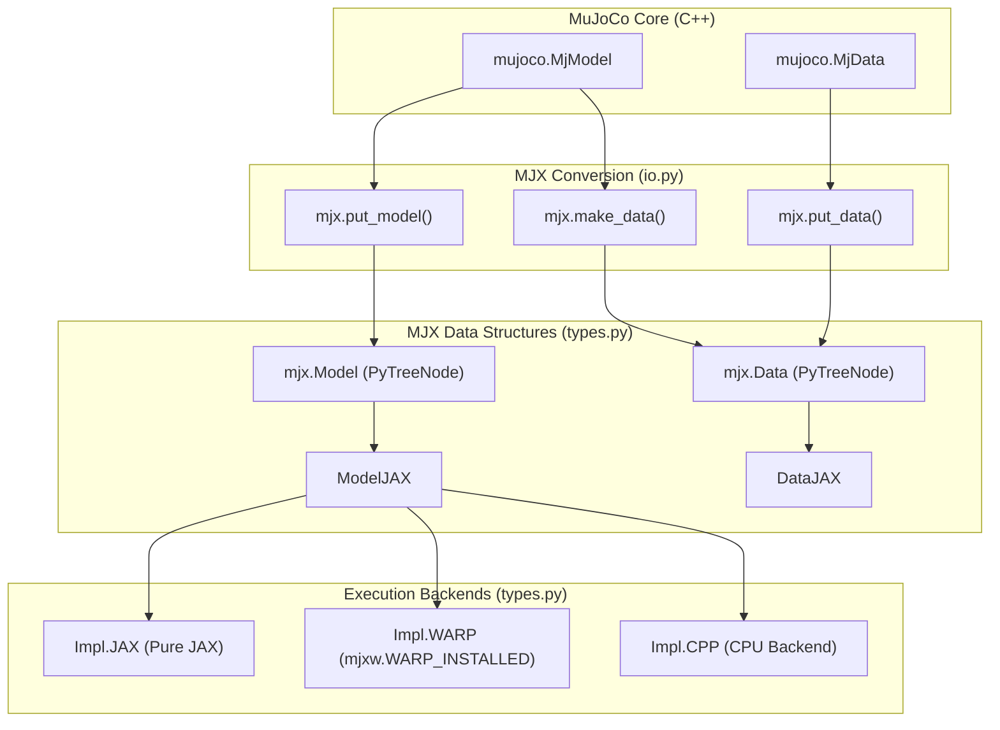
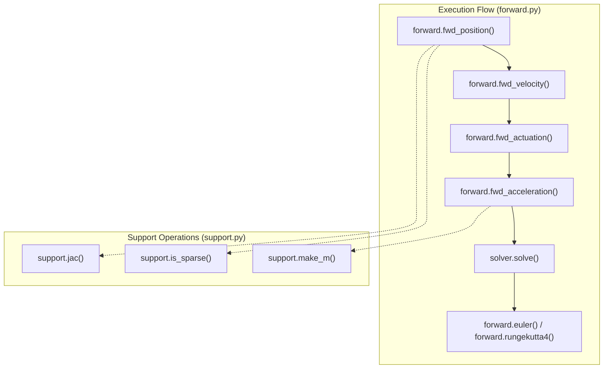

<!-- source: DeepWiki mcp.deepwiki.com · repo google-deepmind/mujoco · page 6 MJX: JAX-Accelerated Physics · fetched 2026-10-26 -->

# MJX: JAX-Accelerated Physics

Relevant source files

The following files were used as context for generating this wiki page:

- [doc/mjx.rst](doc/mjx.rst)
- [mjx/mujoco/mjx/__init__.py](mjx/mujoco/mjx/__init__.py)
- [mjx/mujoco/mjx/_src/forward.py](mjx/mujoco/mjx/_src/forward.py)
- [mjx/mujoco/mjx/_src/forward_test.py](mjx/mujoco/mjx/_src/forward_test.py)
- [mjx/mujoco/mjx/_src/io.py](mjx/mujoco/mjx/_src/io.py)
- [mjx/mujoco/mjx/_src/io_test.py](mjx/mujoco/mjx/_src/io_test.py)
- [mjx/mujoco/mjx/_src/smooth.py](mjx/mujoco/mjx/_src/smooth.py)
- [mjx/mujoco/mjx/_src/smooth_test.py](mjx/mujoco/mjx/_src/smooth_test.py)
- [mjx/mujoco/mjx/_src/support.py](mjx/mujoco/mjx/_src/support.py)
- [mjx/mujoco/mjx/_src/support_test.py](mjx/mujoco/mjx/_src/support_test.py)
- [mjx/mujoco/mjx/_src/types.py](mjx/mujoco/mjx/_src/types.py)
- [mjx/mujoco/mjx/test_data/actuator/tendon_force_clamp.xml](mjx/mujoco/mjx/test_data/actuator/tendon_force_clamp.xml)
- [mjx/mujoco/mjx/warp/collision_driver_test.py](mjx/mujoco/mjx/warp/collision_driver_test.py)
- [mjx/mujoco/mjx/warp/forward_test.py](mjx/mujoco/mjx/warp/forward_test.py)
- [mjx/mujoco/mjx/warp/smooth_test.py](mjx/mujoco/mjx/warp/smooth_test.py)
- [mjx/mujoco/mjx/warp/test_util.py](mjx/mujoco/mjx/warp/test_util.py)

MJX (MuJoCo XLA) provides a `JAX <https://github.com/jax-ml/jax#readme>`__ API for executing MuJoCo physics simulations on accelerator hardware, including NVIDIA/AMD GPUs, Apple Silicon, and Google Cloud TPUs [doc/mjx.rst:12-19](). It supports massive parallelization via `jax.vmap` and provides automatic differentiation for reinforcement learning and gradient-based optimization workflows.

For details on implementation strategies and hardware-specific optimizations, see [MJX Architecture and Backends](#6.1).

Sources: [doc/mjx.rst:12-25]()

## System Architecture

MJX maps MuJoCo's core C++ structures into JAX-compatible PyTrees, enabling execution across multiple backend targets (`Impl.JAX`, `Impl.WARP`, `Impl.CPP`).

### Bridging MuJoCo and MJX
The following diagram illustrates how natural language concepts of models and simulation data map to code entities in the MJX subsystem.

Sources: [mjx/mujoco/mjx/_src/io.py:345-387](), [mjx/mujoco/mjx/_src/types.py:24-47](), [mjx/mujoco/mjx/_src/types.py:161-177](), [mjx/mujoco/mjx/__init__.py:17-65]()

## Implementation Backends and Device Management

MJX supports multiple backends via the `types.Impl` enum [mjx/mujoco/mjx/_src/types.py:29-36]():
- `Impl.JAX`: Pure JAX implementation, fully compatible with automatic differentiation and XLA compilation across CPU, GPU, and TPU [doc/mjx.rst:16-19]().
- `Impl.WARP`: NVIDIA GPU-optimized backend via MuJoCo Warp (`mujoco.mjx.warp`), eliminating contact/constraint bottlenecks but omitting automatic differentiation [doc/mjx.rst:19-21](), [doc/mjx.rst:103-106]().
- `Impl.CPP`: CPU execution wrapper backend [mjx/mujoco/mjx/_src/types.py:32]().

Device resolution logic in `io.py` automatically selects default devices and verifies backend compatibility (`io._resolve_impl_and_device`) [mjx/mujoco/mjx/_src/io.py:142-163]().

For details, see [MJX Architecture and Backends](#6.1) and [MJX Device and Memory Management](#6.3).

Sources: [mjx/mujoco/mjx/_src/io.py:44-110](), [mjx/mujoco/mjx/_src/io.py:142-163](), [mjx/mujoco/mjx/_src/types.py:29-47](), [doc/mjx.rst:93-106]()

## Data Structures and PyTrees

MJX represents models and runtime states as JAX PyTrees inheriting from `PyTreeNode` (`mjx.Model` and `mjx.Data`) [mjx/mujoco/mjx/_src/types.py:24-25](). This allows them to be seamlessly passed through JAX transformations like `jax.jit`, `jax.vmap`, and `jax.grad`.

Functions like `mjx.put_model` and `mjx.put_data` handle conversion from host NumPy structures to device arrays while stripping weak typing and normalizing data formats [mjx/mujoco/mjx/_src/io.py:166-173]().

For details on memory layouts, fields, and scan utilities, see [MJX Data Structures](#6.2).

Sources: [mjx/mujoco/mjx/_src/types.py:24-25](), [mjx/mujoco/mjx/_src/types.py:161-177](), [mjx/mujoco/mjx/_src/io.py:166-173]()

## Physics Simulation Pipeline

The simulation pipeline replicates MuJoCo's forward dynamics via JAX-native operations (`mjx.step`) [mjx/mujoco/mjx/_src/forward.py:70-83]().

Sources: [mjx/mujoco/mjx/_src/forward.py:70-83](), [mjx/mujoco/mjx/_src/support.py:36-55]()

Key pipeline mechanics include:
- **Kinematics & Collision**: Position-dependent updates (`smooth.kinematics`, `smooth.com_pos`) and vectorized collision detection (`collision_driver.collision`) [mjx/mujoco/mjx/_src/forward.py:70-83]().
- **Sparse vs. Dense Paths**: `support.is_sparse` automatically selects sparse matrix representations when `nv >= 60` or on TPU targets via `JacobianType.AUTO` [mjx/mujoco/mjx/_src/support.py:36-55]().

For details on constraint solving, collision stages, and batched execution, see [MJX Physics Pipeline](#6.4).

Sources: [mjx/mujoco/mjx/_src/forward.py:70-83](), [mjx/mujoco/mjx/_src/support.py:36-55]()

## MJX-Warp Integration

MJX-Warp integrates NVIDIA Warp with JAX to provide optimized physics execution for contact-heavy workloads on GPUs [doc/mjx.rst:95-102](). It uses CUDA graph capture modes (`mjxw.GraphMode`) such as `WARP_STAGED` to maintain stable memory pointers and prevent redundant kernel recaptures across XLA execution steps [doc/mjx.rst:149-176]().

For implementation details, packaging requirements, and backend selection guidance, see [MJX Architecture and Backends](#6.1).

Sources: [doc/mjx.rst:95-176](), [mjx/mujoco/mjx/_src/io.py:64-71]()

---

