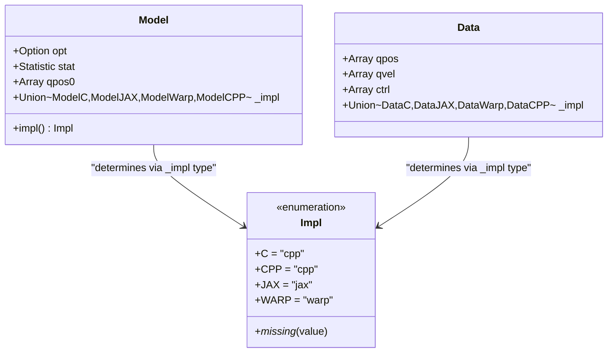
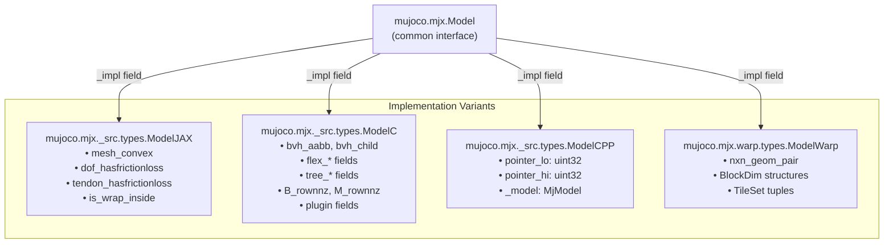
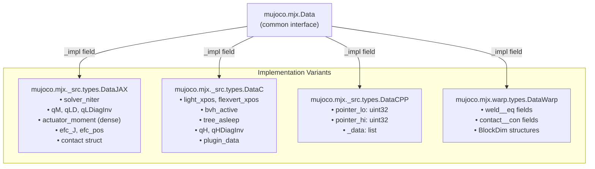
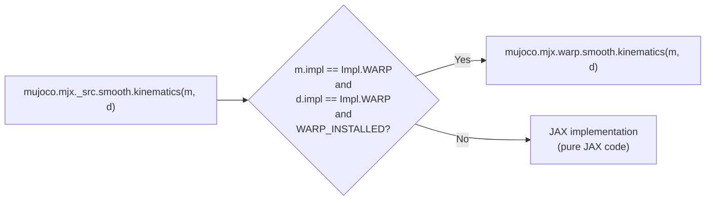

<!-- source: DeepWiki mcp.deepwiki.com · repo google-deepmind/mujoco · page 6.1 MJX Architecture and Backends · fetched 2026-10-26 -->

# MJX Architecture and Backends

<details>
<summary>Relevant source files</summary>

The following files were used as context for generating this wiki page:

- [doc/mjwarp/index.rst](doc/mjwarp/index.rst)
- [mjx/cuda_requirements.txt](mjx/cuda_requirements.txt)
- [mjx/mujoco/mjx/third_party/mujoco_warp/_src/collision_convex.py](mjx/mujoco/mjx/third_party/mujoco_warp/_src/collision_convex.py)
- [mjx/mujoco/mjx/third_party/mujoco_warp/_src/collision_driver.py](mjx/mujoco/mjx/third_party/mujoco_warp/_src/collision_driver.py)
- [mjx/mujoco/mjx/third_party/mujoco_warp/_src/collision_gjk.py](mjx/mujoco/mjx/third_party/mujoco_warp/_src/collision_gjk.py)
- [mjx/mujoco/mjx/third_party/mujoco_warp/_src/constraint.py](mjx/mujoco/mjx/third_party/mujoco_warp/_src/constraint.py)
- [mjx/mujoco/mjx/third_party/mujoco_warp/_src/derivative.py](mjx/mujoco/mjx/third_party/mujoco_warp/_src/derivative.py)
- [mjx/mujoco/mjx/third_party/mujoco_warp/_src/forward.py](mjx/mujoco/mjx/third_party/mujoco_warp/_src/forward.py)
- [mjx/mujoco/mjx/third_party/mujoco_warp/_src/inverse.py](mjx/mujoco/mjx/third_party/mujoco_warp/_src/inverse.py)
- [mjx/mujoco/mjx/third_party/mujoco_warp/_src/io.py](mjx/mujoco/mjx/third_party/mujoco_warp/_src/io.py)
- [mjx/mujoco/mjx/third_party/mujoco_warp/_src/island.py](mjx/mujoco/mjx/third_party/mujoco_warp/_src/island.py)
- [mjx/mujoco/mjx/third_party/mujoco_warp/_src/passive.py](mjx/mujoco/mjx/third_party/mujoco_warp/_src/passive.py)
- [mjx/mujoco/mjx/third_party/mujoco_warp/_src/sensor.py](mjx/mujoco/mjx/third_party/mujoco_warp/_src/sensor.py)
- [mjx/mujoco/mjx/third_party/mujoco_warp/_src/smooth.py](mjx/mujoco/mjx/third_party/mujoco_warp/_src/smooth.py)
- [mjx/mujoco/mjx/third_party/mujoco_warp/_src/solver.py](mjx/mujoco/mjx/third_party/mujoco_warp/_src/solver.py)
- [mjx/mujoco/mjx/third_party/mujoco_warp/_src/support.py](mjx/mujoco/mjx/third_party/mujoco_warp/_src/support.py)
- [mjx/mujoco/mjx/third_party/mujoco_warp/_src/types.py](mjx/mujoco/mjx/third_party/mujoco_warp/_src/types.py)
- [mjx/mujoco/mjx/third_party/warp/_src/jax/__init__.py](mjx/mujoco/mjx/third_party/warp/_src/jax/__init__.py)
- [mjx/mujoco/mjx/third_party/warp/_src/jax/ffi.py](mjx/mujoco/mjx/third_party/warp/_src/jax/ffi.py)
- [mjx/mujoco/mjx/third_party/warp/_src/jax/xla_ffi.py](mjx/mujoco/mjx/third_party/warp/_src/jax/xla_ffi.py)
- [mjx/mujoco/mjx/warp/bvh.py](mjx/mujoco/mjx/warp/bvh.py)
- [mjx/mujoco/mjx/warp/collision_driver.py](mjx/mujoco/mjx/warp/collision_driver.py)
- [mjx/mujoco/mjx/warp/forward.py](mjx/mujoco/mjx/warp/forward.py)
- [mjx/mujoco/mjx/warp/render.py](mjx/mujoco/mjx/warp/render.py)
- [mjx/mujoco/mjx/warp/smooth.py](mjx/mujoco/mjx/warp/smooth.py)
- [mjx/mujoco/mjx/warp/types.py](mjx/mujoco/mjx/warp/types.py)
- [mjx/pyproject.toml](mjx/pyproject.toml)
- [mjx/requirements.txt](mjx/requirements.txt)
- [python/build_requirements.txt](python/build_requirements.txt)
- [python/build_requirements_usd.txt](python/build_requirements_usd.txt)
- [python/make_sdist_requirements.txt](python/make_sdist_requirements.txt)
- [python/pyproject.toml](python/pyproject.toml)

</details>


## Purpose and Scope

This document describes the architecture of MuJoCo XLA (MJX) and its multiple backend implementations. MJX is a reimplementation of MuJoCo's physics engine that supports execution on different hardware platforms (CPU, GPU, TPU) through various backend strategies. This page covers the backend selection mechanism, implementation-specific data structures, and the integration of MuJoCo Warp (MJWarp) for specialized acceleration.

For information about MJX's data structures, see [MJX Data Structures](6.2). For device placement and memory management details, see [MJX Device and Memory Management](6.3). For the physics pipeline implementation, see [MJX Physics Pipeline](6.4).

Sources: [mjx/mujoco/mjx/_src/types.py:29-46](), [mjx/mujoco/mjx/_src/io.py:60-139]()

## MJX Overview

MJX provides physics simulation capabilities compatible with MuJoCo's API while leveraging JAX's compilation and hardware acceleration features. Unlike the C-based MuJoCo implementation optimized for single-scene CPU execution, MJX is designed for batched simulation across thousands of parallel scenes on accelerators.

The key architectural principle is **multiple backend implementations** that share a common interface (`mjx.Model` and `mjx.Data`) but use different execution strategies depending on the target hardware and use case.

**Architecture and Code Flow Integration:**

```mermaid
graph TB
    subgraph "UserAPI["User API Layer"]"
        PutModel["mujoco.mjx.put_model()"]
        MakeData["mujoco.mjx.make_data()"]
        Step["mujoco.mjx.step()"]
    end
    
    subgraph "CommonInterface["Common Interface Layer"]"
        Model["mujoco.mjx.Model"]
        Data["mujoco.mjx.Data"]
    end
    
    subgraph "BackendAbstraction["Backend Abstraction"]"
        ImplField["Model._impl / Data._impl"]
    end
    
    subgraph "BackendImplementations["Backend Implementations"]"
        JAXImpl["mujoco.mjx._src.types.ModelJAX<br/>mujoco.mjx._src.types.DataJAX"]
        CImpl["mujoco.mjx._src.types.ModelC<br/>mujoco.mjx._src.types.DataC"]
        CPPImpl["mujoco.mjx._src.types.ModelCPP<br/>mujoco.mjx._src.types.DataCPP"]
        WARPImpl["mujoco.mjx.warp.types.ModelWarp<br/>mujoco.mjx.warp.types.DataWarp"]
    end
    
    subgraph "ExecutionLayer["Execution Layer"]"
        JAXExec["mujoco.mjx._src.smooth<br/>mujoco.mjx._src.forward<br/>mujoco.mjx._src.constraint"]
        CExec["C MuJoCo Library<br/>libmujoco.so"]
        WARPExec["mujoco.mjx.warp<br/>warp kernels"]
    end
    
    PutModel --> Model
    MakeData --> Data
    Step --> Model
    Step --> Data
    
    Model --> ImplField
    Data --> ImplField
    
    ImplField --> JAXImpl
    ImplField --> CImpl
    ImplField --> CPPImpl
    ImplField --> WARPImpl
    
    JAXImpl --> JAXExec
    CImpl --> CExec
    CPPImpl --> CExec
    WARPImpl --> WARPExec
```

Sources: [mjx/mujoco/mjx/_src/types.py:29-36](), [mjx/mujoco/mjx/_src/types.py:672-963](), [mjx/mujoco/mjx/_src/io.py:526-556]()

## Backend Implementation Types

MJX defines four backend implementations through the `Impl` enum (`mujoco.mjx._src.types.Impl`). The `C` backend is an alias for `CPP` [mjx/mujoco/mjx/_src/types.py:32-33]().

| Backend | Enum Value | Target Device | Implementation Strategy |
|---------|-----------|---------------|------------------------|
| JAX | `Impl.JAX` | CPU/GPU/TPU | Pure JAX implementation, fully differentiable |
| C | `Impl.C` | CPU only | Calls C MuJoCo library via FFI |
| CPP | `Impl.CPP` | CPU only | Minimal wrapper with pointer to C structures |
| WARP | `Impl.WARP` | CUDA GPU only | NVIDIA Warp kernels for GPU acceleration |

**Implementation Enum and Class Hierarchy:**



Sources: [mjx/mujoco/mjx/_src/types.py:29-46](), [mjx/mujoco/mjx/_src/types.py:1015-1015]()

## Backend-Specific Type Hierarchy

Each backend has its own implementation-specific classes that contain private fields not exposed in the common interface.

**Model Implementation Types:**



**Key Implementation-Specific Fields:**

- **ModelJAX**: Pre-computed mesh convexity data (`ConvexMesh`), frictionloss flags, and wrap-inside parameters for JAX collision detection [mjx/mujoco/mjx/_src/types.py:659-670]().
- **ModelC**: Full C backend fields including BVH structures, flex bodies, sparse matrix indices, and plugin data [mjx/mujoco/mjx/_src/types.py:554-657]().
- **ModelCPP**: Minimal - only pointer addresses (`pointer_lo`, `pointer_hi`) to underlying `mujoco.MjModel` [mjx/mujoco/mjx/_src/types.py:534-542]().
- **ModelWarp**: Warp-specific structures like `TileSet` for parallel execution blocks and `BlockDim` configurations [mjx/mujoco/mjx/warp/types.py:172-213]().

Sources: [mjx/mujoco/mjx/_src/types.py:534-657](), [mjx/mujoco/mjx/_src/types.py:659-670](), [mjx/mujoco/mjx/warp/types.py:172-213]()

**Data Implementation Types:**



Sources: [mjx/mujoco/mjx/_src/types.py:1034-1105](), [mjx/mujoco/mjx/_src/types.py:1107-1133](), [mjx/mujoco/mjx/warp/types.py:215-256]()

## Device and Implementation Resolution

MJX automatically selects an appropriate backend based on the target device via `mujoco.mjx._src.io._resolve_impl_and_device` [mjx/mujoco/mjx/_src/io.py:142-163]().

**Device Resolution Logic:**

The `_resolve_impl()` function selects a default backend based on device platform:

| Device Platform | Conditions | Selected Backend |
|----------------|-----------|------------------|
| CUDA GPU | `MJX_GPU_DEFAULT_WARP=true` and Warp installed | `Impl.WARP` |
| GPU/TPU | Default case | `Impl.JAX` |
| CPU | Default case | `Impl.JAX` |

Sources: [mjx/mujoco/mjx/_src/io.py:60-80]()

**Compatibility Validation:**

The `_check_impl_device_compatibility()` function enforces backend-device pairings:

- `Impl.WARP`: Requires a CUDA GPU or CPU device [mjx/mujoco/mjx/_src/io.py:122-130]().
- `Impl.CPP`: Requires a CPU device [mjx/mujoco/mjx/_src/io.py:133-137]().
- `Impl.JAX`: Compatible with any device platform [mjx/mujoco/mjx/_src/io.py:139]().

Sources: [mjx/mujoco/mjx/_src/io.py:122-139]()

## Backend Capabilities and Use Cases

### JAX Backend (`Impl.JAX`)

**Purpose:** Pure JAX implementation for maximum portability and automatic differentiation support.

**Key Characteristics:**
- Fully differentiable physics via JAX [doc/mjx.rst:76-78]().
- Runs on any XLA-supported device (CPU, GPU, TPU) [doc/mjx.rst:15-19]().
- Heuristic for sparse mass matrices: `nv >= 60` or TPU backend triggers sparse paths [mjx/mujoco/mjx/_src/support.py:36-55]().

**Use Cases:**
- Reinforcement learning with gradient-based optimization.
- Massive batch simulation (thousands of parallel scenes).
- TPU acceleration for maximum throughput.

Sources: [mjx/mujoco/mjx/_src/support.py:36-55]()

### MuJoCo Warp Backend (`Impl.WARP`)

**Purpose:** Implementation optimized for NVIDIA hardware and high-throughput parallel simulation [doc/mjwarp/index.rst:12-14]().

**Key Characteristics:**
- Optimized for NVIDIA GPUs [doc/mjx.rst:19-21]().
- Scales better than MJX-JAX for scenes with many geoms or high DoFs [doc/mjwarp/index.rst:63-67]().
- Does **not** support automatic differentiation [doc/mjx.rst:104-105]().
- Uses `nworld`, `nconmax`, and `njmax` for parallel memory management [doc/mjwarp/index.rst:140-151]().

**Graph Modes:**
MJX-Warp supports several CUDA graph capture behaviors via `mujoco.mjx.warp.GraphMode`:
- `WARP`: (Default) Warp captures the CUDA graph internally and caches it using buffer pointers from XLA. Graphs will be re-captured if pointers change [doc/mjx.rst:155-161]().
- `WARP_STAGED`: Staging buffers are created so the CUDA graph gets consistent memory pointers, ensuring single capture [doc/mjx.rst:162-163]().
- `WARP_STAGED_EX`: Similar to staged but moves copy operations outside the initial graph capture [doc/mjx.rst:164-164]().

Sources: [doc/mjwarp/index.rst:12-81](), [doc/mjx.rst:95-165](), [mjx/mujoco/mjx/_src/io.py:449-491]()

### CPP Backend (`Impl.CPP`)

**Purpose:** Minimal wrapper with direct pointer access to C structures for FFI.

**Key Characteristics:**
- Stores pointer addresses in `ModelCPP.pointer_lo/hi` [mjx/mujoco/mjx/_src/types.py:534-542]().
- Splits 64-bit addresses into two 32-bit values for JAX compatibility [mjx/mujoco/mjx/_src/io.py:511-512]().
- CPU-only execution [mjx/mujoco/mjx/_src/io.py:133-137]().

Sources: [mjx/mujoco/mjx/_src/io.py:493-524](), [mjx/mujoco/mjx/_src/types.py:534-542]()

## Backend Dispatch in Physics Functions

Physics functions check the backend implementation in `m.impl` and `d.impl` to dispatch to the appropriate logic (e.g., in `mujoco.mjx._src.smooth.kinematics`).



**Example from `smooth.py`:**
```python
def kinematics(m: Model, d: Data) -> Data:
  if m.impl == Impl.WARP and d.impl == Impl.WARP and mjxw.WARP_INSTALLED:
    from mujoco.mjx.warp import smooth as mjxw_smooth
    return mjxw_smooth.kinematics(m, d)
  
  # JAX logic...
```
Sources: [mjx/mujoco/mjx/_src/smooth.py:41-46]()

## Summary of Backend Usage

| Feature | JAX | WARP | CPP |
| :--- | :--- | :--- | :--- |
| **Device** | CPU, GPU, TPU | NVIDIA GPU | CPU |
| **Differentiable** | Yes (Auto-diff) | No | No |
| **Complexity Scaling** | Moderate | High (Contact-rich) | High (Full MuJoCo) |
| **Throughput** | High (Batch) | Very High (Batch) | Low (Single-scene) |
| **Feature Support** | Core MJX | Optimized subset | Full C MuJoCo |

Sources: [doc/mjwarp/index.rst:31-81](), [doc/mjx.rst:90-106](), [mjx/mujoco/mjx/_src/io.py:60-139]()

---

