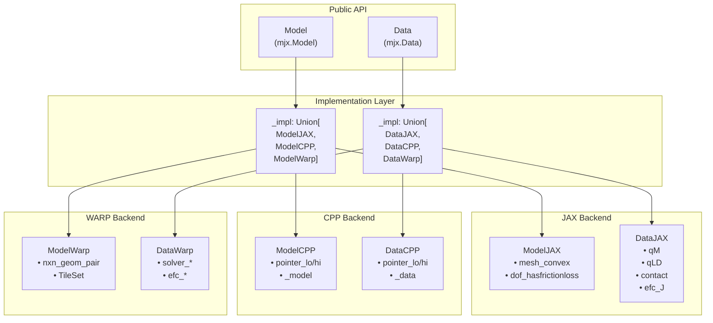
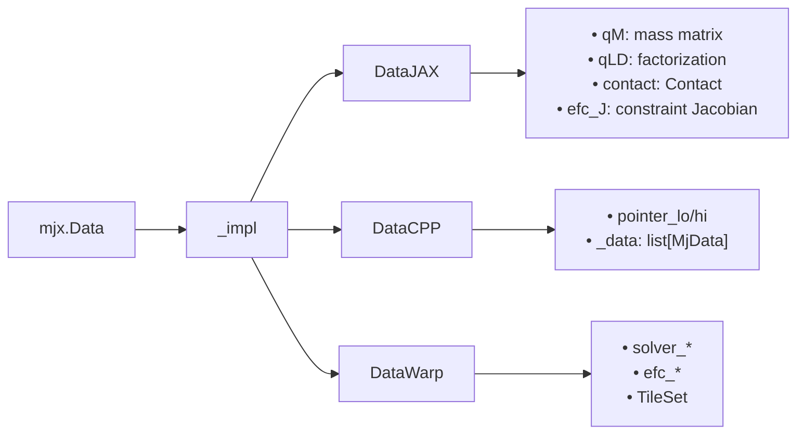
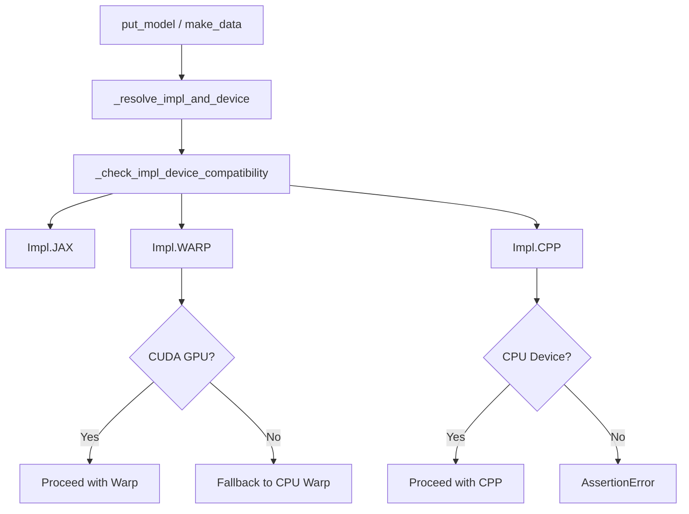

<!-- source: DeepWiki mcp.deepwiki.com · repo google-deepmind/mujoco · page 6.2 MJX Data Structures · fetched 2026-10-26 -->

# MJX Data Structures

Relevant source files

The following files were used as context for generating this wiki page:

- [doc/mjx.rst](doc/mjx.rst)
- [mjx/mujoco/mjx/__init__.py](mjx/mujoco/mjx/__init__.py)
- [mjx/mujoco/mjx/_src/dataclasses.py](mjx/mujoco/mjx/_src/dataclasses.py)
- [mjx/mujoco/mjx/_src/dataclasses_test.py](mjx/mujoco/mjx/_src/dataclasses_test.py)
- [mjx/mujoco/mjx/_src/forward.py](mjx/mujoco/mjx/_src/forward.py)
- [mjx/mujoco/mjx/_src/forward_test.py](mjx/mujoco/mjx/_src/forward_test.py)
- [mjx/mujoco/mjx/_src/io.py](mjx/mujoco/mjx/_src/io.py)
- [mjx/mujoco/mjx/_src/io_test.py](mjx/mujoco/mjx/_src/io_test.py)
- [mjx/mujoco/mjx/_src/scan.py](mjx/mujoco/mjx/_src/scan.py)
- [mjx/mujoco/mjx/_src/scan_test.py](mjx/mujoco/mjx/_src/scan_test.py)
- [mjx/mujoco/mjx/_src/smooth.py](mjx/mujoco/mjx/_src/smooth.py)
- [mjx/mujoco/mjx/_src/smooth_test.py](mjx/mujoco/mjx/_src/smooth_test.py)
- [mjx/mujoco/mjx/_src/support.py](mjx/mujoco/mjx/_src/support.py)
- [mjx/mujoco/mjx/_src/support_test.py](mjx/mujoco/mjx/_src/support_test.py)
- [mjx/mujoco/mjx/_src/test_util.py](mjx/mujoco/mjx/_src/test_util.py)
- [mjx/mujoco/mjx/_src/types.py](mjx/mujoco/mjx/_src/types.py)
- [mjx/mujoco/mjx/test_data/actuator/tendon_force_clamp.xml](mjx/mujoco/mjx/test_data/actuator/tendon_force_clamp.xml)
- [mjx/mujoco/mjx/warp/collision_driver_test.py](mjx/mujoco/mjx/warp/collision_driver_test.py)
- [mjx/mujoco/mjx/warp/forward_test.py](mjx/mujoco/mjx/warp/forward_test.py)
- [mjx/mujoco/mjx/warp/smooth_test.py](mjx/mujoco/mjx/warp/smooth_test.py)
- [mjx/mujoco/mjx/warp/test_util.py](mjx/mujoco/mjx/warp/test_util.py)

This page documents the core data structures used in MJX, including `mjx.Model`, `mjx.Data`, and their implementation-specific variants. These structures are PyTrees containing simulation state and parameters, designed for efficient computation on accelerators (GPU/TPU) via JAX.

For information about creating and transferring these structures to/from devices, see [6.3 MJX Device and Memory Management](). For the physics pipeline that operates on these structures, see [6.4 MJX Physics Pipeline]().

## Purpose and Architecture

MJX data structures mirror MuJoCo's `mjModel` and `mjData` but adapt them for JAX's functional programming model and device execution. Key design principles:

1.  **Immutability**: All structures are immutable PyTrees, updated via the `.replace()` method [mjx/mujoco/mjx/_src/dataclasses.py:160-161]().
2.  **Backend Abstraction**: Public fields are shared across implementations; private fields in `_impl` vary by backend [mjx/mujoco/mjx/_src/types.py:1-1217]().
3.  **Type Stratification**: JAX Arrays (mutable at runtime) vs NumPy arrays (structural, trigger recompilation) [mjx/mujoco/mjx/_src/dataclasses.py:72-87]().
4.  **Device Placement**: Structures are placed on specific devices (CPU, GPU, TPU) via `jax.device_put` or during creation in `put_model` [mjx/mujoco/mjx/_src/io.py:1-1872]().

Sources: [mjx/mujoco/mjx/_src/types.py:1-1217](), [mjx/mujoco/mjx/_src/io.py:1-1872](), [mjx/mujoco/mjx/_src/dataclasses.py:1-210]()

## Core Data Structure Hierarchy

**Diagram: MJX Data Structure Type Hierarchy**

Sources: [mjx/mujoco/mjx/_src/types.py:1-1217](), [mjx/mujoco/mjx/_src/io.py:1-1872]()

## Model Structure

`mjx.Model` contains static, immutable model parameters compiled from MJCF/URDF. It is created via `mjx.put_model(mujoco.MjModel)` [mjx/mujoco/mjx/_src/io.py:1-1872]().

### Public Fields

The public fields mirror `mujoco.MjModel` and are used across all backends [mjx/mujoco/mjx/_src/types.py:1-1217]():

| Category | Fields | Description |
| :--- | :--- | :--- |
| **Sizes** | `nq`, `nv`, `nu`, `na`, `nbody`, `njnt`, `ngeom`, etc. | Model dimensions |
| **Body** | `body_pos`, `body_quat`, `body_mass`, `body_inertia`, `body_parentid` | Body properties and hierarchy |
| **Joint** | `jnt_type`, `jnt_pos`, `jnt_axis`, `jnt_dofadr`, `jnt_stiffness` | Joint configuration |
| **Geometry** | `geom_type`, `geom_pos`, `geom_quat`, `geom_size`, `geom_bodyid` | Collision geometry |
| **Actuator** | `actuator_trntype`, `actuator_dyntype`, `actuator_gaintype` | Actuator properties |
| **Options** | `opt: Option` | Simulation options (integrator, solver, etc.) |

Sources: [mjx/mujoco/mjx/_src/types.py:1-1217]()

### Field Types: JAX Arrays vs NumPy Arrays

MJX distinguishes between array types to handle JIT compilation:

*   **JAX Arrays (Dynamic)**: Fields like `body_mass` or `opt.timestep` are `jax.Array`. They can vary (e.g., across batch dimensions) without triggering recompilation [mjx/mujoco/mjx/_src/dataclasses.py:62-70]().
*   **NumPy Arrays (Static Metadata)**: Fields like `body_parentid` or `jnt_type` are `np.ndarray`. These are treated as static metadata; changing them triggers a JIT recompile [mjx/mujoco/mjx/_src/dataclasses.py:88-95]().

Sources: [mjx/mujoco/mjx/_src/dataclasses.py:62-109](), [mjx/mujoco/mjx/_src/types.py:1-1217]()

## Data Structure

`mjx.Data` contains the dynamic simulation state. It is created via `mjx.make_data(model)` or `mjx.put_data(m, d)` [mjx/mujoco/mjx/_src/io.py:1-1872]().

### Public Fields

| Category | Fields | Description |
| :--- | :--- | :--- |
| **State** | `qpos`, `qvel`, `qacc`, `act`, `ctrl` | Generalized coordinates and control |
| **Forces** | `qfrc_applied`, `xfrc_applied`, `qfrc_bias`, `qfrc_actuator` | Applied and computed forces |
| **Kinematics** | `xpos`, `xquat`, `xmat`, `xipos`, `ximat` | Body positions and orientations |
| **Geometry** | `geom_xpos`, `geom_xmat`, `site_xpos`, `site_xmat` | Geometry and site transforms |
| **Dynamics** | `subtree_com`, `cdof`, `cvel`, `cdof_dot` | Center of mass and motion dofs |
| **Sensors** | `sensordata` | Sensor readings |

Sources: [mjx/mujoco/mjx/_src/types.py:1-1217](), [mjx/mujoco/mjx/_src/io.py:1-1872]()

### Implementation-Specific Fields (`_impl`)

The `_impl` attribute holds workspace arrays specific to the selected backend:

**Diagram: Data Implementation Field Structure**

Sources: [mjx/mujoco/mjx/_src/types.py:1-1217](), [mjx/mujoco/mjx/_src/io.py:1-1872]()

## Backend Implementations

### JAX Implementation
Optimized for GPU/TPU using pure JAX.
*   **ModelJAX**: Stores `mesh_convex` (precompiled convex meshes) and friction loss masks [mjx/mujoco/mjx/_src/types.py:1-1217]().
*   **DataJAX**: Stores the mass matrix `qM` (dense or sparse) and `efc_J` (constraint Jacobian) [mjx/mujoco/mjx/_src/io.py:1-1872]().

### CPP Implementation
A thin wrapper around C++ `mjModel` and `mjData` objects.
*   **ModelCPP/DataCPP**: Stores memory addresses as `pointer_lo` and `pointer_hi` to bypass JAX's 32-bit integer limitations when 64-bit is disabled [mjx/mujoco/mjx/_src/types.py:1-1217]().

### WARP Implementation
Uses NVIDIA Warp for high-performance CUDA kernels.
*   **ModelWarp**: Includes `nxn_geom_pair` for collision dispatch and `TileSet` structures [mjx/mujoco/mjx/_src/io.py:1-1872]().

Sources: [mjx/mujoco/mjx/_src/types.py:1-1217](), [mjx/mujoco/mjx/_src/io.py:1-1872]()

## Supporting Structures

### Contact
The `Contact` structure stores collision results [mjx/mujoco/mjx/_src/types.py:1-1217]().
*   `dist`: Penetration depth (negative) or distance.
*   `pos`, `frame`: Contact position and orientation.
*   `geom1`, `geom2`: IDs of colliding geometries.

### Option
The `Option` structure mirrors `mjOption` [mjx/mujoco/mjx/_src/types.py:1-1217]().
*   `integrator`: `EULER`, `RK4`, or `IMPLICITFAST` [mjx/mujoco/mjx/_src/types.py:123-138]().
*   `jacobian`: `DENSE`, `SPARSE`, or `AUTO` [mjx/mujoco/mjx/_src/types.py:196-204]().

Sources: [mjx/mujoco/mjx/_src/types.py:1-1217]()

## PyTree Structure and Operations

All MJX structures inherit from `PyTreeNode`, which registers them as JAX PyTrees [mjx/mujoco/mjx/_src/dataclasses.py:153-162]().

### Common Operations
*   **`replace(**overrides)`**: Creates a new instance with updated fields [mjx/mujoco/mjx/_src/dataclasses.py:167-170]().
*   **`tree_replace(params)`**: Sets nested attributes using dot-notation strings (e.g., `_impl.qM`) [mjx/mujoco/mjx/_src/dataclasses.py:175-181]().
*   **`vmap` compatibility**: Because they are PyTrees, `mjx.Model` and `mjx.Data` can be batched using `jax.vmap` [doc/mjx.rst:77-87]().

Sources: [mjx/mujoco/mjx/_src/dataclasses.py:153-205](), [doc/mjx.rst:47-89]()

## Conversion and Initialization

### Device Resolution
MJX resolves the backend and device based on the `impl` and `device` arguments [mjx/mujoco/mjx/_src/io.py:142-163]().

**Diagram: Device and Implementation Resolution Flow**

Sources: [mjx/mujoco/mjx/_src/io.py:60-163]()

### Initialization Functions
*   **`put_model`**: Transfers a `mujoco.MjModel` to the device as an `mjx.Model` [mjx/mujoco/mjx/_src/io.py:1-1872]().
*   **`make_data`**: Allocates a new `mjx.Data` on device for a given model [mjx/mujoco/mjx/_src/io.py:1-1872]().
*   **`put_data`**: Transfers an existing `mujoco.MjData` state to the device [mjx/mujoco/mjx/_src/io.py:1-1872]().

Sources: [mjx/mujoco/mjx/_src/io.py:1-1872]()

---

