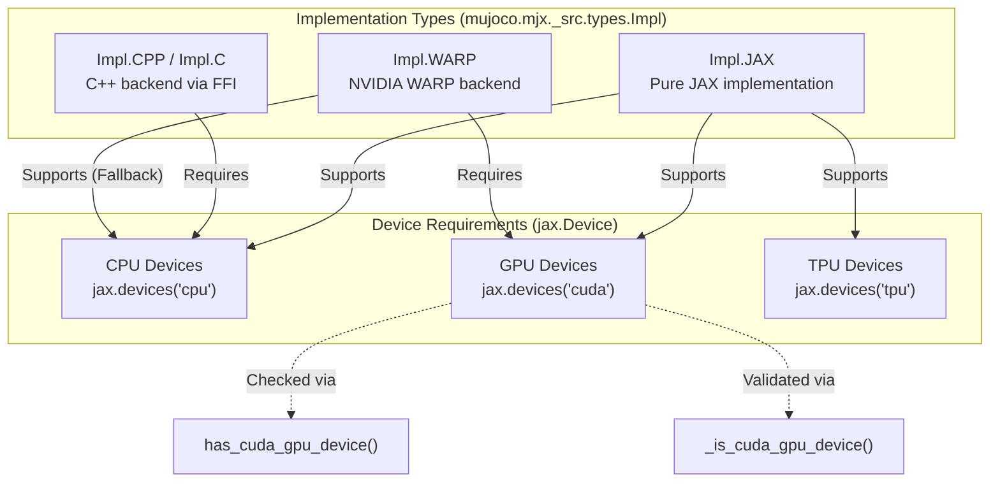
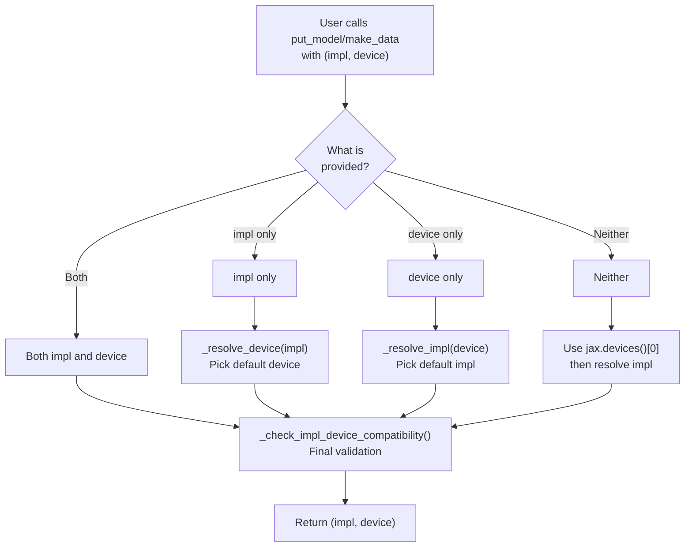
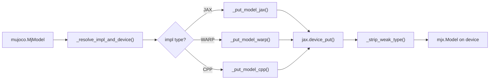
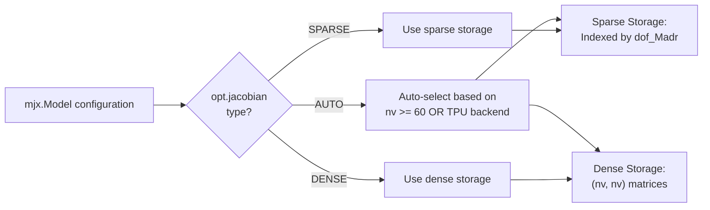

<!-- source: DeepWiki mcp.deepwiki.com · repo google-deepmind/mujoco · page 6.3 MJX Device and Memory Management · fetched 2026-10-26 -->

# MJX Device and Memory Management

Relevant source files

The following files were used as context for generating this wiki page:

- [doc/mjx.rst](doc/mjx.rst)
- [mjx/mujoco/mjx/__init__.py](mjx/mujoco/mjx/__init__.py)
- [mjx/mujoco/mjx/_src/forward.py](mjx/mujoco/mjx/_src/forward.py)
- [mjx/mujoco/mjx/_src/forward_test.py](mjx/mujoco/mjx/_src/forward_test.py)
- [mjx/mujoco/mjx/_src/io.py](mjx/mujoco/mjx/_src/io.py)
- [mjx/mujoco/mjx/_src/io_test.py](mjx/mujoco/mjx/_src/io_test.py)
- [mjx/mujoco/mjx/_src/smooth.py](mjx/mujoco/mjx/_src/smooth.py)
- [mjx/mujoco/mjx/_src/smooth_test.py](mjx/mujoco/mjx/_src/smooth_test.py)
- [mjx/mujoco/mjx/_src/support.py](mjx/mujoco/mjx/_src/support.py)
- [mjx/mujoco/mjx/_src/support_test.py](mjx/mujoco/mjx/_src/support_test.py)
- [mjx/mujoco/mjx/_src/types.py](mjx/mujoco/mjx/_src/types.py)
- [mjx/mujoco/mjx/test_data/actuator/tendon_force_clamp.xml](mjx/mujoco/mjx/test_data/actuator/tendon_force_clamp.xml)
- [mjx/mujoco/mjx/warp/collision_driver_test.py](mjx/mujoco/mjx/warp/collision_driver_test.py)
- [mjx/mujoco/mjx/warp/forward_test.py](mjx/mujoco/mjx/warp/forward_test.py)
- [mjx/mujoco/mjx/warp/smooth_test.py](mjx/mujoco/mjx/warp/smooth_test.py)
- [mjx/mujoco/mjx/warp/test_util.py](mjx/mujoco/mjx/warp/test_util.py)

This page describes how MJX manages device placement and memory allocation for models and data structures across different backend implementations. It covers device resolution, the `put_model` and `put_data` functions, implementation-specific memory layouts, and performance considerations for different hardware targets.

For information about MJX's overall architecture and available backends, see [6.1 MJX Architecture and Backends](). For details on MJX data structures and PyTree organization, see [6.2 MJX Data Structures]().

## Overview and Purpose

MJX supports multiple backend implementations that run on different hardware devices. The device and memory management system handles:

1.  **Device Resolution**: Automatically selecting appropriate devices based on implementation type or vice versa [mjx/mujoco/mjx/_src/io.py:60-109]().
2.  **Implementation Compatibility**: Ensuring implementation-device pairs are valid (e.g., WARP requires CUDA GPU) [mjx/mujoco/mjx/_src/io.py:112-141]().
3.  **Memory Transfer**: Converting `mujoco.MjModel` and `mujoco.MjData` to device-resident `mjx.Model` and `mjx.Data` [mjx/mujoco/mjx/_src/io.py:526-1100]().
4.  **Backend-Specific Layout**: Managing implementation-specific fields and memory representations in `_impl` structures [mjx/mujoco/mjx/_src/types.py:1146-1182]().
5.  **Performance Optimization**: Handling sparse/dense matrix selection and dtype canonicalization [mjx/mujoco/mjx/_src/support.py:36-56]().

Sources: [mjx/mujoco/mjx/_src/io.py:15-165](), [mjx/mujoco/mjx/_src/types.py:29-48](), [mjx/mujoco/mjx/_src/support.py:36-56]()

## Implementation and Device Types

MJX defines backend implementations via the `Impl` enum, each with specific device requirements.

Sources: [mjx/mujoco/mjx/_src/types.py:29-48](), [mjx/mujoco/mjx/_src/io.py:43-51](), [mjx/mujoco/mjx/_src/io.py:122-138]()

The `Impl` enum defines these implementation types, with case-insensitive string conversion for user convenience [mjx/mujoco/mjx/_src/types.py:29-48]().

## Device Resolution Logic

Device resolution occurs when either implementation or device (or neither) is specified, following a two-way resolution pattern in `_resolve_impl_and_device` [mjx/mujoco/mjx/_src/io.py:142-165]().

Sources: [mjx/mujoco/mjx/_src/io.py:142-165]()

### Implementation Resolution by Device

When a device is specified without implementation, `_resolve_impl()` selects the implementation [mjx/mujoco/mjx/_src/io.py:60-81]():

| Device Type | Default Implementation | Condition |
|------------|------------------------|-----------|
| CUDA GPU | `Impl.WARP` | If `MJX_GPU_DEFAULT_WARP=true` and `mjxw.WARP_INSTALLED` [mjx/mujoco/mjx/_src/io.py:66-71]() |
| CUDA GPU | `Impl.JAX` | Otherwise [mjx/mujoco/mjx/_src/io.py:73-75]() |
| TPU | `Impl.JAX` | Always [mjx/mujoco/mjx/_src/io.py:73-75]() |
| CPU | `Impl.JAX` | Always [mjx/mujoco/mjx/_src/io.py:77-78]() |

### Device Resolution by Implementation

When implementation is specified without device, `_resolve_device()` selects the device [mjx/mujoco/mjx/_src/io.py:83-110]():

| Implementation | Selected Device |
|----------------|-----------------|
| `Impl.JAX` | `jax.devices()[0]` (default JAX device) |
| `Impl.CPP` | `jax.devices('cpu')[0]` |
| `Impl.WARP` | `jax.devices('cuda')[0]` (falls back to CPU if no CUDA) |

Sources: [mjx/mujoco/mjx/_src/io.py:60-110](), [mjx/mujoco/mjx/_src/io.py:142-165]()

## Model Transfer: put_model

The `put_model()` function transfers a `mujoco.MjModel` to device as `mjx.Model` [mjx/mujoco/mjx/_src/io.py:526-556]().

Sources: [mjx/mujoco/mjx/_src/io.py:526-556]()

### Implementation-Specific Model Creation

**JAX Implementation** (`_put_model_jax`):
- Pre-compiles mesh convex hulls via `mesh.put_mesh` for collision detection [mjx/mujoco/mjx/_src/io.py:448-450]().
- Populates `ModelJAX` with fields like `mesh_convex`, `dof_hasfrictionloss`, and `wrap_inside_z_init` [mjx/mujoco/mjx/_src/io.py:461-482]().

**WARP Implementation** (`_put_model_warp`):
- Converts via `mjwp.put_model()` and uses `_wp_to_np_type()` to convert Warp arrays to NumPy [mjx/mujoco/mjx/_src/io.py:175-219]().
- Populates `ModelWarp` with GPU-optimized structures like `nxn_geom_pair` [mjx/mujoco/mjx/_src/io.py:504-518]().

**CPP Implementation** (`_put_model_cpp`):
- Stores model pointer as two 32-bit integers (`pointer_lo`, `pointer_hi`) for FFI calls [mjx/mujoco/mjx/_src/io.py:545-546]().

Sources: [mjx/mujoco/mjx/_src/io.py:294-556](), [mjx/mujoco/mjx/_src/io.py:175-219]()

## Data Transfer and Creation

MJX provides `put_data` for transferring existing state and `make_data` for fresh allocation [mjx/mujoco/mjx/_src/io.py:558-1100]().

### put_data Workflow

The `put_data()` function transfers existing `mujoco.MjData` state [mjx/mujoco/mjx/_src/io.py:1002-1064]():
1.  **Resolve implementation/device** via `_resolve_impl_and_device()`.
2.  **Copy public fields** (qpos, qvel, ctrl, etc.) to a dictionary.
3.  **Handle contacts** via `_put_contact()`, which maps MuJoCo contacts to MJX's pre-allocated condim-specific buffers [mjx/mujoco/mjx/_src/io.py:1146-1181]().
4.  **Place on device** via `jax.device_put()` and strip weak types [mjx/mujoco/mjx/_src/io.py:1062-1064]().

### make_data Workflow

The `make_data()` function creates fresh data structures [mjx/mujoco/mjx/_src/io.py:854-912]():
1.  **Determine implementation** (must match model implementation).
2.  **Initialize public fields** (qpos from `model.qpos0`, others zeroed) [mjx/mujoco/mjx/_src/io.py:882-886]().
3.  **Allocate implementation-specific data** (e.g., `DataJAX` or `DataWarp`).
4.  **Warp Warm-up**: For `Impl.WARP`, it performs a dummy step to warm up kernel caches [mjx/mujoco/mjx/_src/io.py:871-876]().

Sources: [mjx/mujoco/mjx/_src/io.py:854-1100](), [mjx/mujoco/mjx/_src/io.py:1146-1181]()

## Sparse vs Dense Matrices

MJX manages memory for mass matrices (`qM`) and Cholesky factors (`qLD`) based on the model's sparsity configuration [mjx/mujoco/mjx/_src/support.py:36-56]().

Sources: [mjx/mujoco/mjx/_src/support.py:36-56]()

### Sparsity Resolution
The function `is_sparse()` determines the storage mode [mjx/mujoco/mjx/_src/support.py:36-56]():
- If `JacobianType.AUTO`: returns True if `nv >= 60` or if `jax.default_backend() == 'tpu'`.
- Otherwise: respects the explicit `JacobianType` set in `m.opt.jacobian`.

### Memory Impact
- **Dense**: Stores full `(nv, nv)` matrices in `DataJAX._impl.qM` [mjx/mujoco/mjx/_src/support.py:89-91]().
- **Sparse**: Stores only non-zero entries (indices determined by the kinematic tree) in a flat array of size `nM` [mjx/mujoco/mjx/_src/support.py:92-95]().

Sources: [mjx/mujoco/mjx/_src/support.py:36-112](), [mjx/mujoco/mjx/_src/types.py:191-203]()

## Performance and Graph Management

### Graph Modes (MJX-Warp)
When using the WARP implementation, CUDA graph capture behavior is controlled by `graph_mode` [doc/mjx.rst:135-168]().

| Mode | Description | Performance Trade-off |
| :--- | :--- | :--- |
| `WARP` | Internal Warp capture using XLA buffer pointers. | Fastest if pointers are stable; recapture is expensive. |
| `WARP_STAGED` | Uses staging buffers to maintain stable pointers. | Higher memory usage; capture occurs only once. |
| `WARP_STAGED_EX` | Staged buffers with copy ops outside the capture. | Optimal for certain XLA memory patterns. |

### Memory Alignment and Types
- **Weak Type Stripping**: `_strip_weak_type` is used to canonicalize dtypes (e.g., converting float64 to float32 if XLA is configured for single precision) to prevent unnecessary recompilations [mjx/mujoco/mjx/_src/io.py:166-173]().
- **Contact Buffers**: Users are encouraged to read contacts via sensors because JAX and Warp diverge in buffer implementation [doc/mjx.rst:125-133]().

Sources: [doc/mjx.rst:135-186](), [mjx/mujoco/mjx/_src/io.py:166-173]()

---

