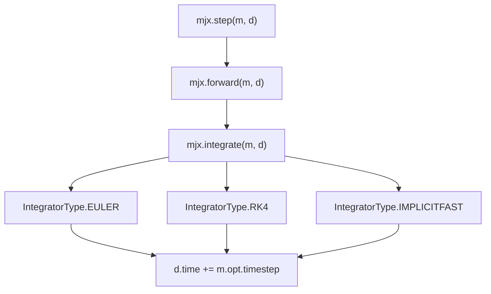
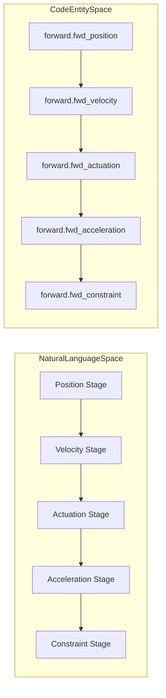
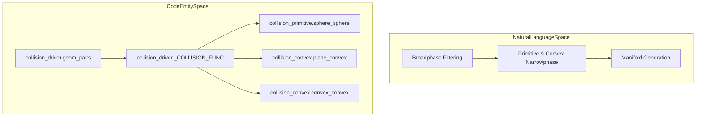

<!-- source: DeepWiki mcp.deepwiki.com · repo google-deepmind/mujoco · page 6.4 MJX Physics Pipeline · fetched 2026-10-26 -->

# MJX Physics Pipeline

Relevant source files

The following files were used as context for generating this wiki page:

- [doc/images/mjx/apg_diagram.png](doc/images/mjx/apg_diagram.png)
- [mjx/README.md](mjx/README.md)
- [mjx/mujoco/mjx/_src/bvh.py](mjx/mujoco/mjx/_src/bvh.py)
- [mjx/mujoco/mjx/_src/collision_convex.py](mjx/mujoco/mjx/_src/collision_convex.py)
- [mjx/mujoco/mjx/_src/collision_driver.py](mjx/mujoco/mjx/_src/collision_driver.py)
- [mjx/mujoco/mjx/_src/collision_driver_test.py](mjx/mujoco/mjx/_src/collision_driver_test.py)
- [mjx/mujoco/mjx/_src/collision_primitive.py](mjx/mujoco/mjx/_src/collision_primitive.py)
- [mjx/mujoco/mjx/_src/collision_sdf.py](mjx/mujoco/mjx/_src/collision_sdf.py)
- [mjx/mujoco/mjx/_src/collision_types.py](mjx/mujoco/mjx/_src/collision_types.py)
- [mjx/mujoco/mjx/_src/constraint.py](mjx/mujoco/mjx/_src/constraint.py)
- [mjx/mujoco/mjx/_src/constraint_test.py](mjx/mujoco/mjx/_src/constraint_test.py)
- [mjx/mujoco/mjx/_src/math.py](mjx/mujoco/mjx/_src/math.py)
- [mjx/mujoco/mjx/_src/mesh.py](mjx/mujoco/mjx/_src/mesh.py)
- [mjx/mujoco/mjx/_src/mesh_test.py](mjx/mujoco/mjx/_src/mesh_test.py)
- [mjx/mujoco/mjx/_src/ray.py](mjx/mujoco/mjx/_src/ray.py)
- [mjx/mujoco/mjx/_src/ray_test.py](mjx/mujoco/mjx/_src/ray_test.py)
- [mjx/mujoco/mjx/_src/render.py](mjx/mujoco/mjx/_src/render.py)
- [mjx/mujoco/mjx/_src/render_util.py](mjx/mujoco/mjx/_src/render_util.py)
- [mjx/mujoco/mjx/_src/render_util_test.py](mjx/mujoco/mjx/_src/render_util_test.py)
- [mjx/mujoco/mjx/_src/sensor.py](mjx/mujoco/mjx/_src/sensor.py)
- [mjx/mujoco/mjx/_src/sensor_test.py](mjx/mujoco/mjx/_src/sensor_test.py)
- [mjx/mujoco/mjx/_src/solver.py](mjx/mujoco/mjx/_src/solver.py)
- [mjx/mujoco/mjx/_src/solver_test.py](mjx/mujoco/mjx/_src/solver_test.py)
- [mjx/mujoco/mjx/test_data/constraints.xml](mjx/mujoco/mjx/test_data/constraints.xml)
- [mjx/mujoco/mjx/test_data/ray.xml](mjx/mujoco/mjx/test_data/ray.xml)
- [mjx/mujoco/mjx/test_data/sensor/model.xml](mjx/mujoco/mjx/test_data/sensor/model.xml)
- [mjx/mujoco/mjx/test_data/sensor/sensor.xml](mjx/mujoco/mjx/test_data/sensor/sensor.xml)
- [mjx/mujoco/mjx/test_data/shadow_hand/right_hand.xml](mjx/mujoco/mjx/test_data/shadow_hand/right_hand.xml)
- [mjx/mujoco/mjx/warp/io.py](mjx/mujoco/mjx/warp/io.py)
- [mjx/mujoco/mjx/warp/render_test.py](mjx/mujoco/mjx/warp/render_test.py)
- [mjx/mujoco/mjx/warp/testspeed.py](mjx/mujoco/mjx/warp/testspeed.py)
- [mjx/mujoco/mjx/warp/visualize_render.py](mjx/mujoco/mjx/warp/visualize_render.py)
- [mjx/training_apg.ipynb](mjx/training_apg.ipynb)

## Purpose and Scope

This page describes the MJX physics simulation pipeline, detailing the core `mjx.step` implementation, the five-stage forward dynamics pipeline, sparse versus dense matrix representation paths, non-smooth constraint solving, collision detection routines, sensor evaluation, rendering utilities, and parallel batching via JAX `vmap`.

Sources: [mjx/mujoco/mjx/_src/solver.py:1-124](), [mjx/mujoco/mjx/_src/collision_driver.py:1-114]()

---

## Main Simulation Step (`mjx.step`)

The `mjx.step` function serves as the primary entry point for advancing a simulation state by a single discrete timestep `m.opt.timestep`. It adheres to JAX's pure functional paradigm, mapping a model (`Model`) and an initial state (`Data`) to an updated state (`Data`).

**Simulation Step Dispatch**

Sources: [mjx/mujoco/mjx/_src/forward.py:259-284]()

The execution flow within `mjx.step` consists of:
1. **Forward Dynamics (`mjx.forward`)**: Evaluates kinematics, inertias, biases, actuator forces, unconstrained accelerations, and constraint forces.
2. **Numerical Integration**: Updates generalized positions (`qpos`) and velocities (`qvel`) using the chosen scheme (`IntegratorType.EULER`, `IntegratorType.RK4`, or `IntegratorType.IMPLICITFAST`).
3. **Time Increment**: Advances `d.time` by `m.opt.timestep`.

---

## Forward Dynamics Pipeline

MJX mirrors MuJoCo's five-stage forward dynamics pipeline. Each stage is implemented as a composable JAX transformation operating on `Model` and `Data` PyTrees.

**Pipeline Architecture Mapping**

Sources: [mjx/mujoco/mjx/_src/forward.py:69-258]()

### Stage 1: Position-Dependent (`fwd_position`)
Computes kinematic coordinates, center-of-mass positions, composite rigid body inertias, mass matrix factorization, collision checks, and constraint Jacobians [mjx/mujoco/mjx/_src/forward.py:70-84]().

### Stage 2: Velocity-Dependent (`fwd_velocity`)
Computes velocities, passive forces (damping, gravcomp, springs), and Coriolis/centrifugal bias forces via recursive Newton-Euler algorithms (`rne`) [mjx/mujoco/mjx/_src/forward.py:87-101]().

### Stage 3: Actuation (`fwd_actuation`)
Computes actuator lengths, velocities, force generation, control clamping, and internal actuator state updates (`act_dot`) [mjx/mujoco/mjx/_src/forward.py:104-258]().

### Stages 4 & 5: Acceleration and Constraints (`fwd_acceleration` & `fwd_constraint`)
Calculates unconstrained accelerations (`qacc_smooth`), constructs the system cost matrix, and resolves non-smooth contacts, joint limits, and equality constraints [mjx/mujoco/mjx/_src/solver.py:36-124]().

Sources: [mjx/mujoco/mjx/_src/forward.py:69-258]()

---

## Sparse vs Dense Matrix Paths

To optimize performance across diverse hardware accelerators (GPUs vs TPUs), MJX dynamically selects between dense and sparse matrix representations based on model dimensionality (`nv`) and hardware target via `support.is_sparse` [mjx/mujoco/mjx/_src/support.py:36-55]().

| Feature | Dense Path | Sparse Path |
| :--- | :--- | :--- |
| **Primary Target** | NVIDIA GPUs | Google TPUs / Large `nv` |
| **Mass Matrix (`qM`)** | Dense $nv \times nv$ array | Compact packed or sparse format |
| **Constraint Jacobian (`efc_J`)** | Dense $nefc \times nv$ array | Block-sparse representation |
| **Solve Method** | Cholesky / Dense BLAS | Conjugate Gradient / Sparse SpMV |

Sources: [mjx/mujoco/mjx/_src/support.py:36-125]()

---

## Collision Detection

MJX collision detection leverages vectorized JAX operations (`jax.vmap`) combined with static function dispatch tables (`_COLLISION_FUNC`) in `collision_driver.py` [mjx/mujoco/mjx/_src/collision_driver.py:85-113]().

**Collision Pipeline and Code Mapping**

Sources: [mjx/mujoco/mjx/_src/collision_driver.py:85-113](), [mjx/mujoco/mjx/_src/collision_convex.py:40-82]()

Pairs of geoms are filtered using collision affinity, contype, body welds, and parent exclusion rules (`geom_pairs`) [mjx/mujoco/mjx/_src/collision_driver.py:127-174](). Pair functions are wrapped using the `@collider` decorator to vectorize over contact counts [mjx/mujoco/mjx/_src/collision_convex.py:40-82]().

Sources: [mjx/mujoco/mjx/_src/collision_driver.py:15-114](), [mjx/mujoco/mjx/_src/collision_convex.py:40-82]()

---

## Constraint Solving

Non-smooth mechanics are handled by constraint solvers supporting both pyramidal and elliptic friction cones (`ConeType`) [mjx/mujoco/mjx/_src/solver.py:25-32]().

- **Context Initialization (`solver.Context.create`)**: Initializes constraint residuals (`Jaref`), constraint forces (`efc_force`), inertia products (`Ma`), and friction cone regularizations [mjx/mujoco/mjx/_src/solver.py:36-124]().
- **Line Search (`_LSPoint`)**: Evaluates quadratic step sizes and directional derivatives to guarantee descent during Newton or Conjugate Gradient iterations [mjx/mujoco/mjx/_src/solver.py:126-191]().
- **Impedance and Stiffness (`_kbi`)**: Computes constraint stiffness ($k$), damping ($b$), and impedance ($imp$) from `solref` and `solimp` attributes [mjx/mujoco/mjx/_src/constraint.py:56-91]().

Sources: [mjx/mujoco/mjx/_src/constraint.py:56-91](), [mjx/mujoco/mjx/_src/solver.py:36-191]()

---

## Sensor Processing

Sensors are evaluated across position, velocity, and acceleration stages depending on `m.sensor_needstage` [mjx/mujoco/mjx/_src/sensor.py:15-178]().

- **Contact Sensors (`_sensor_contact`)**: Computes contact forces, torques, distances, and positions matching specific geom/body ID masks, supporting reduction criteria such as `mindist` and `maxforce` [mjx/mujoco/mjx/_src/sensor.py:56-202]().
- **Cutoff Clipping (`_apply_cutoff`)**: Clips sensor outputs according to real or positive data type specifications and threshold limits [mjx/mujoco/mjx/_src/sensor.py:39-54]().
- **Ray Casting (`ray.py`)**: Evaluates ray intersections against planes, spheres, capsules, boxes, and meshes to implement proximity and rangefinder sensors [mjx/mujoco/mjx/_src/ray.py:31-214]().

Sources: [mjx/mujoco/mjx/_src/sensor.py:39-202](), [mjx/mujoco/mjx/_src/ray.py:31-214]()

---

## Rendering Utilities and Batching with `vmap`

MJX achieves high throughput by vectorizing simulation environments across batch dimensions using JAX's `jax.vmap`.

- **Batching Execution**: `jax.vmap(mjx.step)` compiles a single-environment physics step into a batched SIMD kernel executing thousands of parallel environments.
- **Rendering & Readback**: GPU render contexts (such as those integrated via NVIDIA Warp or Filament backends) unpack raw color, depth, and segmentation buffers into standard JAX array PyTrees.

Sources: [mjx/mujoco/mjx/warp/testspeed.py:115-184](), [mjx/mujoco/mjx/_src/sensor.py:44-53]()

---

