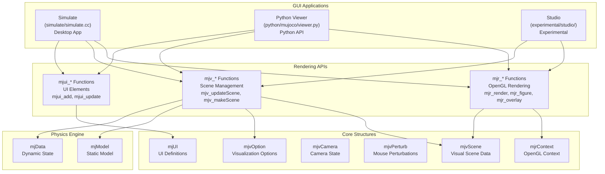
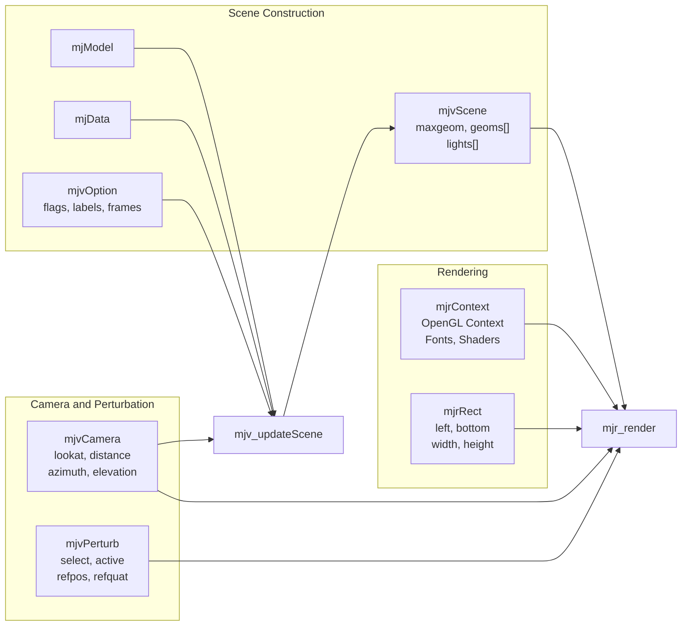

<!-- source: DeepWiki mcp.deepwiki.com · repo google-deepmind/mujoco · page 7 Visualization and Interactive Tools · fetched 2026-10-26 -->

# Visualization and Interactive Tools

Relevant source files

The following files were used as context for generating this wiki page:

- [include/mujoco/mjvisualize.h](include/mujoco/mjvisualize.h)
- [src/engine/engine_vis_visualize.c](src/engine/engine_vis_visualize.c)

This page describes MuJoCo's visualization and interactive GUI systems. It covers the core rendering APIs (`mjr_`, `mjv_`, `mjui_`), the main GUI applications (Simulate, Python Viewer, Studio), and advanced visualization features like profiler displays, sensor plots, and custom overlays.

For model creation and editing, see [Model Definition Pipeline](#2). For the Python bindings architecture, see [C and Python APIs](#5). For MJX visualization, see [MJX: JAX-Accelerated Physics](#6).

## Overview and Architecture

MuJoCo provides three main interactive GUI applications built on a common set of rendering APIs:

1.  **Simulate** - Production desktop application with dual-threaded architecture.
2.  **Python Viewer** - Python-controlled GUI with managed and passive modes.
3.  **Studio** - Experimental next-generation app with WebAssembly support.

### Visualization Stack

Title: "Visualization Stack Architecture"

Sources: [simulate/simulate.cc:1-38](), [python/mujoco/viewer.py:15-32](), [include/mujoco/mjvisualize.h:15-160]()

## Rendering System (mjr and mjv)

The rendering system is divided into scene management (`mjv`) and low-level OpenGL abstraction (`mjr`), providing abstract visualization pipelines for models and data [include/mujoco/mjvisualize.h:15-160]().

### Structure Relationships

Title: "Scene Construction and Rendering Flow"

Sources: [src/engine/engine_vis_visualize.c:169-221](), [include/mujoco/mjvisualize.h:59-155](), [simulate/simulate.h:147-148]()

For details, including the Filament renderer backend (`src/render/filament`), see [Rendering System (mjr and mjv)](#7.1).

## Simulate Interactive Viewer

`Simulate` is the primary C++ GUI application. It utilizes a dual-threaded architecture to ensure that UI rendering remains responsive even during heavy physics computations, incorporating GLFW platform adapters and user input handling [simulate/simulate.h:45-230]().

For details, see [Simulate Interactive Viewer](#7.2).

Sources: [simulate/simulate.h:45-230](), [simulate/main.cc:202-211]()

## Python Viewer

The MuJoCo Python package provides a high-level `viewer` module that wraps simulation visualization with managed and passive modes, a Handle API, custom overlays, and thread safety mechanisms [python/mujoco/viewer.py:15-258]().

For details, see [Python Viewer](#7.3).

Sources: [python/mujoco/viewer.py:15-258](), [python/mujoco/simulate.cc:74-241]()

## Studio Application

`Studio` is an experimental application featuring an app lifecycle, a Filament renderer HAL, a built-in profiler, WebAssembly live-build support, and python/web clients (`python/mujoco/experimental/studio`) [simulate/simulate.h:32-34]().

For details, see [Studio Application](#7.4).

Sources: [simulate/simulate.h:32-34]()

## Visualization Features

### Profiler and Diagnostics
Simulate includes built-in figures for monitoring simulation health and performance metrics [simulate/simulate.cc:188-256]().

### Custom Overlays
Users can inject custom data into the viewer via the Python `Handle` or C++ `Simulate` methods, supporting figures, multi-column text, and direct image buffers [simulate/simulate.cc:136-239](), [python/mujoco/viewer.py:118-206]().

Sources: [simulate/simulate.cc:188-256](), [simulate/simulate.cc:136-239](), [python/mujoco/viewer.py:118-206]()

---

