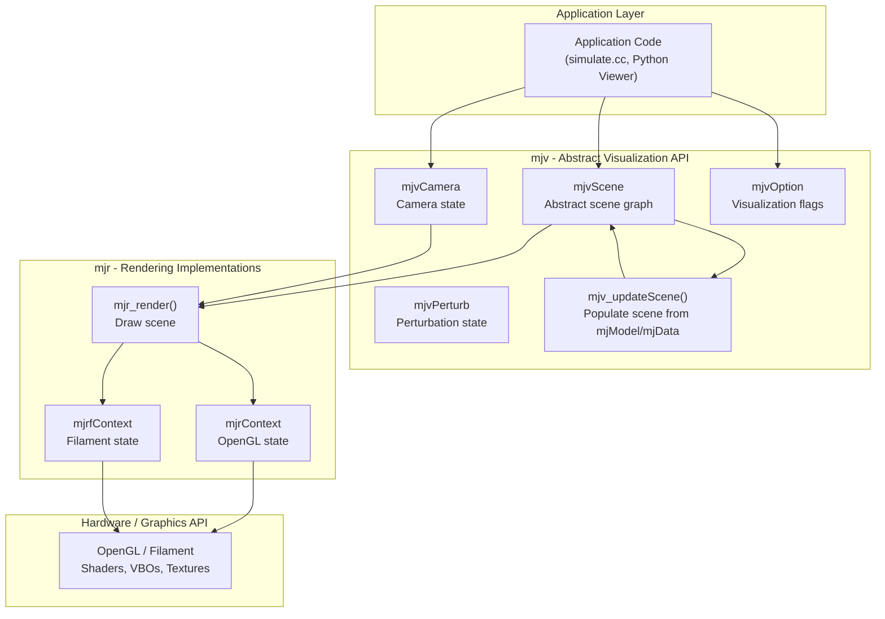
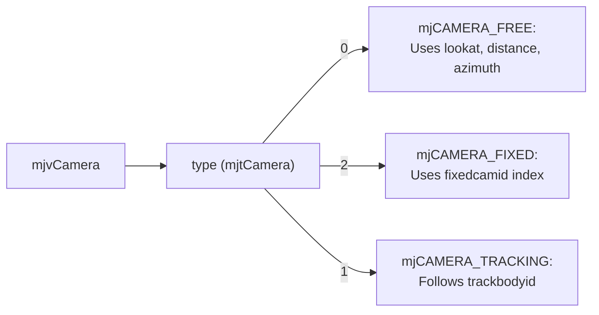
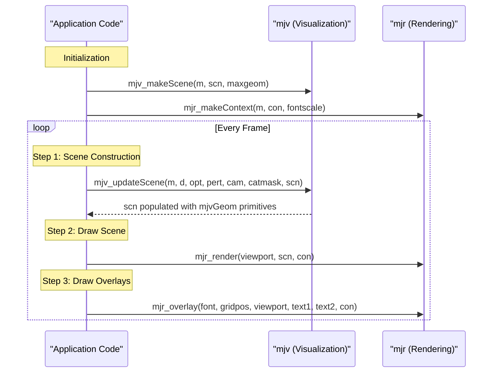

<!-- source: DeepWiki mcp.deepwiki.com · repo google-deepmind/mujoco · page 7.1 Rendering System (mjr and mjv) · fetched 2026-10-26 -->

# Rendering System (mjr and mjv)

Relevant source files

The following files were used as context for generating this wiki page:

- [include/mujoco/mjvisualize.h](include/mujoco/mjvisualize.h)
- [python/mujoco/cgl/__init__.py](python/mujoco/cgl/__init__.py)
- [python/mujoco/cgl/cgl.py](python/mujoco/cgl/cgl.py)
- [python/mujoco/gl_context.py](python/mujoco/gl_context.py)
- [python/mujoco/glfw/__init__.py](python/mujoco/glfw/__init__.py)
- [python/mujoco/renderer.py](python/mujoco/renderer.py)
- [python/mujoco/renderer_test.py](python/mujoco/renderer_test.py)
- [python/mujoco/rendering/classic/__init__.py](python/mujoco/rendering/classic/__init__.py)
- [python/mujoco/rendering/classic/gl_context.py](python/mujoco/rendering/classic/gl_context.py)
- [python/mujoco/rendering/classic/renderer.py](python/mujoco/rendering/classic/renderer.py)
- [src/engine/engine_sleep.h](src/engine/engine_sleep.h)
- [src/engine/engine_vis_init.c](src/engine/engine_vis_init.c)
- [src/engine/engine_vis_visualize.c](src/engine/engine_vis_visualize.c)
- [src/engine/engine_vis_visualize.h](src/engine/engine_vis_visualize.h)
- [src/render/filament/support/mesh_util.cc](src/render/filament/support/mesh_util.cc)
- [src/render/filament/support/mesh_util.h](src/render/filament/support/mesh_util.h)
- [test/engine/engine_vis_visualize_test.cc](test/engine/engine_vis_visualize_test.cc)
- [test/engine/testdata/catenary.xml](test/engine/testdata/catenary.xml)
- [test/engine/testdata/sleep/sensor.xml](test/engine/testdata/sleep/sensor.xml)

## Purpose and Scope

The MuJoCo rendering system consists of two complementary APIs that separate abstract scene representation from rendering implementation:

-   **mjv (Visualization)**: High-level API for constructing abstract scene representations, camera configuration, and visualization options. It handles the logic of what should be drawn based on the physics state [include/mujoco/mjvisualize.h:1-20]().
-   **mjr (Rendering)**: Low-level API for rendering scenes, figures, text overlays, and images. While the primary implementation is OpenGL-based, recent additions include experimental backends like Filament [include/mujoco/mjrender.h:1-28]().

This system allows MuJoCo to remain platform-agnostic at the visualization level while providing high-performance implementations for display and offscreen capture.

Sources: [include/mujoco/mjvisualize.h:1-20](), [include/mujoco/mjrender.h:1-28]()

## Architecture Overview

The rendering system uses a layered architecture that separates abstract visualization concerns from implementation details:

Title: Rendering System Architecture

**Key Design Principle**: `mjv` structures are platform-independent and contain no rendering-backend state [include/mujoco/mjvisualize.h:236-261](). Only implementation contexts (like `mjrContext` or `mjrfContext`) hold graphics handles [include/mujoco/mjrender.h:136-160](), enabling the same scene to be rendered with different backends.

Sources: [src/engine/engine_vis_visualize.c:169-221](), [src/engine/engine_vis_init.c:126-154](), [src/render/filament/support/renderable_manager.h:31-36]()

## Core Data Structures

### mjvScene - Abstract Scene Graph
`mjvScene` represents the complete renderable scene. It acts as a buffer of geometric primitives (`mjvGeom`) and lights [include/mujoco/mjvisualize.h:236-261]().

| Field | Type | Description |
|-------|------|-------------|
| `maxgeom` | `int` | Maximum number of geoms allocated [src/engine/engine_vis_init.c:133]() |
| `ngeom` | `int` | Number of geoms currently in scene [src/engine/engine_vis_visualize.c:171]() |
| `geoms` | `mjvGeom*` | Array of geometric primitives [src/engine/engine_vis_init.c:134]() |
| `lights` | `mjvLight[mjMAXLIGHT]` | Light sources in the scene [include/mujoco/mjvisualize.h:245]() |
| `flags` | `float[mjNRNDFLAG]` | Rendering effect toggles (shadows, fog, etc) [src/engine/engine_vis_init.c:145]() |

The scene is populated by `mjv_updateScene`, which iterates through `mjModel` and `mjData` to generate visual representations of bodies, joints, and contacts [src/engine/engine_vis_visualize.h:37-39]().

Sources: [include/mujoco/mjvisualize.h:236-261](), [src/engine/engine_vis_init.c:133-145](), [src/engine/engine_vis_visualize.c:171-188]()

### mjvCamera - Camera Configuration
The camera structure supports multiple modes defined by `mjtCamera` [include/mujoco/mjvisualize.h:59-64]().

Title: Camera Mode Logic

Sources: [include/mujoco/mjvisualize.h:59-66](), [src/engine/engine_vis_visualize.c:1161-1200]()

### mjvOption - Visualization Flags
`mjvOption` controls what elements are visible in the scene via bitmasks and arrays [include/mujoco/mjvisualize.h:200-218]().
- `flags[mjNVISFLAG]`: Toggles for specific categories like `mjVIS_JOINT`, `mjVIS_CONTACTPOINT`, or `mjVIS_ISLAND` [src/engine/engine_vis_init.c:70-102]().
- `geomgroup`, `sitegroup`: Enable/disable visibility based on group ID [include/mujoco/mjvisualize.h:212-213]().

Sources: [include/mujoco/mjvisualize.h:200-218](), [src/engine/engine_vis_init.c:70-102]()

## Key Implementation Details

### Geom Acquisition and Initialization
Geoms are not created dynamically; they are pulled from a pre-allocated buffer in the `mjvScene`.
- `acquireGeom`: Fetches the next available `mjvGeom` slot from `scn->geoms` [src/engine/engine_vis_visualize.c:169-188]().
- `mjv_initGeom`: Sets default properties like size, position, and orientation for a primitive [src/engine/engine_vis_visualize.c:182]().
- `releaseGeom`: Increments the scene's geom counter `scn->ngeom` [src/engine/engine_vis_visualize.c:192-200]().

Sources: [src/engine/engine_vis_visualize.c:169-200]()

### Constraint and Island Visualization
MuJoCo can visualize solver islands and contact forces.
- `islandColor`: Uses a Halton sequence to generate distinct colors for different constraint islands [src/engine/engine_vis_visualize.c:110-136]().
- `mjv_connector`: A utility to create cylinder or line geoms connecting two points in space, used for visualizing forces or tendons [src/engine/engine_vis_visualize.h:29-30]().

Sources: [src/engine/engine_vis_visualize.c:110-136](), [src/engine/engine_vis_visualize.h:29-30]()

### Flex and Skin Rendering
MuJoCo supports deformable objects through Flex and Skin structures.
- `mjv_makeScene` allocates specific buffers for flex vertices, edges, and faces based on the model definition [src/engine/engine_vis_init.c:156-227]().
- For details on how the modern rendering backend handles renderables, lights, and textures, see [Filament Renderer Backend](#7.1.1).

Sources: [src/engine/engine_vis_init.c:156-227](), [src/render/filament/support/renderable_manager.h:31-36]()

## Rendering Pipeline

The rendering flow bridges the gap between physics data and pixels through a clear sequence of calls.

Title: Rendering Pipeline Flow

Sources: [src/engine/engine_vis_visualize.h:37-39](), [src/engine/engine_vis_init.c:126-154](), [include/mujoco/mjrender.h:170-190]()

## Advanced Visualization: Sleeping State
MuJoCo's sleep mechanism is reflected in the visualization system.
- Static bodies are categorized via `bodycategory` [src/engine/engine_vis_visualize.c:157-163]().
- Visualizers can inspect object status to apply specialized rendering (e.g., dimming asleep objects).

Sources: [src/engine/engine_vis_visualize.c:157-163]()

---

