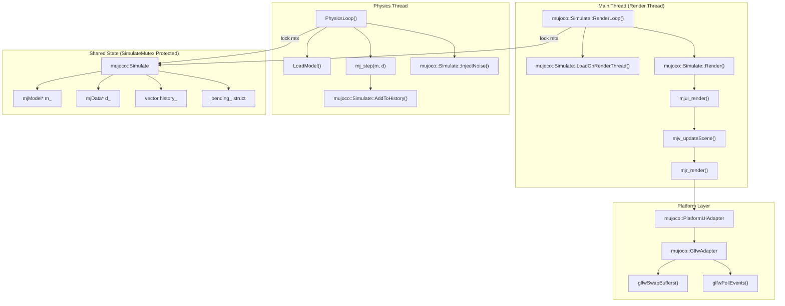
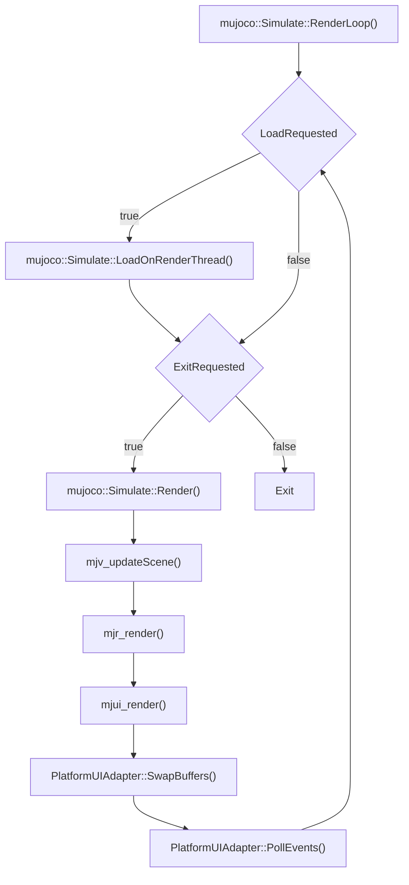
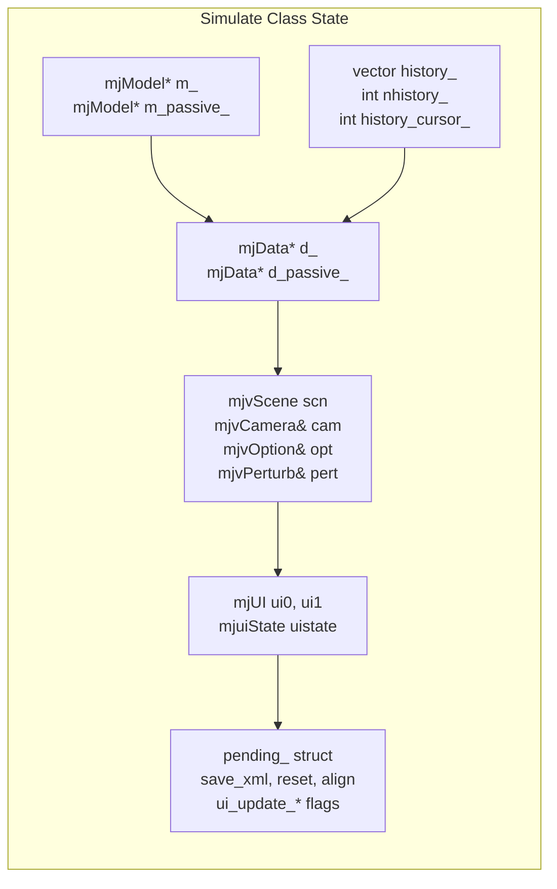
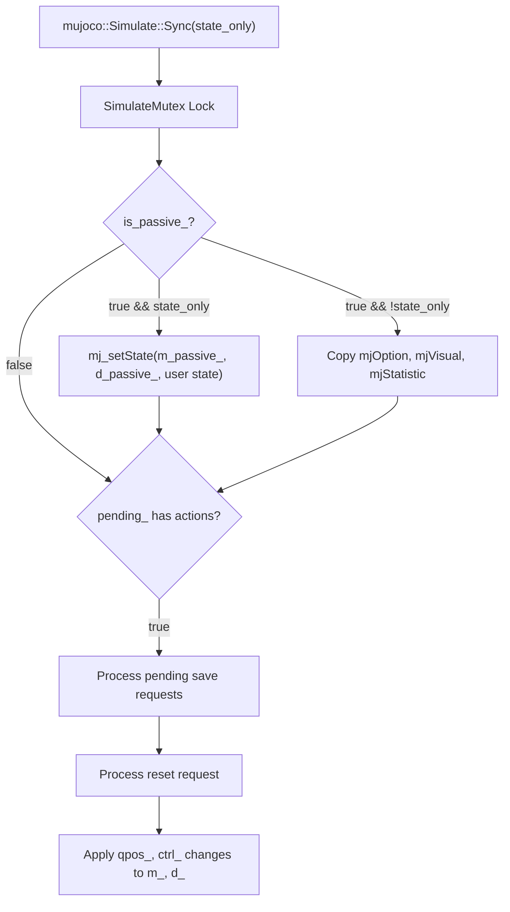
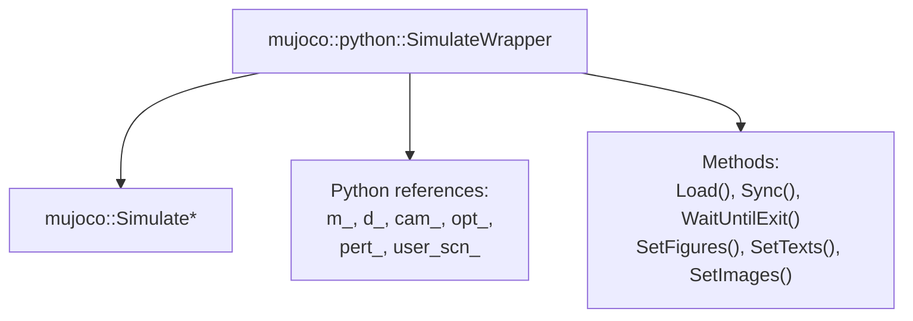

<!-- source: DeepWiki mcp.deepwiki.com · repo google-deepmind/mujoco · page 7.2 Simulate Interactive Viewer · fetched 2026-10-26 -->

# Simulate Interactive Viewer

Relevant source files

The following files were used as context for generating this wiki page:

- [.pre-commit-config.yaml](.pre-commit-config.yaml)
- [python/mujoco/simulate.cc](python/mujoco/simulate.cc)
- [python/mujoco/viewer.py](python/mujoco/viewer.py)
- [sample/.clang-format](sample/.clang-format)
- [simulate/.clang-format](simulate/.clang-format)
- [simulate/glfw_adapter.cc](simulate/glfw_adapter.cc)
- [simulate/glfw_adapter.h](simulate/glfw_adapter.h)
- [simulate/glfw_corevideo.h](simulate/glfw_corevideo.h)
- [simulate/glfw_corevideo.mm](simulate/glfw_corevideo.mm)
- [simulate/glfw_dispatch.cc](simulate/glfw_dispatch.cc)
- [simulate/glfw_dispatch.h](simulate/glfw_dispatch.h)
- [simulate/main.cc](simulate/main.cc)
- [simulate/platform_ui_adapter.cc](simulate/platform_ui_adapter.cc)
- [simulate/platform_ui_adapter.h](simulate/platform_ui_adapter.h)
- [simulate/simulate.cc](simulate/simulate.cc)
- [simulate/simulate.h](simulate/simulate.h)
- [src/user/.clang-format](src/user/.clang-format)
- [src/xml/.clang-format](src/xml/.clang-format)

## Purpose and Scope

The **Simulate Interactive Viewer** is a standalone C++ application that provides an interactive graphical interface for visualizing and controlling MuJoCo simulations. It features a dual-panel UI system, real-time physics simulation, performance profiling, history scrubbing, and extensive model editing capabilities. This document covers the C++ implementation, architectural patterns, thread coordination, platform adapters, and Python binding integration of the viewer.

For the abstract visualization layer that populates `mjvScene`, see [Rendering System (mjr and mjv)](7.1). For the Python wrapper that provides `viewer.launch_passive()`, see [Python Viewer](7.3).

**Sources:** [simulate/simulate.h:45-201](), [simulate/simulate.cc:1-228](), [simulate/main.cc:1-213]()

## Architecture Overview

The Simulate viewer operates as a dual-threaded application with clear separation between physics computation and UI rendering. In active mode, the physics thread owns the simulation loop; in passive mode, the user's thread controls execution while the viewer synchronizes state.

**Key Design Principles:**

1. **Thread Safety**: The `Simulate` class uses `SimulateMutex` (a subclass of `std::recursive_mutex` defined at [simulate/simulate.h:41-42]()) to protect shared state between physics and render threads.
2. **Active vs Passive Mode**: 
   - **Active Mode** (`is_passive_ = false`): Physics thread runs `PhysicsLoop()` continuously; viewer owns `m_` and `d_` [simulate/simulate.h:99-106]().
   - **Passive Mode** (`is_passive_ = true`): User owns `mjModel` and `mjData`, calling `Sync()` to update viewer-owned copies `m_passive_` and `d_passive_` [simulate/simulate.h:143-144]().
3. **Pending Actions**: GUI interactions populate the `pending_` struct, which is applied during the next `Sync()` execution [simulate/simulate.h:154-182]().

**Sources:** [simulate/simulate.h:41-182](), [simulate/simulate.cc:1-90](), [simulate/main.cc:194-213]()

## Execution Loops

### Render Thread

The render thread (main thread) updates the UI and visualization. This execution flow must run on the main thread due to operating system and OpenGL context constraints, particularly on macOS [simulate/simulate.h:87-88]().

**Key Functions:**

| Function | Location | Purpose |
|----------|----------|---------|
| `RenderLoop()` | [simulate/simulate.h:88]() | Main render loop, initializes UI context and calls `Render()` each frame. |
| `LoadOnRenderThread()` | [simulate/simulate.h:82]() | Handles model loading requests safely on the render thread. |
| `Render()` | [simulate/simulate.h:85]() | Core rendering: updates scene, draws viewport, UI components, and overlays. |
| `Sync()` | [simulate/simulate.h:62]() | Synchronizes state between threads and applies pending UI actions. |

**Sources:** [simulate/simulate.h:82-88](), [simulate/simulate.cc:1-90]()

### Physics Thread

The physics thread executes the simulation stepping loop and processes model loading requests. This thread runs when `is_passive_` is `false`.

**Real-Time Synchronization Mechanism:**

The physics loop maintains wall-clock synchronization by comparing simulation time steps against real-time pacing coefficients (`PERCENT_REALTIME`) [python/mujoco/viewer.py:40-45](). When running faster than real-time, the loop introduces sleep intervals or yields execution.

**Sources:** [simulate/main.cc:194-213](), [python/mujoco/viewer.py:40-51]()

## Core Components

### Simulate Class

The `Simulate` class manages the state required by the viewer outside of core MuJoCo structures.

**Key Fields:**

| Field | Type | Purpose |
|-------|------|---------|
| `m_`, `d_` | `mjModel*`, `mjData*` | Active model and data pointers [simulate/simulate.h:107-108](). |
| `m_passive_`, `d_passive_` | `mjModel*`, `mjData*` | Passive-mode copies owned by `Simulate` [simulate/simulate.h:143-144](). |
| `history_` | `std::vector<mjtNum>` | Circular buffer storing historical simulation states [simulate/simulate.h:131](). |
| `pending_` | `struct` | Queued GUI-driven actions processed during `Sync()` [simulate/simulate.h:155-182](). |

**Sources:** [simulate/simulate.h:45-190](), [python/mujoco/viewer.py:64-117]()

### UI System

The viewer constructs dual UI panels (`ui0` and `ui1`) using the `mjui` framework [simulate/simulate.cc:96-114](). 
- **Left Panel (`SECT_FILE`, `SECT_OPTION`, `SECT_SIMULATION`, `SECT_WATCH`, `SECT_PHYSICS`, `SECT_RENDERING`, `SECT_VISUALIZATION`, `SECT_GROUP`, `SECT_LOGGING`)**: Manages file operations, global rendering options, physics parameters, and visualization groups [simulate/simulate.cc:96-107]().
- **Right Panel (`SECT_JOINT`, `SECT_CONTROL`, `SECT_EQUALITY`)**: Manages joint configurations (`qpos`), actuator controls (`ctrl`), and equality constraints [simulate/simulate.cc:109-114]().

**Sources:** [simulate/simulate.cc:96-128](), [include/mujoco/mjui.h:1-50]()

## Sync and Pending Actions

The `Sync()` method bridges external execution contexts (or user scripts in Python) with the render thread.

**Sources:** [simulate/simulate.h:59-62](), [simulate/simulate.cc:1-90]()

## Platform Abstraction

The viewer uses `PlatformUIAdapter` to isolate window management and input subsystems from platform-specific windowing libraries such as GLFW [simulate/platform_ui_adapter.h:23]().

| Entity | File | Purpose |
|--------|------|---------|
| `PlatformUIAdapter` | [simulate/platform_ui_adapter.h:23]() | Abstract base interface for event handling and rendering context management. |
| `GlfwAdapter` | [simulate/glfw_adapter.h:30]() | Concrete windowing adapter utilizing GLFW [simulate/glfw_adapter.h:30](). |
| `GlfwCoreVideo` | [simulate/glfw_corevideo.h:25]() | macOS-specific display synchronization workaround using `CVDisplayLink` [simulate/glfw_adapter.h:70-74](). |
| `Glfw` | [simulate/glfw_dispatch.h:29]() | Dynamic symbol resolution table for GLFW functions [simulate/glfw_dispatch.h:29](). |

**Sources:** [simulate/platform_ui_adapter.h:23-100](), [simulate/glfw_adapter.h:30-76](), [simulate/glfw_dispatch.h:29-77]()

## Python Bindings

The Python integration exposes `Simulate` via `mujoco.viewer` and the pybind11 module `_simulate` [python/mujoco/viewer.py:31-62](). 

**SimulateWrapper Structure**

**Key Bindings and Functions:**

| Entity | Location | Purpose |
|--------|----------|---------|
| `SimulateWrapper` | [python/mujoco/simulate.cc:74]() | C++ wrapper class managing `mujoco::Simulate` instances inside Python. |
| `Handle` | [python/mujoco/viewer.py:64]() | Python handle class providing inspection and overlay controls (`set_figures`, `set_texts`, `set_images`). |
| `UIAdapterWithPyCallback` | [python/mujoco/simulate.cc:48]() | Subclass of UI adapter handling Python key callback triggers under GIL acquisition. |

**Sources:** [python/mujoco/simulate.cc:48-222](), [python/mujoco/viewer.py:64-212]()

---

