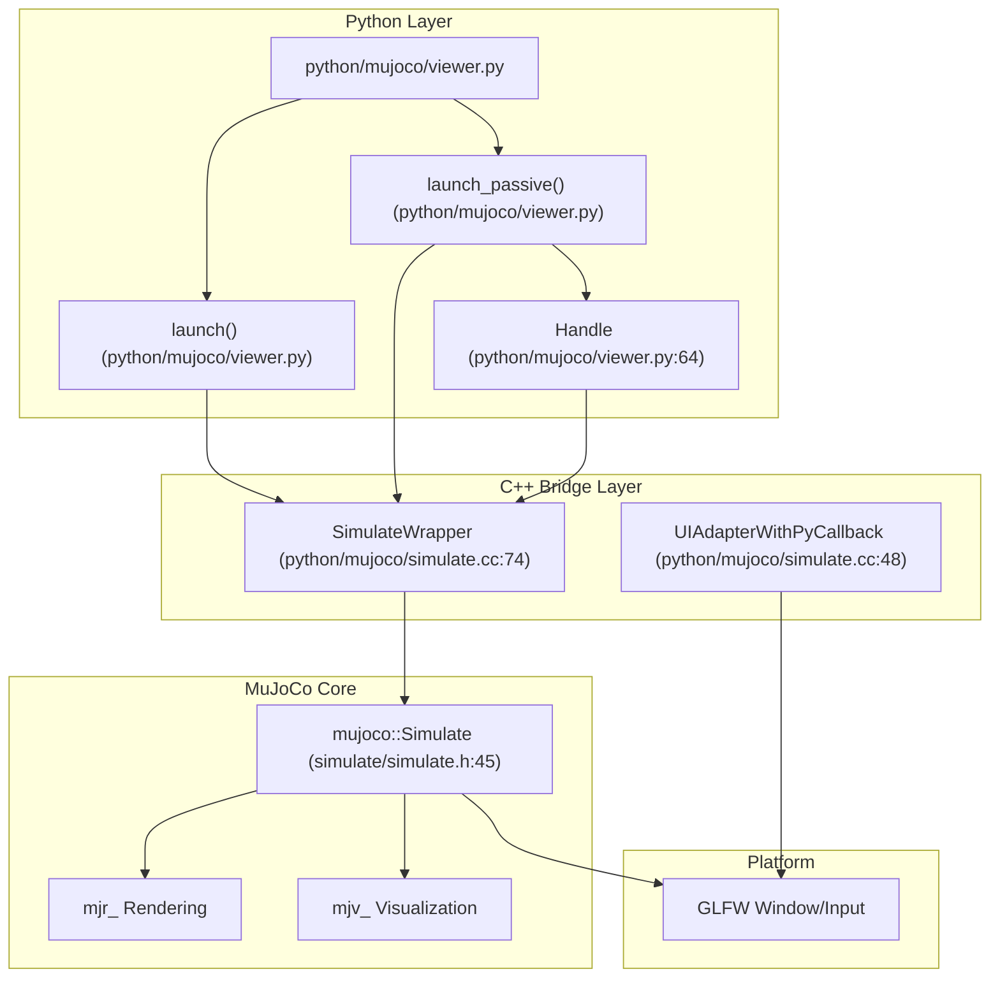
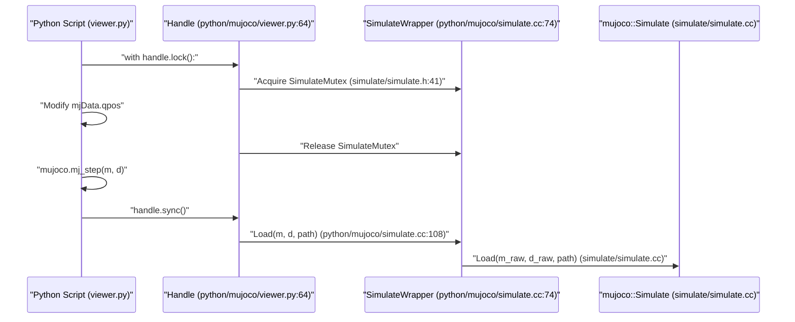

<!-- source: DeepWiki mcp.deepwiki.com · repo google-deepmind/mujoco · page 7.3 Python Viewer · fetched 2026-10-26 -->

# Python Viewer

Relevant source files

The following files were used as context for generating this wiki page:

- [python/mujoco/mjpython/Info.plist](python/mujoco/mjpython/Info.plist)
- [python/mujoco/simulate.cc](python/mujoco/simulate.cc)
- [python/mujoco/viewer.py](python/mujoco/viewer.py)
- [simulate/main.cc](simulate/main.cc)
- [simulate/simulate.cc](simulate/simulate.cc)
- [simulate/simulate.h](simulate/simulate.h)

## Purpose and Scope

The Python Viewer provides an interactive GUI for visualizing and controlling MuJoCo simulations from Python. It is built on the same codebase as the native [Simulate Interactive Viewer](#7.2) but exposes Python-friendly APIs for integration with Python-based workflows. The viewer supports three operational modes: **managed** (blocks execution), **passive** (non-blocking with user control), and **CLI** (standalone application). It includes specialized features for thread-safe state synchronization and custom overlays (figures, text, and images).

Sources: [python/mujoco/viewer.py:15-27](), [python/mujoco/simulate.cc:74-92]()

---

## Architecture Overview

The Python Viewer bridges Python code with MuJoCo's native rendering through a C++ wrapper layer (`SimulateWrapper`). It uses `pybind11` to expose the C++ `mujoco::Simulate` class to Python.

Sources: [python/mujoco/viewer.py:15-79](), [python/mujoco/simulate.cc:48-92](), [simulate/simulate.h:45-55]()

---

## Viewer Modes

### Mode Comparison

| Mode | Entry Point | Blocks Python | Control |
|------|----------|---------------|-----------------|
| **Managed** | `viewer.launch()` | Yes | Internal physics loop |
| **Passive** | `viewer.launch_passive()` | No | User-driven physics loop |
| **CLI** | `python -m mujoco.viewer` | Yes | Internal physics loop |

Sources: [python/mujoco/viewer.py:391-411](), [python/mujoco/viewer.py:441-458]()

### Managed Mode
In managed mode, the viewer takes control of the execution thread. It internally handles the physics stepping and UI event loop. Users can interact with the simulation via callbacks.

### Passive Mode
Passive mode allows the user's Python script to remain the driver of the simulation. The viewer runs in a separate thread, and the user must explicitly call synchronization methods to update the visualization.

Sources: [python/mujoco/viewer.py:441-458](), [python/mujoco/simulate.cc:108-123]()

---

## Handle API and Thread Safety

The `Handle` class provides the primary interface for interacting with a passive viewer session. It manages thread safety via a reentrant mutex (`SimulateMutex`).

### Key Properties and Methods
- **`lock()`**: A context manager that acquires the `SimulateMutex` [simulate/simulate.h:41-42](). Users must hold this lock when modifying `mjModel` or `mjData` to prevent race conditions with the viewer's render thread.
- **`sync()`**: Synchronizes the state between the user's `mjData` and the viewer's internal copies [simulate/simulate.h:60-61]().
- **`is_running()`**: Returns `True` as long as the viewer window is open and hasn't received an exit request [python/mujoco/viewer.py:224-225]().

Sources: [python/mujoco/viewer.py:64-117](), [python/mujoco/simulate.cc:74-123](), [simulate/simulate.h:36-42]()

---

## Custom Overlays

The Python Viewer supports three types of custom overlays that can be updated dynamically from Python. These updates are signaled to the C++ layer via atomic request flags.

### Overlay Mechanisms

| Overlay Type | Python Method | C++ Atomic Flag | Implementation |
|--------------|---------------|-----------------|----------------|
| **Figures** | `set_figures()` | `newfigurerequest` | Uses `mjvFigure` and `mjrRect` |
| **Texts** | `set_texts()` | `newtextrequest` | Supports font and grid positioning |
| **Images** | `set_images()` | `newimagerequest` | Accepts NumPy RGB arrays |

**Data Flow for Overlays:**
1. User calls `handle.set_images(viewports_images)` in [python/mujoco/viewer.py:175-201]().
2. `SimulateWrapper::SetImages` in [python/mujoco/simulate.cc:193-228]() copies the image data to `user_images_new_`.
3. `newimagerequest` is set to 1.
4. The render thread in `simulate/simulate.cc` detects the flag, swaps the data, and renders the overlay.

Sources: [python/mujoco/viewer.py:118-203](), [python/mujoco/simulate.cc:136-239](), [simulate/simulate.h:208-215]()

---

## macOS Implementation: mjpython

On macOS, GUI frameworks (Cocoa/AppKit) require the event loop to run on the process's main thread. This conflicts with standard Python scripts where the user's code runs on the main thread.

### The mjpython Trampoline
MuJoCo provides the `mjpython` launcher bundle configuration to solve this. It re-architects the process:
1. The native bundle starts on the macOS main thread [python/mujoco/mjpython/Info.plist:17-18]().
2. It initializes a separate thread to run the CPython interpreter while keeping the main thread free for GUI event dispatching.

Sources: [python/mujoco/mjpython/Info.plist:1-34]()

---

## Implementation Details

### SimulateWrapper
The `SimulateWrapper` class in `python/mujoco/simulate.cc` acts as the owner of the `mujoco::Simulate` instance. It provides the logic for non-blocking loads and synchronization.

- **`WaitUntilExit`**: Uses `WaitForAtomicNoGil` in [python/mujoco/simulate.cc:104-106]() to block until `exitrequest` is signaled, allowing the Python thread to wait for the GUI to close without holding the GIL.
- **`GetViewport`**: Returns the `mjrRect` corresponding to the 3D viewing area (index 3 in `uistate.rect`) in [python/mujoco/simulate.cc:130-134]().
- **`UIAdapterWithPyCallback`**: A template class that extends the platform adapter to forward keyboard events to a Python callback function [python/mujoco/simulate.cc:48-72]().

Sources: [python/mujoco/simulate.cc:48-134](), [simulate/simulate.h:208-222]()

---

