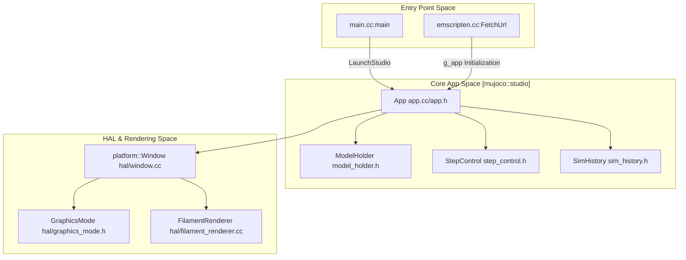
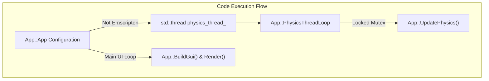

<!-- source: DeepWiki mcp.deepwiki.com · repo google-deepmind/mujoco · page 7.4 Studio Application · fetched 2026-10-26 -->

# Studio Application

Relevant source files

The following files were used as context for generating this wiki page:

- [python/mujoco/experimental/studio/sim.cc](python/mujoco/experimental/studio/sim.cc)
- [python/mujoco/experimental/studio/ux.cc](python/mujoco/experimental/studio/ux.cc)
- [src/engine/engine_util_errmem.h](src/engine/engine_util_errmem.h)
- [src/experimental/studio/CMakeLists.txt](src/experimental/studio/CMakeLists.txt)
- [src/experimental/studio/app.cc](src/experimental/studio/app.cc)
- [src/experimental/studio/app.h](src/experimental/studio/app.h)
- [src/experimental/studio/emscripten.cc](src/experimental/studio/emscripten.cc)
- [src/experimental/studio/favicon.ico](src/experimental/studio/favicon.ico)
- [src/experimental/studio/live.css](src/experimental/studio/live.css)
- [src/experimental/studio/live.html](src/experimental/studio/live.html)
- [src/experimental/studio/live.js](src/experimental/studio/live.js)
- [src/experimental/studio/main.cc](src/experimental/studio/main.cc)
- [src/experimental/studio/sim/sim_profiler.cc](src/experimental/studio/sim/sim_profiler.cc)
- [src/experimental/studio/sim/sim_profiler.h](src/experimental/studio/sim/sim_profiler.h)
- [src/experimental/studio/ux/gui.cc](src/experimental/studio/ux/gui.cc)
- [src/experimental/studio/ux/gui.h](src/experimental/studio/ux/gui.h)
- [test/engine/engine_util_errmem_test.cc](test/engine/engine_util_errmem_test.cc)

## Purpose and Scope

The Studio Application is an experimental next-generation interactive viewer and editing suite for MuJoCo simulations (`mujoco::studio`). It provides a modern graphical user interface built on top of Dear ImGui, ImPlot, and the Filament rendering engine with support for Vulkan/OpenGL graphics modes (`GraphicsMode`), rich model specification editing (`SpecEditor`), simulation history tracking (`SimHistory`), and WebAssembly deployment for browser-based execution (`mujoco Live`). Studio evolves beyond the production [Simulate Interactive Viewer](#7.2), offering advanced rendering capabilities, parallel asset prefetching for web clients, and a modular platform abstraction layer.

For details on Python bindings, viewer protocols, and remote web server clients, see [Studio Python and Web Clients](#7.4.1).

Sources: `[src/experimental/studio/app.h:1-72]()`, `[src/experimental/studio/app.cc:155-189]()`, `[src/experimental/studio/CMakeLists.txt:25-72]()`

---

## Architecture Overview

The Studio codebase is organized around the central `mujoco::studio::App` class (`app.cc`, `app.h`), which integrates window management, simulation stepping, scene rendering, and UI panels. Desktop execution begins in `main.cc` via Abseil command-line flag parsing (`LaunchStudio`), while web builds are driven by `emscripten.cc` and `live.js`.

**Diagram: Studio Application Architecture and Code Entity Mapping**

Sources: `[src/experimental/studio/main.cc:26-40]()`, `[src/experimental/studio/app.h:53-98]()`, `[src/experimental/studio/CMakeLists.txt:27-72]()`

---

## Application Lifecycle and Threading

The `App` class constructor initializes the console logger, graphics mode, VFS (`mj_defaultVFS`), perturbation objects, camera parameters, and visualization options (`mjv_defaultOption`) `[src/experimental/studio/app.cc:155-189]()`. 

For desktop environments, Studio launches a dedicated physics background thread (`PhysicsThreadLoop`) guarded by `physics_mutex_` to decouple the simulation stepping rate from the UI rendering frame rate `[src/experimental/studio/app.cc:185-215]()`. In WebAssembly (`__EMSCRIPTEN__`), execution conforms to single-threaded browser loops using Emscripten callbacks.

**Diagram: Threading and Lifecycle Control Flow**

Sources: `[src/experimental/studio/app.cc:155-215]()`, `[src/experimental/studio/app.h:74-105]()`

---

## Filament Renderer HAL and Graphics Modes

Studio relies on a hardware abstraction layer (HAL) located under `src/experimental/studio/hal/` to support multiple rendering backends (`GraphicsMode::FilamentVulkan`, etc.) `[src/experimental/studio/app.h:60-72]()`. 

The `mujoco_studio_platform` library compiles window management (`window.cc`), graphics mode routing (`graphics_mode.cc`), and Filament renderer integrations (`filament_renderer.cc`) into a static target linked against Dear ImGui SDL2 backends `[src/experimental/studio/CMakeLists.txt:27-120]`. Asset staging tasks automatically stage required font assets (Atkinson Hyperlegible, FontAwesome) and Filament shaders into the runtime directories `[src/experimental/studio/CMakeLists.txt:122-139]()`.

Sources: `[src/experimental/studio/CMakeLists.txt:27-120]`, `[src/experimental/studio/hal/graphics_mode.h]()`, `[src/experimental/studio/hal/window.cc]()`

---

## WebAssembly and Live Build Integration

For browser execution, `emscripten.cc` and `live.js` establish an asynchronous bridge between JavaScript and the compiled C++ modules. 

* **Parallel Asset Prefetcher (`live.js`)**: To mitigate network latency during XML compilation, `prefetchModelAssets` parses transient dependencies via `Module.getXMLDependencies`, fetches meshes and textures in parallel, and primes the C++ `FetchCache` (`emscripten.cc`) prior to model loading `[src/experimental/studio/live.js:84-152]()`.
* **Async Fetch Cache (`emscripten.cc`)**: Implements `FetchCache::Fetch` backed by `EM_ASYNC_JS` `FetchUrl` to bridge network responses into stable byte buffers accessed by MuJoCo's resource provider `[src/experimental/studio/emscripten.cc:74-185]()`.

Sources: `[src/experimental/studio/emscripten.cc:74-185]`, `[src/experimental/studio/live.js:84-152]`, `[src/experimental/studio/live.html:1-57]`

---

## User Interface and Simulation Controls

The GUI subsystem (`src/experimental/studio/ux/`) provides modular ImGui panels and widgets configured via `ConfigureDockingLayout` (`gui.cc`) `[src/experimental/studio/ux/gui.cc:141-150]()`:

* **`StepControl` & `StepControlGui`**: Manages logarithmic real-time slow-down factors (`kPercentRealTime`) and stepping pause states `[src/experimental/studio/ux/gui.h:95-112]()`.
* **`SimHistory` & `TimelineScrubberGui`**: Records state snapshots into a bounded ring buffer to allow interactive timeline scrubbing and state inspection `[src/experimental/studio/ux/gui.h:122-158]()`.
* **`SpecEditor`**: Provides tree-based inspection and runtime property editing for `mjsElement` spec hierarchies `[src/experimental/studio/app.h:189-195]()`.

Sources: `[src/experimental/studio/ux/gui.cc:1-175]`, `[src/experimental/studio/ux/gui.h:35-160]()`, `[src/experimental/studio/app.h:145-218]()`

---

## Python and Web Clients

Studio exposes its simulation stepping, timeline history, and UX state formatting through pybind11 extension modules (`python/mujoco/experimental/studio/ux.cc` and `sim.cc`). 

For complete details on the viewer protocol, message formats, `viewer_app/handle`, launch modes (native, web, thread), embedded web servers, and NetImgui remote UI integration, see [Studio Python and Web Clients](#7.4.1).

Sources: `[python/mujoco/experimental/studio/ux.cc:39-120]`, `[python/mujoco/experimental/studio/sim.cc:29-88]()`

---

