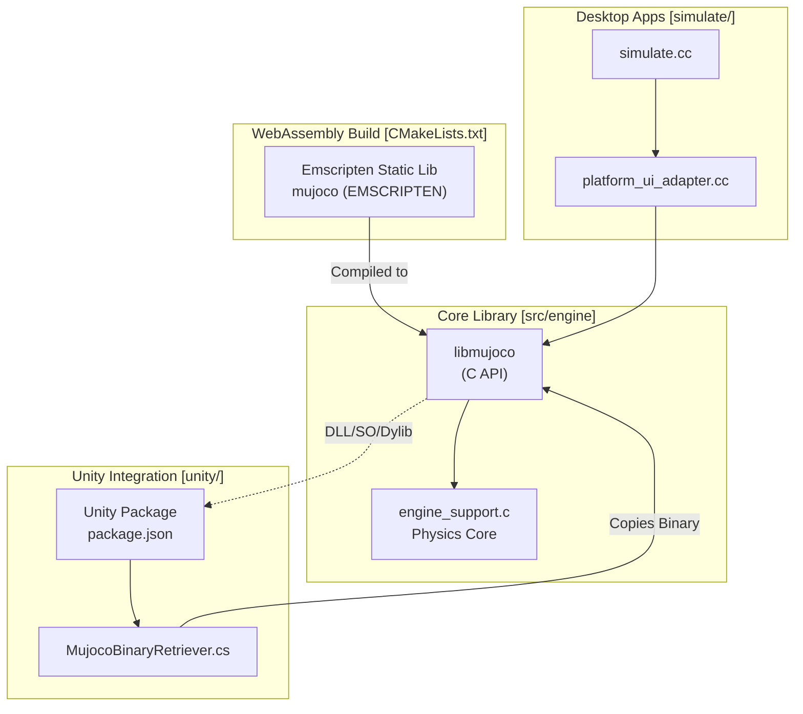

<!-- source: DeepWiki mcp.deepwiki.com · repo google-deepmind/mujoco · page 8 Cross-Platform Integration · fetched 2026-10-26 -->

# Cross-Platform Integration

Relevant source files

The following files were used as context for generating this wiki page:

- [CMakeLists.txt](CMakeLists.txt)
- [dist/mujoco.rc](dist/mujoco.rc)
- [dist/simulate.rc](dist/simulate.rc)
- [doc/unity.rst](doc/unity.rst)
- [python/mujoco/CMakeLists.txt](python/mujoco/CMakeLists.txt)
- [sample/CMakeLists.txt](sample/CMakeLists.txt)
- [simulate/CMakeLists.txt](simulate/CMakeLists.txt)
- [src/engine/engine_support.c](src/engine/engine_support.c)
- [unity/Editor/Bindings/MujocoBinaryRetriever.cs](unity/Editor/Bindings/MujocoBinaryRetriever.cs)
- [unity/package.json](unity/package.json)

This page documents MuJoCo's integration with non-Python languages and platforms, including Unity (C#), WebAssembly/JavaScript, auto-generated C# bindings, and OpenUSD support. For Python bindings, see [Python Bindings Architecture](#5.2). For the C API itself, see [C API Reference](#5.1).

MuJoCo provides a high-performance C core library (`libmujoco`) that serves as the foundation for all language bindings and platform integrations.

---

## Architecture Overview

MuJoCo's cross-platform strategy centers on compiling the core C physics engine [src/engine/engine_support.c:46-48]() into shared or static libraries across Linux, Windows, macOS, and Emscripten [CMakeLists.txt:141-147](), and bridging those libraries to higher-level ecosystems via P/Invoke, WebAssembly bindings, and asset plugins.

### Bridge to Code Entities

The following diagram maps high-level cross-platform components to their corresponding source locations and build artifacts.

**Sources**: [src/engine/engine_support.c:46-48](), [CMakeLists.txt:141-147](), [unity/package.json:1-17](), [unity/Editor/Bindings/MujocoBinaryRetriever.cs:22-64]()

---

## Unity Plugin

The MuJoCo Unity plug-in allows the Unity Editor and runtime to utilize the MuJoCo physics engine for simulation while leveraging Unity for rendering, assets, and game logic [doc/unity.rst:8-11](). The package is structured around Unity's Package Manager specification [unity/package.json:1-17]() and handles platform-specific binary retrieval [unity/Editor/Bindings/MujocoBinaryRetriever.cs:22-64]().

For detailed information on the package structure, `MjScene` components, MJCF import workflows, and component mappings, see [Unity Plugin](#8.1).

**Sources**: [doc/unity.rst:8-29](), [unity/package.json:1-17](), [unity/Editor/Bindings/MujocoBinaryRetriever.cs:22-64]()

---

## WebAssembly Build

MuJoCo can be compiled to WebAssembly (WASM) using Emscripten, enabling physics execution directly inside web browsers and Node.js environments [CMakeLists.txt:54-70](). The build configuration manages multithreading support (`-pthread`), custom flags, and host tool generation for asset processing [CMakeLists.txt:54-99]().

For details on Emscripten compilation, code-generated WASM bindings, the JavaScript/TypeScript interface, and demo applications, see [WebAssembly Build](#8.2).

**Sources**: [CMakeLists.txt:54-99]()

---

## C# Bindings

To support integration with .NET and Unity environments, MuJoCo features auto-generated C# bindings via custom code generation scripts [unity/Editor/Bindings/MujocoBinaryRetriever.cs:22-64](). These bindings define platform invoke (`P/Invoke`) declarations and ensure rigid struct layout compatibility between managed C# types and native C structures.

For details on `MjBindings.cs`, the codegen script, and marshaling rules, see [C# Bindings](#8.3).

**Sources**: [unity/Editor/Bindings/MujocoBinaryRetriever.cs:22-64]()

---

## OpenUSD Integration

MuJoCo provides experimental support for the Universal Scene Description (OpenUSD) ecosystem. This integration enables importing USD assets into MuJoCo, exporting MJCF models to USD format, and utilizing specialized schema plugins (`mjcPhysics`) for scene description interoperability.

For details on USD asset import/export, file format plugins, and the Python USD exporter, see [OpenUSD Integration](#8.4).

---

## Summary of Integration Modules

| Integration Target | Key Directories / Files | Primary Mechanism |
|---|---|---|
| Unity Plugin | `unity/` [unity/package.json:1-17]() | C# Components & P/Invoke |
| Binary Retriever | `unity/Editor/Bindings/MujocoBinaryRetriever.cs` [unity/Editor/Bindings/MujocoBinaryRetriever.cs:22-64]() | Automated Native Library Deployment |
| WebAssembly | `CMakeLists.txt` [CMakeLists.txt:54-70]() | Emscripten & JS Bindings |
| C# Interop | `unity/` | Marshaled Structs & P/Invoke |

**Sources**: [unity/package.json:1-17](), [unity/Editor/Bindings/MujocoBinaryRetriever.cs:22-64](), [CMakeLists.txt:54-70]()

---

