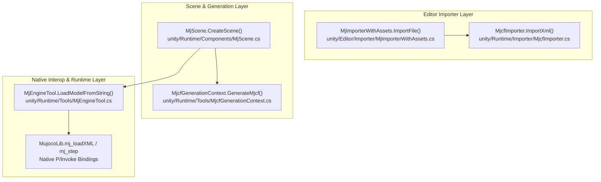
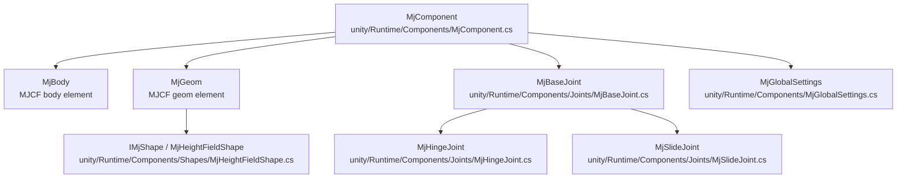

<!-- source: DeepWiki mcp.deepwiki.com · repo google-deepmind/mujoco · page 8.1 Unity Plugin · fetched 2026-10-26 -->

# Unity Plugin

Relevant source files

The following files were used as context for generating this wiki page:

- [unity/Editor/Components/MjActuatorEditor.cs](unity/Editor/Components/MjActuatorEditor.cs)
- [unity/Editor/Components/MjMouseSpring.cs](unity/Editor/Components/MjMouseSpring.cs)
- [unity/Editor/Components/MjShapeComponentEditor.cs](unity/Editor/Components/MjShapeComponentEditor.cs)
- [unity/Editor/Importer/MjImporterWithAssets.cs](unity/Editor/Importer/MjImporterWithAssets.cs)
- [unity/Editor/Importer/ObjMeshImportUtility.cs](unity/Editor/Importer/ObjMeshImportUtility.cs)
- [unity/Editor/Importer/ObjMeshImportUtility.cs.meta](unity/Editor/Importer/ObjMeshImportUtility.cs.meta)
- [unity/Runtime/Components/Equality/MjWeld.cs](unity/Runtime/Components/Equality/MjWeld.cs)
- [unity/Runtime/Components/Joints/MjBaseJoint.cs](unity/Runtime/Components/Joints/MjBaseJoint.cs)
- [unity/Runtime/Components/Joints/MjHingeJoint.cs](unity/Runtime/Components/Joints/MjHingeJoint.cs)
- [unity/Runtime/Components/Joints/MjJointSettings.cs](unity/Runtime/Components/Joints/MjJointSettings.cs)
- [unity/Runtime/Components/Joints/MjSlideJoint.cs](unity/Runtime/Components/Joints/MjSlideJoint.cs)
- [unity/Runtime/Components/MjActuator.cs](unity/Runtime/Components/MjActuator.cs)
- [unity/Runtime/Components/MjComponent.cs](unity/Runtime/Components/MjComponent.cs)
- [unity/Runtime/Components/MjGlobalSettings.cs](unity/Runtime/Components/MjGlobalSettings.cs)
- [unity/Runtime/Components/MjScene.cs](unity/Runtime/Components/MjScene.cs)
- [unity/Runtime/Components/Sensors/MjBaseSensor.cs](unity/Runtime/Components/Sensors/MjBaseSensor.cs)
- [unity/Runtime/Components/Shapes/MjGeomSettings.cs](unity/Runtime/Components/Shapes/MjGeomSettings.cs)
- [unity/Runtime/Components/Shapes/MjHeightFieldShape.cs](unity/Runtime/Components/Shapes/MjHeightFieldShape.cs)
- [unity/Runtime/Components/Shapes/MjHeightFieldShape.cs.meta](unity/Runtime/Components/Shapes/MjHeightFieldShape.cs.meta)
- [unity/Runtime/Components/Shapes/MjMeshFilter.cs](unity/Runtime/Components/Shapes/MjMeshFilter.cs)
- [unity/Runtime/Components/Shapes/MjMeshShape.cs](unity/Runtime/Components/Shapes/MjMeshShape.cs)
- [unity/Runtime/Components/Shapes/MjShapeComponent.cs](unity/Runtime/Components/Shapes/MjShapeComponent.cs)
- [unity/Runtime/Importer/MjcfImporter.cs](unity/Runtime/Importer/MjcfImporter.cs)
- [unity/Runtime/Resources/mujoco_semitransparent_template.mat](unity/Runtime/Resources/mujoco_semitransparent_template.mat)
- [unity/Runtime/Resources/mujoco_semitransparent_template.mat.meta](unity/Runtime/Resources/mujoco_semitransparent_template.mat.meta)
- [unity/Runtime/Resources/mujoco_semitransparent_template_hd.mat](unity/Runtime/Resources/mujoco_semitransparent_template_hd.mat)
- [unity/Runtime/Resources/mujoco_semitransparent_template_hd.mat.meta](unity/Runtime/Resources/mujoco_semitransparent_template_hd.mat.meta)
- [unity/Runtime/Tools/MjEngineTool.cs](unity/Runtime/Tools/MjEngineTool.cs)
- [unity/Runtime/Tools/MjcfGenerationContext.cs](unity/Runtime/Tools/MjcfGenerationContext.cs)
- [unity/Runtime/Tools/XmlElementExtensions.cs](unity/Runtime/Tools/XmlElementExtensions.cs)
- [unity/Tests/Editor/Components/Joints/MjHingeJointTests.cs](unity/Tests/Editor/Components/Joints/MjHingeJointTests.cs)
- [unity/Tests/Editor/Components/Joints/MjSlideJointTests.cs](unity/Tests/Editor/Components/Joints/MjSlideJointTests.cs)
- [unity/Tests/Editor/Components/MjGeomSettingsTests.cs](unity/Tests/Editor/Components/MjGeomSettingsTests.cs)
- [unity/Tests/Editor/Components/MjGlobalSettingsTests.cs](unity/Tests/Editor/Components/MjGlobalSettingsTests.cs)
- [unity/Tests/Editor/Components/MjcfGenerationContextTests.cs](unity/Tests/Editor/Components/MjcfGenerationContextTests.cs)
- [unity/Tests/Editor/Components/Sensors/MjBaseSensorTests.cs](unity/Tests/Editor/Components/Sensors/MjBaseSensorTests.cs)
- [unity/Tests/Editor/Importer/MjcfImporterTests.cs](unity/Tests/Editor/Importer/MjcfImporterTests.cs)

## Purpose and Scope
The MuJoCo Unity plugin enables the Unity Editor and runtime to utilize the MuJoCo physics engine for simulation. It provides a package-based integration that maps MJCF (MuJoCo Model) elements to Unity `MonoBehaviour` components. Users can import MJCF files, edit models within the Unity Editor, and run simulations where MuJoCo determines object dynamics while Unity handles rendering, assets, and game logic [doc/unity.rst:8-12]().

The core design principle establishes a one-to-one mapping between MJCF elements and Unity components. The GameObject hierarchy determines the kinematic tree structure of the resulting MuJoCo model [doc/unity.rst:110-117]().

Sources: [doc/unity.rst:5-15](), [unity/Runtime/Components/MjScene.cs:33-50]()

---

## Architecture Overview
The plugin operates by scanning the Unity hierarchy for MuJoCo-specific components via `MjScene`, generating an MJCF description through `MjcfGenerationContext`, and compiling it via native C# P/Invoke calls in `MjEngineTool` [unity/Runtime/Components/MjScene.cs:120-176](), [unity/Runtime/Tools/MjcfGenerationContext.cs:41-44](), [unity/Runtime/Tools/MjEngineTool.cs:44-71]().

### High-Level System Design (Code Entity Bridge)

Sources: [unity/Runtime/Components/MjScene.cs:120-180](), [unity/Runtime/Importer/MjcfImporter.cs:104-131](), [unity/Runtime/Tools/MjcfGenerationContext.cs:41-45](), [unity/Runtime/Tools/MjEngineTool.cs:44-71](), [unity/Editor/Importer/MjImporterWithAssets.cs:44-62]()

---

## Component System and MJCF Mapping
The plugin enforces a design rule where every GameObject has at most one MuJoCo component derived from `MjComponent` [doc/unity.rst:122-123](), [unity/Runtime/Components/MjComponent.cs:25-40]().

### Component Class Hierarchy (Code Entity Bridge)

Sources: [unity/Runtime/Components/MjComponent.cs:25-40](), [unity/Runtime/Components/Joints/MjBaseJoint.cs:20-40](), [unity/Runtime/Components/Joints/MjHingeJoint.cs:21-40](), [unity/Runtime/Components/Joints/MjSlideJoint.cs:22-36](), [unity/Runtime/Components/Shapes/MjHeightFieldShape.cs:24-30](), [unity/Runtime/Components/MjGlobalSettings.cs:30-52]()

---

## MjScene and Simulation Loop
`MjScene` is a singleton component managing the simulation lifecycle [unity/Runtime/Components/MjScene.cs:50-64]().

### Compilation and Binding Workflow
1. **Linearization:** `MjScene.CreateScene()` linearizes component hierarchies via `MjHierarchyTool.LinearizeHierarchyBFS` [unity/Runtime/Components/MjScene.cs:138-146]().
2. **Generation:** `GenerateSceneMjcf` invokes `MjcfGenerationContext` to assemble the XML document [unity/Runtime/Components/MjScene.cs:150](), [unity/Runtime/Tools/MjcfGenerationContext.cs:41-44]().
3. **Compilation:** `MjEngineTool.LoadModelFromString` uses `MjVfs` to load the model into native memory [unity/Runtime/Tools/MjEngineTool.cs:65-71]().
4. **Runtime Update:** `FixedUpdate` executes `preUpdateEvent`, steps the simulation, and invokes `postUpdateEvent` [unity/Runtime/Components/MjScene.cs:96-100]().

Sources: [unity/Runtime/Components/MjScene.cs:50-195](), [unity/Runtime/Tools/MjEngineTool.cs:65-71]()

---

## MJCF Import Workflow
The importer parses MJCF XML documents and constructs corresponding Unity GameObjects and asset files [unity/Editor/Importer/MjImporterWithAssets.cs:44-79](), [unity/Runtime/Importer/MjcfImporter.cs:104-131]().

- `MjImporterWithAssets.ImportFile()` loads an MJCF file using native engine calls, saves it temporarily, and invokes `ImportString()` [unity/Editor/Importer/MjImporterWithAssets.cs:44-62]().
- `MjcfImporter.ImportXml()` builds the Unity transform hierarchy and parses root elements like `<worldbody>`, `<compiler>`, and asset lists [unity/Runtime/Importer/MjcfImporter.cs:104-171]().
- Meshes and textures are imported into Unity project folders (e.g., `Assets/Local/MjImports`) [unity/Editor/Importer/MjImporterWithAssets.cs:98-105]().

Sources: [unity/Editor/Importer/MjImporterWithAssets.cs:44-130](), [unity/Runtime/Importer/MjcfImporter.cs:104-171]()

---

## Components: Joints, Geoms, and Settings
- **Joints:** `MjHingeJoint` and `MjSlideJoint` handle 1-DoF rotational and translational joints. They configure lower/upper limits, references, and `MjJointSettings` containing armature, stiffness, damping, and solver parameters [unity/Runtime/Components/Joints/MjHingeJoint.cs:21-100](), [unity/Runtime/Components/Joints/MjSlideJoint.cs:22-90](), [unity/Runtime/Components/Joints/MjJointSettings.cs:21-48]().
- **Shapes and Heightfields:** `MjHeightFieldShape` interfaces with Unity `Terrain` data, extracting height map scales, width, length, and exporting or updating height field buffers in `MjScene.Instance.Model` [unity/Runtime/Components/Shapes/MjHeightFieldShape.cs:24-133]().
- **Global Settings:** `MjGlobalSettings` handles `<option>`, `<size>`, and `<flag>` configurations, exposing options like `IntegratorType`, `ConstraintSolverType`, and `MjcfOptionFlag` [unity/Runtime/Components/MjGlobalSettings.cs:30-140](), [unity/Runtime/Components/MjGlobalSettings.cs:160-185]().

Sources: [unity/Runtime/Components/Joints/MjHingeJoint.cs:21-100](), [unity/Runtime/Components/Joints/MjSlideJoint.cs:22-90](), [unity/Runtime/Components/Joints/MjJointSettings.cs:21-48](), [unity/Runtime/Components/Shapes/MjHeightFieldShape.cs:24-133](), [unity/Runtime/Components/MjGlobalSettings.cs:30-140]()

---

## Interactive Tools and C# Bindings
- **Mouse Spring:** `MjMouseSpring` provides an editor-time scene view tool (`OnSceneGUI`) that applies forces to bodies by tracking mouse drags against a generated drag plane and updating `xfrc_applied` in `MjData` [unity/Editor/Components/MjMouseSpring.cs:80-185]().
- **C# Bindings:** Native functions are accessed via P/Invoke declarations in `MujocoLib`, bridging C# data structures to MuJoCo's C API (`mjModel`, `mjData`, `mj_step`, `mj_loadXML`) [unity/Runtime/Components/MjScene.cs:35-36](), [unity/Runtime/Tools/MjEngineTool.cs:44-71]().

Sources: [unity/Editor/Components/MjMouseSpring.cs:80-185](), [unity/Runtime/Tools/MjEngineTool.cs:44-71]()

---

