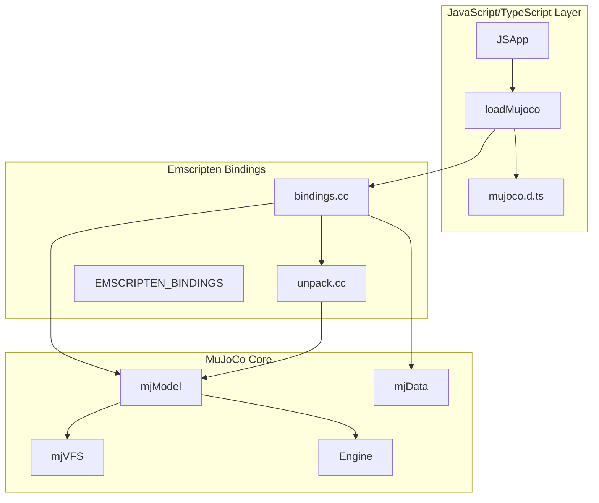
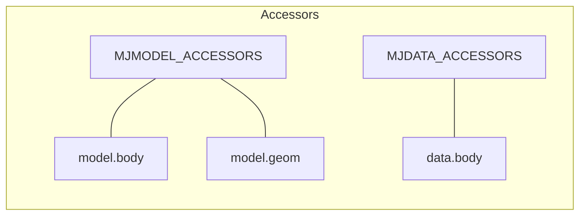

<!-- source: DeepWiki mcp.deepwiki.com · repo google-deepmind/mujoco · page 8.2 WebAssembly Build · fetched 2026-10-26 -->

# WebAssembly Build

Relevant source files

The following files were used as context for generating this wiki page:

- [.github/actions/notify-chat/action.yml](.github/actions/notify-chat/action.yml)
- [.github/actions/notify-chat/notify_chat.py](.github/actions/notify-chat/notify_chat.py)
- [.github/workflows/README.md](.github/workflows/README.md)
- [.github/workflows/build.yml](.github/workflows/build.yml)
- [.github/workflows/build_steps.sh](.github/workflows/build_steps.sh)
- [.github/workflows/lint.yml](.github/workflows/lint.yml)
- [.github/workflows/live.yml](.github/workflows/live.yml)
- [.github/workflows/publish-wasm.yml](.github/workflows/publish-wasm.yml)
- [.github/workflows/update_live.yml](.github/workflows/update_live.yml)
- [include/mujoco/mjspecmacro.h](include/mujoco/mjspecmacro.h)
- [python/mujoco/codegen/code_builder.py](python/mujoco/codegen/code_builder.py)
- [wasm/README.md](wasm/README.md)
- [wasm/codegen/generated/bindings.cc](wasm/codegen/generated/bindings.cc)
- [wasm/codegen/generated/bindings.h](wasm/codegen/generated/bindings.h)
- [wasm/codegen/generators/binding_builder.py](wasm/codegen/generators/binding_builder.py)
- [wasm/codegen/generators/common.py](wasm/codegen/generators/common.py)
- [wasm/codegen/generators/constants.py](wasm/codegen/generators/constants.py)
- [wasm/codegen/generators/enums.py](wasm/codegen/generators/enums.py)
- [wasm/codegen/generators/functions.py](wasm/codegen/generators/functions.py)
- [wasm/codegen/generators/structs.py](wasm/codegen/generators/structs.py)
- [wasm/codegen/templates/bindings.cc](wasm/codegen/templates/bindings.cc)
- [wasm/codegen/tests/bindings_diff_test.py](wasm/codegen/tests/bindings_diff_test.py)
- [wasm/codegen/tests/coverage_test.py](wasm/codegen/tests/coverage_test.py)
- [wasm/codegen/tests/enums_test_generator.py](wasm/codegen/tests/enums_test_generator.py)
- [wasm/codegen/tests/generators_test.py](wasm/codegen/tests/generators_test.py)
- [wasm/codegen/update.py](wasm/codegen/update.py)
- [wasm/demo_app/app.ts](wasm/demo_app/app.ts)
- [wasm/package-lock.json](wasm/package-lock.json)
- [wasm/package.json](wasm/package.json)
- [wasm/package.npm.json](wasm/package.npm.json)
- [wasm/tests/bindings_test.ts](wasm/tests/bindings_test.ts)
- [wasm/tests/enums_test.ts](wasm/tests/enums_test.ts)
- [wasm/tests/run_benchmarks.mjs](wasm/tests/run_benchmarks.mjs)
- [wasm/tests/run_tests.mjs](wasm/tests/run_tests.mjs)
- [wasm/tests/sandbox/main.ts](wasm/tests/sandbox/main.ts)

This page describes the WebAssembly (WASM) compilation of MuJoCo, providing high-performance physics simulation in browser environments. MuJoCo's WASM implementation includes a core engine build, comprehensive JavaScript/TypeScript bindings generated via Emscripten's Embind, and support for both single-threaded and multi-threaded execution [wasm/README.md:1-12]().

## Architecture Overview

The WASM build bridges the C++ MuJoCo engine with the JavaScript ecosystem. It consists of the compiled C++ core, a set of hand-written and auto-generated bindings, and a TypeScript interface for type safety [wasm/README.md:1-12]().

**Diagram: WebAssembly Build Architecture**

Sources: [wasm/codegen/templates/bindings.cc:18-44](), [wasm/CMakeLists.txt:33-46]()

## Build System and Configuration

MuJoCo uses CMake in conjunction with the Emscripten SDK (`emcmake`) to generate the WASM artifacts [wasm/README.md:125-126]().

### Compilation Flags
The build process applies specific Emscripten linker flags to ensure proper behavior in the browser:
- `--bind`: Enables Embind for C++/JS interoperability [wasm/CMakeLists.txt:34]().
- `-s ASSERTIONS=1`: Enables runtime checks in the WASM module [wasm/CMakeLists.txt:35]().
- `-s ALLOW_MEMORY_GROWTH=1`: Allows the WASM heap to expand dynamically [wasm/CMakeLists.txt:36]().
- `-s EXPORT_ES6=1`: Generates modern ECMAScript modules [wasm/CMakeLists.txt:37]().
- `-s MODULARIZE=1`: Wraps the generated code in a factory function [wasm/CMakeLists.txt:38]().
- `-fexceptions`: Required for MuJoCo's error handling to throw JavaScript `Error` objects [wasm/CMakeLists.txt:30]().

### Threading Models
MuJoCo supports two distinct threading configurations:
1.  **Single-Threaded (ST):** The default build, compatible with all modern browsers without special security headers [wasm/README.md:39-46]().
2.  **Multi-Threaded (MT):** Enabled via `-DMUJOCO_WASM_THREADS=ON`. It utilizes Web Workers and `SharedArrayBuffer` to parallelize physics computations [wasm/README.md:48-55]().
    - In MT mode, the flag `-pthread` is passed to the linker, and `PTHREAD_POOL_SIZE` is set to `navigator.hardwareConcurrency` [wasm/CMakeLists.txt:48-51]().

Sources: [wasm/CMakeLists.txt:25-54](), [wasm/README.md:36-64]()

## JavaScript/TypeScript Interface

The bindings provide a high-level API that mirrors the MuJoCo C API while adding JavaScript-friendly features like named access and typed memory views [wasm/README.md:3-11]().

### Buffer API and Memory Management
To handle large arrays (like `qpos` or `mass`), the bindings use `typed_memory_view`. This allows JavaScript to access WASM memory directly without expensive copying [wasm/codegen/generators/structs.py:167-179]().

| Class | Purpose | Key Methods |
|-------|---------|-------------|
| `DoubleBuffer` | Wrapper for `mjtNum*` | `GetView()`, `FromArray()` |
| `IntBuffer` | Wrapper for `int*` | `GetView()`, `GetPointer()` |
| `Uint8Buffer` | Wrapper for `mjtByte*` | `GetView()` |

Sources: [wasm/tests/bindings_test.ts:141-166](), [wasm/codegen/generators/structs.py:167-179]()

### Named Access
Similar to the MuJoCo Python bindings, the WASM interface supports accessing model and data elements by name. This is implemented via X-Macros that generate accessors for all major MuJoCo object types [wasm/README.md:166-170]().

**Diagram: Named Access Implementation**

The implementation uses macros like `MJMODEL_ACCESSORS` to define getters that resolve strings to indices using internal MuJoCo logic [wasm/codegen/generated/bindings.h:71-91](). If a name lookup fails, `KeyErrorMessage` generates a descriptive error listing valid names [wasm/codegen/generated/bindings.cc:80-103]().

Sources: [wasm/codegen/generated/bindings.cc:80-103](), [wasm/codegen/generated/bindings.h:71-109]()

## Asset Management and VFS

In browser environments, MuJoCo cannot access the local filesystem directly. It uses a Virtual File System (VFS).

### Virtual File System (`mjVFS`)
The Emscripten `FS` module is used to stage XML and binary files [wasm/tests/bindings_test.ts:101-116]().
- **`FS.writeFile`**: Emscripten's virtual filesystem is used to stage XML and MJB files [wasm/tests/bindings_test.ts:109-115]().
- **`mj_loadXML`**: Models are loaded from the virtual path (e.g., `/tmp/model.xml`) [wasm/tests/bindings_test.ts:122]().

### Asset Unpacking
The `unpack.cc` utility provides helper functions to transition data between JavaScript `val` objects and native MuJoCo pointers. This is critical for functions like `mj_addM` which require sparse matrix indices or `mj_extractState` which requires `mjtNum` arrays [wasm/codegen/generators/functions.py:88-115]().

Sources: [wasm/tests/bindings_test.ts:101-134](), [wasm/CMakeLists.txt:65-68](), [wasm/codegen/generators/functions.py:162-169]()

## Binding Generation Process

MuJoCo uses a Python-based code generator to produce the `bindings.cc` file. This ensures that the WASM API stays in sync with the core C headers [wasm/README.md:98-99]().

### Generator Components
- **`introspect`**: A tool that parses MuJoCo headers to extract struct definitions and function signatures [wasm/codegen/generators/structs.py:23-25]().
- **`structs.py`**: Generates Embind `class_` definitions for MuJoCo structures like `mjModel` and `mjData`. It handles primitive fields, fixed-size arrays, and nested structs [wasm/codegen/generators/structs.py:71-131]().
- **`functions.py`**: Wraps MuJoCo C functions, handling pointer-to-reference conversions and array unpacking via `UNPACK_ARRAY` and `UNPACK_VALUE` macros [wasm/codegen/generators/functions.py:88-115]().
- **`constants.py`**: Defines which functions or structs should be skipped (e.g., `mj_clearCache`) or manually wrapped (e.g., `mj_compile`, `mj_saveModel`) [wasm/codegen/generators/constants.py:108-258]().

### Error Handling
The generator injects custom error handlers. The function `ThrowMujocoErrorToJS` captures MuJoCo's internal `mju_error` calls and re-throws them as JavaScript `Error` objects [wasm/codegen/generated/bindings.cc:52-63](). This is initialized via a C++ constructor `InitMuJoCoErrorHandler` [wasm/codegen/generated/bindings.cc:64-66]().

Sources: [wasm/codegen/generators/structs.py:15-56](), [wasm/codegen/generators/constants.py:233-258](), [wasm/codegen/generated/bindings.cc:52-66](), [wasm/codegen/generators/functions.py:41-68]()

## Build, Test, and CI Workflow

The project provides a comprehensive pipeline for building and validating the WASM package.

1.  **Compilation:** CMake is used to build the `mujoco_wasm` target, which aggregates generated source files and the MuJoCo core library [wasm/README.md:125-126]().
2.  **Testing:** The `wasm/tests` directory contains Jasmine tests written in TypeScript that verify:
    - Model loading and simulation stepping [wasm/tests/bindings_test.ts:117-140]().
    - Buffer API integrity and direct WASM memory access [wasm/tests/bindings_test.ts:141-166]().
    - Sparse matrix operations like `mj_addM` using `DoubleBuffer` for output [wasm/tests/bindings_test.ts:197-211]().
3.  **Publishing Workflow:** The CI pipeline defined in `.github/workflows/publish-wasm.yml` sets up Node.js, Emscripten SDK (`4.0.10`), installs npm dependencies via `npm_ci`, compiles the WASM binaries, and packages them for distribution on npm [.github/workflows/publish-wasm.yml:20-53]().

Sources: [wasm/tests/bindings_test.ts:92-211](), [.github/workflows/publish-wasm.yml:20-53](), [wasm/README.md:65-150]()

---

