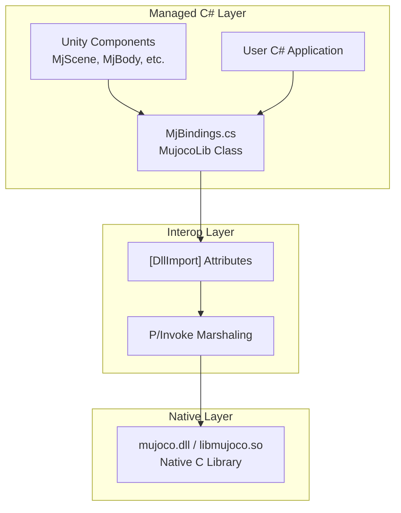
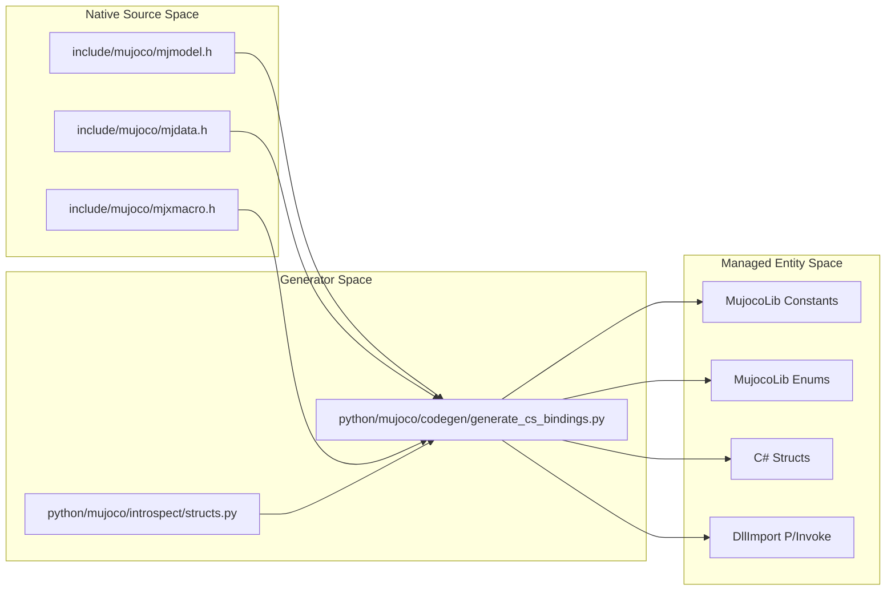
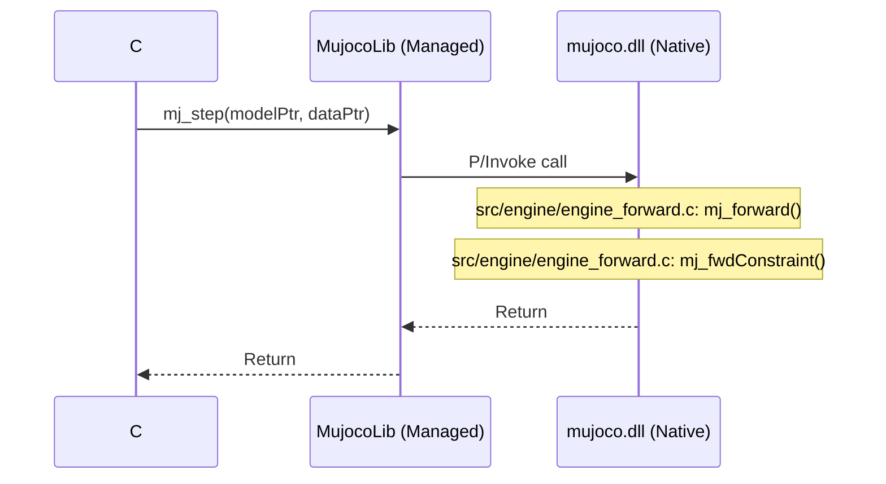
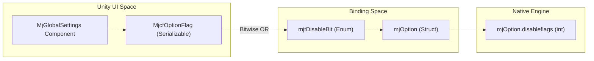

<!-- source: DeepWiki mcp.deepwiki.com · repo google-deepmind/mujoco · page 8.3 C# Bindings · fetched 2026-10-26 -->

# C# Bindings

<details>
<summary>Relevant source files</summary>

The following files were used as context for generating this wiki page:

- [doc/APIreference/APIglobals.rst](doc/APIreference/APIglobals.rst)
- [doc/APIreference/functions.rst](doc/APIreference/functions.rst)
- [doc/APIreference/functions_override.rst](doc/APIreference/functions_override.rst)
- [doc/includes/references.h](doc/includes/references.h)
- [include/mujoco/mjdata.h](include/mujoco/mjdata.h)
- [include/mujoco/mjmodel.h](include/mujoco/mjmodel.h)
- [include/mujoco/mjspec.h](include/mujoco/mjspec.h)
- [include/mujoco/mjxmacro.h](include/mujoco/mjxmacro.h)
- [include/mujoco/mujoco.h](include/mujoco/mujoco.h)
- [python/mujoco/codegen/generate_cs_bindings.py](python/mujoco/codegen/generate_cs_bindings.py)
- [python/mujoco/constants.cc](python/mujoco/constants.cc)
- [python/mujoco/introspect/functions.py](python/mujoco/introspect/functions.py)
- [python/mujoco/introspect/structs.py](python/mujoco/introspect/structs.py)
- [src/engine/engine_io.c](src/engine/engine_io.c)
- [src/engine/engine_io.h](src/engine/engine_io.h)
- [src/engine/engine_print.c](src/engine/engine_print.c)
- [test/engine/engine_io_test.cc](test/engine/engine_io_test.cc)
- [test/header_test.cc](test/header_test.cc)
- [unity/Runtime/Bindings/MjBindings.cs](unity/Runtime/Bindings/MjBindings.cs)

</details>


## Purpose and Scope

This page documents MuJoCo's C# language bindings, which provide a managed interface to the native MuJoCo C library. The bindings enable C# applications, particularly Unity projects, to call MuJoCo's physics simulation functions through Platform Invoke (P/Invoke) interop.

The bindings are primarily auto-generated to ensure that the complex memory layouts of MuJoCo's core structures (`mjModel`, `mjData`) are perfectly synchronized between the C engine and the .NET runtime.

For information about Unity-specific integration patterns and components built on top of these bindings, see [Unity Plugin](8.1). For the underlying C API being exposed, see [C API Reference](5.1).

Sources: [unity/Runtime/Bindings/MjBindings.cs:1-24]()

## Architecture Overview

The C# bindings form a thin interop layer between managed C# code and the native MuJoCo library. They use `DllImport` to map native symbols to C# static methods.

Title: C# Interop Architecture


Sources: [unity/Runtime/Bindings/MjBindings.cs:1-27]()

## File Organization

The C# bindings are contained in a single auto-generated file `MjBindings.cs` within the `Mujoco` namespace [unity/Runtime/Bindings/MjBindings.cs:24](). The file follows a rigid structure to mirror the native headers:

| Section | Lines | Content |
|---------|-------|---------|
| Constants | 27-120 | Global MuJoCo constants (e.g., `mjPI`, `mjMAXVAL`) [unity/Runtime/Bindings/MjBindings.cs:27-120]() |
| Enums | 122-713 | All MuJoCo enum types (e.g., `mjtJoint`, `mjtGeom`) [unity/Runtime/Bindings/MjBindings.cs:129-195]() |
| Structs | 714+ | Struct declarations with `[StructLayout]` |

The generation process relies on MuJoCo's introspection and header definitions, specifically mapping the `mjt` (MuJoCo types) and `mj` (MuJoCo structures) namespaces into C#.

Title: C# Binding Generation Flow


Sources: [unity/Runtime/Bindings/MjBindings.cs:15-122](), [include/mujoco/mjmodel.h:1-150](), [python/mujoco/introspect/structs.py:30-116]()

## Constants and Enums

MuJoCo constants are declared as `public const` fields within the `MujocoLib` class [unity/Runtime/Bindings/MjBindings.cs:25-27](). These include mathematical constants, physical limits, and array size definitions used for solver parameters.

```csharp
public const double mjPI = 3.141592653589793;
public const int mjMAXCONPAIR = 50;
public const int mjNREF = 2;
public const int mjNIMP = 5;
```

Enums are mapped to C# enums with explicit `int` backing. For example, `mjtJoint` [include/mujoco/mjmodel.h:155-160]() is mapped to:

```csharp
public enum mjtJoint : int {
  mjJNT_FREE = 0,
  mjJNT_BALL = 1,
  mjJNT_SLIDE = 2,
  mjJNT_HINGE = 3,
}
```

Sources: [unity/Runtime/Bindings/MjBindings.cs:27-120](), [unity/Runtime/Bindings/MjBindings.cs:129-167](), [include/mujoco/mjmodel.h:24-48]()

## Struct Layout and Memory Compatibility

C# structs use `[StructLayout(LayoutKind.Sequential)]` to ensure binary compatibility with the memory layout expected by the native C engine.

### Layout Strategy
MuJoCo's native engine relies on specific memory alignments (often 64-byte alignment for buffers via the `SKIP` macro [src/engine/engine_io.c:139-142]()) and sequential pointer arithmetic. The C# bindings mirror this by ensuring field order matches the native `mjModel` [include/mujoco/mjmodel.h:1-203]() and `mjData` [include/mujoco/mjdata.h:99-150]() definitions.

The `mjModel` structure, for instance, is divided into sizes (integers), properties (doubles), and pointers (buffers) [include/mujoco/mjxmacro.h:160-190]().

| Feature | Implementation | Purpose |
|---------|----------------|---------|
| **Ordering** | `LayoutKind.Sequential` | Matches C struct field ordering. |
| **Fixed Arrays** | `fixed double pos[3]` | Embeds arrays directly in the struct memory block. |
| **Numeric Types** | `double` for `mjtNum` | Matches standard MuJoCo precision. |
| **Size Types** | `Int64` for `mjtSize` | Matches MuJoCo's 64-bit size definitions (`mjtSize`). |

### Complex Structs: mjContact
The `mjContact` struct [doc/includes/references.h:35-67]() demonstrates how spatial data is handled via fixed buffers to maintain layout compatibility:

```csharp
[StructLayout(LayoutKind.Sequential)]
public unsafe struct mjContact_ {
  public double dist;
  public fixed double pos[3];
  public fixed double frame[9];
  public double includemargin;
  public fixed double friction[5];
  // ...
  public int dim;
  public fixed int geom[2];
}
```

Sources: [unity/Runtime/Bindings/MjBindings.cs:17](), [doc/includes/references.h:35-67](), [src/engine/engine_io.c:139-174](), [include/mujoco/mjxmacro.h:160-190]()

## Data Flow and P/Invoke

Functions are exposed via `DllImport`. The data flow typically involves passing pointers (`IntPtr`) to `mjModel` and `mjData` structures. The native engine initializes these pointers using the `mj_setPtrModel` function [src/engine/engine_io.c:148-174](), which applies 64-byte alignment padding.

Title: Native Function Execution Flow


### Type Mappings for P/Invoke

| Native C Type | C# Managed Type |
|---------------|-----------------|
| `mjModel*` | `IntPtr` |
| `mjData*` | `IntPtr` |
| `mjtNum*` | `double*` (unsafe) or `IntPtr` |
| `const char*` | `string` (In) or `StringBuilder` (Out) |
| `size_t` | `UIntPtr` |

Sources: [unity/Runtime/Bindings/MjBindings.cs:18-21](), [include/mujoco/mujoco.h:80-164]()

## Integration with Unity Components

The bindings serve as the foundation for high-level Unity components like `MjGlobalSettings`. These components translate Unity-friendly types (like `Vector3` and `enum`) into the raw structures required by `MujocoLib`.

For instance, `MjcfOptionFlag` provides a managed interface to the `disableflags` and `enableflags` bitmasks defined in `mjtDisableBit` [unity/Runtime/Bindings/MjBindings.cs:129-151]().

Title: Settings to Bindings Translation


Sources: [include/mujoco/mjmodel.h:81-124](), [unity/Runtime/Bindings/MjBindings.cs:129-151]()

---

