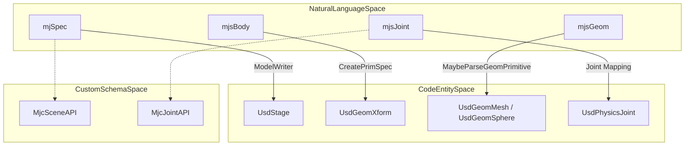
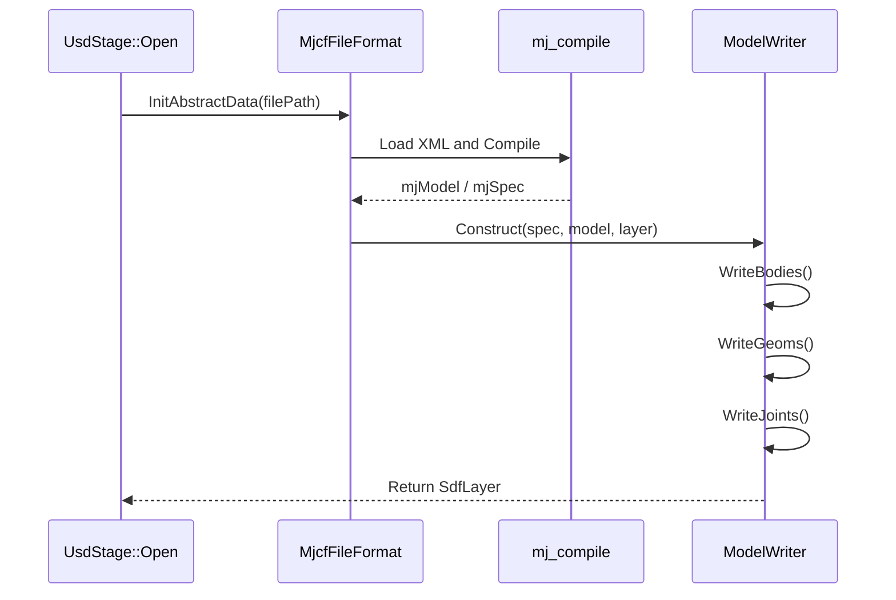

<!-- source: DeepWiki mcp.deepwiki.com · repo google-deepmind/mujoco · page 8.4 OpenUSD Integration · fetched 2026-10-26 -->

# OpenUSD Integration

<details>
<summary>Relevant source files</summary>

The following files were used as context for generating this wiki page:

- [cmake/third_party_deps/openusd.cmake](cmake/third_party_deps/openusd.cmake)
- [include/mujoco/experimental/usd/mjcPhysics/collisionAPI.h](include/mujoco/experimental/usd/mjcPhysics/collisionAPI.h)
- [include/mujoco/experimental/usd/mjcPhysics/jointAPI.h](include/mujoco/experimental/usd/mjcPhysics/jointAPI.h)
- [include/mujoco/experimental/usd/mjcPhysics/meshCollisionAPI.h](include/mujoco/experimental/usd/mjcPhysics/meshCollisionAPI.h)
- [include/mujoco/experimental/usd/mjcPhysics/sceneAPI.h](include/mujoco/experimental/usd/mjcPhysics/sceneAPI.h)
- [include/mujoco/experimental/usd/mjcPhysics/siteAPI.h](include/mujoco/experimental/usd/mjcPhysics/siteAPI.h)
- [include/mujoco/experimental/usd/mjcPhysics/tokens.h](include/mujoco/experimental/usd/mjcPhysics/tokens.h)
- [mjx/mujoco/mjx/_src/render_test.py](mjx/mujoco/mjx/_src/render_test.py)
- [plugin/usd_decoder/CMakeLists.txt](plugin/usd_decoder/CMakeLists.txt)
- [plugin/usd_decoder/kinematic_tree.cc](plugin/usd_decoder/kinematic_tree.cc)
- [plugin/usd_decoder/newton_tokens.cc](plugin/usd_decoder/newton_tokens.cc)
- [plugin/usd_decoder/usd_decoder.cc](plugin/usd_decoder/usd_decoder.cc)
- [python/mujoco/testdata/usd_golden.usda](python/mujoco/testdata/usd_golden.usda)
- [python/mujoco/usd/camera.py](python/mujoco/usd/camera.py)
- [python/mujoco/usd/demo.py](python/mujoco/usd/demo.py)
- [python/mujoco/usd/exporter.py](python/mujoco/usd/exporter.py)
- [python/mujoco/usd/exporter_test.py](python/mujoco/usd/exporter_test.py)
- [python/mujoco/usd/lights.py](python/mujoco/usd/lights.py)
- [python/mujoco/usd/objects.py](python/mujoco/usd/objects.py)
- [python/mujoco/usd/shapes.py](python/mujoco/usd/shapes.py)
- [python/mujoco/usd/utils.py](python/mujoco/usd/utils.py)
- [sample/cmake/SampleDependencies.cmake](sample/cmake/SampleDependencies.cmake)
- [simulate/cmake/SimulateDependencies.cmake](simulate/cmake/SimulateDependencies.cmake)
- [src/experimental/usd/CMakeLists.txt](src/experimental/usd/CMakeLists.txt)
- [src/experimental/usd/mjcPhysics/collisionAPI.cpp](src/experimental/usd/mjcPhysics/collisionAPI.cpp)
- [src/experimental/usd/mjcPhysics/generatedSchema.usda](src/experimental/usd/mjcPhysics/generatedSchema.usda)
- [src/experimental/usd/mjcPhysics/jointAPI.cpp](src/experimental/usd/mjcPhysics/jointAPI.cpp)
- [src/experimental/usd/mjcPhysics/meshCollisionAPI.cpp](src/experimental/usd/mjcPhysics/meshCollisionAPI.cpp)
- [src/experimental/usd/mjcPhysics/plugInfo.json](src/experimental/usd/mjcPhysics/plugInfo.json)
- [src/experimental/usd/mjcPhysics/sceneAPI.cpp](src/experimental/usd/mjcPhysics/sceneAPI.cpp)
- [src/experimental/usd/mjcPhysics/schema.usda](src/experimental/usd/mjcPhysics/schema.usda)
- [src/experimental/usd/mjcPhysics/siteAPI.cpp](src/experimental/usd/mjcPhysics/siteAPI.cpp)
- [src/experimental/usd/mjcPhysics/tokens.cpp](src/experimental/usd/mjcPhysics/tokens.cpp)
- [src/experimental/usd/plugins/mjcf/mjcf_file_format.cc](src/experimental/usd/plugins/mjcf/mjcf_file_format.cc)
- [src/experimental/usd/plugins/mjcf/mjcf_file_format.h](src/experimental/usd/plugins/mjcf/mjcf_file_format.h)
- [src/experimental/usd/plugins/mjcf/mujoco_to_usd.cc](src/experimental/usd/plugins/mjcf/mujoco_to_usd.cc)
- [src/experimental/usd/plugins/mjcf/mujoco_to_usd.h](src/experimental/usd/plugins/mjcf/mujoco_to_usd.h)
- [src/experimental/usd/plugins/mjcf/plugInfo.json](src/experimental/usd/plugins/mjcf/plugInfo.json)
- [src/experimental/usd/plugins/mjcf/utils.cc](src/experimental/usd/plugins/mjcf/utils.cc)
- [src/experimental/usd/plugins/mjcf/utils.h](src/experimental/usd/plugins/mjcf/utils.h)
- [test/engine/engine_collision_box_fuzz_test.cc](test/engine/engine_collision_box_fuzz_test.cc)
- [test/experimental/CMakeLists.txt](test/experimental/CMakeLists.txt)
- [test/experimental/usd/mjcPhysics/mjc_physics_scene_test.cc](test/experimental/usd/mjcPhysics/mjc_physics_scene_test.cc)
- [test/experimental/usd/plugins/mjcf/CMakeLists.txt](test/experimental/usd/plugins/mjcf/CMakeLists.txt)
- [test/experimental/usd/plugins/mjcf/mjcf_file_format_test.cc](test/experimental/usd/plugins/mjcf/mjcf_file_format_test.cc)
- [test/experimental/usd/test_utils.cc](test/experimental/usd/test_utils.cc)
- [test/experimental/usd/test_utils.h](test/experimental/usd/test_utils.h)
- [test/plugin/usd_decoder/CMakeLists.txt](test/plugin/usd_decoder/CMakeLists.txt)
- [test/plugin/usd_decoder/usd_decoder_test.cc](test/plugin/usd_decoder/usd_decoder_test.cc)
- [test/sample/CMakeLists.txt](test/sample/CMakeLists.txt)
- [test/sample/compile_test.sh](test/sample/compile_test.sh)
- [test/sample/testspeed_test.sh](test/sample/testspeed_test.sh)
- [test/user/testdata/lengthrange.xml](test/user/testdata/lengthrange.xml)

</details>


The MuJoCo OpenUSD integration provides experimental support for interoperability between MuJoCo and the Pixar OpenUSD ecosystem. This includes importing USD assets as MuJoCo models, exporting MJCF models to USD for high-fidelity rendering, and a dedicated USD schema for MuJoCo-specific physics properties.

## Architecture Overview

The integration is implemented through several components:
1.  **mjcPhysics Schema**: A custom USD schema defining MuJoCo-specific attributes (e.g., solver parameters, actuator dynamics) [src/experimental/usd/mjcPhysics/schema.usda:1-101]().
2.  **MJCF File Format Plugin (`usdMjcf`)**: A USD plugin that allows OpenUSD to open `.xml` (MJCF) files directly by translating them to USD in-memory [src/experimental/usd/plugins/mjcf/mjcf_file_format.cc:1-40]().
3.  **USD Decoder Plugin**: A MuJoCo engine plugin that allows MuJoCo to load `.usd` or `.usda` files as models [plugin/usd_decoder/usd_decoder.cc:1-50]().
4.  **Python USD Exporter**: A high-level utility for generating USD trajectories from MuJoCo simulations [python/mujoco/usd/exporter.py:36-51]().

### Data Flow: MJCF to USD Translation

The translation process converts MuJoCo's hierarchical body structure into a USD Xform hierarchy, mapping MJCF elements to USD Prims and MuJoCo attributes to `mjcPhysics` schema attributes.

Title: "MJCFToUSDEntityMapping"

Sources: [src/experimental/usd/plugins/mjcf/mujoco_to_usd.cc:178-191](), [plugin/usd_decoder/usd_decoder.cc:170-190](), [src/experimental/usd/mjcPhysics/schema.usda:96-105]()

## The mjcPhysics Schema

The `mjcPhysics` schema extends standard USD physics with MuJoCo's advanced simulation parameters. It is defined in `schema.usda` and generated into C++ classes via `usdGenSchema`.

### Key Schema APIs
*   **MjcSceneAPI**: Global simulation options including `mjc:option:timestep`, `mjc:option:integrator` (euler, rk4, implicit), and `mjc:option:solver` (pgs, cg, newton) [src/experimental/usd/mjcPhysics/schema.usda:106-220]().
*   **MjcJointAPI**: MuJoCo-specific joint properties like `mjc:armature`, `mjc:damping`, and `mjc:frictionloss` [src/experimental/usd/mjcPhysics/tokens.cpp:186-190]().
*   **MjcActuator**: Defines actuator dynamics including `mjc:dynType` (none, integrator, filter) and `mjc:gainType` [src/experimental/usd/mjcPhysics/tokens.cpp:79-81]().

Sources: [src/experimental/usd/mjcPhysics/schema.usda:1-245](), [src/experimental/usd/mjcPhysics/tokens.cpp:19-140](), [src/experimental/usd/mjcPhysics/generatedSchema.usda:6-91]()

## MJCF File Format Plugin (`usdMjcf`)

The `MjcfFileFormat` class implements the `Sdf_FileFormat` interface, allowing the USD library to treat MJCF XML files as USD layers.

### Implementation Details
*   **Discovery**: The plugin is registered in `plugInfo.json` to handle `.xml` extensions within specific contexts [src/experimental/usd/plugins/mjcf/plugInfo.json]().
*   **Translation**: When a file is opened, `mujoco::usd::MjcfToUsd` is called to populate an `SdfLayer` [src/experimental/usd/plugins/mjcf/mujoco_to_usd.cc:15-30]().
*   **ModelWriter**: The `ModelWriter` class iterates through the compiled `mjModel` and `mjSpec` to create USD PrimSpecs [src/experimental/usd/plugins/mjcf/mujoco_to_usd.cc:178-185]().

Title: "UsdMjcfPluginExecutionFlow"

Sources: [src/experimental/usd/plugins/mjcf/mjcf_file_format.cc:1-40](), [src/experimental/usd/plugins/mjcf/mujoco_to_usd.cc:178-200]()

## USD Decoder Plugin

The USD decoder allows MuJoCo to import USD files. It parses the USD stage and translates it back into MuJoCo's `mjSpec` format.

### Key Functions
*   **`SetLocalPoseFromPrim`**: Extracts translation and rotation from a USD Prim relative to its parent to set `mjsElement->pos` and `mjsElement->quat` [plugin/usd_decoder/usd_decoder.cc:134-148]().
*   **`MaybeParseGeomPrimitive`**: Maps `UsdGeomSphere`, `UsdGeomCube`, `UsdGeomCapsule`, and `UsdGeomCylinder` to MuJoCo `mjGEOM` types [plugin/usd_decoder/usd_decoder.cc:171-190]().
*   **`KinematicTree`**: A helper class that resolves the USD transform hierarchy into a nested MuJoCo body structure [plugin/usd_decoder/kinematic_tree.cc:1-30]().
*   **`SetUsdPrimPathUserValue`**: Stores the original USD prim path in the `mjsElement` user data for traceability [plugin/usd_decoder/usd_decoder.cc:95-103]().

Sources: [plugin/usd_decoder/usd_decoder.cc:86-112](), [plugin/usd_decoder/usd_decoder.cc:171-200](), [plugin/usd_decoder/usd_decoder.cc:134-148]()

## Python USD Exporter

The `USDExporter` class in `mujoco.usd.exporter` provides a high-level API for users to record MuJoCo simulations into USD format.

### Features
*   **Trajectory Recording**: Captures state changes over time using USD TimeCodes [python/mujoco/usd/exporter.py:136-143]().
*   **Material Handling**: Supports both solid colors and image-based textures (RGB, Cube maps) [python/mujoco/usd/objects.py:86-146]().
*   **Shape Generation**: Includes utility functions for creating USD-compatible triangle meshes for boxes, spheres, hemispheres, and cylinders [python/mujoco/usd/shapes.py:107-230]().
*   **Camera and Light Export**: Translates MuJoCo cameras and lights into `UsdGeomCamera` and `UsdLux` primitives [python/mujoco/usd/exporter.py:111-114]().

### Usage Example
```python
exp = exporter.USDExporter(model=m)
while data.time < duration:
    mujoco.mj_step(m, d)
    exp.update_scene(data=d) # Captures frame
exp.save_scene("output.usd")
```
Sources: [python/mujoco/usd/exporter.py:36-103](), [python/mujoco/usd/demo.py:32-49](), [python/mujoco/usd/shapes.py:107-140]()

## Build System and Dependencies

The OpenUSD integration requires the `OpenUSD` library as a dependency.

*   **CMake Configuration**: The build is controlled by `src/experimental/usd/CMakeLists.txt`. It defines two main targets: `usdMjcf` (the MJCF plugin) and `mjcPhysics` (the schema library) [src/experimental/usd/CMakeLists.txt:18-20]().
*   **Library Dependencies**: Both targets link against core USD libraries: `usd`, `ar`, `kind`, `tf`, `gf`, `vt`, `usdShade`, `usdLux`, `usdGeom`, and `usdPhysics` [src/experimental/usd/CMakeLists.txt:25-27]().
*   **Plugin Installation**: Plugins and their `plugInfo.json` files are installed to a dedicated resources directory [src/experimental/usd/CMakeLists.txt:22-23]().
*   **Houdini Support**: Includes specific configuration helpers for integrating with Houdini's USD (Solaris) environment [src/experimental/usd/CMakeLists.txt:64-103]().

Sources: [src/experimental/usd/CMakeLists.txt:15-103](), [src/experimental/usd/CMakeLists.txt:186-201]()

---

