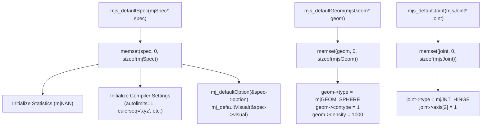
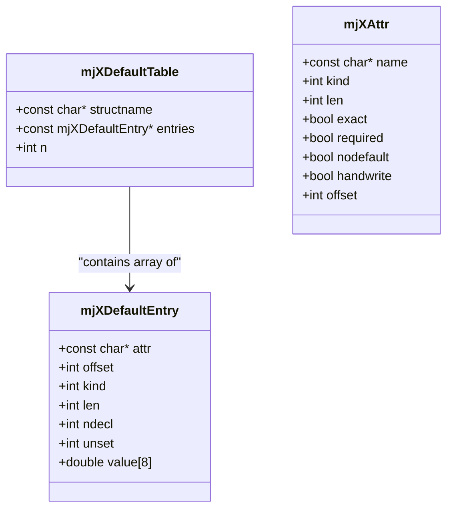
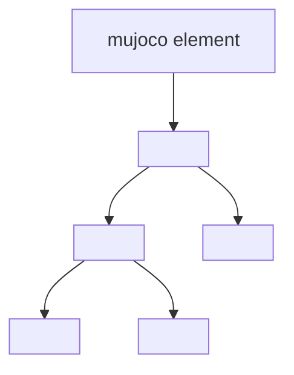

<!-- source: DeepWiki mcp.deepwiki.com · repo google-deepmind/mujoco · page 9.1 Default System and Inheritance · fetched 2026-10-26 -->

# Default System and Inheritance

Relevant source files

The following files were used as context for generating this wiki page:

- [src/user/user_init.c](src/user/user_init.c)
- [src/xml/generated/dmcontrol_schema.xml](src/xml/generated/dmcontrol_schema.xml)
- [src/xml/generated/mjcf.xsd](src/xml/generated/mjcf.xsd)
- [src/xml/generated/mjcf_default_table.inc](src/xml/generated/mjcf_default_table.inc)
- [src/xml/generated/mjcf_map.h](src/xml/generated/mjcf_map.h)
- [src/xml/generated/mjcf_read_table.inc](src/xml/generated/mjcf_read_table.inc)
- [src/xml/generated/mjcf_table.inc](src/xml/generated/mjcf_table.inc)
- [src/xml/mjcf.schema](src/xml/mjcf.schema)

## Purpose and Scope

This page documents MuJoCo's **default system**, which provides class-based property inheritance for model elements defined in MJCF and programmatically via `mjSpec`. The default system allows users to define reusable sets of attribute defaults that can be applied across multiple elements, reducing redundancy and ensuring consistent physical properties throughout complex models.

Key components covered:
- Default attribute initialization functions (`mjs_defaultSpec`, `mjs_defaultGeom`, `mjs_defaultJoint`, etc.).
- The schema-driven default tables (`mjXDefaultEntry`, `mjXDefaultTable`) used for runtime reflection and validation.
- The hierarchical inheritance mechanism and class override behavior in MJCF.

Sources: [src/user/user_init.c:26-69](), [src/xml/generated/mjcf_default_table.inc:29-43]()

---

## Overview of the Default System

The default system in MuJoCo is designed around hierarchical structures where element properties can inherit values from named default classes. In both `mjSpec` and MJCF parsing (`xml_native_reader`), attributes are initialized from baseline constructor defaults and overridden by user-defined default classes or explicit element attributes.

Key architectural elements:
1. **Base Default Constructors**: C functions in `src/user/user_init.c` that populate `mjSpec` sub-structures with standard physical values (e.g., water density for geoms, default joint types, gravity vectors).
2. **Generated Default Tables**: Reflection tables (`mjXDefaultTable`) generated from `src/xml/mjcf.schema` that map schema attributes to struct offsets and default numeric values.
3. **Inheritance & Scope**: Nested `<default>` tags in MJCF form inheritance trees where child default classes inherit properties from their parent classes.

Sources: [src/user/user_init.c:26-240](), [src/xml/generated/mjcf_default_table.inc:15-43]()

---

## Default Initialization Architecture

### C Default Constructors (`user_init.c`)

When a specification (`mjSpec`) or its sub-components are instantiated, default values are assigned via dedicated initialization functions. For example, `mjs_defaultSpec` initializes global options, compiler flags, and sizing parameters [src/user/user_init.c:26-69](). Similarly, component-specific initializers configure defaults for bodies, geoms, joints, sites, cameras, lights, and flexible components.

**Default Initialization Call Flow**

**Key Initializer Functions:**
- `mjs_defaultSpec`: Initializes global specification options, statistics, and user limits [src/user/user_init.c:26-69]().
- `mjs_defaultBody`: Sets up body frames, orientation quaternions (`quat[0] = 1`), and optimization flags [src/user/user_init.c:79-95]().
- `mjs_defaultJoint`: Sets default joint type to hinge (`mjJNT_HINGE`), axis along Z (`axis[2] = 1`), and limit behaviors [src/user/user_init.c:107-116]().
- `mjs_defaultGeom`: Configures default geometry type (`mjGEOM_SPHERE`), friction coefficients, RGBA color (`0.5, 0.5, 0.5, 1.0`), and fluid drag coefficients [src/user/user_init.c:120-158]().

Sources: [src/user/user_init.c:26-240]()

---

## Schema-Driven Default Tables

To bridge MJCF schema declarations with compiled C structures, MuJoCo auto-generates default tables (`mjXDefaultTable`) and attribute reading tables (`mjXAttr`) from `src/xml/mjcf.schema`.

### Default Table Data Structures

Each entry in `mjXDefaultEntry` links a schema attribute name to its byte offset within the corresponding C struct (`offsetof`), data type kind (`0=double`, `1=float`, `2=int`, `3=byte`, `4=mjtNum`), array length, and default numeric values.

**Example Default Entries (`mjcf_default_table.inc`):**
- `mjLROpt` (length range options) defaults [src/xml/generated/mjcf_default_table.inc:46-57]()
- `mjOption` defaults for gravity (`0.0, 0.0, -9.81`), solver iterations, and tolerances [src/xml/generated/mjcf_default_table.inc:59-86]()

Sources: [src/xml/generated/mjcf_default_table.inc:29-43](), [src/xml/generated/mjcf_read_table.inc:18-22]()

---

## MJCF Default Classes and Inheritance Hierarchy

In MJCF, default classes are defined inside the `<default>` element hierarchy. The grammar table (`MJCF`) parsed by `mjXSchema` defines recursive default scoping:

### Inheritance and Override Rules
1. **Hierarchical Scoping**: Nested `<default>` blocks inherit all attribute values defined in their parent `<default>` blocks.
2. **Explicit Override**: Specifying an attribute on a child default class overrides the inherited value for that specific attribute.
3. **Element Reference**: When a concrete element (e.g., `<geom class='robot'/>`) is instantiated, it looks up the named default class (`robot`), resolves its attribute chain up to the root (`main`), and applies any un-overridden defaults.

Sources: [src/xml/generated/mjcf_table.inc:73-112](), [src/xml/generated/mjcf_read_table.inc:25-48]()

---

## Summary

MuJoCo's default system combines programmatic C constructors with schema-driven metadata to provide robust, hierarchical property inheritance:
1. **`user_init.c`** supplies baseline C values for all specification structs [src/user/user_init.c:26-240]().
2. **Generated Default Tables (`mjcf_default_table.inc`)** enforce consistency between the MJCF schema and C struct offsets [src/xml/generated/mjcf_default_table.inc:15-43]().
3. **MJCF Default Hierarchies** allow modular, reusable class definitions that streamline model creation and maintenance.

Sources: [src/user/user_init.c:26-240](), [src/xml/generated/mjcf_default_table.inc:15-43](), [src/xml/generated/mjcf_table.inc:73-112]()

---

