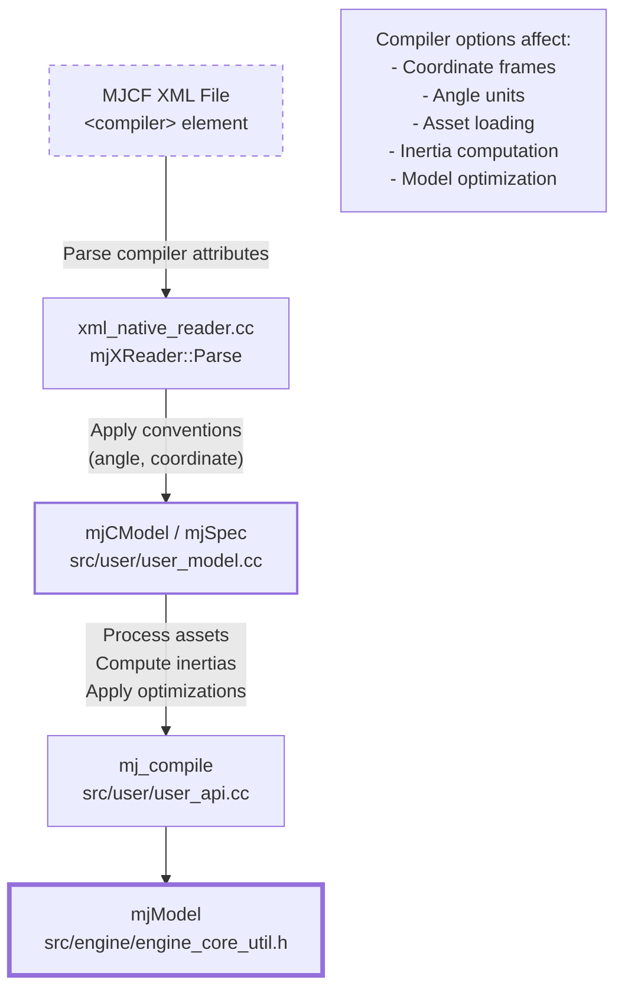
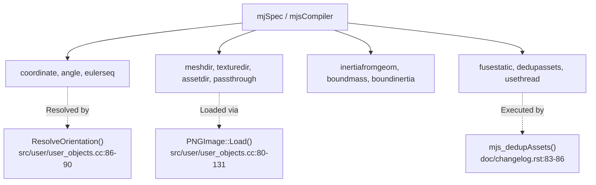
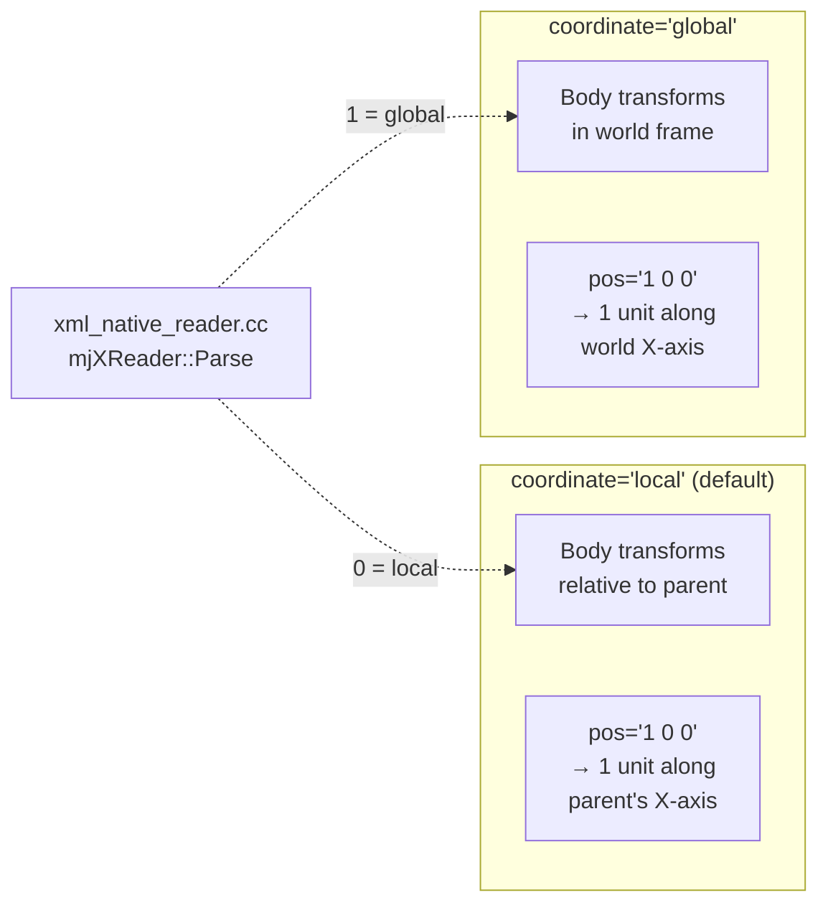
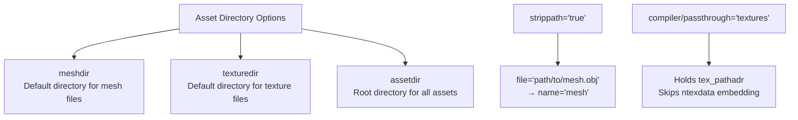
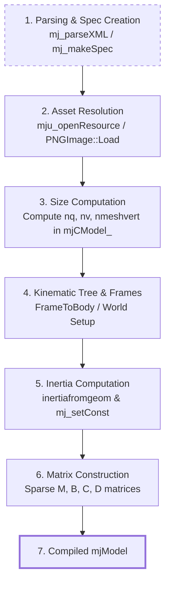

<!-- source: DeepWiki mcp.deepwiki.com · repo google-deepmind/mujoco · page 9.2 Compiler Options and Processing · fetched 2026-10-26 -->

# Compiler Options and Processing

<details>
<summary>Relevant source files</summary>

The following files were used as context for generating this wiki page:

- [doc/XMLreference.rst](doc/XMLreference.rst)
- [doc/XMLschema.rst](doc/XMLschema.rst)
- [doc/changelog.rst](doc/changelog.rst)
- [src/user/user_api.cc](src/user/user_api.cc)
- [src/user/user_api.h](src/user/user_api.h)
- [src/user/user_mesh.cc](src/user/user_mesh.cc)
- [src/user/user_model.cc](src/user/user_model.cc)
- [src/user/user_model.h](src/user/user_model.h)
- [src/user/user_objects.cc](src/user/user_objects.cc)
- [src/user/user_objects.h](src/user/user_objects.h)
- [src/xml/xml_native_reader.cc](src/xml/xml_native_reader.cc)
- [src/xml/xml_native_writer.cc](src/xml/xml_native_writer.cc)
- [test/user/user_api_test.cc](test/user/user_api_test.cc)
- [test/user/user_mesh_test.cc](test/user/user_mesh_test.cc)
- [test/user/user_model_test.cc](test/user/user_model_test.cc)
- [test/user/user_objects_test.cc](test/user/user_objects_test.cc)
- [test/xml/xml_native_reader_test.cc](test/xml/xml_native_reader_test.cc)
- [test/xml/xml_native_writer_test.cc](test/xml/xml_native_writer_test.cc)

</details>


This document describes the compiler options available in MJCF XML files and how they control the processing, validation, and transformation of model specifications during compilation. These options affect coordinate conventions, angle representations, asset handling, inertia computation, and various model optimizations within the MuJoCo compiler pipeline.

## Overview

Compiler options are specified in the `<compiler>` element of MJCF files and control how the model is parsed, validated, and transformed during compilation. These settings are compile-time only and do not affect runtime behavior (unlike `<option>` settings which are stored in `mjModel.opt`). The compilation process is managed by `mj_compile` [src/user/user_api.cc:58-61]() operating on `mjSpec` and `mjCModel` [src/user/user_model.cc:130-180]().



Sources: `[src/xml/xml_native_reader.cc:173-181]`, `[src/user/user_api.cc:58-61]`, `[src/user/user_model.cc:130-180]`

## Compiler Options Categories

The compiler options can be grouped into several functional categories defined in the MJCF schema. These are read by the `Reader` functor struct in `xml_native_reader.cc` and stored within the `mjsCompiler` and `mjCModel` structures.

| Category | Options | Purpose | Code Entity / Mechanism |
|----------|---------|---------|-------------------------|
| **Conventions** | `coordinate`, `angle`, `eulerseq` | Define coordinate frame and angle representation | `ResolveOrientation` [src/user/user_objects.h:86-90]() |
| **Asset Handling** | `meshdir`, `texturedir`, `assetdir`, `strippath`, `passthrough` | Control asset file loading, path processing, and embedding | `PNGImage::Load` [src/user/user_objects.cc:57-78]() |
| **Inertia** | `inertiafromgeom`, `boundmass`, `boundinertia`, `settotalmass`, `balanceinertia` | Configure inertia computation and numerical bounding | `mj_setConst` [src/user/user_model.cc:136-140]() |
| **Limits** | `autolimits` | Automatic limit inference for actuators and joints | `checklimited` [src/user/user_objects.cc:172-182]() |
| **Optimization** | `fusestatic`, `dedupassets`, `discardvisual`, `usethread` | Model optimization, asset deduplication, and simplification | `mjs_fuseStatic`, `mjs_dedupAssets` [doc/changelog.rst:75-86]() |



Sources: `[src/xml/xml_native_reader.cc:75-129]`, `[doc/XMLreference.rst:173-181]`, `[doc/changelog.rst:75-86]`

## Coordinate and Angle Conventions

### Coordinate Frame Convention

The `coordinate` attribute determines how body positions and orientations are interpreted (`local` vs `global`). This is parsed during the XML ingestion phase and stored in the `mjCModel` hierarchy [src/user/user_model.cc:130-180]().



Sources: `[src/xml/xml_native_reader.cc:196-215]`, `[src/user/user_model.cc:130-180]`

### Angle Representation

The `angle` attribute controls the units for all angular values in the model (`radian` or `degree`). Internally, MuJoCo converts all angles to radians for the runtime `mjModel`. The conversion and alternative Euler sequence handling are executed by `ResolveOrientation` [src/user/user_objects.h:86-90]() and `FrameToBody` [src/user/user_objects.cc:150-162]().

Sources: `[src/xml/xml_native_reader.cc:173-176]`, `[src/user/user_objects.cc:150-174]`, `[src/user/user_objects.h:86-90]`

## Asset Processing Options

### Asset Directory Configuration and Passthrough

Asset paths are resolved using `meshdir`, `texturedir`, and `assetdir`. The `strippath` option determines if directory information is stripped from file names when generating object names. Additionally, textures can be kept by reference using `compiler/passthrough` set to `"textures"` or `texture/embed` set to `"false"`, avoiding pixel decoding into `mjModel` memory [doc/changelog.rst:94-101]().



Sources: `[src/xml/xml_native_reader.cc:75-129]`, `[doc/changelog.rst:94-101]`

### Mesh and Texture Loading

The compiler handles loading and decoding assets via `PNGImage::Load` [src/user/user_objects.cc:80-131]() using `lodepng` [src/user/user_objects.cc:41-41](), and mesh preprocessing in `mjCMesh` constructors and qhull integration [src/user/user_mesh.cc:192-235](). Asset deduplication is supported via `mjs_dedupAssets` (`MjSpec.dedup_assets`) [doc/changelog.rst:83-86]().

Sources: `[src/user/user_objects.cc:57-131]`, `[src/user/user_mesh.cc:192-235]`, `[doc/changelog.rst:83-86]`

## Inertia Computation Options

MuJoCo automatically computes inertial properties (mass, center of mass, inertia tensor) from geoms if `inertiafromgeom` is enabled:
- **Bounding:** `boundmass` and `boundinertia` enforce lower bounds on diagonal inertia and mass for numerical stability.
- **Scaling:** `settotalmass` rescales the total mass of the model to a specified target.
- **Derivation:** Values are calculated during compilation and finalized via `mj_setConst` [src/user/user_model.cc:136-140]().

Sources: `[src/xml/xml_native_reader.cc:75-129]`, `[src/user/user_model.cc:136-140]`, `[doc/changelog.rst:35-48]`

## Automatic Limit Inference

The `autolimits` option enables automatic limit checking and inference. If a joint defines a `range` but lacks explicit `limited="true"`, and `autolimits` is false, the compiler triggers an error via `mjCError` [src/user/user_objects.cc:172-182]().

```cpp
// From src/user/user_objects.cc:172-182
static void checklimited(
  const mjCBase* obj,
  bool autolimits, const char* entity, const char* attr, int limited, bool hasrange) {
  if (!autolimits && limited == 2 && hasrange) {
    std::stringstream ss;
    ss << entity << " has `" << attr << "range` but not `" << attr << "limited`. "
       << "set the autolimits=\"true\" compiler option...";
    throw mjCError(obj, "%s", ss.str().c_str());
  }
}
```

Sources: `[src/user/user_objects.cc:172-182]`

## Model Optimization and Multithreading

### Multithreaded Compilation

MuJoCo supports multithreaded compilation via the `usethread` option. The `NumCompilerThreads` utility computes the optimal thread count based on hardware concurrency [src/user/user_model.cc:78-86]().

```cpp
// From src/user/user_model.cc:78-86
unsigned int NumCompilerThreads(int upper_bound = -1) {
  unsigned int nthreads = std::thread::hardware_concurrency() / 2;
  if (upper_bound > 0) { nthreads = std::min(nthreads, static_cast<unsigned int>(upper_bound)); }
  return std::max(static_cast<unsigned int>(1), nthreads);
}
```

Sources: `[src/user/user_model.cc:78-86]`

### Static Body Fusion and Deletion

The compiler supports optimizations such as `mjs_fuseStatic` (merging static bodies without degrees of freedom) and `mjs_discardVisual` [doc/changelog.rst:75-77](), which strip out pure visual elements to streamline simulation memory and performance.

Sources: `[src/user/user_model.cc:130-180]`, `[doc/changelog.rst:75-77]`

## Compilation Processing Phases

The compilation pipeline transforms an `mjSpec` instance into an immutable runtime `mjModel`:



1. **Parsing / Spec Creation:** XML files or API calls populate `mjSpec` (`mjCModel`) [src/user/user_model.cc:130-180]().
2. **Asset Resolution:** Meshes, textures, and heightfields are loaded via `mjResource` and cached [src/user/user_api.cc:100-117]().
3. **Size Computation:** The compiler calculates buffer sizes (`nq`, `nv`, `nmeshvert`, etc.) stored in `mjCModel_` [src/user/user_model.cc:54-135]().
4. **Kinematic Tree Construction:** Bodies, joints, and frames are assembled and normalized [src/user/user_model.cc:152-180]().
5. **Inertia Computation:** Inertial properties are derived and validated via `mj_setConst` [doc/changelog.rst:35-41]().
6. **Matrix Construction:** Sparse structures (inertia matrix $M$, constraint Jacobians) are allocated [src/user/user_model.cc:130-135]().

Sources: `[src/user/user_api.cc:58-117]`, `[src/user/user_model.cc:54-180]`, `[doc/changelog.rst:35-41]`

---

