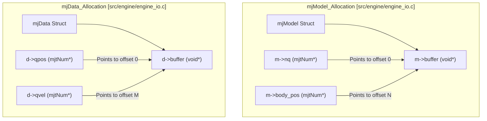
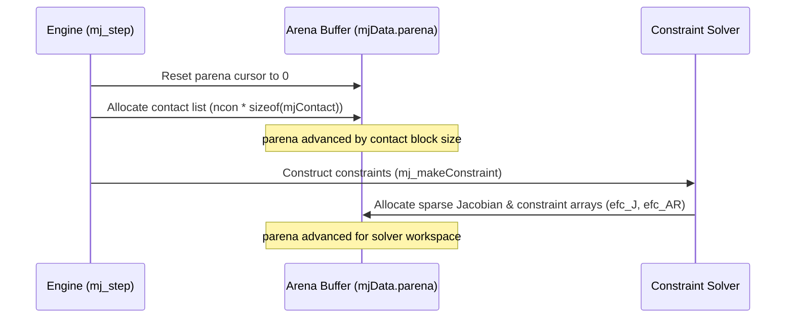
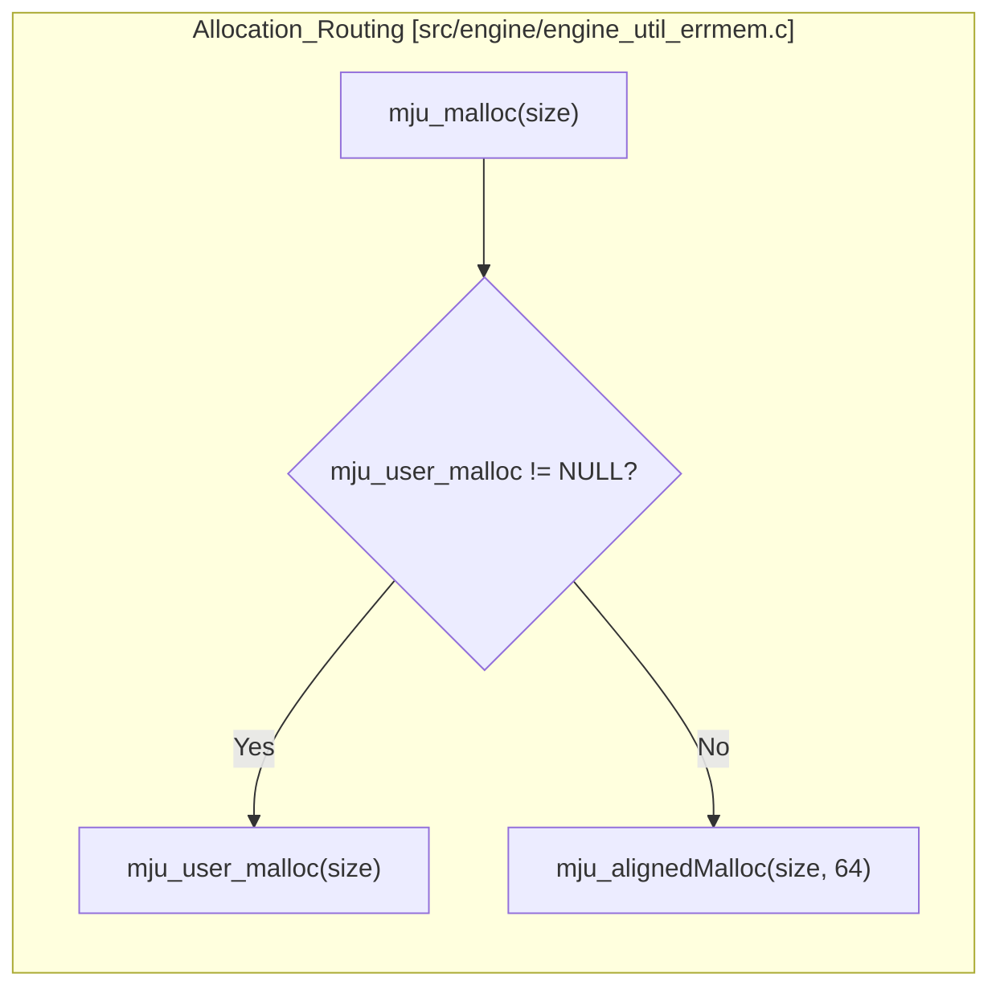

<!-- source: DeepWiki mcp.deepwiki.com · repo google-deepmind/mujoco · page 9.3 Memory Management Strategies · fetched 2026-10-26 -->

# Memory Management Strategies

<details>
<summary>Relevant source files</summary>

The following files were used as context for generating this wiki page:

- [doc/APIreference/APIglobals.rst](doc/APIreference/APIglobals.rst)
- [doc/APIreference/functions.rst](doc/APIreference/functions.rst)
- [doc/APIreference/functions_override.rst](doc/APIreference/functions_override.rst)
- [doc/includes/references.h](doc/includes/references.h)
- [include/mujoco/mjdata.h](include/mujoco/mjdata.h)
- [include/mujoco/mjmodel.h](include/mujoco/mjmodel.h)
- [include/mujoco/mjsan.h](include/mujoco/mjsan.h)
- [include/mujoco/mjspec.h](include/mujoco/mjspec.h)
- [include/mujoco/mjxmacro.h](include/mujoco/mjxmacro.h)
- [include/mujoco/mujoco.h](include/mujoco/mujoco.h)
- [python/mujoco/introspect/functions.py](python/mujoco/introspect/functions.py)
- [python/mujoco/introspect/structs.py](python/mujoco/introspect/structs.py)
- [src/engine/engine_callback.c](src/engine/engine_callback.c)
- [src/engine/engine_crossplatform.cc](src/engine/engine_crossplatform.cc)
- [src/engine/engine_crossplatform.h](src/engine/engine_crossplatform.h)
- [src/engine/engine_io.c](src/engine/engine_io.c)
- [src/engine/engine_io.h](src/engine/engine_io.h)
- [src/engine/engine_macro.h](src/engine/engine_macro.h)
- [src/engine/engine_memory.c](src/engine/engine_memory.c)
- [src/engine/engine_memory.h](src/engine/engine_memory.h)
- [src/engine/engine_print.c](src/engine/engine_print.c)
- [src/engine/engine_thread.cc](src/engine/engine_thread.cc)
- [src/engine/engine_util_errmem.c](src/engine/engine_util_errmem.c)
- [test/engine/engine_io_test.cc](test/engine/engine_io_test.cc)
- [unity/Runtime/Bindings/MjBindings.cs](unity/Runtime/Bindings/MjBindings.cs)

</details>


## Purpose and Scope

This page documents MuJoCo's internal memory management architecture, focusing on performance-critical allocation strategies, contiguous buffer layouts, arena and stack-based allocation mechanisms (`mj_markStack`/`mj_freeStack`), thread-specific memory management, error/warning handling, buffer alignment, and sanitizer support.

## Memory Architecture Overview

MuJoCo avoids fine-grained, dynamic heap allocations during simulation steps. Instead, it pre-allocates large contiguous memory blocks for core runtime structures (`mjModel` and `mjData`). This strategy eliminates heap fragmentation, maximizes CPU cache locality, and simplifies serialization and parallelization.

### Contiguous Buffer Layout

Both `mjModel` and `mjData` are backed by single monolithic heap allocations. All internal array pointers within these structures are initialized to point directly into specific offsets within their respective master buffers. For `mjModel`, pointer assignment is automated using the `MJMODEL_POINTERS` x-macro [src/engine/engine_io.c:148-160]().

Title: MuJoCo Contiguous Buffer Layout (`mjModel` / `mjData`)

Sources: [src/engine/engine_io.c:148-165](), [include/mujoco/mjmodel.h](), [include/mujoco/mjdata.h]()

### Buffer Alignment

To optimize SIMD vectorization and cache line utilization, MuJoCo enforces strict **64-byte alignment** for all arrays residing inside `mjModel` and `mjData` buffers. Alignment padding is dynamically calculated using the `SKIP` macro [src/engine/engine_io.c:135-142]().

| Alignment Parameter | Implementation Detail | Code Reference |
| :--- | :--- | :--- |
| **Buffer Alignment Constant** | 64-byte boundary enforcement | `BUFFER_ALIGN` [src/engine/engine_io.c:135]() |
| **Padding Calculation** | Computes bytes needed to reach alignment | `SKIP(intptr_t offset)` [src/engine/engine_io.c:139-142]() |
| **Pointer Binding** | Offsets base pointer with alignment skip | `mj_setPtrModel(mjModel* m)` [src/engine/engine_io.c:148-160]() |

Sources: [src/engine/engine_io.c:132-142](), [src/engine/engine_io.c:148-160]()

## Arena Allocation

The **Arena** is a dynamic scratchpad located inside `mjData` (`narena`, `parena`), utilized for objects whose sizes fluctuate or are only known at runtime, such as detected contacts (`mjContact`) and sparse constraint matrices (`efc_*`).

### Arena Characteristics and Lifecycle
- **Lifetime:** Managed via the `parena` tracking cursor, which points to the first available free byte in the arena buffer [include/mujoco/mjdata.h:110]().
- **Allocation Pattern:** Monotonic linear growth during simulation steps. Individual arena objects are not dynamically freed piece-by-piece; instead, the entire arena pointer is reset at the start of simulation cycles.
- **Capacity:** Bounded by `mjData.narena`, which defines the total arena allocation size in bytes (inclusive of stack memory) [include/mujoco/mjdata.h:101]().

Title: Arena Allocation Lifecycle (`mjData` Buffer)

Sources: [include/mujoco/mjdata.h:99-111](), [doc/includes/references.h:85-97]()

## Stack-Based Allocation

MuJoCo implements a specialized stack-based scratch allocation mechanism residing inside the `mjData` memory pool. This provides ultra-fast temporary storage for recursive or sub-routine physics computations without hitting the operating system heap.

### Key Stack Fields in `mjData`
- `pstack`: Tracks the first available byte in the stack (mutable during execution) [include/mujoco/mjdata.h:106]().
- `pbase`: Records the value of `pstack` when `mj_markStack` is invoked, enabling nested stack frames and rollbacks [include/mujoco/mjdata.h:107]().
- `maxuse_stack`: Diagnostic counter tracking peak stack usage in bytes [include/mujoco/mjdata.h:117]().

### Thread-Specific Stacks and Concurrency
During multi-threaded execution or batched rollouts, each worker thread operates on its own dedicated `mjData` instance. The `threadlock` flag can disable stack freeing temporarily to safeguard concurrent execution across parallel thread pools [include/mujoco/mjdata.h:114]().

| Stack Entity | Struct Field | Functional Role |
| :--- | :--- | :--- |
| **Stack Pointer** | `d->pstack` | Current head of temporary stack allocations [include/mujoco/mjdata.h:106]() |
| **Stack Base Marker** | `d->pbase` | Saved stack level for `mj_freeStack` resets [include/mujoco/mjdata.h:107]() |
| **Peak Usage Stat** | `d->maxuse_stack` | Diagnostic metric for memory profiling [include/mujoco/mjdata.h:117]() |
| **Thread Lock** | `d->threadlock` | Prevents stack release during threaded calls [include/mujoco/mjdata.h:114]() |

Sources: [include/mujoco/mjdata.h:100-121](), [doc/includes/references.h:90-105]()

## Custom Memory and Error Handling Callbacks

MuJoCo permits embedding applications to intercept and override heap memory allocations and error reporting through global function pointers.

### Memory Allocation Handlers
- `mju_user_malloc`: Custom heap allocation callback. When installed, MuJoCo routes all permanent heap allocations through this function instead of aligned `malloc` [include/mujoco/mujoco.h:45]().
- `mju_user_free`: Custom heap deallocation callback paired with `mju_user_malloc` [include/mujoco/mujoco.h:46]().

### Error and Warning Handlers
- `mju_user_error` / `mju_user_warning`: Legacy user-installable error hooks (deprecated in favor of `mju_setLogHandler`) [include/mujoco/mujoco.h:48-50]().

Title: Memory Routing to Custom Callbacks (`mju_malloc`)

Sources: [include/mujoco/mujoco.h:44-51](), [src/engine/engine_util_errmem.c]()

## Memory Safety and Sanitizer Support

MuJoCo includes explicit instrumentation for AddressSanitizer (ASAN) and MemorySanitizer (MSAN) to detect out-of-bounds errors, uninitialized reads, and buffer overflows in its manual memory layouts [src/engine/engine_io.c:41-48]().

### Poisoning and Padding Checks
When compiled with ASAN (`mjUSEASAN`), MuJoCo explicitly "poisons" padding bytes introduced by 64-byte alignment between model arrays using sanitizer intrinsics (`ASAN_POISON_MEMORY_REGION`). Any accidental read or write into alignment padding triggers an immediate segmentation fault and sanitizer report [src/engine/engine_io.c:157-173]().

```c
// Example of ASAN poisoning in model setup
ASAN_POISON_MEMORY_REGION(ptr, PTRDIFF(m->name, ptr));
```
Sources: [src/engine/engine_io.c:41-49](), [src/engine/engine_io.c:156-174](), [unity/Runtime/Bindings/MjBindings.cs:67-68]()

## Summary of Memory Management Entities

| Code Symbol / Function | File Location | Architectural Role |
| :--- | :--- | :--- |
| `mj_makeModel` | [src/engine/engine_io.c]() | Allocates and initializes master `mjModel` contiguous buffer |
| `mj_makeData` | [src/engine/engine_init.h]() | Allocates `mjData`, arena scratchpad, and state vectors |
| `mj_setPtrModel` | [src/engine/engine_io.c:148]() | Binds `mjModel` struct pointers to aligned buffer offsets |
| `pstack` / `pbase` / `parena` | [include/mujoco/mjdata.h:105-110]() | Runtime workspace stack and arena tracking pointers |
| `mju_user_malloc` / `mju_user_free` | [include/mujoco/mujoco.h:45-46]() | Custom memory allocator hook points for host integrations |
| `ASAN_POISON_MEMORY_REGION` | [src/engine/engine_io.c:157]() | AddressSanitizer integration for detecting buffer overflows |

Sources: [src/engine/engine_io.c:148-174](), [include/mujoco/mjdata.h:98-115](), [include/mujoco/mujoco.h:44-51]()

---

