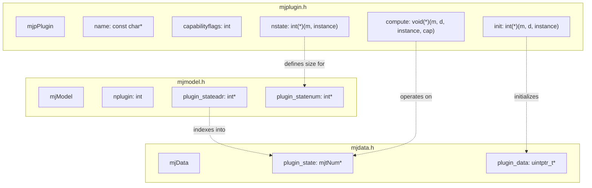
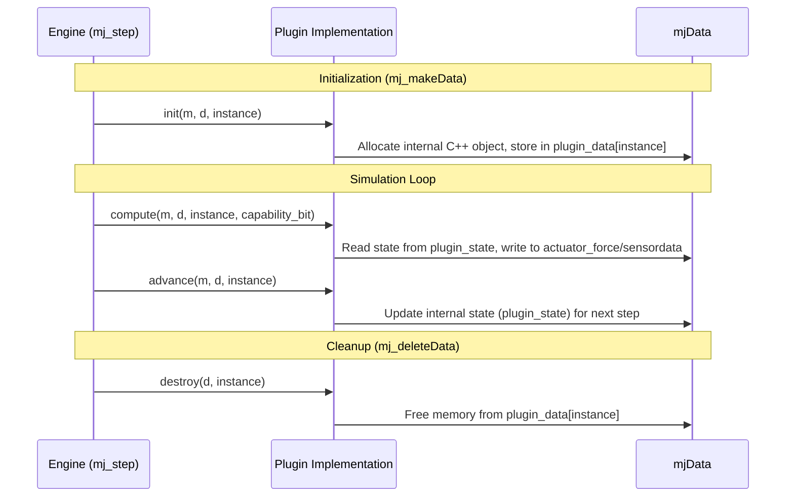
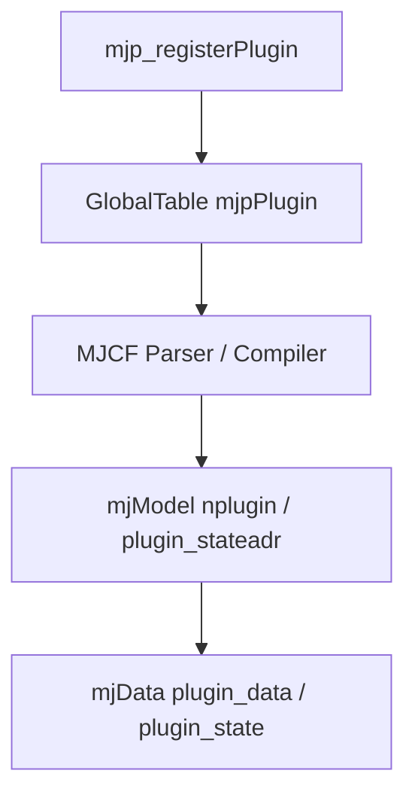

<!-- source: DeepWiki mcp.deepwiki.com · repo google-deepmind/mujoco · page 9.4 Plugin System · fetched 2026-10-26 -->

# Plugin System

Relevant source files

The following files were used as context for generating this wiki page:

- [STYLEGUIDE.md](STYLEGUIDE.md)
- [doc/generate/generate_api_header.py](doc/generate/generate_api_header.py)
- [doc/generate/generate_functions.py](doc/generate/generate_functions.py)
- [doc/programming/extension.rst](doc/programming/extension.rst)
- [include/mujoco/mjplugin.h](include/mujoco/mjplugin.h)
- [plugin/elasticity/cable.cc](plugin/elasticity/cable.cc)
- [plugin/elasticity/cable.h](plugin/elasticity/cable.h)
- [plugin/sdf/gear.cc](plugin/sdf/gear.cc)
- [plugin/sdf/sdf.cc](plugin/sdf/sdf.cc)
- [plugin/sdf/sdf.h](plugin/sdf/sdf.h)
- [plugin/sensor/touch_grid.cc](plugin/sensor/touch_grid.cc)
- [src/engine/engine_plugin.cc](src/engine/engine_plugin.cc)
- [src/engine/engine_plugin.h](src/engine/engine_plugin.h)
- [src/user/user_resource.cc](src/user/user_resource.cc)
- [src/user/user_resource.h](src/user/user_resource.h)
- [src/user/user_vfs.cc](src/user/user_vfs.cc)
- [src/user/user_vfs.h](src/user/user_vfs.h)
- [test/CMakeLists.txt](test/CMakeLists.txt)
- [test/doc/doc_test.py](test/doc/doc_test.py)
- [test/engine/engine_plugin_test.cc](test/engine/engine_plugin_test.cc)
- [test/plugin/actuator/CMakeLists.txt](test/plugin/actuator/CMakeLists.txt)
- [test/plugin/decoder/decoder_test.cc](test/plugin/decoder/decoder_test.cc)
- [test/plugin/elasticity/CMakeLists.txt](test/plugin/elasticity/CMakeLists.txt)
- [test/plugin/elasticity/elasticity_test.cc](test/plugin/elasticity/elasticity_test.cc)
- [test/plugin/sensor/CMakeLists.txt](test/plugin/sensor/CMakeLists.txt)
- [test/plugin/sensor/sensor_test.cc](test/plugin/sensor/sensor_test.cc)
- [test/user/user_resource_test.cc](test/user/user_resource_test.cc)
- [test/user/user_vfs_test.cc](test/user/user_vfs_test.cc)
- [test/xml/xml_api_test.cc](test/xml/xml_api_test.cc)

## Purpose and Scope

The plugin system provides a mechanism for extending MuJoCo's core functionality without modifying the engine itself. Plugins can implement custom passive forces, actuators, sensors, signed distance functions (SDFs) for procedural geometry, elasticity models, and resource/decoder providers (such as decoders for `obj`, `stl`, or `gmsh` files) [doc/programming/extension.rst:6-7](). 

MuJoCo plugins are designed to be **thread-safe**, **stateful**, and **interoperable**. Unlike global callbacks, plugin instances are thread-local and their state is managed by the engine, allowing for correct serialization and deserialization of the full simulation state [doc/programming/extension.rst:19-27]().

Sources: [doc/programming/extension.rst:1-27]()

---

## Plugin Architecture

### Core Entities

The system distinguishes between the **Plugin** (stateless logic) and the **Plugin Instance** (runtime state).

| Entity | Description | Code Reference |
| :--- | :--- | :--- |
| **Plugin** | A collection of stateless functions and static attributes bundled into a struct. | `mjpPlugin` [include/mujoco/mjplugin.h:121-153]() |
| **Plugin Instance** | The runtime state operated on by the plugin logic, represented as a model element. | `mjOBJ_PLUGIN` [doc/programming/extension.rst:38-42]() |

### Code Entity Space Mapping

The following diagram maps high-level plugin concepts to the specific structures and function pointers defined in the MuJoCo header files.

**Diagram:** Plugin Data Structure Mapping
Sources: [include/mujoco/mjplugin.h:121-153](), [doc/programming/extension.rst:30-46]()

---

## Plugin Capabilities

Plugins declare their functionality via a bitfield of `mjtPluginCapabilityBit` [include/mujoco/mjplugin.h:114-120]().

| Capability | Flag | Role |
| :--- | :--- | :--- |
| **Actuator** | `mjPLUGIN_ACTUATOR` | Computes actuator forces and internal dynamics [include/mujoco/mjplugin.h:115](). |
| **Sensor** | `mjPLUGIN_SENSOR` | Provides custom measurements [include/mujoco/mjplugin.h:116](). |
| **Passive** | `mjPLUGIN_PASSIVE` | Applies passive forces (e.g., springs, damping, elasticity) [include/mujoco/mjplugin.h:117](). |
| **SDF** | `mjPLUGIN_SDF` | Defines procedural geometry via Signed Distance Fields [include/mujoco/mjplugin.h:118](). |

Sources: [include/mujoco/mjplugin.h:114-120](), [doc/programming/extension.rst:76-89]()

---

## Plugin Lifecycle and Data Flow

The engine manages plugin execution through specific lifecycle callbacks invoked during simulation and data allocation.

**Diagram:** Plugin Lifecycle Sequence
Sources: [include/mujoco/mjplugin.h:136-152](), [test/engine/engine_plugin_test.cc:229-253]()

### Key Callbacks
*   **`init`**: Called when a new `mjData` is created [include/mujoco/mjplugin.h:136-137](). Plugins typically allocate a C++ object here and store the pointer in `mjData.plugin_data`.
*   **`reset`**: Called during `mj_resetData` [include/mujoco/mjplugin.h:145-146](). Restores the plugin state to its initial configuration.
*   **`compute`**: The primary execution hook [include/mujoco/mjplugin.h:148-149](). Populates forces, sensors, or other outputs depending on `capability_bit`.
*   **`advance`**: Used for time integration of internal plugin state [include/mujoco/mjplugin.h:151-152]().

Sources: [include/mujoco/mjplugin.h:136-152]()

---

## Specialized Plugins and Extensions

### Elasticity Plugins
MuJoCo includes built-in elasticity plugins such as the **Cable** plugin (`mujoco.elasticity.cable`), which simulates 1D elastic structures and Cosserat rods [test/plugin/elasticity/elasticity_test.cc:37-38]() using `mjPLUGIN_PASSIVE`. Non-contiguous body configurations raise compile errors during initialization to prevent runtime corruption [test/plugin/elasticity/elasticity_test.cc:34-39]().

### Touch Grid Sensor and PID Actuator
*   **Touch Grid Sensor**: Implemented via `mjPLUGIN_SENSOR`, generating multi-dimensional tactile array measurements governed by `nsensordata`.
*   **PID Actuator**: A stateful actuator plugin supporting proportional, integral, and derivative gains, utilizing `act_dot` callbacks to manage internal error derivatives [test/engine/engine_plugin_test.cc:180-193]().

### Decoder Plugins (OBJ / STL / GMSH)
Decoder plugins (`mjpDecoder`) allow parsing external asset file formats directly into an `mjSpec` structure [include/mujoco/mjplugin.h:80-98](). Decoders expose `can_decode` and `decode` routines that register with the resource loading pipeline [src/user/user_resource.cc:150-166]().

Sources: [include/mujoco/mjplugin.h:80-98](), [test/plugin/elasticity/elasticity_test.cc:34-69](), [src/user/user_resource.cc:150-166]()

---

## Plugin Activation, Registration, and Resolution

Plugins must be registered with the global table before being referenced in an MJCF model.

**Diagram:** Plugin Registration and Resolution Flow
Sources: [src/engine/engine_plugin.cc:46-49](), [include/mujoco/mjplugin.h:121-153]()

### Global Registration
`mjp_registerPlugin` adds a plugin definition to the global table [src/engine/engine_plugin.cc:46-49](). This table is protected by a standard cross-platform mutex, making the registration thread-safe [src/engine/engine_plugin.cc:15-19]().

### Model Compilation and Resolution
During MJCF compilation:
1.  **Attribute Matching**: XML configuration attributes are validated against `mjpPlugin.attributes`.
2.  **State Allocation**: The engine queries `nstate` to size memory buffers within `mjModel.plugin_stateadr` and `mjData.plugin_state`.
3.  **Instance Assignment**: Element bindings map to unique instance IDs (`mjModel.nplugin`).

Sources: [src/engine/engine_plugin.cc:15-49](), [doc/programming/extension.rst:92-136]()

---

