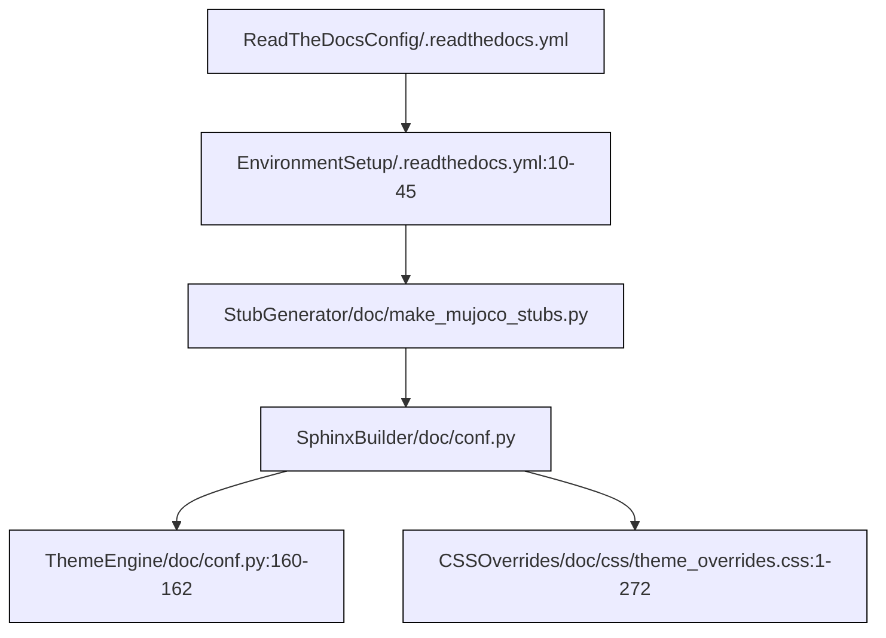
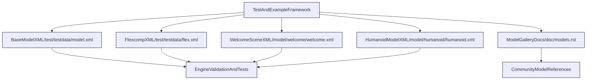

<!-- source: DeepWiki mcp.deepwiki.com · repo google-deepmind/mujoco · page 9.6 Documentation and Model Assets · fetched 2026-10-26 -->

# Documentation and Model Assets

Relevant source files

The following files were used as context for generating this wiki page:

- [.gitignore](.gitignore)
- [.readthedocs.yml](.readthedocs.yml)
- [doc/conf.py](doc/conf.py)
- [doc/css/theme_overrides.css](doc/css/theme_overrides.css)
- [doc/docutils.conf](doc/docutils.conf)
- [doc/index.rst](doc/index.rst)
- [doc/make_mujoco_stubs.py](doc/make_mujoco_stubs.py)
- [doc/mjwarp/update_types.py](doc/mjwarp/update_types.py)
- [doc/models.rst](doc/models.rst)
- [doc/requirements.in](doc/requirements.in)
- [doc/requirements.txt](doc/requirements.txt)
- [model/humanoid/22_humanoids.xml](model/humanoid/22_humanoids.xml)
- [model/humanoid/README.md](model/humanoid/README.md)
- [model/humanoid/humanoid.png](model/humanoid/humanoid.png)
- [model/humanoid/humanoid.xml](model/humanoid/humanoid.xml)
- [model/welcome/welcome.xml](model/welcome/welcome.xml)
- [src/experimental/studio/hal/renderer_test.cc](src/experimental/studio/hal/renderer_test.cc)
- [test/benchmark/testdata/humanoid_body.xml](test/benchmark/testdata/humanoid_body.xml)
- [test/engine/testdata/actuation/actuator_group_disable.xml](test/engine/testdata/actuation/actuator_group_disable.xml)
- [test/engine/testdata/collision_driver/humanoid.xml](test/engine/testdata/collision_driver/humanoid.xml)
- [test/engine/testdata/hammock/humanoid_body.xml](test/engine/testdata/hammock/humanoid_body.xml)
- [test/render/testdata/bunny.obj](test/render/testdata/bunny.obj)
- [test/render/testdata/emissive_bloom.xml](test/render/testdata/emissive_bloom.xml)
- [test/render/testdata/ibl.ktx](test/render/testdata/ibl.ktx)
- [test/render/testdata/lighting.xml](test/render/testdata/lighting.xml)
- [test/render/testdata/pbr.xml](test/render/testdata/pbr.xml)
- [test/render/testdata/reflection.xml](test/render/testdata/reflection.xml)
- [test/render/testdata/shadows.xml](test/render/testdata/shadows.xml)
- [test/render/testdata/shapes.xml](test/render/testdata/shapes.xml)
- [test/render/testdata/test-pattern.png](test/render/testdata/test-pattern.png)
- [test/testdata/flex.xml](test/testdata/flex.xml)
- [test/testdata/model.xml](test/testdata/model.xml)

## Overview and Purpose

This page documents the internal architecture of MuJoCo's documentation build system—powered by Sphinx, the Furo theme, and custom extension scripts—alongside the curated repository of model assets (`MJCF` XML files) utilized across engine tests, benchmarks, and interactive examples.

---

## 1. Sphinx Documentation Build Infrastructure

The MuJoCo documentation is built using Sphinx with custom extensions, configuration management, and visual styling. The core configuration resides in `doc/conf.py`, which sets up paths, Python modules, extensions, and theme properties.

### Configuration and Extensions

The Sphinx project is configured in `doc/conf.py` [doc/conf.py:14-199] with standard project metadata and an extensive list of Sphinx extensions:

* `sphinx.ext.autodoc` and `sphinx.ext.napoleon` for parsing docstrings (Google/NumPy style).
* `sphinx.ext.viewcode` for linking source code.
* `sphinxcontrib.katex` and `sphinxcontrib.youtube` for mathematical typesetting and media embeds.
* `sphinx_copybutton` and `sphinx_design` for UI enhancements.
* Custom theme overrides and redirection rules.

A custom warning filter is implemented via `setup(app)` in `doc/conf.py` [doc/conf.py:84-106] to suppress benign documentation warnings such as incomplete RST formatting in C++ docstrings or inline emphasis mismatches.

*Diagram 1: Documentation build pipeline mapping ReadTheDocs configuration, stub generation, and Sphinx building to code entities.*

**Sources:**
- `doc/conf.py` [doc/conf.py:1-199]
- `doc/css/theme_overrides.css` [doc/css/theme_overrides.css:1-272]
- `.readthedocs.yml` [.readthedocs.yml:1-50]

---

## 2. Documentation Dependencies and ReadTheDocs Integration

Build dependencies for the documentation are pinned and compiled via `uv` in `doc/requirements.txt`. The ReadTheDocs build script (`.readthedocs.yml`) defines the execution environment on Ubuntu 24.04 with Python 3.12:

1. Installs `uv` and sets up the virtual environment (`.readthedocs.yml:17-22`).
2. Installs dependencies from `doc/requirements.txt` [.readthedocs.yml:23-28].
3. Generates and installs doc-only MuJoCo stubs via `doc/make_mujoco_stubs.py` without requiring a full native C compilation [.readthedocs.yml:29-33].
4. Installs `mjx` and wraps internal modules [.readthedocs.yml:34-42].

**Sources:**
- `.readthedocs.yml` [.readthedocs.yml:1-50]
- `doc/requirements.txt` [doc/requirements.txt:1-192]

---

## 3. Styling and Visual Overrides

Visual appearance and typography are customized via custom CSS in `doc/css/theme_overrides.css`. This file defines styling rules for inline code blocks using `DM Mono` [doc/css/theme_overrides.css:5-8], layout parameters for dark theme table shadows [doc/css/theme_overrides.css:31-39], and typography settings for headers and navigation elements [doc/css/theme_overrides.css:143-272].

**Sources:**
- `doc/css/theme_overrides.css` [doc/css/theme_overrides.css:1-272]

---

## 4. Model Asset Library

MuJoCo tests, benchmarks, and examples rely on a library of well-structured MJCF XML models. These models validate diverse physical features such as flex bodies, contacts, constraints, and sensors.

### Key Model Assets in Test Data

* `test/testdata/model.xml`: A comprehensive validation model exercising dense Jacobians, icosahedron meshes, heightfields (`hfield`), skybox textures, default classes (`hip0`, `hip1`, `wheel`), equality constraints, spatial tendons, and multiple sensor types [test/testdata/model.xml:1-167].
* `test/testdata/flex.xml`: Tests soft-body dynamics, flex components (`flexcomp`), ellipsoids, grid flex types, elasticity properties, and custom edge constraints [test/testdata/flex.xml:1-58].
* `model/welcome/welcome.xml`: The interactive welcome scene model featuring complex kinematic trees, materials, letter meshes (`m`, `u`, `j`, `o`), spotlights, and high-fidelity visual/collision groups [model/welcome/welcome.xml:1-145].
* `model/humanoid/humanoid.xml`: Standard bipedal humanoid model with 27 degrees of freedom, 21 actuators, custom joint classes, and tracking spotlight configurations [model/humanoid/humanoid.xml:1-160].

*Diagram 2: Relationship between test/example XML model assets and the validation framework / model gallery documentation.*

**Sources:**
- `test/testdata/model.xml` [test/testdata/model.xml:1-167]
- `test/testdata/flex.xml` [test/testdata/flex.xml:1-58]
- `model/welcome/welcome.xml` [model/welcome/welcome.xml:1-145]
- `model/humanoid/humanoid.xml` [model/humanoid/humanoid.xml:1-160]
- `doc/models.rst` [doc/models.rst:1-124]

---

## 5. Model Galleries (`doc/models.rst`)

The `doc/models.rst` file provides the **Model Gallery** documentation, organizing community and core models (such as the MuJoCo Menagerie) into categories: bipeds, humanoids, mobile manipulators, quadrupeds, grippers/hands, and robot arms [doc/models.rst:1-124]. Each entry references upstream repositories and preview renders used in the documentation build.

**Sources:**
- `doc/models.rst` [doc/models.rst:1-124]
- `model/humanoid/README.md` [model/humanoid/README.md:1-37]

---

