# Page: Overview

# Overview

<details>
<summary>Relevant source files</summary>

The following files were used as context for generating this wiki page:

- [CONTRIBUTING.md](CONTRIBUTING.md)
- [README.md](README.md)
- [cmake/CheckAvxSupport.cmake](cmake/CheckAvxSupport.cmake)
- [cmake/third_party_deps/lodepng.cmake](cmake/third_party_deps/lodepng.cmake)
- [cmake/third_party_deps/lodepng/CMakeLists.txt](cmake/third_party_deps/lodepng/CMakeLists.txt)
- [doc/APIreference/APIglobals.rst](doc/APIreference/APIglobals.rst)
- [doc/APIreference/functions.rst](doc/APIreference/functions.rst)
- [doc/APIreference/functions_override.rst](doc/APIreference/functions_override.rst)
- [doc/computation/index.rst](doc/computation/index.rst)
- [doc/includes/references.h](doc/includes/references.h)
- [doc/modeling.rst](doc/modeling.rst)
- [doc/overview.rst](doc/overview.rst)
- [doc/programming/simulation.rst](doc/programming/simulation.rst)
- [include/mujoco/mjdata.h](include/mujoco/mjdata.h)
- [include/mujoco/mjmodel.h](include/mujoco/mjmodel.h)
- [include/mujoco/mjspec.h](include/mujoco/mjspec.h)
- [include/mujoco/mjxmacro.h](include/mujoco/mjxmacro.h)
- [include/mujoco/mujoco.h](include/mujoco/mujoco.h)
- [python/MANIFEST.in](python/MANIFEST.in)
- [python/README.md](python/README.md)
- [python/make_sdist.sh](python/make_sdist.sh)
- [python/mujoco/callbacks.cc](python/mujoco/callbacks.cc)
- [python/mujoco/enums.cc](python/mujoco/enums.cc)
- [python/mujoco/errors.cc](python/mujoco/errors.cc)
- [python/mujoco/errors.h](python/mujoco/errors.h)
- [python/mujoco/experimental/studio/web/CMakeLists.txt](python/mujoco/experimental/studio/web/CMakeLists.txt)
- [python/mujoco/gil.h](python/mujoco/gil.h)
- [python/mujoco/introspect/functions.py](python/mujoco/introspect/functions.py)
- [python/mujoco/introspect/structs.py](python/mujoco/introspect/structs.py)
- [python/mujoco/util/crossplatform.h](python/mujoco/util/crossplatform.h)
- [src/engine/engine_io.c](src/engine/engine_io.c)
- [src/engine/engine_io.h](src/engine/engine_io.h)
- [src/engine/engine_print.c](src/engine/engine_print.c)
- [test/engine/engine_io_test.cc](test/engine/engine_io_test.cc)
- [unity/Runtime/Bindings/MjBindings.cs](unity/Runtime/Bindings/MjBindings.cs)

</details>


This page provides a high-level introduction to the MuJoCo physics engine architecture, core concepts, and major subsystems. It outlines the fundamental data structures, API organization, and system components that form the foundation of MuJoCo's physics simulation capabilities.

For detailed information about specific foundational topics, see the child pages:
- [Key Concepts](#1.1) — Fundamental concepts including mjModel vs mjData separation, state representation, forward dynamics, and the compilation pipeline
- [Build System and Dependencies](#1.2) — CMake build configuration, external dependencies (Eigen, Abseil, pybind11, Filament, OpenUSD), options files, and how to build MuJoCo from source
- [Testing, Benchmarks, and CI](#1.3) — GoogleTest-based C++ tests, test fixtures, benchmark suite, Bazel/CMake test targets, and GitHub Actions CI/release workflows

---

## What is MuJoCo

**MuJoCo** stands for **Mu**lti-**Jo**int dynamics with **Co**ntact. It is a general-purpose physics engine designed to facilitate research and development in robotics, biomechanics, graphics and animation, machine learning, and other areas requiring fast and accurate simulation of articulated structures interacting with their environment.

MuJoCo is implemented primarily as a C/C++ library exposing a C API tailored for high performance. It operates directly on low-level data structures preallocated by an internal compiler. The runtime simulation engine is optimized for speed and accuracy, while also exposing numerous utility functions for physics-related computations. Model definitions are typically given in MuJoCo's native MJCF XML format or imported from URDF files, which are parsed and compiled into efficient runtime data structures [include/mujoco/mujoco.h:128-157]().

Sources: [README.md:17-31](), [doc/overview.rst:7-25](), [include/mujoco/mujoco.h:128-157]()

---

## System Architecture

MuJoCo’s architecture is layered to cleanly separate model definition, compilation, and simulation runtime. The figure below summarizes these layers and the data flows between them.

### Overall System Layers and Data Flow

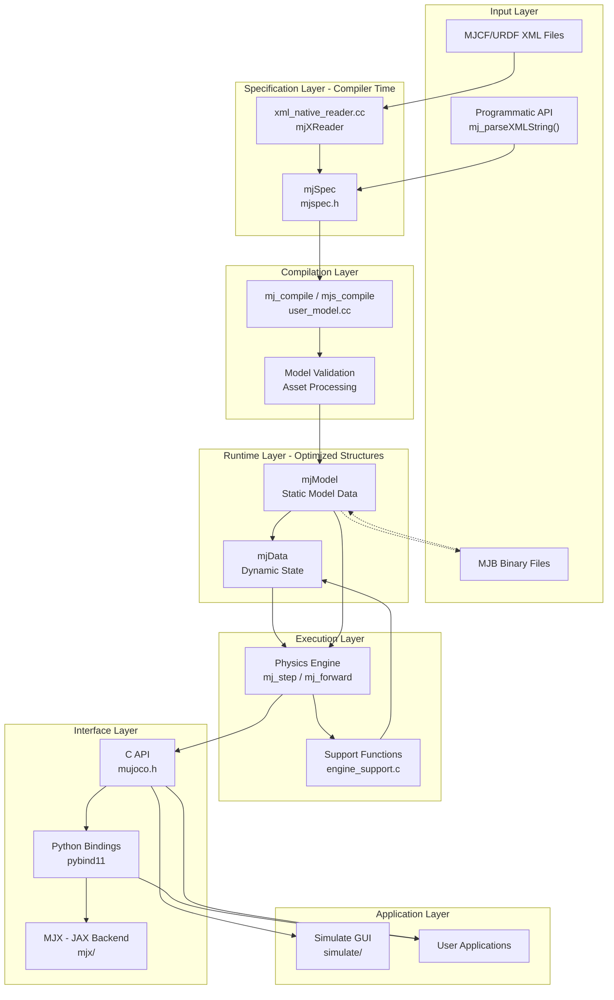

Sources: [doc/overview.rst:84-106](), [doc/modeling.rst:43-57](), [include/mujoco/mujoco.h:125-161]()

---

## Core Data Structures

MuJoCo relies on three primary data structures that separate static model properties from dynamic simulation state:

| Structure | Purpose | Mutability | Applicable Phase |
|:---------:|---------|------------|------------------|
| `mjSpec`  | High-level model specification | Editable | Compiler-time [include/mujoco/mujoco.h:133-146]() |
| `mjModel` | Compiled, optimized model | Read-only | Runtime [include/mujoco/mujodel.h:79-124]() |
| `mjData`  | Simulation state and workspace | Mutable | Runtime [include/mujoco/mjdata.h:99-150]() |

For detailed information on the separation of `mjModel` and `mjData`, memory layout, state representation, and forward dynamics, see [Key Concepts](#1.1).

Sources: [include/mujoco/mjspec.h:33-33](), [include/mujoco/mjmodel.h:79-124](), [include/mujoco/mjdata.h:99-150]()

---

## Key API Functions

MuJoCo’s C API provides functions for model loading, compilation, state management, and simulation stepping [include/mujoco/mujoco.h:126-164]().

### Model Creation and Compilation Pipeline

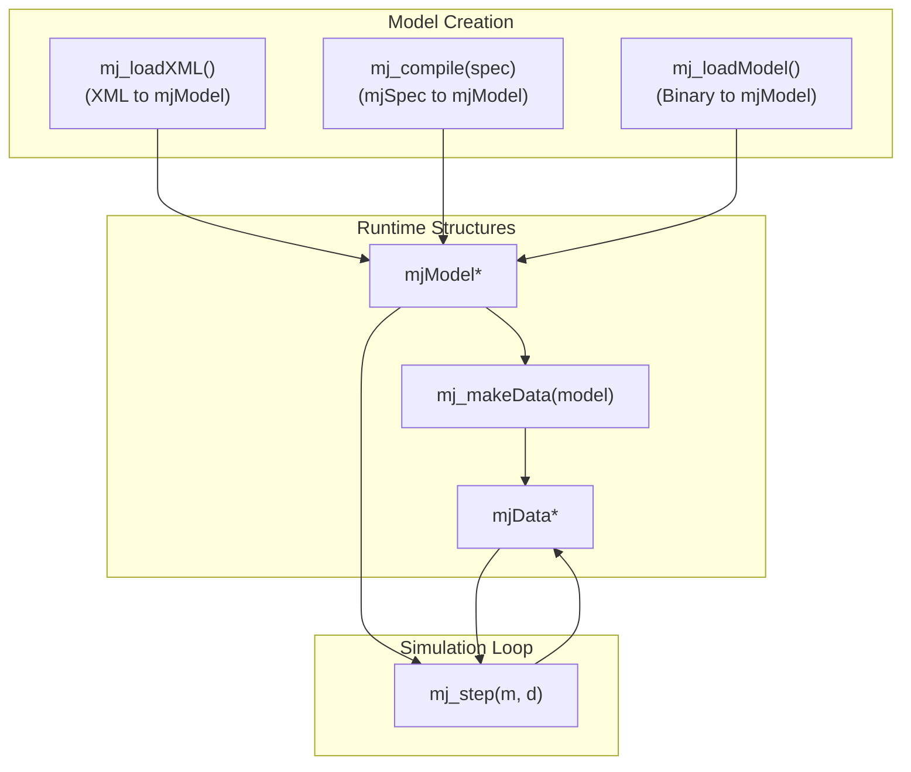

Sources: [include/mujoco/mujoco.h:126-172](), [doc/APIreference/functions.rst:10-30]()

---

## Further Exploration

For more details on building the codebase, configuring CMake, managing third-party dependencies (such as Eigen, Abseil, pybind11, Filament, and OpenUSD), running the GoogleTest suite, benchmarks, and CI pipelines, please refer to the child pages:
- [Key Concepts](#1.1)
- [Build System and Dependencies](#1.2)
- [Testing, Benchmarks, and CI](#1.3)

Sources: [README.md:1-100]()

---

# Page: Key Concepts

# Key Concepts

<details>
<summary>Relevant source files</summary>

The following files were used as context for generating this wiki page:

- [doc/APIreference/APIglobals.rst](doc/APIreference/APIglobals.rst)
- [doc/APIreference/functions.rst](doc/APIreference/functions.rst)
- [doc/APIreference/functions_override.rst](doc/APIreference/functions_override.rst)
- [doc/computation/index.rst](doc/computation/index.rst)
- [doc/includes/references.h](doc/includes/references.h)
- [doc/modeling.rst](doc/modeling.rst)
- [doc/overview.rst](doc/overview.rst)
- [doc/programming/simulation.rst](doc/programming/simulation.rst)
- [include/mujoco/mjdata.h](include/mujoco/mjdata.h)
- [include/mujoco/mjmodel.h](include/mujoco/mjmodel.h)
- [include/mujoco/mjspec.h](include/mujoco/mjspec.h)
- [include/mujoco/mjxmacro.h](include/mujoco/mjxmacro.h)
- [include/mujoco/mujoco.h](include/mujoco/mujoco.h)
- [python/mujoco/introspect/functions.py](python/mujoco/introspect/functions.py)
- [python/mujoco/introspect/structs.py](python/mujoco/introspect/structs.py)
- [src/engine/engine_io.c](src/engine/engine_io.c)
- [src/engine/engine_io.h](src/engine/engine_io.h)
- [src/engine/engine_print.c](src/engine/engine_print.c)
- [test/engine/engine_io_test.cc](test/engine/engine_io_test.cc)
- [unity/Runtime/Bindings/MjBindings.cs](unity/Runtime/Bindings/MjBindings.cs)

</details>


## Purpose and Scope

This page explains the fundamental architectural concepts of MuJoCo that are essential for understanding the codebase. It covers the separation between static model data (`mjModel`) and dynamic simulation state (`mjData`), the compilation workflow, state representation, and the forward dynamics pipeline. 

For details on model creation and editing, see [Model Definition Pipeline](2). For runtime simulation APIs, see [C and Python APIs](5). For the physics engine implementation, see [Physics Simulation Pipeline](4).

---

## The Two-Phase Architecture: Compilation vs Runtime

MuJoCo's core architecture separates model specification from execution through a two-phase system:

**Diagram: Two-Phase Model Lifecycle**
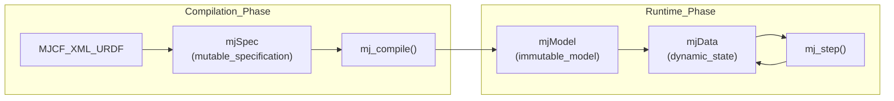

Sources: [include/mujoco/mujoco.h:128-164](), [include/mujoco/mjmodel.h:49-125](), [include/mujoco/mjdata.h:99-149]()

### Phase 1: Compilation (mjSpec → mjModel)

`mjSpec` is a high-level, mutable, editable representation of a model, used as an intermediate representation before compilation [include/mujoco/mjspec.h:1-100](). It can be created by:
- Parsing XML files via `mj_parseXML()` [include/mujoco/mujoco.h:136]()
- Parsing XML strings via `mj_parseXMLString()` [include/mujoco/mujoco.h:140]()

The compilation process transforms `mjSpec` into `mjModel` via `mj_compile()` [include/mujoco/mujoco.h:156](). Key compilation steps include:
- Computing memory requirements, element sizes, and buffer sizes [src/engine/engine_io.c:177-224]()
- Allocating and initializing a contiguous memory buffer for model data and arrays
- Processing assets such as meshes, textures, and heightfields
- Building sparse matrix structures for efficient dynamics computation
- Performing validation and error checking; errors reported via `mjs_getError()` [doc/APIreference/functions.rst:84-86]()

### Phase 2: Runtime (mjModel + mjData)

At runtime, the compiled `mjModel` contains the static, read-only description of the physical model:
- Defines all model parameters: bodies, joints, geometries, actuators, sensors, and dynamics matrices [include/mujoco/mjxmacro.h:160-214]()
- Preallocates buffers for data arrays and sparse matrix storage [src/engine/engine_io.c:145-174]()

The simulation state is stored and advanced in `mjData`, created from an `mjModel`:
- Holds dynamic state vectors such as positions (`qpos`), velocities (`qvel`), actuator states (`act`), controls (`ctrl`), accelerations (`qacc`) [include/mujoco/mjdata.h:99-149]()
- Contains workspace buffers and arena memory for intermediate quantities and contacts [include/mujoco/mjdata.h:100-111]()
- Stores contact and constraint data computed during collision detection and constraint solving [include/mujoco/mjdata.h:29-69]()

Sources: [src/engine/engine_io.c:145-174](), [include/mujoco/mjdata.h:99-149]()

---

## mjModel: Static Model Description

**Diagram: mjModel Memory Layout and Buffer Initialization**
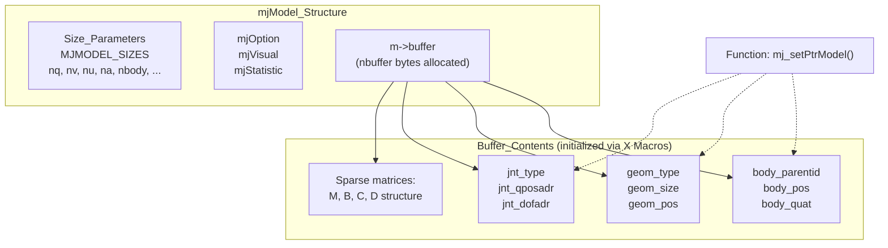

Sources: [src/engine/engine_io.c:145-174](), [include/mujoco/mjxmacro.h:160-214]()

### Key Characteristics

- **Immutability**: After compilation, `mjModel` is not modified during runtime. Structural changes require recompiling the `mjSpec` or using `mj_recompile()` which updates `mjModel` and `mjData` in place while preserving simulation state [include/mujoco/mujoco.h:163]().

- **Buffer-Based Layout**: All array data is stored contiguously within the `m->buffer` region for cache efficiency. Pointer members of `mjModel` are initialized at fixed offsets with 64-byte alignment using the `SKIP` macro [src/engine/engine_io.c:135-174]():

```c
// Example of pointer assignment in mj_setPtrModel():
m->name = (type*)(ptr + SKIP((intptr_t)ptr));
ptr += SKIP((intptr_t)ptr) + sizeof(type) * (m->nr) * (nc);
```

### Size Parameters

The `mjModel` contains multiple integer size fields that specify counts of model elements. These are enumerated in the `MJMODEL_SIZES` macro [include/mujoco/mjxmacro.h:162-214]():

| Category            | Examples                          |
|---------------------|---------------------------------|
| **Degrees of Freedom** | `nq` (position dimension), `nv` (velocity dimension), `nu` (controls), `na` (activations) |
| **Elements**          | `nbody`, `njnt` (joints), `ngeom` (geoms), `nsite`, `ncam` (cameras), `nlight`            |
| **Sparse Matrices**   | `nM`, `nB`, `nC`, `nD` (sizes of dynamics and constraint matrices)                      |
| **Assets**            | `nmesh`, `nhfield`, `ntex`, `nmat`                                                    |
| **Constraints**       | `neq` (equalities), `ntendon`, `npair`, `nexclude`                                    |

Sources: [src/engine/engine_io.c:135-174](), [include/mujoco/mjxmacro.h:160-214]()

---

## mjData: Dynamic State and Workspace

**Diagram: mjData Organization and State Vectors**
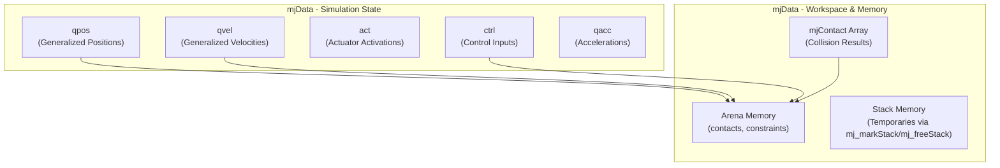

Sources: [include/mujoco/mjdata.h:99-149](), [doc/includes/references.h:19-67]()

### State Components (mjtState)

MuJoCo defines state components for fine-grained state management. The `mjtState` enumeration marks different parts of the integrator state that can be extracted or set [doc/includes/references.h:19-28]():

| State Flag        | Description                     |
|-------------------|--------------------------------|
| `mjSTATE_TIME`    | Simulation time                |
| `mjSTATE_QPOS`    | Generalized joint positions   |
| `mjSTATE_QVEL`    | Generalized joint velocities  |
| `mjSTATE_ACT`     | Actuator activations          |
| `mjSTATE_CTRL`    | Control inputs                |
| `mjSTATE_WARMSTART` | Constraint solver warmstart accelerations |

These are used in functions like `mj_getState()` and `mj_setState()` to manipulate simulation state snapshots [doc/includes/references.h:19-28]()

### Memory Management

`mjData` uses multiple memory regions and strategies:

| Memory Region      | Purpose                                       | Allocation Method                   |
|--------------------|-----------------------------------------------|-----------------------------------|
| `buffer`           | Fixed-size state arrays and workspace buffers | Allocated at creation; contiguous |
| `arena`            | Variable-size data such as contacts, constraints | Dynamic, grows as needed up to allowed arena size |
| `stack`            | Temporary workspace within computations         | Push/pop semantics via `mj_markStack()` and `mj_freeStack()` |

This layout allows efficient management of memory with minimal allocation overhead during simulation steps [include/mujoco/mjdata.h:99-111]()

Sources: [include/mujoco/mjdata.h:99-149]()

---

## Forward Dynamics Pipeline

MuJoCo advances simulation using a modular five-stage forward dynamics pipeline implemented in `mj_forward()` [doc/APIreference/functions.rst:178-188]():

**Diagram: Five-Stage Forward Dynamics Pipeline**
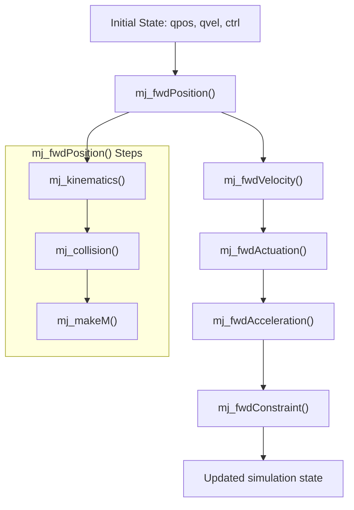

Sources: [doc/APIreference/functions.rst:178-188]()

### Stage Descriptions and Dependencies

| Stage            | Dependencies           | Computes                                      | Updated `mjData` Fields                      |
|------------------|-----------------------|-----------------------------------------------|----------------------------------------------|
| **Position**     | Initial `qpos`         | Forward kinematics, collision detection, inertia computations, contact and constraint instantiation | Positions of bodies/geoms, mass matrix `M`, contacts, constraints data |
| **Velocity**     | After position, `qvel` | Bias forces, passive forces, velocity-related Jacobians | `qfrc_bias`, `qfrc_passive`, velocity Jacobians |
| **Actuation**    | Velocity and `ctrl`    | Actuator forces and input processing          | `actuator_force`, `qfrc_actuator`             |
| **Acceleration** | Actuation stage output | Unconstrained accelerations from dynamics     | `qacc_smooth`, `qfrc_smooth`                  |
| **Constraint**   | Acceleration stage output| Constraint forces solve and projection onto state accelerations | `efc_force`, `qfrc_constraint`, updated `qacc`|

Integration then advances states, using e.g. implicit Euler [doc/APIreference/functions.rst:178-188](), [doc/includes/references.h:68-84]()

---

## Coordinate Representations

MuJoCo uses mixed representations for state variables to balance efficiency and accuracy [include/mujoco/mjmodel.h:162-167]():

### Position (qpos) — Mixed Representations

| Joint Type   | qpos Dimension | Representation                  |
|--------------|----------------|---------------------------------|
| Free joint (`mjJNT_FREE`) | 7              | 3D position + 4D quaternion (unit) |
| Ball joint (`mjJNT_BALL`) | 4              | Quaternion rotation only           |
| Slide/Hinge   | 1              | Single translation or angle       |

### Velocity (qvel) — Tangent Space Representation

| Joint Type   | qvel Dimension | Representation                   |
|--------------|----------------|----------------------------------|
| Free joint   | 6              | 3D linear velocity + 3D angular velocity |
| Ball joint   | 3              | 3D angular velocity only         |
| Slide/Hinge  | 1              | 1D linear or angular velocity    |

Because quaternions have unit-norm constraints, linear velocities are represented as tangent vectors to avoid singularities and over-parameterization. Therefore, `nq` (position vector length) is often larger than `nv` (velocity vector length) [include/mujoco/mjxmacro.h:162-164]().

Sources: [include/mujoco/mjmodel.h:162-167](), [include/mujoco/mjxmacro.h:162-164]()

---

## Options and Configuration

Global simulation parameters are controlled by the `mjOption` structure, described by the `MJOPTION_FIELDS` macro [include/mujoco/mjxmacro.h:23-52]().

### Examples of mjOption fields

| Category      | Example Fields                               |
|---------------|----------------------------------------------|
| Physics       | `timestep`, `gravity`, `density`, `viscosity` |
| Solver        | `integrator` (e.g. Euler, RK4), `solver` (e.g. PGS), `iterations`, `tolerance` |
| Contact       | `impratio` (friction-to-normal impedance ratio), `noslip_tolerance`                        |
| Flags         | `disableflags` (`mjtDisableBit`), `enableflags` (`mjtEnableBit`) |

### Common Disable Flags (`mjtDisableBit` Enum)

| Flag                 | Effect                                  |
|----------------------|-----------------------------------------|
| `mjDSBL_CONSTRAINT`   | Disable the entire constraint solver    |
| `mjDSBL_CONTACT`      | Disable contact constraint processing   |
| `mjDSBL_FRICTIONLOSS` | Disable frictional energy loss          |
| `mjDSBL_LIMIT`        | Disable joint limit constraints          |

These flags allow fine tuning of simulation features to improve performance or debug behavior [unity/Runtime/Bindings/MjBindings.cs:129-151]().

Sources: [include/mujoco/mjxmacro.h:23-52](), [unity/Runtime/Bindings/MjBindings.cs:129-151]()

---

# Summary

MuJoCo cleanly separates the model specification and compilation phase from runtime simulation. Static data is stored in an immutable `mjModel` memory buffer allocated and aligned in bulk, while mutable dynamic simulation state uses `mjData`. The runtime physics engine advances the simulation using a well-defined multi-stage forward dynamics pipeline. This architecture enables efficient simulation while allowing flexible model editing via the `mjSpec` intermediate representation and recompilation.

---

Sources:

- include/mujoco/mujoco.h:128-164
- include/mujoco/mjmodel.h:49-125, 162-167
- include/mujoco/mjxmacro.h:23-52, 160-214
- include/mujoco/mjdata.h:29-149
- doc/includes/references.h:19-84
- src/engine/engine_io.c:135-174, 177-224
- doc/APIreference/functions.rst:84-86, 178-188
- unity/Runtime/Bindings/MjBindings.cs:129-151

---

# Page: Build System and Dependencies

# Build System and Dependencies

<details>
<summary>Relevant source files</summary>

The following files were used as context for generating this wiki page:

- [CMakeLists.txt](CMakeLists.txt)
- [cmake/FindOrFetch.cmake](cmake/FindOrFetch.cmake)
- [cmake/MujocoDependencies.cmake](cmake/MujocoDependencies.cmake)
- [cmake/MujocoOptions.cmake](cmake/MujocoOptions.cmake)
- [cmake/filament-allow-clang-windows.patch](cmake/filament-allow-clang-windows.patch)
- [cmake/libwebp-apple-float16.patch](cmake/libwebp-apple-float16.patch)
- [cmake/third_party_deps/dear_imgui.cmake](cmake/third_party_deps/dear_imgui.cmake)
- [cmake/third_party_deps/filament.cmake](cmake/third_party_deps/filament.cmake)
- [cmake/third_party_deps/font_awesome.cmake](cmake/third_party_deps/font_awesome.cmake)
- [cmake/third_party_deps/font_awesome/CMakeLists.txt](cmake/third_party_deps/font_awesome/CMakeLists.txt)
- [cmake/third_party_deps/implot.cmake](cmake/third_party_deps/implot.cmake)
- [cmake/third_party_deps/libwebp.cmake](cmake/third_party_deps/libwebp.cmake)
- [dist/mujoco.rc](dist/mujoco.rc)
- [dist/simulate.rc](dist/simulate.rc)
- [doc/unity.rst](doc/unity.rst)
- [python/mujoco/CMakeLists.txt](python/mujoco/CMakeLists.txt)
- [python/mujoco/experimental/dear_imgui/dear_imgui.cc](python/mujoco/experimental/dear_imgui/dear_imgui.cc)
- [python/mujoco/experimental/dear_imgui/dear_imgui_macros.h](python/mujoco/experimental/dear_imgui/dear_imgui_macros.h)
- [python/mujoco/experimental/implot/LICENSE-2.0.txt](python/mujoco/experimental/implot/LICENSE-2.0.txt)
- [python/mujoco/experimental/implot/implot.cc](python/mujoco/experimental/implot/implot.cc)
- [python/mujoco/experimental/studio/viewer_app_events.py](python/mujoco/experimental/studio/viewer_app_events.py)
- [sample/CMakeLists.txt](sample/CMakeLists.txt)
- [sample/cmake/FindOrFetch.cmake](sample/cmake/FindOrFetch.cmake)
- [sample/cmake/SampleOptions.cmake](sample/cmake/SampleOptions.cmake)
- [simulate/CMakeLists.txt](simulate/CMakeLists.txt)
- [simulate/cmake/FindOrFetch.cmake](simulate/cmake/FindOrFetch.cmake)
- [simulate/cmake/SimulateOptions.cmake](simulate/cmake/SimulateOptions.cmake)
- [src/engine/engine_support.c](src/engine/engine_support.c)
- [unity/Editor/Bindings/MujocoBinaryRetriever.cs](unity/Editor/Bindings/MujocoBinaryRetriever.cs)
- [unity/package.json](unity/package.json)

</details>


## Purpose and Scope

This document provides a comprehensive technical overview of the MuJoCo build infrastructure based on CMake. It covers the configuration of the build system, management of external dependencies (such as Eigen, Abseil, pybind11, Filament, and OpenUSD), platform-specific considerations, Unity binary retrieval, and instructions on how to build MuJoCo from source. The page also outlines specific targets and their relationships, including core engine libraries, Python bindings, and UI applications.

Sources: [CMakeLists.txt:1-53](), [cmake/MujocoDependencies.cmake:1-15]()

## Build System Overview

MuJoCo employs a modular CMake setup (requiring at least CMake 3.16), split into distinct directories for the physics core, user-level APIs, XML parsing, plugins, visualization, Python bindings, sample programs, and WebAssembly targets. This modularity simplifies organization and allows selective builds of components via options defined in `CMakeLists.txt` [CMakeLists.txt:42-52]().

The root `CMakeLists.txt` defines the overarching `mujoco` project and includes important CMake modules for dependency resolution, compiler options, macOS platform handling, and security hardening [CMakeLists.txt:30-113]().

### CMake Project Structure

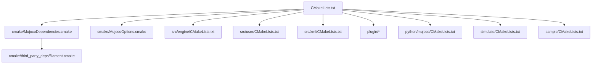

**Diagram 1: MuJoCo CMake Project Structure and Code Entities**

The project sets up key CMake policies for modern behavior, including policies related to `INTERPROCEDURAL_OPTIMIZATION` and shared library builds (`CMP0069`, `CMP0072`, `CMP0077`) [CMakeLists.txt:18-26](). It also configures compiler standard requirements and visibility settings for symbol exports [python/mujoco/CMakeLists.txt:38-40]().

Sources: [CMakeLists.txt:1-180](), [cmake/MujocoDependencies.cmake:1-74]()

## Core Build Targets

| Target Name | Target Type | Description | Output Artifact / Location |
|-------------|-------------|-------------|----------------------------|
| `mujoco` | Shared library (or static on WASM) | Core MuJoCo physics engine | `libmujoco.so`, `mujoco.dll`, or `libmujoco.3.17.0.dylib` [CMakeLists.txt:144-146](), [python/mujoco/CMakeLists.txt:90-126]() |
| `simulate` | Executable | Interactive simulation viewer binary | `simulate` binary or macOS `.app` bundle [simulate/CMakeLists.txt:141-174]() |
| `platform_ui_adapter` | Object library | Platform abstraction layer for GLFW and windowing | Object files [simulate/CMakeLists.txt:83-103]() |
| `libmujoco_simulate` | Static library | Simulate library containing platform UI adapter and UI logic | `libmujoco_simulate.a` / `simulate.lib` [simulate/CMakeLists.txt:105-124]() |
| `compile`, `basic`, `record`, `testspeed` | Executables | Sample programs demonstrating API usage | Standalone binaries in `sample/` [sample/CMakeLists.txt:75-115]() |
| `mujoco_python` | Shared modules | Python bindings modules built via pybind11 | Python `.so` / `.pyd` modules [python/mujoco/CMakeLists.txt:15-95]() |

Sources: [CMakeLists.txt:137-180](), [simulate/CMakeLists.txt:40-190](), [sample/CMakeLists.txt:70-120](), [python/mujoco/CMakeLists.txt:80-200]()

---

# External Dependencies

MuJoCo integrates several third-party libraries to handle diverse functionality such as image loading, mesh parsing, collision detection, linear algebra, and advanced rendering. These dependencies are either found on the system or fetched and built statically if needed via `cmake/MujocoDependencies.cmake` and specialized modules.

### Overview of Core Dependencies and Rendering Backends

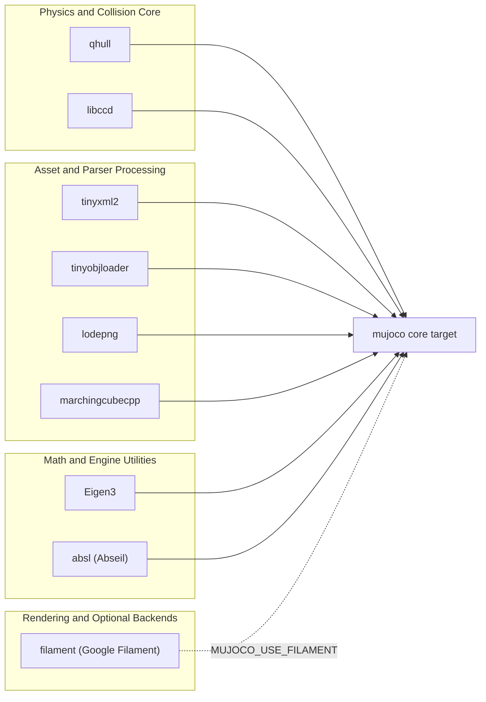

**Diagram 2: MuJoCo Dependencies and Renderer Integration**

#### Details on Key Dependencies

- **qhull**: Provides convex hull computations essential for collision mesh processing [cmake/MujocoDependencies.cmake:33-36](). Includes internal handling for `libqhull_r` sources [cmake/MujocoDependencies.cmake:124-128]().
- **libccd**: Implements GJK and EPA algorithms for narrow-phase collision detection [cmake/MujocoDependencies.cmake:29-32](). Configured with `ENABLE_DOUBLE_PRECISION` depending on `mjUSESINGLE` [cmake/MujocoDependencies.cmake:176-181]().
- **tinyxml2**: Tiny and efficient XML parser used for processing MJCF and other XML assets [cmake/MujocoDependencies.cmake:132-147]().
- **tinyobjloader**: Parses OBJ mesh files used in model assets [cmake/MujocoDependencies.cmake:156-170]().
- **lodepng**: PNG image loading library for textures and rendering utilities [cmake/MujocoDependencies.cmake:86]().
- **MarchingCubeCpp**: Maintains code for converting signed distance fields (SDF) into triangle meshes [cmake/MujocoDependencies.cmake:25-28]().
- **Eigen3**: The primary linear algebra library for matrix and vector operations [cmake/MujocoDependencies.cmake:41-44]().
- **Abseil (`absl`)**: Provides common C++ utility components like `flat_hash_map`, `span`, and synchronization primitives [cmake/MujocoDependencies.cmake:46-49]().
- **Filament**: Google's real-time physically based rendering engine, enabled via `-DMUJOCO_USE_FILAMENT=ON` [CMakeLists.txt:49](), managed via [cmake/third_party_deps/filament.cmake:1-83]().
- **OpenUSD**: Experimental OpenUSD support enabled via `-DMUJOCO_WITH_USD=ON` [CMakeLists.txt:48]().

Sources: [cmake/MujocoDependencies.cmake:10-230](), [cmake/third_party_deps/filament.cmake:1-83](), [python/mujoco/CMakeLists.txt:130-200]()

---

# Dependency Resolution and Fetching

MuJoCo employs an intelligent CMake macro (`findorfetch`) that attempts to locate a dependency system-wide or else downloads, patches, and builds a specified version automatically using CMake's `FetchContent`. This mechanism provides flexibility between using system installations and ensuring consistent, pinned dependency versions.

### Dependency Resolution Flow

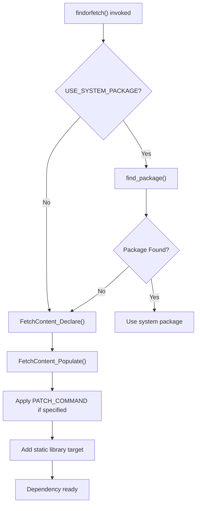

**Diagram 3: Dependency Resolution Flow via FindOrFetch**

Additionally, to ensure static linking of external dependencies, the build system overrides the CMake variable `BUILD_SHARED_LIBS` to `OFF` during dependency fetch and build to avoid shared library incompatibilities [cmake/MujocoDependencies.cmake:80-84]().

Sources: [cmake/MujocoDependencies.cmake:71-123]()

---

# Compilation Configuration and Compiler Settings

## Compiler Standards and Language Support

- MuJoCo requires **C++17** as the minimum standard on most platforms, enabled via `set(CMAKE_CXX_STANDARD 17)` [python/mujoco/CMakeLists.txt:32]().  
- On Windows, if MSVC version is 1927 or higher, C++20 is enabled to support features like forced inline lambdas (`/Gy /Gw /Oi`) [python/mujoco/CMakeLists.txt:29-33]().

```cmake
if(MSVC AND MSVC_VERSION GREATER_EQUAL 1927)
  set(CMAKE_CXX_STANDARD 20) # For forceinline lambdas.
else()
  set(CMAKE_CXX_STANDARD 17)
endif()
set(CMAKE_CXX_STANDARD_REQUIRED ON)
set(CMAKE_CXX_EXTENSIONS OFF)
```

## Symbol Visibility and Compilation Flags

- The build presets symbol visibility to hidden for both C and C++ to reduce exported symbols and improve linking times:  
  `CMAKE_C_VISIBILITY_PRESET hidden` and `CMAKE_CXX_VISIBILITY_PRESET hidden` [python/mujoco/CMakeLists.txt:38-39]().
- Position-independent code is enforced globally with `set(CMAKE_POSITION_INDEPENDENT_CODE ON)` [python/mujoco/CMakeLists.txt:37]().

Sources: [python/mujoco/CMakeLists.txt:15-70]()

## SIMD and AVX Intrinsics

MuJoCo is optimized through SIMD instructions. The macro guard `mjUSEPLATFORMSIMD` enables AVX intrinsics if supported on the platform and build mode [src/engine/engine_support.c:37-42]():

```c
#ifdef mjUSEPLATFORMSIMD
  #if defined(__AVX__) && !defined(mjUSESINGLE)
    #define mjUSEAVX
    #include "immintrin.h"
  #endif
#endif
```

This conditional inclusion allows vectorized operations for better performance, provided the compiler and platform support these extensions.

Sources: [src/engine/engine_support.c:37-42](), [CMakeLists.txt:185-188]()

---

# Hardening and Security Options

The build system optionally enables security hardening flags via the `MujocoHarden` CMake module [python/mujoco/CMakeLists.txt:68-70](). This includes:

- On **Windows**: linker option `/DYNAMICBASE` enabling ASLR (Address Space Layout Randomization) [simulate/CMakeLists.txt:68]().
- On **Linux/macOS**: compile and link with `-fPIE -fPIC` and `-pie` options for position-independent executables [simulate/CMakeLists.txt:70-74]().
- On **macOS**, Objective-C and Objective-C++ languages are enabled for UI and rendering components where needed, such as CoreVideo integration [simulate/CMakeLists.txt:35-38]().

Sources: [simulate/CMakeLists.txt:66-77](), [python/mujoco/CMakeLists.txt:68-70]()

---

# Platform-Specific Considerations and Unity Integration

## Windows

- Uses resource files (`dist/mujoco.rc` and `dist/simulate.rc`) to embed version information, company name, and product descriptions into `mujoco.dll` and `simulate.exe` [dist/mujoco.rc:1-25](), [dist/simulate.rc:1-27]().

## macOS

- Supports building MuJoCo as a `.framework` bundle.  
- The build system detects installed `mujoco.framework` and configures include paths using `-F` framework search paths instead of normal include directories [python/mujoco/CMakeLists.txt:97-120]().

## WebAssembly (Emscripten)

- Emscripten builds are restricted to **static libraries** since dynamic shared libraries are not supported by Emscripten [CMakeLists.txt:141-147]().
- Multi-threading support is conditionally enabled by adding `-pthread` flags when `MUJOCO_WASM_THREADS` is active [CMakeLists.txt:58-63]().
- Cross-compilation requires a separate native host build directory (`MUJOCO_NATIVE_BUILD_DIR`) for asset processor tools (`matc`, `resgen`, `cmgen`) [CMakeLists.txt:77-98]().

## Unity Plugin & Binary Retrieval

The Unity plug-in (`unity/package.json`) integrates MuJoCo into the Unity Editor [unity/package.json:1-17](). The `MujocoBinaryRetriever` script (`unity/Editor/Bindings/MujocoBinaryRetriever.cs`) automatically locates and copies the platform-specific native binary (`mujoco.dll`, `libmujoco.so`, or `mujoco.dylib`) from user directories or application bundles into the Unity package path upon package registration [unity/Editor/Bindings/MujocoBinaryRetriever.cs:23-64]().

Sources: [CMakeLists.txt:40-99](), [dist/mujoco.rc:1-25](), [dist/simulate.rc:1-27](), [unity/package.json:1-17](), [unity/Editor/Bindings/MujocoBinaryRetriever.cs:23-64]()

---

# How to Build MuJoCo From Source

## Prerequisites

- CMake ≥ 3.16 (`MUJOCO_CMAKE_MIN_REQ`) [CMakeLists.txt:15]().
- C and C++ compiler supporting C++17 (or C++20 for recent MSVC) [python/mujoco/CMakeLists.txt:29-35]().
- Python 3 and development headers (for Python bindings) [python/mujoco/CMakeLists.txt:72]().

## Basic Build Steps

1. **Configure build**:

   ```bash
   mkdir build
   cd build
   cmake .. -DCMAKE_BUILD_TYPE=Release
   ```

2. **Build core library and tools**:

   - Build MuJoCo core physics library:

     ```bash
     cmake --build . --target mujoco
     ```

   - Build sample binaries:

     ```bash
     cmake --build . --target basic
     ```

   - Build simulation viewer:

     ```bash
     cmake --build . --target simulate
     ```

3. **Build Python bindings**:

   The Python binding project located in `python/mujoco/CMakeLists.txt` depends on the built core MuJoCo library and pybind11 [python/mujoco/CMakeLists.txt:90-148]().

Sources: [CMakeLists.txt:40-180](), [python/mujoco/CMakeLists.txt:60-146](), [simulate/CMakeLists.txt:40-190]()

---

# Python Bindings Build Details

The Python bindings use pybind11 and Abseil libraries and require Python 3 interpreter and development components [python/mujoco/CMakeLists.txt:72]().

- Python 3 interpreter and headers are found via `find_package(Python3 COMPONENTS Interpreter Development)` [python/mujoco/CMakeLists.txt:72]().
- The build system detects whether the Python interpreter is "free-threaded" by querying `Py_GIL_DISABLED` via `sysconfig`, and defines the `Py_GIL_DISABLED` macro accordingly for static libraries [python/mujoco/CMakeLists.txt:77-85]().

Sources: [python/mujoco/CMakeLists.txt:60-200](), [cmake/MujocoDependencies.cmake:50-61]()

---

# References

- [CMakeLists.txt:1-180]()
- [cmake/MujocoDependencies.cmake:1-230]()
- [cmake/third_party_deps/filament.cmake:1-83]()
- [python/mujoco/CMakeLists.txt:1-200]()
- [simulate/CMakeLists.txt:1-190]()
- [sample/CMakeLists.txt:1-205]()
- [src/engine/engine_support.c:35-42]()
- [dist/mujoco.rc:1-25]()
- [dist/simulate.rc:1-27]()
- [unity/package.json:1-17]()
- [unity/Editor/Bindings/MujocoBinaryRetriever.cs:23-64]()

---

# Page: Testing, Benchmarks, and CI

# Testing, Benchmarks, and CI

<details>
<summary>Relevant source files</summary>

The following files were used as context for generating this wiki page:

- [.github/actions/notify-chat/action.yml](.github/actions/notify-chat/action.yml)
- [.github/actions/notify-chat/notify_chat.py](.github/actions/notify-chat/notify_chat.py)
- [.github/workflows/README.md](.github/workflows/README.md)
- [.github/workflows/build.yml](.github/workflows/build.yml)
- [.github/workflows/build_steps.sh](.github/workflows/build_steps.sh)
- [.github/workflows/lint.yml](.github/workflows/lint.yml)
- [.github/workflows/live.yml](.github/workflows/live.yml)
- [.github/workflows/publish-wasm.yml](.github/workflows/publish-wasm.yml)
- [.github/workflows/update_live.yml](.github/workflows/update_live.yml)
- [src/engine/engine_util_solve.c](src/engine/engine_util_solve.c)
- [src/engine/engine_util_solve.h](src/engine/engine_util_solve.h)
- [test/BUILD.bazel](test/BUILD.bazel)
- [test/benchmark/CMakeLists.txt](test/benchmark/CMakeLists.txt)
- [test/benchmark/ccd_benchmark_test.cc](test/benchmark/ccd_benchmark_test.cc)
- [test/benchmark/chol_benchmark_test.cc](test/benchmark/chol_benchmark_test.cc)
- [test/benchmark/engine_util_solve_benchmark_test.cc](test/benchmark/engine_util_solve_benchmark_test.cc)
- [test/benchmark/parse_benchmark_test.cc](test/benchmark/parse_benchmark_test.cc)
- [test/benchmark/step_benchmark_test.cc](test/benchmark/step_benchmark_test.cc)
- [test/benchmark/testdata/cache_hits.xml](test/benchmark/testdata/cache_hits.xml)
- [test/benchmark/testdata/highres_sphere.obj](test/benchmark/testdata/highres_sphere.obj)
- [test/benchmark/testdata/noise.png](test/benchmark/testdata/noise.png)
- [test/engine/BUILD.bazel](test/engine/BUILD.bazel)
- [test/engine/engine_util_solve_test.cc](test/engine/engine_util_solve_test.cc)
- [test/fixture.cc](test/fixture.cc)
- [test/fixture.h](test/fixture.h)
- [test/plugin/actuator/BUILD.bazel](test/plugin/actuator/BUILD.bazel)
- [test/plugin/elasticity/BUILD.bazel](test/plugin/elasticity/BUILD.bazel)
- [test/plugin/sensor/BUILD.bazel](test/plugin/sensor/BUILD.bazel)
- [test/user/BUILD.bazel](test/user/BUILD.bazel)
- [test/xml/BUILD.bazel](test/xml/BUILD.bazel)
- [test/xml/mjz/BUILD.bazel](test/xml/mjz/BUILD.bazel)
- [wasm/README.md](wasm/README.md)
- [wasm/tests/run_benchmarks.mjs](wasm/tests/run_benchmarks.mjs)
- [wasm/tests/run_tests.mjs](wasm/tests/run_tests.mjs)

</details>


This page documents the testing infrastructure, GoogleTest-based C++ tests, test fixtures, benchmarking suite, Bazel and CMake test targets, and GitHub Actions continuous integration and release workflows for MuJoCo.

## Purpose and Scope

MuJoCo maintains a comprehensive test suite to verify physics correctness, numerical accuracy, API stability, and performance across platforms (Linux, macOS, Windows, and WebAssembly). The test suite includes unit tests for engine utility functions, integration tests for the physics pipeline, model loading and parsing tests, benchmark targets, and regression tests.

Sources: [.github/workflows/build.yml](.github/workflows/build.yml), [test/fixture.h](.github/fixture.h)

---

## GoogleTest-based C++ Tests and Test Fixtures

MuJoCo uses GoogleTest and GoogleMock for C++ unit and integration testing. Test files are organized mirroring the source tree under the `test/` directory.

### The `MujocoTest` Fixture

Most C++ tests inherit from the `MujocoTest` fixture defined in `test/fixture.h`. This fixture manages global plugin loading, warning/error interception, and resource cleanups [test/fixture.h:169-190]().

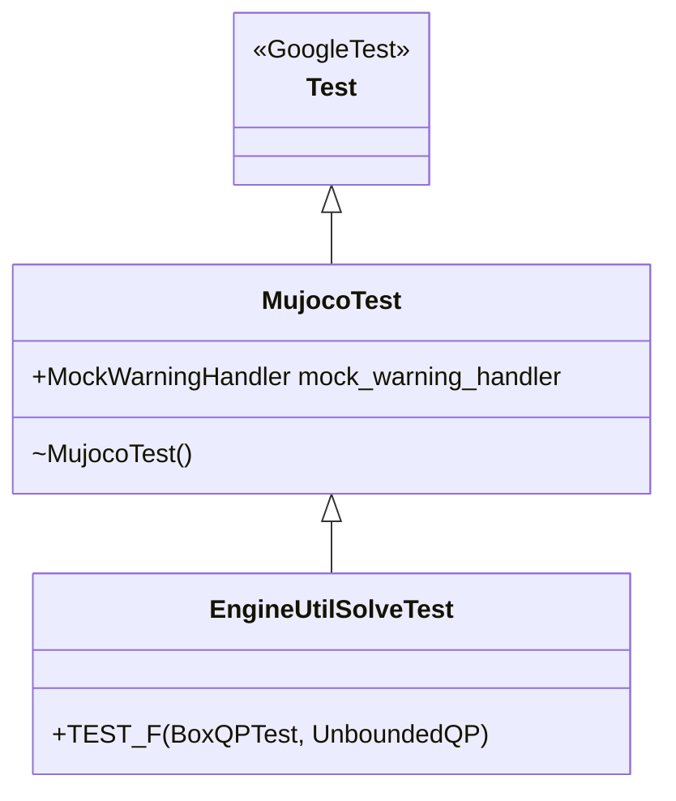

*Figure 1: Test fixture inheritance hierarchy bridging GoogleTest base classes with MuJoCo test utilities.*

Sources: [test/fixture.h](.github/fixture.h), [test/fixture.cc](.github/fixture.cc), [test/engine/engine_util_solve_test.cc](.github/engine/engine_util_solve_test.cc)

### Error and Warning Interception

MuJoCo errors and warnings are intercepted during testing via `MujocoErrorTestGuard` and `MockWarningHandler`. By default, any unexpected warning or error causes a test failure unless explicitly handled or whitelisted as benign [test/fixture.cc:51-81]().

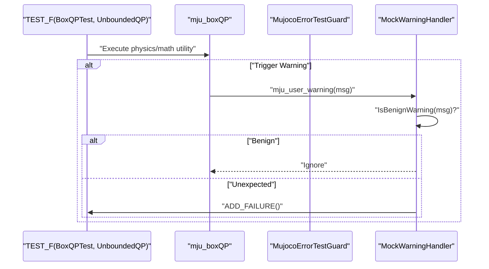

*Figure 2: Sequence flow for warning interception and validation in `MockWarningHandler`.*

Sources: [test/fixture.cc](.github/fixture.cc), [test/fixture.h](.github/fixture.h)

### Precision-Aware Tolerances

To support both double-precision (`mjtNum` as `double`) and single-precision (`mjUSESINGLE` float builds), MuJoCo test assertions use precision-aware matchers and scaling macros (`MjNear`, `MjTol`, `MjEps`) [test/fixture.h:78-121](). The environment variable `MJTOL_SCALE` can be set to scale test tolerances dynamically [test/fixture.h:53-73]().

Sources: [test/fixture.h](.github/fixture.h)

---

## Benchmark Suite

MuJoCo includes a comprehensive benchmarking suite built on the Google Benchmark library, located under `test/benchmark/`. Benchmarks cover physics stepping (`step_benchmark_test.cc`), XML parsing and compilation (`parse_benchmark_test.cc`), collision detection, and mathematical solvers [test/benchmark/CMakeLists.txt:16-104]().

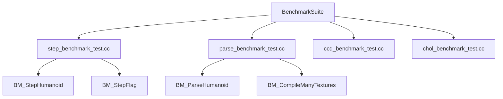

*Figure 3: Structure of the Google Benchmark test targets and key routines.*

Sources: [test/benchmark/CMakeLists.txt](.github/benchmark/CMakeLists.txt), [test/benchmark/parse_benchmark_test.cc](.github/benchmark/parse_benchmark_test.cc), [test/benchmark/step_benchmark_test.cc](.github/benchmark/step_benchmark_test.cc)

---

## Build System Test Targets (Bazel and CMake)

MuJoCo supports both Bazel and CMake build systems. Tests are integrated as native test targets in both environments.

### CMake Test Integration

In CMake, tests are registered using custom helper macros like `mujoco_test` [test/benchmark/CMakeLists.txt:16-20](). CTest executes the resulting binaries.

```cmake
mujoco_test(
  step_benchmark_test
  MAIN_TARGET benchmark::benchmark_main
  ADDITIONAL_LINK_LIBRARIES benchmark::benchmark absl::core_headers
)
```
*Snippet: CMake test target definition from `test/benchmark/CMakeLists.txt`.*

Sources: [test/benchmark/CMakeLists.txt](.github/benchmark/CMakeLists.txt)

---

## GitHub Actions CI and Release Workflows

Continuous integration is managed through GitHub Actions workflows in `.github/workflows/`.

### Workflow Matrix and Build Steps

The main CI workflow (`build.yml`) triggers on pushes and pull requests [.github/workflows/build.yml:27-38](). It uses a dynamically generated build matrix (`build_matrix.json`) controlled by `build_steps.sh` [__github/workflows/build.yml:58-62](), [.github/workflows/build_steps.sh:38-54]().

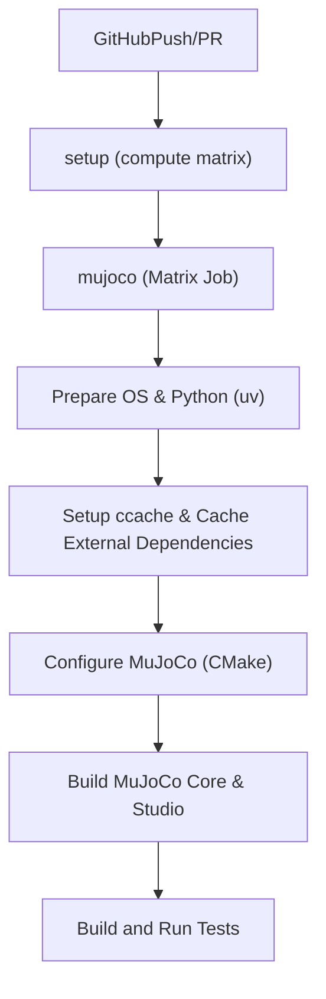

*Figure 4: GitHub Actions CI pipeline execution flow.*

Sources: [.github/workflows/build.yml](.github/workflows/build.yml), [.github/workflows/build_steps.sh](.github/workflows/build_steps.sh)

### WASM and Release Publication

Dedicated workflows handle WebAssembly builds and publishing, such as `publish-wasm.yml` which triggers on version tags to build and package the JS/WASM bindings [__github/workflows/publish-wasm.yml:1-54]().

Sources: [.github/workflows/publish-wasm.yml](.github/workflows/publish-wasm.yml), [wasm/README.md](wasm/README.md)

---

# Page: Model Definition Pipeline

# Model Definition Pipeline

<details>
<summary>Relevant source files</summary>

The following files were used as context for generating this wiki page:

- [doc/XMLreference.rst](doc/XMLreference.rst)
- [doc/XMLschema.rst](doc/XMLschema.rst)
- [doc/changelog.rst](doc/changelog.rst)
- [src/user/user_api.cc](src/user/user_api.cc)
- [src/user/user_api.h](src/user/user_api.h)
- [src/user/user_mesh.cc](src/user/user_mesh.cc)
- [src/user/user_model.cc](src/user/user_model.cc)
- [src/user/user_model.h](src/user/user_model.h)
- [src/user/user_objects.cc](src/user/user_objects.cc)
- [src/user/user_objects.h](src/user/user_objects.h)
- [src/xml/xml_native_reader.cc](src/xml/xml_native_reader.cc)
- [src/xml/xml_native_writer.cc](src/xml/xml_native_writer.cc)
- [test/user/user_api_test.cc](test/user/user_api_test.cc)
- [test/user/user_mesh_test.cc](test/user/user_mesh_test.cc)
- [test/user/user_objects_test.cc](test/user/user_objects_test.cc)
- [test/xml/xml_native_reader_test.cc](test/xml/xml_native_reader_test.cc)
- [test/xml/xml_native_writer_test.cc](test/xml/xml_native_writer_test.cc)

</details>


## Purpose and Scope

This document describes the **complete model creation workflow** in MuJoCo, from high-level model descriptions to compiled runtime structures. It covers the input formats (MJCF XML and programmatic APIs), the intermediate specification representation (`mjSpec`), asset management, and the compilation process that produces `mjModel`.

For information about runtime simulation with `mjModel` and `mjData`, see [Core Runtime System](#3). For details on the physics simulation algorithms, see [Physics Simulation Pipeline](#4). For language bindings, see [C and Python APIs](#5).

---

## Overview

The Model Definition Pipeline transforms human-readable model descriptions into optimized runtime structures through three distinct phases:

**Phase 1: Specification** - Models are defined using MJCF XML files or the programmatic `mjSpec` API via `mj_makeSpec()` [src/user/user_api.cc:60](). This creates a tree of mutable `mjC*` objects (`mjCModel`, `mjCBody`, `mjCGeom`, etc.) [src/user/user_model.h:41](), [src/user/user_objects.h:40]() representing the kinematic structure and physical properties.

**Phase 2: Compilation** - The `mj_compile()` function validates, processes, and flattens the specification tree into the immutable `mjModel` structure with contiguous arrays and pre-computed sparse matrices optimized for fast simulation [src/user/user_model.cc:152]().

**Phase 3: Instantiation** - The compiled `mjModel` is used to instantiate `mjData` instances that hold simulation state, intermediates, and workspace memory.

### Workflow Diagram
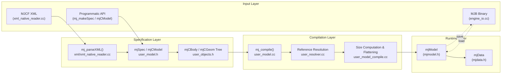
Sources: [src/user/user_model.h:1-100](), [src/user/user_model.cc:152-201](), [src/user/user_api.cc:60-76]()

---

## Input Formats and APIs

### 2.1 MJCF XML Format
MJCF is an XML-based declarative language for describing mechanical systems. It defines a rich schema of elements (bodies, joints, geoms, sensors, actuators) and attributes configuring physical and visual properties. Elements are parsed into mutable `mjC*` objects. Special meta-elements like `<include>`, `<frame>`, and `<replicate>` enable modular modeling.
For details, see [MJCF XML Format](#2.1).
Sources: [doc/XMLreference.rst:1-100](), [src/xml/xml_native_reader.cc:170-215]()

### 2.2 mjSpec C++ API
MuJoCo provides a low-level C++ programmatic API (`mjSpec`, `mjCModel`, `mjCBase`) for constructing and editing models without XML files. Elements are built dynamically and initialized via `mjs_defaultSpec` and related builder functions.
For details, see [mjSpec C++ API](#2.2).
Sources: [src/user/user_model.cc:130-180](), [src/user/user_api.cc:60-77]()

### 2.3 Python MjSpec API
The Python interface wraps `mjSpec` via `mujoco.MjSpec`, offering high-level Pythonic element manipulation, attachment systems, asset embedding, and code generation.
For details, see [Python MjSpec API](#2.3).
Sources: [src/user/user_api.cc:60-76]()

### 2.4 XML Parsing and Writing
The XML parsing layer (`xml_native_reader.cc`) reads MJCF structures, verifies against the XSD schema (`mjcf.xsd`), and tracks authored attributes. The XML writer (`xml_native_writer.cc`) serializes `mjSpec` trees back into formatted XML files.
For details, see [XML Parsing and Writing](#2.4).
Sources: [src/xml/xml_native_reader.cc:190-215](), [src/xml/xml_native_writer.cc:63-132]()

---

## Asset Management and VFS

### 2.5 Asset Management and VFS
Models frequently reference external files such as meshes (`.obj`, `.stl`), heightfields (`.hfield`), and textures (`.png`). 
- Assets are managed through the Virtual File System (`mjVFS`) and resource provider infrastructure (`mju_openResource`).
- `mjCMesh` processes geometry to generate convex hulls via Qhull and bounding volume hierarchies (BVH).
- Textures are decoded (e.g., using `lodepng` in `user_objects.cc`) or kept by reference.

For details, see [Asset Management and VFS](#2.5).

### Asset Pipeline Diagram
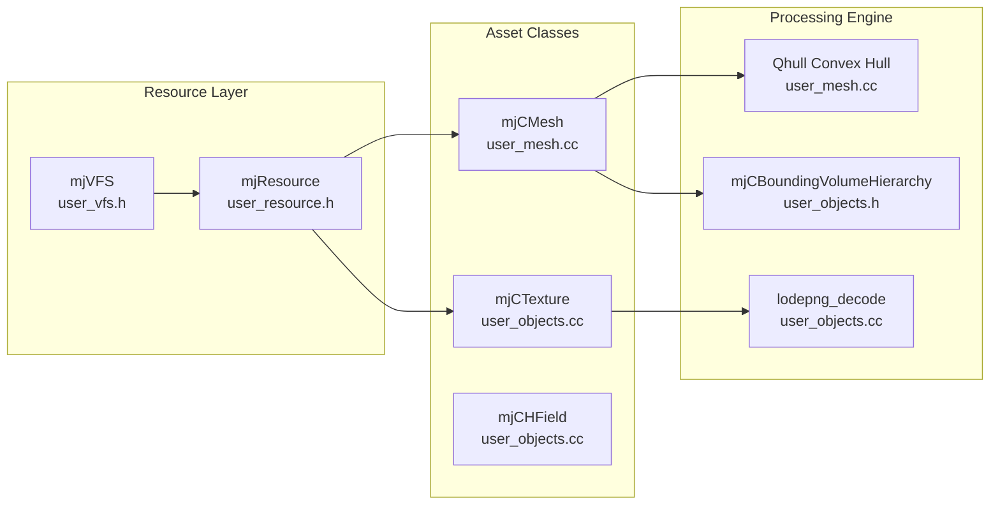
Sources: [src/user/user_objects.cc:57-136](), [src/user/user_mesh.cc:190-235](), [src/user/user_objects.h:95-185]()

---

## Compilation Process

### 2.6 Compilation Process
The compilation engine (`mj_compile` in `src/user/user_model.cc`) converts the specification hierarchy into the flat runtime structure `mjModel`:
- **Validation & Resolution**: Resolves string references to pointers and checks semantic constraints.
- **Size Computation**: Computes required buffer dimensions (`nq`, `nv`, `nu`, `nbody`, etc.) [src/user/user_model.h:55-135]().
- **Flattening**: Allocates contiguous memory arrays for simulation structures.
- **Sparse Matrix Construction**: Builds compressed sparse row (CSR) representations for matrices like :math:`M`, :math:`B`, :math:`C`, and :math:`D`.
- **In-Place Updates**: `mj_recompile` allows runtime modifications.

For details, see [Compilation Process](#2.6).
Sources: [src/user/user_model.h:55-135](), [src/user/user_model.cc:152-233]()

### 2.7 Model Composition and Attachment
Sub-models can be attached to parent specifications at specified frames, sites, or bodies using namespace management prefixes/suffixes and the `deepcopy` flag. This enables hierarchical assembly of complex multi-robot scenes.
For details, see [Model Composition and Attachment](#2.7).
Sources: [src/user/user_model.h:43-46](), [src/user/user_model.cc:189-220]()

---

## Summary of Child Pages

- **[MJCF XML Format](#2.1)** — MJCF XML schema, element hierarchy, attribute reference, and URDF support.
- **[mjSpec C++ API](#2.2)** — C++ API for programmatic model creation using `mjCModel` and `mjCBase`.
- **[Python MjSpec API](#2.3)** — Python interface for `MjSpec` element manipulation and attachments.
- **[XML Parsing and Writing](#2.4)** — XML reader (`xml_native_reader.cc`) and writer (`xml_native_writer.cc`).
- **[Asset Management and VFS](#2.5)** — Asset loading, VFS, caching, BVH, and SDF generation.
- **[Compilation Process](#2.6)** — Compilation workflows (`mj_compile`), sizing, and sparse matrices.
- **[Model Composition and Attachment](#2.7)** — Model attachments, namespaces, and deepcopy behaviors.

Sources: [src/user/user_model.h:1-150](), [src/user/user_api.cc:55-120]()

---

# Page: MJCF XML Format

# MJCF XML Format

<details>
<summary>Relevant source files</summary>

The following files were used as context for generating this wiki page:

- [cmake/ShellTests.cmake](cmake/ShellTests.cmake)
- [doc/XMLreference.rst](doc/XMLreference.rst)
- [doc/XMLschema.rst](doc/XMLschema.rst)
- [doc/changelog.rst](doc/changelog.rst)
- [plugin/obj_decoder/CMakeLists.txt](plugin/obj_decoder/CMakeLists.txt)
- [plugin/stl_decoder/CMakeLists.txt](plugin/stl_decoder/CMakeLists.txt)
- [src/user/user_api.cc](src/user/user_api.cc)
- [src/user/user_api.h](src/user/user_api.h)
- [src/user/user_mesh.cc](src/user/user_mesh.cc)
- [src/user/user_model.cc](src/user/user_model.cc)
- [src/user/user_model.h](src/user/user_model.h)
- [src/user/user_objects.cc](src/user/user_objects.cc)
- [src/user/user_objects.h](src/user/user_objects.h)
- [src/xml/generated/dmcontrol_schema.xml](src/xml/generated/dmcontrol_schema.xml)
- [src/xml/generated/mjcf.xsd](src/xml/generated/mjcf.xsd)
- [src/xml/generated/mjcf_default_table.inc](src/xml/generated/mjcf_default_table.inc)
- [src/xml/generated/mjcf_map.h](src/xml/generated/mjcf_map.h)
- [src/xml/generated/mjcf_read_table.inc](src/xml/generated/mjcf_read_table.inc)
- [src/xml/generated/mjcf_table.inc](src/xml/generated/mjcf_table.inc)
- [src/xml/mjcf.schema](src/xml/mjcf.schema)
- [src/xml/xml_native_reader.cc](src/xml/xml_native_reader.cc)
- [src/xml/xml_native_writer.cc](src/xml/xml_native_writer.cc)
- [src/xml/xml_urdf.cc](src/xml/xml_urdf.cc)
- [src/xml/xml_urdf.h](src/xml/xml_urdf.h)
- [test/user/CMakeLists.txt](test/user/CMakeLists.txt)
- [test/user/user_api_test.cc](test/user/user_api_test.cc)
- [test/user/user_mesh_test.cc](test/user/user_mesh_test.cc)
- [test/user/user_objects_test.cc](test/user/user_objects_test.cc)
- [test/xml/CMakeLists.txt](test/xml/CMakeLists.txt)
- [test/xml/xml_native_reader_test.cc](test/xml/xml_native_reader_test.cc)
- [test/xml/xml_native_writer_test.cc](test/xml/xml_native_writer_test.cc)
- [test/xml/xml_urdf_test.cc](test/xml/xml_urdf_test.cc)
- [wasm/CMakeLists.txt](wasm/CMakeLists.txt)

</details>


## Purpose and Scope

This page documents the MJCF (MuJoCo XML Format) modeling language, which is the primary method for defining physics models in MuJoCo. MJCF is a declarative XML-based format describing all aspects of a simulation model, including geometry, kinematics, dynamics, appearance, sensors, and actuators.

For programmatic model creation and editing, see the [mjSpec C++ API](#2.2) and [Python MjSpec API](#2.3). Parsing and serialization details are covered in [XML Parsing and Writing](#2.4), and model compilation from MJCF to runtime structures is detailed in [Compilation Process](#2.6).

Sources: `[doc/XMLreference.rst:1-96]()`, `[src/xml/xml_native_reader.cc:1-50]()`

---

## MJCF Structure Overview

MJCF files contain a single top-level `<mujoco>` element, which may include multiple optional sections. The document is hierarchical; for example, the `<worldbody>` section contains a tree of `<body>` elements representing the system's kinematic structure.

The parser reads and validates the XML against a comprehensive schema, then builds an internal `mjSpec` representation. This is compiled into the runtime model structures (`mjModel`/`mjData`).

### Element Hierarchy Diagram

**Figure 1:** MJCF Document Element Hierarchy
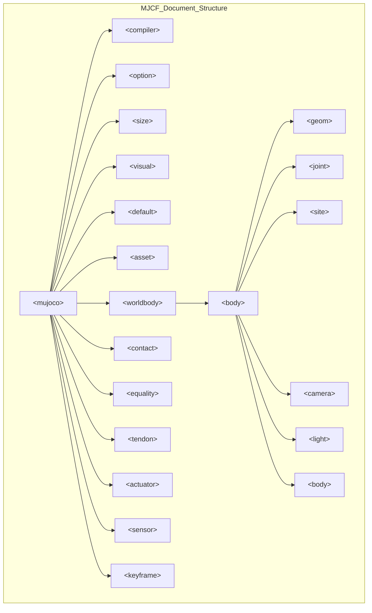

Sources: `[doc/XMLreference.rst:98-117]()`, `[src/xml/xml_native_reader.cc:98-511]()`

---

## Schema Definition and Validation

The MJCF schema is internally represented as the `MJCF` array in `[src/xml/xml_native_reader.cc]`. It enumerates valid XML elements, cardinality, and their allowed attributes.

- Cardinality Indicators:
  - `!` — Required element, appears exactly once.
  - `?` — Optional, appears at most once.
  - `R` — Recursive element (e.g., `<body>` can include child `<body>`).
  - `*` — Optional, may appear multiple times.

Parsing follows strict validation of element hierarchy and attribute types, aided by numerous keyword maps (e.g., coordinate systems, solvers). Errors in schema or attributes produce detailed exceptions.

### Schema Validation Pipeline (Code Entity Bridge)

**Figure 2:** Schema Validation Pipeline mapped to `mjXReader` and TinyXML2
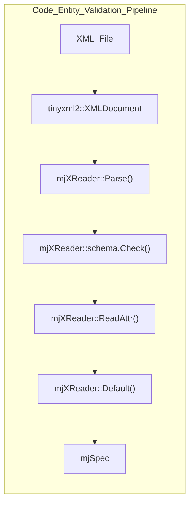

Sources: `[src/xml/xml_native_reader.cc:100-511]()`, `[doc/XMLreference.rst:14-46]()`

---

## Attribute Types and Parsing

MJCF attributes are strongly typed, with the following primary attribute data types:

| Type       | Format                  | Example                 | Parsing Implementation        |
|------------|-------------------------|-------------------------|-------------------------------|
| `string`   | Arbitrary string        | `name="box"`            | `mjXUtil::ReadAttrTxt`         |
| `int(N)`   | N integers              | `group="3"`             | `mjXUtil::ReadAttrInt`         |
| `real(N)`  | N real numbers          | `pos="1 2 3"`           | `mjXReader::ReadAttr`          |
| `[...]`    | Enum keywords           | `type="sphere"`         | `mjXReader::MapValue`          |

Attribute parsing accounts for special values like `inf`, `-inf`, or `nan` for floating-point numbers. Memory size attributes support suffixes such as `K`, `M`, `G`. Quaternions are normalized automatically if specified with nonzero values.

Sources: `[doc/XMLreference.rst:48-91]()`, `[src/xml/xml_native_reader.cc:75-130]`, `[test/xml/xml_native_reader_test.cc:279-329]()`

---

## Meta-Elements

Certain MJCF elements do not correspond to runtime objects but serve as procedural or structural directives during parsing. They are removed after processing.

### Frame Element

The `<frame>` element represents a pure coordinate transform that wraps subtrees in the kinematic tree. Upon compilation, frames disappear and their transformations aggregate into child elements.

### Include Element

The `<include>` element merges external XML files into the current model. The parser recursively loads and consolidates these files at the include's location.

### Replicate Element

The `<replicate>` element duplicates kinematic subtrees multiple times with incremental transformations and namespace suffixes. The `UpdateString` helper generates suffixes. This facilitates compact repetition of similar elements.

### Replicate Processing Diagram

**Figure 3:** Replicate Processing and Suffix Generation
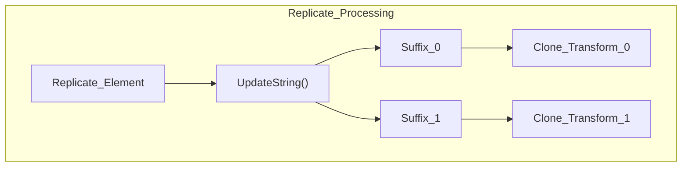

Sources: `[doc/XMLreference.rst:179-260]()`, `[src/xml/xml_native_reader.cc:155-164]`, `[test/xml/xml_native_reader_test.cc:1087-1139]()`

---

## Default System and Inheritance

MJCF supports an inheritance mechanism via `<default>` elements that define attribute templates grouped by `class` names. Model elements can reference these default classes to inherit attribute values unless explicitly set.

### Default Inheritance Resolution

**Figure 4:** Default Class Attribute Inheritance
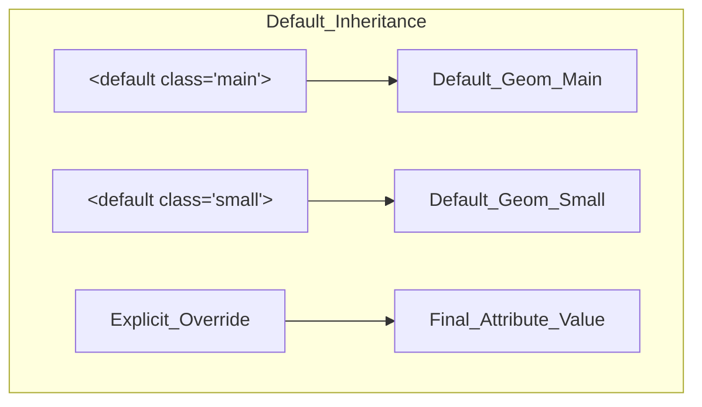

Sources: `[src/xml/xml_native_reader.cc:151-172]()`, `[test/xml/xml_native_reader_test.cc:479-510]()`

---

## Key Element Sections

### Compiler Section

Controls compilation options influencing preprocessing and optimization. Attributes include `angle`, `coordinate`, resource directories (`meshdir`, `texturedir`, `assetdir`), and flags like `boundmass`.

### Option Section

Defines runtime simulation parameters stored in `mjModel.opt`, including `timestep`, `gravity`, `integrator`, and solver tolerances.

### Asset Section

Declares external assets such as meshes, textures, and materials. Asset loading performs caching and path resolution leveraging resource directories and virtual file systems (`mjVFS`).

### Worldbody Section

Root of the kinematic hierarchy, containing nested `<body>` elements representing rigid bodies, including joints, geoms, sites, cameras, and lights.

### Actuator Section

Defines actuators applying forces or torques using types such as motors, position actuators, and velocity actuators.

Sources: `[doc/XMLreference.rst:661-841]()`, `[src/xml/xml_native_reader.cc:1852-2280]()`, `[test/user/user_objects_test.cc:159-243]()`, `[doc/changelog.rst:17-34]`

---

## XML Parsing Implementation

Parsing is performed by `mjXReader` in `[src/xml/xml_native_reader.cc]()`. The pipeline handles DOM parsing, include resolution, frame accumulation, replication, schema validation, default population, asset loading, and spec tree construction.

### XML Parsing Pipeline (Code Entity Bridge)

**Figure 5:** XML Parsing Data Flow via `mjXReader`
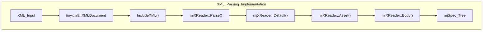

Sources: `[src/xml/xml_native_reader.cc:46-215]`, `[src/xml/xml.cc:102-230]()`

---

## XML Writing and Round-Tripping

The `mjXWriter` class in `[src/xml/xml_native_writer.cc]()` serializes an `mjSpec` model back to MJCF XML using `mj_XMLPrinter` for compact indentation.

Sources: `[src/xml/xml_native_writer.cc:15-132]()`, `[test/xml/xml_native_writer_test.cc:49-237]()`

---

## Validation and Error Reporting

The parser enforces strict validation rules, including unique element constraints and exclusive orientation attributes, emitting `mjXError` exceptions on failure.

Sources: `[test/xml/xml_native_reader_test.cc:49-150, 1100-1150]()`

---

## References to Key Code Entities

### Natural Language to Code Entity Mappings

**Figure 6:** System Concepts Mapped to Code Entities
```mermaid
graph LR
    subgraph "Natural_Language_To_Code"
        Parser["Parser_System"] --> ReaderClass["mjXReader"]
        WriterSystem["Writer_System"] --> WriterClass["mjXWriter"]
        SchemaDef["Schema_Definition"] --> SchemaArray["MJCF_Table"]
        IncludeSys["Include_Handling"] --> IncludeFunc["IncludeXML"]
    end
```

**Figure 7:** MJCF Elements Mapped to `mjSpec` Components
```mermaid
graph LR
    subgraph "MJCF_Elements_To_Spec"
        MujocoEl["&lt;mujoco&gt;"] --> SpecStruct["mjSpec"]
        CompilerEl["&lt;compiler&gt;"] --> CompilerStruct["mjsCompiler"]
        OptionEl["&lt;option&gt;"] --> OptionStruct["mjsOption"]
        BodyEl["<body>"] --> BodyClass["mjCBody"]
        GeomEl["<geom>"] --> GeomClass["mjCGeom"]
    end
```

Sources: `[src/xml/xml_native_reader.cc:46-164]()`, `[src/xml/xml_native_writer.cc:15-124]`, `[doc/XMLreference.rst:1-300]()`

---

# Page: mjSpec C++ API

# mjSpec C++ API

<details>
<summary>Relevant source files</summary>

The following files were used as context for generating this wiki page:

- [doc/XMLreference.rst](doc/XMLreference.rst)
- [doc/XMLschema.rst](doc/XMLschema.rst)
- [doc/changelog.rst](doc/changelog.rst)
- [src/user/user_api.cc](src/user/user_api.cc)
- [src/user/user_api.h](src/user/user_api.h)
- [src/user/user_init.c](src/user/user_init.c)
- [src/user/user_mesh.cc](src/user/user_mesh.cc)
- [src/user/user_model.cc](src/user/user_model.cc)
- [src/user/user_model.h](src/user/user_model.h)
- [src/user/user_objects.cc](src/user/user_objects.cc)
- [src/user/user_objects.h](src/user/user_objects.h)
- [src/user/user_util.cc](src/user/user_util.cc)
- [src/user/user_util.h](src/user/user_util.h)
- [src/xml/xml_native_reader.cc](src/xml/xml_native_reader.cc)
- [src/xml/xml_native_writer.cc](src/xml/xml_native_writer.cc)
- [test/user/user_api_test.cc](test/user/user_api_test.cc)
- [test/user/user_mesh_test.cc](test/user/user_mesh_test.cc)
- [test/user/user_objects_test.cc](test/user/user_objects_test.cc)
- [test/user/user_util_test.cc](test/user/user_util_test.cc)
- [test/xml/xml_native_reader_test.cc](test/xml/xml_native_reader_test.cc)
- [test/xml/xml_native_writer_test.cc](test/xml/xml_native_writer_test.cc)

</details>


This document provides a detailed technical overview of MuJoCo’s C++ API for programmatic model creation and editing via the `mjSpec` system. It covers the hierarchical object model (`mjCBase` and subclasses), the top-level model container class (`mjCModel`), and the C API wrapper interface, explaining data flow, key classes and functions, along with architecture diagrams.

## Overview

MuJoCo model construction programmatically uses the `mjSpec` interface wrapping a C++ object tree rooted at `mjCModel`. This system allows direct creation, modification, and compilation of models to the runtime `mjModel` structure, bypassing XML if desired.

Key components:

- **`mjCBase` and subclasses**: C++ class hierarchy representing all modeling elements (bodies, joints, geoms, sites, actuators, etc.) [src/user/user_objects.h:40-70]().
- **`mjCModel`**: The top-level model class managing all elements, defaults, and compilation [src/user/user_model.h:41-140]().
- **`mjSpec`**: C API handle wrapping `mjCModel` for public API exposure [src/user/user_api.cc:60-63]().

Sources: [src/user/user_objects.h:40-70](), [src/user/user_model.h:41-140](), [src/user/user_api.cc:60-63]()

---

## `mjCBase` Class Hierarchy: Model Element Representation

All model elements derive from `mjCBase`, an abstract base providing naming, hierarchical relationships, and common behavioral interfaces. The inheritance structure includes body elements, geometric primitives, sensors, actuators, and assets.

### Key Classes

- `mjCBody`: Rigid body container forming the tree hierarchy [src/user/user_objects.h:42]().
- `mjCFrame`: Coordinate frames for pose transforms [src/user/user_objects.h:43]().
- `mjCGeom`: Collision geometry elements [src/user/user_objects.h:45]().
- `mjCJoint`: DOFs that connect bodies [src/user/user_objects.h:44]().
- `mjCSite`: Markers or reference frames [src/user/user_objects.h:46]().
- `mjCCamera`, `mjCLight`: Visual elements [src/user/user_objects.h:47-48]().
- Asset classes: `mjCMesh`, `mjCTexture`, `mjCMaterial`, `mjCHField`, `mjCSkin` [src/user/user_objects.h:49-54]().
- Control/sensing elements: `mjCActuator`, `mjCSensor`, `mjCTendon`, `mjCEquality`, `mjCPair` [src/user/user_objects.h:55-60]().

### `mjCBase` Inheritance Diagram

```mermaid
graph TB
    mjCBase["mjCBase"]
    
    mjCBase --> mjCBody["mjCBody"]
    mjCBase --> mjCFrame["mjCFrame"]
    mjCBase --> mjCGeom["mjCGeom"]
    mjCBase --> mjCJoint["mjCJoint"]
    mjCBase --> mjCSite["mjCSite"]
    mjCBase --> mjCCamera["mjCCamera"]
    mjCBase --> mjCLight["mjCLight"]
    
    mjCBase --> mjCMesh["mjCMesh"]
    mjCBase --> mjCTexture["mjCTexture"]
    mjCBase --> mjCMaterial["mjCMaterial"]
    mjCBase --> mjCHField["mjCHField"]
    mjCBase --> mjCSkin["mjCSkin"]
    
    mjCBase --> mjCActuator["mjCActuator"]
    mjCBase --> mjCSensor["mjCSensor"]
    mjCBase --> mjCTendon["mjCTendon"]
    mjCBase --> mjCEquality["mjCEquality"]
    mjCBase --> mjCPair["mjCPair"]
    
    style mjCBase stroke-width:2px
```

Sources: [src/user/user_objects.h:40-70]()

---

## `mjCModel`: Main Model Container and Compiler

`mjCModel` inherits from `mjCModel_` (which in turn inherits `mjsElement`) and is the primary class collecting all model elements and defaults. It provides APIs to build a complete model tree programmatically and to trigger compilation to the runtime `mjModel`.

### Internal Elements Storage

- `std::vector<mjCBody*> bodies_`: All bodies including the root world body [src/user/user_model.cc:172]().
- Vectors for geoms, joints, meshes, actuators, and other elements [src/user/user_model.cc:150-180]().
- `std::vector<mjCDef*> defaults_`: Default classes for inheritance of properties [src/user/user_model.cc:154]().

### Construction and Ownership

- The root "world" body is created automatically in the constructor [src/user/user_model.cc:161-174]().
- Defaults hierarchy is initialized with a "main" base default [src/user/user_model.cc:153-155]().
- The `mjCModel` instance manages object lifetimes and references.

### `mjCModel` Structure Diagram

```mermaid
graph LR
    subgraph "mjCModel Container"
        mjCModel["mjCModel"]
        
        Bodies["std::vector<mjCBody*> bodies_"]
        Geoms["std::vector<mjCGeom*> geoms_"]
        Joints["std::vector<mjCJoint*> joints_"]
        Meshes["std::vector<mjCMesh*> meshes_"]
        Actuators["std::vector<mjCActuator*> actuators_"]
        Defaults["std::vector<mjCDef*> defaults_"]
        
        mjCModel --> Bodies
        mjCModel --> Geoms
        mjCModel --> Joints
        mjCModel --> Meshes
        mjCModel --> Actuators
        mjCModel --> Defaults
    end
    
    Bodies --> World["World Body id=0"]
```

### Important `mjCModel` Members

- Compilation status flags and size counters (`nbody`, `njnt`, `nq`, `nv`, etc.) [src/user/user_model.h:54-140]().
- Auto-computed model metrics (e.g., mean inertia, extent) [src/user/user_model.cc:141-147]().
- Reference counting and deep copy flags for model composition.

Sources: [src/user/user_model.h:41-140](), [src/user/user_model.cc:130-220]()

---

## C API Wrappers and Construction Functions

The public C API exposes the underlying C++ spec model via `mjSpec` pointers, which point to `mjCModel->spec` [src/user/user_api.cc:60-63](). Construction and manipulation are performed using functions declared in `src/user/user_api.h`.

### Creating and Copying Specs

- `mjSpec* mj_makeSpec();` — Creates a new `mjCModel` and returns its `mjSpec` interface [src/user/user_api.cc:60-63]().
- `mjSpec* mj_copySpec(const mjSpec* s);` — Creates a deep copy of an existing spec, cloning the entire element tree [src/user/user_api.cc:67-76]().

### Adding Elements to Model

| API Function | Description | Returns |
| --- | --- | --- |
| `mjsBody* mjs_addBody(mjsBody* body, const mjsDefault* def)` | Add a new child body | Pointer to new body |
| `mjsGeom* mjs_addGeom(mjsBody* body, const mjsDefault* def)` | Add a geometry to the body | Pointer to geom |
| `mjsJoint* mjs_addJoint(mjsBody* body, const mjsDefault* def)` | Add a joint DOF | Pointer to joint |
| `mjsSite* mjs_addSite(mjsBody* body, const mjsDefault* def)` | Add a site marker | Pointer to site |

Sources: [src/user/user_api.cc:56-76](), [test/user/user_api_test.cc:55-67]()

---

## Model Compilation Process

After model specification, compilation transforms the editable `mjCModel` tree into an efficient low-level `mjModel` representation used at runtime.

### Compilation Pipeline

```mermaid
graph TB
    Input["mjCModel"]
    
    subgraph "Preprocessing"
        AssignIds["Assign IDs to elements"]
        ResolveRefs["Resolve name references"]
    end
    
    subgraph "Compilation"
        CompileTree["Compile tree structure into arrays"]
        ComputeSizes["Calculate buffer and matrix sizes"]
    end
    
    subgraph "Finalization"
        Allocate["Allocate mjModel buffers"]
        SetConstants["Compute derived quantities mj_setConst"]
    end
    
    Output["mjModel"]
    
    Input --> AssignIds --> ResolveRefs --> CompileTree --> ComputeSizes --> Allocate --> SetConstants --> Output
```

Sources: [src/user/user_model.cc:150-220](), [src/user/user_api.cc:200-240]()

---

## Default Class System (`mjCDef`)

The default system supports property inheritance. Default classes (`mjCDef`) can be defined hierarchically (e.g., "main", "robot", "arm"). Elements specify a default class to inherit properties [src/user/user_model.cc:153-156]().

Sources: [src/user/user_model.cc:130-180]()

---

## Error Handling and Diagnostics

Errors during model construction and compilation are thrown as exceptions of type `mjCError`. This class provides detailed messages including object context and error text [src/user/user_objects.h:77-83]().

```cpp
class [[nodiscard]] mjCError {
 public:
  mjCError(const mjCBase* obj = 0, const char* msg = 0, const char* str = 0, int pos1 = 0, int pos2 = 0);
  char message[500];
};
```

Sources: [src/user/user_objects.h:77-83](), [src/user/user_objects.cc:80-111]()

---

## Natural Language to Code Entity Space Mapping

### Diagram: Model Construction Workflow

```mermaid
graph LR
    UserIntent[""User Intent: Create Model Spec""] --> MakeSpec[""mj_makeSpec() / mjCModel""]
    MakeSpec --> AddBody[""mjs_addBody() / mjCBody""]
    AddBody --> AddGeom[""mjs_addGeom() / mjCGeom""]
    AddBody --> AddJoint[""mjs_addJoint() / mjCJoint""]
    MakeSpec --> Compile[""mj_compile() / mjModel""]
```

Sources: [src/user/user_api.cc:60-76](), [src/user/user_objects.h:40-70]()

---

# Page: Python MjSpec API

# Python MjSpec API

<details>
<summary>Relevant source files</summary>

The following files were used as context for generating this wiki page:

- [python/mujoco/codegen/generate_spec_bindings.py](python/mujoco/codegen/generate_spec_bindings.py)
- [python/mujoco/specs.cc](python/mujoco/specs.cc)
- [python/mujoco/specs_test.py](python/mujoco/specs_test.py)

</details>


## Purpose and Scope

The Python MjSpec API offers a comprehensive Python interface to MuJoCo's intermediate model specification representation, `mjSpec`. It facilitates programmatic creation, manipulation, and composition of MuJoCo models directly from Python without the need for XML. The API provides classes for model elements, supports an efficient attachment system for model composition, and exposes functionality to compile the specification into runtime MuJoCo models.

This page covers the internal structure and the usage patterns of the Python MjSpec API, focusing on the `MjSpec` class, element manipulation APIs, the attachment mechanism, and the code generation strategy used to create the bindings. For underlying C++ details, see the C++ mjSpec API [2.2](). For XML reference, see the MJCF XML Format [2.1]().

---

## Architecture Overview

### Layered Structure and Data Flow

The Python MjSpec API is layered to bridge Python usage and the C++ core intermediate representation. The data flow from Python user code to the native MuJoCo compilation can be summarized as:

```mermaid
graph TB
    U["Python User Code"] -->|Use| P["mujoco.MjSpec and element classes"]
    P -->|Calls| B["pybind11 bindings in python/mujoco/specs.cc"]
    B -->|Wraps| W["MjSpec wrapper (manages raw::MjSpec* and assets)"]
    W -->|Manipulates underlying| R["raw::MjSpec C struct"]
    R -->|Calls| C["mj_compile() from mujoco C API"]
    C -->|Creates| M["mjModel (runtime compiled model)"]
```

- `mujoco.MjSpec` acts as the primary Python class wrapping a raw pointer to `raw::MjSpec`.
- Element classes like `MjsBody`, `MjsGeom` hold lightweight references to sub-elements in the raw spec.
- The `Compile()` method converts the spec into an `mjModel*` by invoking native MuJoCo runtime compilation.
- Assets added to the `MjSpec` (like meshes or textures as bytes) are injected into an optional virtual file system (`mjVFS`) during compilation.

This layering ensures efficient memory management and seamless integration into Python workflows without compromising the rich functionality of underlying C++ structs.

Sources: [python/mujoco/specs.cc:25-154](), [python/mujoco/specs_test.py:67-146]()

---

### Class Hierarchy and Element Composition

The Python MjSpec API models the MJCF element hierarchy with dedicated Python classes matching MuJoCo's `mjs*` structs. This includes `MjsBody`, `MjsGeom`, `MjsSite`, `MjsJoint`, `MjsFrame`, `MjsCamera`, `MjsLight`, `MjsMesh`, `MjsTexture`, `MjsMaterial`, `MjsActuator`, and others.

#### Key Relationships:

```mermaid
graph TB
    MjSpec["mujoco.MjSpec\n(Root - containing all model data)"]
    MjsBody["mujoco.MjsBody\n(Body element)"]
    MjsGeom["mujoco.MjsGeom"]
    MjsSite["mujoco.MjsSite"]
    MjsJoint["mujoco.MjsJoint"]
    MjsFrame["mujoco.MjsFrame"]
    MjsCamera["mujoco.MjsCamera"]
    MjsLight["mujoco.MjsLight"]
    MjsMesh["mujoco.MjsMesh"]
    MjsTexture["mujoco.MjsTexture"]
    MjsMaterial["mujoco.MjsMaterial"]
    MjsActuator["mujoco.MjsActuator"]
    MjsSensor["mujoco.MjsSensor"]
    MjsTendon["mujoco.MjsTendon"]

    MjSpec -->|worldbody| MjsBody
    MjSpec -->|add_mesh()| MjsMesh
    MjSpec -->|add_texture()| MjsTexture
    MjSpec -->|add_material()| MjsMaterial
    MjSpec -->|add_actuator()| MjsActuator
    MjSpec -->|add_sensor()| MjsSensor
    MjSpec -->|add_tendon()| MjsTendon

    MjsBody -->|add_body()| MjsBody
    MjsBody -->|add_geom()| MjsGeom
    MjsBody -->|add_site()| MjsSite
    MjsBody -->|add_joint()| MjsJoint
    MjsBody -->|add_frame()| MjsFrame
    MjsBody -->|add_camera()| MjsCamera
    MjsBody -->|add_light()| MjsLight
```

- `MjSpec.worldbody` is the root body tree of the model.
- Nested bodies and other elements (geoms, sites, joints, frames, cameras, lights) can be recursively added under bodies.
- Other assets such as meshes, textures, materials, actuators, sensors, and tendons are attached to the root `MjSpec`.

These classes are reference-like wrappers: they do not copy underlying data but reflect and modify the native C++ structures in-place.

Sources: [python/mujoco/specs.cc:139-179](), [python/mujoco/specs_test.py:38-146]()

---

## Loading and Parsing Model Specifications

### Creating MjSpec from XML or Files

The Python API allows creating an `MjSpec` from various sources:

- **from_string(xml: str, assets: Optional[dict])**  
  Loads a spec by parsing MJCF XML or a similar format provided as a string.  
  Optional `assets` dictionary can provide additional files (meshes, textures) as binary buffers to be injected into a virtual file system (VFS).

- **from_file(path: str, assets: Optional[dict])**  
  Loads a spec from an XML file on disk, similarly with optional asset injection.

Internally, when assets are provided, a MuJoCo VFS (`mjVFS`) is constructed, and assets are added as virtual buffers before compilation, enabling seamless referencing in XML (e.g., mesh files).

```python
spec = mujoco.MjSpec.from_string(xml_string, assets={'mesh.stl': mesh_bytes})
model = spec.compile()
```

Assets can be used to avoid filesystem dependencies and enable precise control of all model resources in memory.

Source snippets implementing loading with assets and VFS usage are found in [python/mujoco/specs.cc:85-113]() and tested via [python/mujoco/specs_test.py:20-146]().

---

## Constructing and Manipulating Model Elements

### Adding Elements with Initialization kwargs

The Python bindings provide `add_*` methods for elements with optional keyword arguments to initialize any element attributes upon creation. This allows concise and declarative element construction, e.g.:

```python
spec = mujoco.MjSpec()
body = spec.worldbody.add_body(name='my_body', pos=[1, 2, 3])
geom = body.add_geom(type=mujoco.mjtGeom.mjGEOM_SPHERE, size=[0.1])
```

This mechanism is broadly supported across element types including `body`, `geom`, `site`, `joint`, `mesh`, `material`, `actuator`, `equalities`, `pair`, etc. [python/mujoco/codegen/generate_spec_bindings.py:30-55]()

- Keyword arguments map directly to struct fields.
- Array fields map to NumPy arrays or sequences.
- Enums are exposed as Python enum constants for clarity and safety.
- The system validates bounds (e.g., list indices) and value types. [python/mujoco/specs.cc:126-140]()

### Orientation Resolution Helper

The `MjSpec` class provides a static helper to resolve orientation specifications (Euler angles, axis-angle) into quaternions respecting the spec compiler's settings like Euler sequence and degree/radian mode. This allows users to specify orientations flexibly and consistently.

Example usage:

```python
quat = mujoco.MjSpec.resolve_orientation(
    degree=spec.compiler.degree,
    sequence=spec.compiler.eulerseq,
    orientation=body.alt,
)
```

Sources: [python/mujoco/specs_test.py:173-184]()

---

## Element Access, Traversal, and Queries

### Finding Elements

Elements support traversal and querying functions:

- `find_all(objtype: mujoco.mjtObj, recursive: bool = False) -> List[MjStruct]`  
  Retrieve a list of child elements of a specified object type (e.g., `mjOBJ_BODY`, `mjOBJ_GEOM`) optionally searching recursively down the tree. [python/mujoco/specs.cc:147-187]()

Traversal uses the underlying C API traversal functions (`mjs_firstChild`, `mjs_nextChild`), raising exceptions if errors occur. [python/mujoco/specs.cc:149-153]()

Example:

```python
geoms = body.find_all(mujoco.mjtObj.mjOBJ_GEOM, recursive=True)
```

### Direct Property Access

Child elements are also often exposed as list properties on parent elements (e.g., `spec.meshes`, `body.geoms`), providing Pythonic direct array-like access.

Sources: [python/mujoco/specs.cc:147-187](), [python/mujoco/codegen/generate_spec_bindings.py:30-55]()

---

## Model Composition via Attachment System

### Attaching Specs to Frames/Sites

The Python API supports the MuJoCo attachment system whereby one `MjSpec` or sub-element can be attached to a host frame or site in another spec, enabling modular model composition.

Example:

```python
parent_spec = mujoco.MjSpec.from_string(parent_xml)
child_spec = mujoco.MjSpec.from_string(child_xml)

parent_spec.attach(child_spec, site="mount", prefix="child_", suffix="_v1")
```

- The `attach` method modifies names in the attached subtree to prevent collisions using the specified `prefix` and `suffix`.
- Attachments can be targeted to a `frame` or a `site` in the host spec.
- The system ensures that assets in the child spec are either merged into the parent or managed via a shared virtual file system.

This mechanism enables reuse and dynamic composition of modularly developed models.

Sources: [python/mujoco/specs.cc:85-113]()

---

## Compilation to Runtime Model

### Compile Method

The `MjSpec.compile()` method invokes MuJoCo's compiler on the specification, producing a `mjModel` (runtime model) usable for simulation. [python/mujoco/specs_test.py:75-75]()

- It accepts an optional `mjVFS*` for virtual filesystem overrides [python/mujoco/specs.cc:85-112]().
- Throws exceptions if compilation fails [python/mujoco/specs.cc:150-153]().
- Ensures assets are correctly loaded into VFS if specified [python/mujoco/specs.cc:90-106]().

On success, the returned `mjModel` can be combined with `mjData` and other runtime APIs for simulation. [python/mujoco/specs_test.py:147-149]()

Example:

```python
model = spec.compile()
data = mujoco.MjData(model)
mujoco.mj_forward(model, data)
```

Sources: [python/mujoco/specs.cc:85-112](), [python/mujoco/specs_test.py:75-78]()

---

## Code Generation of Bindings

### generate_spec_bindings.py Script

This Python script automates the generation of pybind11 binding code for `mjs*` structs: [python/mujoco/codegen/generate_spec_bindings.py:15-25]()

- Parses introspection AST for structs and enums. [python/mujoco/codegen/generate_spec_bindings.py:21-23]()
- For each spec element struct (`mjsBody`, `mjsGeom`, etc.), it outputs: [python/mujoco/codegen/generate_spec_bindings.py:30-55]()
  - Getter/setter property code for scalar fields (integers, floats, enums). [python/mujoco/codegen/generate_spec_bindings.py:68-130]()
  - Array access wrappers via `MjTypeVec` template classes. [python/mujoco/specs.cc:115-145]()
  - Nested anonymous struct property bindings. [python/mujoco/codegen/generate_spec_bindings.py:132-150]()
- The generated code is inserted into `specs.cc` for building the Python extension.

This automated approach ensures consistency, coverage, and maintenance ease for the large set of spec element types and fields.

---

## Summary Diagram: Python MjSpec API Entities to Code Entities

```mermaid
graph LR
    subgraph Python_API
      PSpec["class mujoco.MjSpec"]
      PBody["class mujoco.MjsBody"]
      PGeom["class mujoco.MjsGeom"]
      PAttach["method MjSpec.attach()"]
      PCompile["method MjSpec.compile()"]
    end

    subgraph Binding_Layer
      BPyBind["pybind11 bindings (python/mujoco/specs.cc)"]
      BAddMethods["add_* methods for elements"]
      BVFS["VFS asset management (python/mujoco/specs.cc)"]
    end

    subgraph Cpp_Core
      CRawSpec["raw::MjSpec (<mujoco/mjspec.h>)"]
      CRawElements["raw::MjsBody, raw::MjsGeom, etc."]
      CCompiler["mj_compile() (mujoco C API)"]
      CVFS["mjVFS virtual filesystem"]
    end

    PSpec --> BPyBind
    PBody --> BPyBind
    PCompile --> BPyBind
    PAttach --> BAddMethods
    BPyBind --> CRawSpec
    BAddMethods --> CRawElements
    BPyBind --> BVFS
    BVFS --> CVFS
    CRawSpec --> CCompiler
    CCompiler --> CRawSpec
```

Sources: [python/mujoco/specs.cc:30-187](), [python/mujoco/codegen/generate_spec_bindings.py:30-65]()

---

## Summary Table: Core Python MjSpec API Components

| Python API Class/Method | Purpose | Implementation Location |
|------------------------|---------|-------------------------|
| `mujoco.MjSpec` | Root model specification wrapper | [python/mujoco/specs.cc:85-112]() |
| `MjSpec.worldbody` | Root body element, base of body tree | [python/mujoco/specs_test.py:59-59]() |
| `add_body()`, `add_geom()` etc. | Methods to add sub-elements with kwargs support | [python/mujoco/codegen/generate_spec_bindings.py:30-65]() |
| `MjSpec.compile()` | Compile spec to runtime `mjModel` | [python/mujoco/specs_test.py:75-75]() |
| `MjSpec.attach()` | Attach another spec or subtree to body/site/frame | [python/mujoco/specs.cc:180-224]() |
| `resolve_orientation()` | Static helper for quaternion conversion | [python/mujoco/specs_test.py:173-184]() |
| VFS Asset Injection | Support for in-memory assets mapped into virtual filesystem | [python/mujoco/specs.cc:85-112]() |

---

# Sources

- [python/mujoco/specs.cc:25-187]()
- [python/mujoco/specs_test.py:20-184]()
- [python/mujoco/codegen/generate_spec_bindings.py:15-150]()

---

# Page: XML Parsing and Writing

# XML Parsing and Writing

<details>
<summary>Relevant source files</summary>

The following files were used as context for generating this wiki page:

- [src/xml/mjz/CMakeLists.txt](src/xml/mjz/CMakeLists.txt)
- [src/xml/mjz/mjz_archive_provider.cc](src/xml/mjz/mjz_archive_provider.cc)
- [src/xml/mjz/mjz_decoder.cc](src/xml/mjz/mjz_decoder.cc)
- [src/xml/mjz/mjz_encoder.cc](src/xml/mjz/mjz_encoder.cc)
- [src/xml/xml.cc](src/xml/xml.cc)
- [src/xml/xml.h](src/xml/xml.h)
- [src/xml/xml_api.cc](src/xml/xml_api.cc)
- [src/xml/xml_base.cc](src/xml/xml_base.cc)
- [src/xml/xml_base.h](src/xml/xml_base.h)
- [src/xml/xml_native_reader.h](src/xml/xml_native_reader.h)
- [src/xml/xml_native_writer.h](src/xml/xml_native_writer.h)
- [src/xml/xml_util.cc](src/xml/xml_util.cc)
- [src/xml/xml_util.h](src/xml/xml_util.h)
- [test/user/user_recompile_test.cc](test/user/user_recompile_test.cc)
- [test/xml/mjz/CMakeLists.txt](test/xml/mjz/CMakeLists.txt)
- [test/xml/mjz/mjz_archive_provider_test.cc](test/xml/mjz/mjz_archive_provider_test.cc)
- [test/xml/mjz/mjz_decoder_test.cc](test/xml/mjz/mjz_decoder_test.cc)
- [test/xml/mjz/mjz_encoder_test.cc](test/xml/mjz/mjz_encoder_test.cc)
- [test/xml/mjz/testdata/meshdir_rewrite_test/assets/mesh.obj](test/xml/mjz/testdata/meshdir_rewrite_test/assets/mesh.obj)
- [test/xml/mjz/testdata/meshdir_rewrite_test/mesh.obj](test/xml/mjz/testdata/meshdir_rewrite_test/mesh.obj)
- [test/xml/mjz/testdata/meshdir_rewrite_test/model.xml](test/xml/mjz/testdata/meshdir_rewrite_test/model.xml)
- [test/xml/xml_schema_test.cc](test/xml/xml_schema_test.cc)
- [test/xml/xml_utils_test.cc](test/xml/xml_utils_test.cc)
- [test/xml/xml_write_read_test.cc](test/xml/xml_write_read_test.cc)

</details>


## Purpose and Scope

This page describes the XML parsing (`src/xml/xml_native_reader.cc`) and writing (`src/xml/xml_native_writer.cc`) infrastructure in MuJoCo. It covers high-level API entry points (`src/xml/xml_api.cc`), utility functions and schema validation (`src/xml/xml_util.cc`), virtual archive encoding and decoding (`mjz` archives), round-trip preservation, and rigorous error handling.

For details on the MJCF XML format itself, see [MJCF XML Format](#2.1). For information on the `mjSpec` API populated by the parser, see [mjSpec C++ API](#2.2) and [Python MjSpec API](#2.3). For compilation into runtime `mjModel` structures, see [Compilation Process](#2.6).

---

## XML API Infrastructure (`xml_api.cc` & `xml_util.cc`)

MuJoCo exposes high-level C functions for loading, saving, and querying XML models and specs. These functions wrap the internal reader, writer, and compiler engines.

### Key API Functions

- `mj_loadXML`: Parses an XML file (MJCF or URDF) via `ParseXML()`, compiles it using `mj_compile()`, and returns an allocated `mjModel*` [src/xml/xml_api.cc:40-70]().
- `mj_parseXML` / `mj_parseXMLString`: Parses XML files or strings directly into an `mjSpec*` structure without compilation [src/xml/xml_api.cc:153-161]().
- `mj_saveXML` / `mj_saveXMLString`: Serializes an `mjSpec*` back into an XML file or string buffer [src/xml/xml_api.cc:165-198]().
- `mj_printSchema`: Outputs the internal XML schema as plain text or HTML for documentation generation [src/xml/xml_api.cc:104-126]().

### Locale Independence via `LocaleOverride`

When MuJoCo runs inside host applications (e.g., Unity) that modify the system locale (such as European locales where commas `,` replace periods `.` as decimal separators), number parsing and formatting can fail. MuJoCo uses a thread-safe `LocaleOverride` RAII wrapper to temporarily enforce the `"C"` locale during XML operations [src/xml/xml.cc:55-97]().

### File Path Resolution and Resources

`ResolveFilePath` and `ParseXMLResource` in `xml_util.cc` handle locating files through the MuJoCo resource provider infrastructure, supporting standard OS file paths, VFS buffers, and remote resource URIs [src/xml/xml_util.cc:85-164]().

```mermaid
graph TD
    API["mj_loadXML / mj_parseXML"] --> Parser["ParseXML (xml.cc)"]
    Parser --> Res["ParseXMLResource (xml_util.cc)"]
    Res --> VFS["mjVFS / Resource Provider"]
    Res --> Locale["LocaleOverride (xml.cc)"]
    Parser --> Reader["mjXReader (xml_native_reader.cc)"]
```
Sources: [src/xml/xml_api.cc:40-198](), [src/xml/xml_util.cc:85-164](), [src/xml/xml.cc:55-97]()

---

## XML Parsing Architecture (`xml_native_reader.cc`)

The parser uses the `tinyxml2` DOM library to read elements into `mjSpec` data structures.

### Core Parsing Components

- `mjXReader`: The primary reader class implementing element-by-element parsing, attribute table reading, and default class management [src/xml/xml_native_reader.h:29-121]().
- Table-Driven Attribute Reading: Driven by auto-generated `mjXAttr` schema rows (`mjcf_read_table.inc`), `ReadAttrTable` and `ReadAttrTableCore` parse attributes directly into spec fields with type safety and validation [src/xml/xml_native_reader.h:76-83]().
- Meta-Elements (`<include>`): `ExpandIncludeXML` recursively loads included XML files, mounting subtrees into the DOM while checking for circular dependencies [src/xml/xml.cc:107-188]().

#### Parsing Code Entity Flow

```mermaid
graph TD
    XML["XML File/String"] --> Doc["tinyxml2::XMLDocument"]
    Doc --> Reader["mjXReader::Parse (xml_native_reader.cc)"]
    Reader --> Table["ReadAttrTable (xml_native_reader.h)"]
    Reader --> Include["ExpandIncludeXML (xml.cc)"]
    Table --> Spec["mjSpec (mjspec.h)"]
    Include --> Doc
```
Sources: [src/xml/xml_native_reader.h:29-121](), [src/xml/xml.cc:107-188]()

---

## XML Writing Architecture (`xml_native_writer.cc`)

The writer serializes `mjSpec` (and optionally runtime `mjModel` data) back into clean MJCF XML strings.

### Key Writing Mechanisms

- `mjXWriter`: Main writer class responsible for traversing the model spec and writing elements [src/xml/xml_native_writer.h:29-37]().
- Attribute Elision: To ensure concise output, `WriteAttrTable` compares each attribute value against its default class counterpart (`def`), omitting attributes that match their defaults [src/xml/xml_native_writer.h:78-85]().
- Custom Formatting: Uses custom indentation and blank line insertion before major top-level sections (e.g., `<worldbody>`, `<actuator>`).

```mermaid
graph TD
    Spec["mjSpec / mjModel"] --> Writer["mjXWriter::Write (xml_native_writer.cc)"]
    Writer --> AttrCheck["WriteAttrTable (elides defaults)"]
    AttrCheck --> Printer["mj_XMLPrinter"]
    Printer --> Output["MJCF XML String"]
```
Sources: [src/xml/xml_native_writer.h:29-137]()

---

## MJZ Archive Encode/Decode Infrastructure

MuJoCo supports compressed archives (`.mjz` and `.zip` files) containing a model XML file alongside its associated assets (meshes, textures).

### Decoder Plugin (`mjz_decoder.cc`)

Registered via the plugin system (`mjpDecoder`), the MJZ decoder identifies `.mjz` and `.zip` files, mounts them into a VFS, and probes for candidate model entry points (e.g., `model.xml`, `<stem>.xml`, `<stem>/model.xml`) before parsing [src/xml/mjz/mjz_decoder.cc:25-78]().

### Encoder (`mjz_encoder.cc`)

The MJZ encoder packs an `mjSpec` and compiled `mjModel` into a zip archive, ensuring root XML files are named `model.xml` and asset paths maintain forward slashes [test/xml/mjz/mjz_encoder_test.cc:150-200]().

```mermaid
graph TD
    Archive["Archive File (.mjz / .zip)"] --> Decoder["mjz_decoder (mjz_decoder.cc)"]
    Decoder --> Probe["Candidate Probing (model.xml)"]
    Probe --> VFS["Local mjVFS"]
    VFS --> Parser["mj_parseXML"]
```
Sources: [src/xml/mjz/mjz_decoder.cc:25-78]()

---

## Round-Trip Preservation and Error Handling

### Round-Trip Validation

MuJoCo tests model round-tripping across its entire test suite via `WriteReadCompareTest` [test/xml/xml_write_read_test.cc:75-171]() and `GetRecompileTestModels()` [test/user/user_recompile_test.cc:50-76](). Models are parsed, compiled, saved back to XML, re-parsed, re-compiled, and compared against the original runtime model to ensure numerical and structural equivalence.

### Error Handling

Parsing and validation errors throw `mjXError` exceptions containing descriptive messages and element context [src/xml/xml_util.h:40-49](). Internal utility `ThrowXmlDepsError` safely catches and formats dependency analysis failures before propagating through language bindings [src/xml/xml_util.cc:114-123]().

```mermaid
graph TD
    Input["Model XML"] --> Parse["mj_parseXML / mj_compile"]
    Parse -- "Error/Mismatch" --> Err["mjXError / XmlDepsError"]
    Parse -- "Success" --> Save["mj_saveXMLString"]
    Save --> Reload["mj_parseXMLString"]
    Reload --> Compare["CompareModel (compare_model.cc)"]
```
Sources: [src/xml/xml_util.h:40-49](), [src/xml/xml_util.cc:114-123](), [test/xml/xml_write_read_test.cc:75-171]()

---

# Page: Asset Management and VFS

# Asset Management and VFS

<details>
<summary>Relevant source files</summary>

The following files were used as context for generating this wiki page:

- [doc/XMLreference.rst](doc/XMLreference.rst)
- [doc/XMLschema.rst](doc/XMLschema.rst)
- [doc/changelog.rst](doc/changelog.rst)
- [doc/programming/extension.rst](doc/programming/extension.rst)
- [include/mujoco/mjplugin.h](include/mujoco/mjplugin.h)
- [src/engine/engine_plugin.cc](src/engine/engine_plugin.cc)
- [src/engine/engine_plugin.h](src/engine/engine_plugin.h)
- [src/user/user_api.cc](src/user/user_api.cc)
- [src/user/user_api.h](src/user/user_api.h)
- [src/user/user_cache.cc](src/user/user_cache.cc)
- [src/user/user_cache.h](src/user/user_cache.h)
- [src/user/user_mesh.cc](src/user/user_mesh.cc)
- [src/user/user_model.cc](src/user/user_model.cc)
- [src/user/user_model.h](src/user/user_model.h)
- [src/user/user_objects.cc](src/user/user_objects.cc)
- [src/user/user_objects.h](src/user/user_objects.h)
- [src/user/user_resource.cc](src/user/user_resource.cc)
- [src/user/user_resource.h](src/user/user_resource.h)
- [src/user/user_vfs.cc](src/user/user_vfs.cc)
- [src/user/user_vfs.h](src/user/user_vfs.h)
- [src/xml/xml_native_reader.cc](src/xml/xml_native_reader.cc)
- [src/xml/xml_native_writer.cc](src/xml/xml_native_writer.cc)
- [test/plugin/decoder/decoder_test.cc](test/plugin/decoder/decoder_test.cc)
- [test/user/user_api_test.cc](test/user/user_api_test.cc)
- [test/user/user_cache_test.cc](test/user/user_cache_test.cc)
- [test/user/user_mesh_test.cc](test/user/user_mesh_test.cc)
- [test/user/user_objects_test.cc](test/user/user_objects_test.cc)
- [test/user/user_resource_test.cc](test/user/user_resource_test.cc)
- [test/user/user_vfs_test.cc](test/user/user_vfs_test.cc)
- [test/xml/xml_api_test.cc](test/xml/xml_api_test.cc)
- [test/xml/xml_native_reader_test.cc](test/xml/xml_native_reader_test.cc)
- [test/xml/xml_native_writer_test.cc](test/xml/xml_native_writer_test.cc)

</details>


## Purpose and Scope

This page documents the MuJoCo asset management system, focusing on the loading, processing, caching, and deduplication of external resources such as meshes, textures, and heightfields. It details the Virtual File System (VFS) architecture, which allows for flexible asset handling from various sources (disk, memory, custom providers), and the resource provider system that enables custom loading logic. Additionally, it covers processing pipelines for geometry, including bounding volume hierarchy (BVH) construction, signed distance field (SDF) generation, texture embedding vs. passthrough modes, and asset deduplication.

---

## Virtual File System (VFS) and Resource Providers

MuJoCo abstracts resource loading via a Virtual File System implemented in C++ (`mujoco::user::VFS`) and exposed through a C API type `mjVFS`. Instead of direct disk I/O, MuJoCo handles assets through `mjResource` handles obtained via VFS operations. This architecture supports loading resources from memory buffers, custom data sources (network, archives), or standard filesystem transparently.

### VFS Architecture

The core class `mujoco::user::VFS` manages mounts and resource providers. A **resource provider** (`mjpResourceProvider`) implements callbacks to open, read, close, mount, unmount, and check modification times of resources. The VFS maintains a map of mounts keyed by path, delegating resource I/O to the correct provider based on prefix matching.

**Code Entities and Relationships in VFS**

```mermaid
graph TD
  mjVFS["mjVFS (Opaque Struct) [mujoco.h]"]
  mjResource["mjResource (Struct) [mujoco.h]"]
  VFSClass["mujoco::user::VFS [src/user/user_vfs.h:108-129]"]
  Provider["mjpResourceProvider (Callbacks) [include/mujoco/mjplugin.h:62-71]"]
  ResPtr["ResourcePtr (std::unique_ptr<mjResource>) [src/user/user_vfs.cc:161]"]
  Mounts["mounts_ (std::unordered_map<std::string, ResourcePtr>) [src/user/user_vfs.cc:144-149]"]
  OpenRes["open_resources_ (std::unordered_map<mjResource*, ResourcePtr>)"]
    
  mjVFS --> |wrapping| VFSClass
  VFSClass --> |manages| ResPtr
  VFSClass --> |tracks| Mounts
  VFSClass --> |tracks| OpenRes
  VFSClass --> |uses callbacks| Provider
  Provider --> |open/read/close| mjResource
```

The **mount system** allows mounting multiple resource providers at various path prefixes, enabling layered resource resolution (e.g., memory buffers overriding files on disk).

Key methods:
- `VFS::Open(const char* dir, const char* name)` opens a resource, selects provider by mount prefix, calls its open callback, manages resource lifetime.
- `VFS::Mount(const FilePath& path, const mjpResourceProvider* provider)` mounts a provider at a given path prefix.
- `VFS::Close(mjResource* res)` closes the resource, invoking provider close callback.
- `VFS::ContainsFile()` and `ContainsBuffer()` query mounted resources.

Sources: [src/user/user_vfs.h:108-129](), [src/user/user_vfs.cc:108-250]()

### Resource Loading Flow

When MuJoCo needs to load an asset such as a mesh or texture, it calls `mju_openResource()`, which delegates to the `VFS` instance to open the requested file or name.

The flow is as follows:

```mermaid
graph TD
  Start["Request Asset: 'assets/mesh.obj'"] --> MjuOpen["mju_openResource() [src/user/user_resource.cc:33-57]"]
  MjuOpen --> VFSOpen["VFS::Open(dir, name) [src/user/user_vfs.cc:152-183]"]
  VFSOpen --> FindMount["VFS::FindMount(path) [src/user/user_vfs.cc:256-273]"]
  
  subgraph "Provider Resolution"
    FindMount -->|Match Prefix| ProvCustom["Custom Provider open callback"]
    FindMount -->|No Match| ProvDefault["Default Provider (disk file) open callback [src/user/user_vfs.cc:111-119]"]
  end
  
  ProvCustom --> OpenResult["Returns mjResource* on success"]
  ProvDefault --> OpenResult
  OpenResult --> Read["mju_readResource() [src/user/user_resource.cc:75-90]"]
  Read --> VFSRead["VFS::Read() [src/user/user_vfs.cc:64-72]"]
```

The resource provider's `open` callback initializes `mjResource`, sets `data` and timestamp, and on success the engine can read from it via `mju_readResource`.

Sources: [src/user/user_resource.cc:33-90](), [src/user/user_vfs.cc:152-184](), [src/user/user_vfs.cc:64-72]()

---

## Asset Caching System

To improve compilation performance for reusable assets like large meshes or textures, MuJoCo caches processed assets linked to timestamps.

### `mjCCache` Global Cache

`mjCCache` manages a global cache of `mjCAsset` objects representing loaded and processed assets. This cache supports:

- **Timestamp Validation**: With timestamps encoded from resource modification times, cache validity is checked via `mju_isModifiedResource` to detect changed files [src/user/user_cache.cc:114-120]().

- **LRU Eviction**: Cache entries are kept under a global size limit (default 500 MB) and trimmed by least-recently-used policy to free memory [src/user/user_cache.cc:189]().

- **Reference Counting**: Each cached asset tracks which models reference it to avoid premature release [src/user/user_cache.cc:131-140]().

- **Configurable Cache Size**: A default size constant `kGlobalCacheSize` (500MB) is specified in the API layer, modifiable as needed [src/user/user_api.cc:53-54]().

This cache enables workflows like model recompilation (`mj_recompile`) to reuse unchanged asset data efficiently.

| Feature                | Details                                                   |
|------------------------|-----------------------------------------------------------|
| Cache Key              | Asset file path or unique identifier                      |
| Cache Entries          | `mjCAsset` (processed asset data with timestamps)        |
| Validity Check         | `mju_isModifiedResource` compares timestamps              |
| Eviction Strategy      | Least Recently Used based on usage order                   |
| Reference Management   | Tracks referencing models to manage asset lifetimes       |
| Default Max Size       | 500 MB (configurable via `kGlobalCacheSize`)              |

Sources: [src/user/user_cache.cc:40-150](), [src/user/user_cache.h:18-130](), [src/user/user_api.cc:53-54]()

---

## Asset Processing: Meshes, Textures, and BVH

MuJoCo transforms raw assets into efficient runtime representations during model compilation.

### Mesh Processing (`mjCMesh`)

The class `mjCMesh` encapsulates geometry loading and processing for mesh assets. It supports STL, OBJ, MSH file formats and processes them into internal data structures.

Features include:
- **File Decoding**: Uses format-specific loaders to parse vertex, normal, and face data.
- **Convex Hull Generation**: For collision shapes, a hull is computed using `qhull` library integration to generate convex decomposition when needed [src/user/user_mesh.cc:71-73]().
- **Inertia and Volume Computation**: Computes triangle areas, surface normals, and mesh centers to estimate mass properties required by the physics engine [src/user/user_mesh.cc:154-188]().
- **Signed Distance Field (SDF)**: Meshes can interact with SDF plugins for collision and sensor purposes [src/user/user_mesh.cc:62-64]().
- **Auxiliary Data**: Maintains transformed vertex positions, bounding boxes, and mesh statistics.

`mjCMesh` maintains flags for tracking processing state (`processed_`), convexity (`needhull_`), and orientation needs (`needreorient_`).

Sources: [src/user/user_mesh.cc:190-250]()

### Texture Loading, Embedding, and Passthrough

MuJoCo supports PNG textures using the `LodePNG` decoder wrapped by the `PNGImage` class.
- `PNGImage::Load` reads a PNG resource buffer, decodes pixels, and interprets color profiles (sRGB) [src/user/user_objects.cc:56-135]().
- **Texture Embedding vs. Passthrough**: Textures can be kept by reference instead of being fully decoded into `mjModel` memory. By configuring `compiler/passthrough` to `"textures"` or setting `texture/embed` to `"false"`, a texture loaded from a single file is not read at compile time; the model holds its path and content type rather than decoded pixels (`tex_adr` is set to `-1`, reducing loaded model memory significantly).
- **Asset Deduplication**: Functions like `mjs_dedupAssets` (`MjSpec.dedup_assets`) merge textures and meshes within an `mjSpec` that compile to identical assets, pointing all references to the first instance.

Sources: [src/user/user_objects.cc:56-135]()

### Bounding Volume Hierarchies (BVH)

To accelerate collision detection on complex meshes and heightfields, MuJoCo builds bounding volume hierarchies:
- `mjCBoundingVolumeHierarchy` represents the hierarchy with nodes containing axis-aligned bounding boxes (AABB), child indices, and references to elements like triangles or voxels [src/user/user_objects.h:95-153]().
- The BVH is built during compilation from mesh face data or heightfield cells, supporting both static and dynamic hierarchies for efficiency.
- BVHs enable fast spatial queries and collision broadphase pruning.

Sources: [src/user/user_objects.h:95-153]()

**Summary Diagram: Asset Processing Pipeline**

```mermaid
graph TD
  RawAsset["Raw Asset Files (STL, OBJ, PNG, Heightfield)"] --> VFSLoad["Loaded via VFS (mjResource)"]
  VFSLoad --> MeshProc["mjCMesh::Process [src/user/user_mesh.cc]"]
  VFSLoad --> TextureProc["PNGImage::Load [src/user/user_objects.cc:56-135]"]
  MeshProc --> BVHBuild["mjCBoundingVolumeHierarchy::CreateBVH"]
  BVHBuild --> Cached["Asset Cached in mjCCache"]
  TextureProc --> Cached
  Cached --> ModelCompile["Included in mjModel during mj_compile"]
```

Sources: [src/user/user_mesh.cc:190-250](), [src/user/user_objects.cc:56-135](), [src/user/user_objects.h:95-153](), [src/user/user_cache.cc]()

---

## Summary of Key Functions and Classes

| Code Entity            | File Path                 | Role                                                                                   |
|-----------------------|---------------------------|----------------------------------------------------------------------------------------|
| `mjVFS`               | `include/mujoco/mujoco.h` | Opaque struct representing Virtual File System at the API level.                      |
| `mujoco::user::VFS`   | [src/user/user_vfs.h:108-129]() | Main C++ implementation of VFS, manages mounts and open resources.                    |
| `mjpResourceProvider` | `include/mujoco/mjplugin.h` | Struct defining resource provider callbacks for open/read/close/etc.                 |
| `mjResource`          | `include/mujoco/mjplugin.h` | Resource handle representing an opened asset via VFS.                                |
| `mjCCache`            | [src/user/user_cache.h:18-130]() | Global asset cache for processed assets with timestamp validation and LRU eviction.  |
| `mjCAsset`            | [src/user/user_cache.cc]() | Represents single cached asset and manages references and timestamps.                 |
| `mjCMesh`             | [src/user/user_mesh.cc:190-236]() | Handles mesh asset loading, processing (convex hull, inertia), and storage.           |
| `PNGImage`            | [src/user/user_objects.cc:56-135]() | Loads PNG textures from decoded resources via LodePNG.                                |
| `mjCBoundingVolumeHierarchy` | [src/user/user_objects.h:95-153]() | Manages BVH construction for fast collision queries.                                 |
| `mju_openResource()`  | [src/user/user_resource.cc:33-80]() | Opens a resource through VFS, obtaining a handle for reading asset data.              |
| `mj_compile()`        | [src/user/user_api.cc:43-185]() | High-level compile function that triggers asset processing and builds mjModel.        |

Sources: [src/user/user_vfs.h:108-129](), [src/user/user_vfs.cc:50-250](), [src/user/user_resource.cc:30-90](), [src/user/user_cache.cc:40-150](), [src/user/user_cache.h:10-130](), [src/user/user_mesh.cc:130-250](), [src/user/user_objects.cc:56-135](), [src/user/user_objects.h:90-153](), [src/user/user_api.cc:40-185]()

---

# Page: Compilation Process

# Compilation Process

<details>
<summary>Relevant source files</summary>

The following files were used as context for generating this wiki page:

- [doc/XMLreference.rst](doc/XMLreference.rst)
- [doc/XMLschema.rst](doc/XMLschema.rst)
- [doc/changelog.rst](doc/changelog.rst)
- [src/user/user_api.cc](src/user/user_api.cc)
- [src/user/user_api.h](src/user/user_api.h)
- [src/user/user_mesh.cc](src/user/user_mesh.cc)
- [src/user/user_model.cc](src/user/user_model.cc)
- [src/user/user_model.h](src/user/user_model.h)
- [src/user/user_objects.cc](src/user/user_objects.cc)
- [src/user/user_objects.h](src/user/user_objects.h)
- [src/xml/xml_native_reader.cc](src/xml/xml_native_reader.cc)
- [src/xml/xml_native_writer.cc](src/xml/xml_native_writer.cc)
- [test/user/user_api_test.cc](test/user/user_api_test.cc)
- [test/user/user_mesh_test.cc](test/user/user_mesh_test.cc)
- [test/user/user_model_test.cc](test/user/user_model_test.cc)
- [test/user/user_objects_test.cc](test/user/user_objects_test.cc)
- [test/xml/xml_native_reader_test.cc](test/xml/xml_native_reader_test.cc)
- [test/xml/xml_native_writer_test.cc](test/xml/xml_native_writer_test.cc)

</details>


## Purpose and Scope

This document details the compilation process within MuJoCo, focusing on the workflow from the high-level model specification (`mjSpec` or its internal C++ representation `mjCModel`) to the immutable runtime structure (`mjModel`). It covers the internal mechanics of key compilation functions such as `mj_compile` and `mjs_compile`, including size computation, asset indexing, sparse matrix construction, and `mj_recompile` for in-place model updates.

Sources: [src/user/user_api.cc:59-241](), [src/user/user_model.cc:1173-1259]()

---

## Overview and Entry Points

The compilation process transforms user-friendly model specifications into the optimized, memory-contiguous structures required by the simulation engine. The primary entry points exposed by the C API are `mj_compile` and `mj_recompile`.

### `mj_compile`

```c
mjModel* mj_compile(mjSpec* s, const mjVFS* vfs);
```

- Converts the user-level `mjSpec` (backed by `mjCModel` in `src/user/user_model.cc`) into a flat, runtime-ready `mjModel`.
- Validates structural consistency, allocates a contiguous memory block via `mj_makeModel`, copies and flattens hierarchical elements, and constructs sparse matrices.

Sources: [src/user/user_api.cc:207-210](), [src/user/user_model.cc:1173-1259]()

### `mj_recompile`

```c
int mj_recompile(mjSpec* s, const mjVFS* vfs, mjModel* m, mjData* d);
```

- Performs in-place model updates without discarding the active simulation state.
- Caches current simulation state (positions, velocities, controls, activations) from `mjData` to `mjSpec`.
- Recompiles the model into the existing `mjModel` buffer (reallocating if array sizes expanded).
- Restores the saved state into the updated `mjData`.

Sources: [src/user/user_api.cc:215-241](), [src/user/user_model.cc:2041-2110]()

---

## Detailed Compilation Phases

The internal compilation workflow executed by `mjCModel::TryCompile` follows a rigid sequence of transformations:

| Phase | Function / Class Entity | Description |
| :--- | :--- | :--- |
| **Asset Indexing** | `mjCModel::IndexAssets()` | Assigns unique sequential integer IDs (0 upwards) to all meshes, textures, and heightfields. |
| **Size Computation** | `mjCModel::SetSizes()` | Computes generalized coordinates (`nq`), degrees of freedom (`nv`), actuator counts (`nu`), and sparse matrix non-zero counts (`nM`, `nB`, `nC`, `nD`). |
| **Memory Allocation** | `mj_makeModel()` | Allocates a single contiguous memory buffer for all `mjModel` fields, applying proper alignment constraints. |
| **Object Flattening** | `mjCModel::CopyObjects()` | Serializes hierarchical objects (bodies, geoms, joints, tendons, actuators) into flat runtime arrays. |
| **Sparse Matrix Build** | `mjCModel::MakeSparse()` | Constructs compressed sparse row (CSR) index structures for mass matrices, constraints, and Jacobians. |

Sources: [src/user/user_model.cc:1173-1369](), [src/user/user_model.cc:1589-2039]()

---

## Asset Indexing and Mesh Processing

Assets such as triangle meshes, textures, and heightfields are indexed during compilation. Triangle meshes undergo geometric preprocessing, including convex hull generation via Qhull and Bounding Volume Hierarchy (BVH) construction for fast collision queries.

```mermaid
graph TD
  RawMesh["RawMesh<br/>(mjCMesh)"]
  Qhull["Qhull<br/>(mjCMesh::MakeConvexHull)"]
  BVH["BVH<br/>(mjCBoundingVolumeHierarchy::CreateBVH)"]
  SDF["SDFGeneration<br/>(user_mesh.cc)"]

  RawMesh --> Qhull
  Qhull --> BVH
  RawMesh --> SDF
```
Sources: [src/user/user_mesh.cc:1115-1163](), [src/user/user_objects.cc:396-543]()

---

## Size Computation and Memory Layout

The `mjCModel::SetSizes()` function calculates exact array dimensions. To maximize cache locality, MuJoCo packs an entire `mjModel` into a single contiguous memory block allocated by `mj_makeModel()`.

- **`nq`**: Dimension of generalized coordinates (`qpos`).
- **`nv`**: Dimension of degrees of freedom (`qvel`).
- **`nM`, `nB`, `nC`, `nD`**: Non-zero counts for sparse matrix structures (`M`, `B`, `C`, `D`).

Pointer offsets within the allocated buffer are calculated using the `SKIP` macro to ensure strict SIMD/AVX alignment requirements.

Sources: [src/user/user_model.h:54-135](), [src/user/user_model.cc:1589-2039](), [src/engine/engine_io.c:131-164]()

---

## Sparse Matrix Construction

Physics calculations rely heavily on sparse matrix representations in Compressed Sparse Row (CSR) format. During compilation, sparsity patterns are determined by analyzing joint trees, body connectivity, and constraint topologies.

- **`mj_makeDofDofSparse()`**: Populates sparsity patterns for the mass matrix `M` and constraint matrix `D`.
- **`mj_makeBSparse()`**: Computes non-zero indices for the body-DOF Jacobian matrix `B`.

Sources: [src/engine/engine_support.c:1027-1049](), [src/user/user_model.cc:3878-3978]()

---

## In-Place Model Recompilation Flow

When `mj_recompile` is invoked, the simulation preserves continuity by saving state vector values before re-allocating runtime structures and restoring configuration parameters.

```mermaid
graph TD
  DataInput["mjData* d"] --> SaveState["mjCModel::SaveState()"]
  SaveState --> SpecUpdate["mjSpec* s (Modified Specs)"]
  SpecUpdate --> CompileStep["mjCModel::Compile()"]
  CompileStep --> ModelAlloc["mjModel* m (Reallocated/Updated)"]
  ModelAlloc --> RestoreState["mjCModel::RestoreState()"]
  RestoreState --> DataOutput["mjData* d (State Restored)"]
```
Sources: [src/user/user_api.cc:215-241](), [src/user/user_model.cc:2041-2110]()

---

## Error Handling in Compilation

Compilation errors are managed via the C++ `mjCError` exception class. If an invalid attribute, missing resource, or malformed specification is encountered, an `mjCError` is thrown containing a detailed diagnostic message and pointer context.

```cpp
class [[nodiscard]] mjCError {
 public:
  mjCError(const mjCBase* obj = 0, const char* msg = 0, const char* str = 0, int pos1 = 0, int pos2 = 0);
  char message[500];
};
```
Sources: [src/user/user_objects.h:77-83](), [src/user/user_objects.cc:194-231]()

---

# Page: Model Composition and Attachment

# Model Composition and Attachment

<details>
<summary>Relevant source files</summary>

The following files were used as context for generating this wiki page:

- [python/mujoco/codegen/generate_spec_bindings.py](python/mujoco/codegen/generate_spec_bindings.py)
- [python/mujoco/specs.cc](python/mujoco/specs.cc)
- [python/mujoco/specs_test.py](python/mujoco/specs_test.py)
- [src/user/user_composite.cc](src/user/user_composite.cc)
- [src/user/user_composite.h](src/user/user_composite.h)
- [src/user/user_flexcomp.cc](src/user/user_flexcomp.cc)
- [src/user/user_flexcomp.h](src/user/user_flexcomp.h)
- [test/user/user_flex_test.cc](test/user/user_flex_test.cc)

</details>


## Purpose and Scope

This page documents the **model attachment system** and procedural element generators (`composite` and `flexcomp`) in MuJoCo, which enable the composition of independently developed sub-models into a parent model and the programmatic generation of complex geometric structures (such as cables, grids, meshes, and deformable flexes). The attachment and composition mechanisms allow users to:

- Attach child models or subtrees to parent bodies, frames, or sites (`mjs_attach`, `attachBody`, `attachFrame`) [src/user/user_api.cc:248-323]().
- Manage namespaces with prefix and suffix strings to avoid naming collisions (`mjCBase::NameSpace`) [src/user/user_model.cc:246-285]().
- Control copy behavior (deep vs. shallow) for different use cases via the `deepcopy` flag in `mjCModel` [src/user/user_model.cc:171]().
- Generate procedural multi-body structures using `mjCComposite` (cables, deprecated particles/grids/ropes/loops/cloths) [src/user/user_composite.cc:125-223]() and `mjCFlexcomp` (grids, boxes, cylinders, ellipsoids, meshes, GMSH files) [src/user/user_flexcomp.cc:137-206]().

This system is implemented within the `mjSpec` layer (using internal C++ classes like `mjCModel`, `mjCComposite`, and `mjCFlexcomp`), providing a high-level programmatic and declarative alternative to static XML includes.

**Sources:** [src/user/user_api.h:73-78](), [src/user/user_model.h:51-54](), [src/user/user_api.cc:58-61](), [src/user/user_composite.h:57-124](), [src/user/user_flexcomp.h:54-128]()

---

## Overview of Model Attachment

Model attachment is the primary mechanism for composing complex models from reusable sub-models. Unlike static XML includes, attachment operates on model specification objects (`mjSpec` / `mjCModel`) and provides precise control over namespacing and memory management.

**Key Concepts:**
- **Parent Element**: The attachment point (body, frame, or site) represented by `mjsElement` / `mjCBase` [src/user/user_api.cc:248-253]().
- **Child Element**: The sub-model or subtree being attached (body, frame, or entire model) [src/user/user_api.cc:254-257]().
- **Namespace Management**: Prefix and suffix strings applied to names and classes within the attached subtree [src/user/user_model.h:53-54]().
- **Copy Mode**: Controlled by the `deepcopy_` flag, determining if elements are duplicated or shared [src/user/user_model.cc:171]().

**Sources:** [src/user/user_api.cc:248-323](), [src/user/user_model.cc:152-201](), [src/user/user_model.h:50-55]()

---

## Attachment Points and API

The attachment system supports multiple types of attachment points. The primary C API function is `mjs_attach`, which handles various combinations of parent and child types by delegating to internal C++ routines.

### Core Attachment API

**Function Signature:**
```c
mjsElement* mjs_attach(mjsElement* parent, 
                       const mjsElement* child,
                       const char* prefix, 
                       const char* suffix);
```
[src/user/user_api.h:76-77](), [src/user/user_api.cc:248-251]()

### mjs_attach Logic and Data Flow

The following diagram bridges system-level attachment concepts to code entities within `src/user/user_api.cc`.

**Title: Code Entity Routing in mjs_attach**
```mermaid
graph TD
    mjs_attach["mjs_attach(mjsElement* parent, const mjsElement* child, prefix, suffix)"] --> CheckParent{"parent->elemtype"}
    
    CheckParent -->|"mjOBJ_FRAME"| FrameParent["mjs_asFrame(parent)"]
    CheckParent -->|"mjOBJ_BODY"| BodyParent["mjs_asBody(parent)"]
    CheckParent -->|"mjOBJ_SITE"| SiteParent["mjs_asSite(parent)"]
    
    mjs_attach -->|"mjOBJ_MODEL"| ModelChild["mjs_asModel(child)"]
    ModelChild --> WrapWorldbody["Wrap child worldbody in frame"]
    WrapWorldbody --> CheckChild
    
    FrameParent --> CheckChild{"child->elemtype"}
    BodyParent --> CheckChild
    SiteParent --> CheckChild
    
    CheckChild -->|"mjOBJ_BODY"| BodyChild["mjs_asBody(child)"]
    CheckChild -->|"mjOBJ_FRAME"| FrameChild["mjs_asFrame(child)"]
    
    BodyChild --> attachBody["attachBody(mjsFrame* frame, mjsBody* body)"]
    BodyChild --> attachToSite["attachToSite(mjsSite* site, mjsBody* body)"]
    FrameChild --> attachFrame["attachFrame(mjsBody* body, mjsFrame* frame)"]
    FrameChild --> attachFrameToSite["attachFrameToSite(mjsSite* site, mjsFrame* frame)"]
    
    attachBody --> Result["Returns mjsElement*"]
    attachFrame --> Result
    attachToSite --> Result
    attachFrameToSite --> Result
```

### Internal Attachment Implementation

When attaching to a site, MuJoCo creates an intermediate frame to represent the site's relative pose before merging the child body.

**attachToSite Internal Flow (Simplified):**
1. A new frame is added to the parent body: `body->AddFrame(parent->frame)` [src/user/user_api.cc:231]().
2. The frame's position and orientation are set to match the site: `frame->pos = parent->pos` [src/user/user_api.cc:233-234]().
3. Alternative orientations (euler, axisangle) are resolved to quaternions using `mjs_resolveOrientation` [src/user/user_api.cc:236-240](), [src/user/user_objects.cc:238-240]().
4. `attachBody` is called to merge the child body into this new frame [src/user/user_api.cc:242]().

**Sources:** [src/user/user_api.cc:167-323](), [src/user/user_objects.cc:139-148](), [src/user/user_objects.h:89-92]()

---

## Namespace Management

To prevent naming collisions when merging multiple models, the attachment system applies a prefix and suffix to all named entities in the child model.

### Namespace Transformation Logic

When `mjs_attach` is called, it assigns the `prefix` and `suffix` fields on the child `mjCModel` [src/user/user_api.cc:184-185](). During the merge process (triggered by `mjCModel::operator+=`), the `mjCBase::NameSpace` function is invoked on all elements in the subtree.

**Title: NameSpace Transformation Data Flow**
```mermaid
graph TD
    Attach["mjs_attach()"] --> SetStrings["child->prefix = prefix<br/>child->suffix = suffix"]
    SetStrings --> Merge["mjCModel::operator+=()"]
    Merge --> NameSpace["mjCBase::NameSpace(const std::string& prefix, const std::string& suffix)"]
    
    NameSpace --> UpdateName["If !name.empty():<br/>name = prefix + name + suffix"]
    UpdateName --> UpdateClass["If classname != 'main':<br/>classname = prefix + classname + suffix"]
    UpdateClass --> UpdateRefs["ResolveReferences()<br/>re-links pointers"]
```

### Elements Affected
- **Names**: All objects inheriting from `mjCBase` (bodies, joints, geoms, sites, etc.) have their `name` updated.
- **Classes**: The `classname` attribute used for MJCF default inheritance is transformed unless it is the default `"main"` class.
- **References**: Internal references (e.g., an actuator targeting a joint name) are updated to match the new namespaced names during the resolution phase [src/user/user_model.cc:280-285]().

**Sources:** [src/user/user_model.cc:246-285](), [src/user/user_model.h:53-54](), [src/user/user_objects.cc:139-148]()

---

## Deep Copy vs. Shallow Copy

The attachment behavior is controlled by the `deepcopy_` flag in `mjCModel` [src/user/user_model.cc:171](). This flag determines whether attached elements are fully duplicated or share ownership pointers with the source.

### Copy Modes

| Mode | API Setting | Behavior |
| :--- | :--- | :--- |
| **Shallow Copy** | `mjs_setDeepCopy(s, 0)` | Increments reference counts (`AddRef`). Changes to the child spec may affect the parent model depending on shared ownership [src/user/user_model.cc:213-215](). |
| **Deep Copy** | `mjs_setDeepCopy(s, 1)` | Invokes copy constructors for all elements in the subtree, creating a fully independent copy [src/user/user_model.cc:213](). |

### Copy Implementation (`CopyList`)

The internal template helper `CopyList` handles duplication logic during model merging.

**Title: CopyList Execution Flow**
```mermaid
graph LR
    CopyList["CopyList(dest, source)"] --> CheckFlag{"deepcopy_ flag?"}
    
    CheckFlag -->|false| ShallowPath["candidate = source[i]<br/>(pointer share)"]
    CheckFlag -->|true| DeepPath["candidate = new T(*source[i])<br/>(copy construct)"]
    
    ShallowPath --> AddRef["candidate->AddRef()"]
    AddRef --> Resolve["ResolveReferences(this)"]
    DeepPath --> Resolve
    Resolve --> AddToList["dest.push_back(candidate)"]
```

**Sources:** [src/user/user_model.cc:171-242](), [src/user/user_api.cc:66-75](), [src/user/user_api.h:66-67]()

---

## Model Composition (`operator+=`)

The core of model composition is the `mjCModel::operator+=` method. It merges two `mjCModel` instances by iterating through all object lists.

### Composition Pipeline
1. **Tree List Management**: Resets and rebuilds the kinematic tree lists (`ResetTreeLists`, `MakeTreeLists`) [src/user/user_model.cc:232-233]().
2. **Asset Merging**: Copies meshes, textures, and materials from the source model to the destination [src/user/user_model.cc:439-450]().
3. **Element Merging**: Merges actuators, sensors, tendons, and equality constraints using `CopyList` [src/user/user_model.cc:451-470]().
4. **Plugin Mapping**: Plugin instances are copied and their namespaced names are mapped to maintain element-to-plugin associations [src/user/user_model.cc:383-422]().
5. **Reference Resolution**: All elements in the merged model re-resolve their internal pointers via `ResolveReferences` [src/user/user_model.cc:280-285]().

### Keyframe Management
When models are composed, keyframes must be resized to accommodate the expanded state space (`nq`, `nv`, `na`). `ExpandAllKeyframes` creates new keyframe objects and maps the old state data into the expanded vectors based on element names [src/user/user_model.cc:1737-1789]().

**Sources:** [src/user/user_model.cc:212-242](), [src/user/user_model.cc:383-422](), [src/user/user_model.cc:1737-1789]()

---

## Composite and Flexcomp Generators

In addition to static model attachment, MuJoCo provides programmatic procedural generators for multi-body systems and deformable structures via `mjCComposite` and `mjCFlexcomp`.

### `mjCComposite` (Composite Objects)
`mjCComposite` generates composite chains, cables, and particle/grid structures [src/user/user_composite.cc:48-124](). While several legacy types (`mjCOMPTYPE_PARTICLE`, `mjCOMPTYPE_GRID`, `mjCOMPTYPE_ROPE`, `mjCOMPTYPE_LOOP`) are deprecated in favor of `flex` and `replicate` [src/user/user_composite.cc:194-218](), `mjCOMPTYPE_CABLE` remains fully supported for modeling elastic cables with plugin-based elasticity (`mujoco.elasticity.cable`) [src/user/user_composite.cc:176-183]().

- **Key Functions**: `mjCComposite::Make` [src/user/user_composite.cc:125](), `mjCComposite::MakeCable` [src/user/user_composite.cc:220](), and skin generators like `MakeSkin2` and `MakeCableBones` [src/user/user_composite.h:67-70]().
- **Namespace Prefix**: Supports custom prefixes per composite instance (`prefix`) for naming generated internal bodies and geoms [src/user/user_composite.h:73]().

### `mjCFlexcomp` (Flexible and Deformable Components)
`mjCFlexcomp` generates structured or unstructured volumetric flexes, cloths, ropes, and deformable bodies from primitives (grids, boxes, cylinders, ellipsoids, squares, discs, circles) or files (meshes and GMSH formats) [src/user/user_flexcomp.cc:65-206](), [src/user/user_flexcomp.h:27-37]().

- **Key Functions**: `mjCFlexcomp::Make` [src/user/user_flexcomp.cc:137](), `MakeGrid`, `MakeBox`, `MakeSquare`, `MakeMesh`, and `MakeGMSH` [src/user/user_flexcomp.h:59-71]().
- **Cell Markings & Pining**: `MarkEmptyCells` identifies empty volumetric cells and automatically pins nodes located exclusively within empty regions [src/user/user_flexcomp.cc:94-133]().
- **Degrees of Freedom**: Configurable via `doftype` (`mjFCOMPDOF_FULL`, `mjFCOMPDOF_RADIAL`, `mjFCOMPDOF_TRILINEAR`, `mjFCOMPDOF_QUADRATIC`, `mjFCOMPDOF_2D`) [src/user/user_flexcomp.h:43-51]().

**Sources:** [src/user/user_composite.cc:48-223](), [src/user/user_composite.h:57-124](), [src/user/user_flexcomp.cc:65-206](), [src/user/user_flexcomp.h:27-128]()

---

## Python API Usage

The Python bindings provide a high-level interface to the attachment system via the `MjSpec`, `MjsBody`, and `MjsSite` classes.

**Example: Attaching a gripper to a robot arm**
```python
import mujoco

# Load robot and gripper specs
robot_spec = mujoco.MjSpec.from_string("<mujoco>...</mujoco>")
gripper_spec = mujoco.MjSpec.from_string("<mujoco>...</mujoco>")

# Find the attachment site on the robot
mount_site = robot_spec.worldbody.find_site("end_effector_site")

# Attach the gripper worldbody to the site with a namespace prefix
attached_body = mount_site.attach(gripper_spec.worldbody, prefix="gripper_")

# Compile the combined spec into an mjModel and mjData
model = robot_spec.compile()
data = mujoco.MjData(model)
```

**Sources:** [python/mujoco/specs.cc:147-187](), [python/mujoco/specs_test.py:178-210](), [python/mujoco/specs_test.py:790-850]()

---

# Page: Core Runtime System

# Core Runtime System

<details>
<summary>Relevant source files</summary>

The following files were used as context for generating this wiki page:

- [doc/APIreference/APIglobals.rst](doc/APIreference/APIglobals.rst)
- [doc/APIreference/functions.rst](doc/APIreference/functions.rst)
- [doc/APIreference/functions_override.rst](doc/APIreference/functions_override.rst)
- [doc/includes/references.h](doc/includes/references.h)
- [include/mujoco/mjdata.h](include/mujoco/mjdata.h)
- [include/mujoco/mjmodel.h](include/mujoco/mjmodel.h)
- [include/mujoco/mjspec.h](include/mujoco/mjspec.h)
- [include/mujoco/mjxmacro.h](include/mujoco/mjxmacro.h)
- [include/mujoco/mujoco.h](include/mujoco/mujoco.h)
- [python/mujoco/introspect/functions.py](python/mujoco/introspect/functions.py)
- [python/mujoco/introspect/structs.py](python/mujoco/introspect/structs.py)
- [src/engine/engine_io.c](src/engine/engine_io.c)
- [src/engine/engine_io.h](src/engine/engine_io.h)
- [src/engine/engine_print.c](src/engine/engine_print.c)
- [test/engine/engine_io_test.cc](test/engine/engine_io_test.cc)
- [unity/Runtime/Bindings/MjBindings.cs](unity/Runtime/Bindings/MjBindings.cs)

</details>


The Core Runtime System provides the fundamental data structures and C API functions that enable MuJoCo simulation. At its heart are two structures: `mjModel` (compiled static model data) and `mjData` (dynamic simulation state). The C API provides functions for model lifecycle management, data allocation, state serialization, and simulation execution.

This is a parent page. For detailed technical breakdowns, see the following child pages:
- [mjModel Structure](#3.1) — Detailed breakdown of memory layout and model properties.
- [mjData Structure](#3.2) — mjData fields, state vectors, and arena memory.
- [Model I/O and Serialization](#3.3) — Loading, saving, and binary MJB format.
- [State Management](#3.4) — State signatures, `mj_getState`, and keyframes.
- [Sparse Matrix Structures](#3.5) — CSR format and sparse matrix construction.

## Architecture Overview

**Core Data Structure Separation**

MuJoCo strictly separates static model information from dynamic simulation state (`mjModel` vs `mjData`). This separation enables efficient simulation with multiple instances sharing the same model, and supports safe multi-threading with shared read-only models.

```mermaid
graph TB
    subgraph "Model Definition Layer"
        XML["XMLFile"]
        mjSpec["mjSpecStruct"]
        Compiler["mj_compile"]
    end
    
    subgraph "Core Runtime Layer"
        mjModel["mjModelStruct_StaticData"]
        mjData1["mjDataInstance1_DynamicState"]
        mjData2["mjDataInstance2_DynamicState"]
    end
    
    subgraph "C API Functions"
        LoadAPI["mj_loadXML_mj_loadModel"]
        DataAPI["mj_makeData_mj_resetData"]
        SimAPI["mj_step_mj_forward"]
    end
    
    XML --> LoadAPI
    LoadAPI --> mjModel
    mjSpec --> Compiler
    Compiler --> mjModel
    
    mjModel --> mjData1
    mjModel --> mjData2
    
    DataAPI --> mjData1
    SimAPI --> mjData1
```
Sources: [include/mujoco/mjmodel.h:15-30](), [include/mujoco/mjdata.h:98-120](), [include/mujoco/mujoco.h:130-165]()

**The mjModel Structure**

`mjModel` contains all compiled static data that describes the physical model. Once compiled, it is read-only during simulation and can be safely shared across threads. Key content includes:

- **Size parameters**: `nq` (generalized coordinates), `nv` (degrees of freedom), `nu` (actuators) [include/mujoco/mjxmacro.h:160-170]().
- **Configuration options**: `mjOption opt` (physics settings), `mjVisual vis` (visualizer settings) [include/mujoco/mjmodel.h:80-130]().
- **Static arrays**: Body positions (`body_pos`), joint types (`jnt_type`), and geometry properties [include/mujoco/mjxmacro.h:200-300]().
- **Buffer management**: A single `void* buffer` containing all arrays to minimize fragmentation [src/engine/engine_io.c:145-175]().

For details, see [mjModel Structure](#3.1).
Sources: [include/mujoco/mjmodel.h:80-130](), [include/mujoco/mjxmacro.h:160-300](), [src/engine/engine_io.c:145-175]()

**The mjData Structure**

`mjData` holds all dynamic simulation state and temporary computation buffers. Each simulation instance requires its own `mjData` that references a shared `mjModel`. Key content includes:

- **Integration state**: `qpos` (positions), `qvel` (velocities), `act` (actuator activations) [doc/includes/references.h:85-110]().
- **Computed quantities**: `qacc` (accelerations), `xpos` (Cartesian body positions), `cfrc_ext` (external forces) [doc/includes/references.h:110-140]().
- **Workspace Memory**: The `arena` and `stack` for high-speed temporary allocations during the physics pipeline [include/mujoco/mjdata.h:100-115]().

For details, see [mjData Structure](#3.2).
Sources: [include/mujoco/mjdata.h:100-115](), [doc/includes/references.h:85-140]()

## Model Lifecycle Management

**Model Creation and Loading**

MuJoCo provides multiple pathways for creating `mjModel` instances. The modern workflow utilizes `mjSpec` for programmatic editing before compilation via `mj_compile` or `mj_loadXML`.

| Function | Purpose | Source |
|----------|---------|--------|
| `mj_loadXML` | Parse XML and compile to `mjModel` | [include/mujoco/mujoco.h:130-134]() |
| `mj_compile` | Compile an `mjSpec` to a new `mjModel` | [include/mujoco/mujoco.h:154-158]() |
| `mj_recompile` | Update an existing `mjModel`/`mjData` in-place | [include/mujoco/mujoco.h:160-165]() |
| `mj_makeModel` | Low-level allocation of model buffers | [src/engine/engine_io.c:145-175]() |

For details, see [Model I/O and Serialization](#3.3).
Sources: [include/mujoco/mujoco.h:130-165](), [src/engine/engine_io.c:145-175]()

**Memory Layout and Alignment**

To maximize SIMD performance, MuJoCo uses a specific alignment strategy for its internal buffers via `mj_setPtrModel`. The `SKIP` macro ensures that array pointers within the `buffer` are 64-byte aligned (`BUFFER_ALIGN`).

```mermaid
graph LR
    subgraph "mj_setPtrModel_Logic"
        Start["ptr_m->buffer"]
        Align["ptr_plus_SKIP"]
        Assign["m_name_ptr"]
        Advance["ptr_plus_size"]
    end
    
    Start --> Align
    Align --> Assign
    Assign --> Advance
    Advance --> Align
```
Sources: [src/engine/engine_io.c:135-175]()

For details, see [mjModel Structure](#3.1).
Sources: [src/engine/engine_io.c:135-175]()

## Data and State Management

**Data Initialization**

Simulation state is initialized via `mj_makeData`, which calculates the required workspace sizes based on the provided `mjModel`.

| Function | Purpose | Source |
|----------|---------|--------|
| `mj_makeData` | Allocate `mjData` and workspace buffers | [include/mujoco/mjdata.h:100-115]() |
| `mj_resetData` | Set state to model defaults (`qpos0`, etc.) | [include/mujoco/mjdata.h:100-115]() |
| `mj_copyData` | Deep copy of all dynamic state | [include/mujoco/mjdata.h:100-115]() |

**State Serialization**

MuJoCo supports partial state extraction using bitmasks (`mjtState`). This is used for checkpointing, sub-sampling, or parallel rollouts via `mj_getState` and `mj_setState`.

```mermaid
graph TB
    subgraph "mjtState_Components"
        TIME["mjSTATE_TIME"]
        QPOS["mjSTATE_QPOS"]
        QVEL["mjSTATE_QVEL"]
        ACT["mjSTATE_ACT"]
    end
    
    mj_getState["mj_getState"]
    mj_setState["mj_setState"]
    
    TIME & QPOS & QVEL & ACT --> mj_getState
    mj_getState --> DataBuffer["mjtNum_FlatArray"]
    DataBuffer --> mj_setState
```
Sources: [include/mujoco/mjtype.h:1-50](), [include/mujoco/mujoco.h:130-165]()

For details, see [State Management](#3.4).
Sources: [include/mujoco/mjtype.h:1-50](), [include/mujoco/mujoco.h:130-165]()

## Sparse Matrix Operations

Large-scale physics involves high-dimensional matrices. MuJoCo uses specialized sparse formats to maintain $O(N)$ or $O(N^2)$ complexity relative to the kinematic tree.

- **Mass Matrix ($M$)**: Stored in a custom sparse format (`nM`, `nM` nonzeros) or dense depending on `mjOption` [include/mujoco/mjxmacro.h:170-180]().
- **Constraint Jacobian ($J$)**: Stored in Compressed Sparse Row (CSR) format (`nJ` nonzeros) [include/mujoco/mjdata.h:130-140]().

For details, see [Sparse Matrix Structures](#3.5).
Sources: [include/mujoco/mjmodel.h:35-48](), [include/mujoco/mjdata.h:130-140](), [include/mujoco/mjxmacro.h:170-180]()

---

# Page: mjModel Structure

# mjModel Structure

<details>
<summary>Relevant source files</summary>

The following files were used as context for generating this wiki page:

- [doc/APIreference/APIglobals.rst](doc/APIreference/APIglobals.rst)
- [doc/APIreference/functions.rst](doc/APIreference/functions.rst)
- [doc/APIreference/functions_override.rst](doc/APIreference/functions_override.rst)
- [doc/includes/references.h](doc/includes/references.h)
- [include/mujoco/mjdata.h](include/mujoco/mjdata.h)
- [include/mujoco/mjmodel.h](include/mujoco/mjmodel.h)
- [include/mujoco/mjspec.h](include/mujoco/mjspec.h)
- [include/mujoco/mjxmacro.h](include/mujoco/mjxmacro.h)
- [include/mujoco/mujoco.h](include/mujoco/mujoco.h)
- [python/mujoco/introspect/functions.py](python/mujoco/introspect/functions.py)
- [python/mujoco/introspect/structs.py](python/mujoco/introspect/structs.py)
- [src/engine/engine_io.c](src/engine/engine_io.c)
- [src/engine/engine_io.h](src/engine/engine_io.h)
- [src/engine/engine_print.c](src/engine/engine_print.c)
- [test/engine/engine_io_test.cc](test/engine/engine_io_test.cc)
- [unity/Runtime/Bindings/MjBindings.cs](unity/Runtime/Bindings/MjBindings.cs)

</details>


## Purpose and Scope

This page provides a detailed technical reference for the `mjModel` structure, which represents the compiled, immutable runtime model in MuJoCo. `mjModel` contains all static model data organized in contiguous memory buffers for efficient simulation.

For information about creating and editing models before compilation, see [mjSpec C++ API](2.2) and [Python MjSpec API](2.3). For the companion dynamic state structure used during simulation, see [mjData Structure](3.2). For the compilation process that produces `mjModel`, see [Compilation Process](2.6).

Sources: [include/mujoco/mjmodel.h:1](), [src/engine/engine_io.c:1]()

---

## Overview

`mjModel` is the central data structure representing a compiled MuJoCo model. It is:

- **Immutable**: Once compiled via `mj_compile` [include/mujoco/mujoco.h:156](), the model cannot be modified during simulation (though it can be recompiled in-place via `mj_recompile` [include/mujoco/mujoco.h:163]()).
- **Optimized**: All data is stored in flat arrays within a single contiguous buffer (`buffer`) for cache efficiency.
- **Self-contained**: Contains all sizing parameters, physical options (`mjOption`), visual settings (`mjVisual`), and pointers to domain arrays.

The structure is processed extensively by routines in `src/engine/engine_io.c` [src/engine/engine_io.c:1]() and defined across headers included by `include/mujoco/mjmodel.h` [include/mujoco/mjmodel.h:1]().

**Relationship to Other Structures:**

```mermaid
graph LR
    mjSpec["mjSpec"]
    mjModel["mjModel"]
    mjData["mjData"]
    Engine["Physics Engine"]
    
    mjSpec -->|"mj_compile"| mjModel
    mjModel -->|"mj_makeData"| mjData
    mjModel -->|"Read-only parameters"| Engine
    mjData -->|"Dynamic state vectors"| Engine
```
Sources: [include/mujoco/mujoco.h:156-163](), [include/mujoco/mjmodel.h:1]()

---

## Memory Layout and Buffer Organization

`mjModel` uses a **single contiguous buffer** (`buffer`) to store all array data, with pointers initialized to reference locations within this buffer.

### Buffer Structure and Alignment

```mermaid
graph TB
    subgraph mjModelStruct["mjModel Structure"]
        Scalars["Size Parameters<br/>nq, nv, nu, nbody"]
        Config["Configuration<br/>mjOption opt"]
        BufferPtr["void* buffer"]
        Pointers["Pointer Arrays<br/>body_parentid, jnt_type, qpos0"]
    end
    
    subgraph ContiguousBuffer["Contiguous Memory Buffer (nbuffer bytes)"]
        B1["body_parentid[]"]
        Pad1["padding"]
        B2["body_rootid[]"]
        Pad2["padding"]
        B3["jnt_type[]"]
    end
    
    BufferPtr -.->|"points to"| ContiguousBuffer
    Pointers -.->|"point into"| ContiguousBuffer
```

All array pointers are aligned to **64-byte boundaries** (`BUFFER_ALIGN`) for optimal cache line utilization. The `SKIP` function computes the padding required to reach the next alignment boundary.

```c
// alignment of the arrays in the mjModel and mjData buffers
#define BUFFER_ALIGN 64

// number of bytes to be skipped to achieve BUFFER_ALIGN-byte alignment
static inline unsigned int SKIP(intptr_t offset) {
  // compute skipped bytes
  return (BUFFER_ALIGN - (offset % BUFFER_ALIGN)) % BUFFER_ALIGN;
}
```

Sources: [src/engine/engine_io.c:134-142]()

### Pointer Initialization via `mj_setPtrModel`

The `mj_setPtrModel` function populates all pointer fields in `mjModel` by iterating through the model pointers defined by X-macros, applying `SKIP` padding, poisoning unused or padding regions when AddressSanitizer (`mjUSEASAN`) is active, and verifying the total buffer size.

```mermaid
graph TD
    Start["mj_setPtrModel(mjModel* m)"]
    Init["ptr = m->buffer"]
    Loop["For each pointer in MJMODEL_POINTERS"]
    Align["pad = SKIP(ptr)"]
    Assign["m->name = type* (ptr + pad)"]
    ASAN["ASAN_POISON_MEMORY_REGION"]
    Advance["ptr += pad + sizeof(type)*nr*nc"]
    Check["Verify m->nbuffer == actual size"]
    Done["End"]
    
    Start --> Init
    Init --> Loop
    Loop --> Align
    Align --> Assign
    Assign --> ASAN
    ASAN --> Advance
    Advance --> Check
    Check --> Done
```

Sources: [src/engine/engine_io.c:148-174]()

---

## Size Parameters and X-Macro System

The size parameters define the dimensions of all arrays in the model. They are managed via the `MJMODEL_SIZES` X-macro (`include/mujoco/mjxmacro.h`) and counted using `getnsize` [src/engine/engine_io.c:75-83]().

### Core Size Fields

| Field | Type | Description |
|-------|------|-------------|
| `nq` | int | Number of generalized coordinates (configuration space dimension) |
| `nv` | int | Number of degrees of freedom (velocity space dimension) |
| `nu` | int | Number of control inputs (actuators) |
| `na` | int | Number of activation states |
| `nbody` | int | Number of bodies |
| `njnt` | int | Number of joints |
| `ngeom` | int | Number of geometries |
| `nsite` | int | Number of sites |

Sources: [include/mujoco/mjxmacro.h:162-254](), [src/engine/engine_io.c:75-83]()

---

## Pointer Arrays by Category

All model arrays are categorized by element type and accessed via pointers initialized in `mj_setPtrModel`.

### Body Arrays

Body-related fields describe the kinematic tree structure and inertial properties:

| Array | Type | Size | Description |
|-------|------|------|-------------|
| `body_parentid` | int | nbody | Parent body ID (-1 for world) |
| `body_rootid` | int | nbody | Root body ID of the kinematic tree |
| `body_pos` | mjtNum | nbody x 3 | Local position relative to parent frame |
| `body_quat` | mjtNum | nbody x 4 | Local orientation relative to parent frame |
| `body_mass` | mjtNum | nbody | Mass of each body |
| `body_inertia` | mjtNum | nbody x 3 | Diagonal inertia tensor in inertial frame |

Sources: [include/mujoco/mjmodel.h:554-577](), [include/mujoco/mjxmacro.h:261-290]()

### Joint and DOF Arrays

| Array | Type | Size | Description |
|-------|------|------|-------------|
| `jnt_type` | int | njnt | Joint type (`mjtJoint`) |
| `jnt_qposadr` | int | njnt | Start index in `qpos` |
| `jnt_dofadr` | int | njnt | Start index in `qvel`/`qacc` |
| `dof_bodyid` | int | nv | Body ID associated with each DOF |
| `dof_jntid` | int | nv | Joint ID associated with each DOF |
| `dof_damping` | mjtNum | nv | Damping coefficient per DOF |

Sources: [include/mujoco/mjmodel.h:91-96](), [include/mujoco/mjxmacro.h:292-325]()

---

## Sparse Matrix Structures

MuJoCo uses Compressed Sparse Row (CSR) storage for large system matrices such as the mass matrix **M** and body-dof matrix **B**.

```mermaid
graph TB
    subgraph CSRMeta["Sparse Metadata (mjModel)"]
        M_rowadr["M_rowadr[] (nv)<br/>Row start indices"]
        M_rownnz["M_rownnz[] (nv)<br/>Non-zeros per row"]
        M_colind["M_colind[] (nC)<br/>Column indices"]
    end
    
    subgraph DataStorage["Runtime Values (mjData)"]
        qM["qM[] (nC)<br/>Non-zero matrix elements"]
    end
    
    M_rowadr -.->|"indexes"| M_colind
    M_rowadr -.->|"indexes"| qM
```

Sources: [include/mujoco/mjmodel.h:729-738](), [src/engine/engine_print.c:170-189]()

---

## Configuration Structures

`mjModel` embeds configuration structs that govern physics and rendering:
- `mjOption opt`: Physics options including `timestep`, `gravity`, `integrator`, `solver`, and tolerances [include/mujoco/mjmodel.h:81-124]().
- `mjVisual vis`: Rendering options, graphical flags, and default camera/light settings [include/mujoco/mjmodel.h:129]().

Sources: [include/mujoco/mjmodel.h:81-130](), [include/mujoco/mjxmacro.h:23-156]()

---

## Model Lifecycle and Serialization

Models are allocated via `mj_makeModel` [src/engine/engine_io.c:227](), which relies on `safeAddToBufferSize` [src/engine/engine_io.c:177](). Binary persistence uses the `.mjb` file format, bundling the magic ID `ID` [src/engine/engine_io.c:63](), configuration structs, size parameters, and the contiguous memory buffer.

Sources: [src/engine/engine_io.c:60-260]()

---

# Page: mjData Structure

# mjData Structure

<details>
<summary>Relevant source files</summary>

The following files were used as context for generating this wiki page:

- [doc/APIreference/APIglobals.rst](doc/APIreference/APIglobals.rst)
- [doc/APIreference/functions.rst](doc/APIreference/functions.rst)
- [doc/APIreference/functions_override.rst](doc/APIreference/functions_override.rst)
- [doc/includes/references.h](doc/includes/references.h)
- [include/mujoco/mjdata.h](include/mujoco/mjdata.h)
- [include/mujoco/mjmodel.h](include/mujoco/mjmodel.h)
- [include/mujoco/mjsan.h](include/mujoco/mjsan.h)
- [include/mujoco/mjspec.h](include/mujoco/mjspec.h)
- [include/mujoco/mjxmacro.h](include/mujoco/mjxmacro.h)
- [include/mujoco/mujoco.h](include/mujoco/mujoco.h)
- [python/mujoco/introspect/functions.py](python/mujoco/introspect/functions.py)
- [python/mujoco/introspect/structs.py](python/mujoco/introspect/structs.py)
- [src/engine/engine_callback.c](src/engine/engine_callback.c)
- [src/engine/engine_crossplatform.cc](src/engine/engine_crossplatform.cc)
- [src/engine/engine_crossplatform.h](src/engine/engine_crossplatform.h)
- [src/engine/engine_io.c](src/engine/engine_io.c)
- [src/engine/engine_io.h](src/engine/engine_io.h)
- [src/engine/engine_macro.h](src/engine/engine_macro.h)
- [src/engine/engine_memory.c](src/engine/engine_memory.c)
- [src/engine/engine_memory.h](src/engine/engine_memory.h)
- [src/engine/engine_print.c](src/engine/engine_print.c)
- [src/engine/engine_thread.cc](src/engine/engine_thread.cc)
- [src/engine/engine_util_errmem.c](src/engine/engine_util_errmem.c)
- [test/engine/engine_io_test.cc](test/engine/engine_io_test.cc)
- [unity/Runtime/Bindings/MjBindings.cs](unity/Runtime/Bindings/MjBindings.cs)

</details>


## Purpose and Scope

The `mjData` structure is the central runtime data container in MuJoCo, holding all dynamic simulation state, control inputs, computational workspace, constraint data, and diagnostic statistics. It is paired with an `mjModel` instance (which holds static model definitions) to execute physics simulation steps. 

This document details the memory layout, field organization, arena/stack memory management strategies, and lifecycle management functions of `mjData`.

For information about the static model structure, see [mjModel Structure](3.1). For state serialization, see [Model I/O and Serialization](3.3). For state manipulation routines, see [State Management](3.4).

Sources: [include/mujoco/mjdata.h:98-150](), [include/mujoco/mujoco.h:26]()

---

## Structure Overview

The `mjData` structure (`struct mjData_`) is partitioned into fixed-size buffers for state vectors and workspace, and a dynamic arena for variable-sized simulation artifacts like contacts and constraints.

```mermaid
graph TB
    subgraph "Natural Language Space to Code Entity Space"
        DataStruct["mjData struct<br/>struct mjData_<br/>mjdata.h:99"]
        MakeData["Make Data Function<br/>mj_makeData<br/>engine_io.c"]
        DeleteData["Delete Data Function<br/>mj_deleteData<br/>engine_io.c"]
        MainBuffer["Main Buffer<br/>nbuffer<br/>mjdata.h:102"]
        ArenaMem["Arena Memory<br/>narena<br/>mjdata.h:101"]
        StackMem["Stack Region<br/>pstack / pbase<br/>mjdata.h:105-106"]
    end

    DataStruct --> MainBuffer
    DataStruct --> ArenaMem
    ArenaMem --> StackMem
    MakeData --> DataStruct
    DeleteData -.frees.-> DataStruct
```

Sources: [include/mujoco/mjdata.h:99-110](), [src/engine/engine_io.c:113-138]()

---

## Memory Layout and Pointer Structure

The `mjData` structure follows a header-plus-buffers design. Fixed-size data resides in a main buffer initialized at creation, while variable-size constraint and contact data reside in an arena that is cleared and reused every timestep.

```mermaid
graph LR
    subgraph "Memory Layout Engine"
        Header["struct mjData_<br/>mjdata.h:99"]
        Buffer["buffer pointer<br/>nbuffer bytes<br/>mjdata.h:102"]
        Arena["arena pointer<br/>narena bytes<br/>mjdata.h:101"]
        Stack["Stack Pointer<br/>pstack / pbase<br/>mjdata.h:105-106"]
    end

    Header --> Buffer
    Header --> Arena
    Arena --> Stack

    subgraph "Buffer Arrays"
        B1["qpos[nq]"]
        B2["qvel[nv]"]
        B3["act[na]"]
        B4["qM[nM]"]
    end

    Buffer --> B1
    Buffer --> B2
    Buffer --> B3
    Buffer --> B4

    subgraph "Arena Arrays"
        A1["contact[ncon]"]
        A2["efc_J[nJ]"]
        A3["efc_force[nefc]"]
    end

    Arena --> A1
    Arena --> A2
    Arena --> A3
```

Sources: [include/mujoco/mjdata.h:99-115](), [src/engine/engine_io.c:131-165]()

---

## Field Categories

### Header and Metadata Section

The initial segment of `mjData` contains configuration fields, sizing parameters, pointers, and performance counters.

| Field | Type | Purpose |
|-------|------|---------|
| `narena` | `mjtSize` | Total arena size in bytes (inclusive of stack) [include/mujoco/mjdata.h:101]() |
| `nbuffer` | `mjtSize` | Size of main buffer in bytes [include/mujoco/mjdata.h:102]() |
| `nplugin` | `int` | Number of active plugin instances [include/mujoco/mjdata.h:103]() |
| `pstack` | `size_t` | First available byte in stack (mutable) [include/mujoco/mjdata.h:106]() |
| `pbase` | `size_t` | Value of `pstack` when `mj_markStack` was last called [include/mujoco/mjdata.h:107]() |
| `parena` | `size_t` | First available byte in arena [include/mujoco/mjdata.h:110]() |

Sources: [include/mujoco/mjdata.h:100-111]()

### Memory Utilization Statistics

MuJoCo tracks peak resource consumption to help users tune workspace and arena capacities.

*   `maxuse_stack`: Maximum stack allocation in bytes (mutable) [include/mujoco/mjdata.h:117]().
*   `maxuse_arena`: Maximum arena allocation in bytes [include/mujoco/mjdata.h:118]().
*   `maxuse_con`: Maximum number of detected contacts [include/mujoco/mjdata.h:119]().
*   `maxuse_efc`: Maximum number of scalar constraints [include/mujoco/mjdata.h:120]().

Sources: [include/mujoco/mjdata.h:116-121]()

### Solver and Diagnostic Statistics

*   `solver`: Per-island, per-iteration solver statistics array (`mjSolverStat`) [include/mujoco/mjdata.h:123]().
*   `solver_niter`: Number of solver iterations per island [include/mujoco/mjdata.h:124]().
*   `solver_nnz`: Number of nonzeros in solver matrix per island [include/mujoco/mjdata.h:125]().
*   `warning`: Warning statistics array (`mjWarningStat`) [include/mujoco/mjdata.h:129]().
*   `timer`: Timer statistics array (`mjTimerStat`) [include/mujoco/mjdata.h:130]().

Sources: [include/mujoco/mjdata.h:122-131]()

### Variable Sizes

These fields track dynamic quantities re-evaluated at each simulation timestep:
*   `ncon`: Number of detected contacts [include/mujoco/mjdata.h:133]()
*   `ne`: Number of equality constraints [include/mujoco/mjdata.h:134]()
*   `nf`: Number of friction constraints [include/mujoco/mjdata.h:135]()
*   `nl`: Number of limit constraints [include/mujoco/mjdata.h:136]()
*   `nefc`: Total scalar constraints [include/mujoco/mjdata.h:137]()
*   `nJ`: Number of non-zeros in constraint Jacobian [include/mujoco/mjdata.h:138]()

Sources: [include/mujoco/mjdata.h:132-139]()

---

## State and Control Vectors

The core dynamic state of the simulation is represented via fixed-size buffer arrays located in the main buffer:

| Array Name | Size / Dimensions | Purpose |
|------------|-------------------|---------|
| `qpos` | `nq` | Generalized positions [include/mujoco/mjdata.h:167]() |
| `qvel` | `nv` | Generalized velocities [include/mujoco/mjdata.h:168]() |
| `act` | `na` | Actuator activation states [include/mujoco/mjdata.h:169]() |
| `ctrl` | `nu` | Control inputs [include/mujoco/mjdata.h:176]() |
| `qfrc_applied` | `nv` | Applied generalized forces [include/mujoco/mjdata.h:177]() |
| `xfrc_applied` | `nbody x 6` | Applied Cartesian forces/torques per body [include/mujoco/mjdata.h:178]() |
| `qacc` | `nv` | Generalized accelerations [include/mujoco/mjdata.h:314]() |

Sources: [include/mujoco/mjdata.h:167-314]()

---

## Position, Velocity, and Acceleration Dependent Quantities

```mermaid
graph TB
    subgraph "Pipeline Computation Stages"
        Pos["Position Stage<br/>mj_fwdPosition"]
        Vel["Velocity Stage<br/>mj_fwdVelocity"]
        Acc["Acceleration Stage<br/>mj_fwdAcceleration"]
    end

    subgraph "Data Fields"
        XPos["xpos, xquat, xmat<br/>(mjdata.h:179-181)"]
        CVel["cvel, qfrc_bias<br/>(mjdata.h:256-258)"]
        QAcc["qacc, efc_force<br/>(mjdata.h:314, 350)"]
    end

    Pos --> XPos
    Vel --> CVel
    Acc --> QAcc
```

Sources: [include/mujoco/mjdata.h:179-350]()

---

## Arena-Allocated Arrays

### Contact Data

The `contact` array stores results from narrowphase collision detection (`mjContact`).

```mermaid
graph TB
    ContactStruct["mjContact struct<br/>mjdata.h:37"]
    Dist["dist<br/>mjdata.h:39"]
    Pos["pos[3]<br/>mjdata.h:40"]
    Frame["frame[9]<br/>mjdata.h:41"]
    Geom["geom[2]<br/>mjdata.h:57"]
    EfcAddress["efc_address<br/>mjdata.h:66"]

    ContactStruct --> Dist
    ContactStruct --> Pos
    ContactStruct --> Frame
    ContactStruct --> Geom
    ContactStruct --> EfcAddress
```

Sources: [include/mujoco/mjdata.h:37-69]()

---

## Lifecycle and Memory Management

`mjData` instances are dynamically managed via core engine routines.

```mermaid
graph LR
    Make["mj_makeData<br/>engine_io.h"]
    Reset["mj_resetData<br/>engine_io.h"]
    Copy["mj_copyData<br/>engine_io.h"]
    Delete["mj_deleteData<br/>engine_io.h"]

    Make --> Reset
    Reset --> Copy
    Delete -.deallocates.-> Make
```

Sources: [src/engine/engine_io.h:110-138](), [src/engine/engine_io.c:131-165]()

### Memory Alignment and Stack Allocation

MuJoCo enforces strict 64-byte alignment across all buffer arrays for SIMD vectorization. Pointers are offset using the `SKIP` macro [src/engine/engine_io.c:139-142](). Temporary workspace within the arena is managed via stack mark/free primitives (`mj_markStack` and `mj_freeStack`).

Sources: [src/engine/engine_io.c:131-142](), [include/mujoco/mjdata.h:105-107]()

---

# Page: Model I/O and Serialization

# Model I/O and Serialization

<details>
<summary>Relevant source files</summary>

The following files were used as context for generating this wiki page:

- [doc/APIreference/APIglobals.rst](doc/APIreference/APIglobals.rst)
- [doc/APIreference/functions.rst](doc/APIreference/functions.rst)
- [doc/APIreference/functions_override.rst](doc/APIreference/functions_override.rst)
- [doc/includes/references.h](doc/includes/references.h)
- [include/mujoco/mjdata.h](include/mujoco/mjdata.h)
- [include/mujoco/mjmodel.h](include/mujoco/mjmodel.h)
- [include/mujoco/mjspec.h](include/mujoco/mjspec.h)
- [include/mujoco/mjxmacro.h](include/mujoco/mjxmacro.h)
- [include/mujoco/mujoco.h](include/mujoco/mujoco.h)
- [python/mujoco/introspect/functions.py](python/mujoco/introspect/functions.py)
- [python/mujoco/introspect/structs.py](python/mujoco/introspect/structs.py)
- [src/engine/engine_io.c](src/engine/engine_io.c)
- [src/engine/engine_io.h](src/engine/engine_io.h)
- [src/engine/engine_print.c](src/engine/engine_print.c)
- [test/engine/engine_io_test.cc](test/engine/engine_io_test.cc)
- [unity/Runtime/Bindings/MjBindings.cs](unity/Runtime/Bindings/MjBindings.cs)

</details>


This document describes MuJoCo's model input/output operations and binary serialization format. It covers loading models from various sources, saving models to binary and XML formats, the internal binary format specification, model memory management, and validation procedures.

For information about creating models programmatically using `mjSpec`, see [mjSpec C++ API](#2.2) and [Python MjSpec API](#2.3). For XML parsing specifics, see [XML Parsing and Writing](#2.4). For the structure of `mjModel` and `mjData`, see [mjModel Structure](#3.1) and [mjData Structure](#3.2).

## Overview

MuJoCo models can be loaded from three sources:
1. **MJCF XML files** - Human-readable text format (see [MJCF XML Format](#2.1)).
2. **MJB binary files** - Optimized binary format for fast loading.
3. **Memory buffers** - In-memory binary representations for distributed systems.

Once loaded, models exist as `mjModel` structures in memory. Models can be saved back to either binary MJB format or XML format.

### Data Flow for Model I/O

```mermaid
graph LR
    subgraph "Input_Sources"
        XML["MJCF XML File<br/>.xml"]
        MJB["MJB Binary File<br/>.mjb"]
        Buffer["Memory Buffer<br/>(byte array)"]
    end
    
    subgraph "Loading_API"
        LoadXML["mj_loadXML"]
        LoadModel["mj_loadModel"]
        LoadBuffer["mj_loadModelBuffer"]
        ParseXML["mj_parseXML"]
    end
    
    subgraph "Runtime_Space"
        Spec["mjSpec*<br/>(mutable)"]
        Model["mjModel*<br/>(immutable)"]
        Data["mjData*<br/>(dynamic state)"]
    end
    
    subgraph "Saving_API"
        SaveModel["mj_saveModel"]
        SaveXML["mj_saveXML"]
        SaveLastXML["mj_saveLastXML"]
        Encode["mj_encode"]
    end
    
    subgraph "Output_Destinations"
        OutMJB["MJB File"]
        OutXML["XML File"]
        OutBuffer["Memory Buffer"]
    end
    
    XML --> LoadXML
    XML --> ParseXML
    MJB --> LoadModel
    Buffer --> LoadBuffer
    
    ParseXML --> Spec
    Spec -- mj_compile --> Model
    LoadXML --> Model
    LoadModel --> Model
    LoadBuffer --> Model
    
    Model --> SaveModel
    Model --> SaveLastXML
    Spec --> SaveXML
    Model --> Encode
    Spec --> Encode
    
    Model -.mj_makeData.-> Data
    
    SaveModel --> OutMJB
    SaveModel --> OutBuffer
    SaveXML --> OutXML
    SaveLastXML --> OutXML
    Encode --> OutXML
    Encode --> OutMJB
```

**Sources:** [src/engine/engine_io.c:483-661](), [include/mujoco/mujoco.h:125-178](), [doc/APIreference/functions.rst:10-120]()

## Binary Format Specification

### MJB File Structure

The MJB (MuJoCo Binary) format provides fast model loading without parsing overhead. The format is platform-specific and depends on the floating-point precision (`mjtNum`) used during compilation [src/engine/engine_io.c:59-63]().

### Header Validation

When loading a binary model, the header is validated to ensure compatibility:

| Field | Value | Purpose |
|-------|-------|---------|
| `header[0]` | `54321` | Magic ID (`ID`) to identify MJB files [src/engine/engine_io.c:60]() |
| `header[1]` | `sizeof(mjtNum)` | Float precision (4 for single, 8 for double) [src/engine/engine_io.c:545]() |
| `header[2]` | `getnint()` | Number of integer fields in `mjModel` [src/engine/engine_io.c:546]() |
| `header[3]` | `getnsize()` | Number of `mjtSize` fields in `mjModel` [src/engine/engine_io.c:547]() |
| `header[4]` | `getnptr()` | Number of pointer arrays in `mjModel` [src/engine/engine_io.c:548]() |

**Sources:** [src/engine/engine_io.c:59-63](), [src/engine/engine_io.c:543-577]()

### Integer and Pointer Iteration Macros

The binary format relies on X-macros to iterate over all `mjModel` fields systematically:

- **`MJMODEL_INTS`**: All integer fields [include/mujoco/mjxmacro.h:233-301]().
- **`MJMODEL_SIZES`**: All `mjtSize` fields used for buffer dimensions [include/mujoco/mjxmacro.h:162-230]().
- **`MJMODEL_POINTERS`**: All pointer arrays with their dimensions [src/engine/engine_io.c:149-152]().

**Sources:** [include/mujoco/mjxmacro.h:162-301](), [src/engine/engine_io.c:71-91]()

## Model Loading

### Loading from Binary (MJB)

The `mj_loadModelBuffer` function loads a model from a memory buffer, which is the underlying implementation for file-based binary loading [src/engine/engine_io.c:539-661]().

```mermaid
graph TB
    Input["Binary Buffer/File"]
    
    ReadHeader["Read and Validate Header<br/>(NHEADER ints)"]
    ReadInts["Read Model Integers<br/>(MJMODEL_INTS)"]
    Allocate["mj_makeModel<br/>Allocate mjModel + buffer"]
    ReadSizes["Read mjtSize fields<br/>(MJMODEL_SIZES)"]
    ReadStructs["Read mjOption, mjVisual,<br/>mjStatistic"]
    ReadArrays["Read All Pointer Arrays<br/>(MJMODEL_POINTERS)"]
    Validate["mj_validateReferences<br/>Check internal consistency"]
    
    Success["Return mjModel*"]
    Fail["Return NULL with warning"]
    
    Input --> ReadHeader
    ReadHeader -->|Valid| ReadInts
    ReadHeader -->|Invalid| Fail
    ReadInts --> Allocate
    Allocate --> ReadSizes
    ReadSizes --> ReadStructs
    ReadStructs --> ReadArrays
    ReadArrays --> Validate
    Validate -->|Pass| Success
    Validate -->|Fail| Fail
```

**Key Implementation Details:**
1. **Buffer Boundaries**: `bufread` checks that it doesn't exceed the model buffer size [src/engine/engine_io.c:113-127]().
2. **Size Consistency**: The `nbuffer` field is validated against the actual calculated size [src/engine/engine_io.c:157-164]().
3. **Reference Validation**: `mj_validateReferences` ensures all internal indices (body IDs, geom IDs, etc.) are valid [src/engine/engine_io.c:653-658]().

**Sources:** [src/engine/engine_io.c:539-661](), [include/mujoco/mujoco.h:125-130]()

### Loading from XML

Loading from XML is a multi-stage process handled by the compiler. The primary entry point is `mj_loadXML` [include/mujoco/mujoco.h:132](). This process parses the XML (optionally using a Virtual File System `mjVFS`) into an `mjSpec` and then compiles it into a runtime `mjModel`. 

For programmatic use, `mj_parseXML` and `mj_parseXMLString` return an `mjSpec` which can be modified before calling `mj_compile` [include/mujoco/mujoco.h:136-156]().

**Sources:** [include/mujoco/mujoco.h:125-164](), [doc/APIreference/functions.rst:10-120]()

## Model Saving

### Saving to Binary

The `mj_saveModel` function serializes an `mjModel` to either a file or memory buffer [src/engine/engine_io.c:483-535]().

**Serialization Order:**
1. **Header**: Magic ID and metadata (precision, counts) [src/engine/engine_io.c:492-498]().
2. **Model Ints/Sizes**: Dimensions like `nq`, `nv`, `nbody` [src/engine/engine_io.c:500-510]().
3. **Configuration Structs**: `mjOption`, `mjVisual`, `mjStatistic` [src/engine/engine_io.c:512-523]().
4. **Pointer Arrays**: Data for bodies, joints, geoms, etc., iterating via `MJMODEL_POINTERS` [src/engine/engine_io.c:525-534]().

**Sources:** [src/engine/engine_io.c:483-535](), [include/mujoco/mujoco.h:182]()

### Saving to XML and Text

- **`mj_saveXML`**: Saves a compiled `mjSpec` to an XML file [include/mujoco/mujoco.h:180]().
- **`mj_saveLastXML`**: Updates internal XML structures from an `mjModel` (loaded via `mj_loadXML`) and saves as MJCF [include/mujoco/mujoco.h:168]().
- **`mj_encode`**: Unified entry point that encodes to MJCF, MJB, or TXT based on file extension [doc/APIreference/functions.rst:62-80]().
- **`mj_printModel`**: Generates a human-readable text dump (TXT) of the model [doc/APIreference/functions.rst:77]().

**Sources:** [include/mujoco/mujoco.h:162-180](), [doc/APIreference/functions.rst:62-152]()

## Model Memory Management

### Memory Layout

Models are constructed using `mj_makeModel`, which allocates a single contiguous memory block for the `mjModel` struct and its internal data buffer [src/engine/engine_io.c:227-396]().

```mermaid
graph TB
    subgraph "mjModel_Memory_Structure"
        ModelStruct["mjModel struct<br/>sizeof(mjModel) bytes"]
        Buffer["m->buffer<br/>(m->nbuffer bytes)"]
        
        ModelStruct -.points to.-> Buffer
        
        subgraph "Buffer_Contents_64-byte_aligned"
            Array1["body_parentid<br/>(nbody ints)<br/>+ padding"]
            Array2["body_pos<br/>(nbody * 3 doubles)<br/>+ padding"]
            Array3["jnt_type<br/>(njnt ints)<br/>+ padding"]
            Dots["..."]
            ArrayN["tex_data<br/>(ntexdata bytes)"]
        end
        
        Buffer --> Array1
        Array1 --> Array2
        Array2 --> Array3
        Array3 --> Dots
        Dots --> ArrayN
    end
```

**Alignment**: Each pointer array in the buffer is aligned to 64-byte boundaries using the `SKIP` macro [src/engine/engine_io.c:132-136](). This is enforced during pointer assignment in `mj_setPtrModel` [src/engine/engine_io.c:142-165]().

**Sources:** [src/engine/engine_io.c:132-165](), [src/engine/engine_io.c:227-396]()

### Buffer Size Calculation

The buffer size is computed safely to avoid integer overflow using `safeAddToBufferSize` [src/engine/engine_io.c:173-217](). This function uses compiler builtins like `__builtin_mul_overflow` and `__builtin_add_overflow` to ensure validity before allocation.

**Sources:** [src/engine/engine_io.c:173-217]()

## Validation

### Reference Validation

The `mj_validateReferences` function checks the internal consistency of an `mjModel`. It ensures that:
- Body parent IDs are within the range `[0, nbody-1]`.
- Joint body IDs are valid.
- Asset indices (meshes, textures) exist in the model.

This is automatically called during `mj_loadModelBuffer` to prevent memory corruption from malformed binary files [src/engine/engine_io.c:653-658]().

**Sources:** [src/engine/engine_io.c:653-658](), [include/mujoco/mujoco.h:189]()

## API Summary

| Function | Description | Source |
|----------|-------------|--------|
| `mj_loadXML` | Parses XML (MJCF/URDF) and compiles to `mjModel`. | [include/mujoco/mujoco.h:132]() |
| `mj_loadModel` | Loads `mjModel` from a binary MJB file. | [include/mujoco/mujoco.h:181]() |
| `mj_loadModelBuffer` | Loads `mjModel` from a binary memory buffer. | [src/engine/engine_io.c:539]() |
| `mj_saveModel` | Saves `mjModel` to binary MJB format. | [src/engine/engine_io.c:483]() |
| `mj_saveXML` | Saves `mjSpec` to XML file. | [include/mujoco/mujoco.h:180]() |
| `mj_saveLastXML` | Saves the last XML loaded via `mj_loadXML`. | [include/mujoco/mujoco.h:168]() |
| `mj_recompile` | Recompiles `mjSpec` to `mjModel` in-place, preserving state. | [include/mujoco/mujoco.h:163]() |
| `mj_makeModel` | Allocates and initializes an `mjModel`. | [src/engine/engine_io.c:227]() |
| `mj_deleteModel` | Deallocates an `mjModel` and its internal buffer. | [src/engine/engine_io.c:665]() |
| `mj_validateReferences` | Validates internal indices in `mjModel`. | [src/engine/engine_io.c:653]() |

**Sources:** [src/engine/engine_io.c:15-840](), [include/mujoco/mujoco.h:125-190](), [doc/APIreference/functions.rst:10-150]()

---

# Page: State Management

# State Management

<details>
<summary>Relevant source files</summary>

The following files were used as context for generating this wiki page:

- [CMakeLists.txt](CMakeLists.txt)
- [dist/mujoco.rc](dist/mujoco.rc)
- [dist/simulate.rc](dist/simulate.rc)
- [doc/unity.rst](doc/unity.rst)
- [python/mujoco/CMakeLists.txt](python/mujoco/CMakeLists.txt)
- [sample/CMakeLists.txt](sample/CMakeLists.txt)
- [simulate/CMakeLists.txt](simulate/CMakeLists.txt)
- [src/engine/engine_support.c](src/engine/engine_support.c)
- [src/engine/engine_support.h](src/engine/engine_support.h)
- [test/engine/engine_support_test.cc](test/engine/engine_support_test.cc)
- [unity/Editor/Bindings/MujocoBinaryRetriever.cs](unity/Editor/Bindings/MujocoBinaryRetriever.cs)
- [unity/package.json](unity/package.json)

</details>


## Purpose and Scope

State Management provides functions for serializing, deserializing, and manipulating the dynamic simulation state stored in `mjData`. This includes:

- **State serialization**: Saving and loading simulation state to/from memory buffers (`mj_getState`, `mj_setState`) [src/engine/engine_support.c:217-238](), [src/engine/engine_support.c:265-298]().
- **Keyframe storage**: Capturing snapshots of simulation state in the model (`mj_setKeyframe`) [src/engine/engine_support.c:302-320]().
- **Position integration**: Converting between positions and velocities for different joint types (`mj_integratePos`, `mj_differentiatePos`) [src/engine/engine_support.c:533-563](), [src/engine/engine_support.c:499-529]().
- **State preservation**: Maintaining continuity during model transitions and copy operations (`mj_copyState`) [src/engine/engine_support.c:466-495]().

State management is essential for checkpointing, state replay, deterministic testing, and model editing workflows.

Sources: [src/engine/engine_support.c:126-574](), [include/mujoco/mjdata.h:1-100]()

---

## State Elements and Signatures

### State Element Enumeration

MuJoCo defines state as a collection of **state elements**, each representing a different component of simulation state. The `mjtState` enum defines these elements as bit flags.

```mermaid
graph TB
    subgraph "mjtState Enum (Bit Flags)"
        TIME["mjSTATE_TIME<br/>Simulation time"]
        QPOS["mjSTATE_QPOS<br/>Joint positions"]
        QVEL["mjSTATE_QVEL<br/>Joint velocities"]
        ACT["mjSTATE_ACT<br/>Actuator activations"]
        HISTORY["mjSTATE_HISTORY<br/>Sensor history"]
        WARMSTART["mjSTATE_WARMSTART<br/>Solver warmstart data"]
        CTRL["mjSTATE_CTRL<br/>Control inputs"]
        QFRC["mjSTATE_QFRC_APPLIED<br/>Applied generalized forces"]
        XFRC["mjSTATE_XFRC_APPLIED<br/>Applied Cartesian forces"]
        EQ["mjSTATE_EQ_ACTIVE<br/>Equality constraint flags"]
        MOCAP_POS["mjSTATE_MOCAP_POS<br/>Mocap body positions"]
        MOCAP_QUAT["mjSTATE_MOCAP_QUAT<br/>Mocap body orientations"]
        USERDATA["mjSTATE_USERDATA<br/>User-defined state"]
        PLUGIN["mjSTATE_PLUGIN<br/>Plugin state"]
    end
    
    SIG["State Signature<br/>(unsigned int)<br/>Bitwise OR of flags"]
    
    TIME --> SIG
    QPOS --> SIG
    QVEL --> SIG
    ACT --> SIG
    HISTORY --> SIG
    WARMSTART --> SIG
    CTRL --> SIG
    QFRC --> SIG
    XFRC --> SIG
    EQ --> SIG
    MOCAP_POS --> SIG
    MOCAP_QUAT --> SIG
    USERDATA --> SIG
    PLUGIN --> SIG
```

**State Element Sizes and Data Types**

| State Element | Size Formula | mjData Field | Data Type | Notes |
|---------------|--------------|--------------|-----------|-------|
| `mjSTATE_TIME` | 1 | `d->time` | `mjtNum` | Single scalar [src/engine/engine_support.c:140]() |
| `mjSTATE_QPOS` | `m->nq` | `d->qpos` | `mjtNum*` | Joint positions [src/engine/engine_support.c:141]() |
| `mjSTATE_QVEL` | `m->nv` | `d->qvel` | `mjtNum*` | Joint velocities [src/engine/engine_support.c:142]() |
| `mjSTATE_ACT` | `m->na` | `d->act` | `mjtNum*` | Actuator activations [src/engine/engine_support.c:143]() |
| `mjSTATE_HISTORY` | `m->nhistory` | `d->history` | `mjtNum*` | Sensor history buffer [src/engine/engine_support.c:144]() |
| `mjSTATE_WARMSTART` | `m->nv` | `d->qacc_warmstart` | `mjtNum*` | Constraint solver cache [src/engine/engine_support.c:145]() |
| `mjSTATE_CTRL` | `m->nu` | `d->ctrl` | `mjtNum*` | Control signals [src/engine/engine_support.c:146]() |
| `mjSTATE_QFRC_APPLIED` | `m->nv` | `d->qfrc_applied` | `mjtNum*` | Generalized forces [src/engine/engine_support.c:147]() |
| `mjSTATE_XFRC_APPLIED` | `6*m->nbody` | `d->xfrc_applied` | `mjtNum*` | Cartesian forces/torques [src/engine/engine_support.c:148]() |
| `mjSTATE_EQ_ACTIVE` | `m->neq` | `d->eq_active` | `mjtByte*` | Stored as `mjtNum` in state vector [src/engine/engine_support.c:149]() |
| `mjSTATE_MOCAP_POS` | `3*m->nmocap` | `d->mocap_pos` | `mjtNum*` | XYZ positions [src/engine/engine_support.c:150]() |
| `mjSTATE_MOCAP_QUAT` | `4*m->nmocap` | `d->mocap_quat` | `mjtNum*` | Quaternion orientations [src/engine/engine_support.c:151]() |
| `mjSTATE_USERDATA` | `m->nuserdata` | `d->userdata` | `mjtNum*` | User-defined array [src/engine/engine_support.c:152]() |
| `mjSTATE_PLUGIN` | `m->npluginstate` | `d->plugin_state` | `mjtNum*` | Plugin-managed state [src/engine/engine_support.c:153]() |

Sources: [src/engine/engine_support.c:138-158](), [src/engine/engine_support.c:162-181]()

---

## State Serialization API

### Overview Diagram

```mermaid
graph LR
    subgraph "mjData [Live Runtime State]"
        D_TIME["d->time"]
        D_QPOS["d->qpos[nq]"]
        D_QVEL["d->qvel[nv]"]
        D_ACT["d->act[na]"]
        D_CTRL["d->ctrl[nu]"]
        D_EQ["d->eq_active[neq]"]
    end
    
    subgraph "State Buffer [Linear mjtNum Array]"
        BUF["mjtNum state[]"]
    end
    
    SIZE["mj_stateSize"]
    GET["mj_getState"]
    SET["mj_setState"]
    
    D_TIME --"Copy"--> BUF
    D_QPOS --"Copy"--> BUF
    D_EQ --"Cast to mjtNum"--> BUF
    
    BUF --"Copy"--> D_TIME
    BUF --"Copy"--> D_QPOS
    BUF --"Cast to mjtByte"--> D_EQ
    
    SIZE --"Calculates Required Length"--> BUF
```

### Function: `mj_stateSize`

Computes the total size (in `mjtNum` elements) required to store a state with the given signature.

```c
int mj_stateSize(const mjModel* m, int sig)
```

**Implementation:** Iterates through the bits of the signature and sums the sizes returned by the internal `mj_stateElemSize` helper for each enabled component [src/engine/engine_support.c:205-210]().

Sources: [src/engine/engine_support.c:190-210]()

### Function: `mj_getState`

Serializes selected state elements from `mjData` into a contiguous `mjtNum` buffer.

```c
void mj_getState(const mjModel* m, const mjData* d, mjtNum* state, int sig)
```

**Behavior:**
- Elements are stored in order of their bit position in `mjtState` [src/engine/engine_support.c:229-232]().
- Special handling for `mjSTATE_EQ_ACTIVE`: converts `mjtByte` flags to `mjtNum` values during copy [src/engine/engine_support.c:235-240]().
- Uses `mju_copy` for standard numeric components.

Sources: [src/engine/engine_support.c:214-247]()

### Function: `mj_setState`

Deserializes state from a buffer back into `mjData`.

```c
void mj_setState(const mjModel* m, mjData* d, const mjtNum* state, int sig)
```

**Behavior:**
- Reads elements in the same order as `mj_getState`.
- Converts `mjtNum` values back to `mjtByte` for equality constraint activation flags.
- Does **not** trigger recomputation of dependent kinematics or dynamics (user must call `mj_forward` or similar).

Sources: [src/engine/engine_support.c:265-298]()

### Function: `mj_extractState`

Extracts a sub-state from an existing state buffer without requiring an `mjData` instance. This is useful for manipulating saved checkpoints or filtering data.

Sources: [src/engine/engine_support.c:251-261]()

---

## Keyframe System

### Overview

Keyframes store snapshots of simulation state **inside the model** (`mjModel`), allowing instant state reset without external memory management. Each keyframe captures a specific subset of state elements including time, joint positions, velocities, activations, mocap data, and control inputs.

```mermaid
graph TB
    subgraph "mjModel [Compiled Model]"
        NKEY["m->nkey"]
        KEY_TIME["m->key_time[nkey]"]
        KEY_QPOS["m->key_qpos[nkey*nq]"]
        KEY_QVEL["m->key_qvel[nkey*nv]"]
        KEY_ACT["m->key_act[nkey*na]"]
        KEY_MPOS["m->key_mpos[nkey*3*nmocap]"]
        KEY_MQUAT["m->key_mquat[nkey*4*nmocap]"]
        KEY_CTRL["m->key_ctrl[nkey*nu]"]
    end
    
    subgraph "mjData [Simulation Data]"
        D_TIME["d->time"]
        D_QPOS["d->qpos"]
        D_QVEL["d->qvel"]
        D_ACT["d->act"]
    end
    
    SETKF["mj_setKeyframe"]
    RESETKF["mj_resetDataKeyframe"]
    
    D_TIME --"Save"--> SETKF --> KEY_TIME
    KEY_TIME --"Restore"--> RESETKF --> D_TIME
```

### Function: `mj_setKeyframe`

Copies the current simulation state from `mjData` into the k-th keyframe slot in `mjModel`.

```c
void mj_setKeyframe(mjModel* m, const mjData* d, int k)
```

**Saved Elements:**
- Time, Joint positions (`qpos`), Joint velocities (`qvel`), Actuator activations (`act`), Mocap positions/quaternions, and Control inputs (`ctrl`).

Sources: [src/engine/engine_support.c:302-320]()

---

## Position Integration and Differentiation

MuJoCo joints (hinge, slide, ball, free) have different mathematical representations for positions and velocities. State management provides functions to bridge these spaces.

### Function: `mj_integratePos`

Integrates position from velocity over a timestep `dt`, handling the unit-quaternion manifold for ball and free joints.

```c
void mj_integratePos(const mjModel* m, mjtNum* qpos, const mjtNum* qvel, mjtNum dt)
```

**Algorithm Details:**
- **Hinge/Slide**: Performs standard additive integration.
- **Ball/Free (Rotation)**: Uses `mju_quatIntegrate` to update the orientation quaternion based on the angular velocity vector.

Sources: [src/engine/engine_support.c:533-563]()

### Function: `mj_differentiatePos`

Computes the velocity required to move from `qpos1` to `qpos2` in time `dt`.

```c
void mj_differentiatePos(const mjModel* m, mjtNum* qvel, mjtNum dt, 
                         const mjtNum* qpos1, const mjtNum* qpos2)
```

**Algorithm Details:**
- **Rotation**: Uses `mju_subQuat` to compute the 3D angular velocity vector that represents the rotation from `qpos1` to `qpos2`.

Sources: [src/engine/engine_support.c:499-529]()

### Function: `mj_normalizeQuat`

Ensures all quaternions in the `qpos` vector have unit length. This should be called after manual position updates to prevent numerical drift.

Sources: [src/engine/engine_support.c:567-574]()

---

## State Components and Memory Layout

The state buffer is a linear array of `mjtNum`. The order is fixed by the bit order in `mjtState`.

| Order | Component | `mjModel` size reference |
|:---:|:---|:---|
| 1 | Time | 1 [src/engine/engine_support.c:143]() |
| 2 | Qpos | `m->nq` [src/engine/engine_support.c:144]() |
| 3 | Qvel | `m->nv` [src/engine/engine_support.c:145]() |
| 4 | Act | `m->na` [src/engine/engine_support.c:146]() |
| 5 | History | `m->nhistory` [src/engine/engine_support.c:147]() |
| 6 | Warmstart | `m->nv` [src/engine/engine_support.c:148]() |
| 7 | Ctrl | `m->nu` [src/engine/engine_support.c:149]() |
| 8 | Qfrc_applied | `m->nv` [src/engine/engine_support.c:150]() |
| 9 | Xfrc_applied | `6 * m->nbody` [src/engine/engine_support.c:151]() |
| 10 | Eq_active | `m->neq` [src/engine/engine_support.c:152]() |
| 11 | Mocap_pos | `3 * m->nmocap` [src/engine/engine_support.c:153]() |
| 12 | Mocap_quat | `4 * m->nmocap` [src/engine/engine_support.c:154]() |
| 13 | Userdata | `m->nuserdata` [src/engine/engine_support.c:155]() |
| 14 | Plugin | `m->npluginstate` [src/engine/engine_support.c:156]() |

Sources: [src/engine/engine_support.c:138-158](), [src/engine/engine_support.c:214-238]()

### Implementation of `mj_copyState`

The function `mj_copyState` is a high-level utility that copies the entire state (defined by a signature) from one `mjData` structure to another.

```c
void mj_copyState(const mjModel* m, const mjData* src, mjData* dst, int sig)
```

**Implementation:**
1. Validates the signature range.
2. Iterates through all state elements.
3. For each element, uses `mj_stateElemConstPtr` and `mj_stateElemPtr` to find the source and destination pointers.
4. Performs a direct memory copy using `mju_copy` (or special logic for `eq_active`).

Sources: [src/engine/engine_support.c:466-495]()

---

# Page: Sparse Matrix Structures

# Sparse Matrix Structures

<details>
<summary>Relevant source files</summary>

The following files were used as context for generating this wiki page:

- [doc/APIreference/APIglobals.rst](doc/APIreference/APIglobals.rst)
- [doc/APIreference/functions.rst](doc/APIreference/functions.rst)
- [doc/APIreference/functions_override.rst](doc/APIreference/functions_override.rst)
- [doc/includes/references.h](doc/includes/references.h)
- [include/mujoco/mjdata.h](include/mujoco/mjdata.h)
- [include/mujoco/mjmodel.h](include/mujoco/mjmodel.h)
- [include/mujoco/mjspec.h](include/mujoco/mjspec.h)
- [include/mujoco/mjxmacro.h](include/mujoco/mjxmacro.h)
- [include/mujoco/mujoco.h](include/mujoco/mujoco.h)
- [model/flex/hollow_vs_solid.xml](model/flex/hollow_vs_solid.xml)
- [python/mujoco/introspect/functions.py](python/mujoco/introspect/functions.py)
- [python/mujoco/introspect/structs.py](python/mujoco/introspect/structs.py)
- [src/engine/engine_core_constraint.c](src/engine/engine_core_constraint.c)
- [src/engine/engine_core_constraint.h](src/engine/engine_core_constraint.h)
- [src/engine/engine_io.c](src/engine/engine_io.c)
- [src/engine/engine_io.h](src/engine/engine_io.h)
- [src/engine/engine_print.c](src/engine/engine_print.c)
- [src/engine/engine_solver.c](src/engine/engine_solver.c)
- [src/engine/engine_util_sparse.c](src/engine/engine_util_sparse.c)
- [src/engine/engine_util_sparse.h](src/engine/engine_util_sparse.h)
- [src/engine/engine_util_sparse_avx.h](src/engine/engine_util_sparse_avx.h)
- [test/benchmark/engine_util_sparse_benchmark_test.cc](test/benchmark/engine_util_sparse_benchmark_test.cc)
- [test/engine/engine_core_constraint_test.cc](test/engine/engine_core_constraint_test.cc)
- [test/engine/engine_io_test.cc](test/engine/engine_io_test.cc)
- [test/engine/engine_util_sparse_test.cc](test/engine/engine_util_sparse_test.cc)
- [unity/Runtime/Bindings/MjBindings.cs](unity/Runtime/Bindings/MjBindings.cs)

</details>


## Purpose and Scope

This page documents the sparse matrix data structures used in MuJoCo's physics engine to efficiently represent and manipulate large, sparse matrices that arise in dynamics computations. These matrices are stored in Compressed Sparse Row (CSR) format and are constructed during model compilation.

For information about `mjModel` and `mjData` structures that contain these matrices, see [mjModel Structure](3.1) and [mjData Structure](3.2). For details on how these matrices are used during physics simulation, see [Physics Simulation Pipeline](4).

Sources: `[include/mujoco/mjmodel.h:174-177]()`, `[include/mujoco/mjdata.h:100-149]()`

## Overview

MuJoCo uses sparse matrix representations for several key matrices in the dynamics computation. These matrices are critical for handling complex kinematic chains where dense representations would be computationally prohibitive.

| Matrix | Symbol | Size | Description |
|--------|--------|------|-------------|
| Inertia | M | `nM` | Joint-space inertia matrix (reduced or unreduced form) |
| Body-DOF | B | `nB` | Maps DOF velocities to body velocities |
| Factorization | C | `nC` | L'DL factorization of M (compressed) |
| Derivative | D | `nD` | Derivative information for implicit integration |

All sparse matrices in MuJoCo use the **Compressed Sparse Row (CSR)** format, which stores only the non-zero elements along with their column indices and row pointers.

Sources: `[include/mujoco/mjmodel.h:174-177]()`, `[src/engine/engine_core_smooth.h:58-85]()`

## CSR Format Structure

The CSR format represents a sparse matrix using three primary arrays:

```mermaid
graph TD
    subgraph "CSR_Format_Components"
        rownnz["rownnz[nv]<br/>Non-zeros per row"]
        rowadr["rowadr[nv]<br/>Row start address"]
        colind["colind[nnz]<br/>Column indices"]
        data["data[nnz]<br/>Matrix values"]
    end
    
    subgraph "Example_4x4_Matrix"
        sparse["1.0  0   2.0  0<br/>0   3.0  0   4.0<br/>5.0  0   6.0  0<br/>0   7.0  0   8.0"]
    end
    
    subgraph "Stored_As"
        nnz["rownnz = [2, 2, 2, 2]"]
        adr["rowadr = [0, 2, 4, 6]"]
        col["colind = [0,2, 1,3, 0,2, 1,3]"]
        val["data = [1,2, 3,4, 5,6, 7,8]"]
    end
    
    sparse --> nnz
    sparse --> adr
    sparse --> col
    sparse --> val
```

### CSR Arrays in mjModel and mjData

For a sparse matrix with `nv` rows (degrees of freedom):

- **`rownnz[nv]`**: Number of non-zero elements in each row.
- **`rowadr[nv]`**: Starting index in `colind` and data arrays for each row.
- **`colind[nnz]`**: Column index for each non-zero element.
- **`diag[nv]`** (optional): Index of diagonal element within each row.

The actual matrix values are stored in data arrays like `qM`, `M`, and `qLD` in `mjData`.

Sources: `[src/engine/engine_core_smooth.h:67-77]()`, `[include/mujoco/mjmodel.h:236-249]()`

## Sparse Matrix Types

### M Matrix (Inertia)

The joint-space inertia matrix M is a symmetric, positive-definite matrix of size `nv × nv`. MuJoCo stores it in three forms to balance computational efficiency and memory:

```mermaid
graph LR
    subgraph "mjModel_Structure"
        nM["nM: Size of unreduced M"]
        nC["nC: Size of reduced M"]
        dof_Madr["dof_Madr[nv]: Address in qM"]
        dof_parentid["dof_parentid[nv]: Parent DOF"]
    end
    
    subgraph "mjData_Storage"
        qM["qM[nM]: Unreduced inertia"]
        M["M[nC]: Reduced CSR format"]
        qLD["qLD[nC]: LDL factorization"]
        qLDiagInv["qLDiagInv[nv]: Inverse diagonal of L"]
    end
    
    dof_Madr --> qM
    dof_parentid --> M
    qM --> M
    M --> qLD
    qLD --> qLDiagInv
```

- **`qM[nM]`**: Full (unreduced) sparse representation, one entry per ancestor DOF.
- **`M[nC]`**: Reduced CSR format.
- **`qLD[nC]`**: L'DL factorization of M for efficient solving via `mj_solveLD`.
- **`qLDiagInv[nv]`**: Precomputed inverse of the diagonal elements of the factorization for faster back-substitution.

Sources: `[src/engine/engine_core_smooth.h:58-85]()`, `[include/mujoco/mjdata.h:302-307]()`, `[include/mujoco/mjmodel.h:236-240]()`

### B Matrix (Body-DOF)

The B matrix maps DOF velocities to body spatial velocities. It has dimensions `nbody × nv`. The B matrix structure follows the kinematic tree, where each body's velocity depends on DOFs in its ancestral chain. This is utilized in functions like `mj_jacSparse` to compute Jacobians efficiently.

```mermaid
graph TD
    subgraph "Body_DOF_Mapping"
        Bodies["Bodies (nbody)"]
        DOFs["DOFs (nv)"]
        B_mat["B Matrix[nB]: Sparse mapping"]
    end
    
    subgraph "Construction_Inputs"
        body_parentid["body_parentid[nbody]"]
        body_jntadr["body_jntadr[nbody]"]
        body_jntnum["body_jntnum[nbody]"]
    end
    
    body_parentid --> B_mat
    body_jntadr --> B_mat
    body_jntnum --> B_mat
    DOFs --> B_mat
    B_mat --> Bodies
```

Sources: `[src/engine/engine_core_smooth.c:62-102]`, `[include/mujoco/mjmodel.h:236-249]()`

### C and D Matrices

- **C Matrix** (`nC`): Compressed storage for the factorized inertia matrix (L'DL factorization).
- **D Matrix** (`nD`): Stores derivative information for implicit integration, includes both reduced and unreduced terms.

Sources: `[include/mujoco/mjmodel.h:174-177]()`

## Construction Functions

### mj_makeDofDofSparse

Constructs the sparse structure for DOF-DOF matrices (M, C, D). This function is responsible for analyzing the kinematic tree (via `dof_parentid`) to determine which DOF pairs have non-zero entries in the mass matrix.

```mermaid
graph TD
    Input["Input: nv, nC, nD, nM, dof_parentid, reduced, upper"]
    
    ComputeNNZ["Compute rownnz: Walk parent chain for each DOF"]
    
    ComputeAddr["Accumulate rowadr: rowadr[i] = sum(rownnz[0..i-1])"]
    
    PopulateCol["Populate colind: Walk parent chain again, Add column indices"]
    
    FindDiag["Find diagonal indices in each row"]
    
    Output["Output: rownnz[nv], rowadr[nv], colind[nnz], diag[nv]"]
    
    Input --> ComputeNNZ
    ComputeNNZ --> ComputeAddr
    ComputeAddr --> PopulateCol
    PopulateCol --> FindDiag
    FindDiag --> Output
```

Key parameters:
- **`reduced`**: If true, skip "simple" DOFs (those with no children).
- **`upper`**: If true, include upper triangle for symmetric storage.

Sources: `[src/engine/engine_core_smooth.h:67-77]()`, `[include/mujoco/mjmodel.h:236-240]()`

### mj_makeBSparse

Constructs the sparse structure for the body-DOF matrix B. This mapping is critical for sparse Jacobian operations (`mj_jacSparse`) and forward kinematics.

```mermaid
graph TD
    Input["Input: nv, nbody, nB, body_parentid, body_jntadr"]
    
    InitZero["Initialize: B_rownnz[nbody] = 0"]
    
    ComputeNNZ["For each body: Walk to root, Count DOFs in ancestral chain"]
    
    ComputeAddr["Accumulate B_rowadr: B_rowadr[i] = sum(B_rownnz[0..i-1])"]
    
    PopulateCol["Populate B_colind: Walk chains again, Add DOF indices"]
    
    Output["Output: B_rownnz[nbody], B_rowadr[nbody], B_colind[nB]"]
    
    Input --> InitZero
    InitZero --> ComputeNNZ
    ComputeNNZ --> ComputeAddr
    ComputeAddr --> PopulateCol
    PopulateCol --> Output
```

Sources: `[src/engine/engine_core_smooth.c:55-103]()`, `[include/mujoco/mjmodel.h:236-249]()`

## Sparse Matrix Operations

MuJoCo provides high-performance utilities for operating on these sparse structures, often optimized with SIMD (AVX) when available.

### Factorization and Solvers

The primary use of the sparse M matrix is solving the system $Mx = y$.

- **`mj_factorI`**: Performs a sparse $L'DL$ factorization of an inertia-like matrix. It uses the `rownnz`, `rowadr`, and `colind` structures to perform the decomposition in-place or into a separate buffer.
- **`mj_solveLD`**: Performs in-place sparse back-substitution $x = (L'DL)^{-1}x$. It can handle multiple vectors simultaneously for performance.
- **`mj_solveM`**: A top-level wrapper that uses the factorization stored in `mjData` to solve the mass matrix system.

Sources: `[src/engine/engine_core_smooth.h:67-85]()`

### Sparse Jacobians

The `mj_jacSparse` function (and related utilities) uses the B-matrix sparsity pattern to compute body Jacobians. Instead of a dense $6 \times nv$ matrix, it only computes the entries for DOFs that actually affect the body, significantly speeding up constraint manifold projections.

Sources: `[src/engine/engine_core_constraint.c:85-87]()`, `[src/engine/engine_core_smooth.c:198-210]()`

## Implementation Notes

### Simple DOF Optimization

DOFs with no children in the kinematic tree are considered "simple". When the `reduced` flag is set during sparse construction, these DOFs are treated differently to minimize the size of `nC` (the compressed factorization size).

- **Unreduced M** (`nM`): Includes all DOF pairs.
- **Reduced M** (`nC`): Excludes simple DOFs where possible, resulting in a smaller memory footprint for `qLD`.

Sources: `[src/engine/engine_core_smooth.h:67-73]()`, `[include/mujoco/mjmodel.h:236-240]()`

### Memory and Alignment

Sparse matrix metadata is stored directly in `mjModel`. To ensure high-performance access (especially for SIMD operations), matrix data in `mjData` is aligned to 64-byte boundaries.

Sources: `[src/engine/engine_core_constraint.c:130-154]()`, `[include/mujoco/mjdata.h:100-149]()`

---

# Page: Physics Simulation Pipeline

# Physics Simulation Pipeline

<details>
<summary>Relevant source files</summary>

The following files were used as context for generating this wiki page:

- [src/engine/engine_core_util.c](src/engine/engine_core_util.c)
- [src/engine/engine_core_util.h](src/engine/engine_core_util.h)
- [src/engine/engine_derivative.c](src/engine/engine_derivative.c)
- [src/engine/engine_derivative.h](src/engine/engine_derivative.h)
- [src/engine/engine_forward.c](src/engine/engine_forward.c)
- [src/engine/engine_passive.c](src/engine/engine_passive.c)
- [src/engine/engine_setconst.c](src/engine/engine_setconst.c)
- [test/engine/engine_derivative_test.cc](test/engine/engine_derivative_test.cc)
- [test/engine/engine_forward_test.cc](test/engine/engine_forward_test.cc)
- [test/engine/engine_passive_test.cc](test/engine/engine_passive_test.cc)

</details>


## Purpose and Scope

This page provides an overview of MuJoCo's physics computation pipeline, covering the sequence of calculations from kinematics through constraint solving to numerical integration. The pipeline implements the forward dynamics computation that advances simulation state through time.

For specific implementation details:
- **Forward Dynamics Pipeline**: Detailed walkthrough of `mj_fwdPosition`, `mj_fwdVelocity`, `mj_fwdActuation`, `mj_fwdAcceleration`, and `mj_fwdConstraint` stages, plus inverse dynamics. See [Forward Dynamics Pipeline](#4.1).
- **Kinematics and Inertia**: `mj_kinematics`, `mj_comPos`, Composite Rigid Body algorithm (`mj_crb`), mass matrix construction (`mj_makeM`), and factorization. See [Kinematics and Inertia](#4.2).
- **Integration Methods**: Euler, RK4, and implicit integrators; handling of DOF damping and derivative computation. See [Integration Methods](#4.3).
- **Constraint System**: Constraint instantiation, Jacobian computation, constraint types (equality, friction, limits, contacts), and arena allocation. See [Constraint System](#4.4).
- **Constraint Solvers**: PGS, CG, and Newton solvers; dual vs primal formulations; island decomposition; sleeping; warmstarting. See [Constraint Solvers](#4.5).
- **Collision Detection**: Broadphase, narrowphase, GJK algorithm, EPA algorithm, support functions, primitive/box/flex/continuous collision, multi-contact generation. See [Collision Detection](#4.6).
- **Support Functions and Utilities**: Force application, perturbations, Jacobian operations, inertia operations, geom distance queries, spatial/BLAS/misc math utilities. See [Support Functions and Utilities](#4.7).
- **Sparse Matrix Operations**: Sparse matrix utilities: transpose, multiply, dot products, sqrMatTDSparse, AVX optimizations. See [Sparse Matrix Operations](#4.8).
- **Sensors and Ray Casting**: Sensor evaluation stages (`mj_sensorPos/Vel/Acc`), sensor types, ray casting (`mj_ray`) and interaction queries used by sensors and visualization. See [Sensors and Ray Casting](#4.9).

## Pipeline Architecture

The physics simulation pipeline in MuJoCo consists of distinct computational stages that transform the current state (positions, velocities) into accelerations and integrate forward in time. The pipeline is exposed through multiple API entry points that provide different levels of control.

### API Entry Points and Code Entities

The following diagram bridges the high-level simulation concepts to the specific functions defined in the MuJoCo engine.

Title: Simulation API Mapping
```mermaid
graph TB
    subgraph "High-Level Entry Points [mujoco.h]"
        mj_step["mj_step"]
        mj_forward["mj_forward"]
        mj_inverse["mj_inverse"]
    end
    
    subgraph "Split-Step API [mujoco.h]"
        mj_step1["mj_step1"]
        mjcb_control["mjcb_control (callback)"]
        mj_step2["mj_step2"]
    end
    
    subgraph "Core Components [engine_forward.c]"
        mj_fwdPosition["mj_fwdPosition"]
        mj_fwdVelocity["mj_fwdVelocity"]
        mj_fwdActuation["mj_fwdActuation"]
        mj_fwdAcceleration["mj_fwdAcceleration"]
        mj_fwdConstraint["mj_fwdConstraint"]
    end
    
    subgraph "Numerical Integration [engine_forward.c]"
        mj_Euler["mj_Euler"]
        mj_RungeKutta["mj_RungeKutta"]
        mj_implicit["mj_implicit"]
    end
    
    mj_step --> mj_forward
    mj_step --> mj_Euler
    
    mj_step1 --> mj_fwdPosition
    mj_step1 --> mj_fwdVelocity
    mj_step1 --> mjcb_control
    
    mjcb_control --> mj_step2
    mj_step2 --> mj_fwdActuation
    mj_step2 --> mj_fwdAcceleration
    mj_step2 --> mj_fwdConstraint
    mj_step2 --> mj_Euler
    
    mj_forward --> mj_fwdPosition
    mj_forward --> mj_fwdVelocity
    mj_forward --> mj_fwdActuation
    mj_forward --> mj_fwdAcceleration
    mj_forward --> mj_fwdConstraint
```
**Sources:** [src/engine/engine_forward.c:131-172](), [src/engine/engine_forward.c:176-218](), [src/engine/engine_forward.c:632-680](), [src/engine/engine_forward.c:684-748]()

## Main Simulation Functions

MuJoCo provides several entry points into the simulation pipeline, each serving different use cases:

| Function | Purpose | Integration | Control Callback |
|----------|---------|-------------|------------------|
| `mj_step` | Complete simulation step | Yes (Euler, RK4, or Implicit) | Called automatically |
| `mj_step1` + `mj_step2` | Split step for manual control | Yes (Euler only) | User calls between |
| `mj_forward` | Forward dynamics only | No | Called automatically |
| `mj_inverse` | Inverse dynamics | No | Not applicable |

### mj_step
The primary simulation function that advances the simulation by one timestep (`mjModel.opt.timestep`). It executes validation checks (`mj_checkPos`, `mj_checkVel`), forward dynamics (`mj_forward`), and numerical integration.
**Sources:** [src/engine/engine_forward.c:54-68](), [src/engine/engine_forward.c:72-89](), [src/engine/engine_forward.c:93-113]()

### mj_step1 and mj_step2
These functions split `mj_step` to allow explicit control signal computation between stages. `mj_step1` computes position and velocity-dependent quantities, while `mj_step2` computes acceleration and integrates.
**Sources:** [src/engine/engine_forward.c:131-172](), [src/engine/engine_forward.c:176-218]()

### mj_forward and mj_inverse
`mj_forward` maps from force to acceleration, while `mj_inverse` maps from acceleration to force. `mj_forward` is essential for putting `mjData` in a valid state after a reset, as it populates all derived fields in `mjData`.
**Sources:** [src/engine/engine_forward.c:108-109](), [src/engine/engine_forward.c:632-680]()

## Forward Dynamics Pipeline

The forward dynamics computation (`mj_forward`) is organized into primary stages. For details, see [Forward Dynamics Pipeline](#4.1).

### Stage 1: Position-Dependent (`mj_fwdPosition`)
Computes all quantities that depend only on generalized positions (`mjData.qpos`). This stage handles kinematics, inertia matrix construction, and collision detection. It also handles "wake" logic for tendons and constraints if the model uses sleep features.

**Key computations in `mj_fwdPosition` [src/engine/engine_forward.c:131-172]():**
- `mj_fwdKinematics`: Cartesian positions, centers of mass, and cameras/lights.
- `mj_makeM` & `mj_factorM`: Joint-space inertia matrix construction and LDL factorization.
- `mj_collision`: Narrowphase collision detection resulting in the `contact` array.
- `mj_makeConstraint`: Instantiation of constraints and island decomposition.

Title: Position Stage Data Flow
```mermaid
graph LR
    qpos["mjData.qpos"] --> mj_kinematics["mj_kinematics"]
    mj_kinematics --> xpos["mjData.xpos"]
    mj_kinematics --> xmat["mjData.xmat"]
    
    xpos --> mj_collision["mj_collision"]
    mj_collision --> contact["mjData.contact"]
    
    xpos --> mj_makeM["mj_makeM"]
    mj_makeM --> qM["mjData.qM"]
    qM --> mj_factorM["mj_factorM"]
    mj_factorM --> qLD["mjData.qLD"]
```
**Sources:** [src/engine/engine_forward.c:131-172](), [src/engine/engine_core_smooth.c:40-187](), [src/engine/engine_core_smooth.c:65-72]()

### Stage 2: Velocity-Dependent (`mj_fwdVelocity`)
Computes quantities depending on both positions and velocities (`mjData.qpos`, `mjData.qvel`). This includes Coriolis, centrifugal, and passive forces. It also computes velocities for flexible objects and tendons via sparse Jacobian multiplications. For details, see [Forward Dynamics Pipeline](#4.1).
**Sources:** [src/engine/engine_forward.c:176-218]()

### Stage 3: Actuation (`mj_fwdActuation`)
Converts control signals (`mjData.ctrl`) to generalized forces (`mjData.qfrc_actuator`) through actuator gains, biases, and dynamics. This stage includes checks for activation limits and damping actuators. For details, see [Forward Dynamics Pipeline](#4.1).
**Sources:** [src/engine/engine_forward.c:300-586](), [test/engine/engine_forward_test.cc:86-134]()

### Stage 4: Acceleration (`mj_fwdAcceleration`)
Computes the unconstrained acceleration `mjData.qacc_smooth` by solving $M a = f$ using the precomputed LDL factorization. It also computes `qfrc_smooth`, the sum of all non-constraint forces. For details, see [Forward Dynamics Pipeline](#4.1).
**Sources:** [src/engine/engine_forward.c:590-623]()

### Stage 5: Constraint (`mj_fwdConstraint`)
Solves for constraint forces (`mjData.efc_force`) that satisfy contacts and limits while minimizing deviation from the smooth acceleration. This results in the final `qacc` and `qfrc_constraint`. For details, see [Forward Dynamics Pipeline](#4.1).
**Sources:** [src/engine/engine_forward.c:755-843]()

## Data Flow Through mjData

The simulation pipeline reads inputs from and writes outputs to specific `mjData` fields.

| Category | Field | Stage Written | Usage |
|----------|-------|---------------|-------|
| **State** | `qpos`, `qvel`, `act` | Input | System configuration, velocity, and actuator state |
| **Kinematics** | `xpos`, `xmat` | Stage 1 | Global body Cartesian state |
| **Inertia** | `qM`, `qLD` | Stage 1 | Mass matrix and its factorization |
| **Forces** | `qfrc_bias` | Stage 2 | Coriolis and centrifugal terms |
| | `qfrc_actuator`| Stage 3 | Forces generated by actuators |
| | `qfrc_constraint`| Stage 5 | Forces enforcing constraints |
| **Output** | `qacc` | Stage 5 | Final generalized acceleration |

**Sources:** [src/engine/engine_forward.c:131-843](), [src/engine/engine_core_smooth.c:191-210]()

## Numerical Integration

After `mj_forward` computes the final accelerations (`mjData.qacc`), the integrator advances the state. For details on integration methods, see [Integration Methods](#4.3).

- **Euler**: Semi-implicit Euler (`mj_Euler`).
- **RK4**: 4th-order Runge-Kutta (`mj_RungeKutta`).
- **Implicit**: Handles stiff systems using Newton iterations (`mj_implicit`). It uses derivatives computed via functions like `mjd_smooth_vel` for efficiency.

**Sources:** [src/engine/engine_forward.c:93-113](), [src/engine/engine_derivative.c:15-31](), [test/engine/engine_forward_test.cc:230-245]()

---

# Page: Forward Dynamics Pipeline

# Forward Dynamics Pipeline

<details>
<summary>Relevant source files</summary>

The following files were used as context for generating this wiki page:

- [src/engine/engine_core_util.c](src/engine/engine_core_util.c)
- [src/engine/engine_core_util.h](src/engine/engine_core_util.h)
- [src/engine/engine_derivative.c](src/engine/engine_derivative.c)
- [src/engine/engine_derivative.h](src/engine/engine_derivative.h)
- [src/engine/engine_forward.c](src/engine/engine_forward.c)
- [src/engine/engine_inverse.c](src/engine/engine_inverse.c)
- [src/engine/engine_passive.c](src/engine/engine_passive.c)
- [src/engine/engine_setconst.c](src/engine/engine_setconst.c)
- [test/engine/engine_derivative_test.cc](test/engine/engine_derivative_test.cc)
- [test/engine/engine_forward_test.cc](test/engine/engine_forward_test.cc)
- [test/engine/engine_passive_test.cc](test/engine/engine_passive_test.cc)

</details>


The purpose and scope of this leaf page is to provide a comprehensive, technical walkthrough of the five-stage forward dynamics pipeline in MuJoCo (`mj_fwdPosition`, `mj_fwdVelocity`, `mj_fwdActuation`, `mj_fwdAcceleration`, and `mj_fwdConstraint`), alongside its counterpart inverse dynamics pipeline (`mj_inverse`). It covers the internal implementation, data flows, and major code symbols across engine files like `src/engine/engine_forward.c` and `src/engine/engine_inverse.c`.

## Pipeline Overview

The forward dynamics pipeline transforms the current physical state (`qpos`, `qvel`, `ctrl`, `act`) into accelerations (`qacc`) and constraint forces (`efc_force`). It is structured into sequential stages, which can be executed together via `mj_forward` or partially via `mj_step1`.

### Pipeline Logic Flow
```mermaid
graph TD
    mj_fwdPosition["mj_fwdPosition"] --> mj_fwdVelocity["mj_fwdVelocity"]
    mj_fwdVelocity --> mj_fwdActuation["mj_fwdActuation"]
    mj_fwdActuation --> mj_fwdAcceleration["mj_fwdAcceleration"]
    mj_fwdAcceleration --> mj_fwdConstraint["mj_fwdConstraint"]
    
    mj_fwdPosition --> mj_fwdKinematics["mj_fwdKinematics"]
    mj_fwdKinematics --> mj_kinematics["mj_kinematics"]
    mj_fwdKinematics --> mj_comPos["mj_comPos"]
    mj_fwdKinematics --> mj_tendon["mj_tendon"]
    mj_fwdPosition --> mj_transmission["mj_transmission"]
    
    mj_fwdPosition --> mj_makeM["mj_makeM + mj_factorM"]
    mj_fwdPosition --> mj_collision["mj_collision"]
    mj_fwdPosition --> mj_makeConstraint["mj_makeConstraint"]
    mj_fwdPosition --> mj_projectConstraint["mj_projectConstraint"]
    
    mj_fwdVelocity --> mj_comVel["mj_comVel"]
    mj_fwdVelocity --> mj_passive["mj_passive"]
    mj_fwdVelocity --> mj_rne["mj_rne (flg_acc=0)"]
    
    mj_fwdActuation --> act_dot["act_dot computation"]
    mj_fwdActuation --> mj_actuatorArmature["mj_actuatorArmature"]
    mj_fwdActuation --> mj_actuatorForce["mj_actuatorForce"]
    
    mj_fwdAcceleration --> qfrc_smooth["qfrc_smooth = sum forces"]
    mj_fwdAcceleration --> mj_solveM["mj_solveM (M \\ qfrc_smooth)"]
    
    mj_fwdConstraint --> efc_b["efc_b = J*qacc_smooth - aref"]
    mj_fwdConstraint --> Solver["Solver (PGS/CG/Newton)"]
    mj_fwdConstraint --> qacc_update["qacc += J' * efc_force"]
```

Sources: [src/engine/engine_forward.c:131-172](), [src/engine/engine_forward.c:176-218](), [src/engine/engine_forward.c:299-586](), [src/engine/engine_forward.c:589-623](), [src/engine/engine_forward.c:755-843]()

## Position-Dependent Stage

The position-dependent stage (`mj_fwdPosition` in [src/engine/engine_forward.c:131-172]()) computes all quantities that depend exclusively on joint positions `qpos`.

### Kinematics Computation
Forward kinematics is performed by `mj_fwdKinematics` [src/engine/engine_forward.c:119-128](), which invokes tree traversals and spatial geometry mapping:

```mermaid
graph TD
    qpos["d->qpos"] --> mj_kinematics["mj_kinematics"]
    mj_kinematics --> xpos["d->xpos"]
    mj_kinematics --> xquat["d->xquat"]
    mj_kinematics --> xmat["d->xmat"]
    
    mj_fwdKinematics --> mj_comPos["mj_comPos"]
    mj_comPos --> cdof["d->cdof"]
    mj_comPos --> cinert["d->cinert"]
    
    mj_fwdKinematics --> mj_tendon["mj_tendon"]
    mj_tendon --> ten_length["d->ten_length"]
    mj_tendon --> ten_J["d->ten_J"]
```

The `mj_kinematics` function (called at [src/engine/engine_forward.c:120]()) traverses the body tree to calculate Cartesian positions and orientations. `mj_comPos` ([src/engine/engine_forward.c:121]()) evaluates subtree centers of mass and spatial axes (`cdof`).

### Inertia Matrix and Collision Detection
- **`mj_makeM`**: Computes the joint-space inertia matrix via the Composite Rigid Body (CRB) algorithm [src/engine/engine_forward.c:144]() and `src/engine/engine_setconst.c:41`().
- **`mj_factorM`**: Performs a sparse $L^\top DL$ factorization of the inertia matrix [src/engine/engine_forward.c:145]().
- **`mj_collision`**: Executes broadphase and narrowphase collision checks, producing `d->contact` [src/engine/engine_forward.c:148]().

### Constraint Generation and Metric Building
- **`mj_makeConstraint`**: Instantiates active constraints (contacts, limits, equality constraints) [src/engine/engine_forward.c:160]().
- **`mj_island`**: Decomposes the constraint network into independent islands [src/engine/engine_forward.c:161]().
- **`mj_projectConstraint`**: Computes constraint transmission and projections [src/engine/engine_forward.c:165]().
- **`mj_effBuild`**: Builds the implicit effective metric matrix $\tilde{M} = M + K$ [src/engine/engine_forward.c:175]().

Sources: [src/engine/engine_forward.c:119-178](), [src/engine/engine_setconst.c:41-65]()

## Velocity-Dependent Stage

The velocity-dependent stage (`mj_fwdVelocity` in [src/engine/engine_forward.c:182-218]()) computes quantities dependent on both positions and velocities.

### Velocity Transmission Products
Velocities map through transmission arrays using sparse matrix vector products:
- `flexedge_velocity = flexedge_J * qvel` [src/engine/engine_forward.c:195-198]()
- `ten_velocity = ten_J * qvel` [src/engine/engine_forward.c:201-202]()
- `actuator_velocity = actuator_moment * qvel` [src/engine/engine_forward.c:206-207]()

### Passive Forces and Bias Forces
- **`mj_passive`**: Computes spring, damper, fluid, and flex deformation forces into `qfrc_passive` [src/engine/engine_forward.c:214]() and `src/engine/engine_passive.c:41-186]().
- **`mj_rne`**: Executes the Recursive Newton-Euler algorithm with zero acceleration (`flg_acc=0`) to calculate Coriolis and centrifugal bias forces (`qfrc_bias`) [src/engine/engine_forward.c:218]().

Sources: [src/engine/engine_forward.c:182-218](), [src/engine/engine_passive.c:41-186]()

## Actuation Stage

The actuation stage (`mj_fwdActuation`) computes actuator forces from control inputs (`ctrl`) and internal states (`act`).

### Activation Dynamics
Stateful actuators update their internal activation derivatives (`act_dot`) based on configured dynamics types (`dyntype`) [src/engine/engine_forward.c:337-406]().

### Force Computation
Actuator forces are evaluated as a function of gains, biases, and control signals, then projected into joint space:
```c
mju_mulMatTVecSparse(d->qfrc_actuator, d->actuator_moment, d->actuator_force, ...)
```
[src/engine/engine_forward.c:559-561]()

Sources: [src/engine/engine_forward.c:299-586]()

## Acceleration Stage

The acceleration stage (`mj_fwdAcceleration` in [src/engine/engine_forward.c:589-623]()) resolves unconstrained accelerations (`qacc_smooth`).

### Smooth Force Summation
The total generalized smooth force vector `qfrc_smooth` combines passive, applied, and actuator forces minus bias forces:
$$qfrc_{smooth} = qfrc_{passive} + qfrc_{applied} + qfrc_{actuator} - qfrc_{bias}$$
[src/engine/engine_forward.c:596-607]()

### Mass Matrix Solution
MuJoCo solves the linear system $M \cdot qacc_{smooth} = qfrc_{smooth}$ using `mj_solveM` backed by the factorization from `mj_factorM` [src/engine/engine_forward.c:612-618]().

Sources: [src/engine/engine_forward.c:589-623]()

## Constraint Stage

The constraint stage (`mj_fwdConstraint` in [src/engine/engine_forward.c:755-843]()) handles inequality and equality constraints via numerical solvers.

### Constraint Right-Hand Side
The constraint acceleration residual `efc_b` is calculated as:
$$efc\_b = J \cdot qacc_{smooth} - efc\_aref$$
[src/engine/engine_forward.c:771-772]()

### Constraint Solving
The engine invokes the configured solver (PGS, CG, or Newton) across decoupled constraint islands to compute constraint forces (`efc_force`) [src/engine/engine_forward.c:779-814]().

### Acceleration Update
The final constrained acceleration `qacc` updates via:
$$qacc = qacc_{smooth} + M^{-1} \cdot J^\top \cdot efc\_force$$
[src/engine/engine_forward.c:831-835]()

Sources: [src/engine/engine_forward.c:755-843]()

## Inverse Dynamics Pipeline

Inverse dynamics (`mj_inverse` / `mj_invPosition`, `mj_invVelocity`, `mj_invConstraint` in `src/engine/engine_inverse.c`) solves the reverse problem: computing required forces or controls from known positions, velocities, and accelerations.

### Inverse Pipeline Flow
```mermaid
graph TD
    mj_inverse["mj_inverse"] --> mj_invPosition["mj_invPosition"]
    mj_invPosition --> mj_kinematics["mj_kinematics & mj_comPos"]
    mj_invPosition --> mj_makeM["mj_makeM & mj_factorM"]
    mj_invPosition --> mj_collision["mj_collision"]
    mj_invPosition --> mj_makeConstraint["mj_makeConstraint"]
    
    mj_inverse --> mj_invVelocity["mj_invVelocity"]
    mj_invVelocity --> mj_fwdVelocity["mj_fwdVelocity (RNE)"]
    
    mj_inverse --> mj_invConstraint["mj_invConstraint"]
    mj_invConstraint --> jar["jar = Jac*qacc - aref"]
    mj_invConstraint --> mj_constraintUpdate["mj_constraintUpdate"]
```

Sources: [src/engine/engine_inverse.c:40-78](), [src/engine/engine_inverse.c:82-84](), [src/engine/engine_inverse.c:201-222]()

## Data Flow Summary

| Stage | Input | Output | Primary Logic Symbols |
| :--- | :--- | :--- | :--- |
| **Position** | `qpos` | `xpos`, `qM`, `qLD` | `mj_kinematics`, `mj_makeM`, `mj_factorM`, `mj_collision` [src/engine/engine_forward.c:131-178]() |
| **Velocity** | `qvel` | `qfrc_bias`, `qfrc_passive` | `mj_rne`, `mj_passive` [src/engine/engine_forward.c:182-218]() |
| **Actuation** | `ctrl`, `act` | `qfrc_actuator`, `act_dot` | `mj_fwdActuation` [src/engine/engine_forward.c:299-586]() |
| **Acceleration** | Forces | `qacc_smooth` | `mj_solveM` [src/engine/engine_forward.c:589-623]() |
| **Constraint** | `qacc_smooth` | `qacc`, `efc_force` | `mj_solCG`, `mj_solNewton`, `mj_solPGS` [src/engine/engine_forward.c:755-843]() |

Sources: [src/engine/engine_forward.c:131-843](), [src/engine/engine_inverse.c:40-222]()

---

# Page: Kinematics and Inertia

# Kinematics and Inertia

<details>
<summary>Relevant source files</summary>

The following files were used as context for generating this wiki page:

- [src/engine/engine_core_smooth.c](src/engine/engine_core_smooth.c)
- [src/engine/engine_core_smooth.h](src/engine/engine_core_smooth.h)
- [test/benchmark/factorI_benchmark_test.cc](test/benchmark/factorI_benchmark_test.cc)
- [test/benchmark/inertia_benchmark_test.cc](test/benchmark/inertia_benchmark_test.cc)
- [test/benchmark/solveLD_benchmark_test.cc](test/benchmark/solveLD_benchmark_test.cc)
- [test/engine/engine_core_smooth_test.cc](test/engine/engine_core_smooth_test.cc)

</details>


## Purpose and Scope

This page documents the kinematics and inertia computation subsystems within MuJoCo's physics pipeline, defined in `src/engine/engine_core_smooth.c` [src/engine/engine_core_smooth.c:1-188]() and declared in `src/engine/engine_core_smooth.h` [src/engine/engine_core_smooth.h:1-123](). These computations form the position-dependent stage of forward dynamics, transforming generalized coordinates (`qpos`) into Cartesian positions, orientations, and the mass matrix `M`. 

The key functions covered are:
- **Forward kinematics**: `mj_kinematics()` [src/engine/engine_core_smooth.h:35](), `mj_kinematics1()` [src/engine/engine_core_smooth.h:29](), and `mj_kinematics2()` [src/engine/engine_core_smooth.h:32]().
- **CoM frame mapping**: `mj_comPos()` [src/engine/engine_core_smooth.h:38](), `mj_comVel()` [src/engine/engine_core_smooth.h:99](), and `mj_subtreeVel()` [src/engine/engine_core_smooth.h:102]().
- **Mass matrix construction**: `mj_crb()` [src/engine/engine_core_smooth.h:62](), `mj_tendonArmature()` [src/engine/engine_core_smooth.h:65](), and `mj_makeM()` [src/engine/engine_core_smooth.h:68]().
- **Factorization and Solvers**: `mj_factorI()` [src/engine/engine_core_smooth.h:72](), `mj_factorM()` [src/engine/engine_core_smooth.h:76](), `mj_solveLD()` [src/engine/engine_core_smooth.h:80](), `mj_solveM()` [src/engine/engine_core_smooth.h:84](), and `mj_solveM2()` [src/engine/engine_core_smooth.h:87]().

Sources: [src/engine/engine_core_smooth.c:1-188](), [src/engine/engine_core_smooth.h:1-123]()

---

## Forward Kinematics Overview

Forward kinematics computes the Cartesian positions and orientations of all bodies, geoms, and sites from the generalized positions `qpos`. The computation is split into two primary stages (`mj_kinematics1` and `mj_kinematics2`) for efficiency and to support sleeping bodies.

### Forward Kinematics Two-Stage Pipeline
```mermaid
graph TD
    qpos["d->qpos<br/>(generalized positions)"]
    
    mj_kinematics1["mj_kinematics1()<br/>engine_core_smooth.c:41"]
    mj_kinematics2["mj_kinematics2()<br/>engine_core_smooth.c:192"]
    wake["mj_wake()<br/>Check sleeping bodies"]
    
    xpos["d->xpos, d->xquat<br/>(body positions/orientations)"]
    xmat["d->xmat<br/>(body rotation matrices)"]
    xipos["d->xipos, d->ximat<br/>(inertial frame transforms)"]
    geom["d->geom_xpos, d->geom_xmat<br/>(geom transforms)"]
    site["d->site_xpos, d->site_xmat<br/>(site transforms)"]
    
    qpos --> mj_kinematics1
    mj_kinematics1 --> xpos
    mj_kinematics1 --> xmat
    mj_kinematics1 --> wake
    wake --> mj_kinematics2
    mj_kinematics2 --> xipos
    mj_kinematics2 --> geom
    mj_kinematics2 --> site
```

Sources: [src/engine/engine_core_smooth.c:41-192](), [src/engine/engine_core_smooth.h:28-35]()

---

## Body Kinematics (`mj_kinematics1`)

`mj_kinematics1()` computes global positions (`xpos`) and orientations (`xquat`, `xmat`) for all bodies by traversing the kinematic tree from parent to child [src/engine/engine_core_smooth.c:41-188]().

### Joint Types and Transformations

The function processes different joint types as follows [src/engine/engine_core_smooth.c:66-152]():

| Joint Type | DOFs | Position Update | Orientation Update |
|------------|------|-----------------|-------------------|
| `mjJNT_FREE` | 6 | `xpos = qpos[0:3]` [src/engine/engine_core_smooth.c:72]() | `xquat = qpos[3:7]` [src/engine/engine_core_smooth.c:73]() |
| `mjJNT_BALL` | 3 | Rotation around anchor [src/engine/engine_core_smooth.c:134-147]() | `xquat = parent_quat * local_quat` [src/engine/engine_core_smooth.c:142]() |
| `mjJNT_HINGE` | 1 | Rotation around axis [src/engine/engine_core_smooth.c:137-148]() | Axis-angle rotation [src/engine/engine_core_smooth.c:138]() |
| `mjJNT_SLIDE` | 1 | Translation along axis [src/engine/engine_core_smooth.c:125-126]() | No rotation |

### Algorithm Structure

```mermaid
graph TD
    start["Initialize world body<br/>xpos=0, xquat=identity"]
    
    loop["For each body i=1..nbody"]
    
    check_sleep{"Sleep filter<br/>enabled?"}
    is_static{"d->body_awake[i]<br/>== mjS_STATIC?"}
    skip["Skip body"]
    
    get_parent["parent = m->body_parentid[i]"]
    
    joint_type{"Joint type?"}
    
    mjJNT_FREE["mjJNT_FREE:<br/>Copy qpos to xpos, xquat"]
    regular["Regular joints:<br/>Apply parent transform"]
    
    accumulate["Accumulate joint<br/>transformations"]
    
    normalize["mju_normalize4(xquat)"]
    
    check_awake{"Body asleep<br/>but moved?"}
    mark_wake["Mark d->tree_awake"]
    
    store["Store d->xpos, d->xquat<br/>Compute d->xmat"]
    
    next["Next body"]
    
    start --> loop
    loop --> check_sleep
    check_sleep -->|Yes| is_static
    check_sleep -->|No| get_parent
    is_static -->|Yes| skip
    is_static -->|No| get_parent
    skip --> next
    
    get_parent --> joint_type
    joint_type -->|FREE| mjJNT_FREE
    joint_type -->|Other| regular
    
    mjJNT_FREE --> normalize
    regular --> accumulate
    accumulate --> normalize
    
    normalize --> check_awake
    check_awake -->|Yes| mark_wake
    check_awake -->|No| store
    mark_wake --> store
    
    store --> next
    next --> loop
```

### Key Implementation Details

1. **Free joints** [src/engine/engine_core_smooth.c:66-79](): Position and orientation are read directly from `qpos`. Joint anchors and axes are initialized from body positions and model axes.
2. **Regular joints** [src/engine/engine_core_smooth.c:81-158](): Body pose is computed relative to the parent body, incorporating mocap overrides if applicable [src/engine/engine_core_smooth.c:87-95]().
3. **Sleep optimization** [src/engine/engine_core_smooth.c:52-60, 164-181](): Static bodies are skipped entirely. Sleeping bodies whose kinematics have changed are flagged for waking via `d->tree_awake`.

Sources: [src/engine/engine_core_smooth.c:41-188](), [src/engine/engine_core_smooth.h:29]()

---

## Inertial Frames, Geoms, and Sites (`mj_kinematics2`)

`mj_kinematics2()` transforms inertial frames, geoms, and sites from local body-relative coordinates to global coordinates using the body transformations computed by `mj_kinematics1()` [src/engine/engine_core_smooth.c:191-232]().

### Data Flow in `mj_kinematics2`
```mermaid
graph LR
    subgraph "Input (from mj_kinematics1)"
        xpos["d->xpos<br/>d->xquat<br/>d->xmat"]
    end
    
    subgraph "mjModel Data"
        body_ipos["m->body_ipos<br/>m->body_iquat"]
        geom_pos["m->geom_pos<br/>m->geom_quat"]
        site_pos["m->site_pos<br/>m->site_quat"]
    end
    
    subgraph "mjData Output"
        xipos["d->xipos<br/>d->ximat<br/>(inertial frames)"]
        geom_xpos["d->geom_xpos<br/>d->geom_xmat<br/>(geom transforms)"]
        site_xpos["d->site_xpos<br/>d->site_xmat<br/>(site transforms)"]
    end
    
    xpos --> xipos
    xpos --> geom_xpos
    xpos --> site_xpos
    
    body_ipos --> xipos
    geom_pos --> geom_xpos
    site_pos --> site_xpos
```

Sources: [src/engine/engine_core_smooth.c:191-232](), [src/engine/engine_core_smooth.h:32]()

---

## Center of Mass Frame Mapping (`mj_comPos`, `mj_comVel`, `mj_subtreeVel`)

`mj_comPos()` transforms inertias and motion DOFs from body frames to global frames centered at each subtree's center of mass [src/engine/engine_core_smooth.h:38](). 

- `mj_comVel()` computes spatial velocities (`cvel`) and local acceleration terms (`cdof_dot`) [src/engine/engine_core_smooth.h:99]().
- `mj_subtreeVel()` computes subtree linear velocities and angular momenta [src/engine/engine_core_smooth.h:102]().

Sources: [src/engine/engine_core_smooth.h:38,99-102]()

---

## Composite Rigid Body Algorithm (`mj_crb`)

The Composite Rigid Body (CRB) algorithm computes the mass matrix `M` by recursively accumulating composite inertias (`d->crb`) from leaves to root [src/engine/engine_core_smooth.h:62](). Each composite inertia groups a body and all its descendants into a single rigid body structure, simplifying the mass matrix projection onto joint axes.

Sources: [src/engine/engine_core_smooth.h:62]()

---

## Mass Matrix Construction (`mj_makeM`)

`mj_makeM()` constructs the full generalized mass matrix `M` [src/engine/engine_core_smooth.h:68]() by combining the results of `mj_crb()` with diagonal terms such as joint armatures and tendon-specific inertias added via `mj_tendonArmature()` [src/engine/engine_core_smooth.h:65]().

Sources: [src/engine/engine_core_smooth.h:65-68]()

---

## Mass Matrix Factorization and Solvers

MuJoCo utilizes sparse $L^T D L$ decomposition to efficiently solve linear systems of the form $M x = b$ without inverting matrices explicitly.

### Factorization and Solution Functions
- `mj_factorI()`: Performs in-place sparse $L^T D L$ factorization on a matrix in CSR format [src/engine/engine_core_smooth.h:72]().
- `mj_factorM()`: Factorizes the system mass matrix `M` stored in `mjData` [src/engine/engine_core_smooth.h:76]().
- `mj_solveLD()`: Solves $x = (L^T D L)^{-1} x$ via sparse backsubstitution [src/engine/engine_core_smooth.h:80]().
- `mj_solveM()`: Specialized wrapper solving against the factored mass matrix [src/engine/engine_core_smooth.h:84]().
- `mj_solveM2()`: Computes half-factor backsubstitutions $x = D^{-1/2} (L^T)^{-1} y$ [src/engine/engine_core_smooth.h:87]().

Sources: [src/engine/engine_core_smooth.h:70-94](), [test/benchmark/factorI_benchmark_test.cc:55-56](), [test/benchmark/solveLD_benchmark_test.cc:58-59]()

---

## Integration with Forward Dynamics

Kinematics and inertia calculations execute sequentially as the initial stages of the forward dynamics pipeline (`mj_forward`).

### Pipeline Integration Map
```mermaid
graph TD
    mj_kinematics["mj_kinematics()<br/>engine_core_smooth.h:35"]
    mj_comPos["mj_comPos()<br/>engine_core_smooth.h:38"]
    mj_crb["mj_crb()<br/>engine_core_smooth.h:62"]
    mj_makeM["mj_makeM()<br/>engine_core_smooth.h:68"]
    mj_factorM["mj_factorM()<br/>engine_core_smooth.h:76"]
    
    mj_kinematics --> mj_comPos
    mj_comPos --> mj_crb
    mj_crb --> mj_makeM
    mj_makeM --> mj_factorM
```

Sources: [src/engine/engine_core_smooth.h:35-76]()

---

# Page: Integration Methods

# Integration Methods

<details>
<summary>Relevant source files</summary>

The following files were used as context for generating this wiki page:

- [src/engine/engine_core_util.c](src/engine/engine_core_util.c)
- [src/engine/engine_core_util.h](src/engine/engine_core_util.h)
- [src/engine/engine_derivative.c](src/engine/engine_derivative.c)
- [src/engine/engine_derivative.h](src/engine/engine_derivative.h)
- [src/engine/engine_forward.c](src/engine/engine_forward.c)
- [src/engine/engine_passive.c](src/engine/engine_passive.c)
- [src/engine/engine_setconst.c](src/engine/engine_setconst.c)
- [test/engine/engine_derivative_test.cc](test/engine/engine_derivative_test.cc)
- [test/engine/engine_forward_test.cc](test/engine/engine_forward_test.cc)
- [test/engine/engine_passive_test.cc](test/engine/engine_passive_test.cc)

</details>


## Purpose and Scope

This page describes the numerical integration methods available in MuJoCo for advancing the simulation state forward in time. Integration methods compute the next state `(qpos, qvel, act)` from the current state, accelerations `qacc`, and activation derivatives.

For information about the overall forward dynamics pipeline that precedes integration, see [Forward Dynamics Pipeline](#4.1). For details about analytical derivative computation used by implicit integrators, see [Analytical Derivatives](#9.5).

Sources: `[src/engine/engine_forward.c:849-1191]()`

---

## Available Integrators

MuJoCo provides four numerical integrators, configured via `mjOption.integrator`:

| Integrator | `mjtIntegrator` | Function | Order | Implicit | Derivative Required |
|-----------|----------------|----------|-------|----------|-------------------|
| Semi-implicit Euler | `mjINT_EULER` | `mj_Euler` | 1st | No | No |
| Runge-Kutta 4 | `mjINT_RK4` | `mj_RungeKutta` | 4th | No | No |
| Implicit | `mjINT_IMPLICIT` | `mj_implicit` | 1st | Yes | Yes |
| Implicit Fast | `mjINT_IMPLICITFAST` | `mj_implicitFast` | 1st | Yes | Yes |

All integrators ultimately call `mj_advance` to update state vectors, handle activation dynamics, and manage sleep filtering.

Sources: `[src/engine/engine_forward.c:849-906]`, `[src/engine/engine_forward.c:909-1191]()`

---

## Integration Method Selection

The step dispatcher inspects `mjModel.opt.integrator` to select the appropriate integration routine during `mj_step`.

Title: Integrator Dispatch and Execution Flow (Code Entity Space)
```mermaid
graph TD
    mjStep["mj_step()<br/>src/engine/engine_forward.c"]
    CheckIntegrator{"m->opt.integrator"}
    mjEuler["mj_Euler()<br/>src/engine/engine_forward.c"]
    mjRungeKutta["mj_RungeKutta()<br/>src/engine/engine_forward.c"]
    mjImplicit["mj_implicit()<br/>src/engine/engine_forward.c"]
    mjImplicitFast["mj_implicitFast()<br/>src/engine/engine_forward.c"]
    mjAdvance["mj_advance()<br/>src/engine/engine_forward.c"]

    mjStep --> CheckIntegrator
    CheckIntegrator -->|"mjINT_EULER"| mjEuler
    CheckIntegrator -->|"mjINT_RK4"| mjRungeKutta
    CheckIntegrator -->|"mjINT_IMPLICIT"| mjImplicit
    CheckIntegrator -->|"mjINT_IMPLICITFAST"| mjImplicitFast
    mjEuler --> mjAdvance
    mjRungeKutta --> mjAdvance
    mjImplicit --> mjAdvance
    mjImplicitFast --> mjAdvance
```

Sources: `[src/engine/engine_forward.c:909-1191]()`

---

## Semi-Implicit Euler Integration

The semi-implicit Euler integrator (`mj_Euler`) is the primary explicit method. It updates velocities first using the computed acceleration (incorporating joint and actuator damping), and then updates positions using the newly updated velocities.

1. **Damped Acceleration**: `mj_Euler` incorporates joint and actuator damping directly into the effective acceleration term to improve numerical stability.
2. **Velocity Update**: `qvel` is advanced via `qvel += timestep * qacc_damped`.
3. **Position Integration**: `qpos` is updated via `mj_integratePos`, which properly handles rotational coordinates (such as quaternions).

The `mj_EulerSkip` variant allows bypassing forward dynamics when only integration is required (e.g., during finite-difference Jacobian evaluations).

Sources: `[src/engine/engine_forward.c:849-958]`, `[src/engine/engine_derivative_fd.c:129-131]()`

---

## Runge-Kutta 4th Order (RK4)

The RK4 integrator (`mj_RungeKutta`) evaluates dynamics across four intermediate stages (`k1`, `k2`, `k3`, `k4`) per timestep. Each intermediate stage invokes `mj_forwardSkip` to update accelerations at fractional step offsets before performing a weighted combination to advance `qpos` and `qvel`.

Sources: `[src/engine/engine_forward.c:1089-1190]()`

---

## Implicit Integration and Derivative Computation

Implicit integrators (`mj_implicit` and `mj_implicitFast`) solve for the next state by satisfying equilibrium conditions at the end of the timestep, handling stiff systems without requiring excessively small timesteps.

### Implicit Fast (`mj_implicitFast`)
Performs a single linearized Newton step:
1. Calls `mjd_smooth_vel` to compute analytical state-derivative matrices (`qDeriv`).
2. Modifies the mass matrix system using `qDeriv`.
3. Solves the linear system using `mj_solveM`.
4. Finalizes the update via `mj_advance`.

### Full Implicit (`mj_implicit`)
Performs multiple Newton-Raphson iterations until convergence criteria or `mjOption.iterations` is satisfied.

### Analytical Derivatives
Both implicit methods rely heavily on `mjd_smooth_vel`, which aggregates actuator, passive, and RNE bias derivatives into `d->qDeriv`.

Title: Implicit Derivative and State Correction Pipeline (Code Entity Space)
```mermaid
graph TD
    mjdSmoothVel["mjd_smooth_vel()<br/>src/engine/engine_derivative.c"]
    mjdActuatorVel["mjd_actuator_vel()<br/>src/engine/engine_derivative.c"]
    mjdPassiveVel["mjd_passive_vel()<br/>src/engine/engine_derivative.c"]
    mjRneVelDense["mjd_rne_vel_dense()<br/>src/engine/engine_derivative.c"]
    qDeriv["d->qDeriv Buffer"]

    mjdSmoothVel --> mjdActuatorVel
    mjdSmoothVel --> mjdPassiveVel
    mjdSmoothVel --> mjRneVelDense
    mjdActuatorVel -->|"d(qfrc_actuator)/d(qvel)"| qDeriv
    mjdPassiveVel -->|"d(qfrc_passive)/d(qvel)"| qDeriv
    mjRneVelDense -->|"-d(qfrc_bias)/d(qvel)"| qDeriv
```

Sources: `[src/engine/engine_forward.c:960-1088]`, `[src/engine/engine_derivative.c:1-48]`, `[src/engine/engine_derivative.h:36-48]()`

---

## State Advancement (`mj_advance`)

All integrators converge on `mj_advance` to execute final state transformations and buffers updates.

1. **Activation Dynamics**: Evaluates activation states (e.g., `mjDYN_FILTER`, `mjDYN_FILTEREXACT`).
2. **Sleep Filtering**: Updates awake/sleep states for bodies via `mj_updateSleep` and `mj_sleep`.
3. **Position Integration**: Calls `mj_integratePos` to advance configuration coordinates.
4. **Warmstart Caching**: Copies `qacc` into `qacc_warmstart` to warm-start the constraint solver on the next step.

Sources: `[src/engine/engine_forward.c:849-906]()`

---

## DOF Damping and Passive Forces

Passive forces (springs, dampers, fluid drag) are computed during `mj_fwdVelocity`. For soft-body flexes, functions such as `mj_flexPassiveInterp` and `mjd_flexInterp_mul` compute internal stretch and bending forces and assemble their stiffness and damping contributions into the global solvers or implicit derivative matrices.

Sources: `[src/engine/engine_passive.c:63-183]`, `[src/engine/engine_derivative.h:65-88]()`

---

# Page: Constraint System

# Constraint System

<details>
<summary>Relevant source files</summary>

The following files were used as context for generating this wiki page:

- [model/flex/hollow_vs_solid.xml](model/flex/hollow_vs_solid.xml)
- [src/engine/engine_core_constraint.c](src/engine/engine_core_constraint.c)
- [src/engine/engine_core_constraint.h](src/engine/engine_core_constraint.h)
- [src/engine/engine_solver.c](src/engine/engine_solver.c)
- [src/engine/engine_util_sparse.c](src/engine/engine_util_sparse.c)
- [src/engine/engine_util_sparse.h](src/engine/engine_util_sparse.h)
- [src/engine/engine_util_sparse_avx.h](src/engine/engine_util_sparse_avx.h)
- [test/benchmark/engine_util_sparse_benchmark_test.cc](test/benchmark/engine_util_sparse_benchmark_test.cc)
- [test/engine/engine_core_constraint_test.cc](test/engine/engine_core_constraint_test.cc)
- [test/engine/engine_util_sparse_test.cc](test/engine/engine_util_sparse_test.cc)

</details>


## Purpose and Scope

The constraint system is responsible for instantiating constraints from model definitions and simulation state, computing their Jacobians, and storing them in data structures suitable for constraint solvers. This page covers constraint types, the instantiation pipeline, Jacobian computation, parameter regularization, and arena allocation.

For information about solving constraints once instantiated, see [Constraint Solvers](#4.5). For the general forward dynamics pipeline where constraint instantiation occurs, see [Forward Dynamics Pipeline](#4.1). For sparse matrix operations used by the constraint system, see [Sparse Matrix Operations](#4.8).

Sources: `[src/engine/engine_core_constraint.c:130-163](), [src/engine/engine_core_constraint.h:87-107]()`

## Constraint Types and Classification

MuJoCo supports five major categories of constraints, each with specific subtypes:

| Constraint Type | Subtypes | Purpose |
|----------------|----------|---------|
| **Equality** (`mjCNSTR_EQUALITY`) | Connect, Weld, Joint, Tendon, Flex | Enforce kinematic relationships between bodies, joints, or tendons |
| **Friction** | DOF (`mjCNSTR_FRICTION_DOF`), Tendon (`mjCNSTR_FRICTION_TENDON`) | Model friction loss in joints and tendons |
| **Limits** | Joint (`mjCNSTR_LIMIT_JOINT`), Tendon (`mjCNSTR_LIMIT_TENDON`) | Enforce position/angle limits on joints and tendons |
| **Contact** | Frictionless (`mjCNSTR_CONTACT_FRICTIONLESS`), Pyramidal (`mjCNSTR_CONTACT_PYRAMIDAL`), Elliptic (`mjCNSTR_CONTACT_ELLIPTIC`) | Handle collision responses and contact friction |
| **Flex Edge** | Implicit in flex constraints | Maintain edge lengths in deformable bodies |

Constraints are classified into three mathematical categories:
- **Bilateral** ($n_e$): Equality constraints that must be exactly satisfied ($J qacc = ar$).
- **Unilateral with bounds** ($n_f$): Friction constraints with bounded forces.
- **Unilateral positive** ($n_l$): Limit and contact constraints requiring non-negative forces.

Sources: `[src/engine/engine_core_constraint.c:218-221](), [src/engine/engine_core_constraint.h:63-72](), [src/engine/engine_core_constraint.h:97-101]()`

## Constraint Data Structures in mjData and Arena Allocation

All instantiated constraints are stored in the `efc_*` arrays within `mjData`. These arrays are allocated dynamically on the arena memory pool using `arenaAllocEfc()` and the `MJDATA_ARENA_POINTERS_SOLVER` macro suite.

Title: Natural Language to Code Entity Space: Constraint Instantiation & Allocation
```mermaid
graph TD
    subgraph "Natural Language Space"
        NL_Main["Main Constraint Driver"]
        NL_Eq["Equality Constraints"]
        NL_Con["Contact Constraints"]
        NL_Alloc["Arena Allocation"]
    end
    
    subgraph "Code Entity Space"
        CE_Make["mj_makeConstraint<br/>src/engine/engine_core_constraint.c"]
        CE_Eq["mj_instantiateEquality<br/>src/engine/engine_core_constraint.h"]
        CE_Con["mj_instantiateContact<br/>src/engine/engine_core_constraint.h"]
        CE_Alloc["arenaAllocEfc<br/>src/engine/engine_core_constraint.c"]
    end
    
    NL_Main --> CE_Make
    NL_Eq --> CE_Eq
    NL_Con --> CE_Con
    NL_Alloc --> CE_Alloc
    
    CE_Make --> CE_Alloc
    CE_Make --> CE_Eq
    CE_Make --> CE_Con
```
Sources: `[src/engine/engine_core_constraint.c:130-163](), [src/engine/engine_core_constraint.h:63-68](), [src/engine/engine_core_constraint.h:104-104]()`

### Key Constraint Arrays

| Array | Type | Size | Purpose |
|-------|------|------|---------|
| `efc_J` | mjtNum* | nefc × nv (dense) or sparse | Constraint Jacobian mapping velocities to constraint space. |
| `efc_pos` | mjtNum* | nefc | Constraint position error (negative = penetration). |
| `efc_margin` | mjtNum* | nefc | Detection/activation margin. |
| `efc_force` | mjtNum* | nefc | Computed constraint forces (output from solver). |
| `efc_type` | int* | nefc | Constraint type (equality, friction, limit, contact). |
| `efc_id` | int* | nefc | ID of source object (joint, contact, etc.). |
| `efc_state` | int* | nefc | Constraint state (satisfied, active, cone, etc.). |
| `efc_AR` | mjtNum* | nefc × nefc | Reduced inertia matrix $J M^{-1} J^T + R$. |

Sources: `[src/engine/engine_core_constraint.h:97-101](), [src/engine/engine_core_constraint.c:77-78]()`

## Constraint Instantiation Pipeline

Constraints are instantiated during the forward dynamics pipeline via `mj_makeConstraint()`. The driver coordinates clearing previous buffers, arena allocation, equality processing, limit/friction checks, and contact Jacobian evaluations.

Title: Constraint Construction Flow
```mermaid
graph TD
    Start["mj_makeConstraint"]
    
    Clear["Clear previous constraints<br/>ne = nf = nl = nefc = 0"]
    
    ArenaAlloc["arenaAllocEfc()<br/>Allocate efc_ arrays on arena"]
    
    InstEq["mj_instantiateEquality()<br/>Process equality constraints"]
    InstFric["mj_instantiateFriction()<br/>Process friction constraints"]
    InstLim["mj_instantiateLimit()<br/>Process joint/tendon limits"]
    InstCon["mj_instantiateContact()<br/>Process contact constraints"]
    
    Diag["mj_diagApprox()<br/>Compute diagonal approximations"]
    
    MakeAR["mj_projectConstraint()<br/>Compute AR = J*M^-1*J^T"]
    
    Start --> Clear
    Clear --> ArenaAlloc
    ArenaAlloc --> InstEq
    InstEq --> InstFric
    InstFric --> InstLim
    InstLim --> InstCon
    InstCon --> Diag
    Diag --> MakeAR
```

Sources: `[src/engine/engine_core_constraint.c:130-163](), [src/engine/engine_core_constraint.h:87-93]()`

## Equality, Friction, and Limit Constraints

- **Equality Constraints (`mj_instantiateEquality`)**: Enforce exact kinematic relationships such as `mjEQ_CONNECT`, `mjEQ_WELD`, `mjEQ_JOINT`, `mjEQ_TENDON`, and `mjEQ_FLEX`.
- **Friction Constraints**: Energy dissipation terms added for degrees of freedom (`dof_frictionloss`) and tendons (`tendon_frictionloss`).
- **Limit Constraints**: Unilateral constraints activated when joint positions or tendon lengths approach specified bounds within their detection margins.

Sources: `[src/engine/engine_core_constraint.h:63-68](), [test/engine/engine_core_constraint_test.cc:44-109]()`

## Contact Constraints and Jacobian Computation

Contact constraints are instantiated by `mj_instantiateContact()`. For complex geometries and flexible elements (`flexcomp`), `mj_contactJacobian()` delegates to helper functions like `cell_pos_and_jac()` and `cell_strain_jacobian()` to compute sparse Jacobians across affected degrees of freedom.

Title: Contact Jacobian Logic
```mermaid
graph TD
    Start["mj_contactJacobian"]
    
    CheckType{"Contact involves<br/>flex elements?"}
    
    Simple["Simple case:<br/>Single body on each side"]
    SimpleJac["mj_jacDifPair()<br/>Compute Jacobian difference"]
    
    Complex["General case:<br/>Flex elements involved"]
    GetBodies["cell_pos_and_jac()<br/>Get bodies and weights"]
    CombineJac["cell_strain_jacobian()<br/>Combine weighted Jacobians"]
    
    Rotate["Rotate to contact frame:<br/>J_contact = frame^T * J_world"]
    
    Start --> CheckType
    CheckType -->|No flex| Simple
    CheckType -->|Has flex| Complex
    Simple --> SimpleJac
    SimpleJac --> Rotate
    Complex --> GetBodies
    GetBodies --> CombineJac
    CombineJac --> Rotate
```

Sources: `[src/engine/engine_core_constraint.c:55-126](), [src/engine/engine_core_constraint.h:69-89]()`

## Sparse Matrix Operations in Constraint System

When sparse Jacobians are enabled (`m->opt.jacobian == mjJAC_SPARSE`), the constraint system uses optimized sparse vector dot products and matrix products defined in `engine_util_sparse.c`.

Title: Natural Language to Code Entity Space: Sparse Utilities
```mermaid
graph TD
    subgraph "Natural Language Space"
        NL_MatVec["Sparse Matrix-Vector Multiplication"]
        NL_Dot["Sparse Dot Product"]
        NL_Transpose["Sparse Transpose"]
        NL_Sqr["Sparse Quadratic Form (J'*D*J)"]
    end
    
    subgraph "Code Entity Space"
        CE_MatVec["mju_mulMatVecSparse<br/>src/engine/engine_util_sparse.c"]
        CE_Dot["mju_dotSparse2 / mju_dotSparseX3<br/>src/engine/engine_util_sparse.c"]
        CE_Trans["mju_transposeSparse<br/>src/engine/engine_util_sparse.c"]
        CE_Sqr["mju_sqrMatTDSparse<br/>src/engine/engine_util_sparse.c"]
    end
    
    NL_MatVec --> CE_MatVec
    NL_Dot --> CE_Dot
    NL_Transpose --> CE_Trans
    NL_Sqr --> CE_Sqr
```
Sources: `[src/engine/engine_util_sparse.c:30-38](), [src/engine/engine_util_sparse.c:59-88](), [src/engine/engine_util_sparse.c:119-126](), [src/engine/engine_util_sparse.c:180-191]()`

## Key Functions Reference

| Function | Purpose | Location |
|----------|---------|----------|
| `mj_makeConstraint` | Main driver for constraint construction. | `[src/engine/engine_core_constraint.h:104-104]()` |
| `mj_projectConstraint` | Computes the `efc_AR` matrix ($J M^{-1} J^T$). | `[src/engine/engine_core_constraint.h:107-107]()` |
| `mj_referenceConstraint` | Computes constraint velocities and reference accelerations. | `[src/engine/engine_core_constraint.h:113-113]()` |
| `mj_constraintUpdate` | Updates constraint states and forces based on solver results. | `[src/engine/engine_core_constraint.h:126-129]()` |
| `mj_diagApprox` | Computes diagonal approximations of the mass matrix for solver scaling. | `[src/engine/engine_core_constraint.h:95-95]()` |
| `mju_mulMatVecSparse` | Multiplies a sparse matrix by a dense vector. | `[src/engine/engine_util_sparse.h:61-63]()` |

Sources: `[src/engine/engine_core_constraint.h:87-130](), [src/engine/engine_util_sparse.h:61-64]()`

---

# Page: Constraint Solvers

# Constraint Solvers

<details>
<summary>Relevant source files</summary>

The following files were used as context for generating this wiki page:

- [src/engine/engine_island.c](src/engine/engine_island.c)
- [src/engine/engine_island.h](src/engine/engine_island.h)
- [src/engine/engine_metric.c](src/engine/engine_metric.c)
- [src/engine/engine_metric.h](src/engine/engine_metric.h)
- [src/engine/engine_sleep.c](src/engine/engine_sleep.c)
- [src/engine/engine_util_spatial.c](src/engine/engine_util_spatial.c)
- [src/engine/engine_util_spatial.h](src/engine/engine_util_spatial.h)
- [test/engine/engine_island_test.cc](test/engine/engine_island_test.cc)
- [test/engine/engine_sleep_test.cc](test/engine/engine_sleep_test.cc)
- [test/engine/engine_solver_test.cc](test/engine/engine_solver_test.cc)
- [test/engine/engine_util_spatial_test.cc](test/engine/engine_util_spatial_test.cc)
- [test/engine/testdata/equality_site_body_compare.xml](test/engine/testdata/equality_site_body_compare.xml)
- [test/engine/testdata/island/island_efc.xml](test/engine/testdata/island/island_efc.xml)
- [test/pipeline_test.cc](test/pipeline_test.cc)

</details>


## Purpose and Scope

This page describes MuJoCo's constraint solvers, which compute constraint forces that enforce contacts, joint limits, equality constraints, and friction. The solvers operate on the constraint system assembled during `mj_fwdConstraint` and produce constraint forces in `d->efc_force` that are then mapped to joint space.

For information about how constraints are instantiated and the constraint Jacobian is assembled, see [Constraint System](#4.4). For details on the forward dynamics pipeline that calls the solver, see [Forward Dynamics Pipeline](#4.1). For sparse matrix operations used by the solvers, see [Sparse Matrix Operations](#4.8).

---

## Solver Architecture Overview

MuJoCo provides multiple constraint solvers that can be selected via `mjModel.opt.solver`. The solvers differ in their mathematical formulation, convergence properties, and computational cost.

### Solver Data Flow and Entities

The following diagram maps the high-level solver selection logic to the specific code entities responsible for the computation.

```mermaid
graph TD
    subgraph "Solver Selection & Logic"
        OptSolver["mjModel.opt.solver<br/>(mjOption)"]
        DualCheck["mj_isDual(m)"]
        
        OptSolver --> DualCheck
        DualCheck -->|"Returns 1"| DualPath["Dual Solvers"]
        DualCheck -->|"Returns 0"| PrimalPath["Primal Solvers"]
    end
    
    subgraph "Dual Solvers [src/engine/engine_solver.c]"
        DualPath --> PGS["mj_solPGS<br/>(Projected Gauss-Seidel)"]
        DualPath --> NoSlip["mj_solNoSlip<br/>(NoSlip iterations)"]
        PGS --> DualFin["dualFinish<br/>(Map to joint space)"]
        NoSlip --> DualFin
    end
    
    subgraph "Primal Solvers [src/engine/engine_solver.c]"
        PrimalPath --> CG["mj_solCG<br/>(Conjugate Gradient)"]
        PrimalPath --> Newton["mj_solNewton<br/>(Newton method)"]
        CG --> PrimFin["PrimalFree"]
        Newton --> PrimFin
    end
    
    subgraph "Output Vectors [mjData]"
        DualFin --> EfcForce["d->efc_force"]
        PrimFin --> Qacc["d->qacc"]
        EfcForce --> Qfrc["d->qfrc_constraint"]
    end
```

**Sources:** [src/engine/engine_solver.c:71-84](), [src/engine/engine_solver.c:752-760]()

---

## Dual vs Primal Formulation

The constraint problem can be formulated in two mathematically equivalent ways:

### Dual Formulation
The dual formulation solves for constraint forces `λ` directly by minimizing a cost function in constraint space.
*   **Cost:** `(1/2) λᵀ A λ + bᵀ λ`
*   **Hessian:** `A = J M⁻¹ Jᵀ + R` (stored in `d->efc_AR`)
*   **Implementation:** Used by PGS and NoSlip solvers.

### Primal Formulation
The primal formulation solves for accelerations `qacc` directly in joint space.
*   **Cost:** `(1/2) qaccᵀ M qacc - qaccᵀ τ`
*   **Implementation:** Used by CG and Newton solvers.

**Determining Formulation:**
The function `mj_isDual` returns true if the solver is PGS or if `noslip_iterations > 0`.

**Sources:** [src/engine/engine_solver.c:71-78](), [src/engine/engine_solver.c:752-803]()

---

## Projected Gauss-Seidel (PGS) Solver

PGS is the default solver (`mjSOL_PGS`). It iterates through constraints, updating each constraint force by solving a local subproblem.

### Key Implementation Details
1.  **Residual Computation:** Uses `residual()` to compute `res = b + AR * force`. In sparse mode, this utilizes `mju_dotSparse` [src/engine/engine_solver.c:186-211]().
2.  **Diagonal Inversion:** `ARdiaginv()` precomputes `1 / diag(AR)` for efficient updates [src/engine/engine_solver.c:89-123]().
3.  **Friction Handling:** For elliptic cones, it uses `mju_QCQP2` or `mju_QCQP3` to solve the friction subproblem [src/engine/engine_util_solve.h:126-132]().

**Sources:** [src/engine/engine_solver.c:89-211](), [src/engine/engine_util_solve.c:33-62]()

---

## NoSlip Solver

The NoSlip solver is an extension that performs additional iterations focusing only on friction constraints to eliminate "creep" or "sliding" artifacts.

### Algorithm
*   It modifies the Hessian by subtracting the regularizer `R`: `A_noslip = AR - R`.
*   This is handled in `ARdiaginv` by setting `flg_subR = 1` [src/engine/engine_solver.c:90-112]().
*   It iterates specifically over friction dimensions (type `mjCNSTR_FRICTION_DOF`, `mjCNSTR_FRICTION_TENDON`, or contact friction).

**Sources:** [src/engine/engine_solver.c:90-112]()

---

## Conjugate Gradient (CG) and Newton Solvers

These solvers use the primal formulation and share workspace management logic.

### Newton Solver Logic
The Newton solver computes a second-order step by factorizing the Hessian `H = M + JᵀDJ`.
1.  **Hessian Assembly:** `mju_sqrMatTDSparse` computes `JᵀDJ` [src/engine/engine_util_sparse.c:118-127]().
2.  **Factorization:** Specialized sparse Cholesky routines like `mju_cholFactorSparse` are used to solve the linear system [src/engine/engine_util_solve.c:141-183]().
3.  **Symbolic Phase:** `mju_cholFactorSymbolic` pre-computes the sparsity pattern of the Cholesky factor [src/engine/engine_util_solve.c:190-231]().

**Sources:** [src/engine/engine_util_sparse.c:118-127](), [src/engine/engine_util_solve.c:141-231]()

---

## Island Decomposition

Island decomposition splits the system into independent kinematic groups to allow parallel or more efficient solving.

### Detection and Implementation
*   **Flood Fill:** `mj_floodFill` identifies groups of bodies and constraints that are coupled [src/engine/engine_island.c:97-137]().
*   **Tree Iteration:** `treeIterInit` and `treeNext` are used to traverse the kinematic tree associated with constraints during island discovery [src/engine/engine_island.c:149-212]().
*   **Per-Island Stats:** Solver statistics are recorded per island in `mjData.solver` via `saveStats` [src/engine/engine_solver.c:40-67]().

```mermaid
graph LR
    subgraph "Island Discovery [src/engine/engine_island.c]"
        Flood["mj_floodFill"]
        TreeIter["treeNext"]
        Islands["mjData.island"]
    end
    
    subgraph "Solver Execution [src/engine/engine_solver.c]"
        Loop["Loop over islands"]
        Solve["mj_solCG / mj_solNewton"]
        Loop --> Solve
    end
    
    Flood --> TreeIter
    TreeIter --> Islands
    Islands --> Loop
```

**Sources:** [src/engine/engine_island.c:97-212](), [src/engine/engine_solver.c:40-67]()

---

## Sparse Matrix Operations

The solvers rely on high-performance sparse utilities defined in `src/engine/engine_util_sparse.c`.

### Key Utilities
*   **`mju_dotSparse`**: Computes dot product where one vector is sparse [src/engine/engine_util_sparse.c:30-56]().
*   **`mju_mulMatVecSparse`**: Multiplies a sparse matrix (CSR) by a dense vector. It supports **AVX** acceleration if available [src/engine/engine_util_sparse.c:180-191]().
*   **`mju_sqrMatTDSparse`**: Computes `Mᵀ D M` for sparse matrices, essential for Newton Hessian assembly [src/engine/engine_util_sparse.c:118-127]().
*   **`mju_transposeSparse`**: Efficiently transposes CSR matrices and optionally computes row supernodes [src/engine/engine_util_sparse.c:110-112]().

### Sparse Cholesky
For tree-structured kinematic chains, MuJoCo uses a specialized sparse Cholesky solver:
*   **`mju_cholFactorSparse`**: In-place sparse factorization using a reverse-order backpass [src/engine/engine_util_solve.c:141-183]().
*   **`mju_cholFactorSymbolic`**: Computes the symbolic pattern based on the algorithm for concise sparse Cholesky factorization [src/engine/engine_util_solve.c:190-231]().

**Sources:** [src/engine/engine_util_sparse.c:30-191](), [src/engine/engine_util_solve.c:141-231]()

---

## Warmstarting

Warmstarting uses the solution from the previous timestep to initialize the current solver state.

*   **Logic:** Previous constraint forces are used to initialize the current solver to reduce iterations.
*   **Island Support:** Warmstarting is integrated into the island solver loop, allowing each island to be initialized from its respective previous state [src/engine/engine_solver.c:40-57]().

**Sources:** [src/engine/engine_solver.c:40-57]()

---

# Page: Collision Detection

# Collision Detection

<details>
<summary>Relevant source files</summary>

The following files were used as context for generating this wiki page:

- [src/engine/BUILD.bazel](src/engine/BUILD.bazel)
- [src/engine/CMakeLists.txt](src/engine/CMakeLists.txt)
- [src/engine/engine_collision_box.c](src/engine/engine_collision_box.c)
- [src/engine/engine_collision_continuous.c](src/engine/engine_collision_continuous.c)
- [src/engine/engine_collision_continuous.h](src/engine/engine_collision_continuous.h)
- [src/engine/engine_collision_convex.c](src/engine/engine_collision_convex.c)
- [src/engine/engine_collision_convex.h](src/engine/engine_collision_convex.h)
- [src/engine/engine_collision_driver.c](src/engine/engine_collision_driver.c)
- [src/engine/engine_collision_driver.h](src/engine/engine_collision_driver.h)
- [src/engine/engine_collision_flex.c](src/engine/engine_collision_flex.c)
- [src/engine/engine_collision_flex.h](src/engine/engine_collision_flex.h)
- [src/engine/engine_collision_gjk.c](src/engine/engine_collision_gjk.c)
- [src/engine/engine_collision_gjk.h](src/engine/engine_collision_gjk.h)
- [src/engine/engine_collision_primitive.c](src/engine/engine_collision_primitive.c)
- [src/engine/engine_collision_primitive.h](src/engine/engine_collision_primitive.h)
- [src/engine/engine_collision_sdf.c](src/engine/engine_collision_sdf.c)
- [src/engine/engine_collision_sdf.h](src/engine/engine_collision_sdf.h)
- [src/engine/engine_ipc.c](src/engine/engine_ipc.c)
- [src/user/BUILD.bazel](src/user/BUILD.bazel)
- [test/engine/CMakeLists.txt](test/engine/CMakeLists.txt)
- [test/engine/engine_collision_box_test.cc](test/engine/engine_collision_box_test.cc)
- [test/engine/engine_collision_continuous_test.cc](test/engine/engine_collision_continuous_test.cc)
- [test/engine/engine_collision_convex_test.cc](test/engine/engine_collision_convex_test.cc)
- [test/engine/engine_collision_driver_test.cc](test/engine/engine_collision_driver_test.cc)
- [test/engine/engine_collision_gjk_test.cc](test/engine/engine_collision_gjk_test.cc)
- [test/engine/engine_collision_sdf_test.cc](test/engine/engine_collision_sdf_test.cc)
- [test/engine/engine_ipc_test.cc](test/engine/engine_ipc_test.cc)

</details>


## Purpose and Scope

This document describes MuJoCo's narrowphase collision detection system, which computes precise contact information between pairs of geometries. The system uses the Gilbert-Johnson-Keerthi (GJK) algorithm for distance computation and the Expanding Polytope Algorithm (EPA) for penetration depth recovery. It also covers specialized primitive colliders, Signed Distance Field (SDF) collisions, continuous collision detection for deformables/flex, and multi-contact generation for stable physics.

## System Architecture

The collision detection system operates primarily during the forward position stage (`mj_fwdPosition`). It is dispatched by a table of pairwise functions `mjCOLLISIONFUNC` [src/engine/engine_collision_driver.c:48-59]().

### Collision Dispatch Logic
The driver iterates through potential contacts and selects the appropriate narrowphase algorithm based on geometry types.

Title: Collision Detection Dispatch Flow
```mermaid
graph TD
    subgraph "Collision Driver"
        Driver["mj_collision()<br/>engine_collision_driver.c"]
        Table["mjCOLLISIONFUNC[type1][type2]"]
    end
    
    subgraph "Narrowphase Engines"
        Primitive["Primitive Colliders<br/>engine_collision_primitive.c"]
        Convex["mjc_Convex()<br/>engine_collision_convex.c"]
        SDF_Eng["mjc_SDF()<br/>engine_collision_sdf.c"]
    end
    
    subgraph "Convex Core (GJK/EPA)"
        CCD["mjc_ccd()<br/>engine_collision_gjk.c"]
        GJK["gjkIntersect()"]
        EPA["epa()"]
    end
    
    Driver --> Table
    Table --> Primitive
    Table --> Convex
    Table --> SDF_Eng
    Convex --> CCD
    CCD --> GJK
    GJK -->|"Penetration"| EPA
```

**Sources:** [src/engine/engine_collision_driver.c:48-59](), [src/engine/engine_collision_convex.c:87-134](), [src/engine/engine_collision_gjk.h:98-103]()

## Core Data Structures

### mjCCDObj - Collision Object Representation
The `mjCCDObj` structure encapsulates a geometry for the GJK/EPA narrowphase. It abstracts various types (mesh, box, capsule, flex elements, etc.) into a common interface [src/engine/engine_collision_convex.h:39-94]().

| Field | Type | Purpose |
|-------|------|---------|
| `geom_type` | `int` | Type from `mjtGeom` [src/engine/engine_collision_convex.h:41]() |
| `pos`, `mat` | `mjtNum[]` | World position and orientation [src/engine/engine_collision_convex.h:43-44]() |
| `size` | `mjtNum[]` | Geometry dimensions [src/engine/engine_collision_convex.h:42]() |
| `margin` | `mjtNum` | Distance at which contact begins [src/engine/engine_collision_convex.h:50]() |
| `support` | `func` | Support function pointer [src/engine/engine_collision_convex.h:93]() |

**Sources:** [src/engine/engine_collision_convex.h:39-94]()

### mjCCDStatus - Results
Contains the output of a GJK/EPA run, including witness points and iteration counts [src/engine/engine_collision_gjk.h:75-93]().

| Field | Type | Purpose |
|-------|------|---------|
| `dist` | `mjtNum[]` | Distance (positive) or penetration (negative) [src/engine/engine_collision_gjk.h:78]() |
| `x1`, `x2` | `mjtNum[]` | Witness points on obj1 and obj2 [src/engine/engine_collision_gjk.h:79-80]() |
| `nx` | `int` | Number of contact points found [src/engine/engine_collision_gjk.h:81]() |
| `epa_status`| `mjEPAStatus`| Success or error code from EPA run [src/engine/engine_collision_gjk.h:92]() |

**Sources:** [src/engine/engine_collision_gjk.h:75-93]()

## GJK Algorithm

The GJK algorithm computes the minimum distance between convex shapes by building a simplex in the Minkowski Difference space.

### Algorithm Implementation
The core implementation is found in `mjc_ccd` and `mjc_gjk` [src/engine/engine_collision_gjk.h:98-103]().
1. **Support Point**: Compute support points using `gjkSupport` where direction points toward the origin [src/engine/engine_collision_gjk.c:73-75]().
2. **Intersection Test**: `gjkIntersect` determines if the shapes overlap [src/engine/engine_collision_gjk.c:126-128]().
3. **Subdistance**: The `subdistance()` function computes the barycentric coordinates of the point in a simplex closest to the origin, adapting the Montanari algorithm [src/engine/engine_collision_gjk.c:61-64]().

### Support Functions
Support functions return the furthest point in a given direction for a specific shape:
- **Sphere**: `mjc_sphereSupport` [src/engine/engine_collision_convex.c:207-215]()
- **Capsule/Line**: `mjc_lineSupport` [src/engine/engine_collision_convex.h:117]()
- **Mesh**: `mjc_meshSupport` [src/engine/engine_collision_convex.c](). This uses hill-climbing on the mesh graph if the vertex count exceeds `mjMESH_HILLCLIMB_MIN` [src/engine/engine_collision_convex.h:31-32]().

**Sources:** [src/engine/engine_collision_gjk.c:61-75](), [src/engine/engine_collision_convex.h:31-118]()

## EPA Algorithm

When GJK detects that the origin is contained within the Minkowski Difference (indicating penetration), EPA is invoked to find the penetration depth and normal [src/engine/engine_collision_gjk.h:98-103]().

### Polytope Expansion
1. **Initial Polytope**: Built from the GJK simplex using `polytope2`, `polytope3`, or `polytope4` depending on the simplex dimension [src/engine/engine_collision_gjk.c:130-133]().
2. **Expansion**:
    - The algorithm finds the face closest to the origin in the `Polytope` structure [src/engine/engine_collision_gjk.c:98-114]().
    - It computes a new support point using `epaSupport` [src/engine/engine_collision_gjk.c:116-118]().
    - If the improvement is significant, it expands the polytope by building a horizon of visible faces and adding new ones via `attachFace` [src/engine/engine_collision_gjk.c:122-124]().

**Sources:** [src/engine/engine_collision_gjk.c:98-138]()

## Multi-Contact Generation

For stable stacking and complex contacts, MuJoCo generates multiple contact points using `mjc_multicontact` [src/engine/engine_collision_gjk.h:105-108]().

- **Feature Identification**: The algorithm identifies if the contact is face-face, face-edge, or edge-edge based on normal alignment using tolerance flags like `mjFACE_TOL` and `mjEDGE_TOL` [src/engine/engine_collision_gjk.h:35-44]().
- **Clipping**: For face-face contacts, it performs polygon clipping to find the intersection area using mesh topology information.
- **Contact Selection**: The system returns up to `max_contacts` as specified in `mjCCDConfig` [src/engine/engine_collision_gjk.h:67]().

**Sources:** [src/engine/engine_collision_gjk.h:35-108]()

## Primitive Colliders

MuJoCo provides optimized analytical colliders for common shapes to avoid the overhead of GJK/EPA. These are defined in `engine_collision_primitive.c` and `engine_collision_box.c`.

| Function | Pair | Logic |
|----------|------|-------|
| `mjc_PlaneSphere` | Plane-Sphere | Analytical distance along plane normal [src/engine/engine_collision_driver.c:50]() |
| `mjc_SphereSphere`| Sphere-Sphere| Distance between centers minus radii [src/engine/engine_collision_driver.c:52]() |
| `mjc_SphereBox` | Sphere-Box | Clamping sphere center to box bounds [src/engine/engine_collision_box.c:90-99]() |
| `mjc_BoxBox` | Box-Box | Separating Axis Theorem (SAT) implementation [src/engine/engine_collision_driver.c:56]() |

**Sources:** [src/engine/engine_collision_driver.c:48-59](), [src/engine/engine_collision_box.c:90-99]()

## Continuous and Flex Collision Detection

Continuous collision detection (CCD) and deformable/flex collision systems handle fast-moving objects and internal/external contacts for meshes, points, segments, and triangles (`engine_collision_continuous.c`) [src/engine/engine_collision_continuous.c:15-41]().

- **Point-Triangle Distances**: `mjc_PtTri` computes distance, closest points, and barycentric weights for point-triangle queries [src/engine/engine_collision_continuous.c:45-54]().
- **Segment-Segment Distances**: `mjc_SegSeg` calculates closest points and parameters between two line segments [src/engine/engine_collision_continuous.c:59-72]().
- **Geometry Distance Queries**: `mjc_GeomDist` evaluates signed distances from a static geometry surface to a world point, supporting planes, spheres, capsules, boxes, and GJK-backed queries for meshes, cylinders, and ellipsoids [src/engine/engine_collision_continuous.c:86-168]().

**Sources:** [src/engine/engine_collision_continuous.c:15-168]()

## SDF Collision Detection

Signed Distance Fields (SDF) allow for collisions with arbitrary shapes defined by a distance function or mesh octrees.

- **Octree Interpolation**: For mesh-based SDFs, MuJoCo uses an octree. `findOct` locates the leaf node containing a point, and `oct_distance` performs trilinear interpolation using `oct_coeff` [src/engine/engine_collision_sdf.c:65-165]().
- **Gradient Computation**: `oct_gradient` computes the contact normal using analytic gradients in the interior and finite differences in the exterior [src/engine/engine_collision_sdf.c:168-201]().
- **Plugin Support**: Custom SDFs and distance evaluators integrate seamlessly into the engine pipeline via registered plugins.

**Sources:** [src/engine/engine_collision_sdf.c:65-201]()

---

# Page: Support Functions and Utilities

# Support Functions and Utilities

<details>
<summary>Relevant source files</summary>

The following files were used as context for generating this wiki page:

- [src/engine/engine_support.h](src/engine/engine_support.h)
- [src/engine/engine_util_blas.c](src/engine/engine_util_blas.c)
- [src/engine/engine_util_blas.h](src/engine/engine_util_blas.h)
- [src/engine/engine_util_blas_avx.h](src/engine/engine_util_blas_avx.h)
- [src/engine/engine_util_misc.c](src/engine/engine_util_misc.c)
- [src/engine/engine_util_misc.h](src/engine/engine_util_misc.h)
- [src/engine/engine_util_solve.c](src/engine/engine_util_solve.c)
- [src/engine/engine_util_solve.h](src/engine/engine_util_solve.h)
- [test/benchmark/CMakeLists.txt](test/benchmark/CMakeLists.txt)
- [test/benchmark/ccd_benchmark_test.cc](test/benchmark/ccd_benchmark_test.cc)
- [test/benchmark/chol_benchmark_test.cc](test/benchmark/chol_benchmark_test.cc)
- [test/benchmark/engine_util_solve_benchmark_test.cc](test/benchmark/engine_util_solve_benchmark_test.cc)
- [test/engine/engine_support_test.cc](test/engine/engine_support_test.cc)
- [test/engine/engine_util_blas_test.cc](test/engine/engine_util_blas_test.cc)
- [test/engine/engine_util_misc_test.cc](test/engine/engine_util_misc_test.cc)
- [test/engine/engine_util_solve_test.cc](test/engine/engine_util_solve_test.cc)
- [test/fixture.cc](test/fixture.cc)
- [test/fixture.h](test/fixture.h)

</details>


## Purpose and Scope

This page documents the support functions and utility routines in the MuJoCo physics engine. These utilities provide high-level interfaces for force application, Jacobian computation, inertia matrix operations, position/velocity integration, geometry distance queries, and low-level spatial/BLAS/solver math. These functions serve as the computational building blocks for the core physics pipeline and external user interaction.

## System Overview

The utility system is implemented across header and implementation files in `src/engine/`, providing the mathematical infrastructure for transforming between Cartesian and generalized coordinates, solving linear systems and factorizations, and manipulating runtime states.

Title: MuJoCo Support Utility Architecture
```mermaid
graph TB
    subgraph "Force & Jacobian Utilities"
        ApplyFT["mj_applyFT"]
        XfrcAccum["mj_xfrcAccumulate"]
    end
    
    subgraph "Inertia & Mass Operations"
        FullM["mj_fullM"]
        MulM["mj_mulM"]
        MulM2["mj_mulM2"]
        AddM["mj_addM"]
        TotalMass["mj_getTotalmass"]
    end
    
    subgraph "State & Integration"
        IntPos["mj_integratePos"]
        DiffPos["mj_differentiatePos"]
        GetSetState["mj_getState"]
    end
    
    subgraph "Math & Factorization"
        CholFactor["mju_cholFactor"]
        BoxQP["mju_boxQP"]
        BlasVec["mju_dot3"]
    end

    ApplyFT --> MulM
    MulM2 --> FullM
    IntPos -.-> DiffPos
    CholFactor --> BoxQP
```

**Sources:** [src/engine/engine_support.h:1-170](), [src/engine/engine_util_blas.h:1-150](), [src/engine/engine_util_solve.h:1-127]()

## Force Application and Jacobians

MuJoCo uses Jacobians to map Cartesian forces applied to bodies into generalized forces acting on joints.

### Cartesian Force Application (`mj_applyFT`)
The function `mj_applyFT` converts a 3D force and torque applied at a specific point on a body into a generalized force vector `qfrc_target` [src/engine/engine_support.h:78-82]().

*   **Sparse vs Dense Paths**: Internal implementations leverage model configurations to select sparse traversal or dense 3xnv Jacobian evaluations.
*   **Body Force Accumulation (`mj_xfrcAccumulate`)**: Iterates through all bodies and applies any external forces stored in `mjData.xfrc_applied` to the generalized force vector `qfrc` [src/engine/engine_support.h:84-85]().

**Sources:** [src/engine/engine_support.h:78-86]()

## Inertia Matrix Operations

MuJoCo's mass matrix $M$ is manipulated through specialized inertia utility functions declared in `src/engine/engine_support.h`.

### Matrix Multiplication and Factorization
*   **`mj_fullM`**: Converts the sparse mass matrix into a dense $nv \times nv$ symmetric matrix [src/engine/engine_support.h:61-62]().
*   **`mj_mulM`**: Computes the product $res = M \cdot vec$ [src/engine/engine_support.h:64-65]().
*   **`mj_mulM2`**: Computes $res = M^{1/2} \cdot vec$ using factorizations stored in `mjData` [src/engine/engine_support.h:67-68]().
*   **`mj_addM`**: Adds the inertia matrix to a destination matrix (sparse or dense) [src/engine/engine_support.h:70-74]().

### Mass Scaling
*   **`mj_getTotalmass`**: Returns the sum of all body masses in the model [src/engine/engine_support.h:117-118]().
*   **`mj_setTotalmass`**: Scales all body masses and inertias to achieve a specified total mass [src/engine/engine_support.h:120-121]().

**Sources:** [src/engine/engine_support.h:59-75](), [src/engine/engine_support.h:117-122]()

## Kinematic and Geometry Utilities

### Position Integration and Differentiation
*   **`mj_integratePos`**: Updates `qpos` based on `qvel` and `dt` [src/engine/engine_support.h:104-106]().
*   **`mj_differentiatePos`**: Computes the `qvel` required to move from `qpos1` to `qpos2` in time `dt` [src/engine/engine_support.h:96-98]().
*   **`mj_normalizeQuat`**: Normalizes all quaternions in a `qpos`-type vector [src/engine/engine_support.h:107-109]().

### Geometry Distance and Containment
*   **`mj_geomDistance`**: Computes the smallest distance between two geoms and populates witness points [src/engine/engine_support.h:89-91]().
*   **`mj_insideSite`**: Returns 1 if a point is inside a site (or convex hull for meshes), 0 otherwise [src/engine/engine_support.h:93-94]().
*   **`mju_insidePrimitive`**: Returns 1 if a point is inside a primitive geom [src/engine/engine_util_misc.h:73-74]().

Title: Geometry and State Entity Mapping
```mermaid
classDiagram
    class mjModel {
        +int nq
        +int nv
        +int nbody
    }
    class mjData {
        +mjtNum* qpos
        +mjtNum* qvel
        +mjtNum* xfrc_applied
    }
    class SupportAPI {
        +mj_integratePos(m, qpos, qvel, dt)
        +mj_geomDistance(m, d, g1, g2, distmax, fromto)
        +mj_applyFT(m, d, force, torque, point, body, qfrc)
    }
    mjModel -- mjData : "runtime context"
    SupportAPI ..> mjModel : "reads configuration"
    SupportAPI ..> mjData : "modifies state"
```

**Sources:** [src/engine/engine_support.h:87-110](), [src/engine/engine_util_misc.h:70-75]()

## State Serialization

MuJoCo provides a state serialization and extraction system driven by bitmask signatures (`sig`).

*   **`mj_stateSize`**: Returns the size of the state signature for a given model and bitmask [src/engine/engine_support.h:40-41]().
*   **`mj_getState` / `mj_setState`**: Get and set runtime states across `mjData` [src/engine/engine_support.h:43-51]().
*   **`mj_copyState` / `mj_extractState`**: Copy states between instances or extract sub-states [src/engine/engine_support.h:46-54]().
*   **`mj_setKeyframe`**: Copies the current state to the $k$-th model keyframe [src/engine/engine_support.h:56-57]().

**Sources:** [src/engine/engine_support.h:38-58]()

## Mathematical, BLAS, and Solver Utilities

Low-level math and solver utilities are located in `src/engine/engine_util_blas.h`, `src/engine/engine_util_solve.h`, and `src/engine/engine_util_misc.h`.

### BLAS and Spatial Math
*   Provides 3D vector operations (`mju_zero3`, `mju_copy3`, `mju_add3`, `mju_dot3`, `mju_norm3`, `mju_dist3`) and matrix-vector/matrix-matrix operations (`mju_mulMatVec3`, `mju_mulMatMat3`) [src/engine/engine_util_blas.c:26-215]().
*   AVX-optimized routines (`src/engine/engine_util_blas_avx.h`) accelerate bulk vector and matrix operations.

### Factorizations and Solvers
*   **Cholesky Factorization**: Dense (`mju_cholFactor`, `mju_cholSolve`, `mju_cholUpdate`) [src/engine/engine_util_solve.h:26-34]() and sparse reverse-order Cholesky (`mju_cholFactorSparse`, `mju_cholFactorSymbolic`, `mju_cholFactorNumeric`) [src/engine/engine_util_solve.h:35-75]().
*   **LU Factorization**: Dense LU with partial pivoting (`mju_factorLU`, `mju_solveLU`) and 6x6 unrolled specialization (`mju_factorLU6`, `mju_solveLU6`) [src/engine/engine_util_solve.h:114-127]().
*   **Box Quadratic Programming**: `mju_boxQP` solves bound-constrained quadratic programming problems [test/engine/engine_util_solve_test.cc:163-164]().

**Sources:** [src/engine/engine_util_blas.c:26-215](), [src/engine/engine_util_solve.h:26-127](), [test/engine/engine_util_solve_test.cc:155-205]()

---

# Page: Sparse Matrix Operations

# Sparse Matrix Operations

<details>
<summary>Relevant source files</summary>

The following files were used as context for generating this wiki page:

- [model/flex/hollow_vs_solid.xml](model/flex/hollow_vs_solid.xml)
- [src/engine/engine_core_constraint.c](src/engine/engine_core_constraint.c)
- [src/engine/engine_core_constraint.h](src/engine/engine_core_constraint.h)
- [src/engine/engine_solver.c](src/engine/engine_solver.c)
- [src/engine/engine_util_sparse.c](src/engine/engine_util_sparse.c)
- [src/engine/engine_util_sparse.h](src/engine/engine_util_sparse.h)
- [src/engine/engine_util_sparse_avx.h](src/engine/engine_util_sparse_avx.h)
- [test/benchmark/engine_util_sparse_benchmark_test.cc](test/benchmark/engine_util_sparse_benchmark_test.cc)
- [test/engine/engine_core_constraint_test.cc](test/engine/engine_core_constraint_test.cc)
- [test/engine/engine_util_sparse_test.cc](test/engine/engine_util_sparse_test.cc)

</details>


## Purpose and Scope

This page documents MuJoCo's sparse matrix operations, which provide critical performance optimizations for systems with many degrees of freedom. Sparse matrices efficiently store and manipulate large Jacobian matrices where most elements are zero, exploiting kinematic tree structure to reduce memory usage and computation time from $O(n^2)$ to $O(k)$ where $k$ is the number of non-zeros.

MuJoCo's sparse utility suite includes specialized algorithms for transpose, multiplication, and matrix squaring ($M^TDM$), often utilizing AVX SIMD instructions and supernode optimizations to maximize throughput.

Sources: [src/engine/engine_util_sparse.h:1-137](), [src/engine/engine_util_sparse.c:1-25]()

## CSR Sparse Matrix Format

MuJoCo uses the **Compressed Sparse Row (CSR)** format for sparse matrices. This format stores only non-zero elements along with their column indices, organized by rows.

### Data Structure Components

A sparse matrix in CSR format requires four arrays:

| Array | Type | Size | Description |
|-------|------|------|-------------|
| `mat` | `mjtNum*` | `nnz` | Non-zero values stored row-by-row |
| `rownnz` | `int*` | `nr` | Number of non-zeros in each row |
| `rowadr` | `int*` | `nr` | Starting address of each row in `mat` and `colind` |
| `colind` | `int*` | `nnz` | Column index of each non-zero element |

Title: CSR Representation and Data Access
```mermaid
graph TB
    subgraph "Dense Matrix Example"
        DenseMatrix["Matrix<br/>[1 0 2]<br/>[0 3 0]<br/>[4 0 5]"]
    end
    
    subgraph "CSR Representation"
        mat["mat = [1, 2, 3, 4, 5]"]
        rownnz["rownnz = [2, 1, 2]"]
        rowadr["rowadr = [0, 2, 3]"]
        colind["colind = [0, 2, 1, 0, 2]"]
    end
    
    DenseMatrix --> mat
    DenseMatrix --> rownnz
    DenseMatrix --> rowadr
    DenseMatrix --> colind
    
    subgraph "Row 0 Access"
        R0["Start: rowadr[0] = 0<br/>Count: rownnz[0] = 2<br/>Values: mat[0:2] = [1,2]<br/>Cols: colind[0:2] = [0,2]"]
    end
    
    subgraph "Row 1 Access"
        R1["Start: rowadr[1] = 2<br/>Count: rownnz[1] = 1<br/>Values: mat[2:3] = [3]<br/>Cols: colind[2:3] = [1]"]
    end
    
    rowadr --> R0
    rowadr --> R1
```

Sources: [src/engine/engine_util_sparse.c:93-125](), [src/engine/engine_util_sparse.h:42-47]()

### Format Conversion

MuJoCo provides functions to convert between dense and sparse representations:

- `mju_dense2sparse()`: Scans a dense matrix for non-zeros and builds the CSR structure. It returns 1 if the provided `nnz` buffer is too small [src/engine/engine_util_sparse.c:93-125]().
- `mju_sparse2dense()`: Reconstructs a full matrix by scattering CSR elements [src/engine/engine_util_sparse.c:129-140]().
- `mju_sym2dense()`: Specifically converts a lower-triangular symmetric CSR matrix to a full dense matrix, reflecting elements across the diagonal [src/engine/engine_util_sparse.c:144-157]().
- `mju_compressSparse()`: Removes elements with absolute values below a threshold `minval` to maintain sparsity during iterative processes, returning the new total non-zero count [src/engine/engine_util_sparse.h:85-87]().

Sources: [src/engine/engine_util_sparse.c:93-157](), [src/engine/engine_util_sparse.h:85-87]()

## Basic Sparse Operations

### Sparse Dot Product

The fundamental operation is computing the dot product between a sparse vector and a dense vector:
$result = \sum sparse\_vec[i] \times dense\_vec[sparse\_indices[i]]$

MuJoCo provides several variants:
- `mju_dotSparse()`: Scalar dot product with loop unrolling. When `mjUSEAVX` is defined, it calls `mju_dotSparse_avx` [src/engine/engine_util_sparse_avx.h:32-80]().
- `mju_dotSparse2()`: Dot product between two sparse vectors by performing a two-pointer merge on their index arrays [src/engine/engine_util_sparse.c:60-88]().
- `mju_dotSparseX3()`: Computes three dot products simultaneously using the same sparse index set (used for supernodes) [src/engine/engine_util_sparse.c:30-56]().

Sources: [src/engine/engine_util_sparse.c:30-88](), [src/engine/engine_util_sparse_avx.h:32-80](), [test/engine/engine_util_sparse_test.cc:56-73]()

### Sparse Matrix-Vector Multiplication

- `mju_mulMatVecSparse()`: Multiplies a sparse matrix by a dense vector: $res = mat \times vec$. It iterates through rows, calling `mju_dotSparse` for each. It also supports `rowsuper` optimizations to process multiple rows in blocks [src/engine/engine_util_sparse.c:180-191]().
- `mju_mulMatTVecSparse()`: Multiplies a transposed sparse matrix by a dense vector: $res = mat^T \times vec$. It iterates through rows of the original matrix, scaling each row by the corresponding vector element and scattering the result into `res` [src/engine/engine_util_sparse.c:195-215]().

Sources: [src/engine/engine_util_sparse.c:180-215](), [src/engine/engine_util_sparse.h:61-67]()

## Sparse Matrix Transpose

Transposing a sparse matrix requires reorganizing the CSR structure. MuJoCo's `mju_transposeSparse` implementation can also compute row supernodes during the process.

Title: Transpose Sparse Algorithm Flow
```mermaid
graph TB
    subgraph "mju_transposeSparse [src/engine/engine_util_sparse.c]"
        Step1["1. Count non-zeros per column<br/>of original matrix"]
        Step2["2. Compute res_rowadr<br/>via cumulative sum of counts"]
        Step3["3. Iterate original matrix<br/>Scatter values/indices into<br/>transposed CSR positions"]
        Step4["4. Optional: mju_superSparse<br/>(Identify supernodes)"]
        
        Step1 --> Step2
        Step2 --> Step3
        Step3 --> Step4
    end
```

**Implementation details:**
- The algorithm uses `res_rownnz` as a workspace to track the current write position for each row of the transpose during the scatter phase [src/engine/engine_util_sparse.h:110-112]().
- It can detect "supernodes"—consecutive rows with identical column indices—to enable later SIMD optimizations via `mju_superSparse` [src/engine/engine_util_sparse.h:115-117]().

Sources: [src/engine/engine_util_sparse.h:110-117](), [test/engine/engine_util_sparse_test.cc:170-216]()

## Matrix Squaring ($M^TDM$)

The `mju_sqrMatTDSparse` function computes $res = M^T \times D \times M$, where $D$ is a diagonal matrix. This is a critical operation for constraint projection in the solver.

### Algorithm Flow

1. **Sparsity Analysis**: `mju_sqrMatTDSparse` pre-computes or uses precomputed sparsity patterns of the result [src/engine/engine_util_sparse.h:119-126]().
2. **Supernode Processing**: It utilizes `rowsuper` information to process blocks of rows simultaneously if they share identical patterns [src/engine/engine_util_sparse.h:119-126]().
3. **Diagonal Scaling**: Each column is scaled by the diagonal $D$ (if provided) before being multiplied. If `diag` is NULL, it computes $M^TM$ [src/engine/engine_util_sparse.h:119-126]().

Sources: [src/engine/engine_util_sparse.h:119-126](), [test/benchmark/engine_util_sparse_benchmark_test.cc:131-138]()

## Supernode Optimization

**Supernodes** are groups of rows (or columns) that share the same sparsity pattern. In MuJoCo, these often correspond to degrees of freedom in a single kinematic chain, such as a multi-DOF joint.

Title: Supernode Detection and SIMD Mapping
```mermaid
graph TB
    subgraph "Supernode Logic"
        SuperDetect["mju_superSparse:<br/>Identify identical consecutive<br/>sparsity patterns"]
        
        SuperCount["rowsuper[i]:<br/>Number of following rows<br/>identical to row i"]
        
        SIMD["mju_dotSparseX3:<br/>Process 3 identical-pattern<br/>rows in one SIMD pass"]
        
        SuperDetect --> SuperCount
        SuperCount --> SIMD
    end
    
    subgraph "Code Entities"
        mj_mulMatVecSparse["mju_mulMatVecSparse: Checks rowsuper"]
        mju_sqrMatTDSparse["mju_sqrMatTDSparse: Uses supernode blocks"]
    end
    
    SuperCount -.-> mj_mulMatVecSparse
    SuperCount -.-> mju_sqrMatTDSparse
```

**Key functions:**
- `mju_superSparse()`: Scans the CSR structure to identify and count identical consecutive rows, storing the count in `rowsuper` [src/engine/engine_util_sparse.h:115-117]().
- `mju_dotSparseX3()`: Exploits supernodes to compute three dot products using a single pass over the index array, reducing memory bandwidth requirements [src/engine/engine_util_sparse.c:30-56]().
- `mju_mulMatVecSparse_avx()`: When processing supernodes, it handles rows in blocks of 3 using `mju_dotSparseX3_avx` [src/engine/engine_util_sparse_avx.h:194-200]().

Sources: [src/engine/engine_util_sparse.c:30-56](), [src/engine/engine_util_sparse.h:115-117](), [src/engine/engine_util_sparse_avx.h:176-219]()

## AVX Acceleration

MuJoCo utilizes AVX SIMD instructions to accelerate sparse operations when `mjUSEPLATFORMSIMD` is enabled and the hardware supports `__AVX__`.

### AVX-Optimized Functions

If `mjUSEAVX` is defined, the engine switches to optimized paths:
- `mju_dotSparse_avx()`: Vectorized version of the sparse dot product using `__m256d` registers to process 4 doubles at once [src/engine/engine_util_sparse_avx.h:33-80]().
- `mju_dotSparseX3_avx()`: Vectorized supernode dot product, loading `vec2` once and performing three multiplications in parallel [src/engine/engine_util_sparse_avx.h:86-172]().
- `mju_mulMatVecSparse_avx()`: Main entry point for vectorized sparse multiplication, dispatching to scalar or supernode paths based on `rowsuper` [src/engine/engine_util_sparse_avx.h:176-219]().

Sources: [src/engine/engine_util_sparse.c:30-56](), [src/engine/engine_util_sparse_avx.h:1-220]()

## Sparse Operations in Solver Context

Sparse matrix utilities are heavily utilized in `src/engine/engine_solver.c` to compute residuals and update constraint forces during iterative solving.

- **Diagonal Extraction**: `ARdiaginv` computes $1/\text{diag}(AR)$ by searching the CSR structure for diagonal elements (where `i == colind[adr]`) [src/engine/engine_solver.c:89-127]().
- **Block Extraction**: `extractBlock` copies a sub-matrix from the sparse $AR$ matrix into a dense block for local solver updates [src/engine/engine_solver.c:131-186]().
- **Residual Computation**: The `residual` function uses `mju_dotSparse` (via its sparse path) to compute $b + AR \times force$ efficiently [src/engine/engine_solver.c:190-215]().

Sources: [src/engine/engine_solver.c:89-215]()

## Summary of Key Sparse Functions

| Function | Role | Source |
|----------|------|--------|
| `mju_dotSparse2` | Dot product between two sparse vectors | [src/engine/engine_util_sparse.h:32]() |
| `mju_mulMatVecSparse` | $y = Ax$ (sparse $A$, dense $x$) | [src/engine/engine_util_sparse.c:180]() |
| `mju_mulMatTVecSparse` | $y = A^T x$ (sparse $A$, dense $x$) | [src/engine/engine_util_sparse.c:195]() |
| `mju_transposeSparse` | $A^T$ (sparse) + supernode detection | [src/engine/engine_util_sparse.h:110]() |
| `mju_sqrMatTDSparse` | $M^TDM$ (sparse) for constraint projection | [src/engine/engine_util_sparse.h:119]() |
| `mju_combineSparseCount` | Counts non-zeros in the sum of two sparse vectors | [src/engine/engine_util_sparse.h:89]() |
| `mju_addChains` | Merges two kinematic chains (integer index sets) | [src/engine/engine_util_sparse.h:106]() |

Sources: [src/engine/engine_util_sparse.h:1-137](), [src/engine/engine_util_sparse.c:1-230]()

---

# Page: Sensors and Ray Casting

# Sensors and Ray Casting

<details>
<summary>Relevant source files</summary>

The following files were used as context for generating this wiki page:

- [src/engine/engine_ray.c](src/engine/engine_ray.c)
- [src/engine/engine_ray.h](src/engine/engine_ray.h)
- [src/engine/engine_sensor.c](src/engine/engine_sensor.c)
- [src/engine/engine_vis_interact.c](src/engine/engine_vis_interact.c)
- [src/engine/engine_vis_interact.h](src/engine/engine_vis_interact.h)
- [test/engine/engine_ray_test.cc](test/engine/engine_ray_test.cc)
- [test/engine/engine_sensor_test.cc](test/engine/engine_sensor_test.cc)

</details>


## Purpose and Scope
This page details MuJoCo's sensor evaluation architecture, sensor types, and ray casting infrastructure. It covers how sensors are evaluated across position, velocity, and acceleration stages (`mj_sensorPos`, `mj_sensorVel`, `mj_sensorAcc`), how specialized sensors like tactile arrays operate, and how ray casting (`mj_ray`, `mj_multiRay`) and interaction queries (`mjv_select`) power both sensors and interactive visualization tools.

---

## 1. Sensor Evaluation Architecture and Stages

Sensors in MuJoCo map internal physical states (positions, velocities, accelerations, forces) and auxiliary quantities into fixed-size sensor data arrays stored in `mjData::sensordata`. Sensor processing is split into distinct evaluation stages that mirror the physics pipeline stages:

- **Position Stage (`mj_sensorPos`)**: Evaluates sensors dependent strictly on configuration coordinates (`qpos`) and spatial positions/orientations (e.g., `framepos`, `framequat`, `clock`, joint position sensors).
- **Velocity Stage (`mj_sensorVel`)**: Evaluates sensors dependent on velocities (`qvel`) and spatial velocities (e.g., joint velocity, gyro, accelerometer components requiring velocity-product accelerations).
- **Acceleration Stage (`mj_sensorAcc`)**: Evaluates sensors dependent on accelerations (`qacc`), contact forces, and applied actuation.

Sensors can be globally disabled via model configuration flags such as `mjDSBL_SENSOR` [test/engine/engine_sensor_test.cc:95](). When disabled, sensor buffers are bypassed or left unpopulated during stepping routines `mj_step` and `mj_step1` [test/engine/engine_sensor_test.cc:90-99]().

```mermaid
graph TD
    subgraph "Sensor_Pipeline"
        A["mj_forward"] --> B["mj_sensorPos"]
        B --> C["mj_sensorVel"]
        C --> D["mj_sensorAcc"]
    end
    subgraph "Implementation_File"
        E["src/engine/engine_sensor.c"]
    end
    B -.-> E
    C -.-> E
    D -.-> E
```
*Figure 1: Sensor evaluation flow across execution stages.*

**Sources:** `src/engine/engine_sensor.c`, `test/engine/engine_sensor_test.cc`

---

## 2. Sensor Types and Implementation Details

MuJoCo supports a rich set of built-in sensor types, alongside plugin-based sensors. 

### Relative Frame Sensors
Frame sensors (`framepos`, `framexaxis`, `frameyaxis`, `framezaxis`, `framequat`) measure properties of a target object relative to an optional reference frame. If no reference frame is specified, measurements default to the global Cartesian coordinate system. 

```cpp
// Example from test/engine/engine_sensor_test.cc retrieving sensor readings
static vector<mjtNum> GetSensor(const mjModel* model, const mjData* data, int id) {
  return vector<mjtNum>(
      data->sensordata + model->sensor_adr[id],
      data->sensordata + model->sensor_adr[id] + model->sensor_dim[id]);
}
```
*Code snippet 1: Accessing sensor buffers via `model->sensor_adr` and `model->sensor_dim`.* [test/engine/engine_sensor_test.cc:51-57]()

### Tactile Sensors
Tactile sensors use mesh vertices or taxel grids to query penetration depths and velocities against colliding geometries. The engine employs parallel task execution (`tactile_taxel_batch`, `tactileTask`) to evaluate taxel batches across meshes [src/engine/engine_sensor.c:83-191](). Signed Distance Functions (SDF) and octrees are utilized to compute distances rapidly for complex collision meshes:

- Penetration depth is calculated via `mjc_distance` [src/engine/engine_sensor.c:155]().
- Relative velocities between the sensor parent weld and contacting bodies are transformed into local geom frames to yield normal and tangential tactile slip components [src/engine/engine_sensor.c:161-184]().

| Sensor Category | Typical Types | Evaluated Stage | Output Dimension |
| :--- | :--- | :--- | :--- |
| **Kinematic** | `jointpos`, `framepos`, `clock` | `mj_sensorPos` | Varies (1 to 7) |
| **Dynamic** | `jointvel`, `gyro`, `accelerometer` | `mj_sensorVel` / `mj_sensorAcc` | 1 to 3 |
| **Force/Contact** | `force`, `torque`, `touch`, `tactile` | `mj_sensorAcc` | Varies by taxel count |

**Sources:** `src/engine/engine_sensor.c`, `test/engine/engine_sensor_test.cc`

---

## 3. Ray Casting Engine (`mj_ray`)

Ray casting is a core geometric utility used by proximity sensors, rangefinders, and mouse interaction picking. The primary entry point is `mj_ray`, which intersects a ray defined by an origin point `pnt` and a direction vector `vec` against visible geometries in the scene [src/engine/engine_ray.h:42-44]().

```mermaid
graph TD
    A["mj_ray"] --> B["ray_eliminate"]
    B -->|Check Body Exclusion| C["bodyexclude"]
    B -->|Check Group/Static Flags| D["geomgroup / flg_static"]
    A --> E["mj_rayHfield"]
    A --> F["mj_rayMesh"]
    A --> G["mju_rayGeom"]
    A --> H["mj_rayFlex"]
```
*Figure 2: Ray casting dispatch and exclusion filtering logic.*

### Ray Intersection Semantics
The function `mj_ray` returns the distance scalar `x` ($pnt + x \cdot vec$, where $x \ge 0$) to the nearest intersecting surface, or `-1` if no intersection occurs [src/engine/engine_ray.h:39-44](). It populates the output parameter `geomid` with the index of the hit geometry.

Exclusions are handled inside `ray_eliminate`, which filters out:
- Geometries belonging to an excluded body (`bodyexclude`) [src/engine/engine_ray.c:71-73]().
- Invisible geometries (zero alpha or unassigned materials) [src/engine/engine_ray.c:75-83]().
- Static geoms when static exclusion (`flg_static = 0`) is active [src/engine/engine_ray.c:85-88]().
- Geometries outside active visual groups (`geomgroup`) [src/engine/engine_ray.c:90-99]().

### Specialized Ray Intersectors
Depending on the geometry type, `mj_ray` delegates to specialized intersection routines:
- **Primitives**: `mju_rayGeom` tests analytic shapes (spheres, boxes, cylinders, ellipsoids, capsules) using quadratic solvers (`ray_quad`) [src/engine/engine_ray.c:103-128]().
- **Heightfields**: `mj_rayHfield` marches through heightfield grid cells [src/engine/engine_ray.h:47]().
- **Meshes**: `mj_rayMesh` and `ray_triangle` test ray-triangle intersections against mesh face hierarchies [src/engine/engine_ray.h:50-56]().
- **Flex and Skin**: `mj_rayFlex` and `mju_raySkin` intersect rays with deformable element vertices, edges, or faces [src/engine/engine_ray.h:64-71]().
- **Multi-Ray**: `mj_multiRay` and `mju_multiRayPrepare` optimize batch ray casting originating from a single source (e.g., depth camera simulation) [src/engine/engine_ray.h:26-36]().

**Sources:** `src/engine/engine_ray.h`, `src/engine/engine_ray.c`, `test/engine/engine_ray_test.cc`

---

##  4. Interaction Queries and Visualization Integration

Ray casting and sensor math directly support interactive manipulation and scene selection via `mjv_select` [src/engine/engine_vis_interact.h:79-83](). 

### Object Selection (`mjv_select`)
When a user clicks in the viewer or when programmatic picking is invoked, `mjv_select` converts normalized screen coordinates (`relx`, `rely`) into a 3D ray using camera parameters (`mjvScene`), and casts it into the model [src/engine/engine_vis_interact.h:79-83](). It returns the selected body ID and identifies intersecting geometries (`geomid`), flex objects (`flexid`), or skins (`skinid`) [src/engine/engine_vis_interact.h:82]().

### Coordinate Space Transformations
Interaction queries frequently translate poses between room (window/OpenGL) space and model space:
- `mjv_room2model` maps room coordinates into simulation model coordinates accounting for scene scaling (`scn->scale`) and transforms [src/engine/engine_vis_interact.c:34-64]().
- `mjv_model2room` performs the inverse mapping [src/engine/engine_vis_interact.c:68-95]().
- Camera orientation helpers (`mjv_cameraInModel`, `mjv_cameraInRoom`, `mjv_frustumHeight`) compute averaged view vectors from stereo or monocular OpenGL camera structures to drive ray generation and perturbation applications (`mjv_applyPerturbPose`, `mjv_applyPerturbForce`) [src/engine/engine_vis_interact.c:99-237]().

**Sources:** `src/engine/engine_vis_interact.h`, `src/engine/engine_vis_interact.c`

---

# Page: C and Python APIs

# C and Python APIs

<details>
<summary>Relevant source files</summary>

The following files were used as context for generating this wiki page:

- [doc/APIreference/APIfunctions.rst](doc/APIreference/APIfunctions.rst)
- [doc/APIreference/APItypes.rst](doc/APIreference/APItypes.rst)
- [doc/js/linenumbers.js](doc/js/linenumbers.js)
- [doc/programming/index.rst](doc/programming/index.rst)
- [doc/programming/modeledit.rst](doc/programming/modeledit.rst)
- [doc/programming/visualization.rst](doc/programming/visualization.rst)
- [doc/python.rst](doc/python.rst)
- [python/mujoco/rollout.cc](python/mujoco/rollout.cc)
- [python/mujoco/rollout.py](python/mujoco/rollout.py)
- [python/mujoco/rollout_test.py](python/mujoco/rollout_test.py)

</details>


This page describes MuJoCo's core C API and Python bindings architecture. The C API provides low-level access to the simulation engine, while the Python bindings offer a Pythonic interface built on top of it. For information about the model editing API (mjSpec), see [mjSpec C++ API](#2.2). For details about MJX (JAX-accelerated physics), see [MJX: JAX-Accelerated Physics](#6).

## Purpose and Scope

MuJoCo exposes two primary programming interfaces:

1.  **C API**: The native interface defined in `mujoco.h`, providing direct access to the simulation engine through a collection of functions prefixed with `mj_`, `mju_`, `mjv_`, `mjr_`, and `mjui_`. [include/mujoco/mujoco.h:18-37]()
2.  **Python Bindings**: A pybind11-based wrapper that exposes the C API to Python, adding Pythonic conveniences like NumPy integration, named indexing, and exception-based error handling. [python/mujoco/functions.cc:38-53]()

Both interfaces operate on the same core data structures (`mjModel` and `mjData`) but differ in how they handle memory management, error reporting, and data access patterns.

---

## C API Structure

The C API is defined in a collection of header files, with `mujoco.h` serving as the main entry point. The API is organized into functional groups, each with a distinct naming prefix.

### Header Organization

```mermaid
graph TB
    subgraph "C Header Hierarchy"
    ["include/mujoco/mujoco.h"] -- includes --> ["include/mujoco/mjdata.h"]
    ["include/mujoco/mujoco.h"] -- includes --> ["include/mujoco/mjmodel.h"]
    ["include/mujoco/mujoco.h"] -- includes --> ["include/mujoco/mjspec.h"]
    ["include/mujoco/mujoco.h"] -- includes --> ["include/mujoco/mjrender.h"]
    ["include/mujoco/mujoco.h"] -- includes --> ["include/mujoco/mjvisualize.h"]
    ["include/mujoco/mujoco.h"] -- includes --> ["include/mujoco/mjui.h"]
    
    ["include/mujoco/mjdata.h"] --> ["mjData struct"]
    ["include/mujoco/mjmodel.h"] --> ["mjModel struct"]
    ["include/mujoco/mjspec.h"] --> ["mjSpec struct"]
    ["include/mujoco/mjrender.h"] --> ["mjrContext struct"]
    ["include/mujoco/mjvisualize.h"] --> ["mjvScene struct"]
    ["include/mujoco/mjui.h"] --> ["mjUI struct"]
    end
```

**Sources:** [include/mujoco/mujoco.h:25-37]()

### Function Categories

The C API functions are organized by prefix, indicating their purpose:

| Prefix | Purpose | Example Functions |
| :--- | :--- | :--- |
| `mj_` | Core simulation and model management | `mj_step`, `mj_forward`, `mj_loadXML`, `mj_compile` |
| `mju_` | Utility functions (math, memory, etc.) | `mju_error`, `mju_warning`, `mju_malloc`, `mju_zero` |
| `mjv_` | Visualization scene management | `mjv_updateScene`, `mjv_defaultCamera`, `mjv_addGeoms` |
| `mjr_` | OpenGL rendering | `mjr_render`, `mjr_readPixels`, `mjr_makeContext` |
| `mjui_` | UI framework | `mjui_add`, `mjui_update`, `mjui_event` |

**Sources:** [include/mujoco/mujoco.h:79-185](), [doc/APIreference/functions.rst:5-196]()

### Core Simulation Functions

The main entry points for the simulator are `mj_step`, `mj_forward`, and `mj_inverse`. `mj_step` advances the simulation by one time step, while `mj_forward` performs computations (kinematics, forces, accelerations) without integration. `mj_inverse` maps acceleration to force. [doc/APIreference/functions.rst:179-196]()

### Error Handling and Callbacks

The C API uses global function pointers for error handling and computation pipeline extension. Users can install custom handlers for errors (`mju_user_error`) or warnings (`mju_user_warning`). It also provides hooks for passive forces (`mjcb_passive`), control logic (`mjcb_control`), and sensors (`mjcb_sensor`). [include/mujoco/mujoco.h:45-62]()

---

## Python Bindings Architecture

The Python bindings are implemented using `pybind11`, providing automatic conversion between C types and Python types while maintaining performance through direct memory access.

### Implementation Overview

The bindings are split into several sub-modules that are aggregated in the main `mujoco` package:
*   `_structs`: Bindings for MuJoCo structures like `MjModel` and `MjData`. [python/mujoco/structs.cc:104-104]()
*   `_functions`: Bindings for C API functions. [python/mujoco/functions.cc:40-40]()
*   `_specs`: Bindings for the `mjSpec` editing API. [python/mujoco/specs.cc:1-45]()

### Wrapper Classes and Memory Management

Python bindings use wrapper classes (e.g., `MjModelWrapper`, `MjDataWrapper`) to manage the lifetime of MuJoCo structures. These wrappers ensure that memory is correctly allocated and deallocated, often using custom memory handlers like `mju_malloc` and `mju_free`. [python/mujoco/structs.cc:78-79](), [python/mujoco/functions.cc:159-172]()

### GIL Management

Expensive C functions like `mj_step` and `mj_recompile` are wrapped with `py::gil_scoped_release` to release the Global Interpreter Lock, allowing other Python threads to run during simulation or compilation. [python/mujoco/functions.cc:126-126](), [python/mujoco/structs.cc:85-90]()

---

## Key API Function Categories

### Model Loading and Compilation

**C API:**
`mj_loadXML` parses an XML file and returns a compiled `mjModel`. [include/mujoco/mujoco.h:132-132]() Alternatively, `mj_parseXML` returns an `mjSpec` which can then be compiled via `mj_compile`. [include/mujoco/mujoco.h:136-156]()

**Python API:**
The Python `MjModel` class provides factory methods like `from_xml_string` and `from_xml_path`. The `MjSpec` class also provides a `compile()` method. [python/mujoco/specs_test.py:63-64](), [python/mujoco/bindings_test.py:125-125]()

### Simulation Stepping

| Function | Purpose |
| :--- | :--- |
| `mj_step` | Complete simulation step (Forward dynamics + Integration) |
| `mj_forward` | Forward dynamics only (kinematics, forces, accelerations) |
| `mj_inverse` | Inverse dynamics (acceleration to force mapping) |

**Sources:** [doc/APIreference/functions.rst:179-196](), [python/mujoco/functions.cc:113-132]()

---

## Python-Specific Features

### Named Indexing

Python bindings provide a high-level "named indexing" interface. Instead of manually looking up IDs using `mj_name2id`, users can access elements by name directly on the model or data objects using the `.bind()` method or specialized accessors like `data.actuator('name')`. [python/mujoco/bindings_test.py:209-220](), [python/mujoco/specs_test.py:140-142]()

### NumPy Integration

MuJoCo's numeric arrays (e.g., `qpos`, `qvel`, `ctrl`) are exposed as NumPy arrays via `pybind11::eigen` and custom array wrappers. These arrays are views into the underlying C memory, meaning modifications to the NumPy array directly affect the simulation state. [python/mujoco/structs.cc:58-74](), [python/mujoco/bindings_test.py:166-175]()

### Asset Management and VFS

The Python API supports passing an `assets` dictionary (mapping filenames to bytes) when loading models. This uses MuJoCo's Virtual File System (VFS) internally to provide assets to the compiler without writing them to disk. [python/mujoco/specs.cc:84-113](), [python/mujoco/bindings_test.py:139-141]()

### Exception-Based Error Handling

C-level errors are intercepted using `InterceptMjErrors` and raised as Python exceptions (e.g., `ValueError` or `FatalError`). [python/mujoco/functions.cc:84-88](), [python/mujoco/structs.cc:92-94]()

### System-Level Mapping

```mermaid
graph LR
    subgraph "Natural Language Space"
    ["Simulation Step"]
    ["Model View"]
    ["Data View"]
    end

    subgraph "Code Entity Space"
    ["Simulation Step"] --> ["mj_step()"]
    ["Model View"] --> ["MjModel class"]
    ["Data View"] --> ["MjData class"]
    ["mj_step()"] --> ["python/mujoco/functions.cc"]
    ["MjModel class"] --> ["python/mujoco/structs.cc"]
    ["Data View"] --> ["python/mujoco/structs.cc"]
    end
```

**Sources:** [python/mujoco/functions.cc:113-114](), [python/mujoco/structs.cc:104-108]()

---

## System Identification (sysid)

The `mujoco.sysid` package provides tools for fitting physics parameters to measured data. It includes `ParameterDict` for managing optimization targets and `ModelSequences` for handling multi-step data.

For details, see [System Identification Toolbox](#5.5).

---

## Child Pages

*   [C API Reference](#5.1) — Detailed documentation of core C functions: model loading, simulation stepping, and state management.
*   [Python Bindings Architecture](#5.2) — Deep dive into pybind11 implementation, wrapper classes, and GIL management.
*   [Python API Usage](#5.3) — Practical guide for using the `mujoco` Python package, including loading models and accessing data.
*   [Python Rollout and Optimization](#5.4) — High-performance batched simulation via the `rollout` module and least-squares optimization.
*   [System Identification Toolbox](#5.5) — Tools for physics parameter estimation and model fitting using the `mujoco.sysid` package.

---

# Page: C API Reference

# C API Reference

<details>
<summary>Relevant source files</summary>

The following files were used as context for generating this wiki page:

- [doc/APIreference/APIglobals.rst](doc/APIreference/APIglobals.rst)
- [doc/APIreference/functions.rst](doc/APIreference/functions.rst)
- [doc/APIreference/functions_override.rst](doc/APIreference/functions_override.rst)
- [doc/includes/references.h](doc/includes/references.h)
- [doc/programming/samples.rst](doc/programming/samples.rst)
- [include/mujoco/mjdata.h](include/mujoco/mjdata.h)
- [include/mujoco/mjmodel.h](include/mujoco/mjmodel.h)
- [include/mujoco/mjspec.h](include/mujoco/mjspec.h)
- [include/mujoco/mjxmacro.h](include/mujoco/mjxmacro.h)
- [include/mujoco/mujoco.h](include/mujoco/mujoco.h)
- [python/mujoco/introspect/functions.py](python/mujoco/introspect/functions.py)
- [python/mujoco/introspect/structs.py](python/mujoco/introspect/structs.py)
- [sample/basic.cc](sample/basic.cc)
- [sample/compile.cc](sample/compile.cc)
- [sample/dependencies.cc](sample/dependencies.cc)
- [sample/record.cc](sample/record.cc)
- [sample/testspeed.cc](sample/testspeed.cc)
- [src/engine/engine_io.c](src/engine/engine_io.c)
- [src/engine/engine_io.h](src/engine/engine_io.h)
- [src/engine/engine_print.c](src/engine/engine_print.c)
- [test/engine/engine_io_test.cc](test/engine/engine_io_test.cc)
- [unity/Runtime/Bindings/MjBindings.cs](unity/Runtime/Bindings/MjBindings.cs)

</details>


## Purpose and Scope

This page documents the C API exposed in `include/mujoco/mujoco.h`, which provides the primary low-level interface for interacting with MuJoCo's physics engine. The C API consists of core routines for model loading, compilation, data allocation, simulation stepping, state management, forward and inverse dynamics, and support utilities.

For information about using the C API from Python, see [5.2 Python Bindings Architecture]() and [5.3 Python API Usage](). For details on the underlying data layouts, see [3.1 mjModel Structure]() and [3.2 mjData Structure]().

**Sources:** [include/mujoco/mujoco.h:1-43](), [doc/APIreference/functions.rst:1-100]()

---

## API Organization

The C API is organized into functional modules, prefixed by their subsystem. 

Title: C API Functional Categories and Subsystems
```mermaid
graph TB
    subgraph "CAPI_Categories [mujoco.h]"
        Parse["Parse_and_Compile<br/>mj_loadXML, mj_parseXML<br/>mj_compile, mj_recompile"]
        Sim["Main_Simulation<br/>mj_step, mj_forward<br/>mj_inverse"]
        Init["Initialization<br/>mj_makeData, mj_deleteModel<br/>mj_resetData, mj_setConst"]
        Comp["Pipeline_Components<br/>mj_fwdPosition, mj_fwdVelocity<br/>mj_fwdConstraint"]
        SubComp["Sub_components<br/>mj_kinematics, mj_crb<br/>mj_collision, mj_passive"]
        Support["Support_Functions<br/>mj_jac, mj_name2id<br/>mj_mulM, mj_applyFT"]
        VFS["Virtual_File_System<br/>mj_defaultVFS, mj_addFileVFS<br/>mj_deleteVFS"]
        Ray["Ray_Casting<br/>mj_ray, mj_multiRay<br/>mj_rayMesh"]
    end
    
    subgraph "Core_Data_Structures"
        Model["mjModel<br/>(include/mujoco/mjmodel.h)"]
        Data["mjData<br/>(include/mujoco/mjdata.h)"]
        Spec["mjSpec<br/>(include/mujoco/mjspec.h)"]
    end
    
    Parse --> Spec
    Spec --> Model
    Init --> Model
    Init --> Data
    Sim --> Model
    Sim --> Data
    Comp --> Model
    Comp --> Data
    SubComp --> Model
    SubComp --> Data
    Support --> Model
    Support --> Data
```

**Sources:** [include/mujoco/mujoco.h:76-172](), [include/mujoco/mjmodel.h:1-100](), [include/mujoco/mjdata.h:97-149]()

---

## Naming Conventions and API Architecture

Public functions and types adhere to strict naming conventions:

| Prefix | Subsystem / Purpose | Example Code Entities |
|--------|---------------------|-----------------------|
| `mj_` | Core engine simulation and model functions | `mj_step`, `mj_forward`, `mj_kinematics` [include/mujoco/mujoco.h:128-164]() |
| `mjs_` | Specification (`mjSpec`) building and editing | `mjs_compile`, `mjs_getError` [doc/APIreference/functions.rst:84-86]() |
| `mju_` | Utility functions (math, string manipulation) | `mju_user_malloc`, `mju_user_free` [include/mujoco/mujoco.h:45-46]() |
| `mjcb_` | Global callback function pointers | `mjcb_control`, `mjcb_passive` [include/mujoco/mujoco.h:54-61]() |

**Sources:** [include/mujoco/mujoco.h:44-62](), [doc/APIreference/functions.rst:84-86]()

---

## Core Data Structures

The simulation runtime revolves around three primary structures: `mjSpec` (editable specification), `mjModel` (immutable compiled physics model), and `mjData` (mutable runtime state and workspace).

Title: Runtime Data Structures and Compilation Bridge
```mermaid
graph LR
    subgraph "Source_Files"
        XML["MJCF/URDF XML"]
    end
    
    subgraph "Code_Entities_Specification"
        Spec["mjSpec*<br/>include/mujoco/mjspec.h"]
        XML -->|"mj_parseXML()"| Spec
    end
    
    subgraph "Code_Entities_Compilation"
        Model["mjModel*<br/>include/mujoco/mjmodel.h"]
        Spec -->|"mj_compile()"| Model
        Spec -->|"mj_recompile()"| Model
    end
    
    subgraph "Code_Entities_Runtime"
        Data["mjData*<br/>include/mujoco/mjdata.h"]
        Model -->|"mj_makeData()"| Data
        Model -->|"mj_resetData()"| Data
    end
```

**Sources:** [include/mujoco/mujoco.h:132-164](), [include/mujoco/mjmodel.h:67-124](), [include/mujoco/mjdata.h:97-149]()

---

## Model Parsing, Compilation, and I/O

Parsing and compilation convert high-level descriptions into low-level runtime structures (`mjModel`).

### Key Functions

| Function Signature | Description | Sources |
|---|---|---|
| `mj_loadXML(filename, vfs, error, error_sz)` | Parse XML (MJCF/URDF) and compile directly to `mjModel`. | [include/mujoco/mujoco.h:132]() |
| `mj_parseXML(filename, vfs, error, error_sz)` | Parse XML file into an editable `mjSpec`. | [include/mujoco/mujoco.h:136]() |
| `mj_compile(s, vfs)` | Compile an `mjSpec` into a new `mjModel`. | [include/mujoco/mujoco.h:156]() |
| `mj_recompile(s, vfs, m, d)` | In-place re-compilation of `mjSpec` into existing `mjModel` and `mjData`, preserving state. | [include/mujoco/mujoco.h:163]() |
| `mj_encode(...)` | Serialize `mjSpec` or `mjModel` to binary or text formats. | [include/mujoco/mujoco.h:150]() |

**Sources:** [include/mujoco/mujoco.h:132-172](), [doc/APIreference/functions.rst:5-110]()

---

## Main Simulation Functions

Simulation execution advances the physical state through discrete time increments.

### Simulation Functions

| Function Signature | Purpose | Sources |
|---|---|---|
| `mj_step(m, d)` | Advances simulation state by one timestep (`m->opt.timestep`), executing `mj_step1` and `mj_step2`. | [include/mujoco/mujoco.h:163-185]() |
| `mj_step1(m, d)` | First half of step: kinematics, sensor positioning, and control evaluation up to control application. | [include/mujoco/mujoco.h:170]() |
| `mj_step2(m, d)` | Second half of step: actuation, acceleration, constraint solving, and numerical integration. | [include/mujoco/mujoco.h:174]() |
| `mj_forward(m, d)` | Computes forward dynamics without performing state integration. | [include/mujoco/mujoco.h:178]() |
| `mj_inverse(m, d)` | Computes inverse dynamics given accelerations `d->qacc`. | [include/mujoco/mujoco.h:182]() |

**Sources:** [include/mujoco/mujoco.h:163-185](), [doc/APIreference/functions.rst:152-243]()

---

## Initialization and Memory Management

Dynamic memory utilization in MuJoCo requires explicit model and data management functions implemented in `src/engine/engine_io.c`.

### Core Memory Management Functions

| Function | Description | Sources |
|---|---|---|
| `mj_makeData(m)` | Allocates and initializes an `mjData` instance matching `mjModel *m`. | [src/engine/engine_io.c:148-174]() |
| `mj_deleteData(d)` | Deallocates an `mjData` instance and its arena buffer. | [src/engine/engine_io.c:148-174]() |
| `mj_deleteModel(m)` | Deallocates an `mjModel` instance and its underlying pointer buffer. | [src/engine/engine_io.c:148-174]() |
| `mj_setPtrModel(m)` | Internal layout initializer for `mjModel` buffer pointer offsets with 64-byte alignment (`BUFFER_ALIGN`). | [src/engine/engine_io.c:148-174]() |

**Sources:** [src/engine/engine_io.c:134-175](), [include/mujoco/mujoco.h:187-210]()

---

## Support Functions, Jacobians, and Inertia Operations

Support routines provide geometric Jacobians (`mj_jac`), composite rigid body mass matrix construction (`mj_makeM`), and matrix factorization (`mj_factorM`).

| Function | Purpose | Sources |
|---|---|---|
| `mj_jac(...)` | Computes translational and rotational Jacobians for a point on a body. | [include/mujoco/mujoco.h:471-500]() |
| `mj_makeM(m, d)` | Computes the joint-space inertia matrix `M` (`d->qM`). | [include/mujoco/mujoco.h:510-520]() |
| `mj_factorM(m, d)` | Factors `M` into $LDL^T$ form for linear solves. | [include/mujoco/mujoco.h:522-530]() |
| `mj_solveM(m, d, x, y, n)` | Solves linear system $Mx = y$ using the factored inertia matrix. | [include/mujoco/mujoco.h:532-540]() |

**Sources:** [include/mujoco/mujoco.h:471-550](), [doc/APIreference/functions.rst:244-300]()

---

## Virtual File System (VFS) and Asset Cache

The Virtual File System (`mjVFS`) allows loading assets (XML, meshes, textures) directly from memory buffers without touching disk storage.

| VFS Function | Description | Sources |
|---|---|---|
| `mj_defaultVFS(vfs)` | Initializes an empty `mjVFS` instance. | [include/mujoco/mujoco.h:82]() |
| `mj_addFileVFS(vfs, dir, filename)` | Mounts a file from disk into the VFS. | [include/mujoco/mujoco.h:92]() |
| `mj_addBufferVFS(vfs, name, buffer, sz)` | Adds an in-memory buffer as a virtual file. | [include/mujoco/mujoco.h:95]() |
| `mj_deleteVFS(vfs)` | Cleans up and frees VFS resources. | [include/mujoco/mujoco.h:107]() |

**Sources:** [include/mujoco/mujoco.h:79-108](), [doc/APIreference/functions_override.rst:5-27]()

---

## Callbacks, Global Variables, and Error Handling

Global function pointers (`mjcb_*`) allow extension of the physics pipeline without modifying core source files.

| Global Variable / Callback | Type | Purpose | Sources |
|---|---|---|---|
| `mjcb_control` | `mjfGeneric` | Custom user control law execution callback. | [include/mujoco/mujoco.h:55](), [doc/APIreference/APIglobals.rst:137-157]() |
| `mjcb_passive` | `mjfGeneric` | Custom joint-space passive force addition. | [include/mujoco/mujoco.h:54](), [doc/APIreference/APIglobals.rst:120-135]() |
| `mjcb_contactfilter` | `mjfConFilt` | Custom contact filtering logic replacing default masks. | [include/mujoco/mujoco.h:56](), [doc/APIreference/APIglobals.rst:159-168]() |
| `mju_user_malloc` / `mju_user_free` | Pointers | Custom heap memory allocation handlers. | [include/mujoco/mujoco.h:45-46](), [doc/APIreference/APIglobals.rst:75-100]() |

**Sources:** [include/mujoco/mujoco.h:44-62](), [doc/APIreference/APIglobals.rst:1-168]()

---

# Page: Python Bindings Architecture

# Python Bindings Architecture

<details>
<summary>Relevant source files</summary>

The following files were used as context for generating this wiki page:

- [.github/workflows/python-version](.github/workflows/python-version)
- [BUILD.bazel](BUILD.bazel)
- [build_defs.bzl](build_defs.bzl)
- [doc/images/changelog/plane_uv_tiling.png](doc/images/changelog/plane_uv_tiling.png)
- [include/mujoco/mjrender.h](include/mujoco/mjrender.h)
- [mujoco_symbols.sh](mujoco_symbols.sh)
- [python/mujoco/__init__.py](python/mujoco/__init__.py)
- [python/mujoco/bindings_test.py](python/mujoco/bindings_test.py)
- [python/mujoco/codegen/BUILD.bazel](python/mujoco/codegen/BUILD.bazel)
- [python/mujoco/experimental/studio/CMakeLists.txt](python/mujoco/experimental/studio/CMakeLists.txt)
- [python/mujoco/experimental/studio/sample/filament_multimodel.py](python/mujoco/experimental/studio/sample/filament_multimodel.py)
- [python/mujoco/experimental/studio/sample/filament_multiview.py](python/mujoco/experimental/studio/sample/filament_multiview.py)
- [python/mujoco/experimental/studio/sample/filament_render.py](python/mujoco/experimental/studio/sample/filament_render.py)
- [python/mujoco/experimental/studio/window.cc](python/mujoco/experimental/studio/window.cc)
- [python/mujoco/functions.cc](python/mujoco/functions.cc)
- [python/mujoco/indexer_xmacro.h](python/mujoco/indexer_xmacro.h)
- [python/mujoco/indexers.cc](python/mujoco/indexers.cc)
- [python/mujoco/indexers.h](python/mujoco/indexers.h)
- [python/mujoco/introspect/BUILD.bazel](python/mujoco/introspect/BUILD.bazel)
- [python/mujoco/introspect/enums.py](python/mujoco/introspect/enums.py)
- [python/mujoco/mjrf.py](python/mujoco/mjrf.py)
- [python/mujoco/pypi/BUILD.bazel](python/mujoco/pypi/BUILD.bazel)
- [python/mujoco/render.cc](python/mujoco/render.cc)
- [python/mujoco/render_filament.cc](python/mujoco/render_filament.cc)
- [python/mujoco/render_filament.h](python/mujoco/render_filament.h)
- [python/mujoco/render_test.py](python/mujoco/render_test.py)
- [python/mujoco/rendering/__init__.py](python/mujoco/rendering/__init__.py)
- [python/mujoco/rendering/filament/__init__.py](python/mujoco/rendering/filament/__init__.py)
- [python/mujoco/rendering/filament/renderer.py](python/mujoco/rendering/filament/renderer.py)
- [python/mujoco/structs.cc](python/mujoco/structs.cc)
- [python/mujoco/structs.h](python/mujoco/structs.h)
- [python/mujoco/structs_wrappers.cc](python/mujoco/structs_wrappers.cc)
- [python/setup.py](python/setup.py)
- [src/experimental/studio/launcher.cc](src/experimental/studio/launcher.cc)
- [src/render/classic/render_context.c](src/render/classic/render_context.c)
- [src/render/classic/render_gl3.c](src/render/classic/render_gl3.c)
- [test/mujoco_shared_exports_test.sh](test/mujoco_shared_exports_test.sh)
- [wasm/codegen/templates/bindings.h](wasm/codegen/templates/bindings.h)

</details>


## Purpose and Scope

This page describes the internal architecture of MuJoCo's Python bindings, which expose the C library to Python using **pybind11**. The bindings provide Pythonic access to MuJoCo's data structures and functions while maintaining performance through zero-copy memory views and proper management of the Python Global Interpreter Lock (GIL).

For information about using the Python API, see [Python API Usage](#5.3). For details about the underlying C functions, see [C API Reference](#5.1).

Sources: [python/mujoco/__init__.py:15-16](), [python/mujoco/structs.cc:149-158]()

## Overall Binding Architecture

The Python bindings are implemented using pybind11, which generates CPython extension modules that bridge C++ and Python. The architecture consists of several key layers:

Title: Python Binding Data Flow
```mermaid
graph TB
    subgraph "Python Layer"
        PyUser["Python User Code"]
        PyAPI["mujoco Package"]
    end
    
    subgraph "pybind11 Binding Modules"
        StructsModule["_structs module<br/>python/mujoco/structs.cc"]
        FunctionsModule["_functions module<br/>python/mujoco/functions.cc"]
    end
    
    subgraph "Wrapper Layer"
        MjModelWrapper["MjModelWrapper"]
        MjDataWrapper["MjDataWrapper"]
        MjOptionWrapper["MjOptionWrapper"]
        OtherWrappers["Other Wrapper Classes"]
        Indexers["Indexers<br/>python/mujoco/indexers.h"]
    end
    
    subgraph "NumPy Integration"
        ArrayViews["NumPy Array Views"]
        MemoryManagement["Capsule-based<br/>Memory Management"]
    end
    
    subgraph "C Library Layer"
        MjModel["mjModel (C struct)"]
        MjData["mjData (C struct)"]
        CFunctions["mj_* C functions"]
    end
    
    PyUser --> PyAPI
    PyAPI --> StructsModule
    PyAPI --> FunctionsModule
    
    StructsModule --> MjModelWrapper
    StructsModule --> MjDataWrapper
    StructsModule --> MjOptionWrapper
    StructsModule --> OtherWrappers
    
    MjModelWrapper --> Indexers
    MjDataWrapper --> Indexers
    
    MjModelWrapper --> ArrayViews
    MjDataWrapper --> ArrayViews
    ArrayViews --> MemoryManagement
    
    MjModelWrapper --> MjModel
    MjDataWrapper --> MjData
    FunctionsModule --> CFunctions
    
    MemoryManagement --> MjModel
    MemoryManagement --> MjData
```
Sources: [python/mujoco/structs.cc:149-158](), [python/mujoco/functions.cc:40-41](), [python/mujoco/structs.h:95-125]()

## Binding Module Structure

The Python bindings are split into several pybind11 modules, typically prefixed with an underscore in the package directory:

| Module | Source File | Purpose |
|--------|-------------|---------|
| `_structs` | `python/mujoco/structs.cc` | Exposes C structs (`mjModel`, `mjData`, `mjOption`) as Python classes with NumPy array properties. |
| `_functions` | `python/mujoco/functions.cc` | Wraps C API functions (`mj_step`, `mj_forward`) with Pythonic interfaces and GIL management. |
| `_render` | `python/mujoco/render.cc` | Exposes rendering contexts (`MjrContext`) and visualization helpers. |
| `_enums` | `python/mujoco/introspect/enums.py` | Metadata and introspection for MuJoCo enums (`mjtJoint`, `mjtGeom`, etc.). |

Sources: [python/mujoco/structs.cc:149-158](), [python/mujoco/functions.cc:40-41](), [python/mujoco/render.cc:149-155](), [python/mujoco/introspect/enums.py:24-52]()

## Wrapper Class Hierarchy

All major C structs are wrapped using the `MjWrapper` template class, which provides memory management and Python object lifetime management.

Title: Wrapper System Code Entities
```mermaid
graph TB
    WrapperBase["WrapperBase&lt;T&gt;<br/>python/mujoco/structs.h"]
    
    MjWrapper["MjWrapper&lt;T&gt;<br/>python/mujoco/structs.h"]
    
    MjModelWrapper["MjModelWrapper<br/>MjWrapper&lt;raw::MjModel&gt;"]
    MjDataWrapper["MjDataWrapper<br/>MjWrapper&lt;raw::MjData&gt;"]
    MjOptionWrapper["MjOptionWrapper<br/>MjWrapper&lt;raw::MjOption&gt;"]
    
    WrapperBase --> MjWrapper
    MjWrapper --> MjModelWrapper
    MjWrapper --> MjDataWrapper
    MjWrapper --> MjOptionWrapper
    
    MjModelWrapper --> |"uses"| MJMODEL_POINTERS["MJMODEL_* macros<br/>python/mujoco/indexer_xmacro.h"]
    MjDataWrapper --> |"uses"| MJDATA_POINTERS["MJDATA_* macros<br/>python/mujoco/indexer_xmacro.h"]
```
Sources: [python/mujoco/structs.h:95-125](), [python/mujoco/structs.h:144-147](), [python/mujoco/indexer_xmacro.h:20-67]()

### WrapperBase Template
The `WrapperBase<T>` template provides core functionality for all wrapper classes:
- **Pointer Storage**: Stores a raw pointer to the underlying C struct (`ptr_`) [python/mujoco/structs.h:123]().
- **Ownership Tracking**: Uses a `pybind11::object owner_` to maintain the Python object lifetime, ensuring the C memory is not freed while Python views (like NumPy arrays) are still active [python/mujoco/structs.h:122]().
- **Capsule Destructor**: Registers a destructor function via `PyCapsule` for proper cleanup when the reference count hits zero [python/mujoco/structs.h:105-110]().

### Memory Management Strategy
The wrapper classes use **PyCapsules** to manage C struct lifetimes. This is critical because NumPy arrays created as views into MuJoCo data must keep the underlying C struct alive.
1. When an `MjModel` is created, it owns a capsule containing the `mjModel*` [python/mujoco/structs_wrappers.cc:215-218]().
2. When a property like `model.body_pos` is accessed, the resulting NumPy array's `base` attribute is set to this capsule.
3. This prevents the `mjModel` from being deleted as long as the NumPy array exists.

Sources: [python/mujoco/structs.h:105-125](), [python/mujoco/structs_wrappers.cc:215-218]()

## NumPy Array Integration

All array fields in MuJoCo structs are exposed as **NumPy arrays** that provide direct memory views into the underlying C data.

### Array Property Definition
Arrays are defined using macros that:
1. Return a NumPy array wrapping the C memory.
2. Configure appropriate writeable flags based on whether the data is constant.
3. Use `XArrayShapeImpl` to determine if the array should be 1D or 2D based on the model's dimensions [python/mujoco/structs.cc:58-75]().

### Zero-Copy Access
The bindings prioritize performance by avoiding data copies. Accessing fields like `data.qpos` returns a view of the memory already allocated in the `mjData` struct [python/mujoco/bindings_test.py:187-190]().

Sources: [python/mujoco/structs.cc:58-75](), [python/mujoco/bindings_test.py:187-190]()

## Named Indexing System

The named indexing system allows accessing model elements by name or numeric ID using a clean syntax like `model.body("mybox")` or `data.actuator("myactuator")`.

Title: Named Indexing Code Path
```mermaid
graph TB
    subgraph "Python API"
        UserCall["model.body('mybox')"]
    end
    
    subgraph "Binding Logic"
        mj_name2id["mj_name2id<br/>include/mujoco/mujoco.h"]
        Indexers["Indexers<br/>python/mujoco/indexers.h"]
        GroupedViews["MjDataActuatorViews<br/>python/mujoco/structs.cc"]
    end
    
    UserCall --> Indexers
    Indexers --> mj_name2id
    mj_name2id --> |"returns ID"| GroupedViews
    GroupedViews --> |"returns view"| UserCall
```
Sources: [python/mujoco/structs.cc:131-145](), [python/mujoco/bindings_test.py:162-170]()

### Grouped Views
For each element type, a grouped views class provides access to that specific element's fields. These views are effectively slices into the global model/data arrays.

Sources: [python/mujoco/structs.cc:131-145]()

## Function Bindings and GIL Management

C API functions are wrapped with template machinery that handles argument conversion, error checking, and **GIL management**.

### GIL Management
MuJoCo simulation can be computationally expensive. To support multi-threading in Python, the bindings release the Global Interpreter Lock (GIL) during calls to core physics functions like `mj_step` and `mj_forward`.

- **Release**: `py::call_guard<py::gil_scoped_release>()` is used in the pybind11 definition for `mj_step` [python/mujoco/functions.cc:165-177]().
- **Manual Release**: In complex workflows like `mj_recompile`, the GIL is released manually using `py::gil_scoped_release no_gil;` before calling the C function [python/mujoco/structs.cc:105-111]().

### Error Handling
The bindings convert MuJoCo's C-style error handling into Python exceptions.
- **InterceptMjErrors**: A wrapper function that installs temporary error handlers to capture messages and throw appropriate exceptions like `py::value_error` or `FatalError` [python/mujoco/functions.cc:84-88](), [python/mujoco/structs.cc:113-115]().

Sources: [python/mujoco/functions.cc:80-89](), [python/mujoco/structs.cc:105-116](), [python/mujoco/functions.cc:164-177]()

## Packaging via setup.py

The Python package is built and packaged using `setup.py`, which integrates with CMake to compile the underlying C++ extension modules (`_structs`, `_functions`, `_render`, etc.).

- **BuildCMakeExtension**: A custom `setuptools.command.build_ext` subclass that invokes CMake, discovers MuJoCo installation and include paths, builds the extension libraries, and copies external runtime dependencies and plugins [python/setup.py:144-165]().
- **Environment Variables**: Relies on variables such as `MUJOCO_PATH`, `MUJOCO_PLUGIN_PATH`, and `MUJOCO_CMAKE_ARGS` to locate prebuilt components or configure the build process [python/setup.py:33-36]().

Sources: [python/setup.py:33-36](), [python/setup.py:144-165]()

## Struct Lists

Arrays of structs (like elements in lists) are handled by the `StructListBase` template. This provides list-like access in Python (indexing, slicing, iteration) while maintaining references to the underlying C array [python/mujoco/structs.h:149-215]().

- **Lazy Initialization**: Wrappers for individual elements in the list are created only when accessed to minimize overhead via `PopulateUpTo` [python/mujoco/structs.h:184-191]().
- **Dynamic Sizing**: The `StructListBase` class manages the mapping between Python indices and the underlying C array pointers [python/mujoco/structs.h:161-167]().

Sources: [python/mujoco/structs.h:149-215]()

---

# Page: Python API Usage

# Python API Usage

<details>
<summary>Relevant source files</summary>

The following files were used as context for generating this wiki page:

- [doc/APIreference/APIfunctions.rst](doc/APIreference/APIfunctions.rst)
- [doc/APIreference/APItypes.rst](doc/APIreference/APItypes.rst)
- [doc/images/changelog/procedural_terrain_generation.png](doc/images/changelog/procedural_terrain_generation.png)
- [doc/images/python/rollout.png](doc/images/python/rollout.png)
- [doc/js/linenumbers.js](doc/js/linenumbers.js)
- [doc/programming/index.rst](doc/programming/index.rst)
- [doc/programming/modeledit.rst](doc/programming/modeledit.rst)
- [doc/programming/visualization.rst](doc/programming/visualization.rst)
- [doc/python.rst](doc/python.rst)
- [mjx/mujoco/mjx/testspeed.py](mjx/mujoco/mjx/testspeed.py)
- [mjx/tutorial.ipynb](mjx/tutorial.ipynb)
- [python/LQR.ipynb](python/LQR.ipynb)
- [python/least_squares.ipynb](python/least_squares.ipynb)
- [python/mjspec.ipynb](python/mjspec.ipynb)
- [python/mujoco/minimize.py](python/mujoco/minimize.py)
- [python/mujoco/minimize_test.py](python/mujoco/minimize_test.py)
- [python/mujoco/rollout.cc](python/mujoco/rollout.cc)
- [python/mujoco/rollout.py](python/mujoco/rollout.py)
- [python/mujoco/rollout_test.py](python/mujoco/rollout_test.py)
- [python/rollout.ipynb](python/rollout.ipynb)
- [python/tutorial.ipynb](python/tutorial.ipynb)

</details>


## Purpose and Scope

The MuJoCo Python package provides a high-level, performant interface to the MuJoCo physics engine. It is built using `pybind11` and maintains consistency with the underlying C API while providing Pythonic enhancements like NumPy integration, named indexing, and automatic memory management [doc/python.rst:5-13](). This page details practical usage patterns for loading models, controlling simulations, and utilizing the interactive visualization tools.

## Model Loading and Initialization

MuJoCo separates simulation into two primary structures: `mjModel` (static description) and `mjData` (dynamic state) [doc/overview.rst:86-95]().

### Loading Mechanisms
Models can be loaded from XML strings, files, or binary MJB files. The Python API provides static factory methods on the `MjModel` class for these operations.

| Method | Source | Description |
| :--- | :--- | :--- |
| `MjModel.from_xml_string(xml_str)` | [python/mjspec.ipynb:88]() | Compiles an MJCF or URDF string into a binary model. |
| `MjModel.from_xml_path(path)` | [doc/python.rst:285]() | Loads and compiles a model from a filesystem path. |
| `mj_loadModel(path)` | [doc/modeling.rst:35-36]() | Loads a pre-compiled binary MJB file. |
| `MjSpec.from_string(xml, assets)` | [python/mujoco/__init__.py:161]() | Creates an editable `MjSpec` from XML and an asset dictionary. |

### Lifecycle Management
In the Python API, memory management is handled automatically. When an `MjModel` or `MjData` object is garbage collected, the underlying C memory is freed via `mj_deleteModel` and `mj_deleteData` respectively [doc/programming/simulation.rst:72-79](). Python's `MjSpec` wrapper also ensures `mj_deleteSpec` is called upon destruction [python/mujoco/specs_wrapper.cc:90]().

Model Initialization Data Flow
```mermaid
graph LR
    subgraph "InputSpace"
        XML["MJCF/URDF XML"]
        MJB["Binary MJB"]
        SpecAPI["MjSpec API"]
    end

    subgraph "FactoryMethods"
        from_xml["MjModel.from_xml_string"]
        from_path["MjModel.from_xml_path"]
        mj_load["mj_loadModel"]
        mj_compile["MjSpec.compile()"]
    end

    subgraph "RuntimeObjects"
        Model["mjModel (Static)"]
        Data["mjData (Dynamic)"]
    end

    XML --> from_xml
    XML --> from_path
    MJB --> mj_load
    SpecAPI --> mj_compile
    from_xml --> Model
    from_path --> Model
    mj_load --> Model
    mj_compile --> Model
    Model --> make_data["mj_makeData(model)"]
    make_data --> Data
```

Sources: [doc/modeling.rst:29-49](), [doc/programming/simulation.rst:22-68](), [python/mujoco/specs_wrapper.cc:92-151]()

## Simulation Pipeline and Callbacks

The primary entry point for advancing physics is `mj_step(model, data)`. This function executes the forward dynamics and integrates the state [doc/programming/simulation.rst:139-142]().

### The Simulation Loop
A typical simulation loop involves setting control inputs and calling the stepper.
1. **Set Inputs**: Modify `data.ctrl` (actuator inputs) or `data.qfrc_applied` (external forces) [doc/programming/simulation.rst:131-135]().
2. **Step**: Call `mujoco.mj_step(model, data)`.
3. **Retrieve State**: Access `data.qpos` and `data.qvel` for analysis [python/rollout.ipynb:180-185]().

### Physics Callbacks
MuJoCo allows intercepting the simulation pipeline via global callbacks. In Python, these are exposed through the `mujoco._callbacks` module [python/mujoco/__init__.py:54]().

*   **`mjcb_control`**: Executed during `mj_step` to compute control signals [doc/programming/simulation.rst:114-123]().
*   **`mjcb_time`**: Allows providing a custom high-resolution timer [doc/python.rst:63]().

Sources: [doc/programming/simulation.rst:86-145](), [python/mujoco/__init__.py:52-60](), [python/rollout.ipynb:180-185]()

## Data Access and Named Indexing

MuJoCo Python bindings provide two ways to access data: raw numeric indexing and named accessors.

### Named Accessors
Instead of manually looking up IDs (e.g., `mj_name2id`), Python users can use named indexers on `mjModel` and `mjData`.
*   **Accessing Geoms**: `model.geom('red_box').rgba` [python/mjspec.ipynb:164]().
*   **Accessing Joints**: `data.joint('hinge').qpos`.
*   **Binding Specs**: The `_bind_model` and `_bind_data` functions allow binding `MjStruct` elements directly to runtime data structures for easier manipulation [python/mujoco/__init__.py:198-226]().

### NumPy Integration
Most arrays in `mjData` (like `qpos`, `qvel`, `ctrl`) are exposed as NumPy views. Modifying these views directly modifies the underlying C memory [doc/python.rst:245-256](). The package defines `MJTNUM_DTYPE` based on whether MuJoCo was built with single or double precision [python/mujoco/__init__.py:63]().

Sources: [doc/python.rst:360-418](), [python/mujoco/__init__.py:62-63](), [python/mujoco/__init__.py:198-226]()

## Interactive Visualization

The `mujoco.viewer` module provides a high-performance GUI for real-time interaction and debugging [doc/python.rst:48-54]().

### Viewer Modes
1. **Managed Viewer**: `viewer.launch(model, data)` blocks the main thread and manages the simulation loop. Ideal for simple scripts [doc/python.rst:58-70]().
2. **Passive Viewer**: `viewer.launch_passive(model, data)` runs in a separate thread, allowing the user's script to continue execution. The user must call `viewer.sync()` to update the GUI [doc/python.rst:85-110]().

### Thread Safety and Locking
When using the passive viewer, the user must hold a lock when modifying `mjModel` or `mjData` to avoid race conditions with the renderer:
```python
with viewer.lock():
    data.qpos[0] += 0.1
viewer.sync()
```
Sources: [doc/python.rst:105-122](), [python/mujoco/renderer.py:19]()

## Procedural Model Editing (MjSpec)

The `MjSpec` class allows for programmatic creation and modification of models without writing XML [python/mjspec.ipynb:14-17]().

### Spec Operations
*   **Adding Elements**: Use methods like `add_body()` or `add_geom()` on parent elements. For example, `spec.worldbody.add_geom()` [doc/programming/modeledit.rst:82-92]().
*   **Querying**: Use `find_all()` to retrieve elements of a specific type recursively [python/mjspec.ipynb:175]().
*   **Asset Management**: `MjSpec` can be initialized with an `assets` dictionary (mapping filenames to bytes) to handle meshes and textures [python/mujoco/specs_wrapper.cc:40-44]().
*   **Serialization**: Convert the spec to XML via `to_xml()` or save to a zip file containing all assets using `mujoco.to_zip(spec, file)` [python/mujoco/__init__.py:108-116]().

Sources: [python/mjspec.ipynb:160-175](), [python/mujoco/specs_wrapper.cc:92-151](), [python/mujoco/__init__.py:108-161]()

## Summary Table of Key Python Classes

| Python Class | C Equivalent | Purpose |
| :--- | :--- | :--- |
| `mujoco.MjModel` | `mjModel` | Static model definition [doc/overview.rst:89](). |
| `mujoco.MjData` | `mjData` | Dynamic simulation state [doc/overview.rst:92](). |
| `mujoco.MjSpec` | `mjSpec` | Procedural model editing API [python/mujoco/specs_wrapper.cc:39](). |
| `mujoco.Renderer` | `mjrContext` / `mjvScene` | Offscreen rendering utility [python/mujoco/renderer.py:19](). |

Bridge between Python User Space and C Engine
```mermaid
graph TD
    subgraph "PythonApplicationLayer"
        UserScript["User Python Script"]
        Viewer["mujoco.viewer (Passive/Managed)"]
        MjSpecPy["mujoco.MjSpec"]
    end

    subgraph "BindingLayer(pybind11)"
        MjModel_Py["mujoco.MjModel"]
        MjData_Py["mujoco.MjData"]
        MjStep_Py["mujoco.mj_step()"]
    end

    subgraph "MuJoCoCEngine"
        mjModel_C["mjModel struct"]
        mjData_C["mjData struct"]
        mj_step_C["mj_step() function"]
        mjSpec_C["mjSpec struct"]
    end

    UserScript --> MjModel_Py
    UserScript --> MjData_Py
    UserScript --> MjStep_Py
    UserScript --> Viewer
    UserScript --> MjSpecPy
    
    MjModel_Py -.-> mjModel_C
    MjData_Py -.-> mjData_C
    MjStep_Py -.-> mj_step_C
    MjSpecPy -.-> mjSpec_C
    
    Viewer --> MjData_Py
    Viewer --> MjModel_Py
    MjSpecPy --> MjModel_Py["MjSpec.compile()"]
```

Sources: [doc/python.rst:5-13](), [doc/python.rst:48-54](), [python/mujoco/__init__.py:52-60](), [python/mujoco/specs_wrapper.cc:128]()

---

# Page: Python Rollout and Optimization

# Python Rollout and Optimization

<details>
<summary>Relevant source files</summary>

The following files were used as context for generating this wiki page:

- [doc/APIreference/APIfunctions.rst](doc/APIreference/APIfunctions.rst)
- [doc/APIreference/APItypes.rst](doc/APIreference/APItypes.rst)
- [doc/images/changelog/procedural_terrain_generation.png](doc/images/changelog/procedural_terrain_generation.png)
- [doc/images/python/rollout.png](doc/images/python/rollout.png)
- [doc/js/linenumbers.js](doc/js/linenumbers.js)
- [doc/programming/index.rst](doc/programming/index.rst)
- [doc/programming/modeledit.rst](doc/programming/modeledit.rst)
- [doc/programming/visualization.rst](doc/programming/visualization.rst)
- [doc/python.rst](doc/python.rst)
- [mjx/mujoco/mjx/testspeed.py](mjx/mujoco/mjx/testspeed.py)
- [mjx/tutorial.ipynb](mjx/tutorial.ipynb)
- [python/LQR.ipynb](python/LQR.ipynb)
- [python/least_squares.ipynb](python/least_squares.ipynb)
- [python/mjspec.ipynb](python/mjspec.ipynb)
- [python/mujoco/minimize.py](python/mujoco/minimize.py)
- [python/mujoco/minimize_test.py](python/mujoco/minimize_test.py)
- [python/mujoco/rollout.cc](python/mujoco/rollout.cc)
- [python/mujoco/rollout.py](python/mujoco/rollout.py)
- [python/mujoco/rollout_test.py](python/mujoco/rollout_test.py)
- [python/rollout.ipynb](python/rollout.ipynb)
- [python/tutorial.ipynb](python/tutorial.ipynb)

</details>


## Purpose and Scope

This page documents the `mujoco.rollout` and `mujoco.minimize` Python modules, which provide efficient batched simulation and optimization capabilities. The `rollout` module enables parallel execution of multiple simulation trajectories using multithreading and persistent thread pools implemented in C++. The `minimize` module provides a box-bounded nonlinear least squares optimization framework.

**Sources:** [python/mujoco/rollout.py:15-18](), [python/mujoco/minimize.py:15-15]()

## Architecture Overview

The rollout system is split between a high-level Python interface and a high-performance C++ backend. The C++ backend manages a custom `ThreadPool` to execute simulations in parallel while releasing the Python Global Interpreter Lock (GIL).

### System Component Diagram
"This diagram associates Python-level entities with their corresponding C++ implementation and MuJoCo core structures."

```mermaid
graph TB
    subgraph "Python_Interface_Space"
        RolloutPy["mujoco.rollout.Rollout"]
        MinimizePy["mujoco.minimize.least_squares"]
        ResidualFunc["User Residual Function"]
    end
    
    subgraph "Binding_Layer_pybind11"
        RolloutCC["python/mujoco/rollout.cc"]
        UnsafeRollout["_unsafe_rollout"]
    end
    
    subgraph "C++_Support_Space"
        ThreadPool["mujoco::python::ThreadPool"]
        WorkerThread["WorkerThread(int i)"]
    end
    
    subgraph "MuJoCo_Runtime_Space"
        MjModel["mjModel (shared)"]
        MjData["mjData (per-thread)"]
        MjStep["mj_step"]
    end
    
    RolloutPy -- "instantiates" --> ThreadPool
    RolloutPy -- "calls" --> RolloutCC
    MinimizePy -- "calls" --> ResidualFunc
    ResidualFunc -- "calls" --> RolloutPy
    
    RolloutCC -- "schedules" --> WorkerThread
    WorkerThread -- "executes" --> UnsafeRollout
    UnsafeRollout -- "updates" --> MjData
    UnsafeRollout -- "steps" --> MjStep
    MjStep -- "reads" --> MjModel
```

**Sources:** [python/mujoco/rollout.cc:32-72](), [python/mujoco/rollout.py:27-39](), [python/mujoco/threadpool.cc:25-34]()

## Rollout Module

The `rollout` module is designed for "open-loop" trajectories where a batch of initial states is advanced by a fixed number of steps, optionally under control.

### Basic Usage

The primary entry point is the `rollout.rollout` function or the `rollout.Rollout` class for persistent pooling.

```python
import mujoco
from mujoco import rollout
import numpy as np

# Load model and setup data
model = mujoco.MjModel.from_xml_string('<mujoco>...</mujoco>')
data = mujoco.MjData(model)

# Define batch: 100 trajectories, 50 steps each
nbatch = 100
nstep = 50
nstate = mujoco.mj_stateSize(model, mujoco.mjtState.mjSTATE_FULLPHYSICS)

initial_state = np.zeros((nbatch, nstate))
control = np.zeros((nbatch, nstep, model.nu))

# Run batched rollout
states, sensors = rollout.rollout(model, data, initial_state, control)
```

**Sources:** [python/mujoco/rollout.py:50-96](), [python/mujoco/rollout_test.py:152-165]()

### Implementation Details: `_unsafe_rollout`

The core logic resides in `_unsafe_rollout` within `rollout.cc`. This function performs the following for each trajectory in its assigned chunk:
1. **State Initialization**: Calls `mj_setState` using the provided `state0` [python/mujoco/rollout.cc:117-118]().
2. **Warmstart Handling**: Copies `qacc_warmstart` if provided, otherwise zeroes it [python/mujoco/rollout.cc:121-125]().
3. **Simulation Loop**: Iterates for `nstep`. In each step:
    - Checks for simulation warnings (e.g., divergence) [python/mujoco/rollout.cc:135-141](). If a warning occurs, it fills the remainder of that trajectory's output with the current state and breaks [python/mujoco/rollout.cc:144-155]().
    - Applies controls via `mj_setState` [python/mujoco/rollout.cc:160-162]().
    - Executes `mj_step` [python/mujoco/rollout.cc:165-165]().
    - Extracts resulting state and sensor data [python/mujoco/rollout.cc:168-175]().

**Sources:** [python/mujoco/rollout.cc:74-178]()

### ThreadPool and Parallelism

The `Rollout` class manages a C++ `ThreadPool` via the `_rollout` binding [python/mujoco/rollout.py:38-38](). When `rollout` is called:
- If `nthread > 0`, the work is divided into chunks defined by `chunk_size` [python/mujoco/rollout.cc:187-189]().
- Jobs are scheduled to the pool using `pool->Schedule`. Each worker thread uses its own assigned `mjData` instance to avoid race conditions [python/mujoco/rollout.cc:195-200]().
- The main thread waits for all scheduled tasks to complete via `pool->WaitCount` [python/mujoco/rollout.cc:211-211]().
- Individual worker threads are assigned a `worker_id_` which indexes into the list of `mjData` objects [python/mujoco/threadpool.cc:58-59]().

**Sources:** [python/mujoco/rollout.cc:181-212](), [python/mujoco/threadpool.cc:29-85]()

## Minimize Module

The `minimize` module implements a Nonlinear Least Squares solver with box bounds, specifically optimized for MuJoCo-related tasks like system identification or trajectory optimization.

### Key Concepts

*   **Residuals**: The user provides a function that returns a vector of residuals $r(x)$. The solver minimizes the norm of this vector [python/mujoco/minimize.py:142-144]().
*   **Levenberg-Marquardt**: The solver uses a regularized Newton method (LM) where the step $\delta x$ is computed using a regularization parameter $\mu$ [python/least_squares.ipynb:142-150]().
*   **Norms**: Users can define custom norm functions by subclassing `minimize.Norm` and implementing `value` and `grad_hess` [python/mujoco/minimize.py:76-95](). A standard `Quadratic` norm is provided by default [python/mujoco/minimize.py:118-123]().

### Optimization Data Flow

```mermaid
graph LR
    subgraph "Optimizer_Loop_minimize.py"
        LS["least_squares()"]
        Jac["Jacobian Calculation<br/>(Finite Diff or User)"]
        Step["Step Computation<br/>(Regularized Newton)"]
    end
    
    subgraph "User_Logic"
        ResFunc["Residual Function<br/>r(x)"]
    end
    
    subgraph "MuJoCo_Execution"
        Roll["rollout.rollout()"]
        Phys["mj_step"]
    end
    
    LS --> Jac
    Jac --> ResFunc
    ResFunc --> Roll
    Roll --> Phys
    Phys -- "Return State" --> ResFunc
    ResFunc -- "Return r" --> Jac
    Jac -- "Return J" --> Step
    Step -- "Update x" --> LS
```

**Sources:** [python/mujoco/minimize.py:142-205](), [python/least_squares.ipynb:122-133]()

### Solver Features

| Feature | Description | Code Pointer |
| :--- | :--- | :--- |
| **Box Bounds** | Constraints on the decision variables $x_{min} \le x \le x_{max}$. | [python/mujoco/minimize.py:145]() |
| **Finite Differencing** | Automatically computes Jacobians if a user function is not provided, using `eps` perturbation. | [python/mujoco/minimize.py:148]() |
| **Iteration Logging** | Returns a `trace` of `IterLog` objects containing objective value, reduction, and gradient at each step. | [python/mujoco/minimize.py:52-74]() |
| **Derivative Checking** | Optional verification of user-provided Jacobians against finite differences. | [python/mujoco/minimize.py:158]() |

**Sources:** [python/mujoco/minimize.py:142-185]()

## Implementation of Persistent Pools

The `Rollout` class in `python/mujoco/rollout.py` provides a context-manager compatible interface for maintaining a thread pool across multiple optimization or simulation iterations.

```python
with rollout.Rollout(nthread=4) as pool:
    for i in range(iterations):
        # The pool and its threads are reused here
        states, sensors = pool.rollout(model, data_list, initial_batch)
```

When `pool.rollout` is called, it performs input validation (unless `skip_checks` is True), handles singleton expansion for batch dimensions, and invokes the C++ `rollout_` object [python/mujoco/rollout.py:110-123](). The `ThreadPool` implementation uses a `std::condition_variable` to manage task queuing and worker notification [python/mujoco/threadpool.cc:17-21]().

**Sources:** [python/mujoco/rollout.py:27-49](), [python/mujoco/rollout.py:102-123](), [python/mujoco/threadpool.cc:40-55]()

---

# Page: System Identification Toolbox

# System Identification Toolbox

<details>
<summary>Relevant source files</summary>

The following files were used as context for generating this wiki page:

- [.github/workflows/python-version](.github/workflows/python-version)
- [BUILD.bazel](BUILD.bazel)
- [build_defs.bzl](build_defs.bzl)
- [doc/images/changelog/procedural_terrain_generation.png](doc/images/changelog/procedural_terrain_generation.png)
- [doc/images/python/rollout.png](doc/images/python/rollout.png)
- [mjx/mujoco/mjx/testspeed.py](mjx/mujoco/mjx/testspeed.py)
- [mjx/tutorial.ipynb](mjx/tutorial.ipynb)
- [mujoco_symbols.sh](mujoco_symbols.sh)
- [python/LQR.ipynb](python/LQR.ipynb)
- [python/least_squares.ipynb](python/least_squares.ipynb)
- [python/mjspec.ipynb](python/mjspec.ipynb)
- [python/mujoco/__init__.py](python/mujoco/__init__.py)
- [python/mujoco/codegen/BUILD.bazel](python/mujoco/codegen/BUILD.bazel)
- [python/mujoco/introspect/BUILD.bazel](python/mujoco/introspect/BUILD.bazel)
- [python/mujoco/minimize.py](python/mujoco/minimize.py)
- [python/mujoco/minimize_test.py](python/mujoco/minimize_test.py)
- [python/mujoco/pypi/BUILD.bazel](python/mujoco/pypi/BUILD.bazel)
- [python/rollout.ipynb](python/rollout.ipynb)
- [python/tutorial.ipynb](python/tutorial.ipynb)
- [test/mujoco_shared_exports_test.sh](test/mujoco_shared_exports_test.sh)

</details>


The `mujoco.sysid` package provides a suite of tools for fitting physics parameters (such as mass, friction, or damping) to measured data. It leverages MuJoCo's fast simulation capabilities, the `mjSpec` model editing API, and Python-based optimization routines to minimize the discrepancy between observed trajectories and simulated behavior.

## Overview and Purpose

System identification in MuJoCo involves finding a set of model parameters $\theta$ that minimize a residual function $R(\theta)$, typically representing the difference between measured sensor data and simulated sensor data over a sequence of states. The toolbox is designed to handle:
*   **Parameter Estimation**: Fitting specific attributes like `geom_friction`, `body_mass`, or `dof_damping` [python/mujoco/sysid/README.md:32-44]().
*   **Multi-sequence Optimization**: Fitting parameters across multiple independent data sequences simultaneously using `ModelSequences` [python/mujoco/sysid/_src/trajectory.py:261-270]().
*   **HTML Reporting**: Generating visual summaries of the optimization process and the quality of the fit [python/mujoco/sysid/README.md:95-96]().

The system utilizes the `mjSpec` API [python/mujoco/sysid/_src/model_modifier.py:60-67]() to programmatically modify model attributes before recompilation and evaluation.

Sources: [python/mujoco/sysid/README.md:5-15](), [python/mujoco/sysid/_src/model_modifier.py:60-67](), [python/mujoco/sysid/_src/trajectory.py:261-270]()

## Key Components

The toolbox is built on several core classes and functions that manage the data flow from raw measurements to optimized models.

### ParameterDict
The `ParameterDict` [python/mujoco/sysid/_src/parameter.py:255-265]() serves as the central configuration for parameters subject to optimization. It maps specific `mjSpec` attributes to optimization variables via `ModifierFn` callbacks [python/mujoco/sysid/_src/parameter.py:38-38](). It manages parameter bounds, scaling, and "frozen" states where parameters are excluded from optimization [python/mujoco/sysid/_src/parameter.py:59-62]().

### ModelSequences
The `ModelSequences` class [python/mujoco/sysid/_src/trajectory.py:261-270]() bundles a model specification (`MjSpec`) with one or more sequences of measured data. It includes:
1.  An initial state created via `create_initial_state` [python/mujoco/sysid/_src/trajectory.py:214-222]().
2.  Control inputs stored as a `TimeSeries` [python/mujoco/sysid/_src/timeseries.py:193-205]().
3.  Target sensor measurements for comparison.

### Residual Functions
The `build_residual_fn` [python/mujoco/sysid/_src/residual.py:176-189]() factory constructs the objective function. It applies parameters to an `MjSpec`, compiles it, and runs a "rollout" using `mujoco.rollout` [python/mujoco/sysid/README.md:12-15](). It can also apply `SignalTransform` operations like delays, gains, and biases to the residuals [python/mujoco/sysid/_src/signal_transform.py:30-43]().

### Optimization Engine
The `optimize` function [python/mujoco/sysid/_src/optimize.py:186-193]() dispatches to different backends:
*   `mujoco`: Native least-squares solver in `mujoco.minimize` [python/mujoco/sysid/_src/optimize.py:122-132]().
*   `scipy`: Standard `scipy.optimize.least_squares` [python/mujoco/sysid/_src/optimize.py:71-77]().
*   `scipy_parallel_fd`: Scipy optimizer using MuJoCo's parallel finite-difference Jacobians [python/mujoco/sysid/_src/optimize.py:174-174]().

Sources: [python/mujoco/sysid/_src/parameter.py:255-265](), [python/mujoco/sysid/_src/trajectory.py:261-270](), [python/mujoco/sysid/_src/optimize.py:186-193](), [python/mujoco/sysid/_src/residual.py:176-189]()

## Data Flow and Implementation

### System Identification Pipeline
The following diagram illustrates the relationship between the Python entities and the underlying MuJoCo structures.

System Identification Data Flow
```mermaid
graph TD
    subgraph "NaturalLanguageSpace"
        UserParams["Physics Parameters (Mass, Friction)"]
        MeasuredData["Measured Sensor Trajectories"]
    end

    subgraph "CodeEntitySpace"
        PD["ParameterDict"]
        MS["ModelSequences"]
        SPEC["MjSpec"]
        TS["TimeSeries"]
        
        subgraph "OptimizationLoop"
            OPT["optimize.optimize"]
            RF["build_residual_fn"]
            RO["mujoco.rollout"]
        end
        
        M["MjModel"]
        D["MjData"]
    end

    UserParams --> PD
    MeasuredData --> TS
    TS --> MS
    PD --> RF
    RF --> SPEC
    SPEC -- "compile()" --> M
    MS --> RF
    RF --> OPT
    OPT -- "jacobian_fd" --> RO
    RO --> M
    RO --> D
    D -- "sensordata" --> RF
    RF -- "Residual Vector" --> OPT
```
Sources: [python/mujoco/sysid/_src/optimize.py:186-193](), [python/mujoco/sysid/_src/residual.py:176-189](), [python/mujoco/sysid/_src/parameter.py:47-62]()

### Optimization Logic

Code Entity Interaction for Optimization
```mermaid
sequenceDiagram
    participant P as mujoco.sysid.optimize
    participant S as MjSpec
    participant M as mujoco.minimize
    participant R as mujoco.rollout
    participant E as mujoco Engine

    P->>M: least_squares(x0, residual_fn)
    loop until convergence
        M->>P: Call residual_fn(x)
        P->>S: apply_param_modifiers(spec, x)
        S->>E: spec.compile()
        P->>R: rollout(model, data, initial_state, ctrl)
        loop for batch
            R->>E: mj_step(m, d)
        end
        R-->>P: return states, sensordata
        P-->>M: return residual (measured - predicted)
    end
    M-->>P: return OptimizeResult
```
Sources: [python/mujoco/sysid/_src/optimize.py:139-146](), [python/mujoco/sysid/_src/model_modifier.py:70-73](), [python/mujoco/sysid/README.md:12-15]()

## Implementation Details

### Parallel Rollouts
The toolbox utilizes `mujoco.rollout` for massive parallelism [python/mujoco/sysid/README.md:12-15](). Each parameter perturbation in a finite-difference Jacobian calculation is treated as an independent rollout in a batch, allowing the engine to saturate multi-core CPUs during the most expensive part of the optimization.

### Parameter Modifiers
Modifiers are Python callbacks with the signature `(MjSpec, Parameter) -> None` [python/mujoco/sysid/_src/parameter.py:38-38](). 
*   **Body Inertia**: `body_inertia_param` handles complex parameterizations like `InertiaType.Pseudo` (10-D) to ensure physical consistency [python/mujoco/sysid/_src/model_modifier.py:241-255]().
*   **Actuator Gains**: `apply_pdgain` updates `gainprm` and `biasprm` simultaneously for position actuators [python/mujoco/sysid/_src/model_modifier.py:174-185]().

### Signal Transformations
The `SignalTransform` class [python/mujoco/sysid/_src/signal_transform.py:30-43]() allows users to identify non-physics parameters that affect the residual:
*   **Time Delays**: `delay(pattern, param)` handles sensor latency [python/mujoco/sysid/_src/signal_transform.py:53-60]().
*   **Gains/Biases**: `gain` and `bias` correct for sensor calibration errors [python/mujoco/sysid/_src/signal_transform.py:62-79]().

### I/O and Results
The `save_results` function [python/mujoco/sysid/_src/io.py:30-37]() persists the identified model and parameters:
*   Saves `params_x_hat.yaml` (optimized values) [python/mujoco/sysid/_src/io.py:56-56]().
*   Exports the identified `MjSpec` to a `.xml` file [python/mujoco/sysid/_src/io.py:78-81]().
*   Calculates confidence intervals using `calculate_intervals` based on the Jacobian at the solution [python/mujoco/sysid/_src/optimize.py:246-258]().

## Summary of Key Entities

| Entity | File Path | Purpose |
| :--- | :--- | :--- |
| `Parameter` | [python/mujoco/sysid/_src/parameter.py:47]() | Holds value, bounds, and a modifier callback for one parameter. |
| `ParameterDict` | [python/mujoco/sysid/_src/parameter.py:255]() | Collection of parameters; handles vector flattening for solvers. |
| `TimeSeries` | [python/mujoco/sysid/_src/timeseries.py:193]() | Time-indexed data with signal-to-model name mapping. |
| `ModelSequences` | [python/mujoco/sysid/_src/trajectory.py:261]() | Links a model spec to specific measurement trajectories. |
| `build_residual_fn` | [python/mujoco/sysid/_src/residual.py:176]() | Factory for the least-squares objective function. |
| `optimize` | [python/mujoco/sysid/_src/optimize.py:186]() | High-level entry point for running the optimization. |

Sources: [python/mujoco/sysid/_src/parameter.py:47-62](), [python/mujoco/sysid/_src/timeseries.py:193-205](), [python/mujoco/sysid/_src/trajectory.py:261-270](), [python/mujoco/sysid/_src/residual.py:176-189](), [python/mujoco/sysid/_src/optimize.py:186-193]()

---

# Page: MJX: JAX-Accelerated Physics

# MJX: JAX-Accelerated Physics

<details>
<summary>Relevant source files</summary>

The following files were used as context for generating this wiki page:

- [doc/mjx.rst](doc/mjx.rst)
- [mjx/mujoco/mjx/__init__.py](mjx/mujoco/mjx/__init__.py)
- [mjx/mujoco/mjx/_src/forward.py](mjx/mujoco/mjx/_src/forward.py)
- [mjx/mujoco/mjx/_src/forward_test.py](mjx/mujoco/mjx/_src/forward_test.py)
- [mjx/mujoco/mjx/_src/io.py](mjx/mujoco/mjx/_src/io.py)
- [mjx/mujoco/mjx/_src/io_test.py](mjx/mujoco/mjx/_src/io_test.py)
- [mjx/mujoco/mjx/_src/smooth.py](mjx/mujoco/mjx/_src/smooth.py)
- [mjx/mujoco/mjx/_src/smooth_test.py](mjx/mujoco/mjx/_src/smooth_test.py)
- [mjx/mujoco/mjx/_src/support.py](mjx/mujoco/mjx/_src/support.py)
- [mjx/mujoco/mjx/_src/support_test.py](mjx/mujoco/mjx/_src/support_test.py)
- [mjx/mujoco/mjx/_src/types.py](mjx/mujoco/mjx/_src/types.py)
- [mjx/mujoco/mjx/test_data/actuator/tendon_force_clamp.xml](mjx/mujoco/mjx/test_data/actuator/tendon_force_clamp.xml)
- [mjx/mujoco/mjx/warp/collision_driver_test.py](mjx/mujoco/mjx/warp/collision_driver_test.py)
- [mjx/mujoco/mjx/warp/forward_test.py](mjx/mujoco/mjx/warp/forward_test.py)
- [mjx/mujoco/mjx/warp/smooth_test.py](mjx/mujoco/mjx/warp/smooth_test.py)
- [mjx/mujoco/mjx/warp/test_util.py](mjx/mujoco/mjx/warp/test_util.py)

</details>


MJX (MuJoCo XLA) provides a `JAX <https://github.com/jax-ml/jax#readme>`__ API for executing MuJoCo physics simulations on accelerator hardware, including NVIDIA/AMD GPUs, Apple Silicon, and Google Cloud TPUs [doc/mjx.rst:12-19](). It supports massive parallelization via `jax.vmap` and provides automatic differentiation for reinforcement learning and gradient-based optimization workflows.

For details on implementation strategies and hardware-specific optimizations, see [MJX Architecture and Backends](#6.1).

Sources: [doc/mjx.rst:12-25]()

## System Architecture

MJX maps MuJoCo's core C++ structures into JAX-compatible PyTrees, enabling execution across multiple backend targets (`Impl.JAX`, `Impl.WARP`, `Impl.CPP`).

### Bridging MuJoCo and MJX
The following diagram illustrates how natural language concepts of models and simulation data map to code entities in the MJX subsystem.

```mermaid
graph TB
    subgraph "MuJoCo Core (C++)"
        MjModel["mujoco.MjModel"]
        MjData["mujoco.MjData"]
    end
    
    subgraph "MJX Conversion (io.py)"
        put_model["mjx.put_model()"]
        put_data["mjx.put_data()"]
        make_data["mjx.make_data()"]
    end
    
    subgraph "MJX Data Structures (types.py)"
        MjxModel["mjx.Model (PyTreeNode)"]
        MjxData["mjx.Data (PyTreeNode)"]
        ModelJAX["ModelJAX"]
        DataJAX["DataJAX"]
    end
    
    subgraph "Execution Backends (types.py)"
        ImplJAX["Impl.JAX (Pure JAX)"]
        ImplWARP["Impl.WARP (mjxw.WARP_INSTALLED)"]
        ImplCPP["Impl.CPP (CPU Backend)"]
    end
    
    MjModel --> put_model
    MjData --> put_data
    MjModel --> make_data
    
    put_model --> MjxModel
    put_data --> MjxData
    make_data --> MjxData
    
    MjxModel --> ModelJAX
    MjxData --> DataJAX
    
    ModelJAX --> ImplJAX
    ModelJAX --> ImplWARP
    ModelJAX --> ImplCPP
```
Sources: [mjx/mujoco/mjx/_src/io.py:345-387](), [mjx/mujoco/mjx/_src/types.py:24-47](), [mjx/mujoco/mjx/_src/types.py:161-177](), [mjx/mujoco/mjx/__init__.py:17-65]()

## Implementation Backends and Device Management

MJX supports multiple backends via the `types.Impl` enum [mjx/mujoco/mjx/_src/types.py:29-36]():
- `Impl.JAX`: Pure JAX implementation, fully compatible with automatic differentiation and XLA compilation across CPU, GPU, and TPU [doc/mjx.rst:16-19]().
- `Impl.WARP`: NVIDIA GPU-optimized backend via MuJoCo Warp (`mujoco.mjx.warp`), eliminating contact/constraint bottlenecks but omitting automatic differentiation [doc/mjx.rst:19-21](), [doc/mjx.rst:103-106]().
- `Impl.CPP`: CPU execution wrapper backend [mjx/mujoco/mjx/_src/types.py:32]().

Device resolution logic in `io.py` automatically selects default devices and verifies backend compatibility (`io._resolve_impl_and_device`) [mjx/mujoco/mjx/_src/io.py:142-163]().

For details, see [MJX Architecture and Backends](#6.1) and [MJX Device and Memory Management](#6.3).

Sources: [mjx/mujoco/mjx/_src/io.py:44-110](), [mjx/mujoco/mjx/_src/io.py:142-163](), [mjx/mujoco/mjx/_src/types.py:29-47](), [doc/mjx.rst:93-106]()

## Data Structures and PyTrees

MJX represents models and runtime states as JAX PyTrees inheriting from `PyTreeNode` (`mjx.Model` and `mjx.Data`) [mjx/mujoco/mjx/_src/types.py:24-25](). This allows them to be seamlessly passed through JAX transformations like `jax.jit`, `jax.vmap`, and `jax.grad`.

Functions like `mjx.put_model` and `mjx.put_data` handle conversion from host NumPy structures to device arrays while stripping weak typing and normalizing data formats [mjx/mujoco/mjx/_src/io.py:166-173]().

For details on memory layouts, fields, and scan utilities, see [MJX Data Structures](#6.2).

Sources: [mjx/mujoco/mjx/_src/types.py:24-25](), [mjx/mujoco/mjx/_src/types.py:161-177](), [mjx/mujoco/mjx/_src/io.py:166-173]()

## Physics Simulation Pipeline

The simulation pipeline replicates MuJoCo's forward dynamics via JAX-native operations (`mjx.step`) [mjx/mujoco/mjx/_src/forward.py:70-83]().

```mermaid
graph TD
    subgraph "Execution Flow (forward.py)"
        fwd_position["forward.fwd_position()"]
        fwd_velocity["forward.fwd_velocity()"]
        fwd_actuation["forward.fwd_actuation()"]
        fwd_acceleration["forward.fwd_acceleration()"]
        solver["solver.solve()"]
        integrate["forward.euler() / forward.rungekutta4()"]
    end

    subgraph "Support Operations (support.py)"
        is_sparse["support.is_sparse()"]
        make_m["support.make_m()"]
        jac["support.jac()"]
    end

    fwd_position --> fwd_velocity
    fwd_velocity --> fwd_actuation
    fwd_actuation --> fwd_acceleration
    fwd_acceleration --> solver
    solver --> integrate
    
    fwd_position -.-> is_sparse
    fwd_acceleration -.-> make_m
    fwd_position -.-> jac
```
Sources: [mjx/mujoco/mjx/_src/forward.py:70-83](), [mjx/mujoco/mjx/_src/support.py:36-55]()

Key pipeline mechanics include:
- **Kinematics & Collision**: Position-dependent updates (`smooth.kinematics`, `smooth.com_pos`) and vectorized collision detection (`collision_driver.collision`) [mjx/mujoco/mjx/_src/forward.py:70-83]().
- **Sparse vs. Dense Paths**: `support.is_sparse` automatically selects sparse matrix representations when `nv >= 60` or on TPU targets via `JacobianType.AUTO` [mjx/mujoco/mjx/_src/support.py:36-55]().

For details on constraint solving, collision stages, and batched execution, see [MJX Physics Pipeline](#6.4).

Sources: [mjx/mujoco/mjx/_src/forward.py:70-83](), [mjx/mujoco/mjx/_src/support.py:36-55]()

## MJX-Warp Integration

MJX-Warp integrates NVIDIA Warp with JAX to provide optimized physics execution for contact-heavy workloads on GPUs [doc/mjx.rst:95-102](). It uses CUDA graph capture modes (`mjxw.GraphMode`) such as `WARP_STAGED` to maintain stable memory pointers and prevent redundant kernel recaptures across XLA execution steps [doc/mjx.rst:149-176]().

For implementation details, packaging requirements, and backend selection guidance, see [MJX Architecture and Backends](#6.1).

Sources: [doc/mjx.rst:95-176](), [mjx/mujoco/mjx/_src/io.py:64-71]()

---

# Page: MJX Architecture and Backends

# MJX Architecture and Backends

<details>
<summary>Relevant source files</summary>

The following files were used as context for generating this wiki page:

- [doc/mjwarp/index.rst](doc/mjwarp/index.rst)
- [mjx/cuda_requirements.txt](mjx/cuda_requirements.txt)
- [mjx/mujoco/mjx/third_party/mujoco_warp/_src/collision_convex.py](mjx/mujoco/mjx/third_party/mujoco_warp/_src/collision_convex.py)
- [mjx/mujoco/mjx/third_party/mujoco_warp/_src/collision_driver.py](mjx/mujoco/mjx/third_party/mujoco_warp/_src/collision_driver.py)
- [mjx/mujoco/mjx/third_party/mujoco_warp/_src/collision_gjk.py](mjx/mujoco/mjx/third_party/mujoco_warp/_src/collision_gjk.py)
- [mjx/mujoco/mjx/third_party/mujoco_warp/_src/constraint.py](mjx/mujoco/mjx/third_party/mujoco_warp/_src/constraint.py)
- [mjx/mujoco/mjx/third_party/mujoco_warp/_src/derivative.py](mjx/mujoco/mjx/third_party/mujoco_warp/_src/derivative.py)
- [mjx/mujoco/mjx/third_party/mujoco_warp/_src/forward.py](mjx/mujoco/mjx/third_party/mujoco_warp/_src/forward.py)
- [mjx/mujoco/mjx/third_party/mujoco_warp/_src/inverse.py](mjx/mujoco/mjx/third_party/mujoco_warp/_src/inverse.py)
- [mjx/mujoco/mjx/third_party/mujoco_warp/_src/io.py](mjx/mujoco/mjx/third_party/mujoco_warp/_src/io.py)
- [mjx/mujoco/mjx/third_party/mujoco_warp/_src/island.py](mjx/mujoco/mjx/third_party/mujoco_warp/_src/island.py)
- [mjx/mujoco/mjx/third_party/mujoco_warp/_src/passive.py](mjx/mujoco/mjx/third_party/mujoco_warp/_src/passive.py)
- [mjx/mujoco/mjx/third_party/mujoco_warp/_src/sensor.py](mjx/mujoco/mjx/third_party/mujoco_warp/_src/sensor.py)
- [mjx/mujoco/mjx/third_party/mujoco_warp/_src/smooth.py](mjx/mujoco/mjx/third_party/mujoco_warp/_src/smooth.py)
- [mjx/mujoco/mjx/third_party/mujoco_warp/_src/solver.py](mjx/mujoco/mjx/third_party/mujoco_warp/_src/solver.py)
- [mjx/mujoco/mjx/third_party/mujoco_warp/_src/support.py](mjx/mujoco/mjx/third_party/mujoco_warp/_src/support.py)
- [mjx/mujoco/mjx/third_party/mujoco_warp/_src/types.py](mjx/mujoco/mjx/third_party/mujoco_warp/_src/types.py)
- [mjx/mujoco/mjx/third_party/warp/_src/jax/__init__.py](mjx/mujoco/mjx/third_party/warp/_src/jax/__init__.py)
- [mjx/mujoco/mjx/third_party/warp/_src/jax/ffi.py](mjx/mujoco/mjx/third_party/warp/_src/jax/ffi.py)
- [mjx/mujoco/mjx/third_party/warp/_src/jax/xla_ffi.py](mjx/mujoco/mjx/third_party/warp/_src/jax/xla_ffi.py)
- [mjx/mujoco/mjx/warp/bvh.py](mjx/mujoco/mjx/warp/bvh.py)
- [mjx/mujoco/mjx/warp/collision_driver.py](mjx/mujoco/mjx/warp/collision_driver.py)
- [mjx/mujoco/mjx/warp/forward.py](mjx/mujoco/mjx/warp/forward.py)
- [mjx/mujoco/mjx/warp/render.py](mjx/mujoco/mjx/warp/render.py)
- [mjx/mujoco/mjx/warp/smooth.py](mjx/mujoco/mjx/warp/smooth.py)
- [mjx/mujoco/mjx/warp/types.py](mjx/mujoco/mjx/warp/types.py)
- [mjx/pyproject.toml](mjx/pyproject.toml)
- [mjx/requirements.txt](mjx/requirements.txt)
- [python/build_requirements.txt](python/build_requirements.txt)
- [python/build_requirements_usd.txt](python/build_requirements_usd.txt)
- [python/make_sdist_requirements.txt](python/make_sdist_requirements.txt)
- [python/pyproject.toml](python/pyproject.toml)

</details>


## Purpose and Scope

This document describes the architecture of MuJoCo XLA (MJX) and its multiple backend implementations. MJX is a reimplementation of MuJoCo's physics engine that supports execution on different hardware platforms (CPU, GPU, TPU) through various backend strategies. This page covers the backend selection mechanism, implementation-specific data structures, and the integration of MuJoCo Warp (MJWarp) for specialized acceleration.

For information about MJX's data structures, see [MJX Data Structures](6.2). For device placement and memory management details, see [MJX Device and Memory Management](6.3). For the physics pipeline implementation, see [MJX Physics Pipeline](6.4).

Sources: [mjx/mujoco/mjx/_src/types.py:29-46](), [mjx/mujoco/mjx/_src/io.py:60-139]()

## MJX Overview

MJX provides physics simulation capabilities compatible with MuJoCo's API while leveraging JAX's compilation and hardware acceleration features. Unlike the C-based MuJoCo implementation optimized for single-scene CPU execution, MJX is designed for batched simulation across thousands of parallel scenes on accelerators.

The key architectural principle is **multiple backend implementations** that share a common interface (`mjx.Model` and `mjx.Data`) but use different execution strategies depending on the target hardware and use case.

**Architecture and Code Flow Integration:**

```mermaid
graph TB
    subgraph "UserAPI["User API Layer"]"
        PutModel["mujoco.mjx.put_model()"]
        MakeData["mujoco.mjx.make_data()"]
        Step["mujoco.mjx.step()"]
    end
    
    subgraph "CommonInterface["Common Interface Layer"]"
        Model["mujoco.mjx.Model"]
        Data["mujoco.mjx.Data"]
    end
    
    subgraph "BackendAbstraction["Backend Abstraction"]"
        ImplField["Model._impl / Data._impl"]
    end
    
    subgraph "BackendImplementations["Backend Implementations"]"
        JAXImpl["mujoco.mjx._src.types.ModelJAX<br/>mujoco.mjx._src.types.DataJAX"]
        CImpl["mujoco.mjx._src.types.ModelC<br/>mujoco.mjx._src.types.DataC"]
        CPPImpl["mujoco.mjx._src.types.ModelCPP<br/>mujoco.mjx._src.types.DataCPP"]
        WARPImpl["mujoco.mjx.warp.types.ModelWarp<br/>mujoco.mjx.warp.types.DataWarp"]
    end
    
    subgraph "ExecutionLayer["Execution Layer"]"
        JAXExec["mujoco.mjx._src.smooth<br/>mujoco.mjx._src.forward<br/>mujoco.mjx._src.constraint"]
        CExec["C MuJoCo Library<br/>libmujoco.so"]
        WARPExec["mujoco.mjx.warp<br/>warp kernels"]
    end
    
    PutModel --> Model
    MakeData --> Data
    Step --> Model
    Step --> Data
    
    Model --> ImplField
    Data --> ImplField
    
    ImplField --> JAXImpl
    ImplField --> CImpl
    ImplField --> CPPImpl
    ImplField --> WARPImpl
    
    JAXImpl --> JAXExec
    CImpl --> CExec
    CPPImpl --> CExec
    WARPImpl --> WARPExec
```

Sources: [mjx/mujoco/mjx/_src/types.py:29-36](), [mjx/mujoco/mjx/_src/types.py:672-963](), [mjx/mujoco/mjx/_src/io.py:526-556]()

## Backend Implementation Types

MJX defines four backend implementations through the `Impl` enum (`mujoco.mjx._src.types.Impl`). The `C` backend is an alias for `CPP` [mjx/mujoco/mjx/_src/types.py:32-33]().

| Backend | Enum Value | Target Device | Implementation Strategy |
|---------|-----------|---------------|------------------------|
| JAX | `Impl.JAX` | CPU/GPU/TPU | Pure JAX implementation, fully differentiable |
| C | `Impl.C` | CPU only | Calls C MuJoCo library via FFI |
| CPP | `Impl.CPP` | CPU only | Minimal wrapper with pointer to C structures |
| WARP | `Impl.WARP` | CUDA GPU only | NVIDIA Warp kernels for GPU acceleration |

**Implementation Enum and Class Hierarchy:**

```mermaid
classDiagram
    class Impl {
        <<enumeration>>
        +C = "cpp"
        +CPP = "cpp"
        +JAX = "jax"
        +WARP = "warp"
        +_missing_(value)
    }
    
    class Model {
        +Option opt
        +Statistic stat
        +Array qpos0
        +Union~ModelC,ModelJAX,ModelWarp,ModelCPP~ _impl
        +impl() Impl
    }
    
    class Data {
        +Array qpos
        +Array qvel
        +Array ctrl
        +Union~DataC,DataJAX,DataWarp,DataCPP~ _impl
    }
    
    Model --> Impl : "determines via _impl type"
    Data --> Impl : "determines via _impl type"
```

Sources: [mjx/mujoco/mjx/_src/types.py:29-46](), [mjx/mujoco/mjx/_src/types.py:1015-1015]()

## Backend-Specific Type Hierarchy

Each backend has its own implementation-specific classes that contain private fields not exposed in the common interface.

**Model Implementation Types:**

```mermaid
graph TB
    Model["mujoco.mjx.Model<br/>(common interface)"]
    
    subgraph "Implementation Variants"
        ModelJAX["mujoco.mjx._src.types.ModelJAX<br/>• mesh_convex<br/>• dof_hasfrictionloss<br/>• tendon_hasfrictionloss<br/>• is_wrap_inside"]
        
        ModelC["mujoco.mjx._src.types.ModelC<br/>• bvh_aabb, bvh_child<br/>• flex_* fields<br/>• tree_* fields<br/>• B_rownnz, M_rownnz<br/>• plugin fields"]
        
        ModelCPP["mujoco.mjx._src.types.ModelCPP<br/>• pointer_lo: uint32<br/>• pointer_hi: uint32<br/>• _model: MjModel"]
        
        ModelWarp["mujoco.mjx.warp.types.ModelWarp<br/>• nxn_geom_pair<br/>• BlockDim structures<br/>• TileSet tuples"]
    end
    
    Model -->|"_impl field"| ModelJAX
    Model -->|"_impl field"| ModelC
    Model -->|"_impl field"| ModelCPP
    Model -->|"_impl field"| ModelWarp
```

**Key Implementation-Specific Fields:**

- **ModelJAX**: Pre-computed mesh convexity data (`ConvexMesh`), frictionloss flags, and wrap-inside parameters for JAX collision detection [mjx/mujoco/mjx/_src/types.py:659-670]().
- **ModelC**: Full C backend fields including BVH structures, flex bodies, sparse matrix indices, and plugin data [mjx/mujoco/mjx/_src/types.py:554-657]().
- **ModelCPP**: Minimal - only pointer addresses (`pointer_lo`, `pointer_hi`) to underlying `mujoco.MjModel` [mjx/mujoco/mjx/_src/types.py:534-542]().
- **ModelWarp**: Warp-specific structures like `TileSet` for parallel execution blocks and `BlockDim` configurations [mjx/mujoco/mjx/warp/types.py:172-213]().

Sources: [mjx/mujoco/mjx/_src/types.py:534-657](), [mjx/mujoco/mjx/_src/types.py:659-670](), [mjx/mujoco/mjx/warp/types.py:172-213]()

**Data Implementation Types:**

```mermaid
graph TB
    Data["mujoco.mjx.Data<br/>(common interface)"]
    
    subgraph "Implementation Variants"
        DataJAX["mujoco.mjx._src.types.DataJAX<br/>• solver_niter<br/>• qM, qLD, qLDiagInv<br/>• actuator_moment (dense)<br/>• efc_J, efc_pos<br/>• contact struct"]
        
        DataC["mujoco.mjx._src.types.DataC<br/>• light_xpos, flexvert_xpos<br/>• bvh_active<br/>• tree_asleep<br/>• qH, qHDiagInv<br/>• plugin_data"]
        
        DataCPP["mujoco.mjx._src.types.DataCPP<br/>• pointer_lo: uint32<br/>• pointer_hi: uint32<br/>• _data: list"]
        
        DataWarp["mujoco.mjx.warp.types.DataWarp<br/>• weld__eq fields<br/>• contact__con fields<br/>• BlockDim structures"]
    end
    
    Data -->|"_impl field"| DataJAX
    Data -->|"_impl field"| DataC
    Data -->|"_impl field"| DataCPP
    Data -->|"_impl field"| DataWarp
```

Sources: [mjx/mujoco/mjx/_src/types.py:1034-1105](), [mjx/mujoco/mjx/_src/types.py:1107-1133](), [mjx/mujoco/mjx/warp/types.py:215-256]()

## Device and Implementation Resolution

MJX automatically selects an appropriate backend based on the target device via `mujoco.mjx._src.io._resolve_impl_and_device` [mjx/mujoco/mjx/_src/io.py:142-163]().

**Device Resolution Logic:**

The `_resolve_impl()` function selects a default backend based on device platform:

| Device Platform | Conditions | Selected Backend |
|----------------|-----------|------------------|
| CUDA GPU | `MJX_GPU_DEFAULT_WARP=true` and Warp installed | `Impl.WARP` |
| GPU/TPU | Default case | `Impl.JAX` |
| CPU | Default case | `Impl.JAX` |

Sources: [mjx/mujoco/mjx/_src/io.py:60-80]()

**Compatibility Validation:**

The `_check_impl_device_compatibility()` function enforces backend-device pairings:

- `Impl.WARP`: Requires a CUDA GPU or CPU device [mjx/mujoco/mjx/_src/io.py:122-130]().
- `Impl.CPP`: Requires a CPU device [mjx/mujoco/mjx/_src/io.py:133-137]().
- `Impl.JAX`: Compatible with any device platform [mjx/mujoco/mjx/_src/io.py:139]().

Sources: [mjx/mujoco/mjx/_src/io.py:122-139]()

## Backend Capabilities and Use Cases

### JAX Backend (`Impl.JAX`)

**Purpose:** Pure JAX implementation for maximum portability and automatic differentiation support.

**Key Characteristics:**
- Fully differentiable physics via JAX [doc/mjx.rst:76-78]().
- Runs on any XLA-supported device (CPU, GPU, TPU) [doc/mjx.rst:15-19]().
- Heuristic for sparse mass matrices: `nv >= 60` or TPU backend triggers sparse paths [mjx/mujoco/mjx/_src/support.py:36-55]().

**Use Cases:**
- Reinforcement learning with gradient-based optimization.
- Massive batch simulation (thousands of parallel scenes).
- TPU acceleration for maximum throughput.

Sources: [mjx/mujoco/mjx/_src/support.py:36-55]()

### MuJoCo Warp Backend (`Impl.WARP`)

**Purpose:** Implementation optimized for NVIDIA hardware and high-throughput parallel simulation [doc/mjwarp/index.rst:12-14]().

**Key Characteristics:**
- Optimized for NVIDIA GPUs [doc/mjx.rst:19-21]().
- Scales better than MJX-JAX for scenes with many geoms or high DoFs [doc/mjwarp/index.rst:63-67]().
- Does **not** support automatic differentiation [doc/mjx.rst:104-105]().
- Uses `nworld`, `nconmax`, and `njmax` for parallel memory management [doc/mjwarp/index.rst:140-151]().

**Graph Modes:**
MJX-Warp supports several CUDA graph capture behaviors via `mujoco.mjx.warp.GraphMode`:
- `WARP`: (Default) Warp captures the CUDA graph internally and caches it using buffer pointers from XLA. Graphs will be re-captured if pointers change [doc/mjx.rst:155-161]().
- `WARP_STAGED`: Staging buffers are created so the CUDA graph gets consistent memory pointers, ensuring single capture [doc/mjx.rst:162-163]().
- `WARP_STAGED_EX`: Similar to staged but moves copy operations outside the initial graph capture [doc/mjx.rst:164-164]().

Sources: [doc/mjwarp/index.rst:12-81](), [doc/mjx.rst:95-165](), [mjx/mujoco/mjx/_src/io.py:449-491]()

### CPP Backend (`Impl.CPP`)

**Purpose:** Minimal wrapper with direct pointer access to C structures for FFI.

**Key Characteristics:**
- Stores pointer addresses in `ModelCPP.pointer_lo/hi` [mjx/mujoco/mjx/_src/types.py:534-542]().
- Splits 64-bit addresses into two 32-bit values for JAX compatibility [mjx/mujoco/mjx/_src/io.py:511-512]().
- CPU-only execution [mjx/mujoco/mjx/_src/io.py:133-137]().

Sources: [mjx/mujoco/mjx/_src/io.py:493-524](), [mjx/mujoco/mjx/_src/types.py:534-542]()

## Backend Dispatch in Physics Functions

Physics functions check the backend implementation in `m.impl` and `d.impl` to dispatch to the appropriate logic (e.g., in `mujoco.mjx._src.smooth.kinematics`).

```mermaid
graph LR
    Func["mujoco.mjx._src.smooth.kinematics(m, d)"]
    
    CheckImpl{"m.impl == Impl.WARP<br/>and<br/>d.impl == Impl.WARP<br/>and<br/>WARP_INSTALLED?"}
    
    WarpPath["mujoco.mjx.warp.smooth.kinematics(m, d)"]
    JAXPath["JAX implementation<br/>(pure JAX code)"]
    
    Func --> CheckImpl
    CheckImpl -->|"Yes"| WarpPath
    CheckImpl -->|"No"| JAXPath
```

**Example from `smooth.py`:**
```python
def kinematics(m: Model, d: Data) -> Data:
  if m.impl == Impl.WARP and d.impl == Impl.WARP and mjxw.WARP_INSTALLED:
    from mujoco.mjx.warp import smooth as mjxw_smooth
    return mjxw_smooth.kinematics(m, d)
  
  # JAX logic...
```
Sources: [mjx/mujoco/mjx/_src/smooth.py:41-46]()

## Summary of Backend Usage

| Feature | JAX | WARP | CPP |
| :--- | :--- | :--- | :--- |
| **Device** | CPU, GPU, TPU | NVIDIA GPU | CPU |
| **Differentiable** | Yes (Auto-diff) | No | No |
| **Complexity Scaling** | Moderate | High (Contact-rich) | High (Full MuJoCo) |
| **Throughput** | High (Batch) | Very High (Batch) | Low (Single-scene) |
| **Feature Support** | Core MJX | Optimized subset | Full C MuJoCo |

Sources: [doc/mjwarp/index.rst:31-81](), [doc/mjx.rst:90-106](), [mjx/mujoco/mjx/_src/io.py:60-139]()

---

# Page: MJX Data Structures

# MJX Data Structures

<details>
<summary>Relevant source files</summary>

The following files were used as context for generating this wiki page:

- [doc/mjx.rst](doc/mjx.rst)
- [mjx/mujoco/mjx/__init__.py](mjx/mujoco/mjx/__init__.py)
- [mjx/mujoco/mjx/_src/dataclasses.py](mjx/mujoco/mjx/_src/dataclasses.py)
- [mjx/mujoco/mjx/_src/dataclasses_test.py](mjx/mujoco/mjx/_src/dataclasses_test.py)
- [mjx/mujoco/mjx/_src/forward.py](mjx/mujoco/mjx/_src/forward.py)
- [mjx/mujoco/mjx/_src/forward_test.py](mjx/mujoco/mjx/_src/forward_test.py)
- [mjx/mujoco/mjx/_src/io.py](mjx/mujoco/mjx/_src/io.py)
- [mjx/mujoco/mjx/_src/io_test.py](mjx/mujoco/mjx/_src/io_test.py)
- [mjx/mujoco/mjx/_src/scan.py](mjx/mujoco/mjx/_src/scan.py)
- [mjx/mujoco/mjx/_src/scan_test.py](mjx/mujoco/mjx/_src/scan_test.py)
- [mjx/mujoco/mjx/_src/smooth.py](mjx/mujoco/mjx/_src/smooth.py)
- [mjx/mujoco/mjx/_src/smooth_test.py](mjx/mujoco/mjx/_src/smooth_test.py)
- [mjx/mujoco/mjx/_src/support.py](mjx/mujoco/mjx/_src/support.py)
- [mjx/mujoco/mjx/_src/support_test.py](mjx/mujoco/mjx/_src/support_test.py)
- [mjx/mujoco/mjx/_src/test_util.py](mjx/mujoco/mjx/_src/test_util.py)
- [mjx/mujoco/mjx/_src/types.py](mjx/mujoco/mjx/_src/types.py)
- [mjx/mujoco/mjx/test_data/actuator/tendon_force_clamp.xml](mjx/mujoco/mjx/test_data/actuator/tendon_force_clamp.xml)
- [mjx/mujoco/mjx/warp/collision_driver_test.py](mjx/mujoco/mjx/warp/collision_driver_test.py)
- [mjx/mujoco/mjx/warp/forward_test.py](mjx/mujoco/mjx/warp/forward_test.py)
- [mjx/mujoco/mjx/warp/smooth_test.py](mjx/mujoco/mjx/warp/smooth_test.py)
- [mjx/mujoco/mjx/warp/test_util.py](mjx/mujoco/mjx/warp/test_util.py)

</details>


This page documents the core data structures used in MJX, including `mjx.Model`, `mjx.Data`, and their implementation-specific variants. These structures are PyTrees containing simulation state and parameters, designed for efficient computation on accelerators (GPU/TPU) via JAX.

For information about creating and transferring these structures to/from devices, see [6.3 MJX Device and Memory Management](). For the physics pipeline that operates on these structures, see [6.4 MJX Physics Pipeline]().

## Purpose and Architecture

MJX data structures mirror MuJoCo's `mjModel` and `mjData` but adapt them for JAX's functional programming model and device execution. Key design principles:

1.  **Immutability**: All structures are immutable PyTrees, updated via the `.replace()` method [mjx/mujoco/mjx/_src/dataclasses.py:160-161]().
2.  **Backend Abstraction**: Public fields are shared across implementations; private fields in `_impl` vary by backend [mjx/mujoco/mjx/_src/types.py:1-1217]().
3.  **Type Stratification**: JAX Arrays (mutable at runtime) vs NumPy arrays (structural, trigger recompilation) [mjx/mujoco/mjx/_src/dataclasses.py:72-87]().
4.  **Device Placement**: Structures are placed on specific devices (CPU, GPU, TPU) via `jax.device_put` or during creation in `put_model` [mjx/mujoco/mjx/_src/io.py:1-1872]().

Sources: [mjx/mujoco/mjx/_src/types.py:1-1217](), [mjx/mujoco/mjx/_src/io.py:1-1872](), [mjx/mujoco/mjx/_src/dataclasses.py:1-210]()

## Core Data Structure Hierarchy

```mermaid
graph TB
    subgraph "Public API"
        Model["Model<br/>(mjx.Model)"]
        Data["Data<br/>(mjx.Data)"]
    end
    
    subgraph "Implementation Layer"
        ModelImpl["_impl: Union[<br/>ModelJAX,<br/>ModelCPP,<br/>ModelWarp]"]
        DataImpl["_impl: Union[<br/>DataJAX,<br/>DataCPP,<br/>DataWarp]"]
    end
    
    subgraph "JAX Backend"
        ModelJAX["ModelJAX<br/>• mesh_convex<br/>• dof_hasfrictionloss"]
        DataJAX["DataJAX<br/>• qM<br/>• qLD<br/>• contact<br/>• efc_J"]
    end
    
    subgraph "CPP Backend"
        ModelCPP["ModelCPP<br/>• pointer_lo/hi<br/>• _model"]
        DataCPP["DataCPP<br/>• pointer_lo/hi<br/>• _data"]
    end
    
    subgraph "WARP Backend"
        ModelWarp["ModelWarp<br/>• nxn_geom_pair<br/>• TileSet"]
        DataWarp["DataWarp<br/>• solver_*<br/>• efc_*"]
    end
    
    Model --> ModelImpl
    Data --> DataImpl
    ModelImpl --> ModelJAX
    ModelImpl --> ModelCPP
    ModelImpl --> ModelWarp
    DataImpl --> DataJAX
    DataImpl --> DataCPP
    DataImpl --> DataWarp
```

**Diagram: MJX Data Structure Type Hierarchy**

Sources: [mjx/mujoco/mjx/_src/types.py:1-1217](), [mjx/mujoco/mjx/_src/io.py:1-1872]()

## Model Structure

`mjx.Model` contains static, immutable model parameters compiled from MJCF/URDF. It is created via `mjx.put_model(mujoco.MjModel)` [mjx/mujoco/mjx/_src/io.py:1-1872]().

### Public Fields

The public fields mirror `mujoco.MjModel` and are used across all backends [mjx/mujoco/mjx/_src/types.py:1-1217]():

| Category | Fields | Description |
| :--- | :--- | :--- |
| **Sizes** | `nq`, `nv`, `nu`, `na`, `nbody`, `njnt`, `ngeom`, etc. | Model dimensions |
| **Body** | `body_pos`, `body_quat`, `body_mass`, `body_inertia`, `body_parentid` | Body properties and hierarchy |
| **Joint** | `jnt_type`, `jnt_pos`, `jnt_axis`, `jnt_dofadr`, `jnt_stiffness` | Joint configuration |
| **Geometry** | `geom_type`, `geom_pos`, `geom_quat`, `geom_size`, `geom_bodyid` | Collision geometry |
| **Actuator** | `actuator_trntype`, `actuator_dyntype`, `actuator_gaintype` | Actuator properties |
| **Options** | `opt: Option` | Simulation options (integrator, solver, etc.) |

Sources: [mjx/mujoco/mjx/_src/types.py:1-1217]()

### Field Types: JAX Arrays vs NumPy Arrays

MJX distinguishes between array types to handle JIT compilation:

*   **JAX Arrays (Dynamic)**: Fields like `body_mass` or `opt.timestep` are `jax.Array`. They can vary (e.g., across batch dimensions) without triggering recompilation [mjx/mujoco/mjx/_src/dataclasses.py:62-70]().
*   **NumPy Arrays (Static Metadata)**: Fields like `body_parentid` or `jnt_type` are `np.ndarray`. These are treated as static metadata; changing them triggers a JIT recompile [mjx/mujoco/mjx/_src/dataclasses.py:88-95]().

Sources: [mjx/mujoco/mjx/_src/dataclasses.py:62-109](), [mjx/mujoco/mjx/_src/types.py:1-1217]()

## Data Structure

`mjx.Data` contains the dynamic simulation state. It is created via `mjx.make_data(model)` or `mjx.put_data(m, d)` [mjx/mujoco/mjx/_src/io.py:1-1872]().

### Public Fields

| Category | Fields | Description |
| :--- | :--- | :--- |
| **State** | `qpos`, `qvel`, `qacc`, `act`, `ctrl` | Generalized coordinates and control |
| **Forces** | `qfrc_applied`, `xfrc_applied`, `qfrc_bias`, `qfrc_actuator` | Applied and computed forces |
| **Kinematics** | `xpos`, `xquat`, `xmat`, `xipos`, `ximat` | Body positions and orientations |
| **Geometry** | `geom_xpos`, `geom_xmat`, `site_xpos`, `site_xmat` | Geometry and site transforms |
| **Dynamics** | `subtree_com`, `cdof`, `cvel`, `cdof_dot` | Center of mass and motion dofs |
| **Sensors** | `sensordata` | Sensor readings |

Sources: [mjx/mujoco/mjx/_src/types.py:1-1217](), [mjx/mujoco/mjx/_src/io.py:1-1872]()

### Implementation-Specific Fields (`_impl`)

The `_impl` attribute holds workspace arrays specific to the selected backend:

```mermaid
graph LR
    Data["mjx.Data"] --> ImplField["_impl"]
    
    ImplField --> JAXImpl["DataJAX"]
    ImplField --> CPPImpl["DataCPP"]
    ImplField --> WarpImpl["DataWarp"]
    
    JAXImpl --> JAXFields["• qM: mass matrix<br/>• qLD: factorization<br/>• contact: Contact<br/>• efc_J: constraint Jacobian"]
    
    CPPImpl --> CPPFields["• pointer_lo/hi<br/>• _data: list[MjData]"]
    
    WarpImpl --> WarpFields["• solver_*<br/>• efc_*<br/>• TileSet"]
```

**Diagram: Data Implementation Field Structure**

Sources: [mjx/mujoco/mjx/_src/types.py:1-1217](), [mjx/mujoco/mjx/_src/io.py:1-1872]()

## Backend Implementations

### JAX Implementation
Optimized for GPU/TPU using pure JAX.
*   **ModelJAX**: Stores `mesh_convex` (precompiled convex meshes) and friction loss masks [mjx/mujoco/mjx/_src/types.py:1-1217]().
*   **DataJAX**: Stores the mass matrix `qM` (dense or sparse) and `efc_J` (constraint Jacobian) [mjx/mujoco/mjx/_src/io.py:1-1872]().

### CPP Implementation
A thin wrapper around C++ `mjModel` and `mjData` objects.
*   **ModelCPP/DataCPP**: Stores memory addresses as `pointer_lo` and `pointer_hi` to bypass JAX's 32-bit integer limitations when 64-bit is disabled [mjx/mujoco/mjx/_src/types.py:1-1217]().

### WARP Implementation
Uses NVIDIA Warp for high-performance CUDA kernels.
*   **ModelWarp**: Includes `nxn_geom_pair` for collision dispatch and `TileSet` structures [mjx/mujoco/mjx/_src/io.py:1-1872]().

Sources: [mjx/mujoco/mjx/_src/types.py:1-1217](), [mjx/mujoco/mjx/_src/io.py:1-1872]()

## Supporting Structures

### Contact
The `Contact` structure stores collision results [mjx/mujoco/mjx/_src/types.py:1-1217]().
*   `dist`: Penetration depth (negative) or distance.
*   `pos`, `frame`: Contact position and orientation.
*   `geom1`, `geom2`: IDs of colliding geometries.

### Option
The `Option` structure mirrors `mjOption` [mjx/mujoco/mjx/_src/types.py:1-1217]().
*   `integrator`: `EULER`, `RK4`, or `IMPLICITFAST` [mjx/mujoco/mjx/_src/types.py:123-138]().
*   `jacobian`: `DENSE`, `SPARSE`, or `AUTO` [mjx/mujoco/mjx/_src/types.py:196-204]().

Sources: [mjx/mujoco/mjx/_src/types.py:1-1217]()

## PyTree Structure and Operations

All MJX structures inherit from `PyTreeNode`, which registers them as JAX PyTrees [mjx/mujoco/mjx/_src/dataclasses.py:153-162]().

### Common Operations
*   **`replace(**overrides)`**: Creates a new instance with updated fields [mjx/mujoco/mjx/_src/dataclasses.py:167-170]().
*   **`tree_replace(params)`**: Sets nested attributes using dot-notation strings (e.g., `_impl.qM`) [mjx/mujoco/mjx/_src/dataclasses.py:175-181]().
*   **`vmap` compatibility**: Because they are PyTrees, `mjx.Model` and `mjx.Data` can be batched using `jax.vmap` [doc/mjx.rst:77-87]().

Sources: [mjx/mujoco/mjx/_src/dataclasses.py:153-205](), [doc/mjx.rst:47-89]()

## Conversion and Initialization

### Device Resolution
MJX resolves the backend and device based on the `impl` and `device` arguments [mjx/mujoco/mjx/_src/io.py:142-163]().

```mermaid
graph TD
    Start["put_model / make_data"]
    
    Start --> Resolve["_resolve_impl_and_device"]
    Resolve --> CheckComp["_check_impl_device_compatibility"]
    
    CheckComp --> JAX["Impl.JAX"]
    CheckComp --> WARP["Impl.WARP"]
    CheckComp --> CPP["Impl.CPP"]
    
    WARP --> CUDA_Check{"CUDA GPU?"}
    CUDA_Check -->|Yes| OK_WARP["Proceed with Warp"]
    CUDA_Check -->|No| CPU_WARP["Fallback to CPU Warp"]
    
    CPP --> CPU_Check{"CPU Device?"}
    CPU_Check -->|Yes| OK_CPP["Proceed with CPP"]
    CPU_Check -->|No| ERR_CPP["AssertionError"]
```

**Diagram: Device and Implementation Resolution Flow**

Sources: [mjx/mujoco/mjx/_src/io.py:60-163]()

### Initialization Functions
*   **`put_model`**: Transfers a `mujoco.MjModel` to the device as an `mjx.Model` [mjx/mujoco/mjx/_src/io.py:1-1872]().
*   **`make_data`**: Allocates a new `mjx.Data` on device for a given model [mjx/mujoco/mjx/_src/io.py:1-1872]().
*   **`put_data`**: Transfers an existing `mujoco.MjData` state to the device [mjx/mujoco/mjx/_src/io.py:1-1872]().

Sources: [mjx/mujoco/mjx/_src/io.py:1-1872]()

---

# Page: MJX Device and Memory Management

# MJX Device and Memory Management

<details>
<summary>Relevant source files</summary>

The following files were used as context for generating this wiki page:

- [doc/mjx.rst](doc/mjx.rst)
- [mjx/mujoco/mjx/__init__.py](mjx/mujoco/mjx/__init__.py)
- [mjx/mujoco/mjx/_src/forward.py](mjx/mujoco/mjx/_src/forward.py)
- [mjx/mujoco/mjx/_src/forward_test.py](mjx/mujoco/mjx/_src/forward_test.py)
- [mjx/mujoco/mjx/_src/io.py](mjx/mujoco/mjx/_src/io.py)
- [mjx/mujoco/mjx/_src/io_test.py](mjx/mujoco/mjx/_src/io_test.py)
- [mjx/mujoco/mjx/_src/smooth.py](mjx/mujoco/mjx/_src/smooth.py)
- [mjx/mujoco/mjx/_src/smooth_test.py](mjx/mujoco/mjx/_src/smooth_test.py)
- [mjx/mujoco/mjx/_src/support.py](mjx/mujoco/mjx/_src/support.py)
- [mjx/mujoco/mjx/_src/support_test.py](mjx/mujoco/mjx/_src/support_test.py)
- [mjx/mujoco/mjx/_src/types.py](mjx/mujoco/mjx/_src/types.py)
- [mjx/mujoco/mjx/test_data/actuator/tendon_force_clamp.xml](mjx/mujoco/mjx/test_data/actuator/tendon_force_clamp.xml)
- [mjx/mujoco/mjx/warp/collision_driver_test.py](mjx/mujoco/mjx/warp/collision_driver_test.py)
- [mjx/mujoco/mjx/warp/forward_test.py](mjx/mujoco/mjx/warp/forward_test.py)
- [mjx/mujoco/mjx/warp/smooth_test.py](mjx/mujoco/mjx/warp/smooth_test.py)
- [mjx/mujoco/mjx/warp/test_util.py](mjx/mujoco/mjx/warp/test_util.py)

</details>


This page describes how MJX manages device placement and memory allocation for models and data structures across different backend implementations. It covers device resolution, the `put_model` and `put_data` functions, implementation-specific memory layouts, and performance considerations for different hardware targets.

For information about MJX's overall architecture and available backends, see [6.1 MJX Architecture and Backends](). For details on MJX data structures and PyTree organization, see [6.2 MJX Data Structures]().

## Overview and Purpose

MJX supports multiple backend implementations that run on different hardware devices. The device and memory management system handles:

1.  **Device Resolution**: Automatically selecting appropriate devices based on implementation type or vice versa [mjx/mujoco/mjx/_src/io.py:60-109]().
2.  **Implementation Compatibility**: Ensuring implementation-device pairs are valid (e.g., WARP requires CUDA GPU) [mjx/mujoco/mjx/_src/io.py:112-141]().
3.  **Memory Transfer**: Converting `mujoco.MjModel` and `mujoco.MjData` to device-resident `mjx.Model` and `mjx.Data` [mjx/mujoco/mjx/_src/io.py:526-1100]().
4.  **Backend-Specific Layout**: Managing implementation-specific fields and memory representations in `_impl` structures [mjx/mujoco/mjx/_src/types.py:1146-1182]().
5.  **Performance Optimization**: Handling sparse/dense matrix selection and dtype canonicalization [mjx/mujoco/mjx/_src/support.py:36-56]().

Sources: [mjx/mujoco/mjx/_src/io.py:15-165](), [mjx/mujoco/mjx/_src/types.py:29-48](), [mjx/mujoco/mjx/_src/support.py:36-56]()

## Implementation and Device Types

MJX defines backend implementations via the `Impl` enum, each with specific device requirements.

```mermaid
graph TB
    subgraph "Implementation Types (mujoco.mjx._src.types.Impl)"
        JAX["Impl.JAX<br/>Pure JAX implementation"]
        C["Impl.CPP / Impl.C<br/>C++ backend via FFI"]
        WARP["Impl.WARP<br/>NVIDIA WARP backend"]
    end
    
    subgraph "Device Requirements (jax.Device)"
        CPU["CPU Devices<br/>jax.devices('cpu')"]
        GPU["GPU Devices<br/>jax.devices('cuda')"]
        TPU["TPU Devices<br/>jax.devices('tpu')"]
    end
    
    JAX -->|"Supports"| CPU
    JAX -->|"Supports"| GPU
    JAX -->|"Supports"| TPU
    C -->|"Requires"| CPU
    WARP -->|"Requires"| GPU
    WARP -->|"Supports (Fallback)"| CPU
    
    GPU -.->|"Checked via"| HasCUDA["has_cuda_gpu_device()"]
    GPU -.->|"Validated via"| IsCUDA["_is_cuda_gpu_device()"]
```
Sources: [mjx/mujoco/mjx/_src/types.py:29-48](), [mjx/mujoco/mjx/_src/io.py:43-51](), [mjx/mujoco/mjx/_src/io.py:122-138]()

The `Impl` enum defines these implementation types, with case-insensitive string conversion for user convenience [mjx/mujoco/mjx/_src/types.py:29-48]().

## Device Resolution Logic

Device resolution occurs when either implementation or device (or neither) is specified, following a two-way resolution pattern in `_resolve_impl_and_device` [mjx/mujoco/mjx/_src/io.py:142-165]().

```mermaid
graph TD
    Start["User calls put_model/make_data<br/>with (impl, device)"]
    
    CheckInput{"What is<br/>provided?"}
    
    BothProvided["Both impl and device"]
    ImplOnly["impl only"]
    DeviceOnly["device only"]
    NeitherProvided["Neither"]
    
    ResolveDevice["_resolve_device(impl)<br/>Pick default device"]
    ResolveImpl["_resolve_impl(device)<br/>Pick default impl"]
    ResolveDefault["Use jax.devices()[0]<br/>then resolve impl"]
    
    Validate["_check_impl_device_compatibility()<br/>Final validation"]
    
    Return["Return (impl, device)"]
    
    Start --> CheckInput
    CheckInput -->|"Both"| BothProvided
    CheckInput -->|"impl only"| ImplOnly
    CheckInput -->|"device only"| DeviceOnly
    CheckInput -->|"Neither"| NeitherProvided
    
    BothProvided --> Validate
    ImplOnly --> ResolveDevice
    DeviceOnly --> ResolveImpl
    NeitherProvided --> ResolveDefault
    
    ResolveDevice --> Validate
    ResolveImpl --> Validate
    ResolveDefault --> Validate
    
    Validate --> Return
```
Sources: [mjx/mujoco/mjx/_src/io.py:142-165]()

### Implementation Resolution by Device

When a device is specified without implementation, `_resolve_impl()` selects the implementation [mjx/mujoco/mjx/_src/io.py:60-81]():

| Device Type | Default Implementation | Condition |
|------------|------------------------|-----------|
| CUDA GPU | `Impl.WARP` | If `MJX_GPU_DEFAULT_WARP=true` and `mjxw.WARP_INSTALLED` [mjx/mujoco/mjx/_src/io.py:66-71]() |
| CUDA GPU | `Impl.JAX` | Otherwise [mjx/mujoco/mjx/_src/io.py:73-75]() |
| TPU | `Impl.JAX` | Always [mjx/mujoco/mjx/_src/io.py:73-75]() |
| CPU | `Impl.JAX` | Always [mjx/mujoco/mjx/_src/io.py:77-78]() |

### Device Resolution by Implementation

When implementation is specified without device, `_resolve_device()` selects the device [mjx/mujoco/mjx/_src/io.py:83-110]():

| Implementation | Selected Device |
|----------------|-----------------|
| `Impl.JAX` | `jax.devices()[0]` (default JAX device) |
| `Impl.CPP` | `jax.devices('cpu')[0]` |
| `Impl.WARP` | `jax.devices('cuda')[0]` (falls back to CPU if no CUDA) |

Sources: [mjx/mujoco/mjx/_src/io.py:60-110](), [mjx/mujoco/mjx/_src/io.py:142-165]()

## Model Transfer: put_model

The `put_model()` function transfers a `mujoco.MjModel` to device as `mjx.Model` [mjx/mujoco/mjx/_src/io.py:526-556]().

```mermaid
graph LR
    Input["mujoco.MjModel"]
    
    Resolve["_resolve_impl_and_device()"]
    
    Router{"impl type?"}
    
    JAXFunc["_put_model_jax()"]
    WARPFunc["_put_model_warp()"]
    CPPFunc["_put_model_cpp()"]
    
    DevicePut["jax.device_put()"]
    StripWeak["_strip_weak_type()"]
    
    Output["mjx.Model on device"]
    
    Input --> Resolve
    Resolve --> Router
    
    Router -->|"JAX"| JAXFunc
    Router -->|"WARP"| WARPFunc
    Router -->|"CPP"| CPPFunc
    
    JAXFunc --> DevicePut
    WARPFunc --> DevicePut
    CPPFunc --> DevicePut
    
    DevicePut --> StripWeak
    StripWeak --> Output
```
Sources: [mjx/mujoco/mjx/_src/io.py:526-556]()

### Implementation-Specific Model Creation

**JAX Implementation** (`_put_model_jax`):
- Pre-compiles mesh convex hulls via `mesh.put_mesh` for collision detection [mjx/mujoco/mjx/_src/io.py:448-450]().
- Populates `ModelJAX` with fields like `mesh_convex`, `dof_hasfrictionloss`, and `wrap_inside_z_init` [mjx/mujoco/mjx/_src/io.py:461-482]().

**WARP Implementation** (`_put_model_warp`):
- Converts via `mjwp.put_model()` and uses `_wp_to_np_type()` to convert Warp arrays to NumPy [mjx/mujoco/mjx/_src/io.py:175-219]().
- Populates `ModelWarp` with GPU-optimized structures like `nxn_geom_pair` [mjx/mujoco/mjx/_src/io.py:504-518]().

**CPP Implementation** (`_put_model_cpp`):
- Stores model pointer as two 32-bit integers (`pointer_lo`, `pointer_hi`) for FFI calls [mjx/mujoco/mjx/_src/io.py:545-546]().

Sources: [mjx/mujoco/mjx/_src/io.py:294-556](), [mjx/mujoco/mjx/_src/io.py:175-219]()

## Data Transfer and Creation

MJX provides `put_data` for transferring existing state and `make_data` for fresh allocation [mjx/mujoco/mjx/_src/io.py:558-1100]().

### put_data Workflow

The `put_data()` function transfers existing `mujoco.MjData` state [mjx/mujoco/mjx/_src/io.py:1002-1064]():
1.  **Resolve implementation/device** via `_resolve_impl_and_device()`.
2.  **Copy public fields** (qpos, qvel, ctrl, etc.) to a dictionary.
3.  **Handle contacts** via `_put_contact()`, which maps MuJoCo contacts to MJX's pre-allocated condim-specific buffers [mjx/mujoco/mjx/_src/io.py:1146-1181]().
4.  **Place on device** via `jax.device_put()` and strip weak types [mjx/mujoco/mjx/_src/io.py:1062-1064]().

### make_data Workflow

The `make_data()` function creates fresh data structures [mjx/mujoco/mjx/_src/io.py:854-912]():
1.  **Determine implementation** (must match model implementation).
2.  **Initialize public fields** (qpos from `model.qpos0`, others zeroed) [mjx/mujoco/mjx/_src/io.py:882-886]().
3.  **Allocate implementation-specific data** (e.g., `DataJAX` or `DataWarp`).
4.  **Warp Warm-up**: For `Impl.WARP`, it performs a dummy step to warm up kernel caches [mjx/mujoco/mjx/_src/io.py:871-876]().

Sources: [mjx/mujoco/mjx/_src/io.py:854-1100](), [mjx/mujoco/mjx/_src/io.py:1146-1181]()

## Sparse vs Dense Matrices

MJX manages memory for mass matrices (`qM`) and Cholesky factors (`qLD`) based on the model's sparsity configuration [mjx/mujoco/mjx/_src/support.py:36-56]().

```mermaid
graph LR
    Model["mjx.Model configuration"]
    
    Model --> JacType{"opt.jacobian<br/>type?"}
    
    JacType -->|"SPARSE"| ForceSparse["Use sparse storage"]
    JacType -->|"DENSE"| ForceDense["Use dense storage"]
    JacType -->|"AUTO"| AutoDecide["Auto-select based on<br/>nv >= 60 OR TPU backend"]
    
    AutoDecide --> Sparse["Sparse Storage:<br/>Indexed by dof_Madr"]
    AutoDecide --> Dense["Dense Storage:<br/>(nv, nv) matrices"]
    
    ForceSparse --> Sparse
    ForceDense --> Dense
```
Sources: [mjx/mujoco/mjx/_src/support.py:36-56]()

### Sparsity Resolution
The function `is_sparse()` determines the storage mode [mjx/mujoco/mjx/_src/support.py:36-56]():
- If `JacobianType.AUTO`: returns True if `nv >= 60` or if `jax.default_backend() == 'tpu'`.
- Otherwise: respects the explicit `JacobianType` set in `m.opt.jacobian`.

### Memory Impact
- **Dense**: Stores full `(nv, nv)` matrices in `DataJAX._impl.qM` [mjx/mujoco/mjx/_src/support.py:89-91]().
- **Sparse**: Stores only non-zero entries (indices determined by the kinematic tree) in a flat array of size `nM` [mjx/mujoco/mjx/_src/support.py:92-95]().

Sources: [mjx/mujoco/mjx/_src/support.py:36-112](), [mjx/mujoco/mjx/_src/types.py:191-203]()

## Performance and Graph Management

### Graph Modes (MJX-Warp)
When using the WARP implementation, CUDA graph capture behavior is controlled by `graph_mode` [doc/mjx.rst:135-168]().

| Mode | Description | Performance Trade-off |
| :--- | :--- | :--- |
| `WARP` | Internal Warp capture using XLA buffer pointers. | Fastest if pointers are stable; recapture is expensive. |
| `WARP_STAGED` | Uses staging buffers to maintain stable pointers. | Higher memory usage; capture occurs only once. |
| `WARP_STAGED_EX` | Staged buffers with copy ops outside the capture. | Optimal for certain XLA memory patterns. |

### Memory Alignment and Types
- **Weak Type Stripping**: `_strip_weak_type` is used to canonicalize dtypes (e.g., converting float64 to float32 if XLA is configured for single precision) to prevent unnecessary recompilations [mjx/mujoco/mjx/_src/io.py:166-173]().
- **Contact Buffers**: Users are encouraged to read contacts via sensors because JAX and Warp diverge in buffer implementation [doc/mjx.rst:125-133]().

Sources: [doc/mjx.rst:135-186](), [mjx/mujoco/mjx/_src/io.py:166-173]()

---

# Page: MJX Physics Pipeline

# MJX Physics Pipeline

<details>
<summary>Relevant source files</summary>

The following files were used as context for generating this wiki page:

- [doc/images/mjx/apg_diagram.png](doc/images/mjx/apg_diagram.png)
- [mjx/README.md](mjx/README.md)
- [mjx/mujoco/mjx/_src/bvh.py](mjx/mujoco/mjx/_src/bvh.py)
- [mjx/mujoco/mjx/_src/collision_convex.py](mjx/mujoco/mjx/_src/collision_convex.py)
- [mjx/mujoco/mjx/_src/collision_driver.py](mjx/mujoco/mjx/_src/collision_driver.py)
- [mjx/mujoco/mjx/_src/collision_driver_test.py](mjx/mujoco/mjx/_src/collision_driver_test.py)
- [mjx/mujoco/mjx/_src/collision_primitive.py](mjx/mujoco/mjx/_src/collision_primitive.py)
- [mjx/mujoco/mjx/_src/collision_sdf.py](mjx/mujoco/mjx/_src/collision_sdf.py)
- [mjx/mujoco/mjx/_src/collision_types.py](mjx/mujoco/mjx/_src/collision_types.py)
- [mjx/mujoco/mjx/_src/constraint.py](mjx/mujoco/mjx/_src/constraint.py)
- [mjx/mujoco/mjx/_src/constraint_test.py](mjx/mujoco/mjx/_src/constraint_test.py)
- [mjx/mujoco/mjx/_src/math.py](mjx/mujoco/mjx/_src/math.py)
- [mjx/mujoco/mjx/_src/mesh.py](mjx/mujoco/mjx/_src/mesh.py)
- [mjx/mujoco/mjx/_src/mesh_test.py](mjx/mujoco/mjx/_src/mesh_test.py)
- [mjx/mujoco/mjx/_src/ray.py](mjx/mujoco/mjx/_src/ray.py)
- [mjx/mujoco/mjx/_src/ray_test.py](mjx/mujoco/mjx/_src/ray_test.py)
- [mjx/mujoco/mjx/_src/render.py](mjx/mujoco/mjx/_src/render.py)
- [mjx/mujoco/mjx/_src/render_util.py](mjx/mujoco/mjx/_src/render_util.py)
- [mjx/mujoco/mjx/_src/render_util_test.py](mjx/mujoco/mjx/_src/render_util_test.py)
- [mjx/mujoco/mjx/_src/sensor.py](mjx/mujoco/mjx/_src/sensor.py)
- [mjx/mujoco/mjx/_src/sensor_test.py](mjx/mujoco/mjx/_src/sensor_test.py)
- [mjx/mujoco/mjx/_src/solver.py](mjx/mujoco/mjx/_src/solver.py)
- [mjx/mujoco/mjx/_src/solver_test.py](mjx/mujoco/mjx/_src/solver_test.py)
- [mjx/mujoco/mjx/test_data/constraints.xml](mjx/mujoco/mjx/test_data/constraints.xml)
- [mjx/mujoco/mjx/test_data/ray.xml](mjx/mujoco/mjx/test_data/ray.xml)
- [mjx/mujoco/mjx/test_data/sensor/model.xml](mjx/mujoco/mjx/test_data/sensor/model.xml)
- [mjx/mujoco/mjx/test_data/sensor/sensor.xml](mjx/mujoco/mjx/test_data/sensor/sensor.xml)
- [mjx/mujoco/mjx/test_data/shadow_hand/right_hand.xml](mjx/mujoco/mjx/test_data/shadow_hand/right_hand.xml)
- [mjx/mujoco/mjx/warp/io.py](mjx/mujoco/mjx/warp/io.py)
- [mjx/mujoco/mjx/warp/render_test.py](mjx/mujoco/mjx/warp/render_test.py)
- [mjx/mujoco/mjx/warp/testspeed.py](mjx/mujoco/mjx/warp/testspeed.py)
- [mjx/mujoco/mjx/warp/visualize_render.py](mjx/mujoco/mjx/warp/visualize_render.py)
- [mjx/training_apg.ipynb](mjx/training_apg.ipynb)

</details>


## Purpose and Scope

This page describes the MJX physics simulation pipeline, detailing the core `mjx.step` implementation, the five-stage forward dynamics pipeline, sparse versus dense matrix representation paths, non-smooth constraint solving, collision detection routines, sensor evaluation, rendering utilities, and parallel batching via JAX `vmap`.

Sources: [mjx/mujoco/mjx/_src/solver.py:1-124](), [mjx/mujoco/mjx/_src/collision_driver.py:1-114]()

---

## Main Simulation Step (`mjx.step`)

The `mjx.step` function serves as the primary entry point for advancing a simulation state by a single discrete timestep `m.opt.timestep`. It adheres to JAX's pure functional paradigm, mapping a model (`Model`) and an initial state (`Data`) to an updated state (`Data`).

```mermaid
graph TD
    StepNode["mjx.step(m, d)"] --> FwdNode["mjx.forward(m, d)"]
    FwdNode --> IntNode["mjx.integrate(m, d)"]
    IntNode --> EulerChoice["IntegratorType.EULER"]
    IntNode --> RK4Choice["IntegratorType.RK4"]
    IntNode --> ImpChoice["IntegratorType.IMPLICITFAST"]
    EulerChoice --> TimeNode["d.time += m.opt.timestep"]
    RK4Choice --> TimeNode
    ImpChoice --> TimeNode
```
**Simulation Step Dispatch**

Sources: [mjx/mujoco/mjx/_src/forward.py:259-284]()

The execution flow within `mjx.step` consists of:
1. **Forward Dynamics (`mjx.forward`)**: Evaluates kinematics, inertias, biases, actuator forces, unconstrained accelerations, and constraint forces.
2. **Numerical Integration**: Updates generalized positions (`qpos`) and velocities (`qvel`) using the chosen scheme (`IntegratorType.EULER`, `IntegratorType.RK4`, or `IntegratorType.IMPLICITFAST`).
3. **Time Increment**: Advances `d.time` by `m.opt.timestep`.

---

## Forward Dynamics Pipeline

MJX mirrors MuJoCo's five-stage forward dynamics pipeline. Each stage is implemented as a composable JAX transformation operating on `Model` and `Data` PyTrees.

```mermaid
graph LR
    subgraph NaturalLanguageSpace
        Pos["Position Stage"] --> Vel["Velocity Stage"]
        Vel --> Act["Actuation Stage"]
        Act --> Acc["Acceleration Stage"]
        Acc --> Con["Constraint Stage"]
    end
    subgraph CodeEntitySpace
        FwdPos["forward.fwd_position"] --> FwdVel["forward.fwd_velocity"]
        FwdVel --> FwdAct["forward.fwd_actuation"]
        FwdAct --> FwdAcc["forward.fwd_acceleration"]
        FwdAcc --> FwdCon["forward.fwd_constraint"]
    end
```
**Pipeline Architecture Mapping**

Sources: [mjx/mujoco/mjx/_src/forward.py:69-258]()

### Stage 1: Position-Dependent (`fwd_position`)
Computes kinematic coordinates, center-of-mass positions, composite rigid body inertias, mass matrix factorization, collision checks, and constraint Jacobians [mjx/mujoco/mjx/_src/forward.py:70-84]().

### Stage 2: Velocity-Dependent (`fwd_velocity`)
Computes velocities, passive forces (damping, gravcomp, springs), and Coriolis/centrifugal bias forces via recursive Newton-Euler algorithms (`rne`) [mjx/mujoco/mjx/_src/forward.py:87-101]().

### Stage 3: Actuation (`fwd_actuation`)
Computes actuator lengths, velocities, force generation, control clamping, and internal actuator state updates (`act_dot`) [mjx/mujoco/mjx/_src/forward.py:104-258]().

### Stages 4 & 5: Acceleration and Constraints (`fwd_acceleration` & `fwd_constraint`)
Calculates unconstrained accelerations (`qacc_smooth`), constructs the system cost matrix, and resolves non-smooth contacts, joint limits, and equality constraints [mjx/mujoco/mjx/_src/solver.py:36-124]().

Sources: [mjx/mujoco/mjx/_src/forward.py:69-258]()

---

## Sparse vs Dense Matrix Paths

To optimize performance across diverse hardware accelerators (GPUs vs TPUs), MJX dynamically selects between dense and sparse matrix representations based on model dimensionality (`nv`) and hardware target via `support.is_sparse` [mjx/mujoco/mjx/_src/support.py:36-55]().

| Feature | Dense Path | Sparse Path |
| :--- | :--- | :--- |
| **Primary Target** | NVIDIA GPUs | Google TPUs / Large `nv` |
| **Mass Matrix (`qM`)** | Dense $nv \times nv$ array | Compact packed or sparse format |
| **Constraint Jacobian (`efc_J`)** | Dense $nefc \times nv$ array | Block-sparse representation |
| **Solve Method** | Cholesky / Dense BLAS | Conjugate Gradient / Sparse SpMV |

Sources: [mjx/mujoco/mjx/_src/support.py:36-125]()

---

## Collision Detection

MJX collision detection leverages vectorized JAX operations (`jax.vmap`) combined with static function dispatch tables (`_COLLISION_FUNC`) in `collision_driver.py` [mjx/mujoco/mjx/_src/collision_driver.py:85-113]().

```mermaid
graph TD
    subgraph NaturalLanguageSpace
        Broadphase["Broadphase Filtering"] --> Narrowphase["Primitive & Convex Narrowphase"]
        Narrowphase --> ContactGen["Manifold Generation"]
    end
    subgraph CodeEntitySpace
        PairsNode["collision_driver.geom_pairs"] --> TableNode["collision_driver._COLLISION_FUNC"]
        TableNode --> SphSph["collision_primitive.sphere_sphere"]
        TableNode --> PlnConv["collision_convex.plane_convex"]
        TableNode --> ConvConv["collision_convex.convex_convex"]
    end
```
**Collision Pipeline and Code Mapping**

Sources: [mjx/mujoco/mjx/_src/collision_driver.py:85-113](), [mjx/mujoco/mjx/_src/collision_convex.py:40-82]()

Pairs of geoms are filtered using collision affinity, contype, body welds, and parent exclusion rules (`geom_pairs`) [mjx/mujoco/mjx/_src/collision_driver.py:127-174](). Pair functions are wrapped using the `@collider` decorator to vectorize over contact counts [mjx/mujoco/mjx/_src/collision_convex.py:40-82]().

Sources: [mjx/mujoco/mjx/_src/collision_driver.py:15-114](), [mjx/mujoco/mjx/_src/collision_convex.py:40-82]()

---

## Constraint Solving

Non-smooth mechanics are handled by constraint solvers supporting both pyramidal and elliptic friction cones (`ConeType`) [mjx/mujoco/mjx/_src/solver.py:25-32]().

- **Context Initialization (`solver.Context.create`)**: Initializes constraint residuals (`Jaref`), constraint forces (`efc_force`), inertia products (`Ma`), and friction cone regularizations [mjx/mujoco/mjx/_src/solver.py:36-124]().
- **Line Search (`_LSPoint`)**: Evaluates quadratic step sizes and directional derivatives to guarantee descent during Newton or Conjugate Gradient iterations [mjx/mujoco/mjx/_src/solver.py:126-191]().
- **Impedance and Stiffness (`_kbi`)**: Computes constraint stiffness ($k$), damping ($b$), and impedance ($imp$) from `solref` and `solimp` attributes [mjx/mujoco/mjx/_src/constraint.py:56-91]().

Sources: [mjx/mujoco/mjx/_src/constraint.py:56-91](), [mjx/mujoco/mjx/_src/solver.py:36-191]()

---

## Sensor Processing

Sensors are evaluated across position, velocity, and acceleration stages depending on `m.sensor_needstage` [mjx/mujoco/mjx/_src/sensor.py:15-178]().

- **Contact Sensors (`_sensor_contact`)**: Computes contact forces, torques, distances, and positions matching specific geom/body ID masks, supporting reduction criteria such as `mindist` and `maxforce` [mjx/mujoco/mjx/_src/sensor.py:56-202]().
- **Cutoff Clipping (`_apply_cutoff`)**: Clips sensor outputs according to real or positive data type specifications and threshold limits [mjx/mujoco/mjx/_src/sensor.py:39-54]().
- **Ray Casting (`ray.py`)**: Evaluates ray intersections against planes, spheres, capsules, boxes, and meshes to implement proximity and rangefinder sensors [mjx/mujoco/mjx/_src/ray.py:31-214]().

Sources: [mjx/mujoco/mjx/_src/sensor.py:39-202](), [mjx/mujoco/mjx/_src/ray.py:31-214]()

---

## Rendering Utilities and Batching with `vmap`

MJX achieves high throughput by vectorizing simulation environments across batch dimensions using JAX's `jax.vmap`.

- **Batching Execution**: `jax.vmap(mjx.step)` compiles a single-environment physics step into a batched SIMD kernel executing thousands of parallel environments.
- **Rendering & Readback**: GPU render contexts (such as those integrated via NVIDIA Warp or Filament backends) unpack raw color, depth, and segmentation buffers into standard JAX array PyTrees.

Sources: [mjx/mujoco/mjx/warp/testspeed.py:115-184](), [mjx/mujoco/mjx/_src/sensor.py:44-53]()

---

# Page: Visualization and Interactive Tools

# Visualization and Interactive Tools

<details>
<summary>Relevant source files</summary>

The following files were used as context for generating this wiki page:

- [include/mujoco/mjvisualize.h](include/mujoco/mjvisualize.h)
- [src/engine/engine_vis_visualize.c](src/engine/engine_vis_visualize.c)

</details>


This page describes MuJoCo's visualization and interactive GUI systems. It covers the core rendering APIs (`mjr_`, `mjv_`, `mjui_`), the main GUI applications (Simulate, Python Viewer, Studio), and advanced visualization features like profiler displays, sensor plots, and custom overlays.

For model creation and editing, see [Model Definition Pipeline](#2). For the Python bindings architecture, see [C and Python APIs](#5). For MJX visualization, see [MJX: JAX-Accelerated Physics](#6).

## Overview and Architecture

MuJoCo provides three main interactive GUI applications built on a common set of rendering APIs:

1.  **Simulate** - Production desktop application with dual-threaded architecture.
2.  **Python Viewer** - Python-controlled GUI with managed and passive modes.
3.  **Studio** - Experimental next-generation app with WebAssembly support.

### Visualization Stack

Title: "Visualization Stack Architecture"
```mermaid
graph TB
    subgraph "GUI Applications"
        Simulate["Simulate<br/>(simulate/simulate.cc)<br/>Desktop App"]
        PyViewer["Python Viewer<br/>(python/mujoco/viewer.py)<br/>Python API"]
        Studio["Studio<br/>(experimental/studio/)<br/>Experimental"]
    end
    
    subgraph "Rendering APIs"
        mjr["mjr_* Functions<br/>OpenGL Rendering<br/>mjr_render, mjr_figure, mjr_overlay"]
        mjv["mjv_* Functions<br/>Scene Management<br/>mjv_updateScene, mjv_makeScene"]
        mjui["mjui_* Functions<br/>UI Elements<br/>mjui_add, mjui_update"]
    end
    
    subgraph "Core Structures"
        mjvScene["mjvScene<br/>Visual Scene Data"]
        mjvOption["mjvOption<br/>Visualization Options"]
        mjvCamera["mjvCamera<br/>Camera State"]
        mjvPerturb["mjvPerturb<br/>Mouse Perturbations"]
        mjrContext["mjrContext<br/>OpenGL Context"]
        mjUI["mjUI<br/>UI Definitions"]
    end
    
    subgraph "Physics Engine"
        mjModel["mjModel<br/>Static Model"]
        mjData["mjData<br/>Dynamic State"]
    end
    
    Simulate --> mjr
    Simulate --> mjv
    Simulate --> mjui
    PyViewer --> mjr
    PyViewer --> mjv
    PyViewer --> mjui
    Studio --> mjr
    Studio --> mjv
    
    mjr --> mjrContext
    mjv --> mjvScene
    mjv --> mjvOption
    mjui --> mjUI
    
    mjv --> mjModel
    mjv --> mjData
    mjr --> mjvScene
```
Sources: [simulate/simulate.cc:1-38](), [python/mujoco/viewer.py:15-32](), [include/mujoco/mjvisualize.h:15-160]()

## Rendering System (mjr and mjv)

The rendering system is divided into scene management (`mjv`) and low-level OpenGL abstraction (`mjr`), providing abstract visualization pipelines for models and data [include/mujoco/mjvisualize.h:15-160]().

### Structure Relationships

Title: "Scene Construction and Rendering Flow"
```mermaid
graph LR
    subgraph "Scene Construction"
        mjModel["mjModel"]
        mjData["mjData"]
        mjvOption["mjvOption<br/>flags, labels, frames"]
        mjvScene["mjvScene<br/>maxgeom, geoms[]<br/>lights[]"]
    end
    
    subgraph "Camera and Perturbation"
        mjvCamera["mjvCamera<br/>lookat, distance<br/>azimuth, elevation"]
        mjvPerturb["mjvPerturb<br/>select, active<br/>refpos, refquat"]
    end
    
    subgraph "Rendering"
        mjrContext["mjrContext<br/>OpenGL Context<br/>Fonts, Shaders"]
        mjrRect["mjrRect<br/>left, bottom<br/>width, height"]
    end
    
    mjModel --> mjv_updateScene
    mjData --> mjv_updateScene
    mjvOption --> mjv_updateScene
    mjvCamera --> mjv_updateScene
    mjv_updateScene --> mjvScene
    
    mjvScene --> mjr_render
    mjrContext --> mjr_render
    mjrRect --> mjr_render
    mjvCamera --> mjr_render
    mjvPerturb --> mjr_render
```
Sources: [src/engine/engine_vis_visualize.c:169-221](), [include/mujoco/mjvisualize.h:59-155](), [simulate/simulate.h:147-148]()

For details, including the Filament renderer backend (`src/render/filament`), see [Rendering System (mjr and mjv)](#7.1).

## Simulate Interactive Viewer

`Simulate` is the primary C++ GUI application. It utilizes a dual-threaded architecture to ensure that UI rendering remains responsive even during heavy physics computations, incorporating GLFW platform adapters and user input handling [simulate/simulate.h:45-230]().

For details, see [Simulate Interactive Viewer](#7.2).

Sources: [simulate/simulate.h:45-230](), [simulate/main.cc:202-211]()

## Python Viewer

The MuJoCo Python package provides a high-level `viewer` module that wraps simulation visualization with managed and passive modes, a Handle API, custom overlays, and thread safety mechanisms [python/mujoco/viewer.py:15-258]().

For details, see [Python Viewer](#7.3).

Sources: [python/mujoco/viewer.py:15-258](), [python/mujoco/simulate.cc:74-241]()

## Studio Application

`Studio` is an experimental application featuring an app lifecycle, a Filament renderer HAL, a built-in profiler, WebAssembly live-build support, and python/web clients (`python/mujoco/experimental/studio`) [simulate/simulate.h:32-34]().

For details, see [Studio Application](#7.4).

Sources: [simulate/simulate.h:32-34]()

## Visualization Features

### Profiler and Diagnostics
Simulate includes built-in figures for monitoring simulation health and performance metrics [simulate/simulate.cc:188-256]().

### Custom Overlays
Users can inject custom data into the viewer via the Python `Handle` or C++ `Simulate` methods, supporting figures, multi-column text, and direct image buffers [simulate/simulate.cc:136-239](), [python/mujoco/viewer.py:118-206]().

Sources: [simulate/simulate.cc:188-256](), [simulate/simulate.cc:136-239](), [python/mujoco/viewer.py:118-206]()

---

# Page: Rendering System (mjr and mjv)

# Rendering System (mjr and mjv)

<details>
<summary>Relevant source files</summary>

The following files were used as context for generating this wiki page:

- [include/mujoco/mjvisualize.h](include/mujoco/mjvisualize.h)
- [python/mujoco/cgl/__init__.py](python/mujoco/cgl/__init__.py)
- [python/mujoco/cgl/cgl.py](python/mujoco/cgl/cgl.py)
- [python/mujoco/gl_context.py](python/mujoco/gl_context.py)
- [python/mujoco/glfw/__init__.py](python/mujoco/glfw/__init__.py)
- [python/mujoco/renderer.py](python/mujoco/renderer.py)
- [python/mujoco/renderer_test.py](python/mujoco/renderer_test.py)
- [python/mujoco/rendering/classic/__init__.py](python/mujoco/rendering/classic/__init__.py)
- [python/mujoco/rendering/classic/gl_context.py](python/mujoco/rendering/classic/gl_context.py)
- [python/mujoco/rendering/classic/renderer.py](python/mujoco/rendering/classic/renderer.py)
- [src/engine/engine_sleep.h](src/engine/engine_sleep.h)
- [src/engine/engine_vis_init.c](src/engine/engine_vis_init.c)
- [src/engine/engine_vis_visualize.c](src/engine/engine_vis_visualize.c)
- [src/engine/engine_vis_visualize.h](src/engine/engine_vis_visualize.h)
- [src/render/filament/support/mesh_util.cc](src/render/filament/support/mesh_util.cc)
- [src/render/filament/support/mesh_util.h](src/render/filament/support/mesh_util.h)
- [test/engine/engine_vis_visualize_test.cc](test/engine/engine_vis_visualize_test.cc)
- [test/engine/testdata/catenary.xml](test/engine/testdata/catenary.xml)
- [test/engine/testdata/sleep/sensor.xml](test/engine/testdata/sleep/sensor.xml)

</details>


## Purpose and Scope

The MuJoCo rendering system consists of two complementary APIs that separate abstract scene representation from rendering implementation:

-   **mjv (Visualization)**: High-level API for constructing abstract scene representations, camera configuration, and visualization options. It handles the logic of what should be drawn based on the physics state [include/mujoco/mjvisualize.h:1-20]().
-   **mjr (Rendering)**: Low-level API for rendering scenes, figures, text overlays, and images. While the primary implementation is OpenGL-based, recent additions include experimental backends like Filament [include/mujoco/mjrender.h:1-28]().

This system allows MuJoCo to remain platform-agnostic at the visualization level while providing high-performance implementations for display and offscreen capture.

Sources: [include/mujoco/mjvisualize.h:1-20](), [include/mujoco/mjrender.h:1-28]()

## Architecture Overview

The rendering system uses a layered architecture that separates abstract visualization concerns from implementation details:

Title: Rendering System Architecture
```mermaid
graph TB
    subgraph "Application Layer"
        App["Application Code<br/>(simulate.cc, Python Viewer)"]
    end
    
    subgraph "mjv - Abstract Visualization API"
        Scene["mjvScene<br/>Abstract scene graph"]
        Camera["mjvCamera<br/>Camera state"]
        Option["mjvOption<br/>Visualization flags"]
        Perturb["mjvPerturb<br/>Perturbation state"]
        
        UpdateScene["mjv_updateScene()<br/>Populate scene from mjModel/mjData"]
    end
    
    subgraph "mjr - Rendering Implementations"
        Context["mjrContext<br/>OpenGL state"]
        Filament["mjrfContext<br/>Filament state"]
        Render["mjr_render()<br/>Draw scene"]
    end
    
    subgraph "Hardware / Graphics API"
        GL["OpenGL / Filament<br/>Shaders, VBOs, Textures"]
    end
    
    App --> Camera
    App --> Option
    App --> Scene
    
    Scene --> UpdateScene
    UpdateScene --> Scene
    
    Scene --> Render
    Camera --> Render
    
    Render --> Context
    Render --> Filament
    
    Context --> GL
    Filament --> GL
```

**Key Design Principle**: `mjv` structures are platform-independent and contain no rendering-backend state [include/mujoco/mjvisualize.h:236-261](). Only implementation contexts (like `mjrContext` or `mjrfContext`) hold graphics handles [include/mujoco/mjrender.h:136-160](), enabling the same scene to be rendered with different backends.

Sources: [src/engine/engine_vis_visualize.c:169-221](), [src/engine/engine_vis_init.c:126-154](), [src/render/filament/support/renderable_manager.h:31-36]()

## Core Data Structures

### mjvScene - Abstract Scene Graph
`mjvScene` represents the complete renderable scene. It acts as a buffer of geometric primitives (`mjvGeom`) and lights [include/mujoco/mjvisualize.h:236-261]().

| Field | Type | Description |
|-------|------|-------------|
| `maxgeom` | `int` | Maximum number of geoms allocated [src/engine/engine_vis_init.c:133]() |
| `ngeom` | `int` | Number of geoms currently in scene [src/engine/engine_vis_visualize.c:171]() |
| `geoms` | `mjvGeom*` | Array of geometric primitives [src/engine/engine_vis_init.c:134]() |
| `lights` | `mjvLight[mjMAXLIGHT]` | Light sources in the scene [include/mujoco/mjvisualize.h:245]() |
| `flags` | `float[mjNRNDFLAG]` | Rendering effect toggles (shadows, fog, etc) [src/engine/engine_vis_init.c:145]() |

The scene is populated by `mjv_updateScene`, which iterates through `mjModel` and `mjData` to generate visual representations of bodies, joints, and contacts [src/engine/engine_vis_visualize.h:37-39]().

Sources: [include/mujoco/mjvisualize.h:236-261](), [src/engine/engine_vis_init.c:133-145](), [src/engine/engine_vis_visualize.c:171-188]()

### mjvCamera - Camera Configuration
The camera structure supports multiple modes defined by `mjtCamera` [include/mujoco/mjvisualize.h:59-64]().

Title: Camera Mode Logic
```mermaid
graph LR
    mjvCamera["mjvCamera"]
    
    Type["type (mjtCamera)"]
    
    Free["mjCAMERA_FREE:<br/>Uses lookat, distance, azimuth"]
    Fixed["mjCAMERA_FIXED:<br/>Uses fixedcamid index"]
    Tracking["mjCAMERA_TRACKING:<br/>Follows trackbodyid"]
    
    mjvCamera --> Type
    Type -->|"0"| Free
    Type -->|"2"| Fixed
    Type -->|"1"| Tracking
```

Sources: [include/mujoco/mjvisualize.h:59-66](), [src/engine/engine_vis_visualize.c:1161-1200]()

### mjvOption - Visualization Flags
`mjvOption` controls what elements are visible in the scene via bitmasks and arrays [include/mujoco/mjvisualize.h:200-218]().
- `flags[mjNVISFLAG]`: Toggles for specific categories like `mjVIS_JOINT`, `mjVIS_CONTACTPOINT`, or `mjVIS_ISLAND` [src/engine/engine_vis_init.c:70-102]().
- `geomgroup`, `sitegroup`: Enable/disable visibility based on group ID [include/mujoco/mjvisualize.h:212-213]().

Sources: [include/mujoco/mjvisualize.h:200-218](), [src/engine/engine_vis_init.c:70-102]()

## Key Implementation Details

### Geom Acquisition and Initialization
Geoms are not created dynamically; they are pulled from a pre-allocated buffer in the `mjvScene`.
- `acquireGeom`: Fetches the next available `mjvGeom` slot from `scn->geoms` [src/engine/engine_vis_visualize.c:169-188]().
- `mjv_initGeom`: Sets default properties like size, position, and orientation for a primitive [src/engine/engine_vis_visualize.c:182]().
- `releaseGeom`: Increments the scene's geom counter `scn->ngeom` [src/engine/engine_vis_visualize.c:192-200]().

Sources: [src/engine/engine_vis_visualize.c:169-200]()

### Constraint and Island Visualization
MuJoCo can visualize solver islands and contact forces.
- `islandColor`: Uses a Halton sequence to generate distinct colors for different constraint islands [src/engine/engine_vis_visualize.c:110-136]().
- `mjv_connector`: A utility to create cylinder or line geoms connecting two points in space, used for visualizing forces or tendons [src/engine/engine_vis_visualize.h:29-30]().

Sources: [src/engine/engine_vis_visualize.c:110-136](), [src/engine/engine_vis_visualize.h:29-30]()

### Flex and Skin Rendering
MuJoCo supports deformable objects through Flex and Skin structures.
- `mjv_makeScene` allocates specific buffers for flex vertices, edges, and faces based on the model definition [src/engine/engine_vis_init.c:156-227]().
- For details on how the modern rendering backend handles renderables, lights, and textures, see [Filament Renderer Backend](#7.1.1).

Sources: [src/engine/engine_vis_init.c:156-227](), [src/render/filament/support/renderable_manager.h:31-36]()

## Rendering Pipeline

The rendering flow bridges the gap between physics data and pixels through a clear sequence of calls.

Title: Rendering Pipeline Flow
```mermaid
sequenceDiagram
    participant App as "Application Code"
    participant mjv as "mjv (Visualization)"
    participant mjr as "mjr (Rendering)"
    
    Note over App: Initialization
    App->>mjv: mjv_makeScene(m, scn, maxgeom)
    App->>mjr: mjr_makeContext(m, con, fontscale)
    
    loop Every Frame
        Note over App: Step 1: Scene Construction
        App->>mjv: mjv_updateScene(m, d, opt, pert, cam, catmask, scn)
        mjv-->>App: scn populated with mjvGeom primitives
        
        Note over App: Step 2: Draw Scene
        App->>mjr: mjr_render(viewport, scn, con)
        
        Note over App: Step 3: Draw Overlays
        App->>mjr: mjr_overlay(font, gridpos, viewport, text1, text2, con)
    end
```

Sources: [src/engine/engine_vis_visualize.h:37-39](), [src/engine/engine_vis_init.c:126-154](), [include/mujoco/mjrender.h:170-190]()

## Advanced Visualization: Sleeping State
MuJoCo's sleep mechanism is reflected in the visualization system.
- Static bodies are categorized via `bodycategory` [src/engine/engine_vis_visualize.c:157-163]().
- Visualizers can inspect object status to apply specialized rendering (e.g., dimming asleep objects).

Sources: [src/engine/engine_vis_visualize.c:157-163]()

---

# Page: Filament Renderer Backend

# Filament Renderer Backend

<details>
<summary>Relevant source files</summary>

The following files were used as context for generating this wiki page:

- [doc/programming/rendering.rst](doc/programming/rendering.rst)
- [include/mujoco/mjrfilament.h](include/mujoco/mjrfilament.h)
- [python/mujoco/render_filament_generated.cc.inc](python/mujoco/render_filament_generated.cc.inc)
- [sample/render.cc](sample/render.cc)
- [src/experimental/filament/CMakeLists.txt](src/experimental/filament/CMakeLists.txt)
- [src/experimental/filament/compat/scene_bridge.cc](src/experimental/filament/compat/scene_bridge.cc)
- [src/experimental/filament/compat/scene_bridge.h](src/experimental/filament/compat/scene_bridge.h)
- [src/experimental/filament/compat/scene_geom_util.cc](src/experimental/filament/compat/scene_geom_util.cc)
- [src/experimental/filament/compat/scene_geom_util.h](src/experimental/filament/compat/scene_geom_util.h)
- [src/experimental/filament/mjr_compat.cc](src/experimental/filament/mjr_compat.cc)
- [src/experimental/studio/ux/imgui_widgets.h](src/experimental/studio/ux/imgui_widgets.h)
- [src/render/filament/assets/decor.mat](src/render/filament/assets/decor.mat)
- [src/render/filament/assets/decor_fade.mat](src/render/filament/assets/decor_fade.mat)
- [src/render/filament/assets/pbr.mat](src/render/filament/assets/pbr.mat)
- [src/render/filament/assets/pbr_packed.mat](src/render/filament/assets/pbr_packed.mat)
- [src/render/filament/assets/phong_2d.mat](src/render/filament/assets/phong_2d.mat)
- [src/render/filament/assets/phong_2d_fade.mat](src/render/filament/assets/phong_2d_fade.mat)
- [src/render/filament/assets/phong_2d_uv.mat](src/render/filament/assets/phong_2d_uv.mat)
- [src/render/filament/assets/phong_2d_uv_fade.mat](src/render/filament/assets/phong_2d_uv_fade.mat)
- [src/render/filament/core/builtins.h](src/render/filament/core/builtins.h)
- [src/render/filament/core/color_grading_options.h](src/render/filament/core/color_grading_options.h)
- [src/render/filament/core/filament_context.cc](src/render/filament/core/filament_context.cc)
- [src/render/filament/core/filament_context.h](src/render/filament/core/filament_context.h)
- [src/render/filament/core/filament_platform_factory.cc](src/render/filament/core/filament_platform_factory.cc)
- [src/render/filament/core/filament_platform_factory.h](src/render/filament/core/filament_platform_factory.h)
- [src/render/filament/core/imgui_editor.cc](src/render/filament/core/imgui_editor.cc)
- [src/render/filament/core/light.cc](src/render/filament/core/light.cc)
- [src/render/filament/core/light.h](src/render/filament/core/light.h)
- [src/render/filament/core/material_manager.cc](src/render/filament/core/material_manager.cc)
- [src/render/filament/core/material_manager.h](src/render/filament/core/material_manager.h)
- [src/render/filament/core/object_manager.cc](src/render/filament/core/object_manager.cc)
- [src/render/filament/core/object_manager.h](src/render/filament/core/object_manager.h)
- [src/render/filament/core/render_target.h](src/render/filament/core/render_target.h)
- [src/render/filament/core/scene_view.cc](src/render/filament/core/scene_view.cc)
- [src/render/filament/core/texture.cc](src/render/filament/core/texture.cc)
- [src/render/filament/core/texture.h](src/render/filament/core/texture.h)
- [src/render/filament/core/types.h](src/render/filament/core/types.h)
- [src/render/filament/mjrfilament.cc](src/render/filament/mjrfilament.cc)
- [src/render/filament/support/filament_util.cc](src/render/filament/support/filament_util.cc)
- [src/render/filament/support/filament_util.h](src/render/filament/support/filament_util.h)
- [src/render/filament/support/mjrf_ptr.h](src/render/filament/support/mjrf_ptr.h)
- [src/render/filament/support/model_lights.cc](src/render/filament/support/model_lights.cc)
- [src/render/filament/support/model_lights.h](src/render/filament/support/model_lights.h)
- [src/render/filament/support/model_renderables.cc](src/render/filament/support/model_renderables.cc)
- [src/render/filament/support/model_renderables.h](src/render/filament/support/model_renderables.h)
- [src/render/filament/support/model_resources.cc](src/render/filament/support/model_resources.cc)
- [src/render/filament/support/model_resources.h](src/render/filament/support/model_resources.h)
- [src/render/filament/support/renderer.cc](src/render/filament/support/renderer.cc)
- [src/render/filament/support/renderer.h](src/render/filament/support/renderer.h)
- [test/render/model_resources_test.cc](test/render/model_resources_test.cc)
- [test/render/renderer_test.cc](test/render/renderer_test.cc)
- [test/render/testdata/BUILD.bazel](test/render/testdata/BUILD.bazel)
- [test/sample/render_test.sh](test/sample/render_test.sh)

</details>


The purpose of this page is to document the **Filament Renderer Backend** (`src/render/filament`) in MuJoCo, which provides a high-performance, modern PBR (Physically Based Rendering) pipeline built on Google's Filament graphics engine. This backend implements the `mjrf_*` API (`include/mujoco/mjrfilament.h` [include/mujoco/mjrfilament.h:1-421]()) and includes compatibility layers (`src/experimental/filament/`) to support classic rendering workflows using Filament.

---

## Architecture and Core Managers

The Filament renderer backend is organized around core manager classes that wrap and interact with Google's Filament engine components. `FilamentContext` owns the core `filament::Engine`, `ObjectManager`, and `MaterialManager`.

```
+-------------------------------------------------------------+
|                     FilamentContext                         |
|  - Manages filament::Engine (OpenGL / Vulkan backend)       |
|  - Owns ObjectManager, MaterialManager, ReflectionManager   |
+-------------------------------------------------------------+
        |                          |                  |
        v                          v                  v
+------------------+     +-------------------+     +------------------+
|  ObjectManager   |     |  MaterialManager  |     |   SceneView      |
|  - Manages meshes|     |  - PBR / Phong    |     |  - filament::View|
|  - Textures, etc.|     |  - Material cache |     |  - Cameras/Lights|
+------------------+     +-------------------+     +------------------+
```
Sources: `src/render/filament/mjrfilament.cc`, `include/mujoco/mjrfilament.h`, `src/render/filament/core/material_manager.cc`

- **`FilamentContext`**: Initialized via `mjrf_createContext` [src/render/filament/mjrfilament.cc:134-136](), it establishes the underlying graphics API (OpenGL or Vulkan) and manages lifecycle allocations.
- **`ObjectManager`**: Manages low-level graphics assets like geometries, buffers, and primitive bindings.
- **`MaterialManager`**: Caches and manages `filament::MaterialInstance` objects based on material types (PBR, Phong, Unlit UI, transparent variants, etc.) and vertex attributes [src/render/filament/core/material_manager.cc:73-117]().
- **`SceneView`**: Implements `mjrfScene` wrapping `filament::Scene`, multiple `filament::View` instances (main, depth/segmentation, reflections), and camera management [src/render/filament/core/scene_view.cc:140-167]().

---

## Renderables, Lights, and Textures

The backend maps MuJoCo model elements and visualization items (`mjvGeom`, `mjvScene`) to Filament entities using specialized support and core classes.

### Renderables and Geometry Processing
- **`ModelRenderables`**: Traverses the model and scene data to generate and update renderable entities [src/render/filament/support/model_renderables.cc:165-184]().
- **Primitive Geometries**: Geometries like boxes, spheres, cylinders, and capsules (`mjGEOM_SPHERE`, `mjGEOM_BOX`, etc.) are mapped to procedural meshes with configurable stacks, slices, and quads (`vis.quality.numstacks`, `vis.quality.numslices`) [src/experimental/filament/compat/scene_geom_util.cc:31-132]().
- **Flex and Skin Meshes**: Flex elements and skins are handled dynamically, updating vertex positions and index buffers per frame [src/experimental/filament/compat/scene_bridge.cc:122-152]().

### Lighting and Shadows
- **`ModelLights`**: Configures scene lights, directional/point lights, and camera-aligned headlights based on model specifications and render requests [src/experimental/filament/compat/scene_bridge.cc:54]().
- Shadows and reflections are managed at the `SceneView` level, supporting shadow mapping, cascade configurations, and reflection planes [src/render/filament/core/scene_view.cc:161-167]().

### Textures and Materials
- **`Texture`**: Wraps `filament::Texture` for 2D, cubemap, and compressed texture formats, supporting uploads of `mjrfTextureData` [src/render/filament/mjrfilament.cc:148-207]().
- **Material Selection**: `MaterialManager::GetMaterialType` chooses between PBR packed, standard PBR, Phong, and fade/transparent variants depending on texture availability, specular/roughness properties, and alpha values [src/render/filament/core/material_manager.cc:119-195]().

---

## The `mjrfilament` API

The public C interface for the Filament renderer is defined in `include/mujoco/mjrfilament.h` [include/mujoco/mjrfilament.h:1-421](). It provides opaque handles and request structures for asynchronous rendering:

| Opaque Handle / Struct | Purpose |
| :--- | :--- |
| `mjrfContext` | Rendering context wrapping `filament::Engine`. |
| `mjrfScene` | Scene container wrapping `filament::Scene` and `filament::View`. |
| `mjrfMesh` | Vertex and index buffer container. |
| `mjrfTexture` | Texture object wrapper. |
| `mjrfRenderable` | Renderable object container. |
| `mjrfRenderTarget` | Offscreen render target attachment. |
| `mjrfRenderRequest` | Parameters for a single render operation (viewport, camera, draw mode, shadows, headlight) [include/mujoco/mjrfilament.h:80-96](). |

```
+------------------+         mjrf_render()         +--------------------+
| mjrfRenderRequest| ----------------------------> | Filament Engine    |
| - camera         |                               | - Asynchronous     |
| - viewport       |         mjrfReadRequest       |   queue execution  |
| - draw_mode      | <---------------------------- | - Readback pixels  |
+------------------+      mjrf_waitForFrame()      +--------------------+
```
Sources: `include/mujoco/mjrfilament.h`, `src/render/filament/mjrfilament.cc`

---

## Compatibility Layer (`mjr` to `mjrf`)

To allow applications built around classic MuJoCo rendering (`mjr_*`) to use Filament without rewriting their rendering loops, `src/experimental/filament/` provides a drop-in compatibility layer (`mjr_compat.cc`) [src/experimental/filament/mjr_compat.cc:1-327]() and the `SceneBridge` class [src/experimental/filament/compat/scene_bridge.cc:43-55]().

```
+-------------------------------------------------------+
|                Classic mjr_* API Calls                |
|       (mjr_makeContext, mjr_render, mjr_readPixels)   |
+-------------------------------------------------------+
                           |
                           v
+-------------------------------------------------------+
|         experimental/filament/mjr_compat.cc           |
|  - CompatContext thread-local state wrapper           |
+-------------------------------------------------------+
                           |
                           v
+-------------------------------------------------------+
|                      SceneBridge                      |
|  - Translates mjvScene geoms -> mjrfRenderable        |
|  - Manages ModelResources, ModelLights, SceneObjects  |
+-------------------------------------------------------+
                           |
                           v
+-------------------------------------------------------+
|                    mjrf_* Backend                     |
+-------------------------------------------------------+
```
Sources: `src/experimental/filament/mjr_compat.cc`, `src/experimental/filament/compat/scene_bridge.cc`, `src/experimental/filament/CMakeLists.txt`

- **`SceneBridge`**: Bridges `mjvScene` objects to Filament renderables [src/experimental/filament/compat/scene_bridge.cc:43-112](). During `SceneBridge::Update`, it clears previous frame drawables, processes `mjvGeom` items (including flex vertices/edges), updates materials, and computes projection/view matrices using `CalculateClipFromWorld` [src/experimental/filament/compat/scene_bridge.cc:73-177]().
- **Offscreen Readback**: `CompatContext::ReadPixels` allocates `mjrfRenderTarget` attachments for RGB and depth formats, submits render and read requests via `mjrf_render`, and blocks on `mjrf_waitForFrame` [src/experimental/filament/compat/scene_bridge.cc:119-184]().

Sources:
- `src/experimental/filament/CMakeLists.txt`
- `src/experimental/filament/compat/scene_bridge.cc`
- `src/experimental/filament/compat/scene_geom_util.cc`
- `src/render/filament/support/model_renderables.cc`
- `src/render/filament/core/material_manager.cc`
- `include/mujoco/mjrfilament.h`
- `test/render/renderer_test.cc`
- `src/render/filament/core/scene_view.cc`
- `src/render/filament/mjrfilament.cc`
- `src/experimental/filament/mjr_compat.cc`
- `sample/render.cc`
- `src/experimental/filament/compat/scene_bridge.h`

---

# Page: Simulate Interactive Viewer

# Simulate Interactive Viewer

<details>
<summary>Relevant source files</summary>

The following files were used as context for generating this wiki page:

- [.pre-commit-config.yaml](.pre-commit-config.yaml)
- [python/mujoco/simulate.cc](python/mujoco/simulate.cc)
- [python/mujoco/viewer.py](python/mujoco/viewer.py)
- [sample/.clang-format](sample/.clang-format)
- [simulate/.clang-format](simulate/.clang-format)
- [simulate/glfw_adapter.cc](simulate/glfw_adapter.cc)
- [simulate/glfw_adapter.h](simulate/glfw_adapter.h)
- [simulate/glfw_corevideo.h](simulate/glfw_corevideo.h)
- [simulate/glfw_corevideo.mm](simulate/glfw_corevideo.mm)
- [simulate/glfw_dispatch.cc](simulate/glfw_dispatch.cc)
- [simulate/glfw_dispatch.h](simulate/glfw_dispatch.h)
- [simulate/main.cc](simulate/main.cc)
- [simulate/platform_ui_adapter.cc](simulate/platform_ui_adapter.cc)
- [simulate/platform_ui_adapter.h](simulate/platform_ui_adapter.h)
- [simulate/simulate.cc](simulate/simulate.cc)
- [simulate/simulate.h](simulate/simulate.h)
- [src/user/.clang-format](src/user/.clang-format)
- [src/xml/.clang-format](src/xml/.clang-format)

</details>


## Purpose and Scope

The **Simulate Interactive Viewer** is a standalone C++ application that provides an interactive graphical interface for visualizing and controlling MuJoCo simulations. It features a dual-panel UI system, real-time physics simulation, performance profiling, history scrubbing, and extensive model editing capabilities. This document covers the C++ implementation, architectural patterns, thread coordination, platform adapters, and Python binding integration of the viewer.

For the abstract visualization layer that populates `mjvScene`, see [Rendering System (mjr and mjv)](7.1). For the Python wrapper that provides `viewer.launch_passive()`, see [Python Viewer](7.3).

**Sources:** [simulate/simulate.h:45-201](), [simulate/simulate.cc:1-228](), [simulate/main.cc:1-213]()

## Architecture Overview

The Simulate viewer operates as a dual-threaded application with clear separation between physics computation and UI rendering. In active mode, the physics thread owns the simulation loop; in passive mode, the user's thread controls execution while the viewer synchronizes state.

```mermaid
graph TB
    subgraph MainThread["Main Thread (Render Thread)"]
        RenderLoop["mujoco::Simulate::RenderLoop()"]
        LoadOnRender["mujoco::Simulate::LoadOnRenderThread()"]
        Render["mujoco::Simulate::Render()"]
        mjui_render["mjui_render()"]
        mjv_updateScene["mjv_updateScene()"]
        mjr_render["mjr_render()"]
        
        RenderLoop --> LoadOnRender
        RenderLoop --> Render
        Render --> mjui_render
        mjui_render --> mjv_updateScene
        mjv_updateScene --> mjr_render
    end
    
    subgraph PhysicsThread["Physics Thread"]
        PhysicsLoop["PhysicsLoop()"]
        LoadModel["LoadModel()"]
        mj_step["mj_step(m, d)"]
        AddToHistory["mujoco::Simulate::AddToHistory()"]
        InjectNoise["mujoco::Simulate::InjectNoise()"]
        
        PhysicsLoop --> LoadModel
        PhysicsLoop --> mj_step
        mj_step --> AddToHistory
        PhysicsLoop --> InjectNoise
    end
    
    subgraph SharedState["Shared State (SimulateMutex Protected)"]
        SimulateClass["mujoco::Simulate"]
        m_["mjModel* m_"]
        d_["mjData* d_"]
        history_["vector<mjtNum> history_"]
        pending_["pending_ struct"]
        
        SimulateClass --> m_
        SimulateClass --> d_
        SimulateClass --> history_
        SimulateClass --> pending_
    end
    
    PhysicsLoop -->|"lock mtx"| SimulateClass
    RenderLoop -->|"lock mtx"| SimulateClass
    
    subgraph PlatformLayer["Platform Layer"]
        PlatformUIAdapter["mujoco::PlatformUIAdapter"]
        GlfwAdapter["mujoco::GlfwAdapter"]
        glfwSwapBuffers["glfwSwapBuffers()"]
        glfwPollEvents["glfwPollEvents()"]
        
        PlatformUIAdapter --> GlfwAdapter
        GlfwAdapter --> glfwSwapBuffers
        GlfwAdapter --> glfwPollEvents
    end
    
    mjr_render --> PlatformUIAdapter
```

**Key Design Principles:**

1. **Thread Safety**: The `Simulate` class uses `SimulateMutex` (a subclass of `std::recursive_mutex` defined at [simulate/simulate.h:41-42]()) to protect shared state between physics and render threads.
2. **Active vs Passive Mode**: 
   - **Active Mode** (`is_passive_ = false`): Physics thread runs `PhysicsLoop()` continuously; viewer owns `m_` and `d_` [simulate/simulate.h:99-106]().
   - **Passive Mode** (`is_passive_ = true`): User owns `mjModel` and `mjData`, calling `Sync()` to update viewer-owned copies `m_passive_` and `d_passive_` [simulate/simulate.h:143-144]().
3. **Pending Actions**: GUI interactions populate the `pending_` struct, which is applied during the next `Sync()` execution [simulate/simulate.h:154-182]().

**Sources:** [simulate/simulate.h:41-182](), [simulate/simulate.cc:1-90](), [simulate/main.cc:194-213]()

## Execution Loops

### Render Thread

The render thread (main thread) updates the UI and visualization. This execution flow must run on the main thread due to operating system and OpenGL context constraints, particularly on macOS [simulate/simulate.h:87-88]().

```mermaid
graph TD
    Start["mujoco::Simulate::RenderLoop()"]
    CheckLoad{LoadRequested}
    LoadModel["mujoco::Simulate::LoadOnRenderThread()"]
    CheckExit{ExitRequested}
    Render["mujoco::Simulate::Render()"]
    UpdateScene["mjv_updateScene()"]
    RenderViewport["mjr_render()"]
    RenderUI["mjui_render()"]
    SwapBuffers["PlatformUIAdapter::SwapBuffers()"]
    PollEvents["PlatformUIAdapter::PollEvents()"]
    
    Start --> CheckLoad
    CheckLoad -->|true| LoadModel
    LoadModel --> CheckExit
    CheckLoad -->|false| CheckExit
    CheckExit -->|true| Render
    CheckExit -->|false| End["Exit"]
    Render --> UpdateScene
    UpdateScene --> RenderViewport
    RenderViewport --> RenderUI
    RenderUI --> SwapBuffers
    SwapBuffers --> PollEvents
    PollEvents --> CheckLoad
```

**Key Functions:**

| Function | Location | Purpose |
|----------|----------|---------|
| `RenderLoop()` | [simulate/simulate.h:88]() | Main render loop, initializes UI context and calls `Render()` each frame. |
| `LoadOnRenderThread()` | [simulate/simulate.h:82]() | Handles model loading requests safely on the render thread. |
| `Render()` | [simulate/simulate.h:85]() | Core rendering: updates scene, draws viewport, UI components, and overlays. |
| `Sync()` | [simulate/simulate.h:62]() | Synchronizes state between threads and applies pending UI actions. |

**Sources:** [simulate/simulate.h:82-88](), [simulate/simulate.cc:1-90]()

### Physics Thread

The physics thread executes the simulation stepping loop and processes model loading requests. This thread runs when `is_passive_` is `false`.

**Real-Time Synchronization Mechanism:**

The physics loop maintains wall-clock synchronization by comparing simulation time steps against real-time pacing coefficients (`PERCENT_REALTIME`) [python/mujoco/viewer.py:40-45](). When running faster than real-time, the loop introduces sleep intervals or yields execution.

**Sources:** [simulate/main.cc:194-213](), [python/mujoco/viewer.py:40-51]()

## Core Components

### Simulate Class

The `Simulate` class manages the state required by the viewer outside of core MuJoCo structures.

```mermaid
graph LR
    subgraph "Simulate Class State"
        Model["mjModel* m_<br/>mjModel* m_passive_"]
        Data["mjData* d_<br/>mjData* d_passive_"]
        Viz["mjvScene scn<br/>mjvCamera& cam<br/>mjvOption& opt<br/>mjvPerturb& pert"]
        UI["mjUI ui0, ui1<br/>mjuiState uistate"]
        History["vector<mjtNum> history_<br/>int nhistory_<br/>int history_cursor_"]
        Pending["pending_ struct<br/>save_xml, reset, align<br/>ui_update_* flags"]
        
        Model --> Data
        Data --> Viz
        Viz --> UI
        History --> Data
        UI --> Pending
    end
```

**Key Fields:**

| Field | Type | Purpose |
|-------|------|---------|
| `m_`, `d_` | `mjModel*`, `mjData*` | Active model and data pointers [simulate/simulate.h:107-108](). |
| `m_passive_`, `d_passive_` | `mjModel*`, `mjData*` | Passive-mode copies owned by `Simulate` [simulate/simulate.h:143-144](). |
| `history_` | `std::vector<mjtNum>` | Circular buffer storing historical simulation states [simulate/simulate.h:131](). |
| `pending_` | `struct` | Queued GUI-driven actions processed during `Sync()` [simulate/simulate.h:155-182](). |

**Sources:** [simulate/simulate.h:45-190](), [python/mujoco/viewer.py:64-117]()

### UI System

The viewer constructs dual UI panels (`ui0` and `ui1`) using the `mjui` framework [simulate/simulate.cc:96-114](). 
- **Left Panel (`SECT_FILE`, `SECT_OPTION`, `SECT_SIMULATION`, `SECT_WATCH`, `SECT_PHYSICS`, `SECT_RENDERING`, `SECT_VISUALIZATION`, `SECT_GROUP`, `SECT_LOGGING`)**: Manages file operations, global rendering options, physics parameters, and visualization groups [simulate/simulate.cc:96-107]().
- **Right Panel (`SECT_JOINT`, `SECT_CONTROL`, `SECT_EQUALITY`)**: Manages joint configurations (`qpos`), actuator controls (`ctrl`), and equality constraints [simulate/simulate.cc:109-114]().

**Sources:** [simulate/simulate.cc:96-128](), [include/mujoco/mjui.h:1-50]()

## Sync and Pending Actions

The `Sync()` method bridges external execution contexts (or user scripts in Python) with the render thread.

```mermaid
graph TD
    Start["mujoco::Simulate::Sync(state_only)"]
    Lock["SimulateMutex Lock"]
    CheckPassive{is_passive_?}
    CopyState["mj_setState(m_passive_, d_passive_, user state)"]
    CopyAll["Copy mjOption, mjVisual, mjStatistic"]
    CheckPending{pending_ has actions?}
    ProcessSaveXML["Process pending save requests"]
    ProcessReset["Process reset request"]
    ApplyToModel["Apply qpos_, ctrl_ changes to m_, d_"]
    
    Start --> Lock
    Lock --> CheckPassive
    CheckPassive -->|"true && state_only"| CopyState
    CheckPassive -->|"true && !state_only"| CopyAll
    CheckPassive -->|false| CheckPending
    CopyState --> CheckPending
    CopyAll --> CheckPending
    CheckPending -->|true| ProcessSaveXML
    ProcessSaveXML --> ProcessReset
    ProcessReset --> ApplyToModel
```

**Sources:** [simulate/simulate.h:59-62](), [simulate/simulate.cc:1-90]()

## Platform Abstraction

The viewer uses `PlatformUIAdapter` to isolate window management and input subsystems from platform-specific windowing libraries such as GLFW [simulate/platform_ui_adapter.h:23]().

| Entity | File | Purpose |
|--------|------|---------|
| `PlatformUIAdapter` | [simulate/platform_ui_adapter.h:23]() | Abstract base interface for event handling and rendering context management. |
| `GlfwAdapter` | [simulate/glfw_adapter.h:30]() | Concrete windowing adapter utilizing GLFW [simulate/glfw_adapter.h:30](). |
| `GlfwCoreVideo` | [simulate/glfw_corevideo.h:25]() | macOS-specific display synchronization workaround using `CVDisplayLink` [simulate/glfw_adapter.h:70-74](). |
| `Glfw` | [simulate/glfw_dispatch.h:29]() | Dynamic symbol resolution table for GLFW functions [simulate/glfw_dispatch.h:29](). |

**Sources:** [simulate/platform_ui_adapter.h:23-100](), [simulate/glfw_adapter.h:30-76](), [simulate/glfw_dispatch.h:29-77]()

## Python Bindings

The Python integration exposes `Simulate` via `mujoco.viewer` and the pybind11 module `_simulate` [python/mujoco/viewer.py:31-62](). 

**SimulateWrapper Structure**

```mermaid
graph TB
    SimulateWrapper["mujoco::python::SimulateWrapper"]
    Simulate["mujoco::Simulate*"]
    PyRefs["Python references:<br/>m_, d_, cam_, opt_,<br/>pert_, user_scn_"]
    Methods["Methods:<br/>Load(), Sync(), WaitUntilExit()<br/>SetFigures(), SetTexts(), SetImages()"]
    
    SimulateWrapper --> Simulate
    SimulateWrapper --> PyRefs
    SimulateWrapper --> Methods
```

**Key Bindings and Functions:**

| Entity | Location | Purpose |
|--------|----------|---------|
| `SimulateWrapper` | [python/mujoco/simulate.cc:74]() | C++ wrapper class managing `mujoco::Simulate` instances inside Python. |
| `Handle` | [python/mujoco/viewer.py:64]() | Python handle class providing inspection and overlay controls (`set_figures`, `set_texts`, `set_images`). |
| `UIAdapterWithPyCallback` | [python/mujoco/simulate.cc:48]() | Subclass of UI adapter handling Python key callback triggers under GIL acquisition. |

**Sources:** [python/mujoco/simulate.cc:48-222](), [python/mujoco/viewer.py:64-212]()

---

# Page: Python Viewer

# Python Viewer

<details>
<summary>Relevant source files</summary>

The following files were used as context for generating this wiki page:

- [python/mujoco/mjpython/Info.plist](python/mujoco/mjpython/Info.plist)
- [python/mujoco/simulate.cc](python/mujoco/simulate.cc)
- [python/mujoco/viewer.py](python/mujoco/viewer.py)
- [simulate/main.cc](simulate/main.cc)
- [simulate/simulate.cc](simulate/simulate.cc)
- [simulate/simulate.h](simulate/simulate.h)

</details>


## Purpose and Scope

The Python Viewer provides an interactive GUI for visualizing and controlling MuJoCo simulations from Python. It is built on the same codebase as the native [Simulate Interactive Viewer](#7.2) but exposes Python-friendly APIs for integration with Python-based workflows. The viewer supports three operational modes: **managed** (blocks execution), **passive** (non-blocking with user control), and **CLI** (standalone application). It includes specialized features for thread-safe state synchronization and custom overlays (figures, text, and images).

Sources: [python/mujoco/viewer.py:15-27](), [python/mujoco/simulate.cc:74-92]()

---

## Architecture Overview

The Python Viewer bridges Python code with MuJoCo's native rendering through a C++ wrapper layer (`SimulateWrapper`). It uses `pybind11` to expose the C++ `mujoco::Simulate` class to Python.

```mermaid
graph TB
    subgraph "Python Layer"
        ViewerPy["python/mujoco/viewer.py"]
        HandleAPI["Handle (python/mujoco/viewer.py:64)"]
        LaunchManaged["launch() (python/mujoco/viewer.py)"]
        LaunchPassive["launch_passive() (python/mujoco/viewer.py)"]
    end
    
    subgraph "C++ Bridge Layer"
        SimWrapper["SimulateWrapper (python/mujoco/simulate.cc:74)"]
        UIAdapter["UIAdapterWithPyCallback (python/mujoco/simulate.cc:48)"]
    end
    
    subgraph "MuJoCo Core"
        Simulate["mujoco::Simulate (simulate/simulate.h:45)"]
        MJR["mjr_ Rendering"]
        MJV["mjv_ Visualization"]
    end
    
    subgraph "Platform"
        GLFW["GLFW Window/Input"]
    end
    
    ViewerPy --> LaunchManaged
    ViewerPy --> LaunchPassive
    
    LaunchManaged --> SimWrapper
    LaunchPassive --> SimWrapper
    
    LaunchPassive --> HandleAPI
    HandleAPI --> SimWrapper
    
    SimWrapper --> Simulate
    Simulate --> MJR
    Simulate --> MJV
    
    Simulate --> GLFW
    UIAdapter --> GLFW
```

Sources: [python/mujoco/viewer.py:15-79](), [python/mujoco/simulate.cc:48-92](), [simulate/simulate.h:45-55]()

---

## Viewer Modes

### Mode Comparison

| Mode | Entry Point | Blocks Python | Control |
|------|----------|---------------|-----------------|
| **Managed** | `viewer.launch()` | Yes | Internal physics loop |
| **Passive** | `viewer.launch_passive()` | No | User-driven physics loop |
| **CLI** | `python -m mujoco.viewer` | Yes | Internal physics loop |

Sources: [python/mujoco/viewer.py:391-411](), [python/mujoco/viewer.py:441-458]()

### Managed Mode
In managed mode, the viewer takes control of the execution thread. It internally handles the physics stepping and UI event loop. Users can interact with the simulation via callbacks.

### Passive Mode
Passive mode allows the user's Python script to remain the driver of the simulation. The viewer runs in a separate thread, and the user must explicitly call synchronization methods to update the visualization.

Sources: [python/mujoco/viewer.py:441-458](), [python/mujoco/simulate.cc:108-123]()

---

## Handle API and Thread Safety

The `Handle` class provides the primary interface for interacting with a passive viewer session. It manages thread safety via a reentrant mutex (`SimulateMutex`).

### Key Properties and Methods
- **`lock()`**: A context manager that acquires the `SimulateMutex` [simulate/simulate.h:41-42](). Users must hold this lock when modifying `mjModel` or `mjData` to prevent race conditions with the viewer's render thread.
- **`sync()`**: Synchronizes the state between the user's `mjData` and the viewer's internal copies [simulate/simulate.h:60-61]().
- **`is_running()`**: Returns `True` as long as the viewer window is open and hasn't received an exit request [python/mujoco/viewer.py:224-225]().

```mermaid
sequenceDiagram
    participant Python as "Python Script (viewer.py)"
    participant Handle as "Handle (python/mujoco/viewer.py:64)"
    participant SimWrap as "SimulateWrapper (python/mujoco/simulate.cc:74)"
    participant Sim as "mujoco::Simulate (simulate/simulate.cc)"

    Python->>Handle: "with handle.lock():"
    Handle->>SimWrap: "Acquire SimulateMutex (simulate/simulate.h:41)"
    Python->>Python: "Modify mjData.qpos"
    Handle->>SimWrap: "Release SimulateMutex"
    
    Python->>Python: "mujoco.mj_step(m, d)"
    
    Python->>Handle: "handle.sync()"
    Handle->>SimWrap: "Load(m, d, path) (python/mujoco/simulate.cc:108)"
    SimWrap->>Sim: "Load(m_raw, d_raw, path) (simulate/simulate.cc)"
```

Sources: [python/mujoco/viewer.py:64-117](), [python/mujoco/simulate.cc:74-123](), [simulate/simulate.h:36-42]()

---

## Custom Overlays

The Python Viewer supports three types of custom overlays that can be updated dynamically from Python. These updates are signaled to the C++ layer via atomic request flags.

### Overlay Mechanisms

| Overlay Type | Python Method | C++ Atomic Flag | Implementation |
|--------------|---------------|-----------------|----------------|
| **Figures** | `set_figures()` | `newfigurerequest` | Uses `mjvFigure` and `mjrRect` |
| **Texts** | `set_texts()` | `newtextrequest` | Supports font and grid positioning |
| **Images** | `set_images()` | `newimagerequest` | Accepts NumPy RGB arrays |

**Data Flow for Overlays:**
1. User calls `handle.set_images(viewports_images)` in [python/mujoco/viewer.py:175-201]().
2. `SimulateWrapper::SetImages` in [python/mujoco/simulate.cc:193-228]() copies the image data to `user_images_new_`.
3. `newimagerequest` is set to 1.
4. The render thread in `simulate/simulate.cc` detects the flag, swaps the data, and renders the overlay.

Sources: [python/mujoco/viewer.py:118-203](), [python/mujoco/simulate.cc:136-239](), [simulate/simulate.h:208-215]()

---

## macOS Implementation: mjpython

On macOS, GUI frameworks (Cocoa/AppKit) require the event loop to run on the process's main thread. This conflicts with standard Python scripts where the user's code runs on the main thread.

### The mjpython Trampoline
MuJoCo provides the `mjpython` launcher bundle configuration to solve this. It re-architects the process:
1. The native bundle starts on the macOS main thread [python/mujoco/mjpython/Info.plist:17-18]().
2. It initializes a separate thread to run the CPython interpreter while keeping the main thread free for GUI event dispatching.

Sources: [python/mujoco/mjpython/Info.plist:1-34]()

---

## Implementation Details

### SimulateWrapper
The `SimulateWrapper` class in `python/mujoco/simulate.cc` acts as the owner of the `mujoco::Simulate` instance. It provides the logic for non-blocking loads and synchronization.

- **`WaitUntilExit`**: Uses `WaitForAtomicNoGil` in [python/mujoco/simulate.cc:104-106]() to block until `exitrequest` is signaled, allowing the Python thread to wait for the GUI to close without holding the GIL.
- **`GetViewport`**: Returns the `mjrRect` corresponding to the 3D viewing area (index 3 in `uistate.rect`) in [python/mujoco/simulate.cc:130-134]().
- **`UIAdapterWithPyCallback`**: A template class that extends the platform adapter to forward keyboard events to a Python callback function [python/mujoco/simulate.cc:48-72]().

Sources: [python/mujoco/simulate.cc:48-134](), [simulate/simulate.h:208-222]()

---

# Page: Studio Application

# Studio Application

<details>
<summary>Relevant source files</summary>

The following files were used as context for generating this wiki page:

- [python/mujoco/experimental/studio/sim.cc](python/mujoco/experimental/studio/sim.cc)
- [python/mujoco/experimental/studio/ux.cc](python/mujoco/experimental/studio/ux.cc)
- [src/engine/engine_util_errmem.h](src/engine/engine_util_errmem.h)
- [src/experimental/studio/CMakeLists.txt](src/experimental/studio/CMakeLists.txt)
- [src/experimental/studio/app.cc](src/experimental/studio/app.cc)
- [src/experimental/studio/app.h](src/experimental/studio/app.h)
- [src/experimental/studio/emscripten.cc](src/experimental/studio/emscripten.cc)
- [src/experimental/studio/favicon.ico](src/experimental/studio/favicon.ico)
- [src/experimental/studio/live.css](src/experimental/studio/live.css)
- [src/experimental/studio/live.html](src/experimental/studio/live.html)
- [src/experimental/studio/live.js](src/experimental/studio/live.js)
- [src/experimental/studio/main.cc](src/experimental/studio/main.cc)
- [src/experimental/studio/sim/sim_profiler.cc](src/experimental/studio/sim/sim_profiler.cc)
- [src/experimental/studio/sim/sim_profiler.h](src/experimental/studio/sim/sim_profiler.h)
- [src/experimental/studio/ux/gui.cc](src/experimental/studio/ux/gui.cc)
- [src/experimental/studio/ux/gui.h](src/experimental/studio/ux/gui.h)
- [test/engine/engine_util_errmem_test.cc](test/engine/engine_util_errmem_test.cc)

</details>


## Purpose and Scope

The Studio Application is an experimental next-generation interactive viewer and editing suite for MuJoCo simulations (`mujoco::studio`). It provides a modern graphical user interface built on top of Dear ImGui, ImPlot, and the Filament rendering engine with support for Vulkan/OpenGL graphics modes (`GraphicsMode`), rich model specification editing (`SpecEditor`), simulation history tracking (`SimHistory`), and WebAssembly deployment for browser-based execution (`mujoco Live`). Studio evolves beyond the production [Simulate Interactive Viewer](#7.2), offering advanced rendering capabilities, parallel asset prefetching for web clients, and a modular platform abstraction layer.

For details on Python bindings, viewer protocols, and remote web server clients, see [Studio Python and Web Clients](#7.4.1).

Sources: `[src/experimental/studio/app.h:1-72]()`, `[src/experimental/studio/app.cc:155-189]()`, `[src/experimental/studio/CMakeLists.txt:25-72]()`

---

## Architecture Overview

The Studio codebase is organized around the central `mujoco::studio::App` class (`app.cc`, `app.h`), which integrates window management, simulation stepping, scene rendering, and UI panels. Desktop execution begins in `main.cc` via Abseil command-line flag parsing (`LaunchStudio`), while web builds are driven by `emscripten.cc` and `live.js`.

```mermaid
graph TB
    subgraph "Entry Point Space"
        MainDesktop["main.cc:main"]
        MainWasm["emscripten.cc:FetchUrl"]
    end
    
    subgraph "Core App Space [mujoco::studio]"
        AppClass["App app.cc/app.h"]
        ModelHolderCls["ModelHolder model_holder.h"]
        StepCtrlCls["StepControl step_control.h"]
        SimHistCls["SimHistory sim_history.h"]
    end
    
    subgraph "HAL & Rendering Space"
        WindowCls["platform::Window hal/window.cc"]
        GraphicsModeEnum["GraphicsMode hal/graphics_mode.h"]
        FilamentRend["FilamentRenderer hal/filament_renderer.cc"]
    end
    
    MainDesktop -->|LaunchStudio| AppClass
    MainWasm -->|g_app Initialization| AppClass
    AppClass --> ModelHolderCls
    AppClass --> StepCtrlCls
    AppClass --> SimHistCls
    AppClass --> WindowCls
    WindowCls --> GraphicsModeEnum
    WindowCls --> FilamentRend
```

**Diagram: Studio Application Architecture and Code Entity Mapping**

Sources: `[src/experimental/studio/main.cc:26-40]()`, `[src/experimental/studio/app.h:53-98]()`, `[src/experimental/studio/CMakeLists.txt:27-72]()`

---

## Application Lifecycle and Threading

The `App` class constructor initializes the console logger, graphics mode, VFS (`mj_defaultVFS`), perturbation objects, camera parameters, and visualization options (`mjv_defaultOption`) `[src/experimental/studio/app.cc:155-189]()`. 

For desktop environments, Studio launches a dedicated physics background thread (`PhysicsThreadLoop`) guarded by `physics_mutex_` to decouple the simulation stepping rate from the UI rendering frame rate `[src/experimental/studio/app.cc:185-215]()`. In WebAssembly (`__EMSCRIPTEN__`), execution conforms to single-threaded browser loops using Emscripten callbacks.

```mermaid
graph TB
    subgraph "Code Execution Flow"
        AppInit["App::App Configuration"]
        ThreadLaunch["std::thread physics_thread_"]
        PhysicsLoop["App::PhysicsThreadLoop"]
        UpdatePhysics["App::UpdatePhysics()"]
        UpdateUI["App::BuildGui() & Render()"]
    end

    AppInit -->|Not Emscripten| ThreadLaunch
    ThreadLaunch --> PhysicsLoop
    PhysicsLoop -->|Locked Mutex| UpdatePhysics
    AppInit -->|Main UI Loop| UpdateUI
```

**Diagram: Threading and Lifecycle Control Flow**

Sources: `[src/experimental/studio/app.cc:155-215]()`, `[src/experimental/studio/app.h:74-105]()`

---

## Filament Renderer HAL and Graphics Modes

Studio relies on a hardware abstraction layer (HAL) located under `src/experimental/studio/hal/` to support multiple rendering backends (`GraphicsMode::FilamentVulkan`, etc.) `[src/experimental/studio/app.h:60-72]()`. 

The `mujoco_studio_platform` library compiles window management (`window.cc`), graphics mode routing (`graphics_mode.cc`), and Filament renderer integrations (`filament_renderer.cc`) into a static target linked against Dear ImGui SDL2 backends `[src/experimental/studio/CMakeLists.txt:27-120]`. Asset staging tasks automatically stage required font assets (Atkinson Hyperlegible, FontAwesome) and Filament shaders into the runtime directories `[src/experimental/studio/CMakeLists.txt:122-139]()`.

Sources: `[src/experimental/studio/CMakeLists.txt:27-120]`, `[src/experimental/studio/hal/graphics_mode.h]()`, `[src/experimental/studio/hal/window.cc]()`

---

## WebAssembly and Live Build Integration

For browser execution, `emscripten.cc` and `live.js` establish an asynchronous bridge between JavaScript and the compiled C++ modules. 

* **Parallel Asset Prefetcher (`live.js`)**: To mitigate network latency during XML compilation, `prefetchModelAssets` parses transient dependencies via `Module.getXMLDependencies`, fetches meshes and textures in parallel, and primes the C++ `FetchCache` (`emscripten.cc`) prior to model loading `[src/experimental/studio/live.js:84-152]()`.
* **Async Fetch Cache (`emscripten.cc`)**: Implements `FetchCache::Fetch` backed by `EM_ASYNC_JS` `FetchUrl` to bridge network responses into stable byte buffers accessed by MuJoCo's resource provider `[src/experimental/studio/emscripten.cc:74-185]()`.

Sources: `[src/experimental/studio/emscripten.cc:74-185]`, `[src/experimental/studio/live.js:84-152]`, `[src/experimental/studio/live.html:1-57]`

---

## User Interface and Simulation Controls

The GUI subsystem (`src/experimental/studio/ux/`) provides modular ImGui panels and widgets configured via `ConfigureDockingLayout` (`gui.cc`) `[src/experimental/studio/ux/gui.cc:141-150]()`:

* **`StepControl` & `StepControlGui`**: Manages logarithmic real-time slow-down factors (`kPercentRealTime`) and stepping pause states `[src/experimental/studio/ux/gui.h:95-112]()`.
* **`SimHistory` & `TimelineScrubberGui`**: Records state snapshots into a bounded ring buffer to allow interactive timeline scrubbing and state inspection `[src/experimental/studio/ux/gui.h:122-158]()`.
* **`SpecEditor`**: Provides tree-based inspection and runtime property editing for `mjsElement` spec hierarchies `[src/experimental/studio/app.h:189-195]()`.

Sources: `[src/experimental/studio/ux/gui.cc:1-175]`, `[src/experimental/studio/ux/gui.h:35-160]()`, `[src/experimental/studio/app.h:145-218]()`

---

## Python and Web Clients

Studio exposes its simulation stepping, timeline history, and UX state formatting through pybind11 extension modules (`python/mujoco/experimental/studio/ux.cc` and `sim.cc`). 

For complete details on the viewer protocol, message formats, `viewer_app/handle`, launch modes (native, web, thread), embedded web servers, and NetImgui remote UI integration, see [Studio Python and Web Clients](#7.4.1).

Sources: `[python/mujoco/experimental/studio/ux.cc:39-120]`, `[python/mujoco/experimental/studio/sim.cc:29-88]()`

---

# Page: Studio Python and Web Clients

# Studio Python and Web Clients

<details>
<summary>Relevant source files</summary>

The following files were used as context for generating this wiki page:

- [doc/skills/studio/SKILL.md](doc/skills/studio/SKILL.md)
- [python/mujoco/experimental/netimgui/Code/Client/Private/NetImgui_Client.cpp](python/mujoco/experimental/netimgui/Code/Client/Private/NetImgui_Client.cpp)
- [python/mujoco/experimental/netimgui/Code/Client/Private/NetImgui_CmdPackets.h](python/mujoco/experimental/netimgui/Code/Client/Private/NetImgui_CmdPackets.h)
- [python/mujoco/experimental/netimgui/Code/Client/Private/NetImgui_CmdPackets.inl](python/mujoco/experimental/netimgui/Code/Client/Private/NetImgui_CmdPackets.inl)
- [python/mujoco/experimental/netimgui/Code/Client/Private/NetImgui_CmdPackets_DrawFrame.cpp](python/mujoco/experimental/netimgui/Code/Client/Private/NetImgui_CmdPackets_DrawFrame.cpp)
- [python/mujoco/experimental/netimgui/Code/Client/Private/NetImgui_CmdPackets_DrawFrame.h](python/mujoco/experimental/netimgui/Code/Client/Private/NetImgui_CmdPackets_DrawFrame.h)
- [python/mujoco/experimental/netimgui/Code/Client/Private/NetImgui_Shared.h](python/mujoco/experimental/netimgui/Code/Client/Private/NetImgui_Shared.h)
- [python/mujoco/experimental/netimgui/Code/Client/Private/NetImgui_Shared.inl](python/mujoco/experimental/netimgui/Code/Client/Private/NetImgui_Shared.inl)
- [python/mujoco/experimental/netimgui/Code/ServerApp/Source/NetImguiServer_App.cpp](python/mujoco/experimental/netimgui/Code/ServerApp/Source/NetImguiServer_App.cpp)
- [python/mujoco/experimental/netimgui/Code/ServerApp/Source/NetImguiServer_Network.cpp](python/mujoco/experimental/netimgui/Code/ServerApp/Source/NetImguiServer_Network.cpp)
- [python/mujoco/experimental/netimgui/Code/ServerApp/Source/NetImguiServer_RemoteClient.cpp](python/mujoco/experimental/netimgui/Code/ServerApp/Source/NetImguiServer_RemoteClient.cpp)
- [python/mujoco/experimental/studio/endpoints.py](python/mujoco/experimental/studio/endpoints.py)
- [python/mujoco/experimental/studio/launch_native.py](python/mujoco/experimental/studio/launch_native.py)
- [python/mujoco/experimental/studio/launch_passive.py](python/mujoco/experimental/studio/launch_passive.py)
- [python/mujoco/experimental/studio/launch_thread.py](python/mujoco/experimental/studio/launch_thread.py)
- [python/mujoco/experimental/studio/launch_web.py](python/mujoco/experimental/studio/launch_web.py)
- [python/mujoco/experimental/studio/messages.py](python/mujoco/experimental/studio/messages.py)
- [python/mujoco/experimental/studio/native_viewer.cc](python/mujoco/experimental/studio/native_viewer.cc)
- [python/mujoco/experimental/studio/native_viewer.py](python/mujoco/experimental/studio/native_viewer.py)
- [python/mujoco/experimental/studio/plugin.py](python/mujoco/experimental/studio/plugin.py)
- [python/mujoco/experimental/studio/sample/custom_sim_loop.py](python/mujoco/experimental/studio/sample/custom_sim_loop.py)
- [python/mujoco/experimental/studio/sample/ghost.py](python/mujoco/experimental/studio/sample/ghost.py)
- [python/mujoco/experimental/studio/sample/implot.py](python/mujoco/experimental/studio/sample/implot.py)
- [python/mujoco/experimental/studio/sim_history.py](python/mujoco/experimental/studio/sim_history.py)
- [python/mujoco/experimental/studio/step_control.py](python/mujoco/experimental/studio/step_control.py)
- [python/mujoco/experimental/studio/viewer.py](python/mujoco/experimental/studio/viewer.py)
- [python/mujoco/experimental/studio/viewer_app.py](python/mujoco/experimental/studio/viewer_app.py)
- [python/mujoco/experimental/studio/viewer_handle.py](python/mujoco/experimental/studio/viewer_handle.py)
- [python/mujoco/experimental/studio/viewer_protocol.py](python/mujoco/experimental/studio/viewer_protocol.py)
- [python/mujoco/experimental/studio/viewer_utils.py](python/mujoco/experimental/studio/viewer_utils.py)
- [python/mujoco/experimental/studio/web/headless_ui.cc](python/mujoco/experimental/studio/web/headless_ui.cc)
- [python/mujoco/experimental/studio/web/index.html](python/mujoco/experimental/studio/web/index.html)
- [python/mujoco/experimental/studio/web/state_payload.cc](python/mujoco/experimental/studio/web/state_payload.cc)
- [python/mujoco/experimental/studio/web/state_payload.h](python/mujoco/experimental/studio/web/state_payload.h)
- [python/mujoco/experimental/studio/web/state_payload_py.cc](python/mujoco/experimental/studio/web/state_payload_py.cc)
- [python/mujoco/experimental/studio/web/web_client.cc](python/mujoco/experimental/studio/web/web_client.cc)
- [python/mujoco/experimental/studio/web/web_client_local_ui.cc](python/mujoco/experimental/studio/web/web_client_local_ui.cc)
- [python/mujoco/experimental/studio/web/web_client_local_ui.h](python/mujoco/experimental/studio/web/web_client_local_ui.h)
- [python/mujoco/experimental/studio/web/web_client_remote_ui.cc](python/mujoco/experimental/studio/web/web_client_remote_ui.cc)
- [python/mujoco/experimental/studio/web/web_client_remote_ui.h](python/mujoco/experimental/studio/web/web_client_remote_ui.h)
- [python/mujoco/experimental/studio/web/web_client_remote_ui_test.cc](python/mujoco/experimental/studio/web/web_client_remote_ui_test.cc)
- [python/mujoco/experimental/studio/web/web_client_session.cc](python/mujoco/experimental/studio/web/web_client_session.cc)
- [python/mujoco/experimental/studio/web/web_client_session.h](python/mujoco/experimental/studio/web/web_client_session.h)
- [python/mujoco/experimental/studio/web/web_server.py](python/mujoco/experimental/studio/web/web_server.py)
- [python/mujoco/experimental/studio/web_viewer.py](python/mujoco/experimental/studio/web_viewer.py)
- [src/experimental/studio/hal/filament_renderer.cc](src/experimental/studio/hal/filament_renderer.cc)
- [src/experimental/studio/hal/filament_renderer.h](src/experimental/studio/hal/filament_renderer.h)
- [src/experimental/studio/ux/picture_gui.cc](src/experimental/studio/ux/picture_gui.cc)
- [src/experimental/studio/ux/picture_gui.h](src/experimental/studio/ux/picture_gui.h)
- [src/render/filament/CMakeLists.txt](src/render/filament/CMakeLists.txt)
- [src/render/filament/core/renderable.cc](src/render/filament/core/renderable.cc)
- [src/render/filament/core/renderable.h](src/render/filament/core/renderable.h)
- [src/render/filament/core/scene_view.h](src/render/filament/core/scene_view.h)
- [src/render/filament/support/imgui_bridge.cc](src/render/filament/support/imgui_bridge.cc)
- [src/render/filament/support/imgui_bridge.h](src/render/filament/support/imgui_bridge.h)

</details>


The `python/mujoco/experimental/studio` package provides an interactive, decoupled visualization and plugin architecture for MuJoCo models. This page details the core components powering Studio's Python and web clients, including the decoupled viewer protocol, message passing infrastructure (`Snapshot` vs `Event`), viewer handles and applications, launch modes (native, web, and threaded execution), and the web server coupled with the NetImgui remote UI stack.

---

## 1. Viewer Protocol and Message-Driven Architecture

Studio replaces monolithic synchronous render loops with a decoupled architecture where the simulation thread and the viewer thread run independently. Communication between them is mediated by typed endpoints (`endpoints.ViewerEndpoint` and `endpoints.SimEndpoint`) passing `Message` objects.

```mermaid
graph TD
    subgraph NaturalLanguageSpace ["System Architecture"]
        SimThread["Simulation Thread"]
        ViewerThread["Viewer Thread"]
        SimEndpoint["Sim Endpoint"]
        ViewerEndpoint["Viewer Endpoint"]
    end

    subgraph CodeEntitySpace ["Code Entity Implementation"]
        VH[python/mujoco/experimental/studio/viewer_handle.py:ViewerHandle] --> SE[python/mujoco/experimental/studio/endpoints.py:SimEndpoint]
        SE --> VE[python/mujoco/experimental/studio/endpoints.py:ViewerEndpoint]
        VE --> V[python/mujoco/experimental/studio/viewer_protocol.py:Viewer]
    end

    SimThread --> VH
    ViewerThread --> V
    SE --- VE
```
*Diagram 1: Bridging architectural simulation/viewer separation to concrete code entities.*

Sources: `python/mujoco/experimental/studio/viewer_protocol.py:48-188()`, `python/mujoco/experimental/studio/viewer_handle.py:58-141()`, `python/mujoco/experimental/studio/messages.py:46-110()`

### Viewer Configuration and Lifecycle

The base class `viewer_protocol.Viewer` owns communication endpoints, plugin registries, and core visualization states. Configuration is specified via `ViewerConfig`:

- `ViewerConfig`: Defines window attributes (`title`, `width`, `height`), graphics mode (`gfx`), HTTP port (`http_port`), browser auto-launch (`open_browser`), and hot-reload behavior (`hot_reload`) [python/mujoco/experimental/studio/viewer_protocol.py:48-61]().
- `ViewerInitEvent`: Dispatched locally upon `Viewer` initialization to initialize viewer plugins (`plugin.ViewerPlugin`) [python/mujoco/experimental/studio/viewer_protocol.py:68-78]().

```mermaid
sequenceDiagram
    participant Sim as "Simulation Thread"
    participant SE as "SimEndpoint"
    participant VE as "ViewerEndpoint"
    participant Viewer as "Viewer.sync()"

    Note over Sim,Viewer: "Decoupled Asynchronous Streaming"
    Sim->>SE: "put(StateSnapshot)"
    SE-->>VE: "WebSocket / Queue Transfer"
    VE->>Viewer: "get() -> latest snapshot"
    Viewer->>Viewer: "Render Frame (Filament / ImGui)"
```
*Diagram 2: Data flow for latest-wins snapshot messaging.*

Sources: `python/mujoco/experimental/studio/viewer_protocol.py:85-188()`, `python/mujoco/experimental/studio/messages.py:53-110()`

### Message Types: Snapshot vs. Event

Messages derive from the base `Message` class and split into two delivery paradigms [python/mujoco/experimental/studio/messages.py:46-70]():
1. **`Snapshot`**: Latest-wins, droppable messages. Each new snapshot overwrites previous unread payloads of the same type. Used for high-frequency runtime data like `StateSnapshot` and `PerturbSnapshot` [python/mujoco/experimental/studio/messages.py:53-61,166-201]().
2. **`Event`**: Reliable, ordered, never-dropped messages queued in FIFO order. Used for discrete actions like `ExitEvent` or `KeyframeEvent` [python/mujoco/experimental/studio/messages.py:63-70]().

The utility function `messages.send_if_changes` avoids redundant messaging by comparing constructed message states before and after block execution [python/mujoco/experimental/studio/messages.py:117-148]().

Sources: `python/mujoco/experimental/studio/messages.py:46-207()`

---

## 2. Viewer App and Handle

Simulation-side interactions are governed by `ViewerHandle`, while UI layouts and standard interactive panels are encapsulated in `ViewerApp`.

### Simulation-Side Handle (`ViewerHandle`)

`ViewerHandle` runs on the simulation thread, wrapping `SimEndpoint` and managing simulation-side plugins (`SimPlugin`) [python/mujoco/experimental/studio/viewer_handle.py:58-114](). 

- `SimInitEvent`: Dispatched locally on handle construction to populate `self.handle` across simulation plugins [python/mujoco/experimental/studio/viewer_handle.py:47-56]().
- **Context Management**: Implements `__enter__` and `__exit__` to cleanly broadcast termination reasons (such as unhandled exceptions via `messages.describe_exception`) to the viewer or browser upon block exit [python/mujoco/experimental/studio/viewer_handle.py:142-154]().

### Default UI Application (`ViewerApp`)

`ViewerApp` serves as the default GUI and UX provider implemented as a viewer-side plugin (`plugin.ViewerPlugin`) [python/mujoco/experimental/studio/viewer_app.py:14-28](). It provides integration with Python's logging and warnings through specialized components:
- `_StudioLogHandler`: Directs Python log records across threads directly into the Studio Console widget [python/mujoco/experimental/studio/viewer_app.py:56-92]().
- `_ConsoleHooks`: Intercepts `warnings.showwarning`, `threading.excepthook`, and `sys.excepthook` to surface unhandled exceptions and warnings inside the Studio Console [python/mujoco/experimental/studio/viewer_app.py:94-148]().
- `install_console_hooks()`: Registers logging hooks and activates targeted warnings filters for MuJoCo compilation logs [python/mujoco/experimental/studio/viewer_app.py:155-178]().

Sources: `python/mujoco/experimental/studio/viewer_handle.py:58-177()`, `python/mujoco/experimental/studio/viewer_app.py:14-178()`

---

## 3. Launch Modes: Native, Web, and Thread

Studio supports multiple execution and deployment launch modes managed via CLI flags in `viewer.py` [python/mujoco/experimental/studio/viewer.py:25-54]() and their respective launchers (`launch_native.py`, `launch_web.py`, `launch_thread.py`).

```mermaid
graph TD
    subgraph LaunchModes ["Studio Launch Modes"]
        CLI[python/mujoco/experimental/studio/viewer.py:main] -->|gfx='opengl'| Native[launch_native.py]
        CLI -->|gfx='web'| Web[launch_web.py]
        CLI -->|Default / Python API| Thread[launch_thread.py]
    end

    Native -->|Local OpenGL Window| NV[NativeViewer]
    Web -->|HTTP / WebSockets / WASM| WV[WebViewer]
    Thread -->|In-Process Queues| TV[Threaded Viewer]
```
*Diagram 3: Launch mode routing from CLI arguments to execution backends.*

Sources: `python/mujoco/experimental/studio/viewer.py:25-91()`, `python/mujoco/experimental/studio/native_viewer.py:38-114()`, `python/mujoco/experimental/studio/web_viewer.py:166-188()`

### Native Mode (`NativeViewer`)
- Uses `native_viewer.py` and C++ bindings (`native_viewer_cc.cc`) [python/mujoco/experimental/studio/native_viewer.py:26-38]().
- Instantiates a `window.Window` object and leverages Google Filament via `mjrf.Context` and `renderer.Renderer` [python/mujoco/experimental/studio/native_viewer.py:81-91]().
- Integrates Dear ImGui (`ImguiBridge`) and ImPlot contexts for immediate-mode GUI and interactive time-series charting [python/mujoco/experimental/studio/native_viewer.py:93-107]().

### Web Mode (`WebViewer`)
- Implemented in `web_viewer.py` [python/mujoco/experimental/studio/web_viewer.py:166-]().
- Streams UI state and simulation states to a web browser using WebSocket proxies.
- Encapsulates headless ImGui contexts (`headless_ui.cc`) and NetImgui binary packet transmission for remote rendering.

### Threaded Mode (`launch_thread.py`)
- Runs the viewer and simulation loops inside separate threads within the same Python interpreter process using in-memory queues (`endpoints.py`).

Sources: `python/mujoco/experimental/studio/viewer.py:65-91()`, `python/mujoco/experimental/studio/native_viewer.py:38-114()`, `python/mujoco/experimental/studio/web_viewer.py:166-188()`

---

## 4. Web Server and NetImgui Remote UI Infrastructure

When running in web mode (`gfx='web'`), Studio launches an embedded web server (`web_server.py`) that serves the static web client assets, models, and WebSocket streams.

### Web Server Architecture (`web_server.py`)
- **HTTP Endpoint**: Serves static HTML/WASM assets (`index.html`, `web_client.wasm`, `web_client.js`) and model files over HTTP.
- **WebSocket `/ui`**: Acts as a NetImgui proxy endpoint. It streams remote Dear ImGui draw data packets between the headless simulation process and the browser client.
- **WebSocket `/state`**: Streams compact binary `StatePayload` views containing simulation states (`qpos`, `qvel`, time) and user-injected render geoms (`extra_geoms`) with latest-wins drop semantics.

### Emscripten WASM Browser Client (`web_client.cc`)
- Written in C++ targeting Emscripten (`__EMSCRIPTEN__`) [python/mujoco/experimental/studio/web/web_client.cc:19-64]().
- **`App` Structure**: Manages the WebAssembly window, Filament renderer (`mujoco::Renderer`), `ModelHolder`, `ModelScene`, and `ImguiBridge` [python/mujoco/experimental/studio/web/web_client.cc:123-160]().
- **Spectator Camera Modes**: Supports local camera control via orbit (`kSpecCamTumble`), WASD fly mode (`kSpecCamWasd`), or controller state mirroring (`kSpecCamFollow`) [python/mujoco/experimental/studio/web/web_client.cc:85-89]().
- **Performance Optimization**: Wraps `glGetError()` as a no-op via linker flags (`-Wl,--wrap=glGetError`) to eliminate synchronous GPU pipeline flushes across the JS-WASM boundary in WebGL [python/mujoco/experimental/studio/web/web_client.cc:66-71]().

Sources: `python/mujoco/experimental/studio/web/web_client.cc:1-190()`, `python/mujoco/experimental/studio/web_viewer.py:1-417()`

---

# Page: Cross-Platform Integration

# Cross-Platform Integration

<details>
<summary>Relevant source files</summary>

The following files were used as context for generating this wiki page:

- [CMakeLists.txt](CMakeLists.txt)
- [dist/mujoco.rc](dist/mujoco.rc)
- [dist/simulate.rc](dist/simulate.rc)
- [doc/unity.rst](doc/unity.rst)
- [python/mujoco/CMakeLists.txt](python/mujoco/CMakeLists.txt)
- [sample/CMakeLists.txt](sample/CMakeLists.txt)
- [simulate/CMakeLists.txt](simulate/CMakeLists.txt)
- [src/engine/engine_support.c](src/engine/engine_support.c)
- [unity/Editor/Bindings/MujocoBinaryRetriever.cs](unity/Editor/Bindings/MujocoBinaryRetriever.cs)
- [unity/package.json](unity/package.json)

</details>


This page documents MuJoCo's integration with non-Python languages and platforms, including Unity (C#), WebAssembly/JavaScript, auto-generated C# bindings, and OpenUSD support. For Python bindings, see [Python Bindings Architecture](#5.2). For the C API itself, see [C API Reference](#5.1).

MuJoCo provides a high-performance C core library (`libmujoco`) that serves as the foundation for all language bindings and platform integrations.

---

## Architecture Overview

MuJoCo's cross-platform strategy centers on compiling the core C physics engine [src/engine/engine_support.c:46-48]() into shared or static libraries across Linux, Windows, macOS, and Emscripten [CMakeLists.txt:141-147](), and bridging those libraries to higher-level ecosystems via P/Invoke, WebAssembly bindings, and asset plugins.

### Bridge to Code Entities

The following diagram maps high-level cross-platform components to their corresponding source locations and build artifacts.

```mermaid
graph TB
    subgraph "Core Library [src/engine]"
        CLib["libmujoco<br/>(C API)"]
        CEngine["engine_support.c<br/>Physics Core"]
        CLib --> CEngine
    end
    
    subgraph "Unity Integration [unity/]"
        UnityPkg["Unity Package<br/>package.json"]
        BinRetriever["MujocoBinaryRetriever.cs"]
        UnityPkg --> BinRetriever
        BinRetriever -->|"Copies Binary"| CLib
    end
    
    subgraph "WebAssembly Build [CMakeLists.txt]"
        WasmBuild["Emscripten Static Lib<br/>mujoco (EMSCRIPTEN)"]
        WasmBuild -->|"Compiled to"| CLib
    end
    
    subgraph "Desktop Apps [simulate/]"
        SimulateApp["simulate.cc"]
        PlatformUI["platform_ui_adapter.cc"]
        SimulateApp --> PlatformUI
        PlatformUI --> CLib
    end
    
    CLib -.->|"DLL/SO/Dylib"| UnityPkg
```

**Sources**: [src/engine/engine_support.c:46-48](), [CMakeLists.txt:141-147](), [unity/package.json:1-17](), [unity/Editor/Bindings/MujocoBinaryRetriever.cs:22-64]()

---

## Unity Plugin

The MuJoCo Unity plug-in allows the Unity Editor and runtime to utilize the MuJoCo physics engine for simulation while leveraging Unity for rendering, assets, and game logic [doc/unity.rst:8-11](). The package is structured around Unity's Package Manager specification [unity/package.json:1-17]() and handles platform-specific binary retrieval [unity/Editor/Bindings/MujocoBinaryRetriever.cs:22-64]().

For detailed information on the package structure, `MjScene` components, MJCF import workflows, and component mappings, see [Unity Plugin](#8.1).

**Sources**: [doc/unity.rst:8-29](), [unity/package.json:1-17](), [unity/Editor/Bindings/MujocoBinaryRetriever.cs:22-64]()

---

## WebAssembly Build

MuJoCo can be compiled to WebAssembly (WASM) using Emscripten, enabling physics execution directly inside web browsers and Node.js environments [CMakeLists.txt:54-70](). The build configuration manages multithreading support (`-pthread`), custom flags, and host tool generation for asset processing [CMakeLists.txt:54-99]().

For details on Emscripten compilation, code-generated WASM bindings, the JavaScript/TypeScript interface, and demo applications, see [WebAssembly Build](#8.2).

**Sources**: [CMakeLists.txt:54-99]()

---

## C# Bindings

To support integration with .NET and Unity environments, MuJoCo features auto-generated C# bindings via custom code generation scripts [unity/Editor/Bindings/MujocoBinaryRetriever.cs:22-64](). These bindings define platform invoke (`P/Invoke`) declarations and ensure rigid struct layout compatibility between managed C# types and native C structures.

For details on `MjBindings.cs`, the codegen script, and marshaling rules, see [C# Bindings](#8.3).

**Sources**: [unity/Editor/Bindings/MujocoBinaryRetriever.cs:22-64]()

---

## OpenUSD Integration

MuJoCo provides experimental support for the Universal Scene Description (OpenUSD) ecosystem. This integration enables importing USD assets into MuJoCo, exporting MJCF models to USD format, and utilizing specialized schema plugins (`mjcPhysics`) for scene description interoperability.

For details on USD asset import/export, file format plugins, and the Python USD exporter, see [OpenUSD Integration](#8.4).

---

## Summary of Integration Modules

| Integration Target | Key Directories / Files | Primary Mechanism |
|---|---|---|
| Unity Plugin | `unity/` [unity/package.json:1-17]() | C# Components & P/Invoke |
| Binary Retriever | `unity/Editor/Bindings/MujocoBinaryRetriever.cs` [unity/Editor/Bindings/MujocoBinaryRetriever.cs:22-64]() | Automated Native Library Deployment |
| WebAssembly | `CMakeLists.txt` [CMakeLists.txt:54-70]() | Emscripten & JS Bindings |
| C# Interop | `unity/` | Marshaled Structs & P/Invoke |

**Sources**: [unity/package.json:1-17](), [unity/Editor/Bindings/MujocoBinaryRetriever.cs:22-64](), [CMakeLists.txt:54-70]()

---

# Page: Unity Plugin

# Unity Plugin

<details>
<summary>Relevant source files</summary>

The following files were used as context for generating this wiki page:

- [unity/Editor/Components/MjActuatorEditor.cs](unity/Editor/Components/MjActuatorEditor.cs)
- [unity/Editor/Components/MjMouseSpring.cs](unity/Editor/Components/MjMouseSpring.cs)
- [unity/Editor/Components/MjShapeComponentEditor.cs](unity/Editor/Components/MjShapeComponentEditor.cs)
- [unity/Editor/Importer/MjImporterWithAssets.cs](unity/Editor/Importer/MjImporterWithAssets.cs)
- [unity/Editor/Importer/ObjMeshImportUtility.cs](unity/Editor/Importer/ObjMeshImportUtility.cs)
- [unity/Editor/Importer/ObjMeshImportUtility.cs.meta](unity/Editor/Importer/ObjMeshImportUtility.cs.meta)
- [unity/Runtime/Components/Equality/MjWeld.cs](unity/Runtime/Components/Equality/MjWeld.cs)
- [unity/Runtime/Components/Joints/MjBaseJoint.cs](unity/Runtime/Components/Joints/MjBaseJoint.cs)
- [unity/Runtime/Components/Joints/MjHingeJoint.cs](unity/Runtime/Components/Joints/MjHingeJoint.cs)
- [unity/Runtime/Components/Joints/MjJointSettings.cs](unity/Runtime/Components/Joints/MjJointSettings.cs)
- [unity/Runtime/Components/Joints/MjSlideJoint.cs](unity/Runtime/Components/Joints/MjSlideJoint.cs)
- [unity/Runtime/Components/MjActuator.cs](unity/Runtime/Components/MjActuator.cs)
- [unity/Runtime/Components/MjComponent.cs](unity/Runtime/Components/MjComponent.cs)
- [unity/Runtime/Components/MjGlobalSettings.cs](unity/Runtime/Components/MjGlobalSettings.cs)
- [unity/Runtime/Components/MjScene.cs](unity/Runtime/Components/MjScene.cs)
- [unity/Runtime/Components/Sensors/MjBaseSensor.cs](unity/Runtime/Components/Sensors/MjBaseSensor.cs)
- [unity/Runtime/Components/Shapes/MjGeomSettings.cs](unity/Runtime/Components/Shapes/MjGeomSettings.cs)
- [unity/Runtime/Components/Shapes/MjHeightFieldShape.cs](unity/Runtime/Components/Shapes/MjHeightFieldShape.cs)
- [unity/Runtime/Components/Shapes/MjHeightFieldShape.cs.meta](unity/Runtime/Components/Shapes/MjHeightFieldShape.cs.meta)
- [unity/Runtime/Components/Shapes/MjMeshFilter.cs](unity/Runtime/Components/Shapes/MjMeshFilter.cs)
- [unity/Runtime/Components/Shapes/MjMeshShape.cs](unity/Runtime/Components/Shapes/MjMeshShape.cs)
- [unity/Runtime/Components/Shapes/MjShapeComponent.cs](unity/Runtime/Components/Shapes/MjShapeComponent.cs)
- [unity/Runtime/Importer/MjcfImporter.cs](unity/Runtime/Importer/MjcfImporter.cs)
- [unity/Runtime/Resources/mujoco_semitransparent_template.mat](unity/Runtime/Resources/mujoco_semitransparent_template.mat)
- [unity/Runtime/Resources/mujoco_semitransparent_template.mat.meta](unity/Runtime/Resources/mujoco_semitransparent_template.mat.meta)
- [unity/Runtime/Resources/mujoco_semitransparent_template_hd.mat](unity/Runtime/Resources/mujoco_semitransparent_template_hd.mat)
- [unity/Runtime/Resources/mujoco_semitransparent_template_hd.mat.meta](unity/Runtime/Resources/mujoco_semitransparent_template_hd.mat.meta)
- [unity/Runtime/Tools/MjEngineTool.cs](unity/Runtime/Tools/MjEngineTool.cs)
- [unity/Runtime/Tools/MjcfGenerationContext.cs](unity/Runtime/Tools/MjcfGenerationContext.cs)
- [unity/Runtime/Tools/XmlElementExtensions.cs](unity/Runtime/Tools/XmlElementExtensions.cs)
- [unity/Tests/Editor/Components/Joints/MjHingeJointTests.cs](unity/Tests/Editor/Components/Joints/MjHingeJointTests.cs)
- [unity/Tests/Editor/Components/Joints/MjSlideJointTests.cs](unity/Tests/Editor/Components/Joints/MjSlideJointTests.cs)
- [unity/Tests/Editor/Components/MjGeomSettingsTests.cs](unity/Tests/Editor/Components/MjGeomSettingsTests.cs)
- [unity/Tests/Editor/Components/MjGlobalSettingsTests.cs](unity/Tests/Editor/Components/MjGlobalSettingsTests.cs)
- [unity/Tests/Editor/Components/MjcfGenerationContextTests.cs](unity/Tests/Editor/Components/MjcfGenerationContextTests.cs)
- [unity/Tests/Editor/Components/Sensors/MjBaseSensorTests.cs](unity/Tests/Editor/Components/Sensors/MjBaseSensorTests.cs)
- [unity/Tests/Editor/Importer/MjcfImporterTests.cs](unity/Tests/Editor/Importer/MjcfImporterTests.cs)

</details>


## Purpose and Scope
The MuJoCo Unity plugin enables the Unity Editor and runtime to utilize the MuJoCo physics engine for simulation. It provides a package-based integration that maps MJCF (MuJoCo Model) elements to Unity `MonoBehaviour` components. Users can import MJCF files, edit models within the Unity Editor, and run simulations where MuJoCo determines object dynamics while Unity handles rendering, assets, and game logic [doc/unity.rst:8-12]().

The core design principle establishes a one-to-one mapping between MJCF elements and Unity components. The GameObject hierarchy determines the kinematic tree structure of the resulting MuJoCo model [doc/unity.rst:110-117]().

Sources: [doc/unity.rst:5-15](), [unity/Runtime/Components/MjScene.cs:33-50]()

---

## Architecture Overview
The plugin operates by scanning the Unity hierarchy for MuJoCo-specific components via `MjScene`, generating an MJCF description through `MjcfGenerationContext`, and compiling it via native C# P/Invoke calls in `MjEngineTool` [unity/Runtime/Components/MjScene.cs:120-176](), [unity/Runtime/Tools/MjcfGenerationContext.cs:41-44](), [unity/Runtime/Tools/MjEngineTool.cs:44-71]().

### High-Level System Design (Code Entity Bridge)
```mermaid
graph TB
    subgraph "Editor Importer Layer"
        Importer["MjImporterWithAssets.ImportFile()<br/>unity/Editor/Importer/MjImporterWithAssets.cs"]
        BaseImporter["MjcfImporter.ImportXml()<br/>unity/Runtime/Importer/MjcfImporter.cs"]
    end
    
    subgraph "Scene & Generation Layer"
        Scene["MjScene.CreateScene()<br/>unity/Runtime/Components/MjScene.cs"]
        Context["MjcfGenerationContext.GenerateMjcf()<br/>unity/Runtime/Tools/MjcfGenerationContext.cs"]
    end
    
    subgraph "Native Interop & Runtime Layer"
        EngineTool["MjEngineTool.LoadModelFromString()<br/>unity/Runtime/Tools/MjEngineTool.cs"]
        NativeLib["MujocoLib.mj_loadXML / mj_step<br/>Native P/Invoke Bindings"]
    end
    
    Importer --> BaseImporter
    Scene --> Context
    Scene --> EngineTool
    EngineTool --> NativeLib
```
Sources: [unity/Runtime/Components/MjScene.cs:120-180](), [unity/Runtime/Importer/MjcfImporter.cs:104-131](), [unity/Runtime/Tools/MjcfGenerationContext.cs:41-45](), [unity/Runtime/Tools/MjEngineTool.cs:44-71](), [unity/Editor/Importer/MjImporterWithAssets.cs:44-62]()

---

## Component System and MJCF Mapping
The plugin enforces a design rule where every GameObject has at most one MuJoCo component derived from `MjComponent` [doc/unity.rst:122-123](), [unity/Runtime/Components/MjComponent.cs:25-40]().

### Component Class Hierarchy (Code Entity Bridge)
```mermaid
graph TB
    BaseComp["MjComponent<br/>unity/Runtime/Components/MjComponent.cs"]
    Body["MjBody<br/>MJCF body element"]
    Geom["MjGeom<br/>MJCF geom element"]
    Joint["MjBaseJoint<br/>unity/Runtime/Components/Joints/MjBaseJoint.cs"]
    Hinge["MjHingeJoint<br/>unity/Runtime/Components/Joints/MjHingeJoint.cs"]
    Slide["MjSlideJoint<br/>unity/Runtime/Components/Joints/MjSlideJoint.cs"]
    Shape["IMjShape / MjHeightFieldShape<br/>unity/Runtime/Components/Shapes/MjHeightFieldShape.cs"]
    Globals["MjGlobalSettings<br/>unity/Runtime/Components/MjGlobalSettings.cs"]

    BaseComp --> Body
    BaseComp --> Geom
    BaseComp --> Joint
    BaseComp --> Globals
    Joint --> Hinge
    Joint --> Slide
    Geom --> Shape
```
Sources: [unity/Runtime/Components/MjComponent.cs:25-40](), [unity/Runtime/Components/Joints/MjBaseJoint.cs:20-40](), [unity/Runtime/Components/Joints/MjHingeJoint.cs:21-40](), [unity/Runtime/Components/Joints/MjSlideJoint.cs:22-36](), [unity/Runtime/Components/Shapes/MjHeightFieldShape.cs:24-30](), [unity/Runtime/Components/MjGlobalSettings.cs:30-52]()

---

## MjScene and Simulation Loop
`MjScene` is a singleton component managing the simulation lifecycle [unity/Runtime/Components/MjScene.cs:50-64]().

### Compilation and Binding Workflow
1. **Linearization:** `MjScene.CreateScene()` linearizes component hierarchies via `MjHierarchyTool.LinearizeHierarchyBFS` [unity/Runtime/Components/MjScene.cs:138-146]().
2. **Generation:** `GenerateSceneMjcf` invokes `MjcfGenerationContext` to assemble the XML document [unity/Runtime/Components/MjScene.cs:150](), [unity/Runtime/Tools/MjcfGenerationContext.cs:41-44]().
3. **Compilation:** `MjEngineTool.LoadModelFromString` uses `MjVfs` to load the model into native memory [unity/Runtime/Tools/MjEngineTool.cs:65-71]().
4. **Runtime Update:** `FixedUpdate` executes `preUpdateEvent`, steps the simulation, and invokes `postUpdateEvent` [unity/Runtime/Components/MjScene.cs:96-100]().

Sources: [unity/Runtime/Components/MjScene.cs:50-195](), [unity/Runtime/Tools/MjEngineTool.cs:65-71]()

---

## MJCF Import Workflow
The importer parses MJCF XML documents and constructs corresponding Unity GameObjects and asset files [unity/Editor/Importer/MjImporterWithAssets.cs:44-79](), [unity/Runtime/Importer/MjcfImporter.cs:104-131]().

- `MjImporterWithAssets.ImportFile()` loads an MJCF file using native engine calls, saves it temporarily, and invokes `ImportString()` [unity/Editor/Importer/MjImporterWithAssets.cs:44-62]().
- `MjcfImporter.ImportXml()` builds the Unity transform hierarchy and parses root elements like `<worldbody>`, `<compiler>`, and asset lists [unity/Runtime/Importer/MjcfImporter.cs:104-171]().
- Meshes and textures are imported into Unity project folders (e.g., `Assets/Local/MjImports`) [unity/Editor/Importer/MjImporterWithAssets.cs:98-105]().

Sources: [unity/Editor/Importer/MjImporterWithAssets.cs:44-130](), [unity/Runtime/Importer/MjcfImporter.cs:104-171]()

---

## Components: Joints, Geoms, and Settings
- **Joints:** `MjHingeJoint` and `MjSlideJoint` handle 1-DoF rotational and translational joints. They configure lower/upper limits, references, and `MjJointSettings` containing armature, stiffness, damping, and solver parameters [unity/Runtime/Components/Joints/MjHingeJoint.cs:21-100](), [unity/Runtime/Components/Joints/MjSlideJoint.cs:22-90](), [unity/Runtime/Components/Joints/MjJointSettings.cs:21-48]().
- **Shapes and Heightfields:** `MjHeightFieldShape` interfaces with Unity `Terrain` data, extracting height map scales, width, length, and exporting or updating height field buffers in `MjScene.Instance.Model` [unity/Runtime/Components/Shapes/MjHeightFieldShape.cs:24-133]().
- **Global Settings:** `MjGlobalSettings` handles `<option>`, `<size>`, and `<flag>` configurations, exposing options like `IntegratorType`, `ConstraintSolverType`, and `MjcfOptionFlag` [unity/Runtime/Components/MjGlobalSettings.cs:30-140](), [unity/Runtime/Components/MjGlobalSettings.cs:160-185]().

Sources: [unity/Runtime/Components/Joints/MjHingeJoint.cs:21-100](), [unity/Runtime/Components/Joints/MjSlideJoint.cs:22-90](), [unity/Runtime/Components/Joints/MjJointSettings.cs:21-48](), [unity/Runtime/Components/Shapes/MjHeightFieldShape.cs:24-133](), [unity/Runtime/Components/MjGlobalSettings.cs:30-140]()

---

## Interactive Tools and C# Bindings
- **Mouse Spring:** `MjMouseSpring` provides an editor-time scene view tool (`OnSceneGUI`) that applies forces to bodies by tracking mouse drags against a generated drag plane and updating `xfrc_applied` in `MjData` [unity/Editor/Components/MjMouseSpring.cs:80-185]().
- **C# Bindings:** Native functions are accessed via P/Invoke declarations in `MujocoLib`, bridging C# data structures to MuJoCo's C API (`mjModel`, `mjData`, `mj_step`, `mj_loadXML`) [unity/Runtime/Components/MjScene.cs:35-36](), [unity/Runtime/Tools/MjEngineTool.cs:44-71]().

Sources: [unity/Editor/Components/MjMouseSpring.cs:80-185](), [unity/Runtime/Tools/MjEngineTool.cs:44-71]()

---

# Page: WebAssembly Build

# WebAssembly Build

<details>
<summary>Relevant source files</summary>

The following files were used as context for generating this wiki page:

- [.github/actions/notify-chat/action.yml](.github/actions/notify-chat/action.yml)
- [.github/actions/notify-chat/notify_chat.py](.github/actions/notify-chat/notify_chat.py)
- [.github/workflows/README.md](.github/workflows/README.md)
- [.github/workflows/build.yml](.github/workflows/build.yml)
- [.github/workflows/build_steps.sh](.github/workflows/build_steps.sh)
- [.github/workflows/lint.yml](.github/workflows/lint.yml)
- [.github/workflows/live.yml](.github/workflows/live.yml)
- [.github/workflows/publish-wasm.yml](.github/workflows/publish-wasm.yml)
- [.github/workflows/update_live.yml](.github/workflows/update_live.yml)
- [include/mujoco/mjspecmacro.h](include/mujoco/mjspecmacro.h)
- [python/mujoco/codegen/code_builder.py](python/mujoco/codegen/code_builder.py)
- [wasm/README.md](wasm/README.md)
- [wasm/codegen/generated/bindings.cc](wasm/codegen/generated/bindings.cc)
- [wasm/codegen/generated/bindings.h](wasm/codegen/generated/bindings.h)
- [wasm/codegen/generators/binding_builder.py](wasm/codegen/generators/binding_builder.py)
- [wasm/codegen/generators/common.py](wasm/codegen/generators/common.py)
- [wasm/codegen/generators/constants.py](wasm/codegen/generators/constants.py)
- [wasm/codegen/generators/enums.py](wasm/codegen/generators/enums.py)
- [wasm/codegen/generators/functions.py](wasm/codegen/generators/functions.py)
- [wasm/codegen/generators/structs.py](wasm/codegen/generators/structs.py)
- [wasm/codegen/templates/bindings.cc](wasm/codegen/templates/bindings.cc)
- [wasm/codegen/tests/bindings_diff_test.py](wasm/codegen/tests/bindings_diff_test.py)
- [wasm/codegen/tests/coverage_test.py](wasm/codegen/tests/coverage_test.py)
- [wasm/codegen/tests/enums_test_generator.py](wasm/codegen/tests/enums_test_generator.py)
- [wasm/codegen/tests/generators_test.py](wasm/codegen/tests/generators_test.py)
- [wasm/codegen/update.py](wasm/codegen/update.py)
- [wasm/demo_app/app.ts](wasm/demo_app/app.ts)
- [wasm/package-lock.json](wasm/package-lock.json)
- [wasm/package.json](wasm/package.json)
- [wasm/package.npm.json](wasm/package.npm.json)
- [wasm/tests/bindings_test.ts](wasm/tests/bindings_test.ts)
- [wasm/tests/enums_test.ts](wasm/tests/enums_test.ts)
- [wasm/tests/run_benchmarks.mjs](wasm/tests/run_benchmarks.mjs)
- [wasm/tests/run_tests.mjs](wasm/tests/run_tests.mjs)
- [wasm/tests/sandbox/main.ts](wasm/tests/sandbox/main.ts)

</details>


This page describes the WebAssembly (WASM) compilation of MuJoCo, providing high-performance physics simulation in browser environments. MuJoCo's WASM implementation includes a core engine build, comprehensive JavaScript/TypeScript bindings generated via Emscripten's Embind, and support for both single-threaded and multi-threaded execution [wasm/README.md:1-12]().

## Architecture Overview

The WASM build bridges the C++ MuJoCo engine with the JavaScript ecosystem. It consists of the compiled C++ core, a set of hand-written and auto-generated bindings, and a TypeScript interface for type safety [wasm/README.md:1-12]().

```mermaid
graph TB
    subgraph "JavaScript/TypeScript Layer"
        JSApp["JSApp"]
        Loader["loadMujoco"]
        TSDecl["mujoco.d.ts"]
    end
    
    subgraph "Emscripten Bindings"
        Bindings["bindings.cc"]
        Unpack["unpack.cc"]
        Embind["EMSCRIPTEN_BINDINGS"]
    end
    
    subgraph "MuJoCo Core"
        MjCore["mjModel"]
        MjData["mjData"]
        VFS["mjVFS"]
        Engine["Engine"]
    end

    JSApp --> Loader
    Loader --> TSDecl
    Loader --> Bindings
    Bindings --> Unpack
    Bindings --> MjCore
    Bindings --> MjData
    Unpack --> MjCore
    MjCore --> Engine
    MjCore --> VFS
```

**Diagram: WebAssembly Build Architecture**

Sources: [wasm/codegen/templates/bindings.cc:18-44](), [wasm/CMakeLists.txt:33-46]()

## Build System and Configuration

MuJoCo uses CMake in conjunction with the Emscripten SDK (`emcmake`) to generate the WASM artifacts [wasm/README.md:125-126]().

### Compilation Flags
The build process applies specific Emscripten linker flags to ensure proper behavior in the browser:
- `--bind`: Enables Embind for C++/JS interoperability [wasm/CMakeLists.txt:34]().
- `-s ASSERTIONS=1`: Enables runtime checks in the WASM module [wasm/CMakeLists.txt:35]().
- `-s ALLOW_MEMORY_GROWTH=1`: Allows the WASM heap to expand dynamically [wasm/CMakeLists.txt:36]().
- `-s EXPORT_ES6=1`: Generates modern ECMAScript modules [wasm/CMakeLists.txt:37]().
- `-s MODULARIZE=1`: Wraps the generated code in a factory function [wasm/CMakeLists.txt:38]().
- `-fexceptions`: Required for MuJoCo's error handling to throw JavaScript `Error` objects [wasm/CMakeLists.txt:30]().

### Threading Models
MuJoCo supports two distinct threading configurations:
1.  **Single-Threaded (ST):** The default build, compatible with all modern browsers without special security headers [wasm/README.md:39-46]().
2.  **Multi-Threaded (MT):** Enabled via `-DMUJOCO_WASM_THREADS=ON`. It utilizes Web Workers and `SharedArrayBuffer` to parallelize physics computations [wasm/README.md:48-55]().
    - In MT mode, the flag `-pthread` is passed to the linker, and `PTHREAD_POOL_SIZE` is set to `navigator.hardwareConcurrency` [wasm/CMakeLists.txt:48-51]().

Sources: [wasm/CMakeLists.txt:25-54](), [wasm/README.md:36-64]()

## JavaScript/TypeScript Interface

The bindings provide a high-level API that mirrors the MuJoCo C API while adding JavaScript-friendly features like named access and typed memory views [wasm/README.md:3-11]().

### Buffer API and Memory Management
To handle large arrays (like `qpos` or `mass`), the bindings use `typed_memory_view`. This allows JavaScript to access WASM memory directly without expensive copying [wasm/codegen/generators/structs.py:167-179]().

| Class | Purpose | Key Methods |
|-------|---------|-------------|
| `DoubleBuffer` | Wrapper for `mjtNum*` | `GetView()`, `FromArray()` |
| `IntBuffer` | Wrapper for `int*` | `GetView()`, `GetPointer()` |
| `Uint8Buffer` | Wrapper for `mjtByte*` | `GetView()` |

Sources: [wasm/tests/bindings_test.ts:141-166](), [wasm/codegen/generators/structs.py:167-179]()

### Named Access
Similar to the MuJoCo Python bindings, the WASM interface supports accessing model and data elements by name. This is implemented via X-Macros that generate accessors for all major MuJoCo object types [wasm/README.md:166-170]().

```mermaid
graph LR
    subgraph "Accessors"
        MAcc["MJMODEL_ACCESSORS"]
        M_Body["model.body"]
        M_Geom["model.geom"]
        DAcc["MJDATA_ACCESSORS"]
        D_Body["data.body"]
    end

    MAcc --- M_Body
    MAcc --- M_Geom
    DAcc --- D_Body
```

**Diagram: Named Access Implementation**

The implementation uses macros like `MJMODEL_ACCESSORS` to define getters that resolve strings to indices using internal MuJoCo logic [wasm/codegen/generated/bindings.h:71-91](). If a name lookup fails, `KeyErrorMessage` generates a descriptive error listing valid names [wasm/codegen/generated/bindings.cc:80-103]().

Sources: [wasm/codegen/generated/bindings.cc:80-103](), [wasm/codegen/generated/bindings.h:71-109]()

## Asset Management and VFS

In browser environments, MuJoCo cannot access the local filesystem directly. It uses a Virtual File System (VFS).

### Virtual File System (`mjVFS`)
The Emscripten `FS` module is used to stage XML and binary files [wasm/tests/bindings_test.ts:101-116]().
- **`FS.writeFile`**: Emscripten's virtual filesystem is used to stage XML and MJB files [wasm/tests/bindings_test.ts:109-115]().
- **`mj_loadXML`**: Models are loaded from the virtual path (e.g., `/tmp/model.xml`) [wasm/tests/bindings_test.ts:122]().

### Asset Unpacking
The `unpack.cc` utility provides helper functions to transition data between JavaScript `val` objects and native MuJoCo pointers. This is critical for functions like `mj_addM` which require sparse matrix indices or `mj_extractState` which requires `mjtNum` arrays [wasm/codegen/generators/functions.py:88-115]().

Sources: [wasm/tests/bindings_test.ts:101-134](), [wasm/CMakeLists.txt:65-68](), [wasm/codegen/generators/functions.py:162-169]()

## Binding Generation Process

MuJoCo uses a Python-based code generator to produce the `bindings.cc` file. This ensures that the WASM API stays in sync with the core C headers [wasm/README.md:98-99]().

### Generator Components
- **`introspect`**: A tool that parses MuJoCo headers to extract struct definitions and function signatures [wasm/codegen/generators/structs.py:23-25]().
- **`structs.py`**: Generates Embind `class_` definitions for MuJoCo structures like `mjModel` and `mjData`. It handles primitive fields, fixed-size arrays, and nested structs [wasm/codegen/generators/structs.py:71-131]().
- **`functions.py`**: Wraps MuJoCo C functions, handling pointer-to-reference conversions and array unpacking via `UNPACK_ARRAY` and `UNPACK_VALUE` macros [wasm/codegen/generators/functions.py:88-115]().
- **`constants.py`**: Defines which functions or structs should be skipped (e.g., `mj_clearCache`) or manually wrapped (e.g., `mj_compile`, `mj_saveModel`) [wasm/codegen/generators/constants.py:108-258]().

### Error Handling
The generator injects custom error handlers. The function `ThrowMujocoErrorToJS` captures MuJoCo's internal `mju_error` calls and re-throws them as JavaScript `Error` objects [wasm/codegen/generated/bindings.cc:52-63](). This is initialized via a C++ constructor `InitMuJoCoErrorHandler` [wasm/codegen/generated/bindings.cc:64-66]().

Sources: [wasm/codegen/generators/structs.py:15-56](), [wasm/codegen/generators/constants.py:233-258](), [wasm/codegen/generated/bindings.cc:52-66](), [wasm/codegen/generators/functions.py:41-68]()

## Build, Test, and CI Workflow

The project provides a comprehensive pipeline for building and validating the WASM package.

1.  **Compilation:** CMake is used to build the `mujoco_wasm` target, which aggregates generated source files and the MuJoCo core library [wasm/README.md:125-126]().
2.  **Testing:** The `wasm/tests` directory contains Jasmine tests written in TypeScript that verify:
    - Model loading and simulation stepping [wasm/tests/bindings_test.ts:117-140]().
    - Buffer API integrity and direct WASM memory access [wasm/tests/bindings_test.ts:141-166]().
    - Sparse matrix operations like `mj_addM` using `DoubleBuffer` for output [wasm/tests/bindings_test.ts:197-211]().
3.  **Publishing Workflow:** The CI pipeline defined in `.github/workflows/publish-wasm.yml` sets up Node.js, Emscripten SDK (`4.0.10`), installs npm dependencies via `npm_ci`, compiles the WASM binaries, and packages them for distribution on npm [.github/workflows/publish-wasm.yml:20-53]().

Sources: [wasm/tests/bindings_test.ts:92-211](), [.github/workflows/publish-wasm.yml:20-53](), [wasm/README.md:65-150]()

---

# Page: C# Bindings

# C# Bindings

<details>
<summary>Relevant source files</summary>

The following files were used as context for generating this wiki page:

- [doc/APIreference/APIglobals.rst](doc/APIreference/APIglobals.rst)
- [doc/APIreference/functions.rst](doc/APIreference/functions.rst)
- [doc/APIreference/functions_override.rst](doc/APIreference/functions_override.rst)
- [doc/includes/references.h](doc/includes/references.h)
- [include/mujoco/mjdata.h](include/mujoco/mjdata.h)
- [include/mujoco/mjmodel.h](include/mujoco/mjmodel.h)
- [include/mujoco/mjspec.h](include/mujoco/mjspec.h)
- [include/mujoco/mjxmacro.h](include/mujoco/mjxmacro.h)
- [include/mujoco/mujoco.h](include/mujoco/mujoco.h)
- [python/mujoco/codegen/generate_cs_bindings.py](python/mujoco/codegen/generate_cs_bindings.py)
- [python/mujoco/constants.cc](python/mujoco/constants.cc)
- [python/mujoco/introspect/functions.py](python/mujoco/introspect/functions.py)
- [python/mujoco/introspect/structs.py](python/mujoco/introspect/structs.py)
- [src/engine/engine_io.c](src/engine/engine_io.c)
- [src/engine/engine_io.h](src/engine/engine_io.h)
- [src/engine/engine_print.c](src/engine/engine_print.c)
- [test/engine/engine_io_test.cc](test/engine/engine_io_test.cc)
- [test/header_test.cc](test/header_test.cc)
- [unity/Runtime/Bindings/MjBindings.cs](unity/Runtime/Bindings/MjBindings.cs)

</details>


## Purpose and Scope

This page documents MuJoCo's C# language bindings, which provide a managed interface to the native MuJoCo C library. The bindings enable C# applications, particularly Unity projects, to call MuJoCo's physics simulation functions through Platform Invoke (P/Invoke) interop.

The bindings are primarily auto-generated to ensure that the complex memory layouts of MuJoCo's core structures (`mjModel`, `mjData`) are perfectly synchronized between the C engine and the .NET runtime.

For information about Unity-specific integration patterns and components built on top of these bindings, see [Unity Plugin](8.1). For the underlying C API being exposed, see [C API Reference](5.1).

Sources: [unity/Runtime/Bindings/MjBindings.cs:1-24]()

## Architecture Overview

The C# bindings form a thin interop layer between managed C# code and the native MuJoCo library. They use `DllImport` to map native symbols to C# static methods.

Title: C# Interop Architecture
```mermaid
graph TB
    subgraph "Managed C# Layer"
        Unity["Unity Components<br/>MjScene, MjBody, etc."]
        UserCode["User C# Application"]
        Bindings["MjBindings.cs<br/>MujocoLib Class"]
    end
    
    subgraph "Interop Layer"
        PInvoke["P/Invoke Marshaling"]
        DllImport["[DllImport] Attributes"]
    end
    
    subgraph "Native Layer"
        MujocoLibNative["mujoco.dll / libmujoco.so<br/>Native C Library"]
    end
    
    Unity --> Bindings
    UserCode --> Bindings
    Bindings --> DllImport
    DllImport --> PInvoke
    PInvoke --> MujocoLibNative
```

Sources: [unity/Runtime/Bindings/MjBindings.cs:1-27]()

## File Organization

The C# bindings are contained in a single auto-generated file `MjBindings.cs` within the `Mujoco` namespace [unity/Runtime/Bindings/MjBindings.cs:24](). The file follows a rigid structure to mirror the native headers:

| Section | Lines | Content |
|---------|-------|---------|
| Constants | 27-120 | Global MuJoCo constants (e.g., `mjPI`, `mjMAXVAL`) [unity/Runtime/Bindings/MjBindings.cs:27-120]() |
| Enums | 122-713 | All MuJoCo enum types (e.g., `mjtJoint`, `mjtGeom`) [unity/Runtime/Bindings/MjBindings.cs:129-195]() |
| Structs | 714+ | Struct declarations with `[StructLayout]` |

The generation process relies on MuJoCo's introspection and header definitions, specifically mapping the `mjt` (MuJoCo types) and `mj` (MuJoCo structures) namespaces into C#.

Title: C# Binding Generation Flow
```mermaid
graph LR
    subgraph "Native Source Space"
        MJMODEL["include/mujoco/mjmodel.h"]
        MJDATA["include/mujoco/mjdata.h"]
        MJMACRO["include/mujoco/mjxmacro.h"]
    end
    
    subgraph "Generator Space"
        Gen["python/mujoco/codegen/generate_cs_bindings.py"]
        Introspect["python/mujoco/introspect/structs.py"]
    end
    
    subgraph "Managed Entity Space"
        Constants["MujocoLib Constants"]
        Enums["MujocoLib Enums"]
        Structs["C# Structs"]
        Functions["DllImport P/Invoke"]
    end
    
    MJMODEL --> Gen
    MJDATA --> Gen
    MJMACRO --> Gen
    Introspect --> Gen
    Gen --> Constants
    Gen --> Enums
    Gen --> Structs
    Gen --> Functions
```

Sources: [unity/Runtime/Bindings/MjBindings.cs:15-122](), [include/mujoco/mjmodel.h:1-150](), [python/mujoco/introspect/structs.py:30-116]()

## Constants and Enums

MuJoCo constants are declared as `public const` fields within the `MujocoLib` class [unity/Runtime/Bindings/MjBindings.cs:25-27](). These include mathematical constants, physical limits, and array size definitions used for solver parameters.

```csharp
public const double mjPI = 3.141592653589793;
public const int mjMAXCONPAIR = 50;
public const int mjNREF = 2;
public const int mjNIMP = 5;
```

Enums are mapped to C# enums with explicit `int` backing. For example, `mjtJoint` [include/mujoco/mjmodel.h:155-160]() is mapped to:

```csharp
public enum mjtJoint : int {
  mjJNT_FREE = 0,
  mjJNT_BALL = 1,
  mjJNT_SLIDE = 2,
  mjJNT_HINGE = 3,
}
```

Sources: [unity/Runtime/Bindings/MjBindings.cs:27-120](), [unity/Runtime/Bindings/MjBindings.cs:129-167](), [include/mujoco/mjmodel.h:24-48]()

## Struct Layout and Memory Compatibility

C# structs use `[StructLayout(LayoutKind.Sequential)]` to ensure binary compatibility with the memory layout expected by the native C engine.

### Layout Strategy
MuJoCo's native engine relies on specific memory alignments (often 64-byte alignment for buffers via the `SKIP` macro [src/engine/engine_io.c:139-142]()) and sequential pointer arithmetic. The C# bindings mirror this by ensuring field order matches the native `mjModel` [include/mujoco/mjmodel.h:1-203]() and `mjData` [include/mujoco/mjdata.h:99-150]() definitions.

The `mjModel` structure, for instance, is divided into sizes (integers), properties (doubles), and pointers (buffers) [include/mujoco/mjxmacro.h:160-190]().

| Feature | Implementation | Purpose |
|---------|----------------|---------|
| **Ordering** | `LayoutKind.Sequential` | Matches C struct field ordering. |
| **Fixed Arrays** | `fixed double pos[3]` | Embeds arrays directly in the struct memory block. |
| **Numeric Types** | `double` for `mjtNum` | Matches standard MuJoCo precision. |
| **Size Types** | `Int64` for `mjtSize` | Matches MuJoCo's 64-bit size definitions (`mjtSize`). |

### Complex Structs: mjContact
The `mjContact` struct [doc/includes/references.h:35-67]() demonstrates how spatial data is handled via fixed buffers to maintain layout compatibility:

```csharp
[StructLayout(LayoutKind.Sequential)]
public unsafe struct mjContact_ {
  public double dist;
  public fixed double pos[3];
  public fixed double frame[9];
  public double includemargin;
  public fixed double friction[5];
  // ...
  public int dim;
  public fixed int geom[2];
}
```

Sources: [unity/Runtime/Bindings/MjBindings.cs:17](), [doc/includes/references.h:35-67](), [src/engine/engine_io.c:139-174](), [include/mujoco/mjxmacro.h:160-190]()

## Data Flow and P/Invoke

Functions are exposed via `DllImport`. The data flow typically involves passing pointers (`IntPtr`) to `mjModel` and `mjData` structures. The native engine initializes these pointers using the `mj_setPtrModel` function [src/engine/engine_io.c:148-174](), which applies 64-byte alignment padding.

Title: Native Function Execution Flow
```mermaid
sequenceDiagram
    participant CS as C# Application
    participant ML as MujocoLib (Managed)
    participant NJ as mujoco.dll (Native)
    
    CS->>ML: mj_step(modelPtr, dataPtr)
    ML->>NJ: P/Invoke call
    Note over NJ: src/engine/engine_forward.c: mj_forward()
    Note over NJ: src/engine/engine_forward.c: mj_fwdConstraint()
    NJ-->>ML: Return
    ML-->>CS: Return
```

### Type Mappings for P/Invoke

| Native C Type | C# Managed Type |
|---------------|-----------------|
| `mjModel*` | `IntPtr` |
| `mjData*` | `IntPtr` |
| `mjtNum*` | `double*` (unsafe) or `IntPtr` |
| `const char*` | `string` (In) or `StringBuilder` (Out) |
| `size_t` | `UIntPtr` |

Sources: [unity/Runtime/Bindings/MjBindings.cs:18-21](), [include/mujoco/mujoco.h:80-164]()

## Integration with Unity Components

The bindings serve as the foundation for high-level Unity components like `MjGlobalSettings`. These components translate Unity-friendly types (like `Vector3` and `enum`) into the raw structures required by `MujocoLib`.

For instance, `MjcfOptionFlag` provides a managed interface to the `disableflags` and `enableflags` bitmasks defined in `mjtDisableBit` [unity/Runtime/Bindings/MjBindings.cs:129-151]().

Title: Settings to Bindings Translation
```mermaid
graph LR
    subgraph "Unity UI Space"
        UComp["MjGlobalSettings Component"]
        UFlag["MjcfOptionFlag (Serializable)"]
    end
    
    subgraph "Binding Space"
        BEnum["mjtDisableBit (Enum)"]
        BOpt["mjOption (Struct)"]
    end
    
    subgraph "Native Engine"
        NOpt["mjOption.disableflags (int)"]
    end
    
    UComp --> UFlag
    UFlag -- "Bitwise OR" --> BEnum
    BEnum --> BOpt
    BOpt --> NOpt
```

Sources: [include/mujoco/mjmodel.h:81-124](), [unity/Runtime/Bindings/MjBindings.cs:129-151]()

---

# Page: OpenUSD Integration

# OpenUSD Integration

<details>
<summary>Relevant source files</summary>

The following files were used as context for generating this wiki page:

- [cmake/third_party_deps/openusd.cmake](cmake/third_party_deps/openusd.cmake)
- [include/mujoco/experimental/usd/mjcPhysics/collisionAPI.h](include/mujoco/experimental/usd/mjcPhysics/collisionAPI.h)
- [include/mujoco/experimental/usd/mjcPhysics/jointAPI.h](include/mujoco/experimental/usd/mjcPhysics/jointAPI.h)
- [include/mujoco/experimental/usd/mjcPhysics/meshCollisionAPI.h](include/mujoco/experimental/usd/mjcPhysics/meshCollisionAPI.h)
- [include/mujoco/experimental/usd/mjcPhysics/sceneAPI.h](include/mujoco/experimental/usd/mjcPhysics/sceneAPI.h)
- [include/mujoco/experimental/usd/mjcPhysics/siteAPI.h](include/mujoco/experimental/usd/mjcPhysics/siteAPI.h)
- [include/mujoco/experimental/usd/mjcPhysics/tokens.h](include/mujoco/experimental/usd/mjcPhysics/tokens.h)
- [mjx/mujoco/mjx/_src/render_test.py](mjx/mujoco/mjx/_src/render_test.py)
- [plugin/usd_decoder/CMakeLists.txt](plugin/usd_decoder/CMakeLists.txt)
- [plugin/usd_decoder/kinematic_tree.cc](plugin/usd_decoder/kinematic_tree.cc)
- [plugin/usd_decoder/newton_tokens.cc](plugin/usd_decoder/newton_tokens.cc)
- [plugin/usd_decoder/usd_decoder.cc](plugin/usd_decoder/usd_decoder.cc)
- [python/mujoco/testdata/usd_golden.usda](python/mujoco/testdata/usd_golden.usda)
- [python/mujoco/usd/camera.py](python/mujoco/usd/camera.py)
- [python/mujoco/usd/demo.py](python/mujoco/usd/demo.py)
- [python/mujoco/usd/exporter.py](python/mujoco/usd/exporter.py)
- [python/mujoco/usd/exporter_test.py](python/mujoco/usd/exporter_test.py)
- [python/mujoco/usd/lights.py](python/mujoco/usd/lights.py)
- [python/mujoco/usd/objects.py](python/mujoco/usd/objects.py)
- [python/mujoco/usd/shapes.py](python/mujoco/usd/shapes.py)
- [python/mujoco/usd/utils.py](python/mujoco/usd/utils.py)
- [sample/cmake/SampleDependencies.cmake](sample/cmake/SampleDependencies.cmake)
- [simulate/cmake/SimulateDependencies.cmake](simulate/cmake/SimulateDependencies.cmake)
- [src/experimental/usd/CMakeLists.txt](src/experimental/usd/CMakeLists.txt)
- [src/experimental/usd/mjcPhysics/collisionAPI.cpp](src/experimental/usd/mjcPhysics/collisionAPI.cpp)
- [src/experimental/usd/mjcPhysics/generatedSchema.usda](src/experimental/usd/mjcPhysics/generatedSchema.usda)
- [src/experimental/usd/mjcPhysics/jointAPI.cpp](src/experimental/usd/mjcPhysics/jointAPI.cpp)
- [src/experimental/usd/mjcPhysics/meshCollisionAPI.cpp](src/experimental/usd/mjcPhysics/meshCollisionAPI.cpp)
- [src/experimental/usd/mjcPhysics/plugInfo.json](src/experimental/usd/mjcPhysics/plugInfo.json)
- [src/experimental/usd/mjcPhysics/sceneAPI.cpp](src/experimental/usd/mjcPhysics/sceneAPI.cpp)
- [src/experimental/usd/mjcPhysics/schema.usda](src/experimental/usd/mjcPhysics/schema.usda)
- [src/experimental/usd/mjcPhysics/siteAPI.cpp](src/experimental/usd/mjcPhysics/siteAPI.cpp)
- [src/experimental/usd/mjcPhysics/tokens.cpp](src/experimental/usd/mjcPhysics/tokens.cpp)
- [src/experimental/usd/plugins/mjcf/mjcf_file_format.cc](src/experimental/usd/plugins/mjcf/mjcf_file_format.cc)
- [src/experimental/usd/plugins/mjcf/mjcf_file_format.h](src/experimental/usd/plugins/mjcf/mjcf_file_format.h)
- [src/experimental/usd/plugins/mjcf/mujoco_to_usd.cc](src/experimental/usd/plugins/mjcf/mujoco_to_usd.cc)
- [src/experimental/usd/plugins/mjcf/mujoco_to_usd.h](src/experimental/usd/plugins/mjcf/mujoco_to_usd.h)
- [src/experimental/usd/plugins/mjcf/plugInfo.json](src/experimental/usd/plugins/mjcf/plugInfo.json)
- [src/experimental/usd/plugins/mjcf/utils.cc](src/experimental/usd/plugins/mjcf/utils.cc)
- [src/experimental/usd/plugins/mjcf/utils.h](src/experimental/usd/plugins/mjcf/utils.h)
- [test/engine/engine_collision_box_fuzz_test.cc](test/engine/engine_collision_box_fuzz_test.cc)
- [test/experimental/CMakeLists.txt](test/experimental/CMakeLists.txt)
- [test/experimental/usd/mjcPhysics/mjc_physics_scene_test.cc](test/experimental/usd/mjcPhysics/mjc_physics_scene_test.cc)
- [test/experimental/usd/plugins/mjcf/CMakeLists.txt](test/experimental/usd/plugins/mjcf/CMakeLists.txt)
- [test/experimental/usd/plugins/mjcf/mjcf_file_format_test.cc](test/experimental/usd/plugins/mjcf/mjcf_file_format_test.cc)
- [test/experimental/usd/test_utils.cc](test/experimental/usd/test_utils.cc)
- [test/experimental/usd/test_utils.h](test/experimental/usd/test_utils.h)
- [test/plugin/usd_decoder/CMakeLists.txt](test/plugin/usd_decoder/CMakeLists.txt)
- [test/plugin/usd_decoder/usd_decoder_test.cc](test/plugin/usd_decoder/usd_decoder_test.cc)
- [test/sample/CMakeLists.txt](test/sample/CMakeLists.txt)
- [test/sample/compile_test.sh](test/sample/compile_test.sh)
- [test/sample/testspeed_test.sh](test/sample/testspeed_test.sh)
- [test/user/testdata/lengthrange.xml](test/user/testdata/lengthrange.xml)

</details>


The MuJoCo OpenUSD integration provides experimental support for interoperability between MuJoCo and the Pixar OpenUSD ecosystem. This includes importing USD assets as MuJoCo models, exporting MJCF models to USD for high-fidelity rendering, and a dedicated USD schema for MuJoCo-specific physics properties.

## Architecture Overview

The integration is implemented through several components:
1.  **mjcPhysics Schema**: A custom USD schema defining MuJoCo-specific attributes (e.g., solver parameters, actuator dynamics) [src/experimental/usd/mjcPhysics/schema.usda:1-101]().
2.  **MJCF File Format Plugin (`usdMjcf`)**: A USD plugin that allows OpenUSD to open `.xml` (MJCF) files directly by translating them to USD in-memory [src/experimental/usd/plugins/mjcf/mjcf_file_format.cc:1-40]().
3.  **USD Decoder Plugin**: A MuJoCo engine plugin that allows MuJoCo to load `.usd` or `.usda` files as models [plugin/usd_decoder/usd_decoder.cc:1-50]().
4.  **Python USD Exporter**: A high-level utility for generating USD trajectories from MuJoCo simulations [python/mujoco/usd/exporter.py:36-51]().

### Data Flow: MJCF to USD Translation

The translation process converts MuJoCo's hierarchical body structure into a USD Xform hierarchy, mapping MJCF elements to USD Prims and MuJoCo attributes to `mjcPhysics` schema attributes.

Title: "MJCFToUSDEntityMapping"
```mermaid
graph TD
    subgraph "NaturalLanguageSpace"
        MJCF_Root["mjSpec"]
        MJCF_Body["mjsBody"]
        MJCF_Geom["mjsGeom"]
        MJCF_Joint["mjsJoint"]
    end

    subgraph "CodeEntitySpace"
        USD_Stage["UsdStage"]
        USD_Xform["UsdGeomXform"]
        USD_Mesh["UsdGeomMesh / UsdGeomSphere"]
        USD_PhysicsJoint["UsdPhysicsJoint"]
    end

    MJCF_Root -- "ModelWriter" --> USD_Stage
    MJCF_Body -- "CreatePrimSpec" --> USD_Xform
    MJCF_Geom -- "MaybeParseGeomPrimitive" --> USD_Mesh
    MJCF_Joint -- "Joint Mapping" --> USD_PhysicsJoint

    subgraph "CustomSchemaSpace"
        MJC_API["MjcSceneAPI"]
        MJC_JointAPI["MjcJointAPI"]
    end

    MJCF_Root -.-> MJC_API
    MJCF_Joint -.-> MJC_JointAPI
```
Sources: [src/experimental/usd/plugins/mjcf/mujoco_to_usd.cc:178-191](), [plugin/usd_decoder/usd_decoder.cc:170-190](), [src/experimental/usd/mjcPhysics/schema.usda:96-105]()

## The mjcPhysics Schema

The `mjcPhysics` schema extends standard USD physics with MuJoCo's advanced simulation parameters. It is defined in `schema.usda` and generated into C++ classes via `usdGenSchema`.

### Key Schema APIs
*   **MjcSceneAPI**: Global simulation options including `mjc:option:timestep`, `mjc:option:integrator` (euler, rk4, implicit), and `mjc:option:solver` (pgs, cg, newton) [src/experimental/usd/mjcPhysics/schema.usda:106-220]().
*   **MjcJointAPI**: MuJoCo-specific joint properties like `mjc:armature`, `mjc:damping`, and `mjc:frictionloss` [src/experimental/usd/mjcPhysics/tokens.cpp:186-190]().
*   **MjcActuator**: Defines actuator dynamics including `mjc:dynType` (none, integrator, filter) and `mjc:gainType` [src/experimental/usd/mjcPhysics/tokens.cpp:79-81]().

Sources: [src/experimental/usd/mjcPhysics/schema.usda:1-245](), [src/experimental/usd/mjcPhysics/tokens.cpp:19-140](), [src/experimental/usd/mjcPhysics/generatedSchema.usda:6-91]()

## MJCF File Format Plugin (`usdMjcf`)

The `MjcfFileFormat` class implements the `Sdf_FileFormat` interface, allowing the USD library to treat MJCF XML files as USD layers.

### Implementation Details
*   **Discovery**: The plugin is registered in `plugInfo.json` to handle `.xml` extensions within specific contexts [src/experimental/usd/plugins/mjcf/plugInfo.json]().
*   **Translation**: When a file is opened, `mujoco::usd::MjcfToUsd` is called to populate an `SdfLayer` [src/experimental/usd/plugins/mjcf/mujoco_to_usd.cc:15-30]().
*   **ModelWriter**: The `ModelWriter` class iterates through the compiled `mjModel` and `mjSpec` to create USD PrimSpecs [src/experimental/usd/plugins/mjcf/mujoco_to_usd.cc:178-185]().

Title: "UsdMjcfPluginExecutionFlow"
```mermaid
sequenceDiagram
    participant USD as UsdStage::Open
    participant Plugin as MjcfFileFormat
    participant MuJoCo as mj_compile
    participant Writer as ModelWriter

    USD->>Plugin: InitAbstractData(filePath)
    Plugin->>MuJoCo: Load XML and Compile
    MuJoCo-->>Plugin: mjModel / mjSpec
    Plugin->>Writer: Construct(spec, model, layer)
    Writer->>Writer: WriteBodies()
    Writer->>Writer: WriteGeoms()
    Writer->>Writer: WriteJoints()
    Writer-->>USD: Return SdfLayer
```
Sources: [src/experimental/usd/plugins/mjcf/mjcf_file_format.cc:1-40](), [src/experimental/usd/plugins/mjcf/mujoco_to_usd.cc:178-200]()

## USD Decoder Plugin

The USD decoder allows MuJoCo to import USD files. It parses the USD stage and translates it back into MuJoCo's `mjSpec` format.

### Key Functions
*   **`SetLocalPoseFromPrim`**: Extracts translation and rotation from a USD Prim relative to its parent to set `mjsElement->pos` and `mjsElement->quat` [plugin/usd_decoder/usd_decoder.cc:134-148]().
*   **`MaybeParseGeomPrimitive`**: Maps `UsdGeomSphere`, `UsdGeomCube`, `UsdGeomCapsule`, and `UsdGeomCylinder` to MuJoCo `mjGEOM` types [plugin/usd_decoder/usd_decoder.cc:171-190]().
*   **`KinematicTree`**: A helper class that resolves the USD transform hierarchy into a nested MuJoCo body structure [plugin/usd_decoder/kinematic_tree.cc:1-30]().
*   **`SetUsdPrimPathUserValue`**: Stores the original USD prim path in the `mjsElement` user data for traceability [plugin/usd_decoder/usd_decoder.cc:95-103]().

Sources: [plugin/usd_decoder/usd_decoder.cc:86-112](), [plugin/usd_decoder/usd_decoder.cc:171-200](), [plugin/usd_decoder/usd_decoder.cc:134-148]()

## Python USD Exporter

The `USDExporter` class in `mujoco.usd.exporter` provides a high-level API for users to record MuJoCo simulations into USD format.

### Features
*   **Trajectory Recording**: Captures state changes over time using USD TimeCodes [python/mujoco/usd/exporter.py:136-143]().
*   **Material Handling**: Supports both solid colors and image-based textures (RGB, Cube maps) [python/mujoco/usd/objects.py:86-146]().
*   **Shape Generation**: Includes utility functions for creating USD-compatible triangle meshes for boxes, spheres, hemispheres, and cylinders [python/mujoco/usd/shapes.py:107-230]().
*   **Camera and Light Export**: Translates MuJoCo cameras and lights into `UsdGeomCamera` and `UsdLux` primitives [python/mujoco/usd/exporter.py:111-114]().

### Usage Example
```python
exp = exporter.USDExporter(model=m)
while data.time < duration:
    mujoco.mj_step(m, d)
    exp.update_scene(data=d) # Captures frame
exp.save_scene("output.usd")
```
Sources: [python/mujoco/usd/exporter.py:36-103](), [python/mujoco/usd/demo.py:32-49](), [python/mujoco/usd/shapes.py:107-140]()

## Build System and Dependencies

The OpenUSD integration requires the `OpenUSD` library as a dependency.

*   **CMake Configuration**: The build is controlled by `src/experimental/usd/CMakeLists.txt`. It defines two main targets: `usdMjcf` (the MJCF plugin) and `mjcPhysics` (the schema library) [src/experimental/usd/CMakeLists.txt:18-20]().
*   **Library Dependencies**: Both targets link against core USD libraries: `usd`, `ar`, `kind`, `tf`, `gf`, `vt`, `usdShade`, `usdLux`, `usdGeom`, and `usdPhysics` [src/experimental/usd/CMakeLists.txt:25-27]().
*   **Plugin Installation**: Plugins and their `plugInfo.json` files are installed to a dedicated resources directory [src/experimental/usd/CMakeLists.txt:22-23]().
*   **Houdini Support**: Includes specific configuration helpers for integrating with Houdini's USD (Solaris) environment [src/experimental/usd/CMakeLists.txt:64-103]().

Sources: [src/experimental/usd/CMakeLists.txt:15-103](), [src/experimental/usd/CMakeLists.txt:186-201]()

---

# Page: Advanced Topics

# Advanced Topics

<details>
<summary>Relevant source files</summary>

The following files were used as context for generating this wiki page:

- [doc/XMLreference.rst](doc/XMLreference.rst)
- [doc/XMLschema.rst](doc/XMLschema.rst)
- [doc/changelog.rst](doc/changelog.rst)
- [src/user/user_api.cc](src/user/user_api.cc)
- [src/user/user_api.h](src/user/user_api.h)
- [src/user/user_mesh.cc](src/user/user_mesh.cc)
- [src/user/user_model.cc](src/user/user_model.cc)
- [src/user/user_model.h](src/user/user_model.h)
- [src/user/user_objects.cc](src/user/user_objects.cc)
- [src/user/user_objects.h](src/user/user_objects.h)
- [src/xml/xml_native_reader.cc](src/xml/xml_native_reader.cc)
- [src/xml/xml_native_writer.cc](src/xml/xml_native_writer.cc)
- [test/user/user_api_test.cc](test/user/user_api_test.cc)
- [test/user/user_mesh_test.cc](test/user/user_mesh_test.cc)
- [test/user/user_objects_test.cc](test/user/user_objects_test.cc)
- [test/xml/xml_native_reader_test.cc](test/xml/xml_native_reader_test.cc)
- [test/xml/xml_native_writer_test.cc](test/xml/xml_native_writer_test.cc)

</details>


This document covers advanced features and internal implementation details of MuJoCo, including the default system and attribute inheritance, compiler options and processing phases, memory management strategies, the plugin system architecture, analytical derivatives, and documentation/asset workflows. These topics are essential for users who need fine-grained control over model compilation, performance optimization, or extension of MuJoCo's capabilities.

For basic model specification, see [Model Definition Pipeline](#2). For core physics simulation, see [Physics Simulation Pipeline](#4). For language bindings, see [C and Python APIs](#5).

## Default System and Inheritance (#9.1)

The MJCF format employs a hierarchical default system that allows for concise model definitions. Elements can inherit attributes from "default classes" (`mjclass`), reducing redundancy. This system manages attribute inheritance, childclass mechanisms, and class override behaviors during the compilation phase. The runtime system also uses these relationships to determine properties like `body_sameframe` or `geom_sameframe` by comparing child frames to their parent body or inertial frames [src/user/user_model.cc:153-172]().

For details, see [Default System and Inheritance](#9.1).

## Compiler Options and Processing (#9.2)

The MuJoCo compiler processes high-level MJCF or `mjSpec` descriptions into the runtime `mjModel`. This phase handles compiler flags, coordinate frame conversions (e.g., local vs. global), and angle representations. Key processing steps include configuring compiler directives, resolving alternative orientations via `ResolveOrientation` [src/user/user_objects.cc:154-159](), and processing complex assets and hierarchy attributes.

For details, see [Compiler Options and Processing](#9.2).

## Memory Management Strategies (#9.3)

MuJoCo uses a custom memory management architecture designed for high-performance physics. Central to this is the **Arena**, a large pre-allocated buffer in `mjData` used for workspace variables, with size configurable via attributes like `<size memory="..."/>` [test/xml/xml_native_reader_test.cc:168-173](). The engine utilizes stack-based allocation mechanisms to manage temporary memory without the overhead of heap allocation during stepping phases.

### Memory Allocation Architecture

```mermaid
graph TD
    subgraph "mjData_Memory_Layout"
        ["Arena_Buffer<br/>(mjData.arena)"] -- "Configured by" --> ["Size_Element<br/>(model->narena)"]
        ["Temporary_Stack"] -- "Managed by" --> ["mj_markStack/mj_freeStack"]
        ["Workspace_Arrays"] -- "Static Layout" --> ["qpos, qvel, qfrc_bias"]
    end

    subgraph "Allocation_Patterns"
        ["mj_makeData"] -- "Initializes" --> ["Static_Allocation"]
        ["Stack_Operations"] -- "Used in" --> ["Forward_Dynamics_Pipeline"]
    end

    ["Static_Allocation"] --> ["Workspace_Arrays"]
```

**Sources:** [test/xml/xml_native_reader_test.cc:168-173](), [src/user/user_model.cc:150-175]()

For details, see [Memory Management Strategies](#9.3).

## Plugin System (#9.4)

The plugin system allows developers to extend MuJoCo's core capabilities, such as custom actuators, sensors, and passive forces, as well as decoder plugins and elasticity models. Plugin configuration attributes are parsed via `ReadPluginConfigs` [src/xml/xml_native_reader.cc:131-157]() and mapped to specification structures (`mjsPlugin`), allowing modular runtime execution.

### Plugin Pipeline Association

```mermaid
graph LR
    subgraph "Parsing_and_Resolution"
        ["XMLElement<br/>(plugin/config)"] -- "Parsed by" --> ["ReadPluginConfigs"]
        ["ReadPluginConfigs"] -- "Populates" --> ["mjsPlugin"]
    end

    subgraph "Runtime_Execution"
        ["mj_compile"] -- "Resolves" --> ["mjPlugin_Instances"]
        ["Forward_Pipeline"] -- "Invokes" --> ["Plugin_Callbacks"]
    end

    ["mjsPlugin"] -- "Initializes" --> ["mjPlugin_Instances"]
```

**Sources:** [src/xml/xml_native_reader.cc:131-157]()

For details, see [Plugin System](#9.4).

## Analytical Derivatives (#9.5)

MuJoCo provides analytical derivatives for smooth dynamics, which are significantly faster than finite difference methods. These derivatives cover force derivatives with respect to state vectors (positions and velocities) and form the foundation for implicit integration support and state transition matrices.

### Derivative Computation Flow

| Function / Component | Purpose |
| :--- | :--- |
| `mjd_smooth_vel` | Computes analytical derivatives of smooth forces with respect to velocities |
| State Transition Jacobians | Linearization of system dynamics for control and optimization |
| Implicit Integration Support | Leverages analytical Jacobians to solve stiff equations stably |

**Sources:** [src/user/user_model.cc:70-125]()

For details, see [Analytical Derivatives](#9.5).

## Documentation and Model Assets (#9.6)

MuJoCo maintains an extensive documentation suite built via Sphinx (`doc/conf.py`) alongside a rich model/asset library used extensively by tests and examples. The XML schema (`mjcf.xsd`) serves as the single source of truth for schema validation and editor auto-completion [doc/XMLreference.rst:128-146]().

For details, see [Documentation and Model Assets](#9.6).

---

# Page: Default System and Inheritance

# Default System and Inheritance

<details>
<summary>Relevant source files</summary>

The following files were used as context for generating this wiki page:

- [src/user/user_init.c](src/user/user_init.c)
- [src/xml/generated/dmcontrol_schema.xml](src/xml/generated/dmcontrol_schema.xml)
- [src/xml/generated/mjcf.xsd](src/xml/generated/mjcf.xsd)
- [src/xml/generated/mjcf_default_table.inc](src/xml/generated/mjcf_default_table.inc)
- [src/xml/generated/mjcf_map.h](src/xml/generated/mjcf_map.h)
- [src/xml/generated/mjcf_read_table.inc](src/xml/generated/mjcf_read_table.inc)
- [src/xml/generated/mjcf_table.inc](src/xml/generated/mjcf_table.inc)
- [src/xml/mjcf.schema](src/xml/mjcf.schema)

</details>


## Purpose and Scope

This page documents MuJoCo's **default system**, which provides class-based property inheritance for model elements defined in MJCF and programmatically via `mjSpec`. The default system allows users to define reusable sets of attribute defaults that can be applied across multiple elements, reducing redundancy and ensuring consistent physical properties throughout complex models.

Key components covered:
- Default attribute initialization functions (`mjs_defaultSpec`, `mjs_defaultGeom`, `mjs_defaultJoint`, etc.).
- The schema-driven default tables (`mjXDefaultEntry`, `mjXDefaultTable`) used for runtime reflection and validation.
- The hierarchical inheritance mechanism and class override behavior in MJCF.

Sources: [src/user/user_init.c:26-69](), [src/xml/generated/mjcf_default_table.inc:29-43]()

---

## Overview of the Default System

The default system in MuJoCo is designed around hierarchical structures where element properties can inherit values from named default classes. In both `mjSpec` and MJCF parsing (`xml_native_reader`), attributes are initialized from baseline constructor defaults and overridden by user-defined default classes or explicit element attributes.

Key architectural elements:
1. **Base Default Constructors**: C functions in `src/user/user_init.c` that populate `mjSpec` sub-structures with standard physical values (e.g., water density for geoms, default joint types, gravity vectors).
2. **Generated Default Tables**: Reflection tables (`mjXDefaultTable`) generated from `src/xml/mjcf.schema` that map schema attributes to struct offsets and default numeric values.
3. **Inheritance & Scope**: Nested `<default>` tags in MJCF form inheritance trees where child default classes inherit properties from their parent classes.

Sources: [src/user/user_init.c:26-240](), [src/xml/generated/mjcf_default_table.inc:15-43]()

---

## Default Initialization Architecture

### C Default Constructors (`user_init.c`)

When a specification (`mjSpec`) or its sub-components are instantiated, default values are assigned via dedicated initialization functions. For example, `mjs_defaultSpec` initializes global options, compiler flags, and sizing parameters [src/user/user_init.c:26-69](). Similarly, component-specific initializers configure defaults for bodies, geoms, joints, sites, cameras, lights, and flexible components.

**Default Initialization Call Flow**
```mermaid
graph TD
    SpecInit["mjs_defaultSpec(mjSpec* spec)"] --> ZeroSpec["memset(spec, 0, sizeof(mjSpec))"]
    ZeroSpec --> StatDefaults["Initialize Statistics (mjNAN)"]
    ZeroSpec --> CompDefaults["Initialize Compiler Settings<br/>(autolimits=1, eulerseq='xyz', etc.)"]
    ZeroSpec --> OptVisual["mj_defaultOption(&spec->option)<br/>mj_defaultVisual(&spec->visual)"]
    
    GeomInit["mjs_defaultGeom(mjsGeom* geom)"] --> GeomZero["memset(geom, 0, sizeof(mjsGeom))"]
    GeomZero --> GeomVals["geom->type = mjGEOM_SPHERE<br/>geom->contype = 1<br/>geom->density = 1000"]

    JointInit["mjs_defaultJoint(mjsJoint* joint)"] --> JointZero["memset(joint, 0, sizeof(mjsJoint))"]
    JointZero --> JointVals["joint->type = mjJNT_HINGE<br/>joint->axis[2] = 1"]
```

**Key Initializer Functions:**
- `mjs_defaultSpec`: Initializes global specification options, statistics, and user limits [src/user/user_init.c:26-69]().
- `mjs_defaultBody`: Sets up body frames, orientation quaternions (`quat[0] = 1`), and optimization flags [src/user/user_init.c:79-95]().
- `mjs_defaultJoint`: Sets default joint type to hinge (`mjJNT_HINGE`), axis along Z (`axis[2] = 1`), and limit behaviors [src/user/user_init.c:107-116]().
- `mjs_defaultGeom`: Configures default geometry type (`mjGEOM_SPHERE`), friction coefficients, RGBA color (`0.5, 0.5, 0.5, 1.0`), and fluid drag coefficients [src/user/user_init.c:120-158]().

Sources: [src/user/user_init.c:26-240]()

---

## Schema-Driven Default Tables

To bridge MJCF schema declarations with compiled C structures, MuJoCo auto-generates default tables (`mjXDefaultTable`) and attribute reading tables (`mjXAttr`) from `src/xml/mjcf.schema`.

### Default Table Data Structures

```mermaid
classDiagram
    class mjXDefaultEntry {
        +const char* attr
        +int offset
        +int kind
        +int len
        +int ndecl
        +int unset
        +double value[8]
    }

    class mjXDefaultTable {
        +const char* structname
        +const mjXDefaultEntry* entries
        +int n
    }

    class mjXAttr {
        +const char* name
        +int kind
        +int len
        +bool exact
        +bool required
        +bool nodefault
        +bool handwrite
        +int offset
    }

    mjXDefaultTable --> mjXDefaultEntry : "contains array of"
```

Each entry in `mjXDefaultEntry` links a schema attribute name to its byte offset within the corresponding C struct (`offsetof`), data type kind (`0=double`, `1=float`, `2=int`, `3=byte`, `4=mjtNum`), array length, and default numeric values.

**Example Default Entries (`mjcf_default_table.inc`):**
- `mjLROpt` (length range options) defaults [src/xml/generated/mjcf_default_table.inc:46-57]()
- `mjOption` defaults for gravity (`0.0, 0.0, -9.81`), solver iterations, and tolerances [src/xml/generated/mjcf_default_table.inc:59-86]()

Sources: [src/xml/generated/mjcf_default_table.inc:29-43](), [src/xml/generated/mjcf_read_table.inc:18-22]()

---

## MJCF Default Classes and Inheritance Hierarchy

In MJCF, default classes are defined inside the `<default>` element hierarchy. The grammar table (`MJCF`) parsed by `mjXSchema` defines recursive default scoping:

```mermaid
graph TD
    Root["mujoco element"] --> DefaultRoot["<default class='main'>"]
    DefaultRoot --> NestedDefault["<default class='robot'>"]
    NestedDefault --> GeomDefault["<geom rgba='1 0 0 1'/>"]
    NestedDefault --> JointDefault["<joint damping='0.1'/>"]
    
    DefaultRoot --> SiteDefault["<site size='0.01'/>"]
```

### Inheritance and Override Rules
1. **Hierarchical Scoping**: Nested `<default>` blocks inherit all attribute values defined in their parent `<default>` blocks.
2. **Explicit Override**: Specifying an attribute on a child default class overrides the inherited value for that specific attribute.
3. **Element Reference**: When a concrete element (e.g., `<geom class='robot'/>`) is instantiated, it looks up the named default class (`robot`), resolves its attribute chain up to the root (`main`), and applies any un-overridden defaults.

Sources: [src/xml/generated/mjcf_table.inc:73-112](), [src/xml/generated/mjcf_read_table.inc:25-48]()

---

## Summary

MuJoCo's default system combines programmatic C constructors with schema-driven metadata to provide robust, hierarchical property inheritance:
1. **`user_init.c`** supplies baseline C values for all specification structs [src/user/user_init.c:26-240]().
2. **Generated Default Tables (`mjcf_default_table.inc`)** enforce consistency between the MJCF schema and C struct offsets [src/xml/generated/mjcf_default_table.inc:15-43]().
3. **MJCF Default Hierarchies** allow modular, reusable class definitions that streamline model creation and maintenance.

Sources: [src/user/user_init.c:26-240](), [src/xml/generated/mjcf_default_table.inc:15-43](), [src/xml/generated/mjcf_table.inc:73-112]()

---

# Page: Compiler Options and Processing

# Compiler Options and Processing

<details>
<summary>Relevant source files</summary>

The following files were used as context for generating this wiki page:

- [doc/XMLreference.rst](doc/XMLreference.rst)
- [doc/XMLschema.rst](doc/XMLschema.rst)
- [doc/changelog.rst](doc/changelog.rst)
- [src/user/user_api.cc](src/user/user_api.cc)
- [src/user/user_api.h](src/user/user_api.h)
- [src/user/user_mesh.cc](src/user/user_mesh.cc)
- [src/user/user_model.cc](src/user/user_model.cc)
- [src/user/user_model.h](src/user/user_model.h)
- [src/user/user_objects.cc](src/user/user_objects.cc)
- [src/user/user_objects.h](src/user/user_objects.h)
- [src/xml/xml_native_reader.cc](src/xml/xml_native_reader.cc)
- [src/xml/xml_native_writer.cc](src/xml/xml_native_writer.cc)
- [test/user/user_api_test.cc](test/user/user_api_test.cc)
- [test/user/user_mesh_test.cc](test/user/user_mesh_test.cc)
- [test/user/user_model_test.cc](test/user/user_model_test.cc)
- [test/user/user_objects_test.cc](test/user/user_objects_test.cc)
- [test/xml/xml_native_reader_test.cc](test/xml/xml_native_reader_test.cc)
- [test/xml/xml_native_writer_test.cc](test/xml/xml_native_writer_test.cc)

</details>


This document describes the compiler options available in MJCF XML files and how they control the processing, validation, and transformation of model specifications during compilation. These options affect coordinate conventions, angle representations, asset handling, inertia computation, and various model optimizations within the MuJoCo compiler pipeline.

## Overview

Compiler options are specified in the `<compiler>` element of MJCF files and control how the model is parsed, validated, and transformed during compilation. These settings are compile-time only and do not affect runtime behavior (unlike `<option>` settings which are stored in `mjModel.opt`). The compilation process is managed by `mj_compile` [src/user/user_api.cc:58-61]() operating on `mjSpec` and `mjCModel` [src/user/user_model.cc:130-180]().

```mermaid
graph TB
    MJCF["MJCF XML File<br/>&lt;compiler&gt; element"]
    Parser["xml_native_reader.cc<br/>mjXReader::Parse"]
    Spec["mjCModel / mjSpec<br/>src/user/user_model.cc"]
    Compiler["mj_compile<br/>src/user/user_api.cc"]
    Model["mjModel<br/>src/engine/engine_core_util.h"]
    
    MJCF -->|"Parse compiler attributes"| Parser
    Parser -->|"Apply conventions<br/>(angle, coordinate)"| Spec
    Spec -->|"Process assets<br/>Compute inertias<br/>Apply optimizations"| Compiler
    Compiler --> Model
    
    Note1["Compiler options affect:<br/>- Coordinate frames<br/>- Angle units<br/>- Asset loading<br/>- Inertia computation<br/>- Model optimization"]
    
    style MJCF stroke-dasharray: 5 5
    style Spec stroke-width:2px
    style Model stroke-width:4px
```

Sources: `[src/xml/xml_native_reader.cc:173-181]`, `[src/user/user_api.cc:58-61]`, `[src/user/user_model.cc:130-180]`

## Compiler Options Categories

The compiler options can be grouped into several functional categories defined in the MJCF schema. These are read by the `Reader` functor struct in `xml_native_reader.cc` and stored within the `mjsCompiler` and `mjCModel` structures.

| Category | Options | Purpose | Code Entity / Mechanism |
|----------|---------|---------|-------------------------|
| **Conventions** | `coordinate`, `angle`, `eulerseq` | Define coordinate frame and angle representation | `ResolveOrientation` [src/user/user_objects.h:86-90]() |
| **Asset Handling** | `meshdir`, `texturedir`, `assetdir`, `strippath`, `passthrough` | Control asset file loading, path processing, and embedding | `PNGImage::Load` [src/user/user_objects.cc:57-78]() |
| **Inertia** | `inertiafromgeom`, `boundmass`, `boundinertia`, `settotalmass`, `balanceinertia` | Configure inertia computation and numerical bounding | `mj_setConst` [src/user/user_model.cc:136-140]() |
| **Limits** | `autolimits` | Automatic limit inference for actuators and joints | `checklimited` [src/user/user_objects.cc:172-182]() |
| **Optimization** | `fusestatic`, `dedupassets`, `discardvisual`, `usethread` | Model optimization, asset deduplication, and simplification | `mjs_fuseStatic`, `mjs_dedupAssets` [doc/changelog.rst:75-86]() |

```mermaid
graph TD
    SubSpec["mjSpec / mjsCompiler"] --> OptConv["coordinate, angle, eulerseq"]
    SubSpec --> OptAsset["meshdir, texturedir, assetdir, passthrough"]
    SubSpec --> OptInertia["inertiafromgeom, boundmass, boundinertia"]
    SubSpec --> OptOpt["fusestatic, dedupassets, usethread"]
    
    OptConv -.->|"Resolved by"| FuncOrient["ResolveOrientation()<br/>src/user/user_objects.cc:86-90"]
    OptAsset -.->|"Loaded via"| FuncAsset["PNGImage::Load()<br/>src/user/user_objects.cc:80-131"]
    OptOpt -.->|"Executed by"| FuncOpt["mjs_dedupAssets()<br/>doc/changelog.rst:83-86"]
```

Sources: `[src/xml/xml_native_reader.cc:75-129]`, `[doc/XMLreference.rst:173-181]`, `[doc/changelog.rst:75-86]`

## Coordinate and Angle Conventions

### Coordinate Frame Convention

The `coordinate` attribute determines how body positions and orientations are interpreted (`local` vs `global`). This is parsed during the XML ingestion phase and stored in the `mjCModel` hierarchy [src/user/user_model.cc:130-180]().

```mermaid
graph LR
    subgraph "coordinate='local' (default)"
        Local["Body transforms<br/>relative to parent"]
        LocalEx["pos='1 0 0'<br/>→ 1 unit along<br/>parent's X-axis"]
    end
    
    subgraph "coordinate='global'"
        Global["Body transforms<br/>in world frame"]
        GlobalEx["pos='1 0 0'<br/>→ 1 unit along<br/>world X-axis"]
    end
    
    Parser["xml_native_reader.cc<br/>mjXReader::Parse"]
    Parser -.->|"0 = local"| Local
    Parser -.->|"1 = global"| Global
```

Sources: `[src/xml/xml_native_reader.cc:196-215]`, `[src/user/user_model.cc:130-180]`

### Angle Representation

The `angle` attribute controls the units for all angular values in the model (`radian` or `degree`). Internally, MuJoCo converts all angles to radians for the runtime `mjModel`. The conversion and alternative Euler sequence handling are executed by `ResolveOrientation` [src/user/user_objects.h:86-90]() and `FrameToBody` [src/user/user_objects.cc:150-162]().

Sources: `[src/xml/xml_native_reader.cc:173-176]`, `[src/user/user_objects.cc:150-174]`, `[src/user/user_objects.h:86-90]`

## Asset Processing Options

### Asset Directory Configuration and Passthrough

Asset paths are resolved using `meshdir`, `texturedir`, and `assetdir`. The `strippath` option determines if directory information is stripped from file names when generating object names. Additionally, textures can be kept by reference using `compiler/passthrough` set to `"textures"` or `texture/embed` set to `"false"`, avoiding pixel decoding into `mjModel` memory [doc/changelog.rst:94-101]().

```mermaid
graph TB
    AssetDirs["Asset Directory Options"]
    
    AssetDirs --> Meshdir["meshdir<br/>Default directory for mesh files"]
    AssetDirs --> Texdir["texturedir<br/>Default directory for texture files"]
    AssetDirs --> Assetdir["assetdir<br/>Root directory for all assets"]
    
    Strip["strippath='true'"]
    Strip --> StripEx["file='path/to/mesh.obj'<br/>→ name='mesh'"]
    
    Passthrough["compiler/passthrough='textures'"]
    Passthrough --> PassEx["Holds tex_pathadr<br/>Skips ntexdata embedding"]
```

Sources: `[src/xml/xml_native_reader.cc:75-129]`, `[doc/changelog.rst:94-101]`

### Mesh and Texture Loading

The compiler handles loading and decoding assets via `PNGImage::Load` [src/user/user_objects.cc:80-131]() using `lodepng` [src/user/user_objects.cc:41-41](), and mesh preprocessing in `mjCMesh` constructors and qhull integration [src/user/user_mesh.cc:192-235](). Asset deduplication is supported via `mjs_dedupAssets` (`MjSpec.dedup_assets`) [doc/changelog.rst:83-86]().

Sources: `[src/user/user_objects.cc:57-131]`, `[src/user/user_mesh.cc:192-235]`, `[doc/changelog.rst:83-86]`

## Inertia Computation Options

MuJoCo automatically computes inertial properties (mass, center of mass, inertia tensor) from geoms if `inertiafromgeom` is enabled:
- **Bounding:** `boundmass` and `boundinertia` enforce lower bounds on diagonal inertia and mass for numerical stability.
- **Scaling:** `settotalmass` rescales the total mass of the model to a specified target.
- **Derivation:** Values are calculated during compilation and finalized via `mj_setConst` [src/user/user_model.cc:136-140]().

Sources: `[src/xml/xml_native_reader.cc:75-129]`, `[src/user/user_model.cc:136-140]`, `[doc/changelog.rst:35-48]`

## Automatic Limit Inference

The `autolimits` option enables automatic limit checking and inference. If a joint defines a `range` but lacks explicit `limited="true"`, and `autolimits` is false, the compiler triggers an error via `mjCError` [src/user/user_objects.cc:172-182]().

```cpp
// From src/user/user_objects.cc:172-182
static void checklimited(
  const mjCBase* obj,
  bool autolimits, const char* entity, const char* attr, int limited, bool hasrange) {
  if (!autolimits && limited == 2 && hasrange) {
    std::stringstream ss;
    ss << entity << " has `" << attr << "range` but not `" << attr << "limited`. "
       << "set the autolimits=\"true\" compiler option...";
    throw mjCError(obj, "%s", ss.str().c_str());
  }
}
```

Sources: `[src/user/user_objects.cc:172-182]`

## Model Optimization and Multithreading

### Multithreaded Compilation

MuJoCo supports multithreaded compilation via the `usethread` option. The `NumCompilerThreads` utility computes the optimal thread count based on hardware concurrency [src/user/user_model.cc:78-86]().

```cpp
// From src/user/user_model.cc:78-86
unsigned int NumCompilerThreads(int upper_bound = -1) {
  unsigned int nthreads = std::thread::hardware_concurrency() / 2;
  if (upper_bound > 0) { nthreads = std::min(nthreads, static_cast<unsigned int>(upper_bound)); }
  return std::max(static_cast<unsigned int>(1), nthreads);
}
```

Sources: `[src/user/user_model.cc:78-86]`

### Static Body Fusion and Deletion

The compiler supports optimizations such as `mjs_fuseStatic` (merging static bodies without degrees of freedom) and `mjs_discardVisual` [doc/changelog.rst:75-77](), which strip out pure visual elements to streamline simulation memory and performance.

Sources: `[src/user/user_model.cc:130-180]`, `[doc/changelog.rst:75-77]`

## Compilation Processing Phases

The compilation pipeline transforms an `mjSpec` instance into an immutable runtime `mjModel`:

```mermaid
graph TD
    Parse["1. Parsing & Spec Creation<br/>mj_parseXML / mj_makeSpec"] --> Asset["2. Asset Resolution<br/>mju_openResource / PNGImage::Load"]
    Asset --> Size["3. Size Computation<br/>Compute nq, nv, nmeshvert in mjCModel_"]
    Size --> Kinematics["4. Kinematic Tree & Frames<br/>FrameToBody / World Setup"]
    Kinematics --> Inertia["5. Inertia Computation<br/>inertiafromgeom & mj_setConst"]
    Inertia --> Matrices["6. Matrix Construction<br/>Sparse M, B, C, D matrices"]
    Matrices --> Runtime["7. Compiled mjModel"]

    style Parse stroke-dasharray: 5 5
    style Runtime stroke-width:3px
```

1. **Parsing / Spec Creation:** XML files or API calls populate `mjSpec` (`mjCModel`) [src/user/user_model.cc:130-180]().
2. **Asset Resolution:** Meshes, textures, and heightfields are loaded via `mjResource` and cached [src/user/user_api.cc:100-117]().
3. **Size Computation:** The compiler calculates buffer sizes (`nq`, `nv`, `nmeshvert`, etc.) stored in `mjCModel_` [src/user/user_model.cc:54-135]().
4. **Kinematic Tree Construction:** Bodies, joints, and frames are assembled and normalized [src/user/user_model.cc:152-180]().
5. **Inertia Computation:** Inertial properties are derived and validated via `mj_setConst` [doc/changelog.rst:35-41]().
6. **Matrix Construction:** Sparse structures (inertia matrix $M$, constraint Jacobians) are allocated [src/user/user_model.cc:130-135]().

Sources: `[src/user/user_api.cc:58-117]`, `[src/user/user_model.cc:54-180]`, `[doc/changelog.rst:35-41]`

---

# Page: Memory Management Strategies

# Memory Management Strategies

<details>
<summary>Relevant source files</summary>

The following files were used as context for generating this wiki page:

- [doc/APIreference/APIglobals.rst](doc/APIreference/APIglobals.rst)
- [doc/APIreference/functions.rst](doc/APIreference/functions.rst)
- [doc/APIreference/functions_override.rst](doc/APIreference/functions_override.rst)
- [doc/includes/references.h](doc/includes/references.h)
- [include/mujoco/mjdata.h](include/mujoco/mjdata.h)
- [include/mujoco/mjmodel.h](include/mujoco/mjmodel.h)
- [include/mujoco/mjsan.h](include/mujoco/mjsan.h)
- [include/mujoco/mjspec.h](include/mujoco/mjspec.h)
- [include/mujoco/mjxmacro.h](include/mujoco/mjxmacro.h)
- [include/mujoco/mujoco.h](include/mujoco/mujoco.h)
- [python/mujoco/introspect/functions.py](python/mujoco/introspect/functions.py)
- [python/mujoco/introspect/structs.py](python/mujoco/introspect/structs.py)
- [src/engine/engine_callback.c](src/engine/engine_callback.c)
- [src/engine/engine_crossplatform.cc](src/engine/engine_crossplatform.cc)
- [src/engine/engine_crossplatform.h](src/engine/engine_crossplatform.h)
- [src/engine/engine_io.c](src/engine/engine_io.c)
- [src/engine/engine_io.h](src/engine/engine_io.h)
- [src/engine/engine_macro.h](src/engine/engine_macro.h)
- [src/engine/engine_memory.c](src/engine/engine_memory.c)
- [src/engine/engine_memory.h](src/engine/engine_memory.h)
- [src/engine/engine_print.c](src/engine/engine_print.c)
- [src/engine/engine_thread.cc](src/engine/engine_thread.cc)
- [src/engine/engine_util_errmem.c](src/engine/engine_util_errmem.c)
- [test/engine/engine_io_test.cc](test/engine/engine_io_test.cc)
- [unity/Runtime/Bindings/MjBindings.cs](unity/Runtime/Bindings/MjBindings.cs)

</details>


## Purpose and Scope

This page documents MuJoCo's internal memory management architecture, focusing on performance-critical allocation strategies, contiguous buffer layouts, arena and stack-based allocation mechanisms (`mj_markStack`/`mj_freeStack`), thread-specific memory management, error/warning handling, buffer alignment, and sanitizer support.

## Memory Architecture Overview

MuJoCo avoids fine-grained, dynamic heap allocations during simulation steps. Instead, it pre-allocates large contiguous memory blocks for core runtime structures (`mjModel` and `mjData`). This strategy eliminates heap fragmentation, maximizes CPU cache locality, and simplifies serialization and parallelization.

### Contiguous Buffer Layout

Both `mjModel` and `mjData` are backed by single monolithic heap allocations. All internal array pointers within these structures are initialized to point directly into specific offsets within their respective master buffers. For `mjModel`, pointer assignment is automated using the `MJMODEL_POINTERS` x-macro [src/engine/engine_io.c:148-160]().

Title: MuJoCo Contiguous Buffer Layout (`mjModel` / `mjData`)
```mermaid
graph TD
    subgraph "mjModel_Allocation [src/engine/engine_io.c]"
        M_Struct["mjModel Struct"]
        M_Buffer["m->buffer (void*)"]
        M_nq["m->nq (mjtNum*)"]
        M_body_pos["m->body_pos (mjtNum*)"]
        
        M_Struct --> M_Buffer
        M_nq -->|"Points to offset 0"| M_Buffer
        M_body_pos -->|"Points to offset N"| M_Buffer
    end

    subgraph "mjData_Allocation [src/engine/engine_io.c]"
        D_Struct["mjData Struct"]
        D_Buffer["d->buffer (void*)"]
        D_qpos["d->qpos (mjtNum*)"]
        D_qvel["d->qvel (mjtNum*)"]
        
        D_Struct --> D_Buffer
        D_qpos -->|"Points to offset 0"| D_Buffer
        D_qvel -->|"Points to offset M"| D_Buffer
    end
```
Sources: [src/engine/engine_io.c:148-165](), [include/mujoco/mjmodel.h](), [include/mujoco/mjdata.h]()

### Buffer Alignment

To optimize SIMD vectorization and cache line utilization, MuJoCo enforces strict **64-byte alignment** for all arrays residing inside `mjModel` and `mjData` buffers. Alignment padding is dynamically calculated using the `SKIP` macro [src/engine/engine_io.c:135-142]().

| Alignment Parameter | Implementation Detail | Code Reference |
| :--- | :--- | :--- |
| **Buffer Alignment Constant** | 64-byte boundary enforcement | `BUFFER_ALIGN` [src/engine/engine_io.c:135]() |
| **Padding Calculation** | Computes bytes needed to reach alignment | `SKIP(intptr_t offset)` [src/engine/engine_io.c:139-142]() |
| **Pointer Binding** | Offsets base pointer with alignment skip | `mj_setPtrModel(mjModel* m)` [src/engine/engine_io.c:148-160]() |

Sources: [src/engine/engine_io.c:132-142](), [src/engine/engine_io.c:148-160]()

## Arena Allocation

The **Arena** is a dynamic scratchpad located inside `mjData` (`narena`, `parena`), utilized for objects whose sizes fluctuate or are only known at runtime, such as detected contacts (`mjContact`) and sparse constraint matrices (`efc_*`).

### Arena Characteristics and Lifecycle
- **Lifetime:** Managed via the `parena` tracking cursor, which points to the first available free byte in the arena buffer [include/mujoco/mjdata.h:110]().
- **Allocation Pattern:** Monotonic linear growth during simulation steps. Individual arena objects are not dynamically freed piece-by-piece; instead, the entire arena pointer is reset at the start of simulation cycles.
- **Capacity:** Bounded by `mjData.narena`, which defines the total arena allocation size in bytes (inclusive of stack memory) [include/mujoco/mjdata.h:101]().

Title: Arena Allocation Lifecycle (`mjData` Buffer)
```mermaid
sequenceDiagram
    participant Engine as Engine (mj_step)
    participant Arena as Arena Buffer (mjData.parena)
    participant Solver as Constraint Solver
    
    Engine->>Arena: Reset parena cursor to 0
    Engine->>Arena: Allocate contact list (ncon * sizeof(mjContact))
    Note over Arena: parena advanced by contact block size
    Engine->>Solver: Construct constraints (mj_makeConstraint)
    Solver->>Arena: Allocate sparse Jacobian & constraint arrays (efc_J, efc_AR)
    Note over Arena: parena advanced for solver workspace
```
Sources: [include/mujoco/mjdata.h:99-111](), [doc/includes/references.h:85-97]()

## Stack-Based Allocation

MuJoCo implements a specialized stack-based scratch allocation mechanism residing inside the `mjData` memory pool. This provides ultra-fast temporary storage for recursive or sub-routine physics computations without hitting the operating system heap.

### Key Stack Fields in `mjData`
- `pstack`: Tracks the first available byte in the stack (mutable during execution) [include/mujoco/mjdata.h:106]().
- `pbase`: Records the value of `pstack` when `mj_markStack` is invoked, enabling nested stack frames and rollbacks [include/mujoco/mjdata.h:107]().
- `maxuse_stack`: Diagnostic counter tracking peak stack usage in bytes [include/mujoco/mjdata.h:117]().

### Thread-Specific Stacks and Concurrency
During multi-threaded execution or batched rollouts, each worker thread operates on its own dedicated `mjData` instance. The `threadlock` flag can disable stack freeing temporarily to safeguard concurrent execution across parallel thread pools [include/mujoco/mjdata.h:114]().

| Stack Entity | Struct Field | Functional Role |
| :--- | :--- | :--- |
| **Stack Pointer** | `d->pstack` | Current head of temporary stack allocations [include/mujoco/mjdata.h:106]() |
| **Stack Base Marker** | `d->pbase` | Saved stack level for `mj_freeStack` resets [include/mujoco/mjdata.h:107]() |
| **Peak Usage Stat** | `d->maxuse_stack` | Diagnostic metric for memory profiling [include/mujoco/mjdata.h:117]() |
| **Thread Lock** | `d->threadlock` | Prevents stack release during threaded calls [include/mujoco/mjdata.h:114]() |

Sources: [include/mujoco/mjdata.h:100-121](), [doc/includes/references.h:90-105]()

## Custom Memory and Error Handling Callbacks

MuJoCo permits embedding applications to intercept and override heap memory allocations and error reporting through global function pointers.

### Memory Allocation Handlers
- `mju_user_malloc`: Custom heap allocation callback. When installed, MuJoCo routes all permanent heap allocations through this function instead of aligned `malloc` [include/mujoco/mujoco.h:45]().
- `mju_user_free`: Custom heap deallocation callback paired with `mju_user_malloc` [include/mujoco/mujoco.h:46]().

### Error and Warning Handlers
- `mju_user_error` / `mju_user_warning`: Legacy user-installable error hooks (deprecated in favor of `mju_setLogHandler`) [include/mujoco/mujoco.h:48-50]().

Title: Memory Routing to Custom Callbacks (`mju_malloc`)
```mermaid
graph LR
    subgraph "Allocation_Routing [src/engine/engine_util_errmem.c]"
        Call["mju_malloc(size)"] --> Check{"mju_user_malloc != NULL?"}
        Check -- "Yes" --> Custom["mju_user_malloc(size)"]
        Check -- "No" --> Standard["mju_alignedMalloc(size, 64)"]
    end
```
Sources: [include/mujoco/mujoco.h:44-51](), [src/engine/engine_util_errmem.c]()

## Memory Safety and Sanitizer Support

MuJoCo includes explicit instrumentation for AddressSanitizer (ASAN) and MemorySanitizer (MSAN) to detect out-of-bounds errors, uninitialized reads, and buffer overflows in its manual memory layouts [src/engine/engine_io.c:41-48]().

### Poisoning and Padding Checks
When compiled with ASAN (`mjUSEASAN`), MuJoCo explicitly "poisons" padding bytes introduced by 64-byte alignment between model arrays using sanitizer intrinsics (`ASAN_POISON_MEMORY_REGION`). Any accidental read or write into alignment padding triggers an immediate segmentation fault and sanitizer report [src/engine/engine_io.c:157-173]().

```c
// Example of ASAN poisoning in model setup
ASAN_POISON_MEMORY_REGION(ptr, PTRDIFF(m->name, ptr));
```
Sources: [src/engine/engine_io.c:41-49](), [src/engine/engine_io.c:156-174](), [unity/Runtime/Bindings/MjBindings.cs:67-68]()

## Summary of Memory Management Entities

| Code Symbol / Function | File Location | Architectural Role |
| :--- | :--- | :--- |
| `mj_makeModel` | [src/engine/engine_io.c]() | Allocates and initializes master `mjModel` contiguous buffer |
| `mj_makeData` | [src/engine/engine_init.h]() | Allocates `mjData`, arena scratchpad, and state vectors |
| `mj_setPtrModel` | [src/engine/engine_io.c:148]() | Binds `mjModel` struct pointers to aligned buffer offsets |
| `pstack` / `pbase` / `parena` | [include/mujoco/mjdata.h:105-110]() | Runtime workspace stack and arena tracking pointers |
| `mju_user_malloc` / `mju_user_free` | [include/mujoco/mujoco.h:45-46]() | Custom memory allocator hook points for host integrations |
| `ASAN_POISON_MEMORY_REGION` | [src/engine/engine_io.c:157]() | AddressSanitizer integration for detecting buffer overflows |

Sources: [src/engine/engine_io.c:148-174](), [include/mujoco/mjdata.h:98-115](), [include/mujoco/mujoco.h:44-51]()

---

# Page: Plugin System

# Plugin System

<details>
<summary>Relevant source files</summary>

The following files were used as context for generating this wiki page:

- [STYLEGUIDE.md](STYLEGUIDE.md)
- [doc/generate/generate_api_header.py](doc/generate/generate_api_header.py)
- [doc/generate/generate_functions.py](doc/generate/generate_functions.py)
- [doc/programming/extension.rst](doc/programming/extension.rst)
- [include/mujoco/mjplugin.h](include/mujoco/mjplugin.h)
- [plugin/elasticity/cable.cc](plugin/elasticity/cable.cc)
- [plugin/elasticity/cable.h](plugin/elasticity/cable.h)
- [plugin/sdf/gear.cc](plugin/sdf/gear.cc)
- [plugin/sdf/sdf.cc](plugin/sdf/sdf.cc)
- [plugin/sdf/sdf.h](plugin/sdf/sdf.h)
- [plugin/sensor/touch_grid.cc](plugin/sensor/touch_grid.cc)
- [src/engine/engine_plugin.cc](src/engine/engine_plugin.cc)
- [src/engine/engine_plugin.h](src/engine/engine_plugin.h)
- [src/user/user_resource.cc](src/user/user_resource.cc)
- [src/user/user_resource.h](src/user/user_resource.h)
- [src/user/user_vfs.cc](src/user/user_vfs.cc)
- [src/user/user_vfs.h](src/user/user_vfs.h)
- [test/CMakeLists.txt](test/CMakeLists.txt)
- [test/doc/doc_test.py](test/doc/doc_test.py)
- [test/engine/engine_plugin_test.cc](test/engine/engine_plugin_test.cc)
- [test/plugin/actuator/CMakeLists.txt](test/plugin/actuator/CMakeLists.txt)
- [test/plugin/decoder/decoder_test.cc](test/plugin/decoder/decoder_test.cc)
- [test/plugin/elasticity/CMakeLists.txt](test/plugin/elasticity/CMakeLists.txt)
- [test/plugin/elasticity/elasticity_test.cc](test/plugin/elasticity/elasticity_test.cc)
- [test/plugin/sensor/CMakeLists.txt](test/plugin/sensor/CMakeLists.txt)
- [test/plugin/sensor/sensor_test.cc](test/plugin/sensor/sensor_test.cc)
- [test/user/user_resource_test.cc](test/user/user_resource_test.cc)
- [test/user/user_vfs_test.cc](test/user/user_vfs_test.cc)
- [test/xml/xml_api_test.cc](test/xml/xml_api_test.cc)

</details>


## Purpose and Scope

The plugin system provides a mechanism for extending MuJoCo's core functionality without modifying the engine itself. Plugins can implement custom passive forces, actuators, sensors, signed distance functions (SDFs) for procedural geometry, elasticity models, and resource/decoder providers (such as decoders for `obj`, `stl`, or `gmsh` files) [doc/programming/extension.rst:6-7](). 

MuJoCo plugins are designed to be **thread-safe**, **stateful**, and **interoperable**. Unlike global callbacks, plugin instances are thread-local and their state is managed by the engine, allowing for correct serialization and deserialization of the full simulation state [doc/programming/extension.rst:19-27]().

Sources: [doc/programming/extension.rst:1-27]()

---

## Plugin Architecture

### Core Entities

The system distinguishes between the **Plugin** (stateless logic) and the **Plugin Instance** (runtime state).

| Entity | Description | Code Reference |
| :--- | :--- | :--- |
| **Plugin** | A collection of stateless functions and static attributes bundled into a struct. | `mjpPlugin` [include/mujoco/mjplugin.h:121-153]() |
| **Plugin Instance** | The runtime state operated on by the plugin logic, represented as a model element. | `mjOBJ_PLUGIN` [doc/programming/extension.rst:38-42]() |

### Code Entity Space Mapping

The following diagram maps high-level plugin concepts to the specific structures and function pointers defined in the MuJoCo header files.

```mermaid
graph TB
    subgraph "mjplugin.h"
        mjp["mjpPlugin"]
        mjp_name["name: const char*"]
        mjp_caps["capabilityflags: int"]
        mjp_nstate["nstate: int(*)(m, instance)"]
        mjp_init["init: int(*)(m, d, instance)"]
        mjp_compute["compute: void(*)(m, d, instance, cap)"]
    end

    subgraph "mjmodel.h"
        mjModel["mjModel"]
        mjM_nplugin["nplugin: int"]
        mjM_stateadr["plugin_stateadr: int*"]
        mjM_statenum["plugin_statenum: int*"]
    end

    subgraph "mjdata.h"
        mjData["mjData"]
        mjD_state["plugin_state: mjtNum*"]
        mjD_data["plugin_data: uintptr_t*"]
    end

    mjp_nstate -. defines size for .-> mjM_statenum
    mjM_stateadr -. indexes into .-> mjD_state
    mjp_init -. initializes .-> mjD_data
    mjp_compute -. operates on .-> mjD_state
```
**Diagram:** Plugin Data Structure Mapping
Sources: [include/mujoco/mjplugin.h:121-153](), [doc/programming/extension.rst:30-46]()

---

## Plugin Capabilities

Plugins declare their functionality via a bitfield of `mjtPluginCapabilityBit` [include/mujoco/mjplugin.h:114-120]().

| Capability | Flag | Role |
| :--- | :--- | :--- |
| **Actuator** | `mjPLUGIN_ACTUATOR` | Computes actuator forces and internal dynamics [include/mujoco/mjplugin.h:115](). |
| **Sensor** | `mjPLUGIN_SENSOR` | Provides custom measurements [include/mujoco/mjplugin.h:116](). |
| **Passive** | `mjPLUGIN_PASSIVE` | Applies passive forces (e.g., springs, damping, elasticity) [include/mujoco/mjplugin.h:117](). |
| **SDF** | `mjPLUGIN_SDF` | Defines procedural geometry via Signed Distance Fields [include/mujoco/mjplugin.h:118](). |

Sources: [include/mujoco/mjplugin.h:114-120](), [doc/programming/extension.rst:76-89]()

---

## Plugin Lifecycle and Data Flow

The engine manages plugin execution through specific lifecycle callbacks invoked during simulation and data allocation.

```mermaid
sequenceDiagram
    participant E as Engine (mj_step)
    participant P as Plugin Implementation
    participant D as mjData

    Note over E, D: Initialization (mj_makeData)
    E->>P: init(m, d, instance)
    P->>D: Allocate internal C++ object, store in plugin_data[instance]
    
    Note over E, D: Simulation Loop
    E->>P: compute(m, d, instance, capability_bit)
    P->>D: Read state from plugin_state, write to actuator_force/sensordata
    
    E->>P: advance(m, d, instance)
    P->>D: Update internal state (plugin_state) for next step
    
    Note over E, D: Cleanup (mj_deleteData)
    E->>P: destroy(d, instance)
    P->>D: Free memory from plugin_data[instance]
```
**Diagram:** Plugin Lifecycle Sequence
Sources: [include/mujoco/mjplugin.h:136-152](), [test/engine/engine_plugin_test.cc:229-253]()

### Key Callbacks
*   **`init`**: Called when a new `mjData` is created [include/mujoco/mjplugin.h:136-137](). Plugins typically allocate a C++ object here and store the pointer in `mjData.plugin_data`.
*   **`reset`**: Called during `mj_resetData` [include/mujoco/mjplugin.h:145-146](). Restores the plugin state to its initial configuration.
*   **`compute`**: The primary execution hook [include/mujoco/mjplugin.h:148-149](). Populates forces, sensors, or other outputs depending on `capability_bit`.
*   **`advance`**: Used for time integration of internal plugin state [include/mujoco/mjplugin.h:151-152]().

Sources: [include/mujoco/mjplugin.h:136-152]()

---

## Specialized Plugins and Extensions

### Elasticity Plugins
MuJoCo includes built-in elasticity plugins such as the **Cable** plugin (`mujoco.elasticity.cable`), which simulates 1D elastic structures and Cosserat rods [test/plugin/elasticity/elasticity_test.cc:37-38]() using `mjPLUGIN_PASSIVE`. Non-contiguous body configurations raise compile errors during initialization to prevent runtime corruption [test/plugin/elasticity/elasticity_test.cc:34-39]().

### Touch Grid Sensor and PID Actuator
*   **Touch Grid Sensor**: Implemented via `mjPLUGIN_SENSOR`, generating multi-dimensional tactile array measurements governed by `nsensordata`.
*   **PID Actuator**: A stateful actuator plugin supporting proportional, integral, and derivative gains, utilizing `act_dot` callbacks to manage internal error derivatives [test/engine/engine_plugin_test.cc:180-193]().

### Decoder Plugins (OBJ / STL / GMSH)
Decoder plugins (`mjpDecoder`) allow parsing external asset file formats directly into an `mjSpec` structure [include/mujoco/mjplugin.h:80-98](). Decoders expose `can_decode` and `decode` routines that register with the resource loading pipeline [src/user/user_resource.cc:150-166]().

Sources: [include/mujoco/mjplugin.h:80-98](), [test/plugin/elasticity/elasticity_test.cc:34-69](), [src/user/user_resource.cc:150-166]()

---

## Plugin Activation, Registration, and Resolution

Plugins must be registered with the global table before being referenced in an MJCF model.

```mermaid
graph TD
    Reg[mjp_registerPlugin] --> Table[GlobalTable mjpPlugin]
    Table --> Parse[MJCF Parser / Compiler]
    Parse --> Model[mjModel nplugin / plugin_stateadr]
    Model --> Runtime[mjData plugin_data / plugin_state]
```
**Diagram:** Plugin Registration and Resolution Flow
Sources: [src/engine/engine_plugin.cc:46-49](), [include/mujoco/mjplugin.h:121-153]()

### Global Registration
`mjp_registerPlugin` adds a plugin definition to the global table [src/engine/engine_plugin.cc:46-49](). This table is protected by a standard cross-platform mutex, making the registration thread-safe [src/engine/engine_plugin.cc:15-19]().

### Model Compilation and Resolution
During MJCF compilation:
1.  **Attribute Matching**: XML configuration attributes are validated against `mjpPlugin.attributes`.
2.  **State Allocation**: The engine queries `nstate` to size memory buffers within `mjModel.plugin_stateadr` and `mjData.plugin_state`.
3.  **Instance Assignment**: Element bindings map to unique instance IDs (`mjModel.nplugin`).

Sources: [src/engine/engine_plugin.cc:15-49](), [doc/programming/extension.rst:92-136]()

---

# Page: Analytical Derivatives

# Analytical Derivatives

<details>
<summary>Relevant source files</summary>

The following files were used as context for generating this wiki page:

- [src/engine/engine_core_util.c](src/engine/engine_core_util.c)
- [src/engine/engine_core_util.h](src/engine/engine_core_util.h)
- [src/engine/engine_derivative.c](src/engine/engine_derivative.c)
- [src/engine/engine_derivative.h](src/engine/engine_derivative.h)
- [src/engine/engine_forward.c](src/engine/engine_forward.c)
- [src/engine/engine_passive.c](src/engine/engine_passive.c)
- [src/engine/engine_setconst.c](src/engine/engine_setconst.c)
- [test/engine/engine_derivative_test.cc](test/engine/engine_derivative_test.cc)
- [test/engine/engine_forward_test.cc](test/engine/engine_forward_test.cc)
- [test/engine/engine_passive_test.cc](test/engine/engine_passive_test.cc)

</details>


## Purpose and Scope

This page documents MuJoCo's analytical derivative system, which computes exact derivatives of smooth forces with respect to velocities, state transition Jacobians, and supports implicit integration methods. These analytical formulations provide high numerical accuracy and stability for stiff mechanical systems, trajectory optimization, and model-based control.

For details on inverse dynamics and constraint forces, see [4.1]() and [4.5](). For information on integration methods utilizing these derivatives, see [4.3]().

Sources: [src/engine/engine_derivative.h:36-45]()

## Overview

MuJoCo computes analytical derivatives of smooth forces—comprising actuation forces, passive forces (such as joint damping, spring forces, and flex elasticity), and Coriolis/centrifugal bias forces—with respect to joint velocities (`qvel`). These derivatives populate `mjData.qDeriv` and facilitate several core runtime capabilities:

- **Implicit integration**: Providing velocity-dependent force gradients to improve stability and allow larger time steps in stiff systems [src/engine/engine_derivative_fd.c:138-142]().
- **State transition Jacobians**: Constructing linearized system matrices ($A$ and $B$) for model predictive control and trajectory optimization.
- **Sensitivity analysis**: Evaluating how system forces respond to instantaneous velocity variations.

### Derivative Computation Data Flow

The following diagram associates the mathematical derivative components with the internal C engine functions that execute them.

```mermaid
graph TB
    subgraph "mjData Input"
        State[""qpos, qvel""]
        Forces[""qfrc_passive, qfrc_actuator, qfrc_bias""]
    end
    
    subgraph "Analytical Engine [src/engine/engine_derivative.c]()"
        mjd_smooth_vel[""mjd_smooth_vel (Entry Point)""]
        mjd_actuator_vel[""mjd_actuator_vel (∂Actuator/∂qvel)""]
        mjd_passive_vel[""mjd_passive_vel (∂Passive/∂qvel)""]
        mjd_rne_vel_dense[""mjd_rne_vel_dense (∂Bias/∂qvel)""]
        
        mjd_smooth_vel --> mjd_actuator_vel
        mjd_smooth_vel --> mjd_passive_vel
        mjd_smooth_vel --> mjd_rne_vel_dense
    end
    
    subgraph "Storage"
        qDeriv[""mjData.qDeriv (Sparse Matrix Buffer)""]
        mjd_actuator_vel --> qDeriv
        mjd_passive_vel --> qDeriv
        mjd_rne_vel_dense --> qDeriv
    end
    
    subgraph "Downstream Consumers"
        Implicit[""Integrators / Implicit Solvers""]
        TransitionFD[""Linearization & State Transitions""]
        
        qDeriv --> Implicit
        qDeriv --> TransitionFD
    end
```

Sources: [src/engine/engine_derivative.c:38-300](), [src/engine/engine_derivative.h:36-48]()

## Core Derivative Functions

### Spatial Algebra Derivatives

MuJoCo implements low-level analytical derivatives for spatial vector operations, cross products, inertia-vector multiplications, and quaternion operations. These routines act as the foundation for Recursive Newton-Euler (RNE) derivative calculations.

| Function | Description | Output Structure | Sources |
|----------|-------------|------------------|---------|
| `mjd_cross` | Derivatives of 3D cross products w.r.t. operands | 3×3 matrices `Da`, `Db` | [src/engine/engine_derivative.c:42-65]() |
| `mjd_crossMotion_vel` | Derivative of `mju_crossMotion` w.r.t. velocity | 6×6 matrix `D` | [src/engine/engine_derivative.c:69-101]() |
| `mjd_crossForce_vel` | Derivative of `mju_crossForce` w.r.t. velocity | 6×6 matrix `D` | [src/engine/engine_derivative.c:105-137]() |
| `mjd_crossForce_frc` | Derivative of `mju_crossForce` w.r.t. force | 6×6 matrix `D` | [src/engine/engine_derivative.c:141-173]() |
| `mjd_mulInertVec_vel` | Derivative of inertia-vector product w.r.t. velocity | 6×6 matrix `D` | [src/engine/engine_derivative.c:177-215]() |
| `mjd_subQuat` | Derivatives of quaternion subtraction w.r.t. inputs | 3×3 matrices `Da`, `Db` | [src/engine/engine_derivative.c:219-263]() |
| `mjd_quatIntegrate` | Derivatives of quaternion integration | `Dquat`, `Dvel`, `Dscale` | [src/engine/engine_derivative.h:33-35]() |

Sources: [src/engine/engine_derivative.c:38-263](), [src/engine/engine_derivative.h:29-35]()

### Force Derivatives with Respect to Velocity

The entry point for velocity-dependent force derivatives is `mjd_smooth_vel`, which computes:

$$\text{qDeriv} = \frac{\partial}{\partial \text{qvel}} \left(\text{qfrc\_actuator} + \text{qfrc\_passive} - \text{qfrc\_bias}\right)$$

```mermaid
graph LR
    mjd_smooth_vel[""mjd_smooth_vel""]
    
    ActuatorDeriv[""mjd_actuator_vel (Actuation)""]
    PassiveDeriv[""mjd_passive_vel (Passive)""]
    BiasDeriv[""mjd_rne_vel_dense (Bias / RNE)""]
    
    mjd_smooth_vel --> ActuatorDeriv
    mjd_smooth_vel --> PassiveDeriv
    mjd_smooth_vel --> BiasDeriv
    
    subgraph "Sub-Components"
        ActComp[""Dampers, Motors, Muscles""]
        PasComp[""Joint Damping, Flex Stencils""]
        BiasComp[""Coriolis & Centrifugal Terms""]
    end
    
    ActuatorDeriv --> ActComp
    PassiveDeriv --> PasComp
    BiasDeriv --> BiasComp
```

Sources: [src/engine/engine_derivative.c:596-1088](), [src/engine/engine_derivative.h:36-48]()

#### Actuator Derivatives (`mjd_actuator_vel`)
This function calculates the partial derivatives of actuator forces with respect to joint velocities (`qvel`). It accounts for damper actuators, velocity-dependent muscle characteristics, DC motor back-EMF, and maps actuator-space derivatives to generalized joint coordinates via `actuator_moment` [src/engine/engine_forward.c:205-208]().

Sources: [src/engine/engine_derivative.h:40-41]()

#### Passive Force Derivatives (`mjd_passive_vel`)
This function incorporates passive terms into `qDeriv`, including:
- Joint damping coefficients (`dof_damping`).
- Tendon damping effects.
- Deformable object (flex) stretch and bending damping [src/engine/engine_passive.c:187-198]().

Sources: [src/engine/engine_derivative.h:43-44](), [src/engine/engine_passive.c:187-198]()

#### Bias Force Derivatives (`mjd_rne_vel_dense` and `mjd_freeBias_vel`)
To capture Coriolis and centrifugal force gradients, MuJoCo uses analytical formulations of the Recursive Newton-Euler algorithm. For independent free-floating rigid bodies, `mjd_freeBias_vel` computes exact $6 \times 6$ blocks ($B = \frac{\partial \text{qfrc\_bias}}{\partial \text{qvel}}$) validated against finite differences [test/engine/engine_derivative_test.cc:154-190]().

Sources: [src/engine/engine_derivative.h:46-54](), [test/engine/engine_derivative_test.cc:154-190]()

## Implicit Integration and Effective Metric Support

Analytical derivatives are directly utilized by MuJoCo's implicit integrators (`mjINT_IMPLICIT` and `mjINT_IMPLICITFAST`) to form effective mass matrices and solve stiff velocity updates without numerical instability.

- **`mjd_freeMhat`**: Computes the $6 \times 6$ modified effective mass block $A = M - h \left(\frac{\partial \text{qfrc\_smooth}}{\partial \text{qvel}}\right)$ for awake free-joint subtrees [src/engine/engine_derivative.h:56-60]().
- **Flex Elasticity Assembly**: Functions like `mjd_flexStiff_assemble`, `mjd_flexInterp_mul`, and `mjd_flexBend_mul` assemble stiffness and damping matrices for deformable objects (flexes) directly into sparse Degree-of-Freedom (DOF) CSR formats [src/engine/engine_derivative.h:65-118]().

Sources: [src/engine/engine_derivative.h:56-118](), [test/engine/engine_forward_test.cc:140-151]()

## Sparse Derivative Format

Derivatives are stored in `mjData.qDeriv` using compressed sparse row (CSR) indexing structures (`nD`, `D_rowadr`, `D_rownnz`, `D_colind`) consistent with MuJoCo's sparse matrix framework. 

- Only non-zero blocks connecting kinematically coupled degrees of freedom are evaluated and stored.
- Dense alternatives (such as `mjd_rne_vel_dense`) provide full $nv \times nv$ representations when required for small models or specific solver modes [src/engine/engine_derivative.h:46-47]().

Sources: [src/engine/engine_derivative.h:46-47](), [test/engine/engine_derivative_test.cc:111-134]()

## Finite Difference Validation

To verify the correctness of analytical implementations, MuJoCo maintains finite-difference counterparts (`mjd_smooth_velFD`, `mjd_passive_velFD`). Unit tests systematically compare analytical outputs against these finite-difference approximations to high precision across various test models (e.g., energy-conserving pendulums, tumbling thin objects, and damped actuators) [test/engine/engine_derivative_test.cc:101-152]().

Sources: [src/engine/engine_derivative_fd.c:138-240](), [test/engine/engine_derivative_test.cc:101-152]()

---

# Page: Documentation and Model Assets

# Documentation and Model Assets

<details>
<summary>Relevant source files</summary>

The following files were used as context for generating this wiki page:

- [.gitignore](.gitignore)
- [.readthedocs.yml](.readthedocs.yml)
- [doc/conf.py](doc/conf.py)
- [doc/css/theme_overrides.css](doc/css/theme_overrides.css)
- [doc/docutils.conf](doc/docutils.conf)
- [doc/index.rst](doc/index.rst)
- [doc/make_mujoco_stubs.py](doc/make_mujoco_stubs.py)
- [doc/mjwarp/update_types.py](doc/mjwarp/update_types.py)
- [doc/models.rst](doc/models.rst)
- [doc/requirements.in](doc/requirements.in)
- [doc/requirements.txt](doc/requirements.txt)
- [model/humanoid/22_humanoids.xml](model/humanoid/22_humanoids.xml)
- [model/humanoid/README.md](model/humanoid/README.md)
- [model/humanoid/humanoid.png](model/humanoid/humanoid.png)
- [model/humanoid/humanoid.xml](model/humanoid/humanoid.xml)
- [model/welcome/welcome.xml](model/welcome/welcome.xml)
- [src/experimental/studio/hal/renderer_test.cc](src/experimental/studio/hal/renderer_test.cc)
- [test/benchmark/testdata/humanoid_body.xml](test/benchmark/testdata/humanoid_body.xml)
- [test/engine/testdata/actuation/actuator_group_disable.xml](test/engine/testdata/actuation/actuator_group_disable.xml)
- [test/engine/testdata/collision_driver/humanoid.xml](test/engine/testdata/collision_driver/humanoid.xml)
- [test/engine/testdata/hammock/humanoid_body.xml](test/engine/testdata/hammock/humanoid_body.xml)
- [test/render/testdata/bunny.obj](test/render/testdata/bunny.obj)
- [test/render/testdata/emissive_bloom.xml](test/render/testdata/emissive_bloom.xml)
- [test/render/testdata/ibl.ktx](test/render/testdata/ibl.ktx)
- [test/render/testdata/lighting.xml](test/render/testdata/lighting.xml)
- [test/render/testdata/pbr.xml](test/render/testdata/pbr.xml)
- [test/render/testdata/reflection.xml](test/render/testdata/reflection.xml)
- [test/render/testdata/shadows.xml](test/render/testdata/shadows.xml)
- [test/render/testdata/shapes.xml](test/render/testdata/shapes.xml)
- [test/render/testdata/test-pattern.png](test/render/testdata/test-pattern.png)
- [test/testdata/flex.xml](test/testdata/flex.xml)
- [test/testdata/model.xml](test/testdata/model.xml)

</details>


## Overview and Purpose

This page documents the internal architecture of MuJoCo's documentation build system—powered by Sphinx, the Furo theme, and custom extension scripts—alongside the curated repository of model assets (`MJCF` XML files) utilized across engine tests, benchmarks, and interactive examples.

---

## 1. Sphinx Documentation Build Infrastructure

The MuJoCo documentation is built using Sphinx with custom extensions, configuration management, and visual styling. The core configuration resides in `doc/conf.py`, which sets up paths, Python modules, extensions, and theme properties.

### Configuration and Extensions

The Sphinx project is configured in `doc/conf.py` [doc/conf.py:14-199] with standard project metadata and an extensive list of Sphinx extensions:

* `sphinx.ext.autodoc` and `sphinx.ext.napoleon` for parsing docstrings (Google/NumPy style).
* `sphinx.ext.viewcode` for linking source code.
* `sphinxcontrib.katex` and `sphinxcontrib.youtube` for mathematical typesetting and media embeds.
* `sphinx_copybutton` and `sphinx_design` for UI enhancements.
* Custom theme overrides and redirection rules.

A custom warning filter is implemented via `setup(app)` in `doc/conf.py` [doc/conf.py:84-106] to suppress benign documentation warnings such as incomplete RST formatting in C++ docstrings or inline emphasis mismatches.

```mermaid
graph TD
    A["ReadTheDocsConfig"/.readthedocs.yml] --> B["EnvironmentSetup"/.readthedocs.yml:10-45]
    B --> C["StubGenerator"/doc/make_mujoco_stubs.py]
    C --> D["SphinxBuilder"/doc/conf.py]
    D --> E["ThemeEngine"/doc/conf.py:160-162]
    D --> F["CSSOverrides"/doc/css/theme_overrides.css:1-272]
    
    classDef default fill:#none,stroke:#000,stroke-width:1px;
```
*Diagram 1: Documentation build pipeline mapping ReadTheDocs configuration, stub generation, and Sphinx building to code entities.*

**Sources:**
- `doc/conf.py` [doc/conf.py:1-199]
- `doc/css/theme_overrides.css` [doc/css/theme_overrides.css:1-272]
- `.readthedocs.yml` [.readthedocs.yml:1-50]

---

## 2. Documentation Dependencies and ReadTheDocs Integration

Build dependencies for the documentation are pinned and compiled via `uv` in `doc/requirements.txt`. The ReadTheDocs build script (`.readthedocs.yml`) defines the execution environment on Ubuntu 24.04 with Python 3.12:

1. Installs `uv` and sets up the virtual environment (`.readthedocs.yml:17-22`).
2. Installs dependencies from `doc/requirements.txt` [.readthedocs.yml:23-28].
3. Generates and installs doc-only MuJoCo stubs via `doc/make_mujoco_stubs.py` without requiring a full native C compilation [.readthedocs.yml:29-33].
4. Installs `mjx` and wraps internal modules [.readthedocs.yml:34-42].

**Sources:**
- `.readthedocs.yml` [.readthedocs.yml:1-50]
- `doc/requirements.txt` [doc/requirements.txt:1-192]

---

## 3. Styling and Visual Overrides

Visual appearance and typography are customized via custom CSS in `doc/css/theme_overrides.css`. This file defines styling rules for inline code blocks using `DM Mono` [doc/css/theme_overrides.css:5-8], layout parameters for dark theme table shadows [doc/css/theme_overrides.css:31-39], and typography settings for headers and navigation elements [doc/css/theme_overrides.css:143-272].

**Sources:**
- `doc/css/theme_overrides.css` [doc/css/theme_overrides.css:1-272]

---

## 4. Model Asset Library

MuJoCo tests, benchmarks, and examples rely on a library of well-structured MJCF XML models. These models validate diverse physical features such as flex bodies, contacts, constraints, and sensors.

### Key Model Assets in Test Data

* `test/testdata/model.xml`: A comprehensive validation model exercising dense Jacobians, icosahedron meshes, heightfields (`hfield`), skybox textures, default classes (`hip0`, `hip1`, `wheel`), equality constraints, spatial tendons, and multiple sensor types [test/testdata/model.xml:1-167].
* `test/testdata/flex.xml`: Tests soft-body dynamics, flex components (`flexcomp`), ellipsoids, grid flex types, elasticity properties, and custom edge constraints [test/testdata/flex.xml:1-58].
* `model/welcome/welcome.xml`: The interactive welcome scene model featuring complex kinematic trees, materials, letter meshes (`m`, `u`, `j`, `o`), spotlights, and high-fidelity visual/collision groups [model/welcome/welcome.xml:1-145].
* `model/humanoid/humanoid.xml`: Standard bipedal humanoid model with 27 degrees of freedom, 21 actuators, custom joint classes, and tracking spotlight configurations [model/humanoid/humanoid.xml:1-160].

```mermaid
graph TD
    A["TestAndExampleFramework"] --> B["BaseModelXML"/test/testdata/model.xml]
    A --> C["FlexcompXML"/test/testdata/flex.xml]
    A --> D["WelcomeSceneXML"/model/welcome/welcome.xml]
    A --> E["HumanoidModelXML"/model/humanoid/humanoid.xml]
    A --> F["ModelGalleryDocs"/doc/models.rst]
    
    B --> G["EngineValidationAndTests"]
    C --> G
    D --> G
    E --> G
    F --> H["CommunityModelReferences"]
    
    classDef default fill:#none,stroke:#000,stroke-width:1px;
```
*Diagram 2: Relationship between test/example XML model assets and the validation framework / model gallery documentation.*

**Sources:**
- `test/testdata/model.xml` [test/testdata/model.xml:1-167]
- `test/testdata/flex.xml` [test/testdata/flex.xml:1-58]
- `model/welcome/welcome.xml` [model/welcome/welcome.xml:1-145]
- `model/humanoid/humanoid.xml` [model/humanoid/humanoid.xml:1-160]
- `doc/models.rst` [doc/models.rst:1-124]

---

## 5. Model Galleries (`doc/models.rst`)

The `doc/models.rst` file provides the **Model Gallery** documentation, organizing community and core models (such as the MuJoCo Menagerie) into categories: bipeds, humanoids, mobile manipulators, quadrupeds, grippers/hands, and robot arms [doc/models.rst:1-124]. Each entry references upstream repositories and preview renders used in the documentation build.

**Sources:**
- `doc/models.rst` [doc/models.rst:1-124]
- `model/humanoid/README.md` [model/humanoid/README.md:1-37]

---

# Page: Glossary

# Glossary

<details>
<summary>Relevant source files</summary>

The following files were used as context for generating this wiki page:

- [doc/APIreference/APIglobals.rst](doc/APIreference/APIglobals.rst)
- [doc/APIreference/functions.rst](doc/APIreference/functions.rst)
- [doc/APIreference/functions_override.rst](doc/APIreference/functions_override.rst)
- [doc/XMLreference.rst](doc/XMLreference.rst)
- [doc/XMLschema.rst](doc/XMLschema.rst)
- [doc/changelog.rst](doc/changelog.rst)
- [doc/includes/references.h](doc/includes/references.h)
- [include/mujoco/mjdata.h](include/mujoco/mjdata.h)
- [include/mujoco/mjmodel.h](include/mujoco/mjmodel.h)
- [include/mujoco/mjspec.h](include/mujoco/mjspec.h)
- [include/mujoco/mjxmacro.h](include/mujoco/mjxmacro.h)
- [include/mujoco/mujoco.h](include/mujoco/mujoco.h)
- [model/flex/hollow_vs_solid.xml](model/flex/hollow_vs_solid.xml)
- [python/mujoco/introspect/functions.py](python/mujoco/introspect/functions.py)
- [python/mujoco/introspect/structs.py](python/mujoco/introspect/structs.py)
- [src/engine/engine_core_constraint.c](src/engine/engine_core_constraint.c)
- [src/engine/engine_core_constraint.h](src/engine/engine_core_constraint.h)
- [src/engine/engine_io.c](src/engine/engine_io.c)
- [src/engine/engine_io.h](src/engine/engine_io.h)
- [src/engine/engine_print.c](src/engine/engine_print.c)
- [src/engine/engine_solver.c](src/engine/engine_solver.c)
- [src/engine/engine_util_sparse.c](src/engine/engine_util_sparse.c)
- [src/engine/engine_util_sparse.h](src/engine/engine_util_sparse.h)
- [src/engine/engine_util_sparse_avx.h](src/engine/engine_util_sparse_avx.h)
- [src/user/user_api.cc](src/user/user_api.cc)
- [src/user/user_api.h](src/user/user_api.h)
- [src/user/user_mesh.cc](src/user/user_mesh.cc)
- [src/user/user_model.cc](src/user/user_model.cc)
- [src/user/user_model.h](src/user/user_model.h)
- [src/user/user_objects.cc](src/user/user_objects.cc)
- [src/user/user_objects.h](src/user/user_objects.h)
- [src/xml/xml_native_reader.cc](src/xml/xml_native_reader.cc)
- [src/xml/xml_native_writer.cc](src/xml/xml_native_writer.cc)
- [test/benchmark/engine_util_sparse_benchmark_test.cc](test/benchmark/engine_util_sparse_benchmark_test.cc)
- [test/engine/engine_core_constraint_test.cc](test/engine/engine_core_constraint_test.cc)
- [test/engine/engine_io_test.cc](test/engine/engine_io_test.cc)
- [test/engine/engine_util_sparse_test.cc](test/engine/engine_util_sparse_test.cc)
- [test/user/user_api_test.cc](test/user/user_api_test.cc)
- [test/user/user_mesh_test.cc](test/user/user_mesh_test.cc)
- [test/user/user_objects_test.cc](test/user/user_objects_test.cc)
- [test/xml/xml_native_reader_test.cc](test/xml/xml_native_reader_test.cc)
- [test/xml/xml_native_writer_test.cc](test/xml/xml_native_writer_test.cc)
- [unity/Runtime/Bindings/MjBindings.cs](unity/Runtime/Bindings/MjBindings.cs)

</details>


This page provides definitions and technical details for core terms, abbreviations, and domain-specific concepts used throughout the MuJoCo codebase. It serves as a bridge between high-level physical concepts and their specific implementations in C, C++, and Python.

## Core Data Structures

MuJoCo's architecture is built around the separation of model definition, runtime constants, and simulation state.

| Term | Definition | Implementation Pointer |
| :--- | :--- | :--- |
| **mjSpec** | The high-level model specification used for editing and procedural generation. It contains a tree of `mjCBase` objects. | [include/mujoco/mjspec.h:23-23]() |
| **mjModel** | The compiled, read-only (at runtime) structure containing physical constants, geometry data, and solver parameters. | [include/mujoco/mjmodel.h:674-674]() |
| **mjData** | The mutable simulation state, including positions, velocities, forces, and workspace buffers. | [include/mujoco/mjdata.h:476-476]() |
| **mjVFS** | Virtual File System used to load assets (meshes, textures) from memory rather than disk. | [include/mujoco/mujoco.h:79-83]() |
| **mjCModel** | The C++ internal representation of a model during the compilation phase, managing the hierarchy of `mjCBody`, `mjCGeom`, etc. | [src/user/user_model.h:34-34]() |
| **mjResource** | An abstraction for loading data from files or VFS, supporting custom decoders (e.g., USD). | [src/user/user_api.cc:100-109]() |

**Sources:** [include/mujoco/mjspec.h:23-23](), [include/mujoco/mjmodel.h:674-674](), [include/mujoco/mjdata.h:476-476](), [include/mujoco/mujoco.h:79-83](), [src/user/user_model.h:34-34](), [src/user/user_api.cc:100-109]()

## System Architecture: Data Flow

The following diagram illustrates how high-level specifications are transformed into runtime structures and how the `mjSpec` API integrates into the pipeline.

### Model Compilation Pipeline
```mermaid
graph TD
    subgraph "NaturalLanguageSpace"
        XML["MJCF/URDF XML"]
        API["Programmatic API mjSpec"]
        USD["USD/Other Assets"]
    end

    subgraph "CodeEntitySpace"
        Parser["mj_parseXML"]
        Resource["mjResource / mju_decodeResource"]
        Spec["mjSpec C/Python"]
        Compiler["mj_compile / mjs_compile"]
        Model["mjModel Constants"]
        DataInit["mj_makeData"]
        Data["mjData State"]
        Recompile["mj_recompile"]
    end

    XML --> Parser
    USD --> Resource
    Resource --> Spec
    Parser --> Spec
    API --> Spec
    Spec --> Compiler
    Compiler --> Model
    Model --> DataInit
    DataInit --> Data
    
    Spec -.-> Recompile
    Data -.-> Recompile
    Recompile -.-> Model
    Recompile -.-> Data
```
**Sources:** [src/user/user_api.cc:78-147](), [src/user/user_model.cc:152-201](), [src/engine/engine_io.c:227-240]()

## Physics and Simulation Jargon

### State Vectors
*   **qpos**: Generalized positions. The dimension is `nq`. For a free joint, this includes a 3D position and a 4D unit quaternion. [include/mujoco/mjdata.h:476]()
*   **qvel**: Generalized velocities. The dimension is `nv`. Note that `nv` may be smaller than `nq` (e.g., 3D angular velocity vs 4D quaternion). [include/mujoco/mjdata.h:476]()
*   **qacc**: Generalized accelerations. [include/mujoco/mjdata.h:476]()
*   **ctrl**: Control inputs for actuators. [include/mujoco/mjdata.h:476]()

### Constraints and Solver
*   **efc**: "Extended Finite Constraints." Internal arrays in `mjData` that store Jacobian rows and solver parameters for active constraints. [include/mujoco/mjdata.h:476]()
*   **Island**: A subset of bodies and joints connected by constraints but independent of other bodies. Island decomposition allows for parallel constraint solving via `mju_threadpool`. [doc/changelog.rst:38-40](), [doc/includes/references.h:116-116]()
*   **Warmstart**: Using the acceleration solution from the previous time step to initialize the solver, accelerating convergence. [doc/includes/references.h:51-52]()
*   **Margin and Gap**: Parameters controlling contact detection. `margin` is geometric inflation; `gap` is a detection buffer. [doc/includes/references.h:32-52]()

### Geometry and Collision
*   **Geom**: A geometric primitive (sphere, box, etc.) or mesh attached to a body for collision and rendering. [include/mujoco/mjmodel.h:160-180]()
*   **Mocap Body**: A "motor-capture" body that is kinematically controlled rather than subject to forces. [doc/includes/references.h:30-31]()
*   **Flex**: Deformable objects (soft bodies, cloths) represented by nodes and elements, created via `mjs_makeFlex`. [doc/changelog.rst:69-71](), [src/user/user_mesh.cc:200-235]()

**Sources:** [include/mujoco/mjdata.h:476](), [doc/includes/references.h:25-139](), [doc/changelog.rst:38-71](), [src/user/user_mesh.cc:200-235]()

## Implementation-Specific Terms

### Memory Management
*   **Arena**: A fast, stack-based memory allocator used within `mjData` for temporary workspace. [include/mujoco/mjdata.h:137-138]()
*   **SKIP Macro**: A utility used during `mjModel` construction to ensure 64-byte alignment for pointers. [src/engine/engine_io.c:131-136]()
*   **mj_markStack / mj_freeStack**: Functions for managing the temporary memory stack within the `mjData` arena. [doc/includes/references.h:81-82]()

### Compilation and Utilities
*   **mj_recompile**: A function that updates an `mjModel` in-place while attempting to preserve the simulation state in `mjData`. [include/mujoco/mujoco.h:158-160]()
*   **mjtNum**: The basic floating-point type used in MuJoCo, typically `double`. [include/mujoco/mjtnum.h:35-35]()
*   **X-Macros**: Preprocessor macros (e.g., `MJMODEL_POINTERS`, `MJMODEL_SIZES`) used to automate structure field generation and serialization. [src/engine/engine_io.c:75-88](), [src/engine/engine_io.c:149-154]()

## Code Entity Association

This diagram maps common physical simulation tasks to the specific C and MJX functions that implement them.

### Simulation Step Logic
```mermaid
graph LR
    subgraph "NaturalLanguageTask"
        Advance["AdvanceSimulation"]
        ComputeForces["ComputeForwardDynamics"]
        Contact["CollisionDetection"]
        Solve["SolveConstraints"]
    end

    subgraph "CodeEntityFunction"
        Step["mj_step / mjx.step"]
        Forward["mj_forward"]
        Collide["mj_collideGeoms / collision_driver.py"]
        Solver["mj_solve / constraint.py"]
    end

    Advance --> Step
    ComputeForces --> Forward
    Contact --> Collide
    Solve --> Solver

    Step --> Forward
    Forward --> Collide
    Forward --> Solver
```
**Sources:** [include/mujoco/mujoco.h:195-200](), [mjx/mujoco/mjx/_src/io.py:28-29](), [src/engine/engine_io.c:29-32]()

## Abbreviations Table

| Abbreviation | Full Name | Context |
| :--- | :--- | :--- |
| **MJCF** | MuJoCo Format | The native XML modeling format. [doc/XMLreference.rst:8-8]() |
| **URDF** | Unified Robot Description Format | External format supported via translation. [src/user/user_api.cc:85-88]() |
| **CSR** | Compressed Sparse Row | Format used for sparse mass matrices (M). [doc/changelog.rst:28-29]() |
| **GJK** | Gilbert-Johnson-Keerthi | Algorithm used for narrow-phase collision detection. [src/engine/engine_collision_gjk.c:1-20]() |
| **PGS** | Projected Gauss-Seidel | A type of constraint solver. [doc/changelog.rst:10-12]() |
| **MJX** | MuJoCo JAX | The JAX-accelerated implementation of MuJoCo. [mjx/mujoco/mjx/_src/io.py:1-15]() |
| **VFS** | Virtual File System | Memory-based file management. [src/user/user_api.cc:80-98]() |

**Sources:** [doc/XMLreference.rst:8-8](), [src/user/user_api.cc:80-98](), [doc/changelog.rst:10-29](), [mjx/mujoco/mjx/_src/io.py:1-15]()