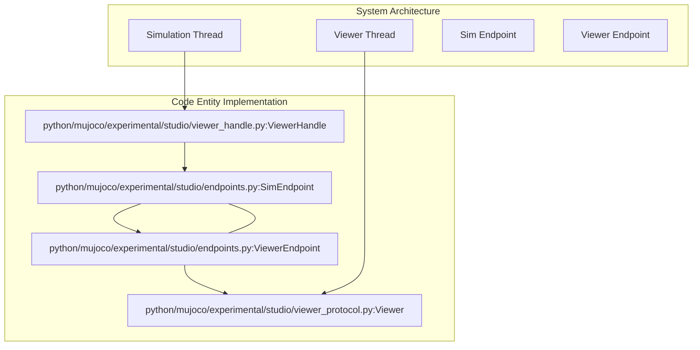
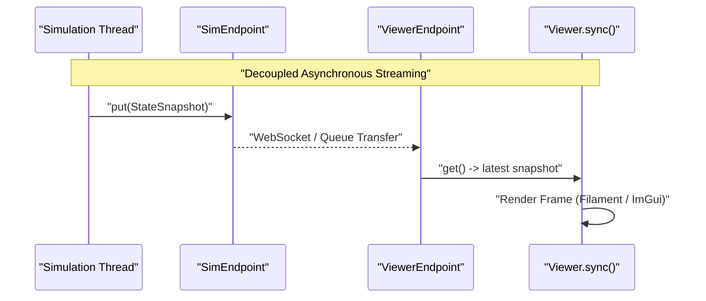
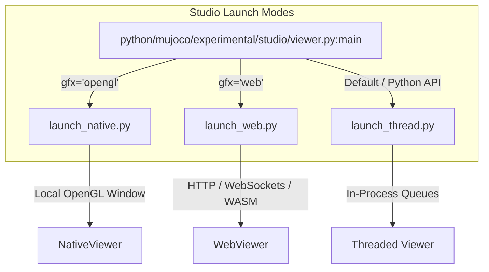

<!-- source: DeepWiki mcp.deepwiki.com · repo google-deepmind/mujoco · extra page Studio Python and Web Clients · fetched 2026-10-26 -->

# Studio Python and Web Clients

Relevant source files

The following files were used as context for generating this wiki page:

- [doc/skills/studio/SKILL.md](doc/skills/studio/SKILL.md)
- [python/mujoco/experimental/netimgui/Code/Client/Private/NetImgui_Client.cpp](python/mujoco/experimental/netimgui/Code/Client/Private/NetImgui_Client.cpp)
- [python/mujoco/experimental/netimgui/Code/Client/Private/NetImgui_CmdPackets.h](python/mujoco/experimental/netimgui/Code/Client/Private/NetImgui_CmdPackets.h)
- [python/mujoco/experimental/netimgui/Code/Client/Private/NetImgui_CmdPackets.inl](python/mujoco/experimental/netimgui/Code/Client/Private/NetImgui_CmdPackets.inl)
- [python/mujoco/experimental/netimgui/Code/Client/Private/NetImgui_CmdPackets_DrawFrame.cpp](python/mujoco/experimental/netimgui/Code/Client/Private/NetImgui_CmdPackets_DrawFrame.cpp)
- [python/mujoco/experimental/netimgui/Code/Client/Private/NetImgui_CmdPackets_DrawFrame.h](python/mujoco/experimental/netimgui/Code/Client/Private/NetImgui_CmdPackets_DrawFrame.h)
- [python/mujoco/experimental/netimgui/Code/Client/Private/NetImgui_Shared.h](python/mujoco/experimental/netimgui/Code/Client/Private/NetImgui_Shared.h)
- [python/mujoco/experimental/netimgui/Code/Client/Private/NetImgui_Shared.inl](python/mujoco/experimental/netimgui/Code/Client/Private/NetImgui_Shared.inl)
- [python/mujoco/experimental/netimgui/Code/ServerApp/Source/NetImguiServer_App.cpp](python/mujoco/experimental/netimgui/Code/ServerApp/Source/NetImguiServer_App.cpp)
- [python/mujoco/experimental/netimgui/Code/ServerApp/Source/NetImguiServer_Network.cpp](python/mujoco/experimental/netimgui/Code/ServerApp/Source/NetImguiServer_Network.cpp)
- [python/mujoco/experimental/netimgui/Code/ServerApp/Source/NetImguiServer_RemoteClient.cpp](python/mujoco/experimental/netimgui/Code/ServerApp/Source/NetImguiServer_RemoteClient.cpp)
- [python/mujoco/experimental/studio/endpoints.py](python/mujoco/experimental/studio/endpoints.py)
- [python/mujoco/experimental/studio/launch_native.py](python/mujoco/experimental/studio/launch_native.py)
- [python/mujoco/experimental/studio/launch_passive.py](python/mujoco/experimental/studio/launch_passive.py)
- [python/mujoco/experimental/studio/launch_thread.py](python/mujoco/experimental/studio/launch_thread.py)
- [python/mujoco/experimental/studio/launch_web.py](python/mujoco/experimental/studio/launch_web.py)
- [python/mujoco/experimental/studio/messages.py](python/mujoco/experimental/studio/messages.py)
- [python/mujoco/experimental/studio/native_viewer.cc](python/mujoco/experimental/studio/native_viewer.cc)
- [python/mujoco/experimental/studio/native_viewer.py](python/mujoco/experimental/studio/native_viewer.py)
- [python/mujoco/experimental/studio/plugin.py](python/mujoco/experimental/studio/plugin.py)
- [python/mujoco/experimental/studio/sample/custom_sim_loop.py](python/mujoco/experimental/studio/sample/custom_sim_loop.py)
- [python/mujoco/experimental/studio/sample/ghost.py](python/mujoco/experimental/studio/sample/ghost.py)
- [python/mujoco/experimental/studio/sample/implot.py](python/mujoco/experimental/studio/sample/implot.py)
- [python/mujoco/experimental/studio/sim_history.py](python/mujoco/experimental/studio/sim_history.py)
- [python/mujoco/experimental/studio/step_control.py](python/mujoco/experimental/studio/step_control.py)
- [python/mujoco/experimental/studio/viewer.py](python/mujoco/experimental/studio/viewer.py)
- [python/mujoco/experimental/studio/viewer_app.py](python/mujoco/experimental/studio/viewer_app.py)
- [python/mujoco/experimental/studio/viewer_handle.py](python/mujoco/experimental/studio/viewer_handle.py)
- [python/mujoco/experimental/studio/viewer_protocol.py](python/mujoco/experimental/studio/viewer_protocol.py)
- [python/mujoco/experimental/studio/viewer_utils.py](python/mujoco/experimental/studio/viewer_utils.py)
- [python/mujoco/experimental/studio/web/headless_ui.cc](python/mujoco/experimental/studio/web/headless_ui.cc)
- [python/mujoco/experimental/studio/web/index.html](python/mujoco/experimental/studio/web/index.html)
- [python/mujoco/experimental/studio/web/state_payload.cc](python/mujoco/experimental/studio/web/state_payload.cc)
- [python/mujoco/experimental/studio/web/state_payload.h](python/mujoco/experimental/studio/web/state_payload.h)
- [python/mujoco/experimental/studio/web/state_payload_py.cc](python/mujoco/experimental/studio/web/state_payload_py.cc)
- [python/mujoco/experimental/studio/web/web_client.cc](python/mujoco/experimental/studio/web/web_client.cc)
- [python/mujoco/experimental/studio/web/web_client_local_ui.cc](python/mujoco/experimental/studio/web/web_client_local_ui.cc)
- [python/mujoco/experimental/studio/web/web_client_local_ui.h](python/mujoco/experimental/studio/web/web_client_local_ui.h)
- [python/mujoco/experimental/studio/web/web_client_remote_ui.cc](python/mujoco/experimental/studio/web/web_client_remote_ui.cc)
- [python/mujoco/experimental/studio/web/web_client_remote_ui.h](python/mujoco/experimental/studio/web/web_client_remote_ui.h)
- [python/mujoco/experimental/studio/web/web_client_remote_ui_test.cc](python/mujoco/experimental/studio/web/web_client_remote_ui_test.cc)
- [python/mujoco/experimental/studio/web/web_client_session.cc](python/mujoco/experimental/studio/web/web_client_session.cc)
- [python/mujoco/experimental/studio/web/web_client_session.h](python/mujoco/experimental/studio/web/web_client_session.h)
- [python/mujoco/experimental/studio/web/web_server.py](python/mujoco/experimental/studio/web/web_server.py)
- [python/mujoco/experimental/studio/web_viewer.py](python/mujoco/experimental/studio/web_viewer.py)
- [src/experimental/studio/hal/filament_renderer.cc](src/experimental/studio/hal/filament_renderer.cc)
- [src/experimental/studio/hal/filament_renderer.h](src/experimental/studio/hal/filament_renderer.h)
- [src/experimental/studio/ux/picture_gui.cc](src/experimental/studio/ux/picture_gui.cc)
- [src/experimental/studio/ux/picture_gui.h](src/experimental/studio/ux/picture_gui.h)
- [src/render/filament/CMakeLists.txt](src/render/filament/CMakeLists.txt)
- [src/render/filament/core/renderable.cc](src/render/filament/core/renderable.cc)
- [src/render/filament/core/renderable.h](src/render/filament/core/renderable.h)
- [src/render/filament/core/scene_view.h](src/render/filament/core/scene_view.h)
- [src/render/filament/support/imgui_bridge.cc](src/render/filament/support/imgui_bridge.cc)
- [src/render/filament/support/imgui_bridge.h](src/render/filament/support/imgui_bridge.h)

The `python/mujoco/experimental/studio` package provides an interactive, decoupled visualization and plugin architecture for MuJoCo models. This page details the core components powering Studio's Python and web clients, including the decoupled viewer protocol, message passing infrastructure (`Snapshot` vs `Event`), viewer handles and applications, launch modes (native, web, and threaded execution), and the web server coupled with the NetImgui remote UI stack.

---

## 1. Viewer Protocol and Message-Driven Architecture

Studio replaces monolithic synchronous render loops with a decoupled architecture where the simulation thread and the viewer thread run independently. Communication between them is mediated by typed endpoints (`endpoints.ViewerEndpoint` and `endpoints.SimEndpoint`) passing `Message` objects.

*Diagram 1: Bridging architectural simulation/viewer separation to concrete code entities.*

Sources: `python/mujoco/experimental/studio/viewer_protocol.py:48-188()`, `python/mujoco/experimental/studio/viewer_handle.py:58-141()`, `python/mujoco/experimental/studio/messages.py:46-110()`

### Viewer Configuration and Lifecycle

The base class `viewer_protocol.Viewer` owns communication endpoints, plugin registries, and core visualization states. Configuration is specified via `ViewerConfig`:

- `ViewerConfig`: Defines window attributes (`title`, `width`, `height`), graphics mode (`gfx`), HTTP port (`http_port`), browser auto-launch (`open_browser`), and hot-reload behavior (`hot_reload`) [python/mujoco/experimental/studio/viewer_protocol.py:48-61]().
- `ViewerInitEvent`: Dispatched locally upon `Viewer` initialization to initialize viewer plugins (`plugin.ViewerPlugin`) [python/mujoco/experimental/studio/viewer_protocol.py:68-78]().

*Diagram 2: Data flow for latest-wins snapshot messaging.*

Sources: `python/mujoco/experimental/studio/viewer_protocol.py:85-188()`, `python/mujoco/experimental/studio/messages.py:53-110()`

### Message Types: Snapshot vs. Event

Messages derive from the base `Message` class and split into two delivery paradigms [python/mujoco/experimental/studio/messages.py:46-70]():
1. **`Snapshot`**: Latest-wins, droppable messages. Each new snapshot overwrites previous unread payloads of the same type. Used for high-frequency runtime data like `StateSnapshot` and `PerturbSnapshot` [python/mujoco/experimental/studio/messages.py:53-61,166-201]().
2. **`Event`**: Reliable, ordered, never-dropped messages queued in FIFO order. Used for discrete actions like `ExitEvent` or `KeyframeEvent` [python/mujoco/experimental/studio/messages.py:63-70]().

The utility function `messages.send_if_changes` avoids redundant messaging by comparing constructed message states before and after block execution [python/mujoco/experimental/studio/messages.py:117-148]().

Sources: `python/mujoco/experimental/studio/messages.py:46-207()`

---

## 2. Viewer App and Handle

Simulation-side interactions are governed by `ViewerHandle`, while UI layouts and standard interactive panels are encapsulated in `ViewerApp`.

### Simulation-Side Handle (`ViewerHandle`)

`ViewerHandle` runs on the simulation thread, wrapping `SimEndpoint` and managing simulation-side plugins (`SimPlugin`) [python/mujoco/experimental/studio/viewer_handle.py:58-114](). 

- `SimInitEvent`: Dispatched locally on handle construction to populate `self.handle` across simulation plugins [python/mujoco/experimental/studio/viewer_handle.py:47-56]().
- **Context Management**: Implements `__enter__` and `__exit__` to cleanly broadcast termination reasons (such as unhandled exceptions via `messages.describe_exception`) to the viewer or browser upon block exit [python/mujoco/experimental/studio/viewer_handle.py:142-154]().

### Default UI Application (`ViewerApp`)

`ViewerApp` serves as the default GUI and UX provider implemented as a viewer-side plugin (`plugin.ViewerPlugin`) [python/mujoco/experimental/studio/viewer_app.py:14-28](). It provides integration with Python's logging and warnings through specialized components:
- `_StudioLogHandler`: Directs Python log records across threads directly into the Studio Console widget [python/mujoco/experimental/studio/viewer_app.py:56-92]().
- `_ConsoleHooks`: Intercepts `warnings.showwarning`, `threading.excepthook`, and `sys.excepthook` to surface unhandled exceptions and warnings inside the Studio Console [python/mujoco/experimental/studio/viewer_app.py:94-148]().
- `install_console_hooks()`: Registers logging hooks and activates targeted warnings filters for MuJoCo compilation logs [python/mujoco/experimental/studio/viewer_app.py:155-178]().

Sources: `python/mujoco/experimental/studio/viewer_handle.py:58-177()`, `python/mujoco/experimental/studio/viewer_app.py:14-178()`

---

## 3. Launch Modes: Native, Web, and Thread

Studio supports multiple execution and deployment launch modes managed via CLI flags in `viewer.py` [python/mujoco/experimental/studio/viewer.py:25-54]() and their respective launchers (`launch_native.py`, `launch_web.py`, `launch_thread.py`).

*Diagram 3: Launch mode routing from CLI arguments to execution backends.*

Sources: `python/mujoco/experimental/studio/viewer.py:25-91()`, `python/mujoco/experimental/studio/native_viewer.py:38-114()`, `python/mujoco/experimental/studio/web_viewer.py:166-188()`

### Native Mode (`NativeViewer`)
- Uses `native_viewer.py` and C++ bindings (`native_viewer_cc.cc`) [python/mujoco/experimental/studio/native_viewer.py:26-38]().
- Instantiates a `window.Window` object and leverages Google Filament via `mjrf.Context` and `renderer.Renderer` [python/mujoco/experimental/studio/native_viewer.py:81-91]().
- Integrates Dear ImGui (`ImguiBridge`) and ImPlot contexts for immediate-mode GUI and interactive time-series charting [python/mujoco/experimental/studio/native_viewer.py:93-107]().

### Web Mode (`WebViewer`)
- Implemented in `web_viewer.py` [python/mujoco/experimental/studio/web_viewer.py:166-]().
- Streams UI state and simulation states to a web browser using WebSocket proxies.
- Encapsulates headless ImGui contexts (`headless_ui.cc`) and NetImgui binary packet transmission for remote rendering.

### Threaded Mode (`launch_thread.py`)
- Runs the viewer and simulation loops inside separate threads within the same Python interpreter process using in-memory queues (`endpoints.py`).

Sources: `python/mujoco/experimental/studio/viewer.py:65-91()`, `python/mujoco/experimental/studio/native_viewer.py:38-114()`, `python/mujoco/experimental/studio/web_viewer.py:166-188()`

---

## 4. Web Server and NetImgui Remote UI Infrastructure

When running in web mode (`gfx='web'`), Studio launches an embedded web server (`web_server.py`) that serves the static web client assets, models, and WebSocket streams.

### Web Server Architecture (`web_server.py`)
- **HTTP Endpoint**: Serves static HTML/WASM assets (`index.html`, `web_client.wasm`, `web_client.js`) and model files over HTTP.
- **WebSocket `/ui`**: Acts as a NetImgui proxy endpoint. It streams remote Dear ImGui draw data packets between the headless simulation process and the browser client.
- **WebSocket `/state`**: Streams compact binary `StatePayload` views containing simulation states (`qpos`, `qvel`, time) and user-injected render geoms (`extra_geoms`) with latest-wins drop semantics.

### Emscripten WASM Browser Client (`web_client.cc`)
- Written in C++ targeting Emscripten (`__EMSCRIPTEN__`) [python/mujoco/experimental/studio/web/web_client.cc:19-64]().
- **`App` Structure**: Manages the WebAssembly window, Filament renderer (`mujoco::Renderer`), `ModelHolder`, `ModelScene`, and `ImguiBridge` [python/mujoco/experimental/studio/web/web_client.cc:123-160]().
- **Spectator Camera Modes**: Supports local camera control via orbit (`kSpecCamTumble`), WASD fly mode (`kSpecCamWasd`), or controller state mirroring (`kSpecCamFollow`) [python/mujoco/experimental/studio/web/web_client.cc:85-89]().
- **Performance Optimization**: Wraps `glGetError()` as a no-op via linker flags (`-Wl,--wrap=glGetError`) to eliminate synchronous GPU pipeline flushes across the JS-WASM boundary in WebGL [python/mujoco/experimental/studio/web/web_client.cc:66-71]().

Sources: `python/mujoco/experimental/studio/web/web_client.cc:1-190()`, `python/mujoco/experimental/studio/web_viewer.py:1-417()`

---

