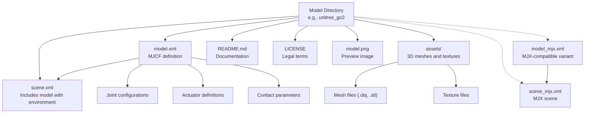
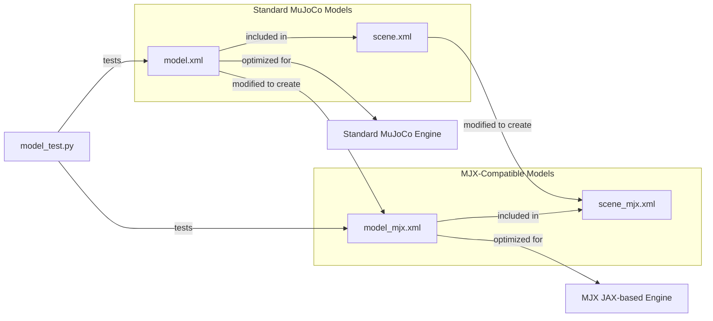
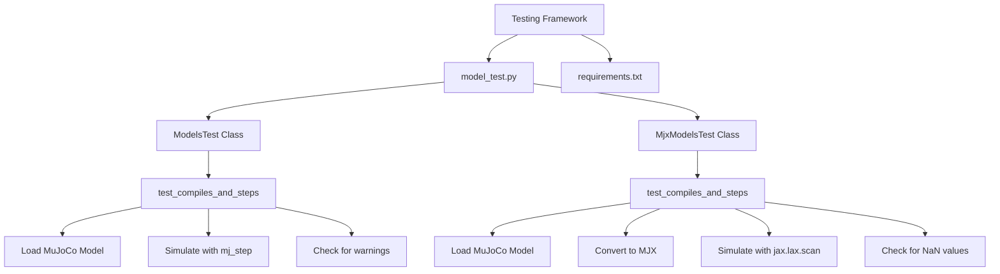
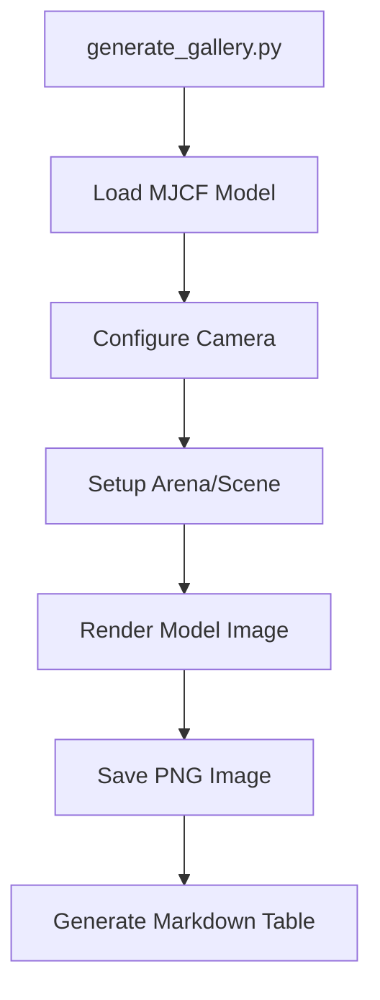

<!-- source: DeepWiki mcp.deepwiki.com · repo google-deepmind/mujoco_menagerie · page 1 MuJoCo Menagerie Overview · fetched 2026-10-26 -->

# MuJoCo Menagerie Overview

<details>
<summary>Relevant source files</summary>

The following files were used as context for generating this wiki page:

- [README.md](README.md)
- [assets/agilex_piper-piper.png](assets/agilex_piper-piper.png)
- [assets/booster_t1-t1.png](assets/booster_t1-t1.png)
- [generate_gallery.py](generate_gallery.py)

</details>


MuJoCo Menagerie is a collection of high-quality models for the [MuJoCo](https://github.com/google-deepmind/mujoco) physics engine, curated by Google DeepMind. The repository provides the research and development community with well-designed robot models that work reliably out of the box. This page offers a comprehensive overview of the repository's structure, content organization, and usage patterns.

As noted in the official documentation: "A physics simulator is only as good as the model it is simulating, and in a powerful simulator like MuJoCo with many modeling options, it is easy to create 'bad' models which do not behave as expected." The goal of this collection is to address this challenge by providing carefully prepared models.

Sources: [README.md:17-25]()

## Repository Organization

MuJoCo Menagerie is organized by robot categories, with each robot model having its own directory containing all necessary files for simulation.

### Repository Structure Diagram

```mermaid
graph TD
    MuJocoMenagerie["MuJoCo Menagerie"] --> Documentation
    MuJocoMenagerie --> RobotModels
    MuJocoMenagerie --> TestFramework
    MuJocoMenagerie --> ToolsAndUtilities

    Documentation --> README["README.md"]
    Documentation --> FAQ["FAQ.md"]
    Documentation --> Contributing["CONTRIBUTING.md"]
    Documentation --> License["LICENSE"]

    RobotModels --> HumanoidRobots
    RobotModels --> QuadrupedRobots
    RobotModels --> ManipulatorArms
    RobotModels --> Grippers
    RobotModels --> MobilePlatforms
    RobotModels --> AerialRobots
    RobotModels --> Biomechanical

    HumanoidRobots --> Apollo["Apptronik Apollo"]
    HumanoidRobots --> G1["Unitree G1"]
    
    QuadrupedRobots --> Go2["Unitree Go2"]
    QuadrupedRobots --> BarkourVB["Google Barkour vB"]
    QuadrupedRobots --> ANYmalC["ANYbotics ANYmal C"]
    
    ManipulatorArms --> Panda["Franka Panda"]
    ManipulatorArms --> PiPER["AgileX PiPER"]
    
    Grippers --> ShadowHand["Shadow Hand"]
    Grippers --> LEAP["LEAP Hand"]
    
    TestFramework --> ModelTest["model_test.py"]
    
    ToolsAndUtilities --> GalleryGenerator["generate_gallery.py"]
```



Sources: [README.md:62-94]()

## Model Directory Structure

Each robot model follows a standardized directory structure that ensures consistency across the repository:



Sources: [README.md:62-99]()

The key files in each model directory serve the following purposes:

1. **`<model>.xml`**: Contains only the MJCF (MuJoCo XML) definition of the robot model itself
2. **`scene.xml`**: Includes the model plus additional elements like a ground plane and lighting
3. **`assets/`**: Directory containing 3D meshes and textures used by the model
4. **`README.md`**: Documents how the model was created and other important details
5. **`LICENSE`**: Specifies the licensing terms for the model (varies by model)
6. **`<model>_mjx.xml`**: MJX-compatible variant of the model (if available)
7. **`scene_mjx.xml`**: Scene file that loads the MJX variant (if available)

Sources: [README.md:82-99]()

## Model Categories and Inventory

MuJoCo Menagerie contains a diverse range of robot models organized into several categories:

| Category | Description | Count | Examples | MJX Support |
|----------|-------------|-------|----------|------------|
| Arms | Manipulator arms | 13 | Franka Panda, UR5e, KUKA iiwa14 | ✔️ (Panda only) |
| Humanoids | Bipedal robots | 7 | Apptronik Apollo, Unitree G1 | ✔️ (Apollo only) |
| Quadrupeds | Four-legged robots | 8 | Unitree Go2, ANYmal C, Barkour vB | ✔️ (Multiple) |
| End-effectors | Grippers and hands | 6 | Shadow Hand, Robotiq 2F85 | ✔️ (ALOHA only) |
| Mobile Manipulators | Mobile robots with arms | 6 | Hello Robot Stretch | ❌ |
| Dual Arms | Multiple arm systems | 1 | ALOHA 2 | ✔️ |
| Aerial Robots | Drones | 2 | Crazyflie 2 | ❌ |
| Biomechanical | Biological models | 1 | flybody | ❌ |
| Miscellaneous | Sensors and others | 1 | RealSense D435i | ❌ |

Sources: [README.md:169-266]()

## MJX Compatibility

MJX is a JAX-based implementation of MuJoCo that enables efficient parallel simulation and automatic differentiation. Some models in the repository have been specifically optimized for MJX with a dedicated variant.

### MJX Compatibility Flow



Sources: [README.md:91-94](), [README.md:169-266]()

Currently, MJX-compatible variants exist for selected models including:
- Apptronik Apollo (humanoid)
- Unitree Go2 (quadruped)
- ANYmal C (quadruped)
- Google Barkour v0 and vB (quadrupeds)
- Franka Panda (arm)
- ALOHA 2 (dual arms)

Sources: [README.md:169-266]()

## Model Quality Grading

The repository introduces a grading system to help users set proper expectations around model quality:

| Grade | Description |
|-------|-------------|
| A+ | Values are the product of proper system identification |
| A | Values are realistic, but have not been properly identified |
| B | Stable, but some values are unrealistic |
| C | Conditionally stable, can be significantly improved |

This grading system will be applied once a proper system identification toolbox is created.

Sources: [README.md:142-167]()

## Testing Framework

MuJoCo Menagerie includes a testing system to validate that models compile and simulate correctly.



The testing framework ensures that:
1. Models can be loaded without errors
2. Simulation runs for several steps without crashing
3. No warnings are generated during compilation
4. For MJX models, conversion to MJX format works correctly
5. MJX simulations don't produce NaN values

Sources: [README.md:142-167]()

## Usage and Integration

There are multiple ways to use the models from MuJoCo Menagerie:

### Via robot-descriptions Package

The recommended approach is using the `robot_descriptions` Python package:

```python
import mujoco

# Method 1: Loading via imported module
from robot_descriptions import panda_mj_description
model = mujoco.MjModel.from_xml_path(panda_mj_description.MJCF_PATH)

# Method 2: Using the loader function
from robot_descriptions.loaders.mujoco import load_robot_description
model = load_robot_description("panda_mj_description")

# Loading a variant like a robot without its gripper
model = load_robot_description("panda_mj_description", variant="panda_nohand")
```

Sources: [README.md:102-127]()

### Via Direct Repository Clone

You can also clone the repository and use the models directly:

```bash
git clone https://github.com/google-deepmind/mujoco_menagerie.git
```

For interactive exploration, use the MuJoCo Python viewer:

```bash
python -m mujoco.viewer --mjcf mujoco_menagerie/unitree_go2/scene.xml
```

Sources: [README.md:127-141]()

### Integration with Custom Simulations

For programmatic use in your own simulations:

```python
import mujoco

# Load a model from the cloned repository
model = mujoco.MjModel.from_xml_path("path/to/mujoco_menagerie/unitree_go2/scene.xml")
data = mujoco.MjData(model)

# Simulate
for _ in range(1000):
    mujoco.mj_step(model, data)
    # Your control code here
```

## Gallery Generation

The repository includes a script to generate a gallery of model images for the README. This script, `generate_gallery.py`, renders each model in a standardized way:



The gallery script handles camera positioning, lighting, and other rendering settings to create consistent, high-quality images of each model.

Sources: [generate_gallery.py:1-482]()

## Licensing

XML and asset files in each individual model directory are subject to different license terms. Each model subdirectory contains its own LICENSE file with specific information. License types include:

- Apache-2.0 (e.g., Apptronik Apollo, Google Barkour models)
- BSD-3-Clause (e.g., Franka Panda, Unitree models)
- BSD-2-Clause (e.g., Robotiq grippers)
- MIT (e.g., LEAP Hand, PiPER arm)

All other repository content is Copyright 2022 DeepMind Technologies Limited and licensed under the Apache License, Version 2.0.

Sources: [README.md:295-303]()

---

