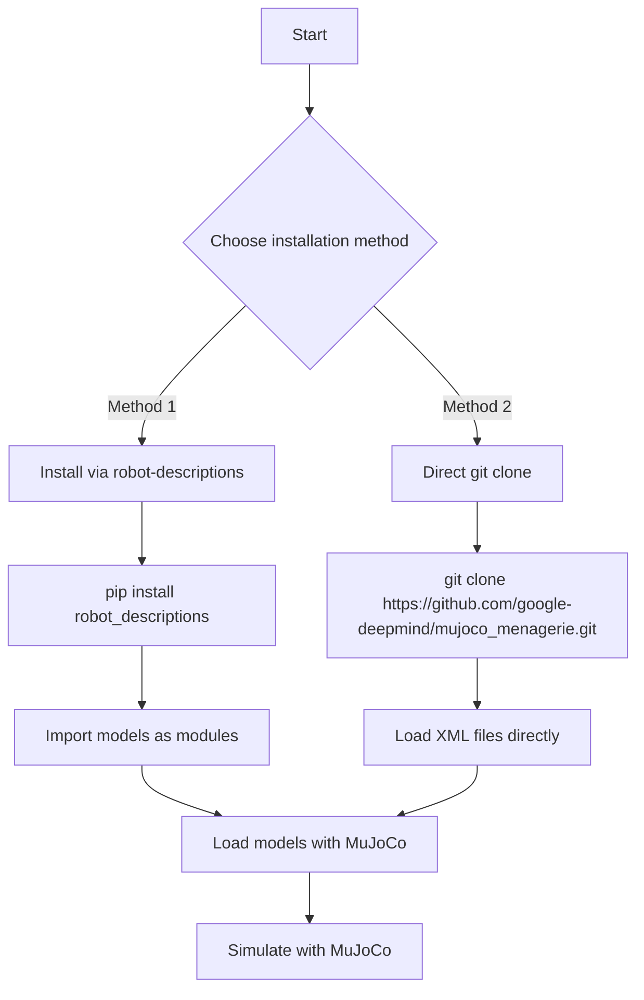
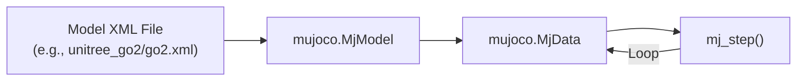
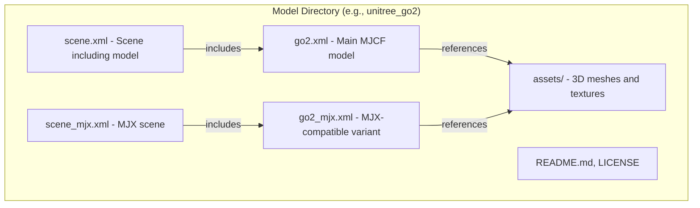
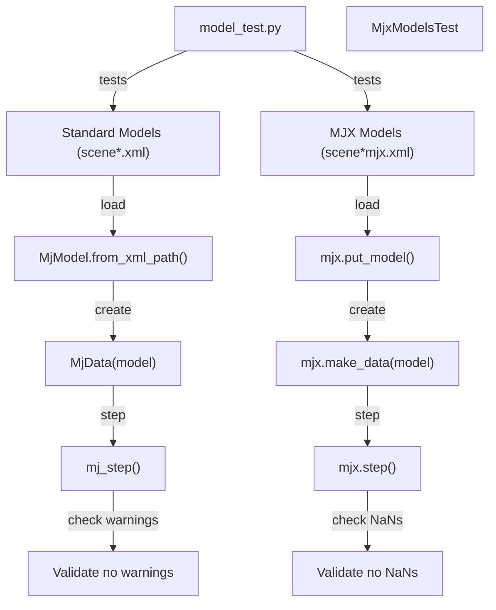
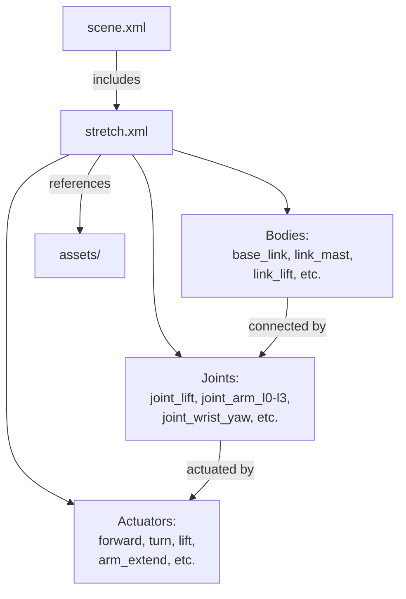

<!-- source: DeepWiki mcp.deepwiki.com · repo google-deepmind/mujoco_menagerie · page 1.1 Installation and Usage · fetched 2026-10-26 -->

# Installation and Usage

<details>
<summary>Relevant source files</summary>

The following files were used as context for generating this wiki page:

- [README.md](README.md)
- [assets/agilex_piper-piper.png](assets/agilex_piper-piper.png)
- [assets/booster_t1-t1.png](assets/booster_t1-t1.png)
- [generate_gallery.py](generate_gallery.py)
- [hello_robot_stretch/README.md](hello_robot_stretch/README.md)
- [hello_robot_stretch/stretch.xml](hello_robot_stretch/stretch.xml)
- [hello_robot_stretch_3/README.md](hello_robot_stretch_3/README.md)
- [hello_robot_stretch_3/stretch.xml](hello_robot_stretch_3/stretch.xml)
- [test/model_test.py](test/model_test.py)
- [test/requirements.txt](test/requirements.txt)

</details>


This document explains how to install the MuJoCo Menagerie repository and use the high-quality robot models with MuJoCo physics engine. It covers different installation methods, basic usage patterns, and how to integrate models into your simulations.

For information about the organization and structure of the models, see [Model Organization and Structure](#1.2). For details about MJX compatibility, see [MJX Compatibility](#1.3).

## Prerequisites

Before using MuJoCo Menagerie, ensure you have the following prerequisites installed:

- **MuJoCo**: The minimum required version for each model is specified in its respective README file
- **Python** (optional): Required if you plan to use Python bindings or the MuJoCo viewer

You can install MuJoCo in one of the following ways:

- Download prebuilt binaries from the [GitHub releases page](https://github.com/google-deepmind/mujoco/releases/)
- Install Python bindings via pip: `pip install mujoco`

The test framework requires additional dependencies listed in the test requirements file:

```
mujoco>=3.2.0
mujoco-mjx
absl-py
pytest-xdist
```

Sources: [README.md:52-61](), [test/requirements.txt:1-4]()

## Installation Methods

There are two primary methods to install and use MuJoCo Menagerie:



Sources: [README.md:102-139]()

### Method 1: Via `robot-descriptions` Package

The [`robot_descriptions`](https://github.com/robot-descriptions/robot_descriptions.py) package provides a convenient way to load models from MuJoCo Menagerie without manually downloading each model. This is recommended for most users.

1. Install the package:
   ```bash
   pip install robot_descriptions
   ```

2. Load models in your Python code:

   ```python
   import mujoco
   
   # Method 1: Load a specific model description as an imported module
   from robot_descriptions import panda_mj_description
   model = mujoco.MjModel.from_xml_path(panda_mj_description.MJCF_PATH)
   
   # Method 2: Directly load an instance of MjModel
   from robot_descriptions.loaders.mujoco import load_robot_description
   model = load_robot_description("panda_mj_description")
   
   # Method 3: Load a variant of the model, e.g. panda without a gripper
   model = load_robot_description("panda_mj_description", variant="panda_nohand")
   ```

Sources: [README.md:102-125]()

### Method 2: Via `git clone`

If you need direct access to model files or want to contribute to the repository, you can clone it directly:

1. Clone the repository:
   ```bash
   git clone https://github.com/google-deepmind/mujoco_menagerie.git
   ```

2. Use models directly by referencing their XML files.

Sources: [README.md:127-139]()

## Basic Usage

After installation, you can use the models in various ways depending on your needs.

### Visualizing Models

To interactively explore a model using the Python viewer:

```bash
python -m mujoco.viewer --mjcf mujoco_menagerie/unitree_go2/scene.xml
```

This command opens the MuJoCo viewer with the specified model loaded. You can manipulate the view and see how the model behaves in the physics simulation.

Sources: [README.md:137-139]()

### Loading Models in Python

To load models in your Python code:

```python
import mujoco

# Load model directly from file path
model = mujoco.MjModel.from_xml_path("path/to/mujoco_menagerie/unitree_go2/go2.xml")
data = mujoco.MjData(model)

# Step simulation
mujoco.mj_step(model, data)
```



Sources: [README.md:112-125](), [test/model_test.py:70-86]()

### Understanding Model Files

Each robot model in the repository follows a standard structure:



Key files:
- `<model>.xml`: The main MJCF model file (e.g., `go2.xml`)
- `scene.xml`: Includes the model with a ground plane and lighting
- `<model>_mjx.xml`: MJX-compatible version (for selected models)
- `assets/`: Directory containing meshes and textures
- `README.md`: Documentation and information about the model

Sources: [README.md:63-99]()

## Model Testing

MuJoCo Menagerie includes a testing framework to ensure models load and simulate correctly. This can help diagnose issues with custom modifications.



To run the tests:

```bash
cd /path/to/mujoco_menagerie
python -m test.model_test
```

Sources: [test/model_test.py:14-126]()

## Example Workflow

Here's a complete workflow example using MuJoCo Menagerie:

1. Install prerequisite: `pip install mujoco`
2. Install robot descriptions: `pip install robot_descriptions`
3. Create a simple simulation:

```python
import mujoco
import numpy as np
from robot_descriptions.loaders.mujoco import load_robot_description

# Load a model from MuJoCo Menagerie
model = load_robot_description("unitree_go2_mj_description")
data = mujoco.MjData(model)

# Set initial pose (optional)
data.qpos[:] = np.zeros(model.nq)

# Simulation loop
for i in range(1000):
    # Apply control inputs if needed
    data.ctrl[:] = np.zeros(model.nu)
    
    # Step the simulation
    mujoco.mj_step(model, data)
    
    # Get sensor data, joint positions, etc.
    joint_positions = data.qpos.copy()
    
    # Render if needed (when using with a viewer)
    # renderer.render(model, data)
```

Sources: [README.md:112-125](), [test/model_test.py:70-86]()

## Advanced Usage: Working with Hello Robot Stretch

As a concrete example, here's how to work with the Hello Robot Stretch model:



The Hello Robot Stretch model showcases a mobile manipulator with:
- Telescoping arm system (joints l0-l3)
- Gripper system with fingers
- Mobile base with wheels
- Head with cameras

To control the robot:
- Use `joint_lift` to raise/lower the lift
- Use the `extend` tendon to control the telescoping arm
- Use `joint_left_wheel` and `joint_right_wheel` for mobility
- Use `joint_wrist_yaw` and gripper joints to manipulate objects

Sources: [hello_robot_stretch/stretch.xml:1-417](), [hello_robot_stretch/README.md:1-31](), [hello_robot_stretch_3/stretch.xml:1-551](), [hello_robot_stretch_3/README.md:1-29]()

## Troubleshooting

If you encounter issues when using MuJoCo Menagerie:

1. **Model Loading Fails**: 
   - Check that you have the minimum required MuJoCo version for the model
   - Ensure asset paths are correct (models expect assets in an `assets/` subdirectory)

2. **Simulation Warnings**:
   - Run the test framework to check for warnings: `python -m test.model_test`
   - Common issues include unstable contacts or improper joint limits

3. **MJX Compatibility**:
   - Not all models have MJX-compatible versions
   - MJX-compatible models are indicated in the model tables in the README
   - Use the `*_mjx.xml` version of models for MJX compatibility

Sources: [README.md:169-267](), [test/model_test.py:68-126]()

---

