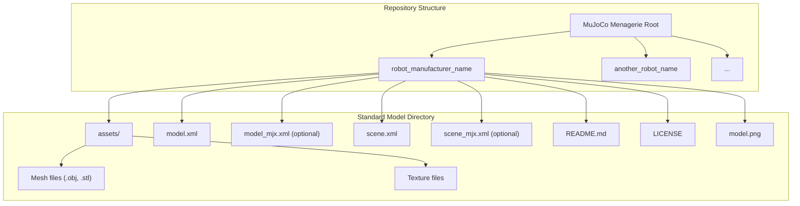
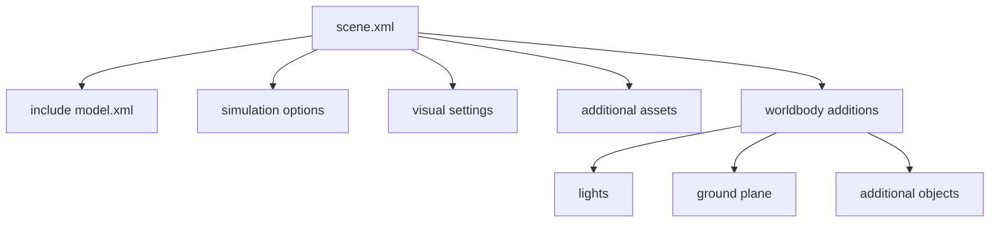
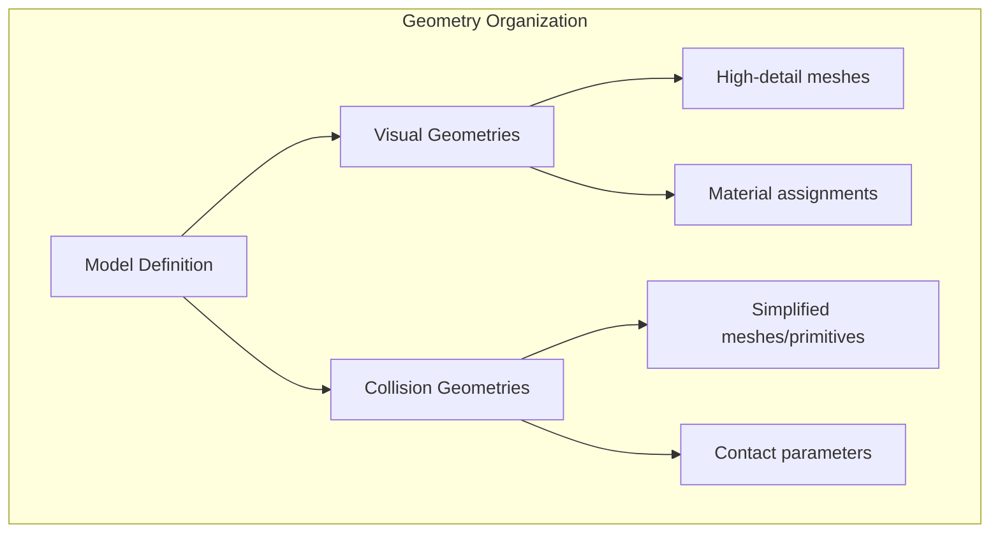
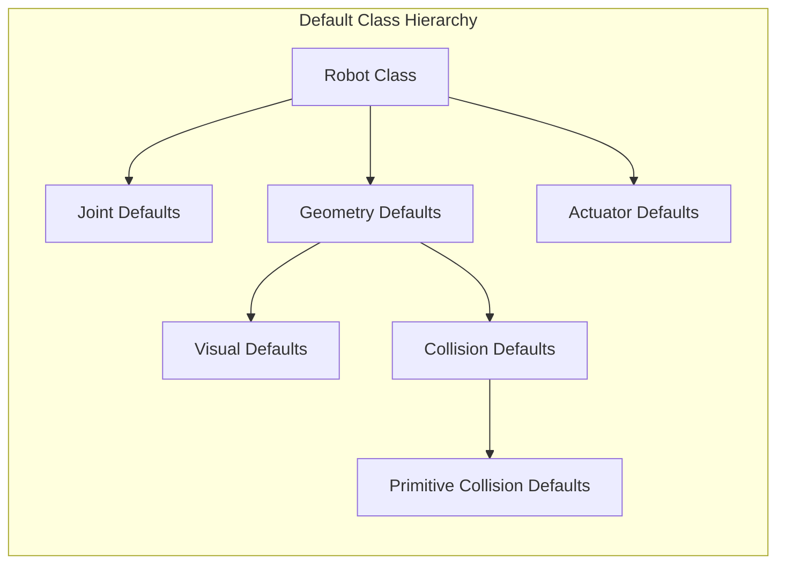
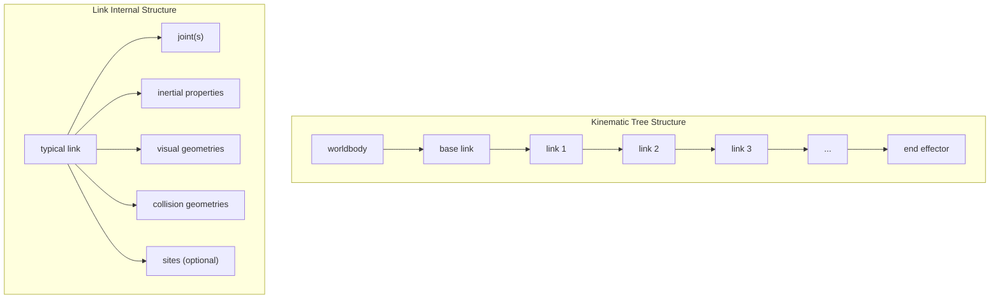
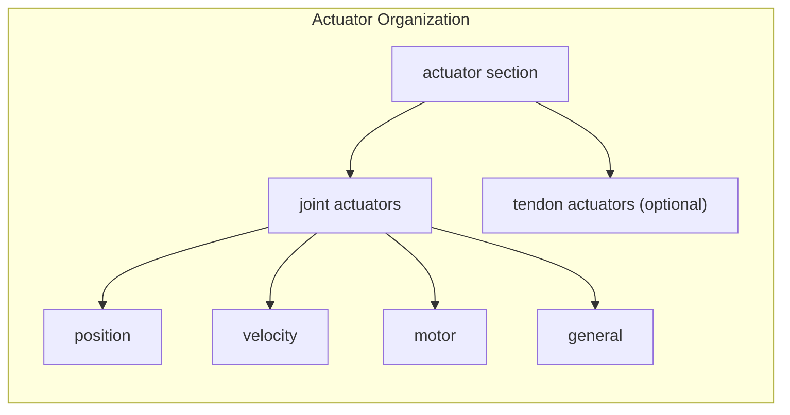
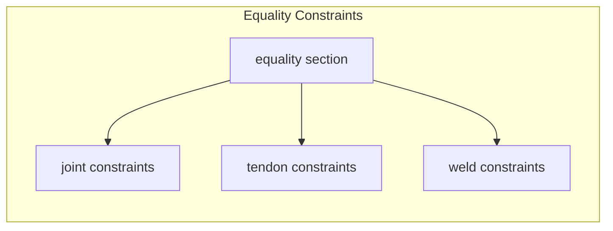

<!-- source: DeepWiki mcp.deepwiki.com · repo google-deepmind/mujoco_menagerie · page 1.2 Model Organization and Structure · fetched 2026-10-26 -->

# Model Organization and Structure

Relevant source files

The following files were used as context for generating this wiki page:

- [CONTRIBUTING.md](CONTRIBUTING.md)
- [FAQ.md](FAQ.md)
- [README.md](README.md)
- [assets/agilex_piper-piper.png](assets/agilex_piper-piper.png)
- [assets/booster_t1-t1.png](assets/booster_t1-t1.png)
- [franka_emika_panda/README.md](franka_emika_panda/README.md)
- [franka_emika_panda/mjx_panda.xml](franka_emika_panda/mjx_panda.xml)
- [franka_emika_panda/mjx_scene.xml](franka_emika_panda/mjx_scene.xml)
- [franka_emika_panda/mjx_single_cube.xml](franka_emika_panda/mjx_single_cube.xml)
- [generate_gallery.py](generate_gallery.py)

## Purpose and Scope

This document explains the standard organization and structure of models within the MuJoCo Menagerie repository. It covers the directory layout, file naming conventions, and internal structure of model files. For information about MJX compatibility specifically, see [MJX Compatibility](#1.3).

## Standard Directory Structure

The MuJoCo Menagerie repository follows a consistent organization pattern for each robot model. Every model is contained in its own dedicated directory, with standard file types and naming conventions.

Each model directory typically contains:

- **model.xml**: The primary MJCF (MuJoCo XML) file defining the robot model
- **scene.xml**: Includes model.xml with additional environment elements like a floor and lighting
- **model_mjx.xml**: An optimized version of the model for MJX (JAX-based MuJoCo), if available
- **scene_mjx.xml**: Scene file that includes the MJX variant of the model
- **assets/**: Directory containing meshes (visual and collision) and textures
- **README.md**: Documentation on model derivation, sources, and other details
- **LICENSE**: Copyright and licensing information for the model
- **model.png**: A preview image of the model in its scene

Sources: [README.md:62-94]()

## Model File Organization

### Main Model XML Structure

The main model XML files follow a consistent structure designed for clarity and reusability. These files describe only the robot model itself without additional environment elements.

```mermaid
graph TD
    Model["model.xml"]
    
    Model --> Compiler["compiler settings"]
    Model --> Assets["asset definitions"]
    Model --> Defaults["default classes"]
    Model --> Worldbody["worldbody (robot structure)"]
    Model --> Equality["equality constraints"]
    Model --> Actuators["actuator definitions"]
    Model --> Sensors["sensor definitions (optional)"]
    Model --> Contacts["contact parameters (optional)"]
    Model --> Custom["custom parameters (optional)"]
    
    Defaults --> VisualDefaults["visual defaults"]
    Defaults --> CollisionDefaults["collision defaults"]
    Defaults --> JointDefaults["joint defaults"]
    Defaults --> ActuatorDefaults["actuator defaults"]
    
    Worldbody --> Links["robot links"]
    Worldbody --> Joints["joints"]
    Worldbody --> Geoms["geometries"]
    Worldbody --> Sites["sites"]
    
    Assets --> Meshes["mesh files"]
    Assets --> Materials["materials"]
    Assets --> Textures["textures"]
```

Key organizational principles include:

1. **Hierarchy of elements**: The robot's kinematic structure is represented as a hierarchy in the `worldbody` section
2. **Default classes**: Common properties are defined in `default` classes to reduce redundancy
3. **Separation of concerns**: Visual elements, collision geoms, and functional components are clearly distinguished

Sources: [franka_emika_panda/mjx_panda.xml:1-253](), [CONTRIBUTING.md:26-38]()

### Scene XML Structure

Scene files provide a complete simulation environment for the model by including the model file and adding environmental elements:

The scene files typically:
- Include the base model file
- Define simulation parameters and visual settings
- Add environmental elements like a ground plane and lighting
- Sometimes add test objects or specific configurations

Sources: [franka_emika_panda/mjx_scene.xml:1-33]()

## Common Components and Conventions

### Visual vs. Collision Geometries

Models typically separate visual and collision geometries:

- **Visual geometries**: Higher-detail meshes used for rendering, typically marked with `contype="0" conaffinity="0"` to exclude them from physics calculations
- **Collision geometries**: Simplified representations used for physics calculations, often using primitive shapes (boxes, cylinders, etc.) or simplified meshes

Sources: [franka_emika_panda/mjx_panda.xml:14-34]()

### Default Classes

Default classes are used extensively to make models more maintainable and reduce redundancy:

Common default classes include:
- Robot-specific defaults for joints, actuators, and materials
- Visual vs. collision geometry settings
- Specialized defaults for different components (e.g., fingers, sensors)

Sources: [franka_emika_panda/mjx_panda.xml:4-37]()

### Mesh Organization

Mesh files are organized in the assets directory and typically follow these conventions:

- Naming pattern: `linkN_[index].obj` for visual meshes, `linkN_c.obj/stl` for collision meshes
- Meshes are referenced from the XML with appropriate pathing via the `meshdir` attribute
- Some models separate meshes by component, others by link

Sources: [franka_emika_panda/mjx_panda.xml:46-116]()

## Standard Model Elements

### World Body Hierarchy

The model's kinematic structure follows a hierarchical pattern:

Each link typically contains:
- Joint definition (connecting to parent)
- Inertial properties (mass, center of mass, inertia)
- Visual geometries (for rendering)
- Collision geometries (for physics)
- Optional site definitions for attachments or sensors

Sources: [franka_emika_panda/mjx_panda.xml:118-252]()

### Actuator Definitions

Actuators define how control signals are mapped to forces/torques:

Most robot models use position actuators with appropriate control ranges and force limits.

Sources: [franka_emika_panda/mjx_panda.xml:255-272]()

### Equality Constraints

Equality constraints are used to create dependencies between joints or enforce specific relationships:

Common uses include:
- Creating mimic joints (e.g., for parallel grippers)
- Welding parts together
- Creating closed kinematic chains

Sources: [franka_emika_panda/mjx_panda.xml:255-257]()

## MJX Compatibility

Some models include MJX-compatible variants, which are optimized for the JAX-based MuJoCo implementation. These adaptations typically include:

1. Simplified collision geometries
2. Tuned solver parameters
3. Adjusted actuator parameters for stability
4. Reduced complexity in certain mechanisms

The full details of MJX compatibility are covered in [MJX Compatibility](#1.3).

Sources: [franka_emika_panda/README.md:43-53]()

## File Naming and Conventions

The repository follows consistent file naming conventions:

- Model files are named after the robot (e.g., `panda.xml`)
- MJX variants add the `_mjx` suffix (e.g., `panda_mjx.xml`)
- Scene files use `scene.xml` or `scene_mjx.xml`
- Mesh files typically follow the pattern `[link_name]_[index].[extension]`
- Collision meshes often have a `_c` suffix

These conventions help maintain consistency across the repository and make it easier to understand the purpose of each file.

Sources: [README.md:62-94](), [generate_gallery.py:372-382]()

---

