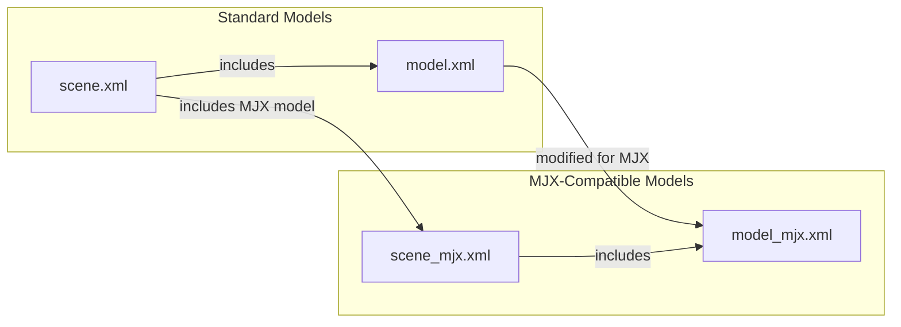
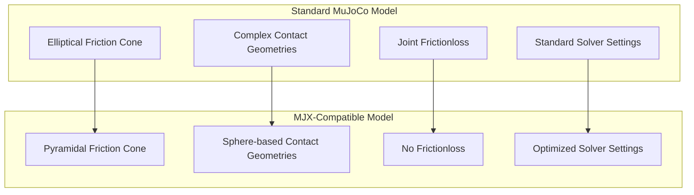
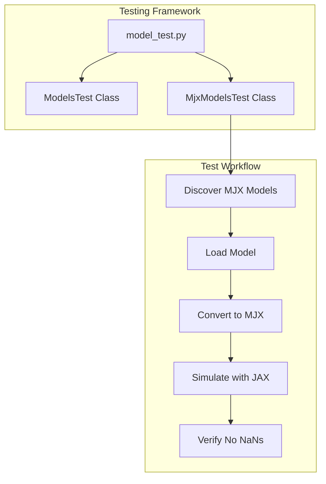

<!-- source: DeepWiki mcp.deepwiki.com · repo google-deepmind/mujoco_menagerie · page 1.3 MJX Compatibility · fetched 2026-10-26 -->

# MJX Compatibility

<details>
<summary>Relevant source files</summary>

The following files were used as context for generating this wiki page:

- [aloha/README.md](aloha/README.md)
- [aloha/aloha.xml](aloha/aloha.xml)
- [aloha/filtered_cartesian_actuators.xml](aloha/filtered_cartesian_actuators.xml)
- [aloha/joint_position_actuators.xml](aloha/joint_position_actuators.xml)
- [aloha/keyframe_ctrl.xml](aloha/keyframe_ctrl.xml)
- [aloha/keyframe_no_act.xml](aloha/keyframe_no_act.xml)
- [aloha/mjx_aloha.patch](aloha/mjx_aloha.patch)
- [aloha/mjx_filtered_cartesian_actuators.patch](aloha/mjx_filtered_cartesian_actuators.patch)
- [aloha/mjx_scene.patch](aloha/mjx_scene.patch)
- [aloha/scene.xml](aloha/scene.xml)
- [google_barkour_vb/README.md](google_barkour_vb/README.md)
- [google_barkour_vb/assets/hfield.png](google_barkour_vb/assets/hfield.png)
- [google_barkour_vb/barkour_vb.png](google_barkour_vb/barkour_vb.png)
- [google_barkour_vb/barkour_vb_mjx.xml](google_barkour_vb/barkour_vb_mjx.xml)
- [google_barkour_vb/scene.xml](google_barkour_vb/scene.xml)
- [google_barkour_vb/scene_hfield_mjx.xml](google_barkour_vb/scene_hfield_mjx.xml)
- [google_barkour_vb/scene_mjx.xml](google_barkour_vb/scene_mjx.xml)
- [hello_robot_stretch/README.md](hello_robot_stretch/README.md)
- [hello_robot_stretch/stretch.xml](hello_robot_stretch/stretch.xml)
- [hello_robot_stretch_3/README.md](hello_robot_stretch_3/README.md)
- [hello_robot_stretch_3/stretch.xml](hello_robot_stretch_3/stretch.xml)
- [test/model_test.py](test/model_test.py)
- [test/requirements.txt](test/requirements.txt)
- [unitree_go2/README.md](unitree_go2/README.md)
- [unitree_go2/go2.xml](unitree_go2/go2.xml)
- [unitree_go2/go2_mjx.png](unitree_go2/go2_mjx.png)
- [unitree_go2/go2_mjx.xml](unitree_go2/go2_mjx.xml)
- [unitree_go2/scene_mjx.xml](unitree_go2/scene_mjx.xml)

</details>


This page documents how models in the MuJoCo Menagerie repository are adapted for compatibility with MJX, the JAX-based implementation of MuJoCo. It explains the common modifications required for MJX compatibility, the file organization patterns for MJX models, and provides guidance on testing MJX compatibility.

## What is MJX?

MJX is a JAX-based implementation of the MuJoCo physics engine, which enables accelerated simulation on modern hardware (especially GPUs) and automatic differentiation capabilities. MJX provides significant performance benefits, especially for batch simulation and gradient-based optimization, but requires specific adaptations to standard MuJoCo models to ensure stability and performance.

Sources: [test/model_test.py:21-24]()

## Model File Structure

MuJoCo Menagerie includes MJX-compatible variants for several robot models. These variants follow a consistent naming pattern and organization.



### Naming Conventions

- Standard model files: `model.xml`, `scene.xml`
- MJX-compatible model files: `model_mjx.xml`, `scene_mjx.xml`

The test framework automatically detects and tests models with `scene*mjx.xml` naming pattern.

Sources: [test/model_test.py:42-43](), [unitree_go2/README.md:39-52](), [google_barkour_vb/README.md:18-25]()

## Common Modifications for MJX Compatibility

MJX has different performance characteristics and limitations compared to the standard MuJoCo implementation. The following modifications are typically required:



### Physics Simulation Parameters

1. **Solver Settings**
   - Reduced iteration counts for performance: `iterations="1" ls_iterations="5"`
   - Disabled Euler damping: `<flag eulerdamp="disable"/>`

2. **Contact Dynamics**
   - Changed friction cone from `elliptic` to `pyramidal`
   - Removed or reduced `impratio` settings
   - Modified `solref` and `solimp` parameters for stable contacts

3. **Joint Dynamics**
   - Removed `frictionloss` parameters

Sources: [unitree_go2/go2_mjx.xml:4-6](), [google_barkour_vb/barkour_vb_mjx.xml:4-6](), [aloha/mjx_aloha.patch:7-12]()

### Collision Geometry Simplification

MJX currently has limitations with complex collision geometries. The primary adaptation strategy is to:

1. Simplify collision meshes by replacing them with primitive shapes, especially spheres
2. Limit collision detection to essential parts of the robot
3. Use the `<mesh maxhullvert="32"/>` parameter to limit complexity of collision hulls
4. Focus collision detection on contacts between the robot and environment, rather than self-collisions

In some models, collision detection is completely disabled except for critical contact points like feet.

Sources: [unitree_go2/README.md:46-47](), [google_barkour_vb/README.md:24](), [aloha/mjx_aloha.patch:20-48]()

### Actuator Modifications

Actuator parameters often need adjustment for MJX compatibility:

1. Simplified control schemes (often using `general` actuators)
2. Adjusted gains and biases for stable control
3. Modified damping characteristics

For example, in the ALOHA model, the actuator parameters are significantly changed, with simplified damping parameters and control ranges.

Sources: [aloha/mjx_filtered_cartesian_actuators.patch:9-32](), [aloha/mjx_aloha.patch:28-29]()

## Testing MJX Compatibility

The MuJoCo Menagerie repository includes a testing framework to verify MJX compatibility of models.



### How to Test

The testing framework automatically detects models with `scene*mjx.xml` naming patterns and runs tests to check:

1. Model loading and conversion to MJX
2. Simulation for a short period (0.1 seconds by default)
3. Checking for numerical stability (no NaN values)

To run the tests:

```bash
python test/model_test.py
```

Sources: [test/model_test.py:89-123](), [test/requirements.txt:1-4]()

## Case Studies

### Unitree Go2

The Unitree Go2 quadruped robot's MJX adaptation demonstrates several common patterns:

1. Changed friction cone from `elliptic` to `pyramidal`
2. Increased `impratio` from standard model to MJX model (100)
3. Removed `frictionloss` parameters
4. Replaced complex collision geometries with strategically placed sphere geometries
5. Reduced solver iterations for performance

The MJX model includes visualizations of collision spheres to show where contact detection occurs.

Sources: [unitree_go2/README.md:39-51](), [unitree_go2/go2_mjx.xml:4-5]()

### Google Barkour vB

The Barkour vB quadruped model's MJX adaptation shows:

1. Modified solver settings: `iterations="1" ls_iterations="5"`
2. Disabled the `eulerdamp` flag
3. Focused collision geometries only on feet-plane interactions
4. Optimized scene configuration

Sources: [google_barkour_vb/README.md:18-25](), [google_barkour_vb/barkour_vb_mjx.xml:4-6]()

### ALOHA Bimanual System

The ALOHA bimanual robot system has one of the most extensive MJX adaptations:

1. Modified contact handling by:
   - Using `<mesh maxhullvert="32"/>` to limit collision hull complexity
   - Adding primitive collision capsules to supplement mesh-based collision
   - Reorganizing collision groups and priorities
   - Simplifying the collision model for the table

2. Modified actuator parameters:
   - Changed filter dynamics parameters
   - Adjusted gains and bias values
   - Modified control ranges

Sources: [aloha/mjx_aloha.patch:7-123](), [aloha/mjx_scene.patch:7-36](), [aloha/mjx_filtered_cartesian_actuators.patch:9-33]()

## Summary Table: Common MJX Adaptations

| Feature | Standard MuJoCo | MJX Adaptation | Reason |
|---------|----------------|----------------|--------|
| Friction cone | `cone="elliptic"` | `cone="pyramidal"` | Better performance in MJX |
| Solver settings | Default iterations | `iterations="1" ls_iterations="5"` | Performance optimization |
| Damping | `eulerdamp` enabled | `<flag eulerdamp="disable"/>` | Numerical stability |
| Joint friction | Uses `frictionloss` | Remove `frictionloss` | Compatibility limitation |
| Collision geometry | Complex meshes | Simplified primitives (spheres) | Current MJX limitation |
| Contact handling | Full contact detection | Focused on critical contacts | Performance and stability |
| Actuator models | Complex dynamics | Simplified parameters | Numerical stability |

Sources: [unitree_go2/go2_mjx.xml:4-5](), [google_barkour_vb/barkour_vb_mjx.xml:4-6](), [aloha/mjx_aloha.patch:7-12]()

## Best Practices

When adapting a model for MJX compatibility:

1. **Start with core functionality**: Ensure the basic physical simulation works before adding complexity
2. **Simplify contact geometry**: Replace complex meshes with primitive shapes, especially at contact points
3. **Adjust solver parameters**: Reduce iteration counts for performance while maintaining stability
4. **Test incrementally**: Make changes one at a time and test to identify issues
5. **Validate simulation**: Ensure the MJX model produces similar behavior to the standard model

The testing framework in the repository provides an automated way to verify basic functionality, but manual testing is recommended to ensure physical behavior matches expectations.

Sources: [test/model_test.py:89-123](), [unitree_go2/README.md:39-51]()

---

