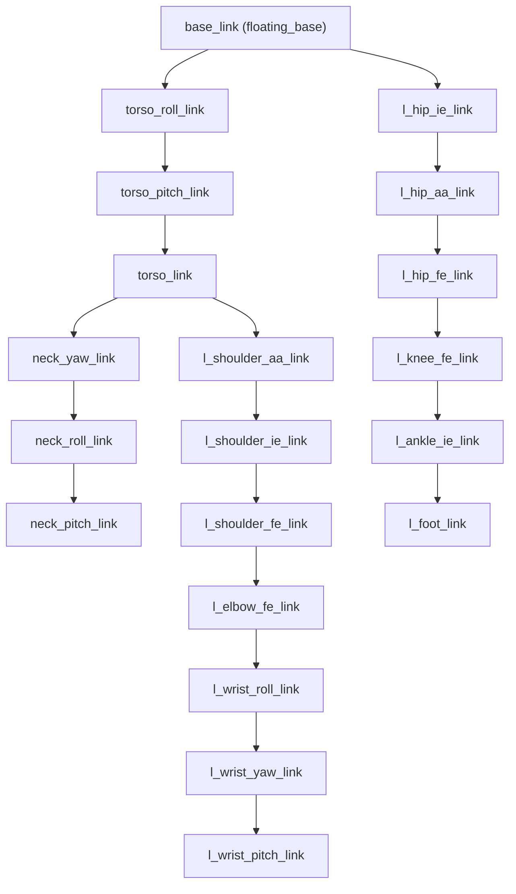
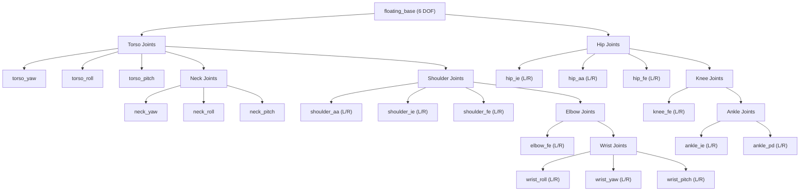
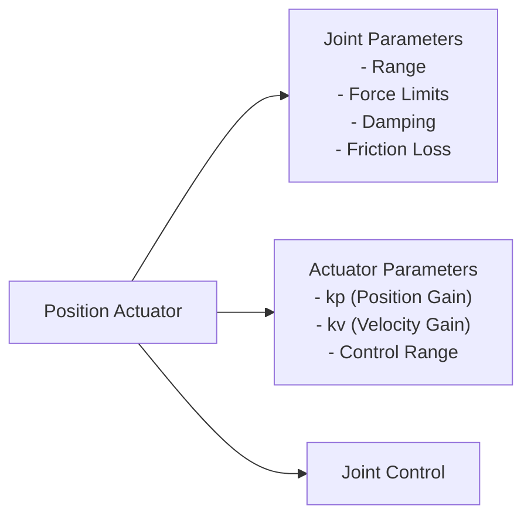
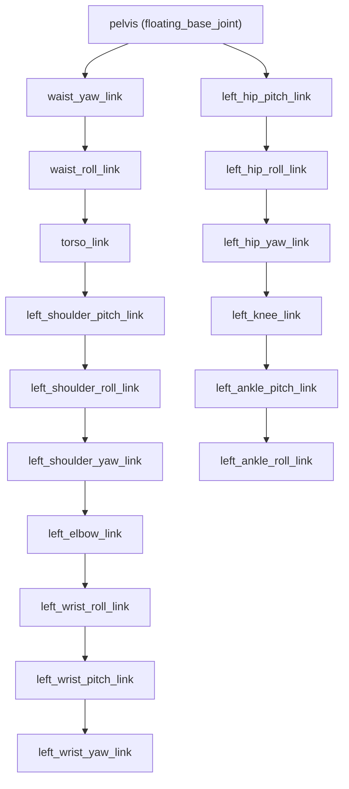

<!-- source: DeepWiki mcp.deepwiki.com · repo google-deepmind/mujoco_menagerie · page 2 Humanoid Robots · fetched 2026-10-26 -->

# Humanoid Robots

<details>
<summary>Relevant source files</summary>

The following files were used as context for generating this wiki page:

- [apptronik_apollo/LICENSE](apptronik_apollo/LICENSE)
- [apptronik_apollo/README.md](apptronik_apollo/README.md)
- [apptronik_apollo/apptronik_apollo.png](apptronik_apollo/apptronik_apollo.png)
- [apptronik_apollo/apptronik_apollo.xml](apptronik_apollo/apptronik_apollo.xml)
- [apptronik_apollo/apptronik_apollo_stand.png](apptronik_apollo/apptronik_apollo_stand.png)
- [apptronik_apollo/assets/ability_hand/FB_palm_ref.STL](apptronik_apollo/assets/ability_hand/FB_palm_ref.STL)
- [apptronik_apollo/assets/ability_hand/FB_palm_ref_MIR.STL](apptronik_apollo/assets/ability_hand/FB_palm_ref_MIR.STL)
- [apptronik_apollo/assets/ability_hand/idx-F1.STL](apptronik_apollo/assets/ability_hand/idx-F1.STL)
- [apptronik_apollo/assets/ability_hand/idx-F2.STL](apptronik_apollo/assets/ability_hand/idx-F2.STL)
- [unitree_g1/README.md](unitree_g1/README.md)
- [unitree_g1/g1.png](unitree_g1/g1.png)
- [unitree_g1/g1.xml](unitree_g1/g1.xml)
- [unitree_g1/g1_with_hands.xml](unitree_g1/g1_with_hands.xml)
- [unitree_g1/scene.xml](unitree_g1/scene.xml)

</details>


This document provides a comprehensive technical overview of the humanoid robot models available in the MuJoCo Menagerie repository. It covers the structure, joint configuration, actuator systems, and simulation properties of these bipedal robots designed with a structure resembling the human body. For information on quadruped robots, see [Quadruped Robots](#3), or for robotic arms, see [Manipulator Arms](#4).

## Available Models

The MuJoCo Menagerie currently includes two humanoid robot models:

1. **Apptronik Apollo** - A sophisticated humanoid with 35+ degrees of freedom (DOF)
2. **Unitree G1** - A 29 DOF humanoid with variants that include articulated hands

### Model Comparison

| Feature | Apptronik Apollo | Unitree G1 |
|---------|------------------|------------|
| Total DOF | 35+ | 29 |
| Base Joint | 6 DOF floating base | 6 DOF floating base |
| Arms | 7 DOF per arm | 7 DOF per arm |
| Legs | 6 DOF per leg | 6 DOF per leg |
| Torso | 3 DOF (yaw, roll, pitch) | 3 DOF (yaw, roll, pitch) |
| Hands | Detailed fingers | Basic or articulated (depending on variant) |
| IMU Sensors | 1 (torso) | 2 (torso and pelvis) |
| Keyframes | "stand" pose | "stand" pose |
| File | apptronik_apollo.xml | g1.xml / g1_with_hands.xml |

Sources: [apptronik_apollo/apptronik_apollo.xml:1-394](), [unitree_g1/g1.xml:1-364](), [unitree_g1/g1_with_hands.xml:1-360]()

## Apptronik Apollo

The Apptronik Apollo is a complex humanoid robot with detailed joint configuration, actuation, and sensor systems.

### Body Structure

The Apollo model has a hierarchical body structure starting with a base link that has a 6-DOF free joint, allowing unconstrained movement in space.

#### Apollo Body Hierarchy



Sources: [apptronik_apollo/apptronik_apollo.xml:76-323]()

### Joint Configuration

Apollo has a comprehensive joint configuration with these main components:

1. **Torso**: 3 DOF
   - `torso_yaw` (range: -0.829031 to 0.829031 rad)
   - `torso_roll` (range: -0.20944 to 0.20944 rad)
   - `torso_pitch` (range: -0.305433 to 1.35263 rad)

2. **Neck**: 3 DOF
   - `neck_yaw` (range: -1.65806 to 1.65806 rad)
   - `neck_roll` (range: -0.785398 to 0.785398 rad)
   - `neck_pitch` (range: -0.261799 to 0.523599 rad)

3. **Arms**: Each arm has 7 DOF
   - Shoulder: 3 DOF (aa, ie, fe)
   - Elbow: 1 DOF (fe)
   - Wrist: 3 DOF (roll, yaw, pitch)

4. **Legs**: Each leg has 6 DOF
   - Hip: 3 DOF (ie, aa, fe)
   - Knee: 1 DOF (fe)
   - Ankle: 2 DOF (ie, pd)

#### Apollo Joint Configuration Diagram



Sources: [apptronik_apollo/apptronik_apollo.xml:87-318]()

### Actuator System

Apollo uses position actuators for joint control with PD (Proportional-Derivative) controllers. Each actuator specifies:

- Position gain (`kp`)
- Velocity gain (`kv`)
- Control range (matches joint range)
- Force range (limits maximum force)
- Optional damping and friction loss parameters

For example, the torso pitch actuator is defined with:
```
<position name="torso_pitch" kp="1525" kv="142" joint="torso_pitch" ctrlrange="-0.305433 1.35263" forcerange="-315 315"/>
```

#### Apollo Actuator System Diagram



Sources: [apptronik_apollo/apptronik_apollo.xml:335-380]()

### Sensors

The Apollo model includes an IMU (Inertial Measurement Unit) sensor placed on the torso that provides:
- Orientation (quaternion)
- Angular velocity (gyroscope)
- Linear acceleration (accelerometer)
- Magnetic field (magnetometer)

```xml
<sensor>
    <framequat name="IMU-orientation" objtype="site" objname="imu"/>
    <gyro name="IMU-angular-velocity" site="imu" noise="5e-4" cutoff="54.9"/>
    <accelerometer name="IMU-linear-acceleration" site="imu" noise="1e-4" cutoff="157"/>
    <magnetometer name="IMU-magnetometer" site="imu"/>
</sensor>
```

Sources: [apptronik_apollo/apptronik_apollo.xml:328-332]()

### Visual and Collision Geometry

The Apollo model uses:
- Detailed mesh files for visual representation (`class="visual_light"` and `class="visual_dark"`)
- Simplified geometric primitives (capsules, boxes) for collision detection (`class="collision"`)

### Keyframe

The model includes a predefined "stand" keyframe that provides a stable initial pose for simulations, defined in the XML file:

```xml
<keyframe>
    <key name="stand" qpos="0.0 0.0 1.01597 1.0 0.0 0.0 0.0 0.0 0.0 0.0 0.0 0.0 0.0 0.2 0.0 0.1 -0.4 0.0 0.0 0.0 -0.2 0.0 0.1 -0.4 0.0 0.0 0.0 0.08 0.1 -0.477 1.033 -0.03 -0.58 -0.08 -0.1 -0.477 1.033 0.03 -0.58" ctrl="0.0 0.0 0.0 0.0 0.0 0.0 0.08 0.1 -0.477 1.033 -0.03 -0.58 -0.08 -0.1 -0.477 1.033 0.03 -0.58 0.2 0.0 0.1 -0.4 0.0 0.0 0.0 -0.2 0.0 0.1 -0.4 0.0 0.0 0.0" />
</keyframe>
```

Sources: [apptronik_apollo/apptronik_apollo.xml:383-393]()

## Unitree G1

The Unitree G1 is a humanoid robot with 29 degrees of freedom and is available in two variants: with basic hands (g1.xml) or with articulated hands (g1_with_hands.xml).

### Body Structure

Similar to Apollo, the G1 has a hierarchical body structure starting with a 6-DOF free joint base, but with some different naming conventions and structural arrangements.

#### G1 Body Hierarchy



Sources: [unitree_g1/g1.xml:66-298]()

### Joint Configuration

G1 has a comprehensive joint configuration with these main components:

1. **Waist**: 3 DOF
   - `waist_yaw_joint` (range: -2.618 to 2.618 rad)
   - `waist_roll_joint` (range: -0.52 to 0.52 rad)
   - `waist_pitch_joint` (range: -0.52 to 0.52 rad)

2. **Arms**: Each arm has 7 DOF
   - Shoulder: 3 DOF (pitch, roll, yaw)
   - Elbow: 1 DOF
   - Wrist: 3 DOF (roll, pitch, yaw)

3. **Legs**: Each leg has 6 DOF
   - Hip: 3 DOF (pitch, roll, yaw)
   - Knee: 1 DOF
   - Ankle: 2 DOF (pitch, roll)

In the articulated hands version, additional joints are available for the fingers and thumb.

Sources: [unitree_g1/g1.xml:76-295](), [unitree_g1/g1_with_hands.xml:76-288]()

### Actuator System

G1 uses position actuators for joint control with common parameters defined in the default section:

```xml
<default class="g1">
    <joint armature="0.01" frictionloss="0.3"/>
    <position kp="500" dampratio="1" inheritrange="1"/>
</default>
```

Each actuator inherits these default properties and is simply defined with:
```xml
<position class="g1" name="left_hip_pitch_joint" joint="left_hip_pitch_joint"/>
```

Sources: [unitree_g1/g1.xml:6-21](), [unitree_g1/g1.xml:303-335]()

### Sensors

The G1 model includes two IMU sensors:
- One in the torso (`imu_in_torso`)
- One in the pelvis (`imu_in_pelvis`)

Both provide angular velocity (gyroscope) and linear acceleration (accelerometer) measurements.

```xml
<sensor>
    <gyro site="imu_in_torso" name="imu-torso-angular-velocity" cutoff="34.9" noise="0.0005"/>
    <accelerometer site="imu_in_torso" name="imu-torso-linear-acceleration" cutoff="157" noise="0.01"/>
    <gyro site="imu_in_pelvis" name="imu-pelvis-angular-velocity" cutoff="34.9" noise="0.0005"/>
    <accelerometer site="imu_in_pelvis" name="imu-pelvis-linear-acceleration" cutoff="157" noise="0.01"/>
</sensor>
```

Sources: [unitree_g1/g1.xml:338-343]()

### Visual and Collision Geometry

The G1 model uses:
- Mesh files for visual representation (`class="visual"`)
- Mesh files or geometric primitives for collision detection (`class="collision"`)
- Specialized collision geometry for feet (`class="foot"`)

### Keyframe

The G1 model includes a predefined "stand" keyframe:

```xml
<keyframe>
    <key name="stand"
      qpos="
      0 0 0.79
      1 0 0 0
      0 0 0 0 0 0
      0 0 0 0 0 0
      0 0 0
      0.2 0.2 0 1.28 0 0 0
      0.2 -0.2 0 1.28 0 0 0
      "
      ctrl="
      0 0 0 0 0 0
      0 0 0 0 0 0
      0 0 0
      0.2 0.2 0 1.28 0 0 0
      0.2 -0.2 0 1.28 0 0 0
      "/>
</keyframe>
```

Sources: [unitree_g1/g1.xml:345-362]()

## Common Features and Differences

### Common Features

Both Apollo and G1 humanoid models share:

1. **Free Joint Base**: Both use a 6-DOF free joint for the base, allowing unconstrained movement
2. **Full Humanoid Structure**: Both have torso, arms, legs, and head components
3. **Position Actuators**: Both use position actuators with PD control for joint actuation
4. **IMU Sensors**: Both include IMU sensors for orientation and motion sensing
5. **Predefined Stand Poses**: Both provide keyframes for stable initial postures
6. **Mesh-Based Visuals**: Both use detailed mesh files for visual representation

### Key Differences

Notable differences between the models include:

1. **Joint Configuration**: 
   - Apollo: 35+ DOF with different joint naming conventions (ie, aa, fe)
   - G1: 29 DOF with more standard joint naming (pitch, roll, yaw)

2. **Waist Structure**:
   - Apollo: Direct connection between base and torso with 3 DOF
   - G1: More distinct waist joint system with separate links

3. **IMU Placement**:
   - Apollo: Single IMU in the torso
   - G1: Dual IMUs in torso and pelvis

4. **Hand Implementation**:
   - Apollo: Detailed hand with finger geometries
   - G1: Two variants - basic hands or articulated hands with individual finger joints

5. **Default Parameters**:
   - Apollo: Individual parameter settings for each joint
   - G1: More consistent default parameters applied across joints

Sources: [apptronik_apollo/apptronik_apollo.xml](), [unitree_g1/g1.xml](), [unitree_g1/g1_with_hands.xml]()

## Technical Implementation Details

### MJCF File Structure

Both humanoid models follow the standard MJCF file structure:

1. **Header and Compiler Settings**:
   ```xml
   <mujoco model="model_name">
       <compiler angle="radian" .../>
       <option .../>
   ```

2. **Default Parameter Blocks**:
   ```xml
   <default>
       <!-- Default parameters for joints, geoms, etc. -->
   </default>
   ```

3. **Asset Declarations**:
   ```xml
   <asset>
       <!-- Mesh files, textures, materials -->
   </asset>
   ```

4. **World Body with Robot Structure**:
   ```xml
   <worldbody>
       <body name="base_link" ...>
           <!-- Hierarchical robot structure -->
       </body>
   </worldbody>
   ```

5. **Sensors**:
   ```xml
   <sensor>
       <!-- IMU and other sensors -->
   </sensor>
   ```

6. **Actuators**:
   ```xml
   <actuator>
       <!-- Joint actuators -->
   </actuator>
   ```

7. **Keyframes**:
   ```xml
   <keyframe>
       <!-- Predefined poses -->
   </keyframe>
   ```

### Common Implementation Patterns

1. **Joint Definition with Limits**:
   ```xml
   <joint name="joint_name" axis="x y z" range="min max" actuatorfrcrange="min max" damping="val" frictionloss="val" armature="val"/>
   ```

2. **Position Actuators with PD Control**:
   ```xml
   <position name="actuator_name" kp="val" kv="val" joint="joint_name" ctrlrange="min max" forcerange="min max"/>
   ```

3. **Visual vs. Collision Geometry**:
   - Visual: Detailed meshes with no collision properties
   - Collision: Simplified geometries (capsules, boxes) for efficient physics

4. **Sensor Integration**:
   - IMU sensors defined as sites with gyro, accelerometer, and other components

Sources: [apptronik_apollo/apptronik_apollo.xml:1-394](), [unitree_g1/g1.xml:1-364]()

## Usage Guidelines

### Loading and Simulation

To use these humanoid robot models in MuJoCo simulations:

1. **Loading the Model**:
   ```python
   import mujoco
   model = mujoco.MjModel.from_xml_path('path/to/model.xml')
   data = mujoco.MjData(model)
   ```

2. **Initializing with Keyframe**:
   ```python
   # Find the "stand" keyframe
   key_id = mujoco.mj_name2id(model, mujoco.mjtObj.mjOBJ_KEY, "stand")
   # Apply the keyframe
   mujoco.mj_resetDataKeyframe(model, data, key_id)
   ```

3. **Applying Control**:
   ```python
   # Set control signals for actuators
   data.ctrl[actuator_id] = control_value
   # Step the simulation
   mujoco.mj_step(model, data)
   ```

### Scene Files

Both humanoid models have corresponding scene files that provide a complete simulation environment with ground plane and lighting:
- `apptronik_apollo/scene.xml`
- `unitree_g1/scene.xml`

These can be loaded directly to visualize the robot in a standard environment.

### Performance Considerations

1. **Complexity vs. Speed**: Both humanoid models are complex with many degrees of freedom. For performance-critical applications, consider:
   - Using the MJX-compatible versions if available
   - Simplifying collision geometry
   - Optimizing the simulation timestep

2. **Joint Damping and Armature**: Both models specify damping, friction loss, and armature parameters that affect simulation stability. Adjust these parameters cautiously if modifying the models.

3. **Control Frequency**: Due to the high DOF count, these models may require higher control frequencies for stable motion compared to simpler robots.

4. **Physical Plausibility**: When developing control algorithms, be mindful of the physical limitations encoded in the joint ranges and force limits to ensure realistic behavior.

Sources: [unitree_g1/scene.xml:1-22]()

---

