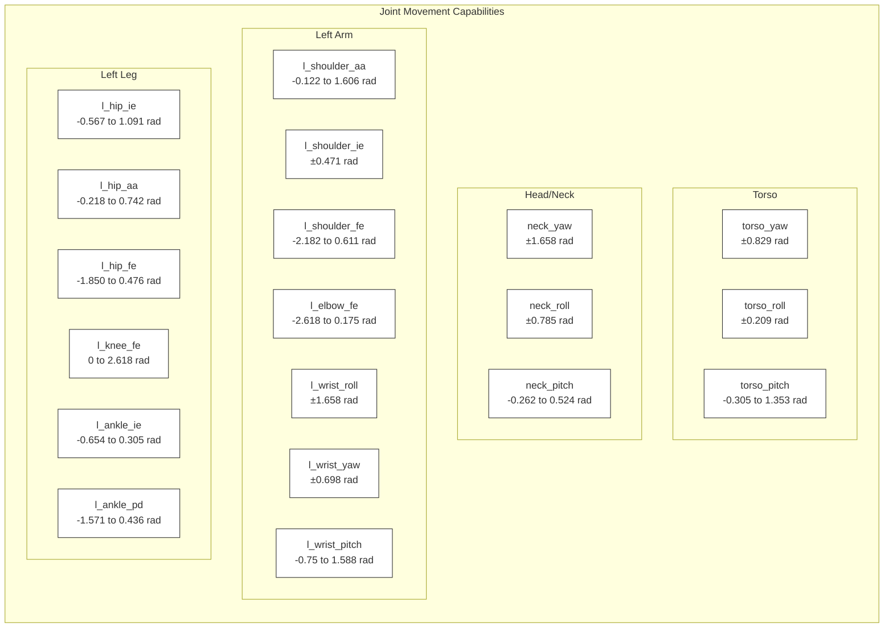
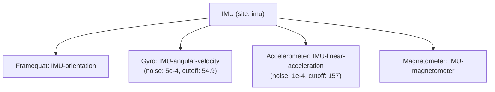
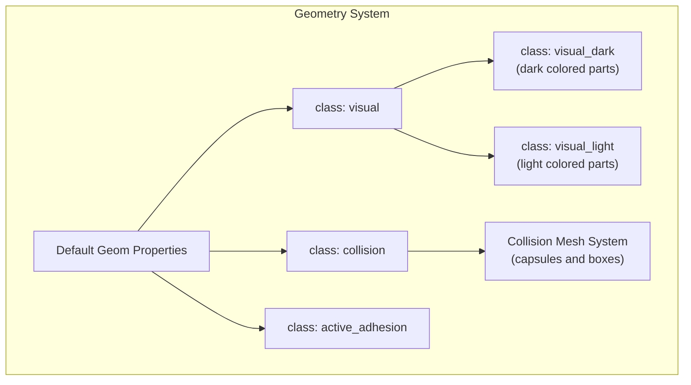

<!-- source: DeepWiki mcp.deepwiki.com · repo google-deepmind/mujoco_menagerie · page 2.1 Apptronik Apollo · fetched 2026-10-26 -->

# Apptronik Apollo

Relevant source files

The following files were used as context for generating this wiki page:

- [apptronik_apollo/LICENSE](apptronik_apollo/LICENSE)
- [apptronik_apollo/README.md](apptronik_apollo/README.md)
- [apptronik_apollo/apptronik_apollo.png](apptronik_apollo/apptronik_apollo.png)
- [apptronik_apollo/apptronik_apollo.xml](apptronik_apollo/apptronik_apollo.xml)
- [apptronik_apollo/apptronik_apollo_stand.png](apptronik_apollo/apptronik_apollo_stand.png)
- [apptronik_apollo/assets/ability_hand/FB_palm_ref.STL](apptronik_apollo/assets/ability_hand/FB_palm_ref.STL)
- [apptronik_apollo/assets/ability_hand/FB_palm_ref_MIR.STL](apptronik_apollo/assets/ability_hand/FB_palm_ref_MIR.STL)
- [apptronik_apollo/assets/ability_hand/idx-F1.STL](apptronik_apollo/assets/ability_hand/idx-F1.STL)
- [apptronik_apollo/assets/ability_hand/idx-F2.STL](apptronik_apollo/assets/ability_hand/idx-F2.STL)

This document provides technical details about the Apptronik Apollo humanoid robot model included in the MuJoCo Menagerie repository. It covers the model structure, joint system, actuation, and simulation properties of this full-body humanoid robot.

Sources: [apptronik_apollo/README.md:1-27]()

## Model Overview

The Apptronik Apollo is a full-size humanoid robot model with 34 degrees of freedom. The model implements a complete body structure including torso, head, arms with hands, and legs with feet. It features position-controlled joints with realistic physical properties and includes IMU sensor simulation.

The MuJoCo model requires MuJoCo 3.0.0 or later and is released under an Apache-2.0 License.

```mermaid
graph TD
    subgraph "Apptronik Apollo Model Structure"
        base["base_link (Floating Base)"]
        base --> torso_roll["torso_roll_link"]
        torso_roll --> torso_pitch["torso_pitch_link"]
        torso_pitch --> torso_link["torso_link"]
        
        torso_link --> neck["neck_yaw_link"]
        neck --> neck_roll["neck_roll_link"]
        neck_roll --> neck_pitch["neck_pitch_link"]
        
        torso_link --> l_shoulder["l_shoulder_aa_link"]
        l_shoulder --> l_shoulder_ie["l_shoulder_ie_link"]
        l_shoulder_ie --> l_shoulder_fe["l_shoulder_fe_link"]
        l_shoulder_fe --> l_elbow["l_elbow_fe_link"]
        l_elbow --> l_wrist_roll["l_wrist_roll_link"]
        l_wrist_roll --> l_wrist_yaw["l_wrist_yaw_link"]
        l_wrist_yaw --> l_wrist_pitch["l_wrist_pitch_link"]
        l_wrist_pitch --> l_hand["left_hand (multiple geometries)"]
        
        torso_link --> r_shoulder["r_shoulder_aa_link"]
        r_shoulder --> r_shoulder_ie["r_shoulder_ie_link"]
        r_shoulder_ie --> r_shoulder_fe["r_shoulder_fe_link"]
        r_shoulder_fe --> r_elbow["r_elbow_fe_link"]
        r_elbow --> r_wrist_roll["r_wrist_roll_link"]
        r_wrist_roll --> r_wrist_yaw["r_wrist_yaw_link"]
        r_wrist_yaw --> r_wrist_pitch["r_wrist_pitch_link"]
        r_wrist_pitch --> r_hand["right_hand (multiple geometries)"]
        
        base --> l_hip["l_hip_ie_link"]
        l_hip --> l_hip_aa["l_hip_aa_link"]
        l_hip_aa --> l_hip_fe["l_hip_fe_link"]
        l_hip_fe --> l_knee["l_knee_fe_link"]
        l_knee --> l_ankle_ie["l_ankle_ie_link"]
        l_ankle_ie --> l_foot["l_foot_link"]
        
        base --> r_hip["r_hip_ie_link"]
        r_hip --> r_hip_aa["r_hip_aa_link"]
        r_hip_aa --> r_hip_fe["r_hip_fe_link"]
        r_hip_fe --> r_knee["r_knee_fe_link"]
        r_knee --> r_ankle_ie["r_ankle_ie_link"]
        r_ankle_ie --> r_foot["r_foot_link"]
    end

    classDef joint fill:#fff,stroke:#333,stroke-width:1px;
    classDef link fill:#fff,stroke:#333,stroke-width:1px;
    
    class torso_roll,torso_pitch,neck,neck_roll,neck_pitch,l_shoulder,l_shoulder_ie,l_shoulder_fe,l_elbow,l_wrist_roll,l_wrist_yaw,l_wrist_pitch,r_shoulder,r_shoulder_ie,r_shoulder_fe,r_elbow,r_wrist_roll,r_wrist_yaw,r_wrist_pitch,l_hip,l_hip_aa,l_hip_fe,l_knee,l_ankle_ie,r_hip,r_hip_aa,r_hip_fe,r_knee,r_ankle_ie joint;
    class base,torso_link,l_hand,r_hand,l_foot,r_foot link;
```

Sources: [apptronik_apollo/apptronik_apollo.xml:1-394]()

## Physical Configuration

The Apollo model uses the following physical simulation settings:

| Parameter | Value |
|-----------|-------|
| Timestep | 0.005 |
| Integrator | implicitfast |
| Angle Units | radians |
| Euler Sequence | zyx |

The model's base position is set at height 1.0813m, and it includes a free joint to allow full 6-DOF movement in space. A default standing pose is defined in the keyframe section.

Sources: [apptronik_apollo/apptronik_apollo.xml:1-5](), [apptronik_apollo/apptronik_apollo.xml:76-88](), [apptronik_apollo/apptronik_apollo.xml:383-393]()

## Joint System

The Apollo has a comprehensive joint system that enables humanoid movement. The model includes:

- 3 torso joints (yaw, roll, pitch)
- 3 neck joints (yaw, roll, pitch)
- 7 joints per arm (shoulder ab/adduction, internal/external rotation, flexion/extension, elbow, wrist roll, yaw, and pitch)
- 6 joints per leg (hip internal/external rotation, ab/adduction, flexion/extension, knee, ankle inversion/eversion, and plantar/dorsiflexion)

Note: Right arm and leg joints have similar ranges but with appropriate symmetry adjustments.

Sources: [apptronik_apollo/apptronik_apollo.xml:91-243](), [apptronik_apollo/apptronik_apollo.xml:245-322]()

## Actuators

The Apollo model includes position actuators for all joints with appropriate force limits and gain parameters. Each actuator includes position limits, force ranges, damping coefficients, friction losses, and armature parameters.

| Body Part | Actuators | Force Range Example |
|-----------|-----------|---------------------|
| Neck | 3 | ±10.6 to ±34.2 N |
| Torso | 3 | ±120 to ±414 N |
| Arms (each) | 7 | ±10.6 to ±114 N |
| Legs (each) | 6 | ±120 to ±494 N |

These actuators support position control with realistic joint behavior, allowing the model to maintain stable poses and perform controlled movements.

Sources: [apptronik_apollo/apptronik_apollo.xml:335-381]()

## Sensors

The Apollo model includes a simulated IMU (Inertial Measurement Unit) located in the torso with the following sensor components:

The IMU is positioned at coordinates (0.067, 0, 0.124874) relative to the torso link with orientation (0.0, 1.5708, 3.1416). This sensor provides orientation, angular velocity, linear acceleration, and magnetic field measurements.

Sources: [apptronik_apollo/apptronik_apollo.xml:101-102](), [apptronik_apollo/apptronik_apollo.xml:328-333]()

## Visual and Collision Geometry

The Apollo model includes detailed visual and collision geometries:

1. **Visual Geometry**: 
   - Uses high-quality mesh files for visual representation
   - Separated into "visual_dark" and "visual_light" components for different colored parts
   - Includes detailed hand meshes for the Ability Hand end effectors

2. **Collision Geometry**:
   - Simplified collision shapes using primitive geometries (capsules, boxes)
   - Collision meshes are optimized for efficient physics computation
   - Different collision groups for selective collision checking

Sources: [apptronik_apollo/apptronik_apollo.xml:6-26](), [apptronik_apollo/apptronik_apollo.xml:28-73](), [apptronik_apollo/apptronik_apollo.xml:88-90](), [apptronik_apollo/apptronik_apollo.xml:173-174]()

## Stand Pose and Default Positioning

The Apollo model includes a predefined "stand" pose in the keyframe section. This pose positions the robot in a stable standing configuration with appropriate joint angles for the torso, arms, and legs. The default position places the robot's base at height 1.0813m with a free joint allowing full movement.

| Body Part | Position in Stand Pose |
|-----------|------------------------|
| Base | (0.0, 0.0, 1.01597) with identity quaternion |
| Torso | Slight forward pitch |
| Arms | Slightly forward and out from the body |
| Legs | Knee bend with feet flat |

This keyframe provides a useful starting point for simulations with the Apollo robot.

Sources: [apptronik_apollo/apptronik_apollo.xml:76-88](), [apptronik_apollo/apptronik_apollo.xml:383-393](), [apptronik_apollo/apptronik_apollo_stand.png]()

## File Organization

The Apptronik Apollo model consists of the following key files:

1. `apptronik_apollo.xml` - Main model definition file
2. `assets/` directory - Contains mesh files and textures:
   - Body part meshes (torso, limbs, etc.)
   - Ability Hand components (located in `assets/ability_hand/`)
3. `README.md` - Documentation and changelog
4. `LICENSE` - Apache 2.0 license file

The mesh files are organized by body part, with separate files for left and right limbs, torso components, and specialized hand parts.

Sources: [apptronik_apollo/README.md:1-27](), [apptronik_apollo/apptronik_apollo.xml:28-73]()

## Changelog and Version History

The Apptronik Apollo model has been updated several times since its initial release:

| Date | Change |
|------|--------|
| 04/17/2025 | IMU position correction based on Apptroink request |
| 03/15/2025 | Fixed finger distal orientation |
| 01/21/2025 | Fixed bug in the IMU position |
| 01/09/2025 | Fixed issue #136 |
| 12/20/2024 | Initial release |

Sources: [apptronik_apollo/README.md:5-11]()

## Usage

To use the Apptronik Apollo model in MuJoCo:

1. Ensure you have MuJoCo version 3.0.0 or later installed
2. Load the model file `apptronik_apollo.xml` in your MuJoCo simulation
3. Initialize the model with the provided "stand" keyframe for a stable starting configuration
4. The model can be controlled via position control of the joint actuators

The model supports standard MuJoCo simulation workflows and can be integrated into research and development projects requiring a full humanoid robot model.

Sources: [apptronik_apollo/README.md:3-3](), [apptronik_apollo/apptronik_apollo.xml:383-393]()

---

