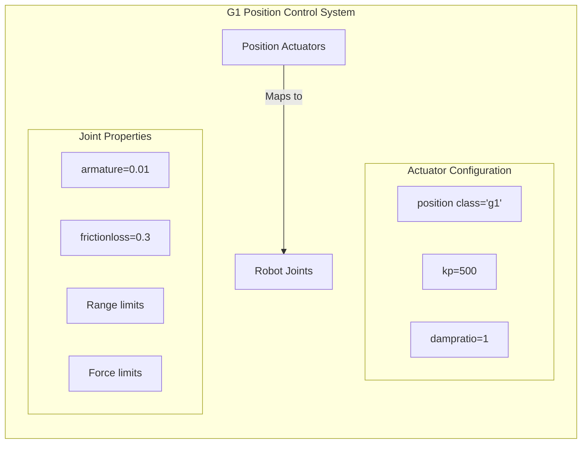

<!-- source: DeepWiki mcp.deepwiki.com · repo google-deepmind/mujoco_menagerie · page 2.2 Unitree G1 · fetched 2026-10-26 -->

# Unitree G1

<details>
<summary>Relevant source files</summary>

The following files were used as context for generating this wiki page:

- [unitree_g1/README.md](unitree_g1/README.md)
- [unitree_g1/g1.png](unitree_g1/g1.png)
- [unitree_g1/g1.xml](unitree_g1/g1.xml)
- [unitree_g1/g1_with_hands.xml](unitree_g1/g1_with_hands.xml)
- [unitree_g1/scene.xml](unitree_g1/scene.xml)

</details>


This documentation provides detailed information about the Unitree G1 humanoid robot model implementation in the MuJoCo Menagerie repository. The model represents a comprehensive simulation of the Unitree G1 humanoid robot with accurate physical properties and joint mechanics for use with the MuJoCo physics engine.

## Overview

The Unitree G1 is a bipedal humanoid robot developed by Unitree Robotics. The MuJoCo model provides a simplified but accurate representation of the robot's physical structure and kinematic capabilities. The model requires MuJoCo 2.3.4 or later to function properly.

The repository includes two variants of the G1 model:
1. Standard model (g1.xml) with 29 degrees of freedom
2. Model with articulated hands (g1_with_hands.xml) that includes additional finger joints

Sources: [unitree_g1/README.md:1-20](), [unitree_g1/g1.xml:1-1](), [unitree_g1/g1_with_hands.xml:1-1]()

## Model Structure

The G1 model follows a hierarchical structure consisting of multiple articulated body segments. The robot features a central pelvis connected to legs, a waist system, torso, arms, and head.

### Kinematic Structure Diagram

```mermaid
graph TD
    subgraph "Unitree G1 Model Structure"
        Pelvis["Pelvis (Root)"]
        
        Pelvis --> LHip["Left Hip Chain"]
        Pelvis --> RHip["Right Hip Chain"]
        Pelvis --> Waist["Waist Chain"]
        
        LHip --> LHipPitch["Left Hip Pitch"]
        LHipPitch --> LHipRoll["Left Hip Roll"]
        LHipRoll --> LHipYaw["Left Hip Yaw"]
        LHipYaw --> LKnee["Left Knee"]
        LKnee --> LAnklePitch["Left Ankle Pitch"]
        LAnklePitch --> LAnkleRoll["Left Ankle Roll"]
        
        RHip --> RHipPitch["Right Hip Pitch"]
        RHipPitch --> RHipRoll["Right Hip Roll"]
        RHipRoll --> RHipYaw["Right Hip Yaw"]
        RHipYaw --> RKnee["Right Knee"]
        RKnee --> RAnklePitch["Right Ankle Pitch"]
        RAnklePitch --> RAnkleRoll["Right Ankle Roll"]
        
        Waist --> WaistYaw["Waist Yaw"]
        WaistYaw --> WaistRoll["Waist Roll"]
        WaistRoll --> Torso["Torso (Waist Pitch)"]
        
        Torso --> Head["Head"]
        Torso --> LArm["Left Arm Chain"]
        Torso --> RArm["Right Arm Chain"]
        
        LArm --> LShoulderPitch["L Shoulder Pitch"]
        LShoulderPitch --> LShoulderRoll["L Shoulder Roll"]
        LShoulderRoll --> LShoulderYaw["L Shoulder Yaw"]
        LShoulderYaw --> LElbow["L Elbow"]
        LElbow --> LWristRoll["L Wrist Roll"]
        LWristRoll --> LWristPitch["L Wrist Pitch"]
        LWristPitch --> LWristYaw["L Wrist Yaw"]
        
        RArm --> RShoulderPitch["R Shoulder Pitch"]
        RShoulderPitch --> RShoulderRoll["R Shoulder Roll"] 
        RShoulderRoll --> RShoulderYaw["R Shoulder Yaw"]
        RShoulderYaw --> RElbow["R Elbow"]
        RElbow --> RWristRoll["R Wrist Roll"]
        RWristRoll --> RWristPitch["R Wrist Pitch"]
        RWristPitch --> RWristYaw["R Wrist Yaw"]
    end
```



Sources: [unitree_g1/g1.xml:64-299]()

### Root Body and Base

The model's root body is the `pelvis`, positioned at a default height of 0.793m and connected to the world through a free joint (`floating_base_joint`). This allows the robot to freely move and balance in the simulation environment.

```
Body: pelvis
Position: [0, 0, 0.793]
Mass: 3.813 kg
Joint: floating_base_joint (6 DoF)
```

Sources: [unitree_g1/g1.xml:66-72]()

### Leg Structure

Each leg consists of 6 joints arranged in a kinematic chain:

| Joint | Axis | Range (rad) | Max Force (N) |
|-------|------|-------------|--------------|
| Hip Pitch | Y | -2.5307 to 2.8798 | ±88 |
| Hip Roll | X | Left: -0.5236 to 2.9671, Right: -2.9671 to 0.5236 | ±139 |
| Hip Yaw | Z | -2.7576 to 2.7576 | ±88 |
| Knee | Y | -0.087267 to 2.8798 | ±139 |
| Ankle Pitch | Y | -0.87267 to 0.5236 | ±50 |
| Ankle Roll | X | -0.2618 to 0.2618 | ±50 |

The leg design includes spherical contact points on the feet for stable ground interaction.

Sources: [unitree_g1/g1.xml:73-132](), [unitree_g1/g1.xml:133-178]()

### Torso and Waist

The waist mechanism consists of three joints that connect the pelvis to the torso:

| Joint | Axis | Range (rad) | Max Force (N) |
|-------|------|-------------|--------------|
| Waist Yaw | Z | -2.618 to 2.618 | ±88 |
| Waist Roll | X | -0.52 to 0.52 | ±50 |
| Waist Pitch | Y | -0.52 to 0.52 | ±50 |

These joints provide flexibility for upper body movement and balance control.

Sources: [unitree_g1/g1.xml:165-184](), [unitree_g1/g1.xml:185-197]()

### Arm Structure

Each arm contains 7 joints in the following configuration:

| Joint | Axis | Range (rad) | Max Force (N) |
|-------|------|-------------|--------------|
| Shoulder Pitch | Y | -3.0892 to 2.6704 | ±25 |
| Shoulder Roll | X | Left: -1.5882 to 2.2515, Right: -2.2515 to 1.5882 | ±25 |
| Shoulder Yaw | Z | -2.618 to 2.618 | ±25 |
| Elbow | Y | -1.0472 to 2.0944 | ±25 |
| Wrist Roll | X | -1.97222 to 1.97222 | ±25 |
| Wrist Pitch | Y | -1.61443 to 1.61443 | ±5 |
| Wrist Yaw | Z | -1.61443 to 1.61443 | ±5 |

The standard model includes simplified end effectors, while the model with hands includes articulated fingers.

Sources: [unitree_g1/g1.xml:185-239](), [unitree_g1/g1.xml:240-295]()

## Joint Control System

### Control Mapping Diagram



Sources: [unitree_g1/g1.xml:6-21](), [unitree_g1/g1.xml:302-336]()

### Actuators

The G1 model uses position actuators for all 29 joints. Each actuator is configured with the following parameters:

- Position control with `kp=500` (stiffness)
- Damping ratio of 1 (critically damped)
- Inherit joint range limits
- Joint-specific force limits

The actuators directly correspond to the joints they control, maintaining a 1:1 mapping between actuator and joint names.

Sources: [unitree_g1/g1.xml:302-336]()

## Sensors

The model includes four IMU sensors for state estimation:

| Sensor | Location | Type | Cutoff (Hz) | Noise |
|--------|----------|------|-------------|-------|
| imu-torso-angular-velocity | Torso | Gyroscope | 34.9 | 0.0005 |
| imu-torso-linear-acceleration | Torso | Accelerometer | 157 | 0.01 |
| imu-pelvis-angular-velocity | Pelvis | Gyroscope | 34.9 | 0.0005 |
| imu-pelvis-linear-acceleration | Pelvis | Accelerometer | 157 | 0.01 |

These sensors provide orientation and acceleration data for the robot's main body segments.

Sources: [unitree_g1/g1.xml:338-343]()

## Model Variants

### Standard Model (g1.xml)

The standard G1 model features:
- 29 degrees of freedom
- Simplified hand/end effector representation
- Full leg, torso, and arm articulation

### Model with Hands (g1_with_hands.xml)

The extended model includes:
- All features of the standard model
- Articulated hands with additional joints
- Three fingers per hand (thumb, index, middle)
- 7 additional joints per hand (14 total additional DoFs)

The table below compares key differences between the variants:

| Feature | Standard (g1.xml) | With Hands (g1_with_hands.xml) |
|---------|-------------------|-------------------------------|
| Total DoF | 29 | 43 |
| End Effector | Simple | Articulated fingers |
| Finger Joints | None | 7 per hand |
| Default Mesh | left/right_rubber_hand | Hand components with fingers |

Sources: [unitree_g1/README.md:13-24](), [unitree_g1/g1.xml:232-233](), [unitree_g1/g1_with_hands.xml:52-75](), [unitree_g1/g1_with_hands.xml:246-306](), [unitree_g1/g1_with_hands.xml:361-422]()

## Usage

### Default Configuration

The model includes a default "stand" keyframe that positions the robot in a balanced standing posture:

```
key name="stand"
- Pelvis height: 0.79m
- Legs: slight bend at knees
- Arms: slightly forward and outward
```

This predefined pose can be used as a starting point for simulations.

Sources: [unitree_g1/g1.xml:345-363]()

### Scene Setup

A basic scene file (`scene.xml`) is provided that:
- Includes the G1 model
- Sets up lighting and visual elements
- Adds a ground plane for the robot to interact with

Sources: [unitree_g1/scene.xml:1-22]()

## Implementation Notes

- The model uses the `implicitfast` integrator for efficient simulation
- Visual and collision geometries are separated into different geom groups
- Foot contact points use spherical geometries with specific friction properties
- The model includes carefully tuned mass and inertia properties based on the real robot

Sources: [unitree_g1/g1.xml:4-4](), [unitree_g1/g1.xml:11-19]()

---

