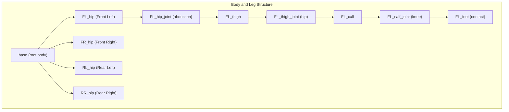
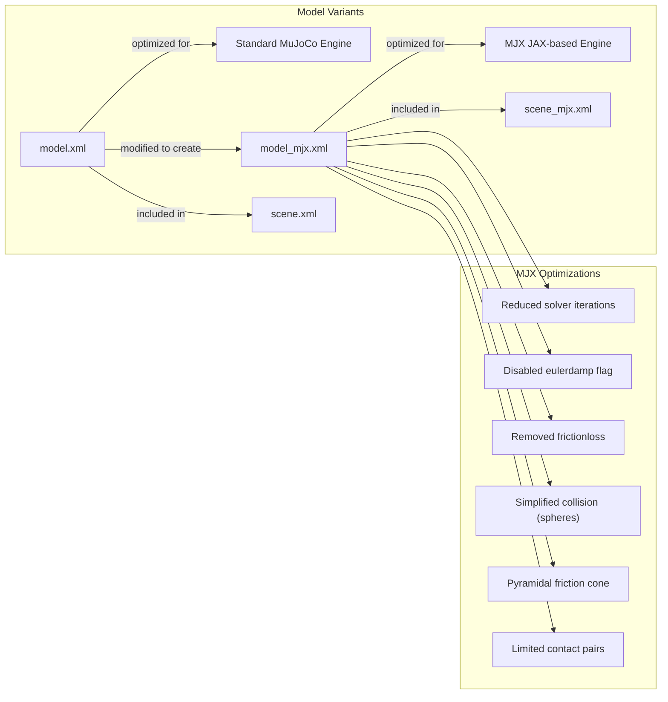
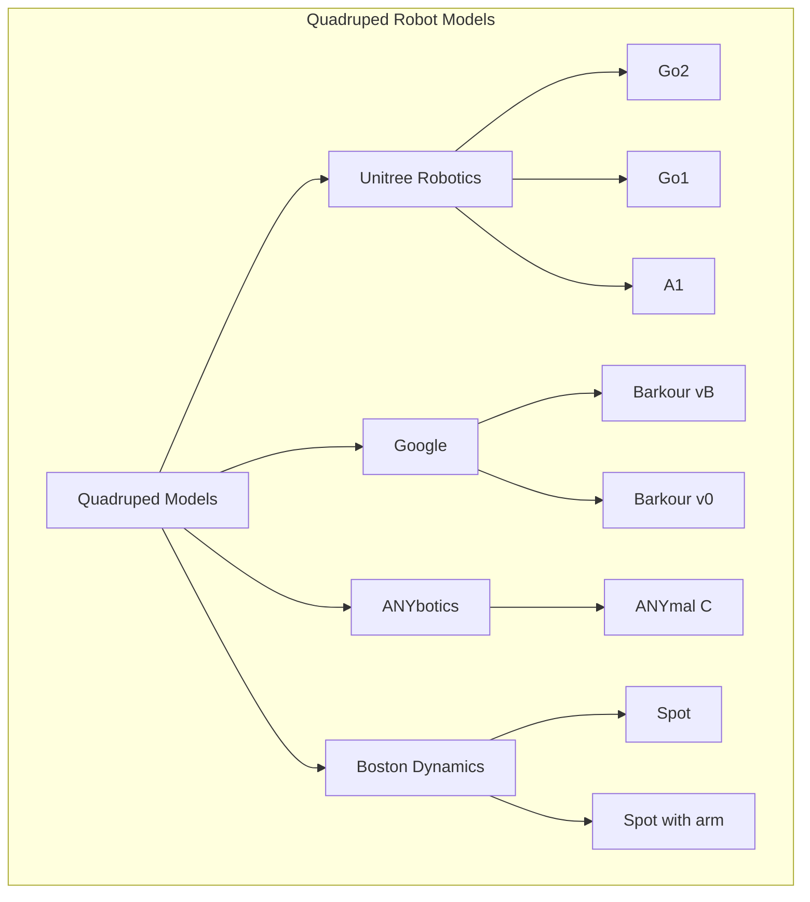
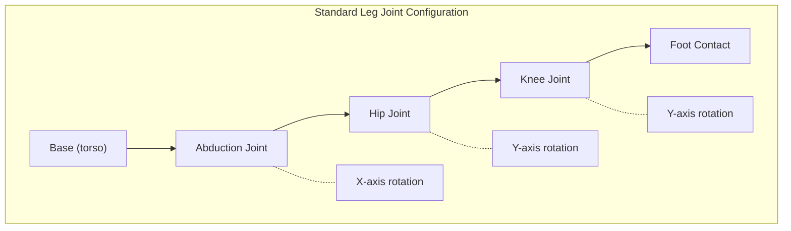

<!-- source: DeepWiki mcp.deepwiki.com · repo google-deepmind/mujoco_menagerie · page 3 Quadruped Robots · fetched 2026-10-26 -->

# Quadruped Robots

<details>
<summary>Relevant source files</summary>

The following files were used as context for generating this wiki page:

- [agility_cassie/README.md](agility_cassie/README.md)
- [anybotics_anymal_b/README.md](anybotics_anymal_b/README.md)
- [anybotics_anymal_c/README.md](anybotics_anymal_c/README.md)
- [anybotics_anymal_c/anymal_c_mjx.xml](anybotics_anymal_c/anymal_c_mjx.xml)
- [anybotics_anymal_c/scene_mjx.xml](anybotics_anymal_c/scene_mjx.xml)
- [boston_dynamics_spot/scene.xml](boston_dynamics_spot/scene.xml)
- [boston_dynamics_spot/spot.xml](boston_dynamics_spot/spot.xml)
- [boston_dynamics_spot/spot_arm.xml](boston_dynamics_spot/spot_arm.xml)
- [google_barkour_v0/LICENSE](google_barkour_v0/LICENSE)
- [google_barkour_v0/README.md](google_barkour_v0/README.md)
- [google_barkour_v0/assets/30degree_aframe__1default.stl](google_barkour_v0/assets/30degree_aframe__1default.stl)
- [google_barkour_v0/assets/abduction.stl](google_barkour_v0/assets/abduction.stl)
- [google_barkour_v0/assets/aframe_side__1default.stl](google_barkour_v0/assets/aframe_side__1default.stl)
- [google_barkour_v0/assets/aframe_side__2default.stl](google_barkour_v0/assets/aframe_side__2default.stl)
- [google_barkour_v0/assets/body.stl](google_barkour_v0/assets/body.stl)
- [google_barkour_v0/assets/broadjump_texture.png](google_barkour_v0/assets/broadjump_texture.png)
- [google_barkour_v0/assets/cone1__1default.stl](google_barkour_v0/assets/cone1__1default.stl)
- [google_barkour_v0/barkour_v0_mjx.xml](google_barkour_v0/barkour_v0_mjx.xml)
- [google_barkour_v0/scene_mjx.xml](google_barkour_v0/scene_mjx.xml)
- [google_barkour_vb/README.md](google_barkour_vb/README.md)
- [google_barkour_vb/assets/hfield.png](google_barkour_vb/assets/hfield.png)
- [google_barkour_vb/barkour_vb.png](google_barkour_vb/barkour_vb.png)
- [google_barkour_vb/barkour_vb_mjx.xml](google_barkour_vb/barkour_vb_mjx.xml)
- [google_barkour_vb/scene.xml](google_barkour_vb/scene.xml)
- [google_barkour_vb/scene_hfield_mjx.xml](google_barkour_vb/scene_hfield_mjx.xml)
- [google_barkour_vb/scene_mjx.xml](google_barkour_vb/scene_mjx.xml)
- [robotiq_2f85/README.md](robotiq_2f85/README.md)
- [robotis_op3/op3.xml](robotis_op3/op3.xml)
- [shadow_hand/README.md](shadow_hand/README.md)
- [unitree_a1/README.md](unitree_a1/README.md)
- [unitree_go1/README.md](unitree_go1/README.md)
- [unitree_go1/go1.png](unitree_go1/go1.png)
- [unitree_go1/go1.xml](unitree_go1/go1.xml)
- [unitree_go2/README.md](unitree_go2/README.md)
- [unitree_go2/go2.xml](unitree_go2/go2.xml)
- [unitree_go2/go2_mjx.png](unitree_go2/go2_mjx.png)
- [unitree_go2/go2_mjx.xml](unitree_go2/go2_mjx.xml)
- [unitree_go2/scene_mjx.xml](unitree_go2/scene_mjx.xml)
- [universal_robots_ur5e/README.md](universal_robots_ur5e/README.md)

</details>


This page documents the quadruped robot models available in the MuJoCo Menagerie repository. These physics-based models represent four-legged robots from various manufacturers and are designed for simulation in the MuJoCo physics engine. The page covers common structures, implementation details, and specific characteristics of each robot model.

## Overview

The MuJoCo Menagerie repository includes several high-quality quadruped robot models:

1. Unitree Go2
2. Google Barkour vB
3. ANYbotics ANYmal C
4. Boston Dynamics Spot
5. Unitree A1
6. Unitree Go1
7. Google Barkour v0

Each model provides accurate physical properties, joint configurations, and visual/collision geometries necessary for realistic simulation.

### Quadruped Robot Structure

**Diagram: Common Quadruped Structure with Code Entity Names**



Sources: [unitree_go2/go2.xml:64-128](), [google_barkour_vb/barkour_vb_mjx.xml:76-116](), [anybotics_anymal_c/anymal_c_mjx.xml:104-145](), [boston_dynamics_spot/spot.xml:58-117]()

## Models Implementation

Each quadruped model features:

1. A main body with a `freejoint` for unconstrained movement in the world
2. Four legs, typically with three degrees of freedom each:
   - Hip abduction/adduction (rotation around X-axis)
   - Hip flexion/extension (rotation around Y-axis)
   - Knee flexion/extension (rotation around Y-axis)
3. Foot contact geometries with specialized friction properties
4. Sensors for joint positions, velocities, and IMU data
5. Position-controlled actuators

### Joint Naming Conventions

Different robot models use varied naming conventions for their joints:

| Robot Model | Front Left Hip | Front Left Knee | Joint Pattern |
|-------------|----------------|-----------------|---------------|
| Unitree Go2 | `FL_hip_joint` | `FL_calf_joint` | `[leg]_[segment]_joint` |
| Google Barkour vB | `abduction_front_left` | `knee_front_left` | `[joint]_[leg]` |
| ANYmal C | `LF_HAA` | `LF_KFE` | `[leg]_[joint]` |
| Boston Dynamics Spot | `fl_hx` | `fl_kn` | `[leg]_[joint]` |

Sources: [unitree_go2/go2.xml:196-200](), [google_barkour_vb/barkour_vb_mjx.xml:210-221](), [anybotics_anymal_c/anymal_c_mjx.xml:234-245](), [boston_dynamics_spot/spot.xml:161-172]()

### Actuation and Control

The quadruped models use position-controlled actuators with appropriate joint limits, gains, and force ranges. Most models use the `<general>` actuator type for Unitree and Google models or the `<position>` actuator type for ANYmal and Spot.

Example from Unitree Go2:

```
<actuator>
  <general class="abduction" name="FL_hip" joint="FL_hip_joint"/>
  <general class="hip" name="FL_thigh" joint="FL_thigh_joint"/>
  <general class="knee" name="FL_calf" joint="FL_calf_joint"/>
  <!-- Other legs... -->
</actuator>
```

Sources: [unitree_go2/go2.xml:188-200](), [google_barkour_vb/barkour_vb_mjx.xml:209-221](), [anybotics_anymal_c/anymal_c_mjx.xml:233-246](), [boston_dynamics_spot/spot.xml:160-172]()

### Sensor Configuration

Most quadruped models include a range of sensors:

```
<sensor>
  <jointpos joint="FL_hip_joint" name="abduction_front_left_pos"/>
  <jointvel joint="FL_hip_joint" name="abduction_front_left_vel"/>
  <!-- Other joint sensors... -->
  <gyro site="imu" name="gyro"/>
  <accelerometer site="imu" name="accelerometer"/>
  <framequat objtype="site" objname="imu" name="orientation"/>
</sensor>
```

Sources: [unitree_go2/go2_mjx.xml:212-242](), [google_barkour_vb/barkour_vb_mjx.xml:224-256]()

## MJX Compatibility

**Diagram: Standard vs MJX Model Structure**



Sources: [unitree_go2/README.md:39-52](), [google_barkour_vb/README.md:17-25](), [anybotics_anymal_c/README.md:42-54]()

Several quadruped models include MJX-compatible versions optimized for the JAX-based MuJoCo engine with the following modifications:

1. **Solver settings**: Reduced iterations for better performance
   ```
   <option iterations="1" ls_iterations="4" cone="pyramidal">
     <flag eulerdamp="disable"/>
   </option>
   ```

2. **Collision geometry**: Simplified to spheres where possible
   ```
   <geom class="foot" type="sphere" size="0.0175" pos="-0.002 0 -0.213"/>
   ```

3. **Contact model**: Changed from elliptic to pyramidal friction cone, removed friction loss

4. **Contact pairs**: Limited to essential contacts (typically only foot-ground)

Sources: [unitree_go2/go2_mjx.xml:4-6](), [google_barkour_vb/barkour_vb_mjx.xml:4-6](), [anybotics_anymal_c/anymal_c_mjx.xml:4-6]()

## Model Comparison

**Diagram: Quadruped Models in the Repository**



Sources: [unitree_go2/README.md](), [unitree_go1/README.md](), [unitree_a1/README.md](), [google_barkour_vb/README.md](), [google_barkour_v0/README.md](), [anybotics_anymal_c/README.md](), [boston_dynamics_spot/spot.xml](), [boston_dynamics_spot/spot_arm.xml]()

| Robot Model | Developer | DoF | MJX Compatible | Special Features |
|-------------|-----------|-----|----------------|------------------|
| Unitree Go2 | Unitree Robotics | 12 | Yes | Latest Go series model; detailed visual meshes |
| Google Barkour vB | Google | 12 | Yes | Camera sensors, IMU, designed for agile locomotion |
| ANYmal C | ANYbotics | 12 | Yes | Rugged design, position-controlled actuators |
| Boston Dynamics Spot | Boston Dynamics | 12 | No | Optional manipulator arm attachment |
| Unitree A1 | Unitree Robotics | 12 | No | Compact research platform |
| Unitree Go1 | Unitree Robotics | 12 | No | Predecessor to Go2 model |
| Google Barkour v0 | Google | 12 | Yes | Earlier version of Barkour |

Sources: All model directories and README files

## Implementation Details

### Joint Configuration

Most quadruped robots share a similar pattern of joint configuration:

**Diagram: Joint Structure and Coordinates**



Sources: [unitree_go2/go2.xml:9-24](), [google_barkour_vb/barkour_vb_mjx.xml:25-42](), [anybotics_anymal_c/anymal_c_mjx.xml:13-27]()

### Contact and Collision

Quadruped models use specialized contact parameters for feet to simulate the behavior of rubber:

```xml
<geom class="foot" type="sphere" size="0.0175" pos="0 0 -0.213" priority="1" 
      solimp="0.015 1 0.031" condim="6" friction="0.8 0.02 0.01"/>
```

Contact exclusions prevent unrealistic self-collisions:

```xml
<contact>
  <exclude body1="body" body2="fl_uleg"/>
  <exclude body1="body" body2="fr_uleg"/>
  <!-- Other exclusions... -->
</contact>
```

Sources: [unitree_go2/go2.xml:33-37](), [boston_dynamics_spot/spot.xml:153-157](), [anybotics_anymal_c/anymal_c_mjx.xml:220-230]()

### Default Standing Pose

Most models include a "home" keyframe defining a default standing pose:

```xml
<keyframe>
  <key name="home" qpos="0 0 0.27 1 0 0 0 0 0.9 -1.8 0 0.9 -1.8 0 0.9 -1.8 0 0.9 -1.8"
    ctrl="0 0.9 -1.8 0 0.9 -1.8 0 0.9 -1.8 0 0.9 -1.8"/>
</keyframe>
```

Sources: [unitree_go2/go2.xml:203-206](), [google_barkour_vb/scene.xml:27-38](), [anybotics_anymal_c/anymal_c_mjx.xml:248-252](), [boston_dynamics_spot/spot.xml:175-187]()

## Usage Examples

The quadruped models can be used for various simulation tasks:

1. **Standard simulation**: Load the robot model through `scene.xml`
2. **MJX-accelerated simulation**: Use the MJX-compatible version through `scene_mjx.xml`
3. **Terrain traversal**: Some models include specialized terrain scenes, e.g., `scene_hfield_mjx.xml` for the Barkour vB

Example initializing a model:

```python
import mujoco
model = mujoco.MjModel.from_xml_path("unitree_go2/scene.xml")
data = mujoco.MjData(model)
# Initialize to the home position
mujoco.mj_resetDataKeyframe(model, data, 0)  # 0 = index of 'home' keyframe
```

Sources: [unitree_go2/scene_mjx.xml](), [google_barkour_vb/scene_mjx.xml](), [google_barkour_vb/scene_hfield_mjx.xml]()

## Conclusion

The quadruped robot models in MuJoCo Menagerie provide accurate representations of real-world robots for simulation and research. The models follow consistent patterns in structure and implementation, with MJX-compatible versions available for most robots to enable efficient simulation with JAX-based acceleration.

For other robot categories in the repository, see:
- [Humanoid Robots](#2)
- [Manipulator Arms](#4)
- [Grippers and Hands](#5)

---

