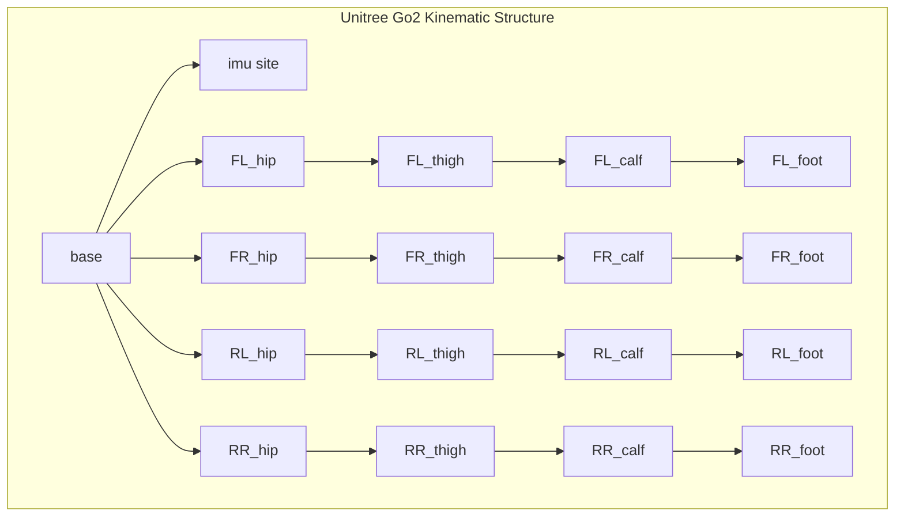
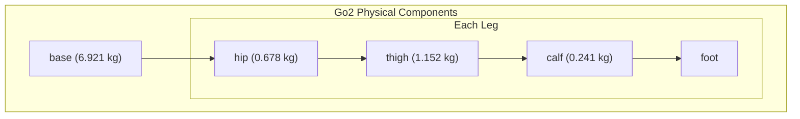
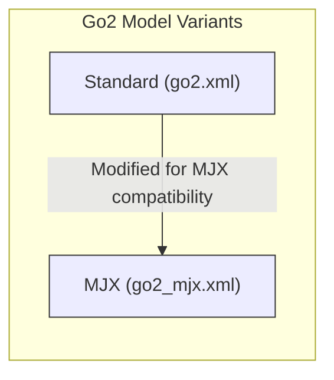

<!-- source: DeepWiki mcp.deepwiki.com · repo google-deepmind/mujoco_menagerie · page 3.1 Unitree Go2 · fetched 2026-10-26 -->

# Unitree Go2

<details>
<summary>Relevant source files</summary>

The following files were used as context for generating this wiki page:

- [unitree_go2/README.md](unitree_go2/README.md)
- [unitree_go2/go2.xml](unitree_go2/go2.xml)
- [unitree_go2/go2_mjx.png](unitree_go2/go2_mjx.png)
- [unitree_go2/go2_mjx.xml](unitree_go2/go2_mjx.xml)
- [unitree_go2/scene_mjx.xml](unitree_go2/scene_mjx.xml)

</details>


## Overview

This document provides technical specifications and usage information for the Unitree Go2 quadruped robot model in the MuJoCo Menagerie repository. The Go2 is a small, agile quadruped robot developed by Unitree Robotics, with this implementation being derived from the publicly available URDF description and optimized for simulation in MuJoCo physics engine. This page covers the model's structure, joint and actuator configuration, kinematic properties, and usage in both standard MuJoCo and MJX (JAX-based MuJoCo) environments.

Sources: [unitree_go2/README.md:12-18]()

## Model Architecture

The Unitree Go2 model implements a quadruped robot with 12 degrees of freedom (3 per leg). Each leg consists of three primary joints:

1. Hip abduction/adduction joint (lateral movement)
2. Hip flexion/extension joint (forward/backward movement)
3. Knee joint (leg extension/flexion)

The model is structured hierarchically, with the main body connected to four legs, and each leg having three articulated segments.

### Kinematic Structure



Sources: [unitree_go2/go2.xml:64-185]()

### Naming Convention

The model uses a consistent naming convention for all body parts, joints, and actuators:

- **Position prefix**: FL (Front Left), FR (Front Right), RL (Rear Left), RR (Rear Right)
- **Joint types**: hip_joint, thigh_joint, calf_joint
- **Body parts**: hip, thigh, calf, foot

Sources: [unitree_go2/go2.xml:77-184]()

## Joint Configuration

The Go2 model implements three types of joints for each leg with specific range limitations:

| Joint Type   | Axis    | Range (radians)      | Control Range     | Description                 |
|--------------|---------|----------------------|-------------------|-----------------------------|
| Abduction    | X-axis  | -1.0472 to 1.0472    | -0.9472 to 0.9472 | Lateral leg movement        |
| Hip (Front)  | Y-axis  | -1.5708 to 3.4907    | -1.4 to 2.5       | Forward/backward rotation   |
| Hip (Back)   | Y-axis  | -0.5236 to 4.5379    | -1.4 to 2.5       | Forward/backward rotation   |
| Knee         | Y-axis  | -2.7227 to -0.83776  | -2.6227 to -0.84776 | Leg extension/flexion     |

The model uses MuJoCo's `autolimits="true"` compiler flag to automatically derive proper actuator ranges from joint limits.

Sources: [unitree_go2/go2.xml:9-26](), [unitree_go2/go2_mjx.xml:10-25]()

## Actuator Configuration

The Go2 model uses 12 actuators (one for each joint) with characteristics appropriate for the specific joint types. In the standard model, actuators are implemented as motors with force limits:

```
Standard model:
- Abduction/Hip actuators: ctrlrange="-23.7 23.7"  
- Knee actuators: ctrlrange="-45.43 45.43"
```

In the MJX model, actuators use the general type with more specific controller settings:

```
MJX model:
- All actuators: forcerange="-24 24", biastype="affine", gainprm="50 0 0", biasprm="0 -50 -0.5"
```

Sources: [unitree_go2/go2.xml:188-201](), [unitree_go2/go2_mjx.xml:197-210]()

## Physical Properties

### Body Components



Sources: [unitree_go2/go2.xml:65-66](), [unitree_go2/go2.xml:78-79](), [unitree_go2/go2.xml:85-86](), [unitree_go2/go2.xml:92-93]()

### Contact Properties

The model implements specialized contact properties for the feet to simulate rubber contact:

- Foot friction: 0.8 (primary), 0.02 (torsional), 0.01 (rolling)
- Softened contact parameters (solimp): "0.015 1 0.022"
- Priority: 1 (higher priority for contact handling)
- Size: 0.022 radius spheres in the standard model, 0.0175 in the MJX model

Sources: [unitree_go2/go2.xml:32-34](), [unitree_go2/go2_mjx.xml:36-37]()

## Model Variants

### Standard MuJoCo Model

The standard model (`go2.xml`) implements:
- Elliptic friction cone
- Geometric collision shapes (boxes, cylinders, spheres)
- Joint friction loss (0.2)
- Full mesh-based visual and collision geometries

Sources: [unitree_go2/go2.xml:4-200]()

### MJX-Compatible Model

The MJX model (`go2_mjx.xml`) includes optimization changes:
- Pyramidal friction cone (instead of elliptic)
- Sphere-only collision geometries (MJX limitation)
- Removed friction loss
- Modified solver parameters (iterations=1, ls_iterations=5)
- Differently tuned contact parameters

These changes ensure compatibility with MJX's current capabilities while maintaining simulation fidelity.



Sources: [unitree_go2/README.md:39-51](), [unitree_go2/go2_mjx.xml:4-6]()

## Sensors

The model includes comprehensive sensors for state observation, particularly in the MJX version:

| Sensor Type      | Names                                    | Description                         |
|------------------|------------------------------------------|-------------------------------------|
| Joint Position   | `*_pos` (e.g., abduction_front_left_pos) | Current joint angles                |
| Joint Velocity   | `*_vel` (e.g., hip_front_right_vel)      | Current joint velocities            |
| IMU Gyroscope    | gyro                                     | Angular velocity of the base        |
| IMU Accelerometer| accelerometer                            | Linear acceleration of the base     |
| Orientation      | orientation                              | Quaternion frame orientation        |
| Global Position  | global_position                          | Global position of the IMU site     |
| Global Linear Vel| global_linvel                            | Global linear velocity              |
| Global Angular Vel| global_angvel                           | Global angular velocity             |

These sensors enable full state observation for control algorithms.

Sources: [unitree_go2/go2_mjx.xml:212-242]()

## Usage

### Loading the Model

The Go2 model can be included in simulations using:
- Standard model: Include `go2.xml` for full MuJoCo compatibility
- MJX model: Include `go2_mjx.xml` for JAX-based simulation

For a complete simulation environment with ground plane and lighting, use the scene files:
- `scene.xml` for standard MuJoCo
- `scene_mjx.xml` for MJX

### Home Position

The model includes a predefined "home" keyframe with the robot standing in a neutral pose:
```
Position: Height 0.27m above ground
Joint configuration: 
- All hip abduction joints: 0 radians
- All hip joints: 0.9 radians
- All knee joints: -1.8 radians
```

Sources: [unitree_go2/go2.xml:203-206](), [unitree_go2/go2_mjx.xml:245-248](), [unitree_go2/scene_mjx.xml:1-23]()

## Conversion Details

The Go2 model was derived from the original URDF description through a careful conversion process:

1. Mesh conversion from DAE to OBJ format using Blender
2. Processing with obj2mjcf utility
3. Initial MJCF generation from URDF preserving visual geometries
4. Manual refinement of the MJCF including:
   - Adding the free joint to the base
   - Extracting common properties into the default section
   - Configuring soft contacts for the feet
   - Creating scene files with ground plane and lighting

For the MJX variant, additional changes were made to ensure compatibility with JAX-based physics:
- Simplification to sphere-based collision geometry
- Modification of solver parameters
- Adaptation of the friction model

Sources: [unitree_go2/README.md:24-46]()

---

