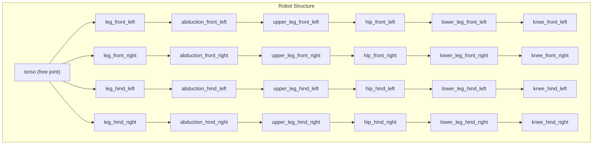
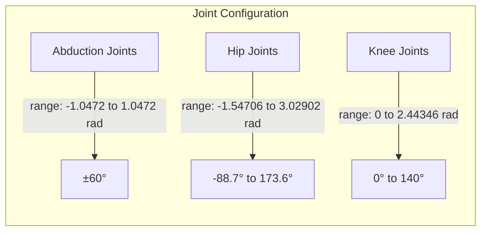
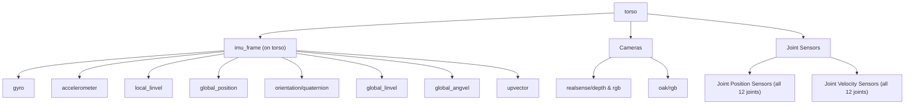
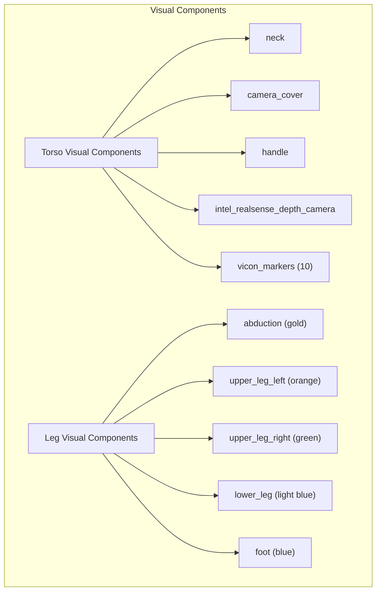
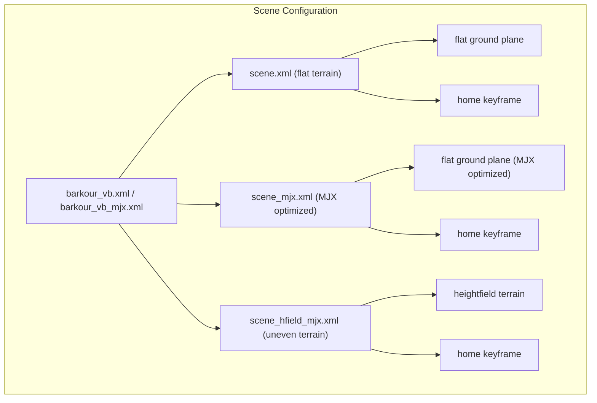

<!-- source: DeepWiki mcp.deepwiki.com · repo google-deepmind/mujoco_menagerie · page 3.2 Google Barkour vB · fetched 2026-10-26 -->

# Google Barkour vB

Relevant source files

The following files were used as context for generating this wiki page:

- [google_barkour_v0/barkour_v0.xml](google_barkour_v0/barkour_v0.xml)
- [google_barkour_v0/scene.xml](google_barkour_v0/scene.xml)
- [google_barkour_v0/scene_barkour.xml](google_barkour_v0/scene_barkour.xml)
- [google_barkour_vb/README.md](google_barkour_vb/README.md)
- [google_barkour_vb/assets/hfield.png](google_barkour_vb/assets/hfield.png)
- [google_barkour_vb/barkour_vb.png](google_barkour_vb/barkour_vb.png)
- [google_barkour_vb/barkour_vb.xml](google_barkour_vb/barkour_vb.xml)
- [google_barkour_vb/barkour_vb_mjx.xml](google_barkour_vb/barkour_vb_mjx.xml)
- [google_barkour_vb/scene.xml](google_barkour_vb/scene.xml)
- [google_barkour_vb/scene_hfield_mjx.xml](google_barkour_vb/scene_hfield_mjx.xml)
- [google_barkour_vb/scene_mjx.xml](google_barkour_vb/scene_mjx.xml)
- [google_robot/robot.xml](google_robot/robot.xml)
- [google_robot/scene.xml](google_robot/scene.xml)
- [hello_robot_stretch/scene.xml](hello_robot_stretch/scene.xml)

## Overview

This document provides detailed information about the Google Barkour vB quadruped robot model implemented in MuJoCo XML format (MJCF). The Barkour vB is a quadruped robot developed by Google for research in agile locomotion, designed to benchmark animal-level agility capabilities. This model is part of the MuJoCo Menagerie collection and requires MuJoCo 3.0.0 or later.

For information about the earlier version of this robot, see the Google Barkour v0 documentation.

Sources: [google_barkour_vb/README.md:1-8]()

## Model Structure

The Barkour vB model consists of a central torso with four articulated legs. Each leg has three joints (abduction, hip, and knee), giving the robot a total of 12 actuated degrees of freedom plus 6 degrees of freedom for the floating base.

### Robot Architecture

Sources: [google_barkour_vb/barkour_vb.xml:66-191](), [google_barkour_vb/barkour_vb_mjx.xml:76-206]()

### Inertial Properties

The robot model's key inertial properties:

| Component | Mass (kg) | Inertia |
|-----------|-----------|---------|
| Torso | 6.04352 | diag(0.144664, 0.12027, 0.0511405) |
| Abduction links | 0.787 | diag(0.00143831, 0.00117023, 0.00100011) |
| Upper leg | 1.155 | diag(0.00562022, 0.00519471, 0.0012633) |
| Lower leg | 0.171238 | diag(0.00137406, 0.00135746, 3.05521e-05) |

Sources: [google_barkour_vb/barkour_vb_mjx.xml:79-81](), [google_barkour_vb/barkour_vb_mjx.xml:108-110](), [google_barkour_vb/barkour_vb_mjx.xml:113-115](), [google_barkour_vb/barkour_vb_mjx.xml:119-121]()

## Joint Configuration and Actuation

### Joint Properties

The robot has three types of joints per leg, each with specific range limits:

In the model, all joints have the following common properties:
- Damping: 0.024
- Armature: 0.011

The MJX version removes frictionloss for performance reasons.

Sources: [google_barkour_vb/barkour_vb.xml:14-35](), [google_barkour_vb/barkour_vb_mjx.xml:25-43]()

### Actuator Configuration

Each joint is controlled via a general actuator with the following properties:

| Joint Type | Force Range | Control Range | Gain | Bias |
|------------|-------------|---------------|------|------|
| Abduction | -18 to 18 N | -0.9472 to 0.9472 rad | 50 | -50 × θ - 0.5 |
| Hip | -18 to 18 N | -1.44706 to 2.92902 rad | 50 | -50 × θ - 0.5 |
| Knee | -18 to 18 N | 0.1 to 2.34346 rad | 50 | -50 × θ - 0.5 |

The actuators use an affine bias type to apply position control.

Sources: [google_barkour_vb/barkour_vb_mjx.xml:26-39](), [google_barkour_vb/barkour_vb_mjx.xml:209-222]()

## Sensors and Perception

The robot is equipped with multiple sensors for state estimation and control:

The sensors include:
- Joint position and velocity sensors for all 12 joints
- IMU with gyroscope and accelerometer
- Position and orientation tracking
- Linear and angular velocity measurements
- RGB and depth cameras (RealSense and Oak)

Sources: [google_barkour_vb/barkour_vb_mjx.xml:91-104](), [google_barkour_vb/barkour_vb_mjx.xml:224-256]()

## Visual Components and Geometry

The model uses detailed meshes for visual rendering and includes the following key visual elements:

- Torso with camera covers, neck, and handle
- Intel RealSense depth camera
- Vicon motion capture markers
- Colored leg components (different for left/right legs)
- Foot geometry with contact friction properties

The foot contact points use sphere geometry with the following properties:
- Radius: 0.0175m
- Friction: [0.8, 0.02, 0.01]
- Solref: [0.015, 1, 0.031]

Sources: [google_barkour_vb/barkour_vb_mjx.xml:62-74](), [google_barkour_vb/barkour_vb_mjx.xml:14-15](), [google_barkour_vb/barkour_vb_mjx.xml:42-58]()

## MJX Compatibility

The model includes an MJX-compatible version (`barkour_vb_mjx.xml`) optimized for the JAX-based MuJoCo engine with the following modifications:

1. Solver iterations reduced for performance (iterations=1, ls_iterations=5)
2. Euler damping disabled with `<flag eulerdamp="disable"/>`
3. Frictionloss removed from joint properties
4. Collision geometry simplified and optimized for contact between feet and ground

This version is intended for use with MJX to enable more efficient simulation, particularly for reinforcement learning applications that benefit from JAX's acceleration.

Sources: [google_barkour_vb/README.md:17-25](), [google_barkour_vb/barkour_vb_mjx.xml:4-6](), [google_barkour_vb/barkour_vb_mjx.xml:11-16]()

## Scene Configuration

Two scene configurations are provided for the Barkour vB model:

1. **Standard Scene (`scene.xml`)**:
   - Basic flat ground plane with checker texture
   - Default camera positioning
   - Home position keyframe definition
   - Standard lighting and visual settings

2. **Heightfield Scene (`scene_hfield_mjx.xml`)**:
   - Uses a heightfield for uneven terrain simulation
   - MJX-compatible for accelerated simulation
   - Same visual settings as the standard scene

Both scenes include keyframe definitions for a "home" position that places the robot in a standing pose.

Sources: [google_barkour_vb/scene.xml:1-41](), [google_barkour_vb/scene_mjx.xml:1-39](), [google_barkour_vb/scene_hfield_mjx.xml:1-40]()

## File Structure

The Barkour vB model is organized into several files with specific purposes:

| File | Description |
|------|-------------|
| `barkour_vb.xml` | Primary model definition file |
| `barkour_vb_mjx.xml` | MJX-optimized version of the model |
| `scene.xml` | Standard simulation scene with flat ground |
| `scene_mjx.xml` | MJX-optimized scene with flat ground |
| `scene_hfield_mjx.xml` | MJX-compatible scene with heightfield terrain |
| `assets/*.stl` | Mesh files for robot geometry |
| `barkour_vb.png` | Reference image of the robot |

Each XML file serves a specific purpose in the model definition and simulation setup, allowing for flexibility in different use cases and simulation environments.

Sources: [google_barkour_vb/README.md:13-25]()

## Key Differences from Barkour v0

The Barkour vB model represents an updated version of the earlier Barkour v0 model with several notable differences:

1. **Structure**: vB has more refined leg geometry and updated mass distribution
2. **Appearance**: Visual components use different color schemes and more detailed geometries
3. **Joint Properties**: Updated joint limits and actuation properties
4. **Sensors**: Enhanced sensor suite including additional cameras and mocap markers

Sources: [google_barkour_vb/barkour_vb.xml:1-241](), [google_barkour_v0/barkour_v0.xml:1-196]()

## References

The Barkour vB model is based on research published in the paper "Barkour: Benchmarking Animal-level Agility with Quadruped Robots" (arxiv:2305.14654). The model is released under the Apache-2.0 License by DeepMind Technologies Limited.

Sources: [google_barkour_vb/README.md:27-43]()

---

