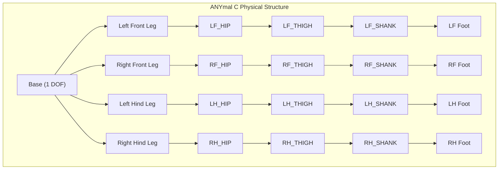
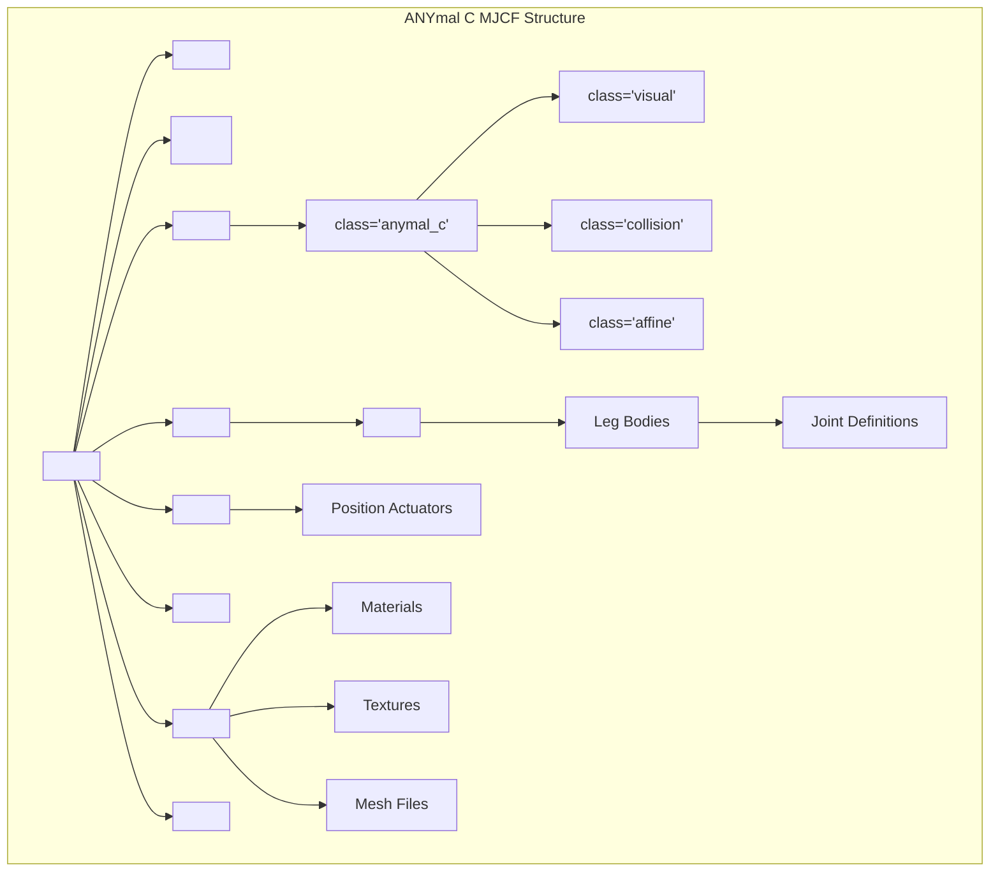

<!-- source: DeepWiki mcp.deepwiki.com · repo google-deepmind/mujoco_menagerie · page 3.3 ANYbotics ANYmal C · fetched 2026-10-26 -->

# ANYbotics ANYmal C

<details>
<summary>Relevant source files</summary>

The following files were used as context for generating this wiki page:

- [agility_cassie/README.md](agility_cassie/README.md)
- [anybotics_anymal_b/README.md](anybotics_anymal_b/README.md)
- [anybotics_anymal_c/README.md](anybotics_anymal_c/README.md)
- [anybotics_anymal_c/anymal_c_mjx.xml](anybotics_anymal_c/anymal_c_mjx.xml)
- [anybotics_anymal_c/scene_mjx.xml](anybotics_anymal_c/scene_mjx.xml)
- [robotiq_2f85/README.md](robotiq_2f85/README.md)
- [shadow_hand/README.md](shadow_hand/README.md)
- [unitree_a1/README.md](unitree_a1/README.md)
- [unitree_go1/README.md](unitree_go1/README.md)
- [universal_robots_ur5e/README.md](universal_robots_ur5e/README.md)

</details>


## 1. Overview

This document provides technical details about the ANYbotics ANYmal C quadruped robot model implementation in the MuJoCo Menagerie repository. The ANYmal C is a versatile, all-terrain quadruped robot developed by ANYbotics for industrial inspection, research, and other applications requiring robust mobility.

This documentation covers the model structure, joint configuration, actuation system, and implementation details for both standard MuJoCo and MJX-compatible versions.

Sources: [anybotics_anymal_c/README.md:6-11]()

## 2. Model Origin and Derivation

The ANYmal C model in the MuJoCo Menagerie is derived from the publicly available URDF description by ANYbotics. The conversion process involved several steps:

1. Converting mesh files from DAE to OBJ format
2. Processing OBJ files with obj2mjcf
3. Converting the URDF to MJCF
4. Adding a freejoint to the base
5. Structuring common properties in the default section
6. Adding collision exclusions between components
7. Configuring actuators based on motor specifications
8. Adding contact properties to simulate rubber feet
9. Creating scene XML with environmental elements

Additionally, a specialized MJX-compatible version was created with specific optimizations for the JAX-based MuJoCo implementation.

Sources: [anybotics_anymal_c/README.md:22-41](), [anybotics_anymal_c/README.md:42-54]()

## 3. Physical Structure

### 3.1 Robot Body Components

The ANYmal C model consists of a main body (base) and four identical legs. Each leg is composed of three segments:
- Hip segment
- Thigh segment
- Shank segment with foot

The model includes detailed visual meshes for all components, with a total of 12 actuated degrees of freedom.



Sources: [anybotics_anymal_c/anymal_c_mjx.xml:104-216]()

### 3.2 Joint Configuration

Each leg has three joints, providing a total of 12 actuated degrees of freedom:

| Leg | Joint | Description | Axis | Range (radians) |
|-----|-------|-------------|------|----------------|
| LF (Left Front) | HAA | Hip Abduction/Adduction | [1,0,0] | -0.72 to 0.49 |
| LF (Left Front) | HFE | Hip Flexion/Extension | [1,0,0] | -9.42 to 9.42 |
| LF (Left Front) | KFE | Knee Flexion/Extension | [1,0,0] | -9.42 to 9.42 |
| RF (Right Front) | HAA | Hip Abduction/Adduction | [1,0,0] | -0.49 to 0.72 |
| RF (Right Front) | HFE | Hip Flexion/Extension | [-1,0,0] | -9.42 to 9.42 |
| RF (Right Front) | KFE | Knee Flexion/Extension | [-1,0,0] | -9.42 to 9.42 |
| LH (Left Hind) | HAA | Hip Abduction/Adduction | [-1,0,0] | -0.72 to 0.49 |
| LH (Left Hind) | HFE | Hip Flexion/Extension | [1,0,0] | -9.42 to 9.42 |
| LH (Left Hind) | KFE | Knee Flexion/Extension | [1,0,0] | -9.42 to 9.42 |
| RH (Right Hind) | HAA | Hip Abduction/Adduction | [-1,0,0] | -0.49 to 0.72 |
| RH (Right Hind) | HFE | Hip Flexion/Extension | [-1,0,0] | -9.42 to 9.42 |
| RH (Right Hind) | KFE | Knee Flexion/Extension | [-1,0,0] | -9.42 to 9.42 |

Additionally, the base has a 6 DOF freejoint, allowing it to move freely in space.

Sources: [anybotics_anymal_c/anymal_c_mjx.xml:122-214]()

## 4. MJCF Implementation Details

### 4.1 Model Structure

The MJCF model is organized into several main sections:



Sources: [anybotics_anymal_c/anymal_c_mjx.xml:1-253]()

### 4.2 Default Properties

The model uses a hierarchical default class structure to organize common properties:

- `anymal_c` - Base class for all robot components
  - `visual` - Class for visual geometries with no collision
    - `visual_zflip` - Subclass for flipped visual geometries
  - `collision` - Class for collision geometries
    - `foot` - Specialized class for foot contact properties
  - `affine` - Class for actuator properties

This structure makes the model more readable and maintainable by centralizing common properties.

Sources: [anybotics_anymal_c/anymal_c_mjx.xml:8-28]()

### 4.3 Visual and Collision Geometry

The model separates visual and collision geometries:

- Visual geometries use detailed mesh files with material textures for realistic rendering
- Collision geometries use simplified primitives (spheres for feet, capsules for other parts)

The collision geometries are optimized for computational efficiency while maintaining physical accuracy.

Sources: [anybotics_anymal_c/anymal_c_mjx.xml:12-24](), [anybotics_anymal_c/anymal_c_mjx.xml:76-100]()

## 5. Actuation System

The ANYmal C model uses position-controlled actuators for all 12 joints. The actuator parameters are:

```
<position kp="100" ctrlrange="-6.28 6.28" forcerange="-80 80"/>
```

These parameters specify:
- A position gain (`kp`) of 100
- Control range of ±6.28 radians (±360 degrees)
- Force limits of ±80 units

Each actuator is directly mapped to a corresponding joint:

```mermaid
graph LR
    subgraph "Actuator to Joint Mapping"
        LF_HAA_act["LF_HAA Actuator"] -->|Controls| LF_HAA_joint["LF_HAA Joint"]
        LF_HFE_act["LF_HFE Actuator"] -->|Controls| LF_HFE_joint["LF_HFE Joint"]
        LF_KFE_act["LF_KFE Actuator"] -->|Controls| LF_KFE_joint["LF_KFE Joint"]
        
        RF_HAA_act["RF_HAA Actuator"] -->|Controls| RF_HAA_joint["RF_HAA Joint"]
        RF_HFE_act["RF_HFE Actuator"] -->|Controls| RF_HFE_joint["RF_HFE Joint"]
        RF_KFE_act["RF_KFE Actuator"] -->|Controls| RF_KFE_joint["RF_KFE Joint"]
        
        LH_HAA_act["LH_HAA Actuator"] -->|Controls| LH_HAA_joint["LH_HAA Joint"]
        LH_HFE_act["LH_HFE Actuator"] -->|Controls| LH_HFE_joint["LH_HFE Joint"]
        LH_KFE_act["LH_KFE Actuator"] -->|Controls| LH_KFE_joint["LH_KFE Joint"]
        
        RH_HAA_act["RH_HAA Actuator"] -->|Controls| RH_HAA_joint["RH_HAA Joint"]
        RH_HFE_act["RH_HFE Actuator"] -->|Controls| RH_HFE_joint["RH_HFE Joint"]
        RH_KFE_act["RH_KFE Actuator"] -->|Controls| RH_KFE_joint["RH_KFE Joint"]
    end
```



The actuator configuration is designed to closely match the actual robot's motor specifications.

Sources: [anybotics_anymal_c/anymal_c_mjx.xml:25-27](), [anybotics_anymal_c/anymal_c_mjx.xml:233-246]()

## 6. Contact Properties

### 6.1 Foot Contact

The feet use specialized contact properties to simulate rubber material:

```
<geom type="sphere" size="0.03" pos="0 0 0.02325" priority="1" solimp="0.015 1 0.031" solref="0.02 1" condim="3" friction="0.8 0.02 0.01"/>
```

These properties include:
- Sphere geometry with radius 0.03
- Priority 1 (higher priority for contacts)
- Softened contacts with specified impedance and reference parameters
- 3-dimensional contacts
- Anisotropic friction (0.8, 0.02, 0.01)

Sources: [anybotics_anymal_c/anymal_c_mjx.xml:20-22]()

### 6.2 Collision Exclusions

The model defines several collision exclusions to prevent unrealistic contacts between parts that should not interact:

1. Between base and each thigh
2. Between pairs of shanks (to prevent legs from colliding with each other)

These exclusions help prevent simulation artifacts and improve stability.

Sources: [anybotics_anymal_c/anymal_c_mjx.xml:220-230]()

## 7. MJX-Compatible Version

The repository includes a specialized version of the model for use with MJX (MuJoCo's JAX-based implementation). Key modifications include:

| Feature | Standard Model | MJX Model |
|---------|---------------|-----------|
| Solver iterations | Not specified | 1 iteration |
| Line search iterations | Not specified | 4 iterations |
| Solver type | Not specified | Newton |
| Friction cone | Elliptic | Pyramidal |
| Impact ratio | Not specified | 100 |
| Euler damping | Enabled | Disabled |
| Friction loss | Present | Removed |
| Contact dimensionality | 6 | 3 |
| Decorative geoms | All included | Some removed for performance |

These modifications are designed to optimize performance for the JAX-based implementation while maintaining physical realism.

Sources: [anybotics_anymal_c/README.md:42-54](), [anybotics_anymal_c/anymal_c_mjx.xml:4-6]()

## 8. Usage

### 8.1 Loading the Model

The model can be loaded using MuJoCo's Python API:

```python
import mujoco

# Load the scene with ANYmal C
model = mujoco.MjModel.from_xml_path('anybotics_anymal_c/scene_mjx.xml')
data = mujoco.MjData(model)

# Alternatively, load just the robot model
robot_model = mujoco.MjModel.from_xml_path('anybotics_anymal_c/anymal_c_mjx.xml')
robot_data = mujoco.MjData(robot_model)
```

Note: It's recommended to load the scene XML rather than just the robot model file.

Sources: [anybotics_anymal_c/README.md:55]()

### 8.2 Reference Pose

The model includes a "standing" keyframe with a predefined pose:

```
<keyframe>
  <key name="standing"
    qpos="0.0 0.0 0.56 1.0 0.0 0.0 0.0 0.0 0.5235987755982988 -0.7853981 0.0 0.5235987755982988 -0.7853981 0.0 -0.5235987755982988 0.7853981 0.0 -0.5235987755982988 0.7853981"/>
</keyframe>
```

This keyframe provides a stable standing configuration that can be used for initialization.

Sources: [anybotics_anymal_c/anymal_c_mjx.xml:249-252]()

### 8.3 MJX Example

The repository includes a Colab notebook demonstrating how to use the ANYmal C model with MJX for locomotion training using policy gradients:

[MJX] Use first-order policy gradients to make the ANYmal C locomote
([Colab Notebook](https://colab.research.google.com/github/google-deepmind/mujoco/blob/main/mjx/training_apg.ipynb))

Sources: [anybotics_anymal_c/README.md:17-20]()

## 9. License

The ANYmal C model is released under a BSD-3-Clause License.

Sources: [anybotics_anymal_c/README.md:57-59]()

---

