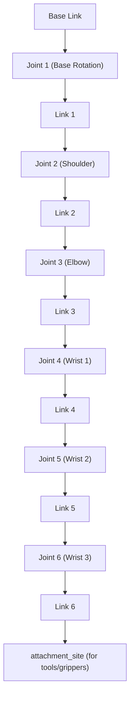
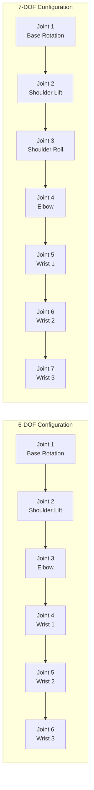
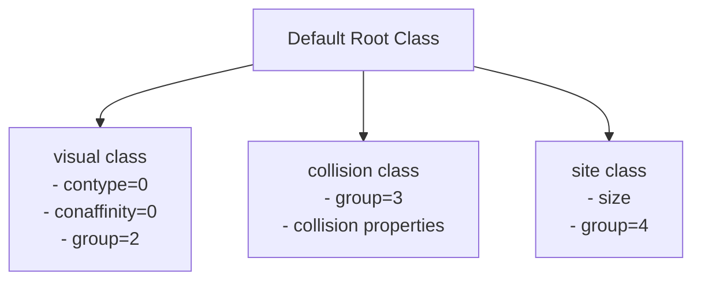
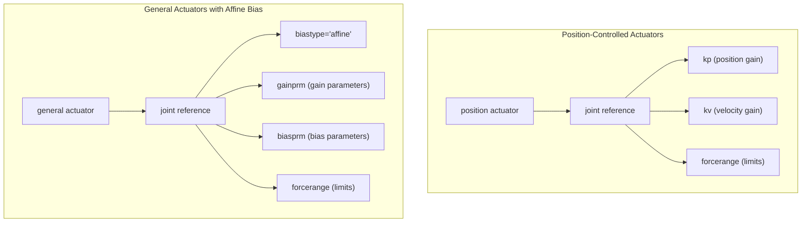
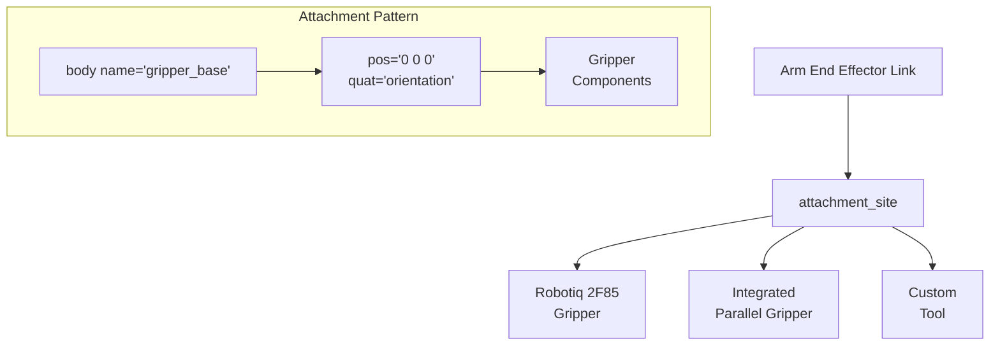

<!-- source: DeepWiki mcp.deepwiki.com · repo google-deepmind/mujoco_menagerie · page 4 Manipulator Arms · fetched 2026-10-26 -->

# Manipulator Arms

<details>
<summary>Relevant source files</summary>

The following files were used as context for generating this wiki page:

- [agilex_piper/README.md](agilex_piper/README.md)
- [agilex_piper/piper.xml](agilex_piper/piper.xml)
- [agilex_piper/scene.xml](agilex_piper/scene.xml)
- [franka_fr3/LICENSE](franka_fr3/LICENSE)
- [franka_fr3/README.md](franka_fr3/README.md)
- [franka_fr3/assets/link0.obj](franka_fr3/assets/link0.obj)
- [franka_fr3/assets/link0.stl](franka_fr3/assets/link0.stl)
- [franka_fr3/assets/link0_0.obj](franka_fr3/assets/link0_0.obj)
- [franka_fr3/assets/link0_1.obj](franka_fr3/assets/link0_1.obj)
- [franka_fr3/assets/link0_2.obj](franka_fr3/assets/link0_2.obj)
- [franka_fr3/assets/link0_3.obj](franka_fr3/assets/link0_3.obj)
- [franka_fr3/assets/link0_4.obj](franka_fr3/assets/link0_4.obj)
- [franka_fr3/fr3.xml](franka_fr3/fr3.xml)
- [kinova_gen3/LICENSE](kinova_gen3/LICENSE)
- [kinova_gen3/README.md](kinova_gen3/README.md)
- [kinova_gen3/assets/base_link.stl](kinova_gen3/assets/base_link.stl)
- [kinova_gen3/assets/bracelet_no_vision_link.stl](kinova_gen3/assets/bracelet_no_vision_link.stl)
- [kinova_gen3/assets/bracelet_with_vision_link.stl](kinova_gen3/assets/bracelet_with_vision_link.stl)
- [kinova_gen3/assets/forearm_link.stl](kinova_gen3/assets/forearm_link.stl)
- [kinova_gen3/assets/half_arm_1_link.stl](kinova_gen3/assets/half_arm_1_link.stl)
- [kinova_gen3/assets/half_arm_2_link.stl](kinova_gen3/assets/half_arm_2_link.stl)
- [kinova_gen3/assets/shoulder_link.stl](kinova_gen3/assets/shoulder_link.stl)
- [kinova_gen3/gen3.xml](kinova_gen3/gen3.xml)
- [trs_so_arm100/LICENSE](trs_so_arm100/LICENSE)
- [trs_so_arm100/README.md](trs_so_arm100/README.md)
- [trs_so_arm100/assets/Base.stl](trs_so_arm100/assets/Base.stl)
- [trs_so_arm100/assets/Base_Motor.stl](trs_so_arm100/assets/Base_Motor.stl)
- [trs_so_arm100/assets/Fixed_Jaw.stl](trs_so_arm100/assets/Fixed_Jaw.stl)
- [trs_so_arm100/assets/Fixed_Jaw_Collision_1.stl](trs_so_arm100/assets/Fixed_Jaw_Collision_1.stl)
- [trs_so_arm100/assets/Fixed_Jaw_Collision_2.stl](trs_so_arm100/assets/Fixed_Jaw_Collision_2.stl)
- [trs_so_arm100/assets/Fixed_Jaw_Motor.stl](trs_so_arm100/assets/Fixed_Jaw_Motor.stl)
- [trs_so_arm100/assets/Lower_Arm.stl](trs_so_arm100/assets/Lower_Arm.stl)
- [trs_so_arm100/assets/Lower_Arm_Motor.stl](trs_so_arm100/assets/Lower_Arm_Motor.stl)
- [trs_so_arm100/assets/Moving_Jaw.stl](trs_so_arm100/assets/Moving_Jaw.stl)
- [ufactory_lite6/README.md](ufactory_lite6/README.md)
- [ufactory_lite6/lite6.xml](ufactory_lite6/lite6.xml)
- [ufactory_lite6/lite6_gripper_narrow.xml](ufactory_lite6/lite6_gripper_narrow.xml)
- [ufactory_lite6/lite6_gripper_wide.xml](ufactory_lite6/lite6_gripper_wide.xml)
- [ufactory_xarm7/hand.xml](ufactory_xarm7/hand.xml)
- [ufactory_xarm7/xarm7.xml](ufactory_xarm7/xarm7.xml)
- [ufactory_xarm7/xarm7_nohand.xml](ufactory_xarm7/xarm7_nohand.xml)
- [universal_robots_ur10e/README.md](universal_robots_ur10e/README.md)
- [universal_robots_ur10e/scene.xml](universal_robots_ur10e/scene.xml)
- [universal_robots_ur10e/ur10e.png](universal_robots_ur10e/ur10e.png)
- [universal_robots_ur10e/ur10e.xml](universal_robots_ur10e/ur10e.xml)
- [universal_robots_ur5e/ur5e.xml](universal_robots_ur5e/ur5e.xml)

</details>


This document provides a comprehensive overview of the robot arm models available in the MuJoCo Menagerie repository. It covers the structure, configuration, and key features of various industrial and research manipulator arms, including their XML implementation details, actuation methods, and integration patterns. For information about grippers that can be paired with these arms, see [Grippers and Hands](#5).

## General Architecture

Manipulator arms in the MuJoCo Menagerie share a common architectural pattern while representing different commercial robot models. They typically follow a sequential kinematic chain of links connected by rotational joints, starting from a fixed base and ending with an attachment site for end-effectors.

### Common Components and Structure



Sources: [universal_robots_ur5e/ur5e.xml](), [universal_robots_ur10e/ur10e.xml](), [ufactory_xarm7/xarm7.xml]()

The manipulator arms in the collection typically feature either 6 or 7 degrees of freedom (DOF):



Sources: [franka_fr3/fr3.xml](), [ufactory_xarm7/xarm7.xml](), [kinova_gen3/gen3.xml]()

## XML Structure and Implementation

All robot arm models in the collection adhere to common MuJoCo MJCF structure patterns with standardized component organization.

### Default Classes

The models use default classes to establish common properties for visual and collision geometries:



Sources: [universal_robots_ur10e/ur10e.xml:28-37](), [franka_fr3/fr3.xml:7-17]()

### Actuator Types

Two primary actuator approaches are used in the manipulator arm models:



Sources: [universal_robots_ur10e/ur10e.xml:134-140](), [franka_fr3/fr3.xml:147-155](), [ufactory_xarm7/xarm7.xml:188-197]()

## Available Manipulator Arm Models

The MuJoCo Menagerie includes several manipulator arm models with varying characteristics. The table below provides a comparison of their key features:

| Arm Model | DOF | Actuator Type | File Path | Notable Features |
|-----------|-----|---------------|-----------|------------------|
| Universal Robots UR5e | 6 | General with affine bias | universal_robots_ur5e/ur5e.xml | Industrial collaborative robot |
| Universal Robots UR10e | 6 | General with affine bias | universal_robots_ur10e/ur10e.xml | Higher payload capacity (10kg) |
| uFactory xArm7 | 7 | General with affine bias | ufactory_xarm7/xarm7.xml | Modular arm with optional gripper |
| uFactory Lite6 | 6 | Position controlled | ufactory_lite6/lite6.xml | Compact with interchangeable grippers |
| Franka FR3 | 7 | Position controlled | franka_fr3/fr3.xml | Research-oriented collaborative arm |
| AgileX PiPER | 6 | Position controlled | agilex_piper/piper.xml | Integrated gripper design |
| Kinova Gen3 | 7 | Position controlled | kinova_gen3/gen3.xml | Integrated wrist camera |

### Universal Robots Series (UR5e, UR10e)

The Universal Robots UR5e and UR10e are widely used industrial collaborative robot arms with 6 DOF. Their joint structure follows the standard industrial 6-axis configuration.

Key implementation details:
- General actuators with affine bias control for accurate industrial motion
- Separate size classes for different joint sizes with appropriate force ranges
- Default joint range of ±6.28319 radians (±360°)
- Carefully designed collision geometries for accurate physics simulation

```xml
<general class="size3_limited" name="elbow" joint="elbow_joint"/>
```

Sources: [universal_robots_ur10e/ur10e.xml:133-140]()

### uFactory Arms (xArm7, Lite6)

The uFactory line includes both a 7-DOF arm (xArm7) and a more compact 6-DOF arm (Lite6).

#### xArm7
- 7 DOF configuration similar to human arm
- Available in versions with or without integrated gripper
- Three size classes for different joint sizes with appropriate actuation parameters

```xml
<general name="act1" joint="joint1" class="size1"/>
<general name="act2" joint="joint2" class="size1" ctrlrange="-2.059 2.0944"/>
```

Sources: [ufactory_xarm7/xarm7.xml:188-197](), [ufactory_xarm7/xarm7_nohand.xml:94-101]()

#### Lite6
- Compact 6 DOF arm with multiple gripper options
- Position-controlled actuators with size-specific force ranges
- Available with wide or narrow gripper configurations

```xml
<position joint="joint1" class="size1" ctrlrange="-6.28319 6.28319"/>
```

Sources: [ufactory_lite6/lite6.xml:102-108](), [ufactory_lite6/lite6_gripper_wide.xml:136-143](), [ufactory_lite6/lite6_gripper_narrow.xml:126-134]()

### Franka Robotics FR3

The Franka FR3 is a 7-DOF research-oriented collaborative robot arm with advanced capabilities:

- 7 DOF configuration with joint ranges chosen for human-like workspace
- Position-controlled actuators with carefully tuned parameters
- Detailed visual mesh with multiple materials for realistic appearance
- Specific joint force ranges that match the physical robot's capabilities

```xml
<position class="fr3" name="fr3_joint1" joint="fr3_joint1" kp="4500" kv="450"/>
```

Sources: [franka_fr3/fr3.xml:147-155]()

### AgileX PiPER

The AgileX PiPER is a 6-DOF arm with an integrated two-finger gripper:

- Position-controlled joints with joint-specific gains
- Built-in parallel gripper with synchronized finger movement
- Equality constraint to coordinate gripper finger movement

```xml
<position name="joint1" joint="joint1" class="piper" kp="80" kv="5"/>
<position name="gripper" joint="joint7" class="finger" kp="40" kv="5"/>
```

Sources: [agilex_piper/piper.xml:262-269]()

### Kinova Gen3

The Kinova Gen3 is a 7-DOF research robot with an integrated wrist camera:

- Two actuator classes for different joint sizes (large_actuator and small_actuator)
- Multiple predefined keyframe positions (home and retract)
- Camera positioned at the wrist for visual feedback
- Carefully tuned joint limits for specific joints

```xml
<position class="large_actuator" name="joint_1" joint="joint_1"/>
<position class="small_actuator" name="joint_7" joint="joint_7"/>
```

Sources: [kinova_gen3/gen3.xml:94-102]()

## Integration with Grippers

The manipulator arms provide standardized attachment sites for connecting grippers or tools:



Sources: [universal_robots_ur10e/ur10e.xml:123](), [ufactory_xarm7/xarm7.xml:155-156](), [franka_fr3/fr3.xml:135]()

Most arms define an `attachment_site` at the end of the final link. For example, in the Universal Robots UR10e:

```xml
<site name="attachment_site" pos="0 0.1 0" quat="-1 1 0 0"/>
```

Integrated grippers (like in the uFactory xArm7) often use equality constraints to synchronize finger movements:

```xml
<equality>
    <joint joint1="left_driver_joint" joint2="right_driver_joint" polycoef="0 1 0 0 0"/>
</equality>
```

Sources: [ufactory_xarm7/xarm7.xml:184](), [agilex_piper/piper.xml:259]()

## XML Structure Patterns

### Body-Joint Hierarchy

All manipulator arms follow a consistent body-joint-body pattern for building the kinematic chain:

```xml
<body name="link1">
  <joint name="joint1" axis="0 0 1" range="min max"/>
  <geom class="visual" mesh="link1"/>
  <geom class="collision" type="capsule" size="..."/>
  <body name="link2">
    <!-- Next link in chain -->
  </body>
</body>
```

Sources: [universal_robots_ur10e/ur10e.xml:71-129](), [franka_fr3/fr3.xml:69-144]()

### Material and Visual Definitions

Many models use custom materials for realistic appearance:

```xml
<material class="ur10e" name="black" rgba="0.033 0.033 0.033 1"/>
<material class="ur10e" name="jointgray" rgba="0.278 0.278 0.278 1"/>
<material class="ur10e" name="linkgray" rgba="0.82 0.82 0.82 1"/>
<material class="ur10e" name="urblue" rgba="0.49 0.678 0.8 1"/>
```

Sources: [universal_robots_ur10e/ur10e.xml:42-45](), [franka_fr3/fr3.xml:21-27]()

### Keyframe Definitions

Predefined poses are stored using keyframes:

```xml
<keyframe>
  <key name="home" qpos="joint1_pos joint2_pos ..." ctrl="ctrl1 ctrl2 ..."/>
</keyframe>
```

Sources: [universal_robots_ur10e/ur10e.xml:142-144](), [franka_fr3/fr3.xml:157-159](), [agilex_piper/piper.xml:272-274]()

## Usage Patterns

### Basic Integration

To use a manipulator arm in a MuJoCo simulation scene:

1. Include the arm model in your scene file:
```xml
<include file="ur10e.xml"/>
```

2. Add a ground plane and other environment elements:
```xml
<geom name="floor" size="0 0 0.05" type="plane" material="groundplane"/>
```

### Controller Integration

When controlling the arms in simulation:

1. For position-controlled actuators, directly set the control values:
```python
# Set the joint positions for a 6-DOF arm
sim.data.ctrl[:6] = [0, -1.57, 1.57, -1.57, -1.57, 0]
```

2. For general actuators with affine bias, use the defined control ranges:
```python
# Check the control range and set within limits
ctrl_range = model.actuator_ctrlrange
sim.data.ctrl[0] = min(max(target_pos, ctrl_range[0][0]), ctrl_range[0][1])
```

### Gripper Attachment

When attaching a gripper to an arm:

1. Use the attachment site for correct positioning:
```xml
<body pos="attachment_site_pos" quat="attachment_site_quat">
  <!-- Gripper components -->
</body>
```

2. Match the control schemes for compatibility between arm and gripper.

## Common Design Patterns

The manipulator arm models demonstrate several recurring design patterns:

1. **Default Class Hierarchy**: Using nested default classes to define common properties for components of similar types and sizes
2. **Visual-Collision Separation**: Separating visual and collision geometries into different groups
3. **Force Range Scaling**: Defining appropriate force ranges based on joint size and position in the kinematic chain
4. **Attachment Standardization**: Using consistent attachment site definitions for interoperability with various end effectors

These patterns ensure consistency and interoperability across the manipulator arm models in the MuJoCo Menagerie.

---

