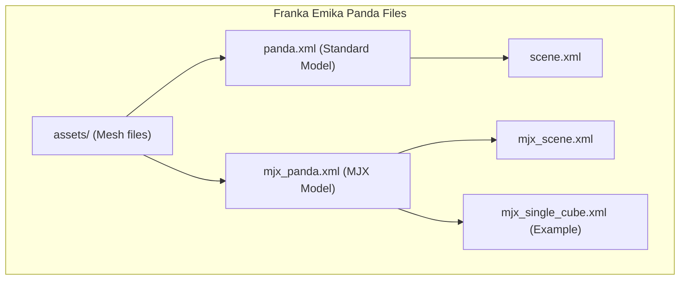
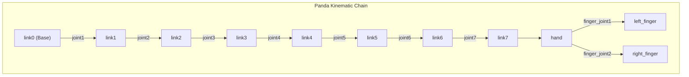
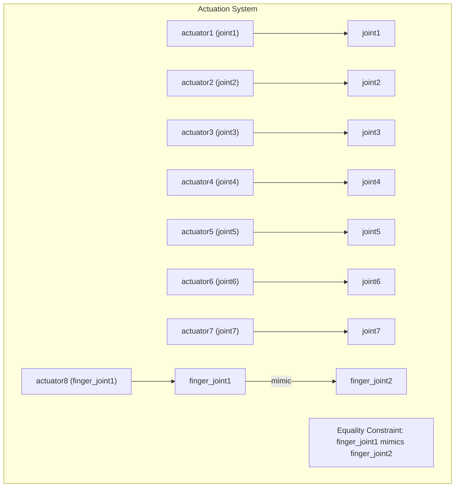
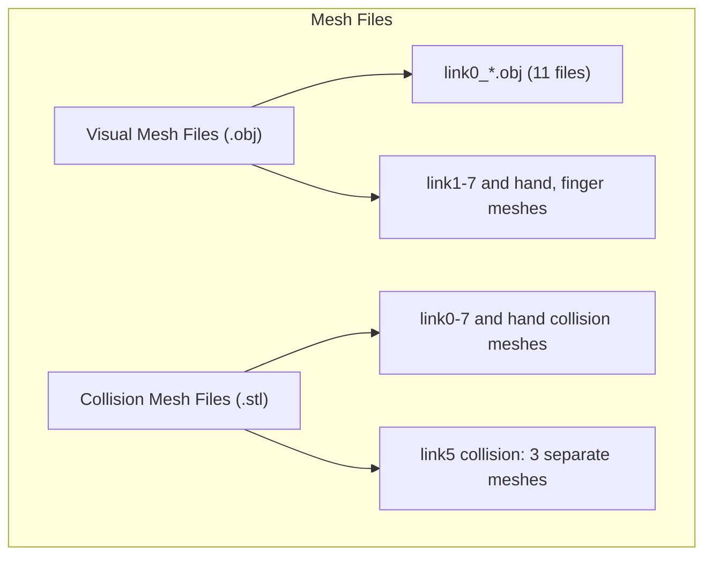
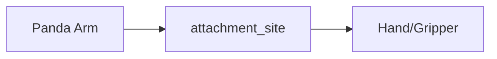

<!-- source: DeepWiki mcp.deepwiki.com · repo google-deepmind/mujoco_menagerie · page 4.1 Franka Emika Panda · fetched 2026-10-26 -->

# Franka Emika Panda

<details>
<summary>Relevant source files</summary>

The following files were used as context for generating this wiki page:

- [CONTRIBUTING.md](CONTRIBUTING.md)
- [FAQ.md](FAQ.md)
- [franka_emika_panda/README.md](franka_emika_panda/README.md)
- [franka_emika_panda/mjx_panda.xml](franka_emika_panda/mjx_panda.xml)
- [franka_emika_panda/mjx_scene.xml](franka_emika_panda/mjx_scene.xml)
- [franka_emika_panda/mjx_single_cube.xml](franka_emika_panda/mjx_single_cube.xml)

</details>


This page documents the Franka Emika Panda robot arm model implemented in MuJoCo Menagerie. It covers the model's structure, components, implementation details, and usage patterns. This documentation is specific to the MuJoCo implementation of the Franka Emika Panda model. For information about other manipulator arms in the collection, see [Manipulator Arms](#4).

## 1. Overview

The Franka Emika Panda is a 7-degree-of-freedom (7-DOF) robot arm with a two-finger gripper, designed for research and industrial applications. The MuJoCo implementation is derived from the publicly available URDF description by Franka Emika. The model requires MuJoCo 2.3.3 or later.

Sources: [franka_emika_panda/README.md:1-11]()

## 2. Model Structure

The Panda model includes both standard MuJoCo and MJX-compatible versions. Each has a corresponding scene file for visualization and testing.



Sources: [franka_emika_panda/README.md:43-52](), [franka_emika_panda/mjx_scene.xml:1-3](), [franka_emika_panda/mjx_single_cube.xml:1-2]()

## 3. Kinematic Structure

The Panda arm has 7 revolute joints, plus 2 prismatic joints for the gripper fingers. The kinematic chain follows a serial structure from base to end-effector.



Sources: [franka_emika_panda/mjx_panda.xml:118-253]()

## 4. Joint Configuration

The Panda arm has specific joint ranges and dynamic properties defined in the model:

| Joint Name | Type | Axis | Range (radians) | Damping |
|------------|------|------|-----------------|---------|
| joint1     | revolute | Z | -2.8973 to 2.8973 | 40 |
| joint2     | revolute | Z | -1.7628 to 1.7628 | 40 |
| joint3     | revolute | Z | -2.8973 to 2.8973 | 40 |
| joint4     | revolute | Z | -3.0718 to -0.0698 | 40 |
| joint5     | revolute | Z | -2.8973 to 2.8973 | 2 |
| joint6     | revolute | Z | -0.0175 to 3.7525 | 2 |
| joint7     | revolute | Z | -2.8973 to 2.8973 | 2 |
| finger_joint1 | prismatic | Y | 0 to 0.04 | 10 |
| finger_joint2 | prismatic | Y | 0 to 0.04 | 10 |

Sources: [franka_emika_panda/mjx_panda.xml:7-8](), [franka_emika_panda/mjx_panda.xml:138-144](), [franka_emika_panda/mjx_panda.xml:159-169](), [franka_emika_panda/mjx_panda.xml:178-200](), [franka_emika_panda/mjx_panda.xml:224-236]()

## 5. Actuation System

The model uses position actuators for all joints. The arm joints use direct position control, while the gripper fingers use a mimic joint constraint.



Sources: [franka_emika_panda/mjx_panda.xml:255-257](), [franka_emika_panda/mjx_panda.xml:259-275]()

## 6. Gripper System

The Panda gripper consists of two parallel fingers that move symmetrically. In the standard model, a tendon is used to distribute force equally between fingers, while in MJX version, a direct position actuator is used with equality constraints:

| Feature | Standard Model | MJX Model |
|---------|---------------|-----------|
| Control Method | Tendon with position actuator | Direct joint actuation |
| Finger Movement | Synchronized via equality constraint | Synchronized via equality constraint |
| Collision Geometry | Detailed multi-box representation | Simplified geometry for performance |

Sources: [franka_emika_panda/README.md:51-52](), [franka_emika_panda/mjx_panda.xml:217-243](), [franka_emika_panda/mjx_panda.xml:255-257]()

## 7. MJX Version Modifications

The MJX-compatible version includes several optimizations for better performance with JAX-based simulation:

1. Simplified collision geometries, especially in the gripper
2. Added capsule collision geometry to the hand
3. Modified solver parameters for performance
4. Reduced actuator gains (`kp` and `kv`) for more stable simulation
5. Removed tendon in favor of direct joint actuation for the gripper
6. Added a site to the gripper for easier manipulation

Sources: [franka_emika_panda/README.md:43-52](), [franka_emika_panda/mjx_panda.xml:217-221]()

## 8. Mesh Assets

The model uses a combination of visual and collision meshes:



Sources: [franka_emika_panda/mjx_panda.xml:47-116]()

## 9. Usage Patterns

### 9.1 Basic Scene Setup

To use the Panda model in a simulation:

1. Include either `panda.xml` (standard) or `mjx_panda.xml` (MJX-optimized)
2. Create a scene configuration with proper lighting and ground plane
3. Configure the initial joint positions

### 9.2 Attaching End-Effectors

The arm includes an attachment site for connecting custom end-effectors:



The standard method for attaching a hand to the arm is via the `attachment_site` as described in the FAQ:

```python
def attach_hand_to_arm(arm_mjcf, hand_mjcf):
    # Find attachment site on arm
    attachment_site = arm_mjcf.find("site", "attachment_site")
    
    # Handle keyframes and controller expansion
    # [...]
    
    # Attach hand to arm
    attachment_site.attach(hand_mjcf)
```

Sources: [FAQ.md:1-49]()

### 9.3 Example: Object Manipulation

The `mjx_single_cube.xml` file demonstrates a simple object manipulation setup:

1. Includes the Panda model with a standard scene
2. Adds a cube object for manipulation
3. Defines keyframes for different robot poses:
   - `home`: Default position
   - `pickup`: Position for grasping an object
   - `pickup1`: Another position in the manipulation sequence

Sources: [franka_emika_panda/mjx_single_cube.xml:1-26]()

## 10. Technical Specifications

The complete technical specifications of the model:

| Property | Value |
|----------|-------|
| Total DOF | 9 (7 arm + 2 gripper) |
| Number of Bodies | 11 |
| Number of Geoms | 70+ (visual and collision) |
| Number of Actuators | 8 |
| Mass Distribution | Realistically modeled based on manufacturer data |
| Compatible MuJoCo Version | 2.3.3+ |
| MJX Compatible | Yes, with optimizations |

Sources: [franka_emika_panda/README.md:1-57](), [franka_emika_panda/mjx_panda.xml:1-277]()

---

