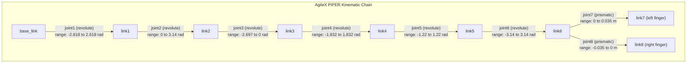
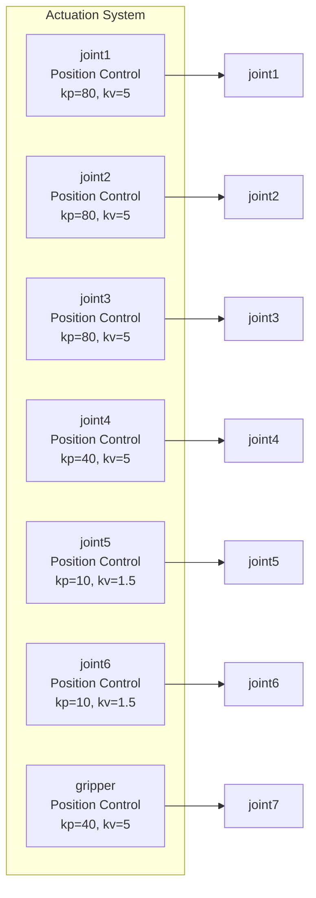
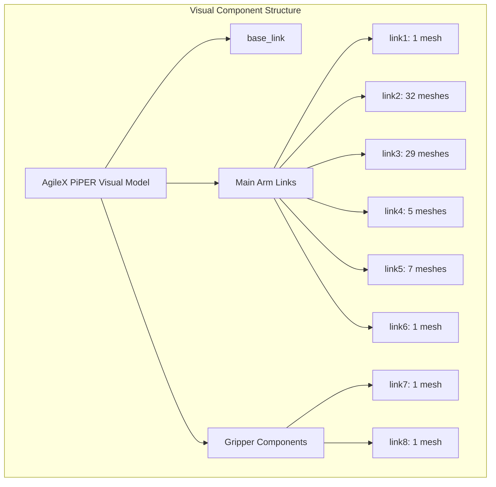

<!-- source: DeepWiki mcp.deepwiki.com · repo google-deepmind/mujoco_menagerie · page 4.2 AgileX PiPER · fetched 2026-10-26 -->

# AgileX PiPER

<details>
<summary>Relevant source files</summary>

The following files were used as context for generating this wiki page:

- [agilex_piper/README.md](agilex_piper/README.md)
- [agilex_piper/piper.xml](agilex_piper/piper.xml)
- [agilex_piper/scene.xml](agilex_piper/scene.xml)

</details>


## Purpose and Scope

This document provides technical documentation for the AgileX PiPER robot arm model implemented in MuJoCo Menagerie. It covers the model's structure, kinematic chain, actuation system, and implementation details. This page focuses specifically on the MuJoCo implementation and simulation aspects of the model, not the physical hardware operation.

Sources: [agilex_piper/README.md:1-11]()

## Model Overview

The AgileX PiPER is a 6-DOF robotic manipulator with a parallel gripper end effector. The model has been derived from the publicly available URDF model in the [AgileX ROS repository](https://github.com/agilexrobotics/Piper_ros/tree/ros-noetic-no-aloha/src/piper_description/urdf) and converted to MuJoCo's MJCF format with several optimizations for physics simulation.

The model features:
- 6 revolute joints for the main arm articulation
- 2 prismatic joints for the parallel gripper
- Position-controlled actuators for each joint
- Optimized collision geometry
- Synchronized gripper fingers via an equality constraint

Sources: [agilex_piper/README.md:5-11](), [agilex_piper/piper.xml:1-5]()

## Kinematic Structure

The AgileX PiPER has a serial kinematic chain with 6 main joints plus a gripper mechanism. The diagram below illustrates the robot's kinematic structure:



Sources: [agilex_piper/piper.xml:120-252]()

### Joint Configuration

The table below provides detailed information about each joint in the kinematic chain:

| Joint Name | Type     | Range (rad/m)     | Axis      | Parent Link | Child Link |
|------------|----------|-------------------|-----------|-------------|------------|
| joint1     | Revolute | -2.618 to 2.618  | [0 0 1]   | base_link   | link1      |
| joint2     | Revolute | 0 to 3.14        | [0 0 1]   | link1       | link2      |
| joint3     | Revolute | -2.697 to 0      | [0 0 1]   | link2       | link3      |
| joint4     | Revolute | -1.832 to 1.832  | [0 0 1]   | link3       | link4      |
| joint5     | Revolute | -1.22 to 1.22    | [0 0 1]   | link4       | link5      |
| joint6     | Revolute | -3.14 to 3.14    | [0 0 1]   | link5       | link6      |
| joint7     | Prismatic| 0 to 0.035       | [0 0 -1]  | link6       | link7      |
| joint8     | Prismatic| -0.035 to 0      | [0 0 1]   | link6       | link8      |

Sources: [agilex_piper/piper.xml:128-241]()

## Actuation System

The PiPER model uses position-controlled actuators for each joint, with different gain parameters depending on the joint location in the kinematic chain.



A notable feature is the gripper control mechanism. Although the gripper has two fingers (link7 and link8), it's controlled through a single actuator attached to joint7 (the left finger). The right finger (joint8) mirrors the position of the left finger through an equality constraint, creating synchronized parallel gripper behavior.

Sources: [agilex_piper/piper.xml:262-270](), [agilex_piper/piper.xml:258-260]()

## Physical Properties

### Collision Geometry

The model uses a mixed approach for collision detection:
- Main robot body: Simplified mesh-based collision geometries derived from the visual meshes
- Gripper fingers: Custom box collision geometries for better contact handling

### Gravity Compensation

All bodies in the model have gravity compensation enabled through the `gravcomp="1"` attribute, which helps stabilize the arm in simulation.

### Contact Handling

The model includes an explicit contact exclusion between the base_link and link1 to prevent any collision detection between these adjacent links:

```xml
<contact>
  <exclude body1="base_link" body2="link1"/>
</contact>
```

Additionally, the model uses MuJoCo's elliptic friction cones and increased `impratio` value (10) for better no-slip contacts, important for stable gripper interactions.

Sources: [agilex_piper/piper.xml:4](), [agilex_piper/piper.xml:120-252](), [agilex_piper/piper.xml:254-256]()

## Implementation Details

### Visual Model

The visual model uses a large number of mesh files to create a detailed representation of the robot:



The model uses multiple materials to create a visually accurate representation of the robot, including gray, light gray, dark gray, red, white, and black components.

Sources: [agilex_piper/piper.xml:24-33](), [agilex_piper/piper.xml:34-115]()

### MuJoCo-Specific Optimizations

Several MuJoCo-specific optimizations have been applied to the model:

1. Implicit fast integrator with elliptic friction cones and increased `impratio` for stability:
   ```xml
   <option integrator="implicitfast" cone="elliptic" impratio="10"/>
   ```

2. Default classes for consistent joint, visual, and collision properties:
   ```xml
   <default class="piper">
     <joint frictionloss="0.3" armature="0.005"/>
     <position inheritrange="1" forcerange="-100 100"/>
     ...
   </default>
   ```

3. Gripper synchronization using an equality constraint:
   ```xml
   <equality>
     <joint joint1="joint8" joint2="joint7" polycoef="0 -1 0 0 0"/>
   </equality>
   ```

Sources: [agilex_piper/piper.xml:4](), [agilex_piper/piper.xml:6-21](), [agilex_piper/piper.xml:258-260]()

## Usage Examples

### Default Pose

The model includes a pre-defined home position keyframe:

```xml
<keyframe>
  <key name="home" qpos="0 1.57 -1.3485 0 0 0 0 0 " ctrl="0 1.57 -1.3485 0 0 0 0"/>
</keyframe>
```

This configuration places the arm in a neutral upright position with the gripper closed.

Sources: [agilex_piper/piper.xml:272-274]()

### Scene Configuration

The model is accompanied by a scene file (`scene.xml`) that sets up the simulation environment with:
- An included reference to the robot model
- A textured ground plane
- Appropriate lighting and skybox
- Camera position settings

This provides a complete ready-to-use simulation environment for the PiPER robot.

Sources: [agilex_piper/scene.xml:1-23]()

## Derivation Process

The model was converted from URDF to MJCF through several steps:
1. Preservation of visual geometries during URDF import
2. Conversion of OBJ files to MJCF-compatible XML with color information
3. Creation of default sections for common properties
4. Addition of gripper equality constraints
5. Manual design of collision geometries
6. Addition of contact exclusions and actuators
7. Physics parameter optimization

Sources: [agilex_piper/README.md:13-26]()

---

