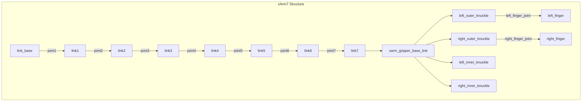
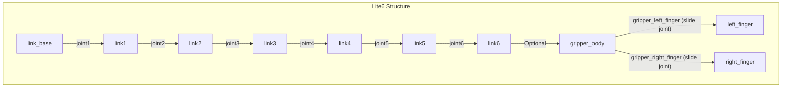
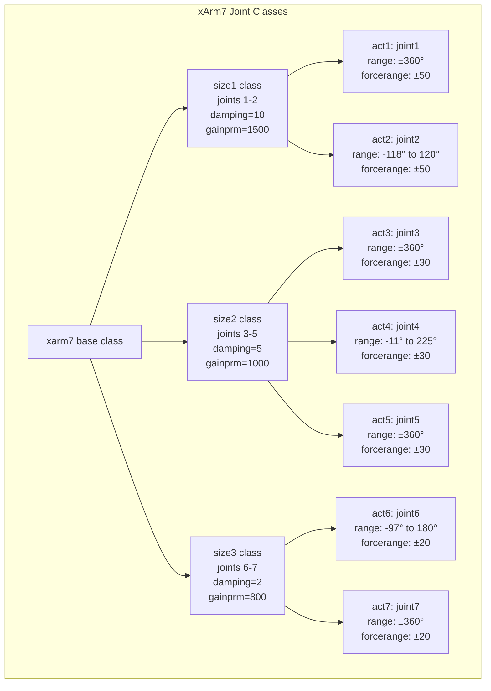
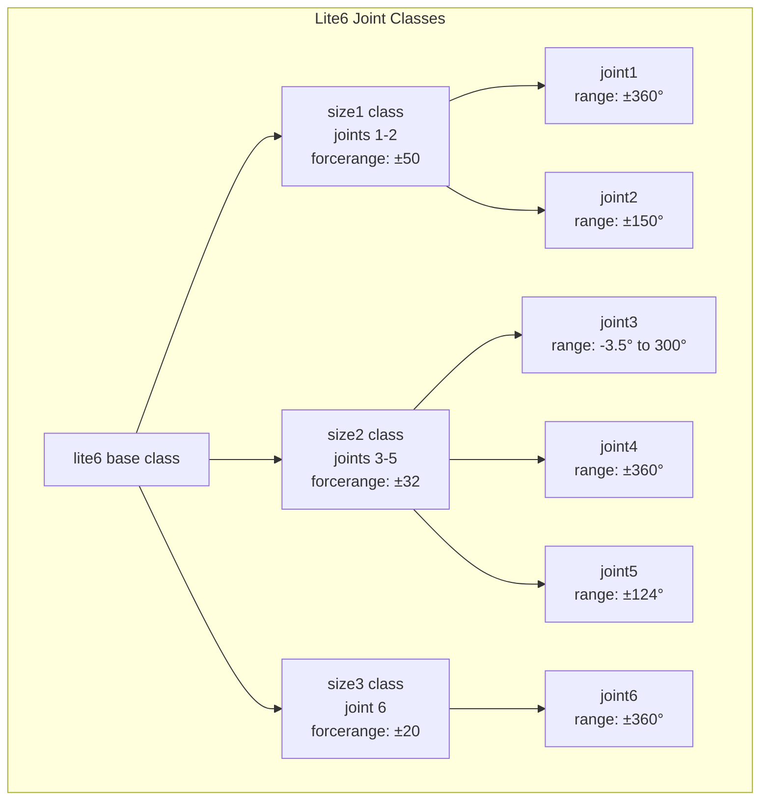
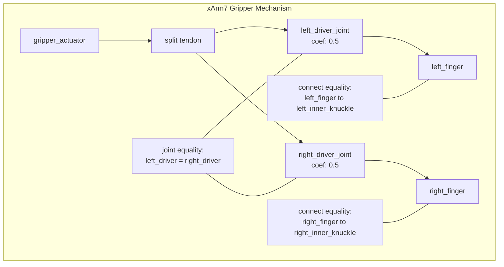
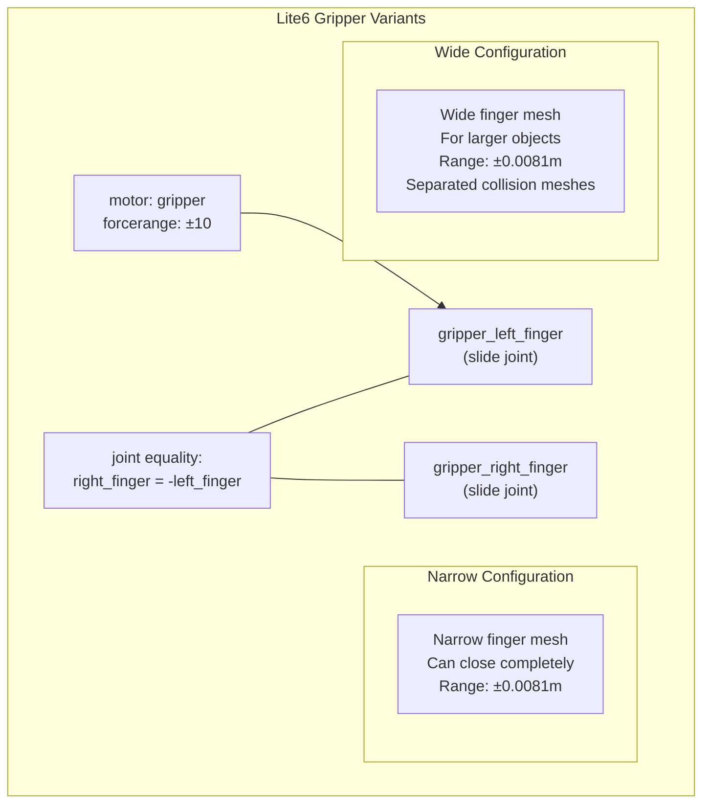

<!-- source: DeepWiki mcp.deepwiki.com · repo google-deepmind/mujoco_menagerie · page 4.3 uFactory Arms · fetched 2026-10-26 -->

# uFactory Arms

Relevant source files

The following files were used as context for generating this wiki page:

- [ufactory_lite6/README.md](ufactory_lite6/README.md)
- [ufactory_lite6/lite6.xml](ufactory_lite6/lite6.xml)
- [ufactory_lite6/lite6_gripper_narrow.xml](ufactory_lite6/lite6_gripper_narrow.xml)
- [ufactory_lite6/lite6_gripper_wide.xml](ufactory_lite6/lite6_gripper_wide.xml)
- [ufactory_xarm7/hand.xml](ufactory_xarm7/hand.xml)
- [ufactory_xarm7/xarm7.xml](ufactory_xarm7/xarm7.xml)
- [ufactory_xarm7/xarm7_nohand.xml](ufactory_xarm7/xarm7_nohand.xml)

## Purpose and Scope

This document provides technical documentation for the uFactory robotic arm models in the MuJoCo Menagerie repository. It covers two specific robot arm models:

1. uFactory xArm7: A 7 degrees of freedom (DoF) robotic manipulator with an integrated gripper
2. uFactory Lite6: A 6 DoF robotic manipulator with optional gripper configurations

Both models are provided as MuJoCo XML (MJCF) files and are designed for physics-based simulation in MuJoCo.

Sources: [ufactory_xarm7/xarm7.xml](), [ufactory_lite6/lite6.xml]()

## Model Overview

### uFactory xArm7

The xArm7 is a 7-joint robotic arm with an optional parallel gripper. The model includes detailed physical properties including mass, inertia, joint limits, and actuator parameters.

#### Model Variants

The xArm7 is available in two configurations:
1. **With integrated gripper**: Full arm with two-finger parallel gripper
2. **Without gripper**: Arm only with an attachment site for custom end effectors

Sources: [ufactory_xarm7/xarm7.xml](), [ufactory_xarm7/xarm7_nohand.xml]()

### uFactory Lite6

The Lite6 is a 6-joint robotic arm available in three configurations:
1. **No gripper**: Base model with an attachment site
2. **Wide gripper**: Includes a gripper with fingers configured for gripping larger objects
3. **Narrow gripper**: Includes a gripper with fingers that can close completely for smaller objects

Sources: [ufactory_lite6/lite6.xml](), [ufactory_lite6/lite6_gripper_wide.xml](), [ufactory_lite6/lite6_gripper_narrow.xml](), [ufactory_lite6/README.md]()

## Kinematic Structure

### xArm7 Kinematic Chain

Sources: [ufactory_xarm7/xarm7.xml:71-165]()

### Lite6 Kinematic Chain

Sources: [ufactory_lite6/lite6.xml:50-98](), [ufactory_lite6/lite6_gripper_wide.xml:60-132]()

## Joint Parameters and Actuation

### xArm7 Joint Specifications

The xArm7 uses a hierarchical class structure for joint parameters, with three different size classes that specify different damping and actuation parameters:

Sources: [ufactory_xarm7/xarm7.xml:29-46](), [ufactory_xarm7/xarm7.xml:187-196]()

### Lite6 Joint Specifications

Similar to the xArm7, the Lite6 uses a hierarchical class structure with three size classes:

Sources: [ufactory_lite6/lite6.xml:6-27](), [ufactory_lite6/lite6.xml:136-142]()

## Gripper Mechanisms

### xArm7 Gripper

The xArm7 gripper is a parallel gripper with a coordinated mechanism:

1. **Finger coordination**: Uses a fixed tendon with split actuation across both fingers
2. **Contact handling**: Uses contact exclusions to prevent self-collisions
3. **Actuation**: Single gripper actuator controls both fingers through the tendon

Sources: [ufactory_xarm7/xarm7.xml:174-196](), [ufactory_xarm7/hand.xml:108-123]()

### Lite6 Grippers

The Lite6 offers two gripper configurations that use a different mechanism:

1. **Sliding motion**: Uses slide joints instead of revolute joints
2. **Mirrored action**: Uses joint equality to ensure fingers move symmetrically
3. **Control**: Single motor actuator with equality constraint

Sources: [ufactory_lite6/lite6_gripper_wide.xml:106-147](), [ufactory_lite6/lite6_gripper_narrow.xml:102-138](), [ufactory_lite6/README.md:11-28]()

## Technical Details

### xArm7 Specifications

| Component | Parameter | Value |
|-----------|-----------|-------|
| Integrator | | implicitfast |
| Joint 1 | Range | ±6.28319 rad (±360°) |
| | Actuation | general, gainprm=1500, forcerange=±50 |
| Joint 2 | Range | -2.059 to 2.0944 rad (-118° to 120°) |
| | Actuation | general, gainprm=1500, forcerange=±50 |
| Joint 3 | Range | ±6.28319 rad (±360°) |
| | Actuation | general, gainprm=1000, forcerange=±30 |
| Joint 4 | Range | -0.19198 to 3.927 rad (-11° to 225°) |
| | Actuation | general, gainprm=1000, forcerange=±30 |
| Joint 5 | Range | ±6.28319 rad (±360°) |
| | Actuation | general, gainprm=1000, forcerange=±30 |
| Joint 6 | Range | -1.69297 to 3.14159 rad (-97° to 180°) |
| | Actuation | general, gainprm=800, forcerange=±20 |
| Joint 7 | Range | ±6.28319 rad (±360°) |
| | Actuation | general, gainprm=800, forcerange=±20 |
| Gripper | Control range | 0 to 255 |
| | Force range | ±50 |
| | Joint range | 0 to 0.85 rad |

Sources: [ufactory_xarm7/xarm7.xml:29-46](), [ufactory_xarm7/xarm7.xml:187-196]()

### Lite6 Specifications

| Component | Parameter | Value |
|-----------|-----------|-------|
| Integrator | | implicitfast |
| Joint 1 | Range | ±6.28319 rad (±360°) |
| | Actuation | position, forcerange=±50 |
| Joint 2 | Range | ±2.61799 rad (±150°) |
| | Actuation | position, forcerange=±50 |
| Joint 3 | Range | -0.061087 to 5.23599 rad (-3.5° to 300°) |
| | Actuation | position, forcerange=±32 |
| Joint 4 | Range | ±6.28319 rad (±360°) |
| | Actuation | position, forcerange=±32 |
| Joint 5 | Range | ±2.1642 rad (±124°) |
| | Actuation | position, forcerange=±32 |
| Joint 6 | Range | ±6.28319 rad (±360°) |
| | Actuation | position, forcerange=±20 |
| Gripper (optional) | Control range | ±10 |
| | Force range | ±10 |
| | Joint range | ±0.0081 m (slide) |

Sources: [ufactory_lite6/lite6.xml:6-27](), [ufactory_lite6/lite6.xml:136-142](), [ufactory_lite6/lite6_gripper_wide.xml:142-147]()

## Predefined Configurations

Both robots include predefined keyframe positions:

### xArm7 Home Position
- Joint positions: `0 -0.247 0 0.909 0 1.15644 0`
- With gripper: `0 -0.247 0 0.909 0 1.15644 0 0 0 0 0 0 0`

Sources: [ufactory_xarm7/xarm7.xml:199-201](), [ufactory_xarm7/xarm7_nohand.xml:103-105]()

### Lite6 Home Position
- Joint positions: `0 0 1.57 0 1.57 0`
- With gripper: `0 0 1.57 0 1.57 0 0 0`

Sources: [ufactory_lite6/lite6.xml:110-112](), [ufactory_lite6/lite6_gripper_wide.xml:149-151]()

## Usage Notes

### Model Selection

1. For applications requiring a 7-DOF arm with higher payload capacity and larger workspace, use the xArm7 model.
2. For applications requiring a more compact 6-DOF arm, use the Lite6 model.
3. The choice of gripper configuration depends on the objects being manipulated:
   - No gripper: For custom end effectors
   - Wide gripper (Lite6): For larger objects
   - Narrow gripper (Lite6): For smaller objects that require complete closure

### Gripper Actuation

- xArm7 gripper: Uses a general actuator with `ctrlrange` from 0 to 255
- Lite6 gripper: Uses a direct motor actuator with `ctrlrange` from -10 to 10

Sources: [ufactory_xarm7/xarm7.xml:195-196](), [ufactory_lite6/lite6_gripper_wide.xml:142](), [ufactory_lite6/lite6_gripper_narrow.xml:133]()

## URDF to MJCF Conversion

The Lite6 model was derived from the publicly available URDF description with the following steps:

1. Preservation of visual geometries during conversion
2. Manual editing to extract common properties into the `<default>` section
3. Addition of actuators
4. Creation of separate collision meshes for improved simulation performance

For the gripper models, additional processing was required:
1. Separation of finger components from fused bodies
2. Creation of slide joints for finger movement
3. Addition of equality constraints for synchronized movement

Sources: [ufactory_lite6/README.md:30-47]()

---

