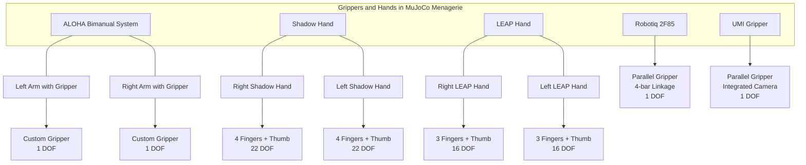
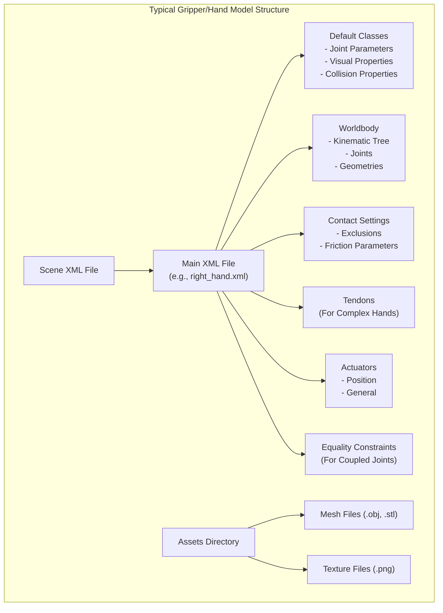
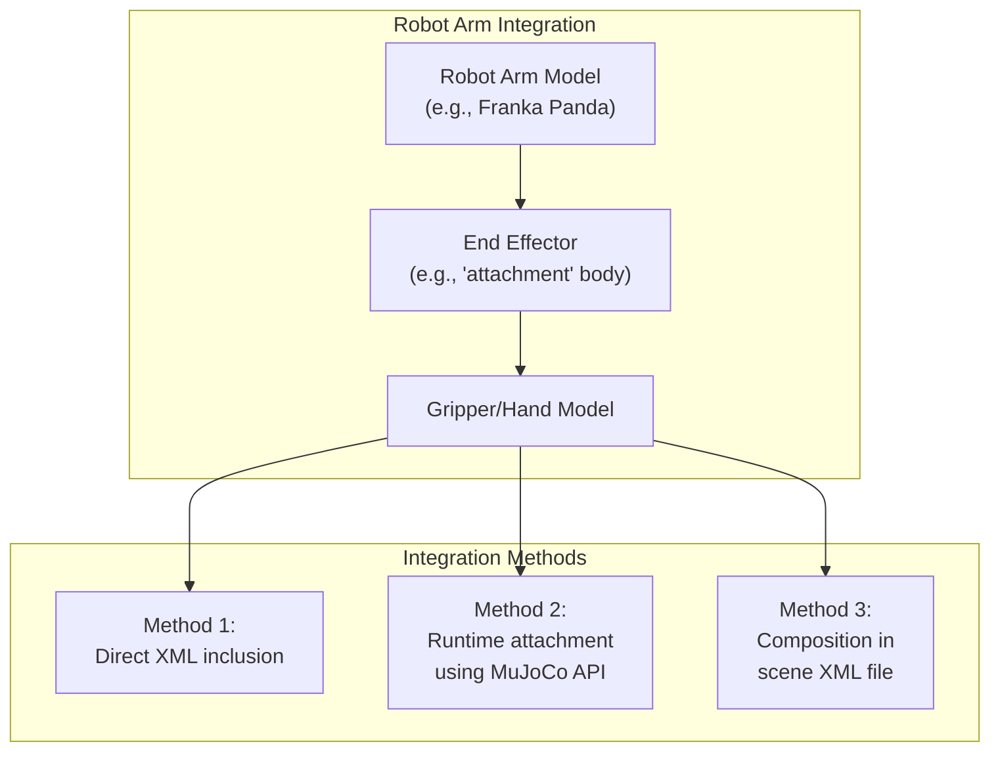
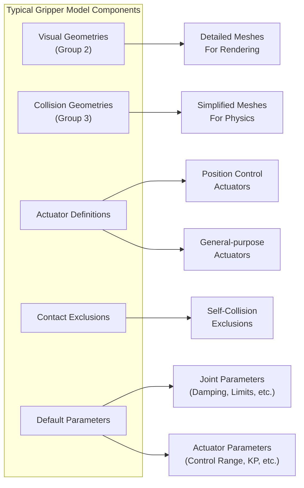

<!-- source: DeepWiki mcp.deepwiki.com · repo google-deepmind/mujoco_menagerie · page 5 Grippers and Hands · fetched 2026-10-26 -->

# Grippers and Hands

<details>
<summary>Relevant source files</summary>

The following files were used as context for generating this wiki page:

- [agility_cassie/cassie.xml](agility_cassie/cassie.xml)
- [aloha/README.md](aloha/README.md)
- [aloha/aloha.xml](aloha/aloha.xml)
- [aloha/filtered_cartesian_actuators.xml](aloha/filtered_cartesian_actuators.xml)
- [aloha/joint_position_actuators.xml](aloha/joint_position_actuators.xml)
- [aloha/keyframe_ctrl.xml](aloha/keyframe_ctrl.xml)
- [aloha/keyframe_no_act.xml](aloha/keyframe_no_act.xml)
- [aloha/mjx_aloha.patch](aloha/mjx_aloha.patch)
- [aloha/mjx_filtered_cartesian_actuators.patch](aloha/mjx_filtered_cartesian_actuators.patch)
- [aloha/mjx_scene.patch](aloha/mjx_scene.patch)
- [aloha/scene.xml](aloha/scene.xml)
- [anybotics_anymal_b/anymal_b.xml](anybotics_anymal_b/anymal_b.xml)
- [anybotics_anymal_c/anymal_c.xml](anybotics_anymal_c/anymal_c.xml)
- [franka_emika_panda/hand.xml](franka_emika_panda/hand.xml)
- [franka_emika_panda/panda.xml](franka_emika_panda/panda.xml)
- [franka_emika_panda/panda_nohand.xml](franka_emika_panda/panda_nohand.xml)
- [leap_hand/README.md](leap_hand/README.md)
- [leap_hand/assets/palm_left.obj](leap_hand/assets/palm_left.obj)
- [leap_hand/assets/thumb_mp_left.obj](leap_hand/assets/thumb_mp_left.obj)
- [leap_hand/left_hand.xml](leap_hand/left_hand.xml)
- [leap_hand/right_hand.png](leap_hand/right_hand.png)
- [leap_hand/scene_left.xml](leap_hand/scene_left.xml)
- [robotiq_2f85/2f85.xml](robotiq_2f85/2f85.xml)
- [robotiq_2f85/scene.xml](robotiq_2f85/scene.xml)
- [shadow_hand/left_hand.xml](shadow_hand/left_hand.xml)
- [shadow_hand/right_hand.xml](shadow_hand/right_hand.xml)
- [shadow_hand/shadow_hand.png](shadow_hand/shadow_hand.png)
- [umi_gripper/assets/left_finger.stl](umi_gripper/assets/left_finger.stl)
- [umi_gripper/assets/left_finger_holder.stl](umi_gripper/assets/left_finger_holder.stl)
- [umi_gripper/assets/right_finger.stl](umi_gripper/assets/right_finger.stl)
- [umi_gripper/assets/right_finger_holder.stl](umi_gripper/assets/right_finger_holder.stl)
- [umi_gripper/scene.xml](umi_gripper/scene.xml)
- [umi_gripper/umi_gripper.xml](umi_gripper/umi_gripper.xml)
- [unitree_a1/a1.xml](unitree_a1/a1.xml)

</details>


This page provides documentation on the various robotic grippers and hand models available in the MuJoCo Menagerie repository. These models are designed to be physically accurate representations that can be used for simulation in the MuJoCo physics engine. The models range from simple parallel grippers to complex anthropomorphic hands with multiple degrees of freedom.

## Model Overview

The MuJoCo Menagerie repository includes the following gripper and hand models:

- **ALOHA Bimanual System**: A complete two-arm system with custom grippers
- **Shadow Hand**: A highly articulated anthropomorphic hand (left and right versions)
- **LEAP Hand**: A simplified anthropomorphic hand from Carnegie Mellon University
- **Robotiq 2F85**: An industrial parallel gripper
- **UMI Gripper**: A parallel gripper with built-in camera and positioning capabilities

Each model is implemented as a standalone MJCF (MuJoCo XML) file with its associated assets (meshes, textures) and can be integrated with robot arms or used independently.



Sources: [shadow_hand/right_hand.xml](), [shadow_hand/left_hand.xml](), [leap_hand/left_hand.xml](), [robotiq_2f85/2f85.xml](), [umi_gripper/umi_gripper.xml](), [aloha/aloha.xml]()

## Common Structure

The gripper and hand models follow a common structure, with model-specific variations:



Sources: [shadow_hand/right_hand.xml](), [robotiq_2f85/2f85.xml](), [umi_gripper/umi_gripper.xml](), [leap_hand/left_hand.xml]()

### Key Components

1. **Default Classes**: Define reusable parameters for joints, geometries, and other elements
2. **Asset Definitions**: Meshes, textures, and materials
3. **Worldbody Structure**: Hierarchical arrangement of bodies, joints, and geometries
4. **Contact Settings**: Define collision behavior between components
5. **Tendon Definitions**: For complex hands, define coupled joint movements
6. **Actuator Definitions**: Define how the gripper or hand is controlled
7. **Equality Constraints**: Couple joint movements (e.g., for parallel grippers)

## Model Details

### ALOHA Bimanual System

The ALOHA (A Low-cost Open-source Haptic Array) is a bimanual robot system consisting of two arms with custom grippers. It is derived from the ViperX 300 6DOF model.

Key features:
- Two identical arms with 6 DOF each
- Custom grippers at the end of each arm
- Parallel jaw gripper design with linear actuator
- Equality constraints between left and right gripper fingers
- Integrated cameras (overhead, worms-eye, and wrist cameras)

The ALOHA gripper uses a single actuator to control both fingers, which are coupled through an equality constraint:

```xml
<equality>
  <joint joint1="left/left_finger" joint2="left/right_finger" polycoef="0 1 0 0 0"/>
  <joint joint1="right/left_finger" joint2="right/right_finger" polycoef="0 1 0 0 0"/>
</equality>
```

The system has multiple actuation modes:
1. Joint position control via `joint_position_actuators.xml`
2. Cartesian control via `filtered_cartesian_actuators.xml`
3. Specialized MJX-compatible actuation via `mjx_filtered_cartesian_actuators.xml`

Sources: [aloha/aloha.xml](), [aloha/README.md](), [aloha/joint_position_actuators.xml](), [aloha/filtered_cartesian_actuators.xml](), [aloha/mjx_filtered_cartesian_actuators.patch]()

### Shadow Hand

The Shadow Hand is a highly articulated anthropomorphic robotic hand available in both left and right-hand versions. It features 22 degrees of freedom and closely mimics human hand capabilities.

Key features:
- 5 fingers including an opposable thumb
- Complex joint hierarchy with 22 DOF
- Tendon-based coupling between joints
- Detailed collision and visual geometries
- Realistic joint limits and dynamics

The hand's kinematic structure includes:
- Wrist: 2 DOF (WRJ1, WRJ2)
- Thumb: 5 DOF (THJ1-THJ5)
- Index finger: 4 DOF (FFJ1-FFJ4)
- Middle finger: 4 DOF (MFJ1-MFJ4)
- Ring finger: 4 DOF (RFJ1-RFJ4)
- Little finger: 5 DOF (LFJ1-LFJ5, including metacarpal movement)

The hand uses tendons to couple the movement of middle and distal joints:

```xml
<tendon>
  <fixed name="rh_FFJ0">
    <joint joint="rh_FFJ2" coef="1"/>
    <joint joint="rh_FFJ1" coef="1"/>
  </fixed>
  <!-- Similar tendons for other fingers -->
</tendon>
```

Sources: [shadow_hand/right_hand.xml](), [shadow_hand/left_hand.xml]()

### LEAP Hand

The LEAP (Low-cost, Efficient, and Anthropomorphic) Hand is a robotic hand developed by Carnegie Mellon University. The MuJoCo Menagerie includes simplified versions derived from the publicly available URDF descriptions.

Key features:
- Available in left and right-hand versions
- 3 fingers plus an opposable thumb (16 DOF total)
- Simplified design compared to Shadow Hand
- Includes joint sensors for each DOF
- Realistic finger and thumb joint limits

The LEAP hand has the following joint structure:
- Index finger: 4 DOF (MCP, ROT, PIP, DIP)
- Middle finger: 4 DOF (MCP, ROT, PIP, DIP)
- Ring finger: 4 DOF (MCP, ROT, PIP, DIP)
- Thumb: 4 DOF (CMC, AXL, MCP, IPL)

Each joint has position actuators with appropriate control ranges:

```xml
<actuator>
  <!-- index -->
  <position name="if_mcp_act" joint="if_mcp" class="mcp" />
  <position name="if_rot_act" joint="if_rot" class="rot" />
  <position name="if_pip_act" joint="if_pip" class="pip" />
  <position name="if_dip_act" joint="if_dip" class="dip" />
  <!-- Similar actuators for other fingers -->
</actuator>
```

Sources: [leap_hand/left_hand.xml](), [leap_hand/README.md]()

### Robotiq 2F85 Gripper

The Robotiq 2F85 is an industrial parallel gripper with a 4-bar linkage mechanism that provides parallel movement of the gripper fingers.

Key features:
- 85mm stroke parallel gripper
- 4-bar linkage mechanism
- Single actuator controlling both fingers
- Spring elements for compliance
- Realistic friction parameters for the finger pads

The 4-bar linkage mechanism is implemented using coupled joints and equality constraints:

```xml
<equality>
  <connect anchor="0 0 0" body1="right_follower" body2="right_coupler" solimp="0.95 0.99 0.001" solref="0.005 1"/>
  <connect anchor="0 0 0" body1="left_follower" body2="left_coupler" solimp="0.95 0.99 0.001" solref="0.005 1"/>
  <joint joint1="right_driver_joint" joint2="left_driver_joint" polycoef="0 1 0 0 0" solimp="0.95 0.99 0.001"
    solref="0.005 1"/>
</equality>
```

The gripper uses a single actuator that controls both fingers through a tendon system:

```xml
<tendon>
  <fixed name="split">
    <joint joint="right_driver_joint" coef="0.5"/>
    <joint joint="left_driver_joint" coef="0.5"/>
  </fixed>
</tendon>
```

Sources: [robotiq_2f85/2f85.xml](), [robotiq_2f85/scene.xml]()

### UMI Gripper

The UMI Gripper is a parallel gripper with integrated cameras and visual markers. It has positional and rotational control capabilities.

Key features:
- Parallel gripper design
- Built-in camera ("gripper_gopro")
- ArUco marker stickers for visual tracking
- 6 DOF positioning capability (3 translation, 3 rotation)
- Single DOF gripper control

The UMI gripper has positional and rotational joints for placement:

```xml
<!-- Positional Joints -->
<joint name="gripper_joint_x" axis="1 0 0" class="gripper_slide" />
<joint name="gripper_joint_y" axis="0 0 1" class="gripper_slide" />
<joint name="gripper_joint_z" axis="0 -1 0" class="gripper_slide" />

<!-- Rotational Joints -->
<joint name="gripper_joint_rx" axis="1 0 0" class="gripper_hinge" />
<joint name="gripper_joint_ry" axis="0 0 1" class="gripper_hinge" />
<joint name="gripper_joint_rz" axis="0 -1 0" class="gripper_hinge" />
```

Sources: [umi_gripper/umi_gripper.xml](), [umi_gripper/scene.xml]()

## Integration with Robot Arms

The gripper and hand models can be integrated with robot arms to form complete manipulators. The typical integration pattern involves attaching the gripper/hand to the end-effector of a robot arm.



Sources: [franka_emika_panda/panda.xml](), [franka_emika_panda/hand.xml](), [franka_emika_panda/panda_nohand.xml]()

### Integration Examples

1. **Franka Panda with Hand**: The Franka Emika Panda arm includes a simple parallel gripper. The gripper is defined in `hand.xml` and can be included in the main `panda.xml` or used separately.

2. **ALOHA Bimanual System**: The ALOHA system's XML defines both the arms and the grippers in a single file, with equality constraints coupling the fingers of each gripper.

3. **Standalone Gripper/Hand**: Models like the Shadow Hand or Robotiq 2F85 can be used standalone in a scene or attached to compatible robot arms at runtime.

## Simulation Considerations

When using these gripper and hand models, there are several important simulation considerations:

1. **Contact Settings**: Properly configured collision geometries and contact parameters are essential for realistic grasping behavior.

2. **Joint Limits and Actuator Ranges**: Each model defines appropriate joint limits and actuator control ranges that match the physical capabilities of the real hardware.

3. **MJX Compatibility**: Some models have specialized MJX-compatible versions (e.g., `mjx_aloha.xml`) that are optimized for the JAX-based MuJoCo engine.

4. **Visual vs. Collision Geometries**: Most models separate visual and collision geometries, with simplified collision meshes for computational efficiency.



Sources: [robotiq_2f85/2f85.xml](), [shadow_hand/right_hand.xml](), [leap_hand/left_hand.xml](), [umi_gripper/umi_gripper.xml](), [aloha/mjx_aloha.patch]()

## Common Usage Patterns

The gripper and hand models support several common usage patterns:

1. **Position Control**: Most models use position actuators to control the joint angles or finger positions.

2. **Coupled Movements**: Tendons or equality constraints are used to couple joint movements (e.g., coupled closing of gripper fingers).

3. **Scene Creation**: Scene XML files (e.g., `scene.xml`) are used to place the grippers in a simulation environment with objects to manipulate.

4. **Integration with Arms**: Grippers can be attached to compatible robot arms either directly in XML or at runtime.

5. **Keyframe Poses**: Some models define keyframe poses for standard configurations (e.g., open/closed gripper).

---

