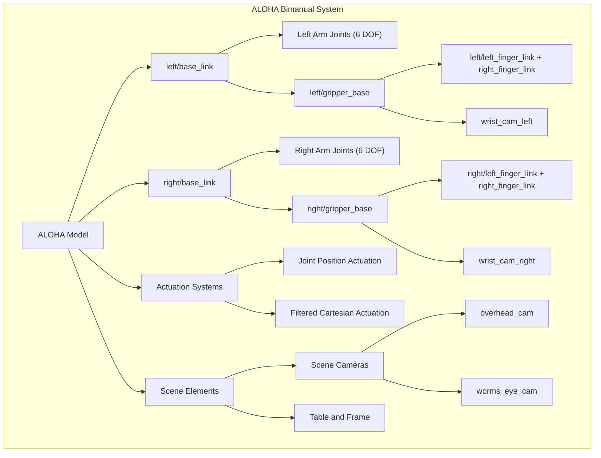
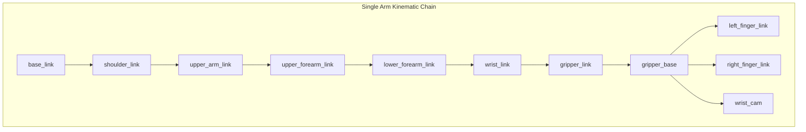
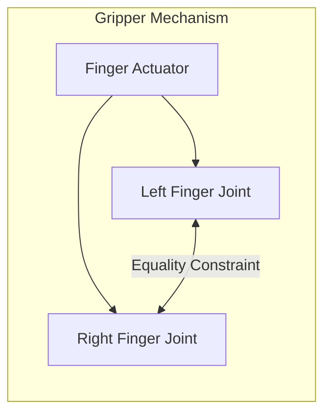
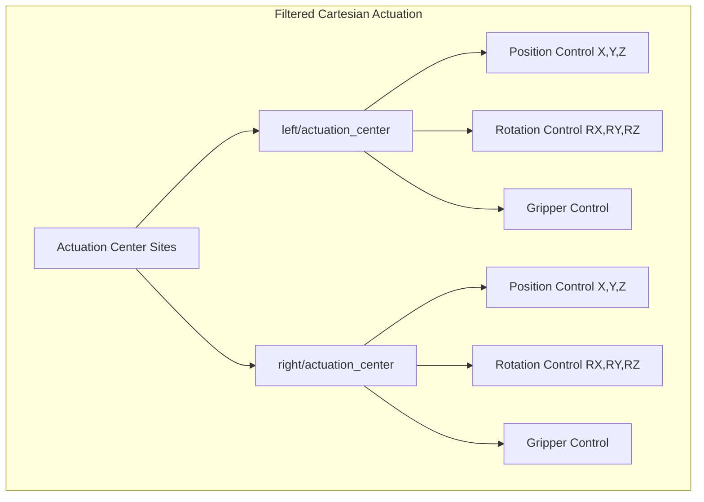
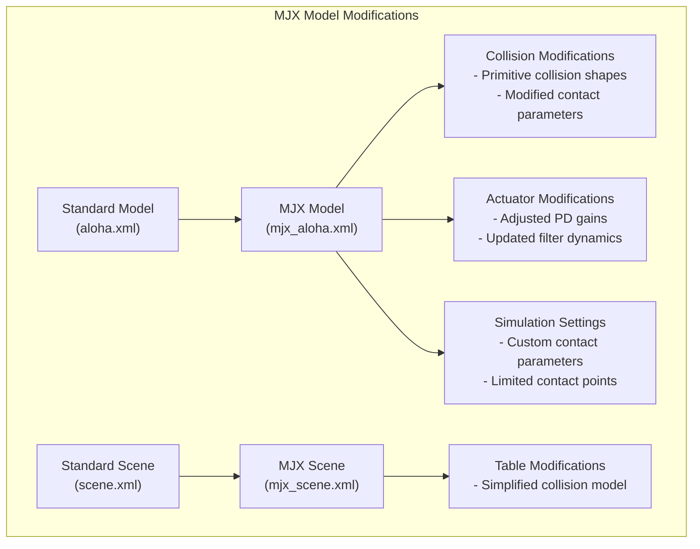

<!-- source: DeepWiki mcp.deepwiki.com · repo google-deepmind/mujoco_menagerie · page 5.1 ALOHA Bimanual System · fetched 2026-10-26 -->

# ALOHA Bimanual System

<details>
<summary>Relevant source files</summary>

The following files were used as context for generating this wiki page:

- [aloha/README.md](aloha/README.md)
- [aloha/aloha.xml](aloha/aloha.xml)
- [aloha/filtered_cartesian_actuators.xml](aloha/filtered_cartesian_actuators.xml)
- [aloha/joint_position_actuators.xml](aloha/joint_position_actuators.xml)
- [aloha/keyframe_ctrl.xml](aloha/keyframe_ctrl.xml)
- [aloha/keyframe_no_act.xml](aloha/keyframe_no_act.xml)
- [aloha/mjx_aloha.patch](aloha/mjx_aloha.patch)
- [aloha/mjx_filtered_cartesian_actuators.patch](aloha/mjx_filtered_cartesian_actuators.patch)
- [aloha/mjx_scene.patch](aloha/mjx_scene.patch)
- [aloha/scene.xml](aloha/scene.xml)

</details>


This document provides detailed technical documentation of the ALOHA Bimanual System as implemented in the MuJoCo Menagerie repository. It covers the bimanual robot model structure, components, actuation systems, and simulation configurations. This documentation focuses on the MJCF model representation rather than the physical robot hardware details.

Sources: [aloha/README.md:1-42]()

## 1. System Overview

The ALOHA Bimanual System is a dual-arm robotic platform consisting of two Trossen ViperX 300 6DOF arms arranged in a face-to-face configuration, with custom grippers for manipulation tasks. The model requires MuJoCo 3.1.1 or later and includes:

- Two identical 6-DOF robot arms (left and right) derived from the ViperX 300
- Custom grippers with specialized finger designs
- Multiple simulated cameras for visual sensing
- Various actuation models for different control approaches
- Modeled mounting frame and table for realistic workspace simulation

The system provides implementations for both standard MuJoCo and MJX (JAX-based MuJoCo) compatibility.

### System Architecture Diagram



Sources: [aloha/aloha.xml:1-290](), [aloha/scene.xml:1-90]()

## 2. Model Components and Structure

The ALOHA model consists of two mirrored ViperX 300 robot arms with a kinematic chain that includes the base, shoulder, upper arm, forearm, wrist, and gripper components.

### 2.1 Kinematic Chain

Each arm follows this kinematic structure:



Sources: [aloha/aloha.xml:95-275]()

### 2.2 Joint Configuration

The ALOHA system has 14 actuated joints (7 per arm including gripper), with the following configuration:

| Joint Type | Joint Name Pattern | Axis | Range | Description |
|------------|-------------------|------|-------|-------------|
| Waist | `{left/right}/waist` | `0 0 1` | `-3.14158 3.14158` | Base rotation |
| Shoulder | `{left/right}/shoulder` | `0 1 0` | `-1.85005 1.25664` | Shoulder joint |
| Elbow | `{left/right}/elbow` | `0 1 0` | `-1.76278 1.6057` | Elbow joint |
| Forearm Roll | `{left/right}/forearm_roll` | `1 0 0` | `-3.14158 3.14158` | Forearm rotation |
| Wrist Angle | `{left/right}/wrist_angle` | `0 1 0` | `-1.8675 2.23402` | Wrist bending |
| Wrist Rotate | `{left/right}/wrist_rotate` | `1 0 0` | `-3.14158 3.14158` | Wrist rotation |
| Finger | `{left/right}/{left/right}_finger` | `0 0 -1` | `0 0.041` | Gripper finger position |

Sources: [aloha/aloha.xml:24-93]()

### 2.3 Gripper Mechanism

The ALOHA system features custom grippers with two key characteristics:

1. **Linear Actuation**: The gripper fingers move along a linear rail with a range of 0 to 0.041 meters from the center.
2. **Synchronized Movement**: Left and right fingers are coupled via an equality constraint ensuring symmetrical movement.

The finger control range (0.002m to 0.037m) represents the software limits on the real robot, while the joint range (0 to 0.041m) represents the physical limits of the rail system.



Sources: [aloha/aloha.xml:51-82](), [aloha/aloha.xml:283-286]()

## 3. Actuation Systems

The ALOHA model provides two different actuation approaches, each designed for different control scenarios.

### 3.1 Joint Position Actuators

The simplest actuation system directly controls joint positions. This is defined in the `joint_position_actuators.xml` file and provides:

- Direct control of individual joint angles
- 14 total actuators (7 per arm)
- Individual PD control gains for each joint type

Sources: [aloha/joint_position_actuators.xml:1-20]()

### 3.2 Filtered Cartesian Actuators

The more sophisticated actuation system uses Cartesian space control with filtering for smoother motion. This is defined in the `filtered_cartesian_actuators.xml` file and provides:

- End-effector position and orientation control in Cartesian space
- Filtered dynamics for smoother trajectories
- Gripper actuation
- Separate actuation centers for left and right arms

This system uses MuJoCo's general actuator type with filterexact dynamics for improved control characteristics.



Sources: [aloha/filtered_cartesian_actuators.xml:1-54]()

## 4. Sensor Configuration

The ALOHA system includes multiple cameras for visual perception during simulation.

### 4.1 Camera Placements

| Camera Name | Position | Purpose | Resolution |
|-------------|----------|---------|------------|
| `teleoperator_pov` | `0 -1.354 0.685` | Operator's view | 1280×720 |
| `collaborator_pov` | `0 1.5 0.8` | Collaborator's view | 1280×720 |
| `wrist_cam_left` | On left gripper | Left wrist view | 1280×720 |
| `wrist_cam_right` | On right gripper | Right wrist view | 1280×720 |
| `overhead_cam` | `0 -0.303794 1.02524` | Overhead scene view | 1280×720 |
| `worms_eye_cam` | `0 -0.377167 0.0316055` | Bottom-up scene view | 1280×720 |

All cameras use parameters that match Intel RealSense D405 camera specifications with a focal length of 1.93e-3 and sensor size of 3896e-6 × 2140e-6.

Sources: [aloha/aloha.xml:98-99](), [aloha/aloha.xml:152-153](), [aloha/aloha.xml:240-241](), [aloha/scene.xml:54-57]()

## 5. MJX Compatibility

The model includes MJX (JAX-based MuJoCo) compatible versions with specific modifications for improved performance and stability in the JAX environment.

### 5.1 Key Modifications for MJX

The main changes for MJX compatibility include:

1. **Collision Model Refinements**: 
   - Added primitive collision geometry (capsules) to supplement mesh-based collision
   - Modified collision types and parameters
   - Simplified contact dynamics

2. **Actuator Parameter Adjustments**:
   - Modified PD control gains
   - Adjusted filter dynamics parameters
   - Updated actuator control ranges

3. **Simulation Settings**:
   - Removed elliptic cone option
   - Adjusted impratio from 10 to 5
   - Added custom contact visualization settings
   - Set maximum number of contact points to 12



Sources: [aloha/mjx_aloha.patch:1-123](), [aloha/mjx_scene.patch:1-39]()

## 6. Usage Examples

The ALOHA model includes predefined keyframes for initializing the robot in useful poses, such as the neutral pose.

### 6.1 Neutral Pose Configuration

The neutral pose positions both arms in a ready configuration with the following joint angles:

```
qpos: 0 -0.96 1.16 0 -0.3 0 0.0084 0.0084 (for each arm)
```

This represents a configuration where both arms are slightly bent at the elbow and the grippers are in a slightly open position.

Sources: [aloha/keyframe_ctrl.xml:1-11](), [aloha/keyframe_no_act.xml:1-8]()

## 7. Development and Modifications

The ALOHA model was derived from the ViperX 300 6DOF model with several key modifications:

1. **Dual-Arm Configuration**: Duplicated the robot tree to create left and right arms
2. **Custom Gripper Design**: Replaced default gripper with the ALOHA 2 design
3. **System Identification**: Tuned actuator gains and joint parameters using real trajectory data
4. **Frame and Environment**: Added mounting frame and table environment
5. **Sensor Configuration**: Added multiple cameras with realistic parameters

Sources: [aloha/README.md:14-24]()

## 8. Licensing and Citation

The ALOHA model is released under a BSD-3-Clause License. When using this model in academic or research work, proper citation should be provided as specified in the README.

Sources: [aloha/README.md:26-41]()

---

