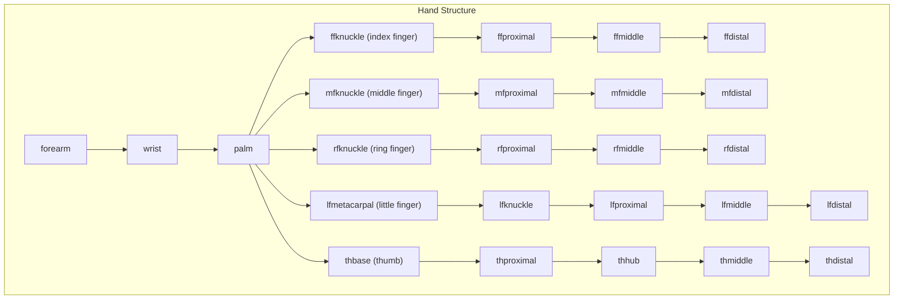
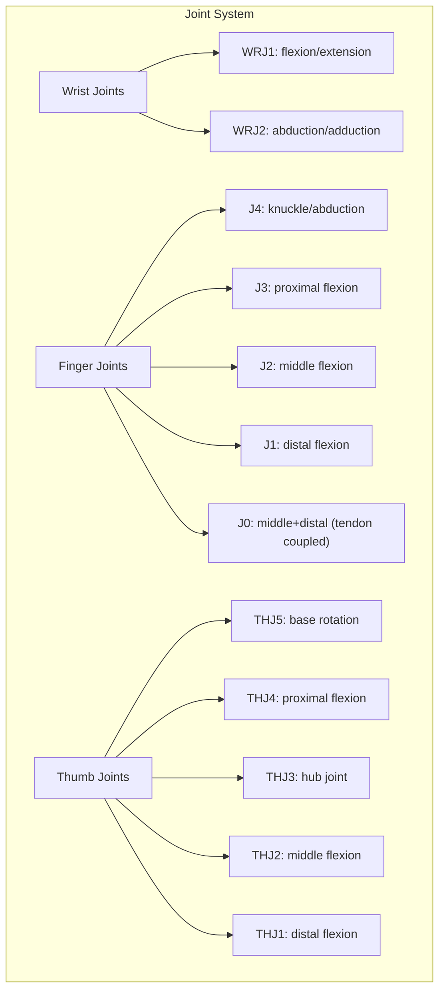
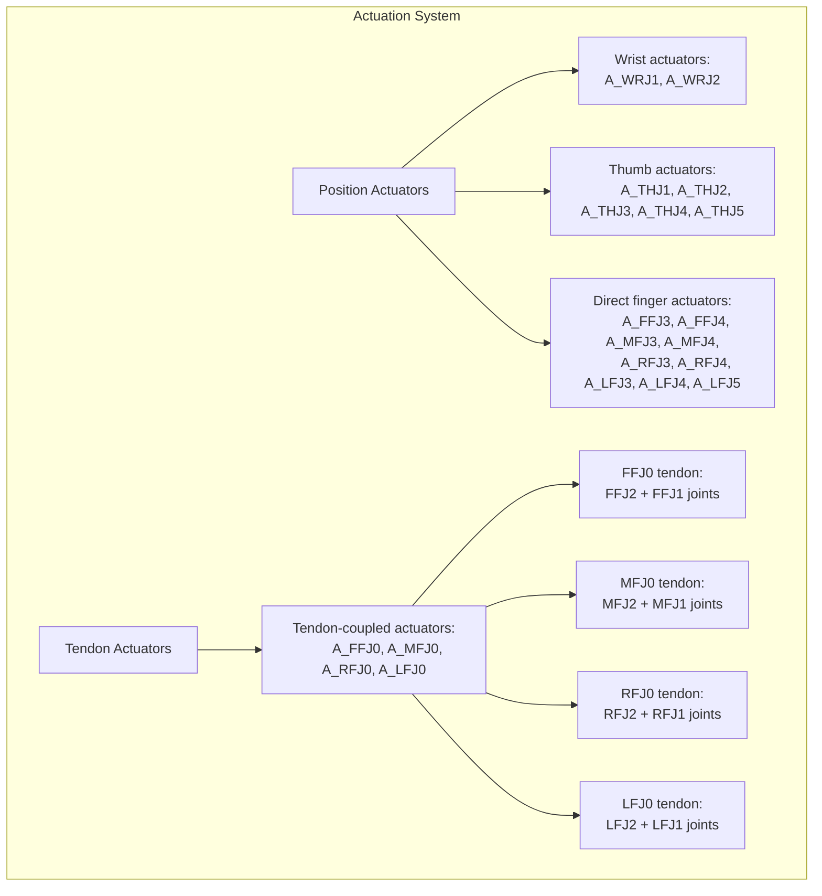
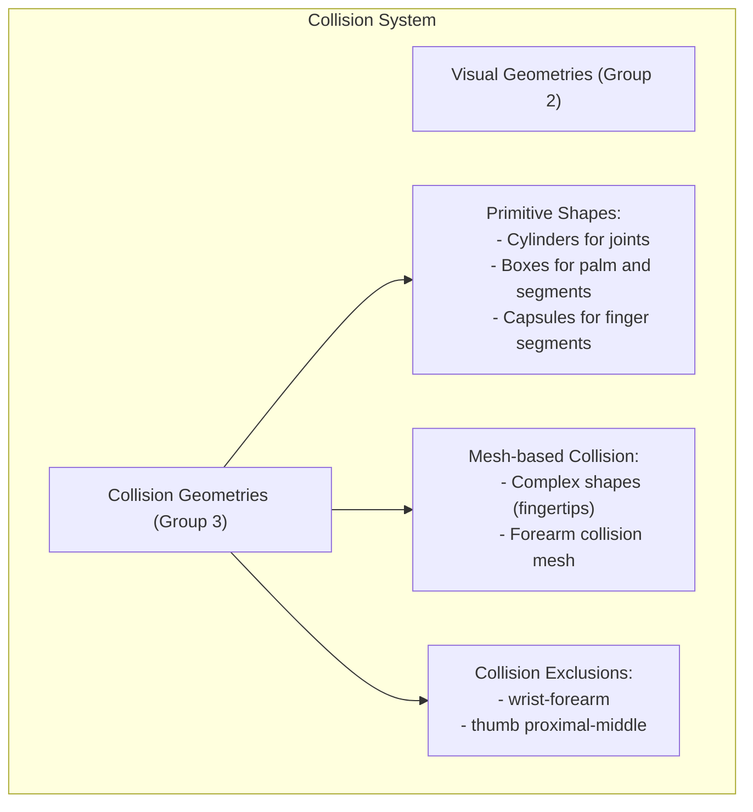
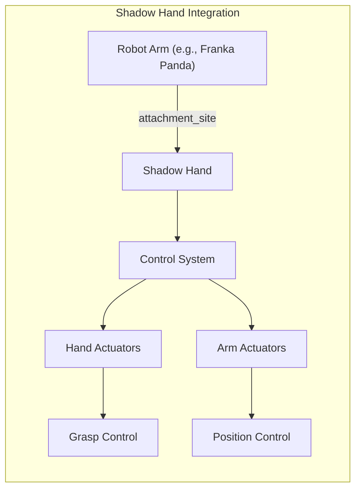

<!-- source: DeepWiki mcp.deepwiki.com · repo google-deepmind/mujoco_menagerie · page 5.2 Shadow Hand · fetched 2026-10-26 -->

# Shadow Hand

Relevant source files

The following files were used as context for generating this wiki page:

- [agility_cassie/cassie.xml](agility_cassie/cassie.xml)
- [anybotics_anymal_b/anymal_b.xml](anybotics_anymal_b/anymal_b.xml)
- [anybotics_anymal_c/anymal_c.xml](anybotics_anymal_c/anymal_c.xml)
- [franka_emika_panda/hand.xml](franka_emika_panda/hand.xml)
- [franka_emika_panda/panda.xml](franka_emika_panda/panda.xml)
- [franka_emika_panda/panda_nohand.xml](franka_emika_panda/panda_nohand.xml)
- [robotiq_2f85/2f85.xml](robotiq_2f85/2f85.xml)
- [robotiq_2f85/scene.xml](robotiq_2f85/scene.xml)
- [shadow_hand/left_hand.xml](shadow_hand/left_hand.xml)
- [shadow_hand/right_hand.xml](shadow_hand/right_hand.xml)
- [shadow_hand/shadow_hand.png](shadow_hand/shadow_hand.png)
- [unitree_a1/a1.xml](unitree_a1/a1.xml)

## Purpose and Overview

This document provides technical documentation for the Shadow Hand robotic hand model implemented in the MuJoCo Menagerie. The Shadow Hand is a highly dexterous anthropomorphic robotic hand with 24 degrees of freedom (DoF) that closely mimics human hand capabilities. This documentation covers the model structure, joint system, actuation methods, and integration considerations for both left and right hand variants.

Sources: [shadow_hand/left_hand.xml:1-316](), [shadow_hand/right_hand.xml:1-317]()

## Model Structure

The Shadow Hand model consists of a complete hand-wrist-forearm assembly with anatomical equivalents to human hand structures. The hand includes a thumb and four fingers (first/index, middle, ring, and little finger) with appropriate joint configurations.

### Model Variants

The Shadow Hand is available in two variants:
- Right hand (`right_hand.xml`)
- Left hand (`left_hand.xml`)

Both models share the same structural design with appropriate mirroring of geometries and joint axes.

### Body Hierarchy

The model follows a biomimetic structure with a hierarchical arrangement of bodies:

Sources: [shadow_hand/left_hand.xml:96-267](), [shadow_hand/right_hand.xml:96-267]()

## Physical Properties and Dimensions

The Shadow Hand model has realistically proportioned dimensions similar to an average adult human hand. The model uses the metric system with lengths in meters.

### Materials
- The model uses three main materials:
  - `black`: Main structural components (RGB: 0.16355, 0.16355, 0.16355)
  - `gray`: Secondary components (RGB: 0.80848, 0.80848, 0.80848)
  - `metallic`: Joint components (RGB: 0.9, 0.9, 0.9)

### Meshes
The visual model uses multiple detailed meshes for each component, scaled to 0.001 (millimeter to meter conversion):
- Forearm, wrist, and palm components
- Finger segments (knuckle, proximal, middle, distal)
- Thumb components
- Specialized metacarpal for little finger

Sources: [shadow_hand/left_hand.xml:76-94](), [shadow_hand/right_hand.xml:76-94]()

## Joint System

The Shadow Hand features 24 degrees of freedom across multiple joint types that closely mimic human hand biomechanics.

### Joint Types and Naming Convention

The joints follow a systematic naming convention:
- `hand_prefix`: `rh_` (right hand) or `lh_` (left hand)
- `digit_prefix`: 
  - `FF` (first/index finger)
  - `MF` (middle finger)
  - `RF` (ring finger)
  - `LF` (little finger)
  - `TH` (thumb)
- `joint_type`:
  - `J1` to `J4` for fingers
  - `J1` to `J5` for thumb
  - `WRJ1` and `WRJ2` for wrist

### Joint Ranges and Properties

Each joint type has specific ranges and properties:

| Joint Type | Axis | Range (rad) | Description |
|------------|------|-------------|-------------|
| Wrist Y (WRJ2) | Y axis | -0.523599 to 0.174533 | Wrist abduction/adduction |
| Wrist X (WRJ1) | X axis | -0.698132 to 0.488692 | Wrist flexion/extension |
| Thumb Base (THJ5) | Z axis | -1.0472 to 1.0472 | Thumb rotation |
| Thumb Proximal (THJ4) | X axis | 0 to 1.22173 | Thumb proximal flexion |
| Thumb Hub (THJ3) | X axis | -0.20944 to 0.20944 | Thumb hub joint |
| Thumb Middle (THJ2) | Y axis | -0.698132 to 0.698132 | Thumb middle flexion |
| Thumb Distal (THJ1) | X axis | -0.261799 to 1.5708 | Thumb distal flexion |
| Finger Metacarpal (LFJ5) | Angled | 0 to 0.785398 | Little finger abduction |
| Finger Knuckle (J4) | Y axis | -0.349066 to 0.349066 | Finger abduction |
| Finger Proximal (J3) | X axis | -0.261799 to 1.5708 | Proximal flexion |
| Finger Middle (J2) | X axis | 0 to 1.5708 | Middle flexion |
| Finger Distal (J1) | X axis | 0 to 1.5708 | Distal flexion |

Sources: [shadow_hand/left_hand.xml:6-74](), [shadow_hand/right_hand.xml:6-74]()

## Actuation System

The Shadow Hand is controlled through position actuators that correspond directly to the joints, with additional coupled motion through tendons.

### Position Actuators

Each joint is controlled by a position actuator with specific parameters:
- Control ranges match joint ranges
- Force ranges limit the maximum applicable forces
- Spring stiffness (kp) values vary by joint type

### Tendon Coupling

Four tendons couple the middle and distal joints of each finger:
- `FFJ0`: Couples `FFJ2` (middle) and `FFJ1` (distal) of index finger
- `MFJ0`: Couples `MFJ2` (middle) and `MFJ1` (distal) of middle finger
- `RFJ0`: Couples `RFJ2` (middle) and `RFJ1` (distal) of ring finger
- `LFJ0`: Couples `LFJ2` (middle) and `LFJ1` (distal) of little finger

This coupling creates a natural, human-like curling motion when the fingers flex.

Sources: [shadow_hand/left_hand.xml:275-316](), [shadow_hand/right_hand.xml:275-316]()

## Collision Model

The Shadow Hand includes both visual and collision geometries for accurate simulation.

### Collision Groups

- Group 2: Visual geometries (no collision)
- Group 3: Collision geometries

### Collision Geometry Types

The collision model uses a combination of:
- Primitive shapes (spheres, cylinders, boxes) for efficient collision detection
- Mesh-based collision for complex shapes
- Appropriate exclusions to prevent self-collision at connected parts

Sources: [shadow_hand/left_hand.xml:64-74](), [shadow_hand/right_hand.xml:64-74](), [shadow_hand/left_hand.xml:270-273](), [shadow_hand/right_hand.xml:270-273]()

## Integration with External Systems

The Shadow Hand model is designed to be integrated with other robot systems, particularly robot arms.

### Attachment Points

- The forearm body provides a base for attaching to other systems
- The hand has appropriate transforms for correct positioning
- Site `grasp_site` is defined in the right hand model for object interaction

### Integration Examples

The Shadow Hand can be integrated with various robotic arms, like the Franka Emika Panda arm from the MuJoCo Menagerie:

Sources: [shadow_hand/right_hand.xml:117-118](), [franka_emika_panda/panda_nohand.xml:188-190]()

## Usage Considerations

### Control Interface

The Shadow Hand provides a straightforward control interface:
- 19 actuators control the 24 DoF through direct and coupled mechanisms
- Control signals are provided in joint space corresponding to desired joint positions
- The position actuators handle the conversion from control signals to forces

### Performance Optimization

For optimal performance when using the Shadow Hand in simulation:
- Use the elliptic cone option for more accurate friction modeling
- Consider the impratio setting (10) for improved computational efficiency
- Take advantage of the exclusion contacts to reduce computational load

Sources: [shadow_hand/left_hand.xml:4](), [shadow_hand/right_hand.xml:4]()

## Comparison with Other Grippers

The Shadow Hand represents a high-dexterity end effector compared to other grippers in the MuJoCo Menagerie:

| Feature | Shadow Hand | Robotiq 2F85 | LEAP Hand | Panda Gripper |
|---------|-------------|--------------|-----------|---------------|
| DoF | 24 | 1 | 16 | 1 |
| Fingers | 5 | 2 | 3 | 2 |
| Actuation Type | Position | Position | Position | Position |
| Dexterity | High | Low | Medium | Low |
| Use Cases | Complex manipulation | Simple grasping | Adaptive grasping | Simple grasping |

Sources: [shadow_hand/left_hand.xml](), [robotiq_2f85/2f85.xml](), [franka_emika_panda/hand.xml]()

---

