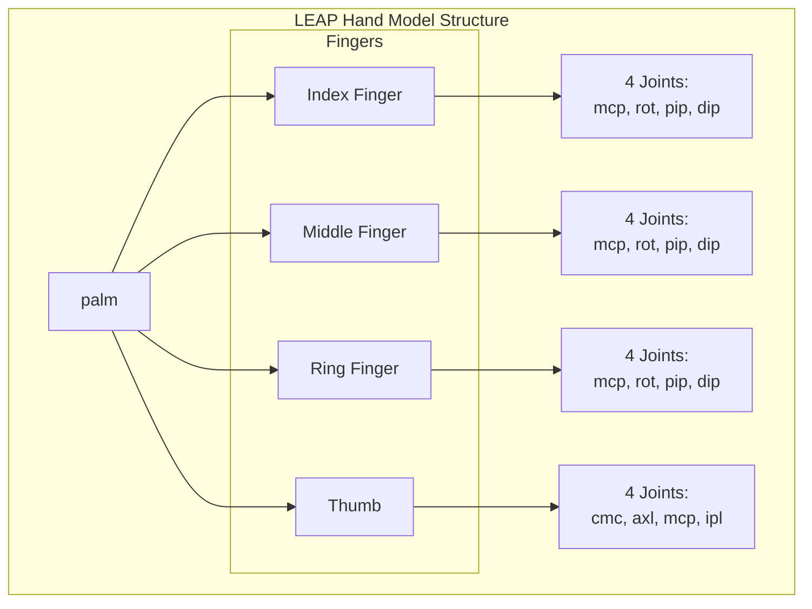
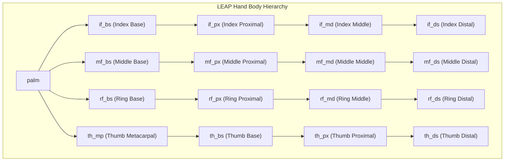
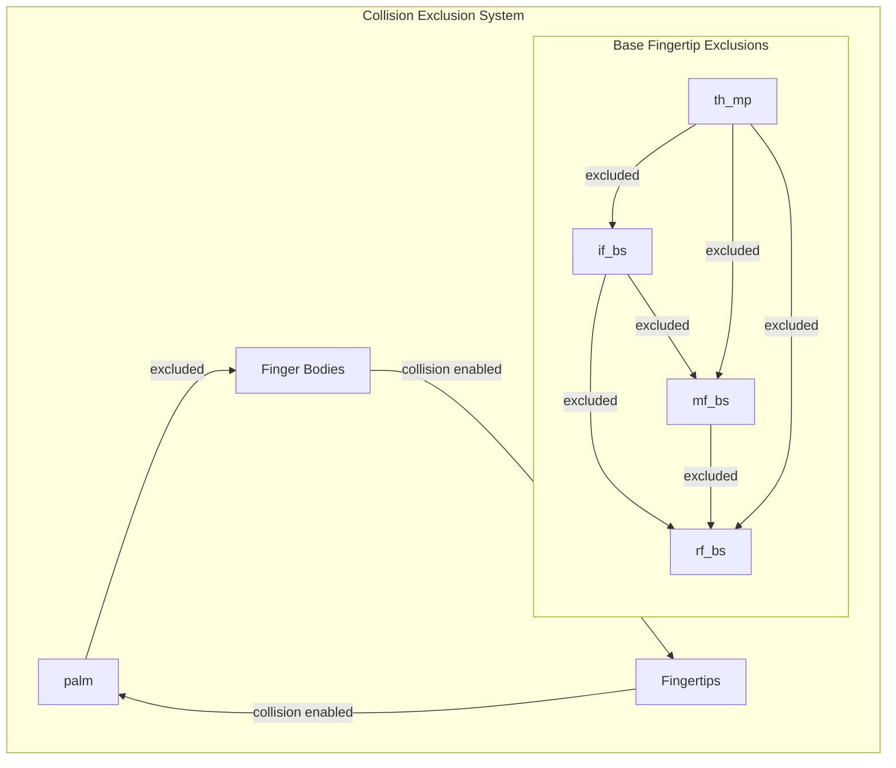

<!-- source: DeepWiki mcp.deepwiki.com · repo google-deepmind/mujoco_menagerie · page 5.3 LEAP Hand · fetched 2026-10-26 -->

# LEAP Hand

<details>
<summary>Relevant source files</summary>

The following files were used as context for generating this wiki page:

- [leap_hand/LICENSE](leap_hand/LICENSE)
- [leap_hand/README.md](leap_hand/README.md)
- [leap_hand/assets/palm_left.obj](leap_hand/assets/palm_left.obj)
- [leap_hand/assets/palm_right.obj](leap_hand/assets/palm_right.obj)
- [leap_hand/assets/thumb_mp_left.obj](leap_hand/assets/thumb_mp_left.obj)
- [leap_hand/left_hand.xml](leap_hand/left_hand.xml)
- [leap_hand/right_hand.png](leap_hand/right_hand.png)
- [leap_hand/right_hand.xml](leap_hand/right_hand.xml)
- [leap_hand/scene_left.xml](leap_hand/scene_left.xml)
- [leap_hand/scene_right.xml](leap_hand/scene_right.xml)

</details>


This page documents the LEAP Hand robotic hand model implemented in MuJoCo. The LEAP Hand (Low-cost, Efficient, and Anthropomorphic Hand) is a simplified robot description derived from the publicly available URDF files developed at Carnegie Mellon University. Both left and right hand models are included in the implementation.

## Overview

The LEAP Hand is a dexterous, anthropomorphic robotic hand designed for robot learning applications. The MuJoCo implementation provides a physics-based simulation model that enables realistic interaction with objects in a virtual environment. The hand consists of a palm, three fingers (index, middle, and ring), and a thumb, with a total of 16 joints and articulated actuators.



Sources: [leap_hand/README.md:1-14](), [leap_hand/right_hand.xml:1-63]()

## Model Specifications

### Naming Conventions

The LEAP Hand uses specific naming conventions for its body parts and joints:

- **Finger phalanges**: `{bs, px, md, ds}` denote base, proximal, middle, and distal phalanges
- **Thumb phalanges**: `{mp, bs, px, ds}` denote metacarpal, base, proximal, and distal phalanges
- **Finger joints**: `{mcp, rot, pip, dip}` denote metacarpophalangeal, rotational, proximal interphalangeal, and distal interphalangeal joints
- **Thumb joints**: `{cmc, axl, mcp, ipl}` denote carpometacarpal, axial, metacarpophalangeal, and interphalangeal joints

Each body and joint also follows a prefix naming convention that identifies which finger it belongs to:
- `if_` - index finger
- `mf_` - middle finger
- `rf_` - ring finger
- `th_` - thumb

Sources: [leap_hand/right_hand.xml:1-63]()

### Body Structure

The LEAP Hand consists of 16 distinct bodies organized hierarchically:



Sources: [leap_hand/right_hand.xml:10-34](), [leap_hand/right_hand.xml:230-416]()

## Joint System

The LEAP Hand contains 16 actuated joints, each with specific movement ranges and parameters:

### Finger Joints

Each finger (index, middle, ring) has four joints with the following parameters:

| Joint Type | Prefix | Axis   | Range (radians) |
|------------|--------|--------|----------------|
| MCP        | *_mcp  | 0 0 -1 | -0.314 to 2.23 |
| Rotational | *_rot  | 0 0 -1 | -1.047 to 1.047 |
| PIP        | *_pip  | 0 0 -1 | -0.506 to 1.885 |
| DIP        | *_dip  | 0 0 -1 | -0.366 to 2.042 |

### Thumb Joints

The thumb has a different joint configuration:

| Joint Type | Prefix   | Axis   | Range (radians) |
|------------|----------|--------|----------------|
| CMC        | th_cmc   | 0 0 -1 | -0.349 to 2.094 |
| Axial      | th_axl   | 0 0 -1 | -0.349 to 2.094 |
| MCP        | th_mcp   | 0 0 -1 | -0.47 to 2.443 |
| IPL        | th_ipl   | 0 0 -1 | -1.34 to 1.88 |

Sources: [leap_hand/right_hand.xml:105-146]()

## Actuators and Sensors

The LEAP Hand implementation includes position actuators and joint position sensors for each joint.

### Actuators

Position actuators are defined for each joint with the following parameters:
- Default `kp` (proportional gain): 3.0
- Default `kv` (damping): 0.01

The actuators are organized as follows:

```mermaid
graph LR
    subgraph "Actuator System"
        IndexAct["Index Finger Actuators"]
        MiddleAct["Middle Finger Actuators"]
        RingAct["Ring Finger Actuators"]
        ThumbAct["Thumb Actuators"]
        
        IndexAct --> IF_A1["if_mcp_act"]
        IndexAct --> IF_A2["if_rot_act"]
        IndexAct --> IF_A3["if_pip_act"]
        IndexAct --> IF_A4["if_dip_act"]
        
        MiddleAct --> MF_A1["mf_mcp_act"]
        MiddleAct --> MF_A2["mf_rot_act"]
        MiddleAct --> MF_A3["mf_pip_act"]
        MiddleAct --> MF_A4["mf_dip_act"]
        
        RingAct --> RF_A1["rf_mcp_act"]
        RingAct --> RF_A2["rf_rot_act"]
        RingAct --> RF_A3["rf_pip_act"]
        RingAct --> RF_A4["rf_dip_act"]
        
        ThumbAct --> TH_A1["th_cmc_act"]
        ThumbAct --> TH_A2["th_axl_act"]
        ThumbAct --> TH_A3["th_mcp_act"]
        ThumbAct --> TH_A4["th_ipl_act"]
    end
```



### Sensors

Joint position sensors are provided for each joint to monitor the hand's state:

```mermaid
graph LR
    subgraph "Sensor System"
        IndexSen["Index Finger Sensors"]
        MiddleSen["Middle Finger Sensors"]
        RingSen["Ring Finger Sensors"]
        ThumbSen["Thumb Sensors"]
        
        IndexSen --> IF_S1["if_mcp_sensor"]
        IndexSen --> IF_S2["if_rot_sensor"]
        IndexSen --> IF_S3["if_pip_sensor"]
        IndexSen --> IF_S4["if_dip_sensor"]
        
        MiddleSen --> MF_S1["mf_mcp_sensor"]
        MiddleSen --> MF_S2["mf_rot_sensor"]
        MiddleSen --> MF_S3["mf_pip_sensor"]
        MiddleSen --> MF_S4["mf_dip_sensor"]
        
        RingSen --> RF_S1["rf_mcp_sensor"]
        RingSen --> RF_S2["rf_rot_sensor"]
        RingSen --> RF_S3["rf_pip_sensor"]
        RingSen --> RF_S4["rf_dip_sensor"]
        
        ThumbSen --> TH_S1["th_cmc_sensor"]
        ThumbSen --> TH_S2["th_axl_sensor"]
        ThumbSen --> TH_S3["th_mcp_sensor"]
        ThumbSen --> TH_S4["th_ipl_sensor"]
    end
```



Sources: [leap_hand/right_hand.xml:177-201](), [leap_hand/right_hand.xml:204-228]()

## Physical Properties

### Collision System

The LEAP Hand model includes a sophisticated collision system that prevents unrealistic self-intersections while allowing interactions with external objects. Key exclusions include:

1. Palm-to-finger collisions (except tips)
2. Base fingertip-to-base fingertip collisions

The collision system uses the `<exclude>` tag to specify which body pairs should not collide with each other:



Sources: [leap_hand/right_hand.xml:149-174]()

### Friction and Contact Properties

The model uses specific friction settings to achieve realistic behavior:

- Default friction coefficient: 0.2
- Fingertip friction coefficient: 0.5 (higher for better grasping)

The implementation uses elliptic friction cones and high impulse ratio (impratio=100) to improve simulation stability.

Sources: [leap_hand/right_hand.xml:67](), [leap_hand/right_hand.xml:88](), [leap_hand/right_hand.xml:98-103]()

## Using the LEAP Hand

The LEAP Hand can be integrated into MuJoCo simulations using the scene files provided. The model requires MuJoCo 3.1.3 or later.

### Basic Usage

To use the LEAP Hand in a MuJoCo simulation:

1. Include either `right_hand.xml` or `left_hand.xml` in your model file
2. Alternatively, use the provided scene files (`scene_right.xml` or `scene_left.xml`) for quick visualization

### Example Scene File

```xml
<mujoco model="right leap hand scene">
  <include file="right_hand.xml"/>

  <statistic center="0 0 0.1" extent=".3"/>

  <visual>
    <headlight diffuse="0.6 0.6 0.6" ambient="0.3 0.3 0.3" specular="0 0 0"/>
    <rgba haze="0.15 0.25 0.35 1"/>
    <global azimuth="35" elevation="-50"/>
  </visual>

  <asset>
    <texture type="skybox" builtin="gradient" rgb1="0.3 0.5 0.7" rgb2="0 0 0" width="512" height="3072"/>
    <texture type="2d" name="groundplane" builtin="checker" mark="edge" rgb1="0.2 0.3 0.4" rgb2="0.1 0.2 0.3"
      markrgb="0.8 0.8 0.8" width="300" height="300"/>
    <material name="groundplane" texture="groundplane" texuniform="true" texrepeat="5 5" reflectance="0.2"/>
  </asset>

  <worldbody>
    <light pos="0 0 1" dir="0 0 -1" directional="true"/>
    <geom name="floor" size="0 0 0.05" type="plane" material="groundplane"/>
  </worldbody>
</mujoco>
```

Sources: [leap_hand/scene_right.xml:1-23](), [leap_hand/scene_left.xml:1-23]()

## Implementation Details

### URDF to MJCF Conversion

The LEAP Hand was derived from publicly available URDF descriptions through a well-defined process. The key conversion steps included:

1. Starting with the URDF from [dexsuite](https://github.com/dexsuite/dex-urdf/)
2. Running the model through Drake's fix_inertia tool
3. Adding MuJoCo-specific parameters
4. Adjusting joint properties, naming conventions, and visual elements
5. Creating default classes for joints and actuators
6. Simplifying fingertip meshes for better performance
7. Adding sensors and collision filters

For the left hand, similar steps were followed with some specific adjustments to ensure consistency with the right hand model.

Sources: [leap_hand/README.md:14-69]()

### Asset Organization

The model's visual appearance is defined by mesh files stored in the `assets/` directory:

- Palm mesh: `palm_right.obj` or `palm_left.obj`
- Finger meshes: `base.obj`, `proximal.obj`, `medial.obj`, `distal.obj`, `tip.obj`
- Thumb meshes: `thumb_base.obj`, `thumb_proximal.obj`, `thumb_distal.obj`, `thumb_tip.obj`

These meshes are referenced in the XML files and loaded by MuJoCo at runtime.

Sources: [leap_hand/right_hand.xml:70-83](), [leap_hand/left_hand.xml:69-82]()

## License and Attribution

The LEAP Hand model is released under the MIT License. It was originally described in the following publication:

```bibtex
@article{shaw2023leaphand,
    title = {LEAP Hand: Low-Cost, Efficient, and Anthropomorphic Hand for Robot Learning},
    author = {Shaw, Kenneth and Agarwal, Ananye and Pathak, Deepak},
    journal = {Robotics: Science and Systems (RSS)},
    year = {2023}
}
```

Sources: [leap_hand/README.md:70-85](), [leap_hand/LICENSE:1-7]()

---

