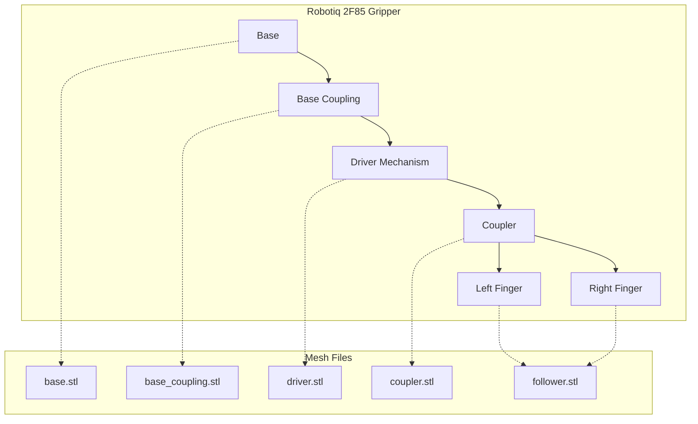
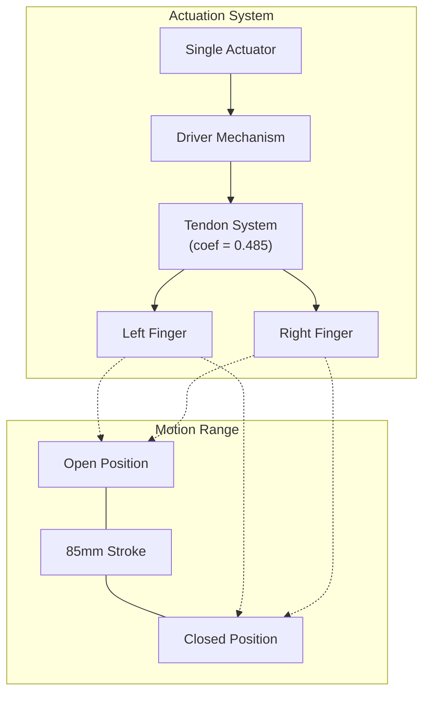

<!-- source: DeepWiki mcp.deepwiki.com · repo google-deepmind/mujoco_menagerie · page 5.4 Robotiq 2F85 Gripper · fetched 2026-10-26 -->

# Robotiq 2F85 Gripper

<details>
<summary>Relevant source files</summary>

The following files were used as context for generating this wiki page:

- [LICENSE](LICENSE)
- [robotiq_2f85_v4/2f85.png](robotiq_2f85_v4/2f85.png)
- [robotiq_2f85_v4/2f85.xml](robotiq_2f85_v4/2f85.xml)
- [robotiq_2f85_v4/LICENSE](robotiq_2f85_v4/LICENSE)
- [robotiq_2f85_v4/README.md](robotiq_2f85_v4/README.md)
- [robotiq_2f85_v4/assets/base.stl](robotiq_2f85_v4/assets/base.stl)
- [robotiq_2f85_v4/assets/base_coupling.stl](robotiq_2f85_v4/assets/base_coupling.stl)
- [robotiq_2f85_v4/assets/c-a01-85-open.stl](robotiq_2f85_v4/assets/c-a01-85-open.stl)
- [robotiq_2f85_v4/assets/coupler.stl](robotiq_2f85_v4/assets/coupler.stl)
- [robotiq_2f85_v4/assets/driver.stl](robotiq_2f85_v4/assets/driver.stl)
- [robotiq_2f85_v4/assets/follower.stl](robotiq_2f85_v4/assets/follower.stl)

</details>


This document provides technical documentation for the Robotiq 2F85 Gripper model included in the MuJoCo Menagerie repository. The Robotiq 2F85 is an 85mm adaptive two-finger gripper widely used in robotics applications. This page covers the model's structure, components, technical specifications, and usage within the MuJoCo physics engine.

## Overview

The Robotiq 2F85 Gripper is a parallel gripper with an 85mm stroke (maximum opening) designed for industrial and research applications. The MuJoCo Menagerie repository contains a simplified MJCF (MuJoCo XML) model of this gripper, derived from publicly available CAD files and URDF descriptions. The model accurately represents the gripper's geometry, kinematics, and basic dynamics properties.

Sources: [robotiq_2f85_v4/README.md:1-16]()

## Model Derivation

The model was created through the following process:

1. Downloaded original step files containing CAD information from Robotiq
2. Created an assembly file using Onshape with joint limits based on the robotiq_2f85 XML model
3. Exported the assembly to URDF using onshape-to-robot
4. Converted URDF to MJCF by loading the model in MuJoCo and exporting as XML
5. Adjusted parameters (like tendon coefficient) for simulation fidelity

A key modification was changing the tendon coefficient from 0.5 to 0.485 to ensure proper contact between fingertips during grasping.

Sources: [robotiq_2f85_v4/README.md:18-27]()

## File Structure

### Model Components

The Robotiq 2F85 model is organized into the following files:

| File | Description |
|------|-------------|
| `model.xml` | Main MJCF model file defining the gripper structure |
| `scene.xml` | Example scene file showing the gripper in a simulated environment |
| `assets/*.stl` | Mesh files for the gripper components |
| `LICENSE` | BSD-2-Clause license file |
| `2f85.png` | Reference image of the gripper |

The model uses mesh files for the various components of the gripper including the base, driver, coupler, and finger components.

Sources: [robotiq_2f85_v4/README.md:28-30](), [robotiq_2f85_v4/LICENSE:1-24]()

## Gripper Architecture

### Component Hierarchy

The following diagram illustrates the hierarchical structure of the Robotiq 2F85 gripper model:



Sources: [robotiq_2f85_v4/assets/base.stl](), [robotiq_2f85_v4/assets/base_coupling.stl](), [robotiq_2f85_v4/assets/driver.stl](), [robotiq_2f85_v4/assets/coupler.stl](), [robotiq_2f85_v4/assets/follower.stl]()

### Actuation Mechanism

The Robotiq 2F85 uses a parallel gripper mechanism with a single actuator. The actuation system employs tendons to convert the linear motion of the driver into the synchronized opening and closing of the fingers.



Note: The tendon coefficient was adjusted from 0.5 to 0.485 in the model to ensure that the fingertips make proper contact when closed.

Sources: [robotiq_2f85_v4/README.md:26-27]()

## Technical Specifications

| Parameter | Value |
|-----------|-------|
| Gripper Type | Parallel 2-Finger Adaptive |
| Maximum Opening | 85mm |
| Tendon Coefficient | 0.485 |
| License | BSD-2-Clause |
| Control | Single actuator |
| MuJoCo Compatibility | Requires MuJoCo 2.2.2 or later |

Sources: [robotiq_2f85_v4/README.md:3-12](), [robotiq_2f85_v4/README.md:26-27]()

## Scene Configuration

The repository includes a pre-configured scene file (`scene.xml`) which demonstrates the gripper in a simulated environment. This scene includes:

- The Robotiq 2F85 gripper model
- A textured groundplane
- Skybox and haze effects
- A hanging box for interaction testing

The scene can be used as a starting point for integrating the gripper into more complex simulations.

Sources: [robotiq_2f85_v4/README.md:28-30]()

## Usage Examples

### Loading the Model

To use the Robotiq 2F85 Gripper in your MuJoCo simulation, you can:

1. Load the model directly:
   ```python
   import mujoco
   model = mujoco.load_model_from_path("path/to/robotiq_2f85_v4/model.xml")
   data = mujoco.MjData(model)
   ```

2. Include it in a larger scene using the MuJoCo include directive:
   ```xml
   <include file="path/to/robotiq_2f85_v4/model.xml"/>
   ```

3. Mount it to a robot arm by connecting to the base coupling.

### Integration with Robot Arms

The Robotiq 2F85 Gripper is designed to be mounted on various robot arms. In the MuJoCo Menagerie repository, it can be combined with manipulator arm models such as:

- Franka Emika Panda (see [Franka Emika Panda](#4.1))
- Universal Robots arms
- Other compatible manipulators

## Model Details

### Key Components

The model consists of these primary components:

1. Base - The mounting point for attaching to robot arms
2. Base coupling - Connects the base to the actuation mechanism
3. Driver - The main actuated component that initiates movement
4. Coupler - Transfers motion from the driver to the fingers
5. Fingers (left and right) - The gripper fingers that make contact with objects

Each component is represented by STL mesh files in the assets directory.

Sources: [robotiq_2f85_v4/assets/base.stl](), [robotiq_2f85_v4/assets/base_coupling.stl](), [robotiq_2f85_v4/assets/driver.stl](), [robotiq_2f85_v4/assets/coupler.stl](), [robotiq_2f85_v4/assets/follower.stl]()

## License

The Robotiq 2F85 Gripper model is released under a BSD-2-Clause License. The license grants permissions for redistribution and use in source and binary forms, with or without modification, provided that copyright notices and disclaimers are preserved.

Sources: [robotiq_2f85_v4/LICENSE:1-24]()

---

