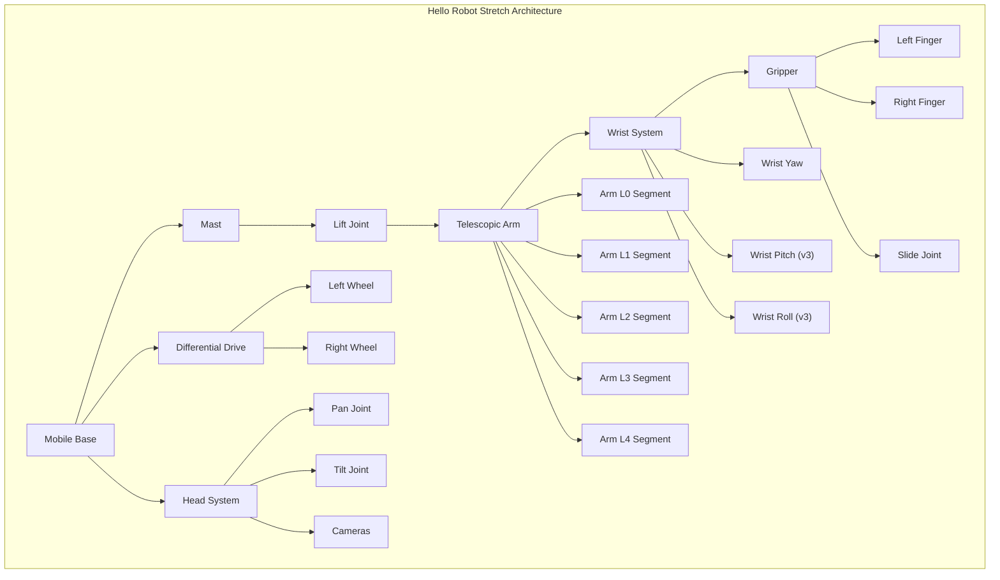
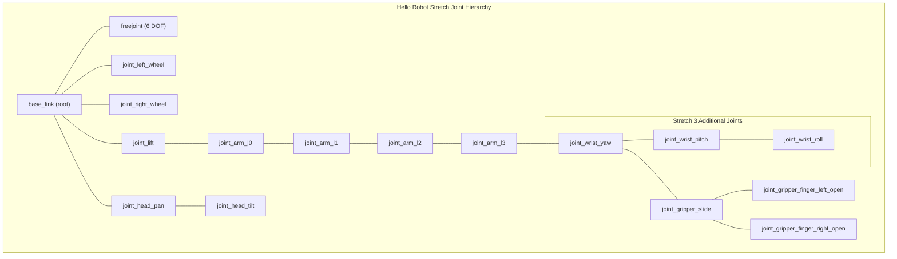

<!-- source: DeepWiki mcp.deepwiki.com · repo google-deepmind/mujoco_menagerie · page 6 Mobile Platforms · fetched 2026-10-26 -->

# Mobile Platforms

<details>
<summary>Relevant source files</summary>

The following files were used as context for generating this wiki page:

- [hello_robot_stretch/README.md](hello_robot_stretch/README.md)
- [hello_robot_stretch/stretch.xml](hello_robot_stretch/stretch.xml)
- [hello_robot_stretch_3/README.md](hello_robot_stretch_3/README.md)
- [hello_robot_stretch_3/stretch.xml](hello_robot_stretch_3/stretch.xml)
- [test/model_test.py](test/model_test.py)
- [test/requirements.txt](test/requirements.txt)

</details>


## Purpose and Scope

This document provides technical information about mobile robot platforms available in the MuJoCo Menagerie repository. Mobile platforms are robots with locomotion capabilities that allow them to navigate through environments, often featuring manipulators for interaction with objects. Currently, the repository includes the Hello Robot Stretch robot in two versions. For information about other robot types such as humanoids, quadrupeds, or manipulator arms, refer to their respective documentation pages ([Humanoid Robots](#2), [Quadruped Robots](#3), [Manipulator Arms](#4)).

Sources: [hello_robot_stretch/README.md:1-31](), [hello_robot_stretch_3/README.md:1-29]()

## Overview of Available Mobile Platforms

The MuJoCo Menagerie currently includes the following mobile platforms:

| Robot | Manufacturer | Versions | Main Features |
|-------|-------------|----------|--------------|
| Stretch | Hello Robot | 2, 3 | Mobile base with telescoping arm and gripper |

### Hello Robot Stretch Architecture

The Hello Robot Stretch is a mobile manipulator designed for research and service applications. It features a differential drive base, telescoping arm, and gripper for object manipulation. The robot includes multiple sensors and cameras for perception.

**Key Components of Hello Robot Stretch:**



Sources: [hello_robot_stretch/stretch.xml:170-359](), [hello_robot_stretch_3/stretch.xml:219-476]()

## Model Versions

### Stretch 2
The Stretch 2 model provides a simplified robot description with a differential drive base, telescoping arm, and basic gripper. The model is based on the actual Hello Robot Stretch 2 commercial robot, with the URDF and assets provided directly by Hello Robot under the Clear BSD License.

### Stretch 3
The Stretch 3 model represents the newer version of the Hello Robot Stretch, with several enhancements:
- Improved wrist system with additional degrees of freedom (pitch and roll joints)
- Enhanced camera system
- Refined joint parameters and control
- Improved gripper design

Sources: [hello_robot_stretch/README.md:1-31](), [hello_robot_stretch_3/README.md:1-29]()

## Technical Implementation

The mobile platforms are modeled using MuJoCo's XML format (MJCF), with detailed representation of mechanics, materials, and control systems.

### Joint Hierarchy and Structure



Sources: [hello_robot_stretch/stretch.xml:170-359](), [hello_robot_stretch_3/stretch.xml:219-476]()

### Joint Types and Properties

The Stretch models use several specialized joint types:

1. **Wheel Joints**: Revolute joints for the differential drive
   ```
   <default class="wheel">
     <joint axis="0 0 -1" damping=".3"/>
     <motor ctrlrange="-1 1" gear="3" forcerange="-100 100"/>
   </default>
   ```

2. **Lift Joint**: Prismatic (slide) joint for vertical movement
   ```
   <default class="lift">
     <joint type="slide" axis="0 0 1" damping="5" range="-0.5 .6"/>
     <general ctrlrange="-0.5 .6" gainprm="300" biasprm="0 -300 -50" forcerange="-56 56"/>
   </default>
   ```

3. **Telescope Joints**: Series of prismatic joints for arm extension
   ```
   <default class="telescope">
     <joint type="slide" axis="0 0 1" damping="5" range="0 0.13"/>
     <general ctrlrange="0 0.52" gainprm="100" biasprm="0 -100 -10" forcerange="-56 56"/>
   </default>
   ```

4. **Wrist and Head Joints**: Revolute joints for orientation
   ```
   <default class="wrist">
     <joint axis="0 0 -1" range="-1.75 4" damping=".1"/>
     <general gainprm="1" biasprm="0 -1 0" ctrlrange="-1.75 4" forcerange="-5 5"/>
   </default>
   ```

5. **Gripper Joints**: Combination of revolute and prismatic joints
   ```
   <default class="finger_open">
     <joint axis="0 0 1" range="-0.6 0.6" damping=".1"/>
   </default>
   <default class="finger_slide">
     <joint type="slide" axis="1 0 0" range="-0.005 .04" damping=".1"/>
     <general gainprm="2000" biasprm="0 -2000 -200" ctrlrange="-0.005 .04"/>
   </default>
   ```

Sources: [hello_robot_stretch/stretch.xml:8-59](), [hello_robot_stretch_3/stretch.xml:8-75]()

### Actuator Configuration

The Hello Robot Stretch models utilize several types of actuators for different joints:

| Actuator Type | Joints | Description |
|--------------|---------|------------|
| Motor | Wheels | Direct motor control for wheels |
| General | Lift, arm extension, wrist | Parameterized control for complex joints |
| Position | Head pan/tilt, gripper | Position control for precise movements |

In the Stretch 2 model, these are defined as:

```
<actuator>
  <motor name="forward" tendon="forward" class="wheel"/>
  <motor name="turn" tendon="turn" class="wheel"/>
  <general name="lift" joint="joint_lift" class="lift"/>
  <general name="arm_extend" tendon="extend" class="telescope"/>
  <general name="wrist_yaw" joint="joint_wrist_yaw" class="wrist"/>
  <general name="grip" joint="joint_gripper_slide" class="finger_slide"/>
  <position name="head_pan" joint="joint_head_pan" class="head_pan"/>
  <position name="head_tilt" joint="joint_head_tilt" class="head_tilt"/>
</actuator>
```

Stretch 3 has an expanded actuator set:

```
<actuator>
  <velocity name="left_wheel_vel" joint="joint_left_wheel" class="wheel"/>
  <velocity name="right_wheel_vel" joint="joint_right_wheel" class="wheel"/>
  <position name="lift" joint="joint_lift" class="lift"/>
  <position name="arm" tendon="extend" class="telescope"/>
  <position name="wrist_yaw" joint="joint_wrist_yaw" class="wrist_yaw"/>
  <position name="wrist_pitch" joint="joint_wrist_pitch" class="wrist_pitch"/>
  <position name="wrist_roll" joint="joint_wrist_roll" class="wrist_roll"/>
  <position name="gripper" joint="joint_gripper_slide" class="finger_slide"/>
  <position name="head_pan" joint="joint_head_pan" class="head_pan"/>
  <position name="head_tilt" joint="joint_head_tilt" class="head_tilt"/>
</actuator>
```

Sources: [hello_robot_stretch/stretch.xml:407-416](), [hello_robot_stretch_3/stretch.xml:528-539]()

### Coordinated Motion through Tendons and Equality Constraints

Both Stretch models use tendons and equality constraints to coordinate joint movements:

1. **Tendons**:
   - `extend` tendon: Coordinates all telescope joints for synchronized arm extension
   - Stretch 2 also has `forward` and `turn` tendons for coordinated wheel motion

2. **Equality Constraints**:
   - Telescope joints are constrained to move together
   - Gripper finger opening is coordinated with slide motion
   ```
   <equality>
     <joint joint1="joint_arm_l0" joint2="joint_arm_l1"/>
     <joint joint1="joint_arm_l1" joint2="joint_arm_l2"/>
     <joint joint1="joint_arm_l2" joint2="joint_arm_l3"/>
     <joint joint1="joint_gripper_finger_left_open" joint2="joint_gripper_slide" polycoef="0 10 0 0 0" solref="0.005 1"/>
     <joint joint1="joint_gripper_finger_right_open" joint2="joint_gripper_slide" polycoef="0 10 0 0 0" solref="0.005 1"/>
   </equality>
   ```

Sources: [hello_robot_stretch/stretch.xml:382-405](), [hello_robot_stretch_3/stretch.xml:511-526]()

### Contact Configuration

To prevent self-collisions, the models define numerous contact exclusions between adjacent components:

```
<contact>
  <exclude body1="link_head_pan" body2="link_head"/>
  <exclude body1="link_left_wheel" body2="base_link"/>
  <exclude body1="link_right_wheel" body2="base_link"/>
  <exclude body1="link_lift" body2="link_mast"/>
  <exclude body1="link_lift" body2="link_head"/>
  <exclude body1="link_arm_l0" body2="link_arm_l4"/>
  <exclude body1="link_arm_l1" body2="link_arm_l4"/>
  <exclude body1="link_arm_l2" body2="link_arm_l4"/>
  <exclude body1="link_arm_l3" body2="link_arm_l4"/>
  <!-- Additional exclusions -->
</contact>
```

The contact exclusions prevent numerical issues during simulation and ensure that adjacent bodies don't generate collision forces when they're supposed to be connected.

Sources: [hello_robot_stretch/stretch.xml:362-379](), [hello_robot_stretch_3/stretch.xml:480-509]()

## Sensors and Perception

The Hello Robot Stretch models include several sensors:

### Cameras
- RGB and depth cameras for perception
- In Stretch 2:
  ```
  <camera name="camera_rgb" pos="0 0.015 0" quat=".5 -.5 -.5 .5"/>
  <camera name="camera_depth" quat=".5 -.5 -.5 .5"/>
  ```
- Stretch 3 adds additional cameras:
  ```
  <camera name="d405_rgb" pos="0 0 0" euler="-3.14 0 -3.14" fovy="58"/>
  <camera name="d405_depth" pos="0 0 0" euler="-3.14 0 -3.14"/>
  <camera name="nav_camera_rgb" pos="0 0 0" euler="-3.1415926 0 3.1415926" fovy="74"/>
  ```

### IMU Sensors (Stretch 3 only)
Stretch 3 adds inertial sensors:
```
<sensor>
  <gyro name="base_gyro" site="base_imu"/>
  <accelerometer name="base_accel" site="base_imu"/>
</sensor>
```

Sources: [hello_robot_stretch/stretch.xml:354-356](), [hello_robot_stretch_3/stretch.xml:371-473](), [hello_robot_stretch_3/stretch.xml:541-544]()

## Usage and Control

### Predefined Keyframes

Stretch 3 includes predefined keyframes for common configurations:
```
<keyframe>
  <key name="home" ctrl="0 0 0.6 0.1 0 0 0 0 0 0"/>
  <key name="stow" ctrl="0 0 0.23 0 3.14 -0.4 0 0 0 0"/>
</keyframe>
```

### Control Examples

To control the Hello Robot Stretch in simulation, you would typically:

1. Load the model into MuJoCo
2. Access the desired actuators
3. Apply control signals within specified ranges

The control ranges are defined in the default classes for each joint type. For example:
- Wheels: `-1 to 1` (Stretch 2) or `-6 to 6` (Stretch 3)
- Lift: `-0.5 to 0.6` (Stretch 2) or `0.0 to 1.1` (Stretch 3)
- Telescope: `0 to 0.52`
- Wrist yaw: `-1.75 to 4` (Stretch 2) or `-1.39 to 4.42` (Stretch 3)

Sources: [hello_robot_stretch_3/stretch.xml:546-549](), [hello_robot_stretch/stretch.xml:8-59](), [hello_robot_stretch_3/stretch.xml:8-75]()

## Testing and Integration

The mobile platform models are tested using the standard MuJoCo Menagerie testing framework, which ensures:
- Models compile without errors
- Simulation runs without generating warnings or NaN values
- All actuators function within their specified ranges

The test system applies random control signals within valid ranges and runs short simulation episodes to verify stability.

Sources: [test/model_test.py:14-125]()

## Conclusion

The Hello Robot Stretch models provide detailed representations of real-world mobile manipulation platforms for use in MuJoCo simulations. These models enable researchers and developers to experiment with mobile manipulation algorithms in simulation before deploying to physical robots. The models balance fidelity with computational efficiency and offer various control methods suitable for different applications.

---

