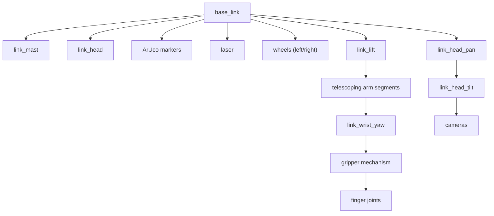
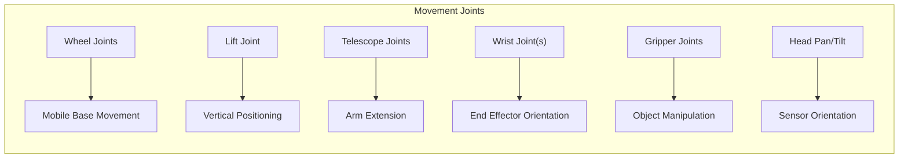
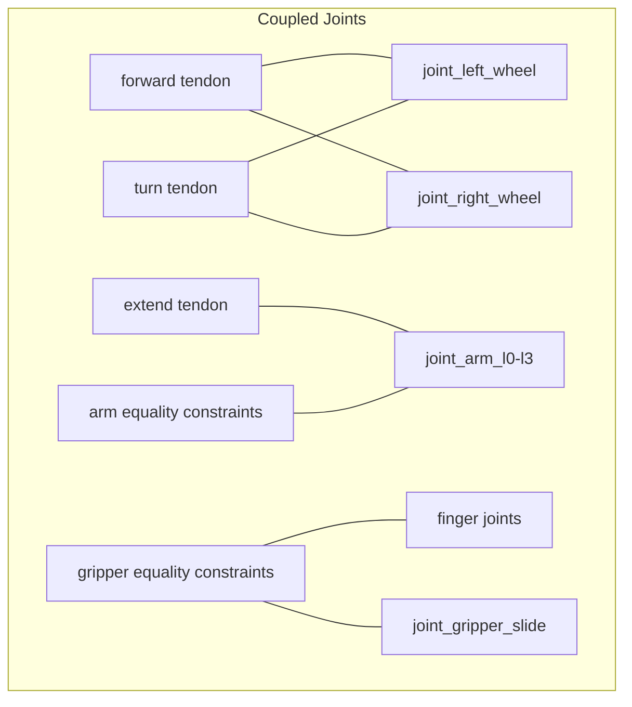
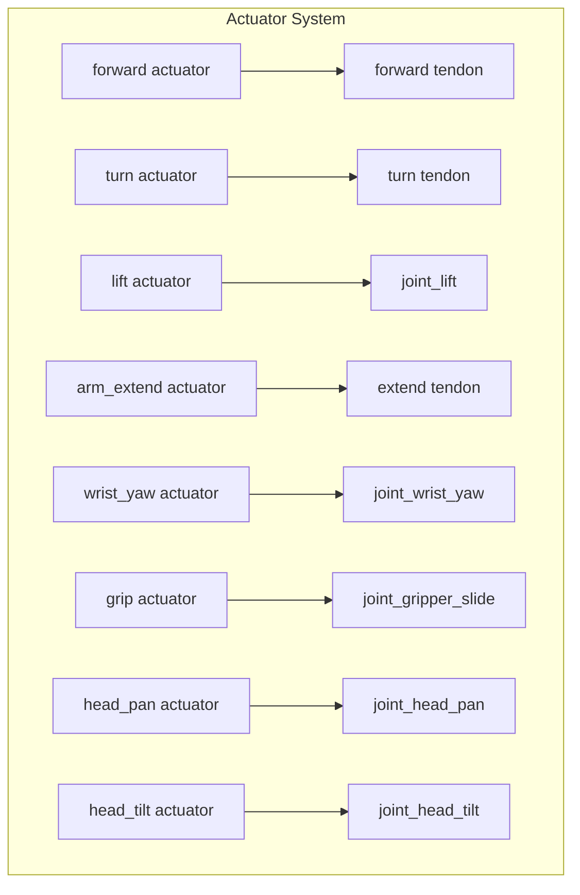
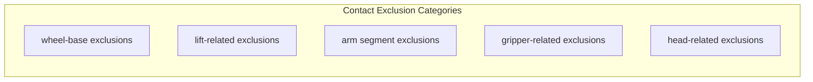
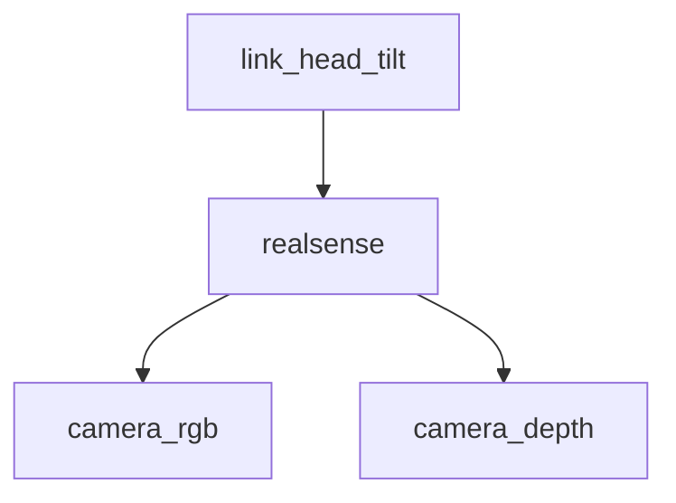

<!-- source: DeepWiki mcp.deepwiki.com · repo google-deepmind/mujoco_menagerie · page 6.1 Hello Robot Stretch · fetched 2026-10-26 -->

# Hello Robot Stretch

<details>
<summary>Relevant source files</summary>

The following files were used as context for generating this wiki page:

- [google_barkour_v0/barkour_v0.xml](google_barkour_v0/barkour_v0.xml)
- [google_barkour_v0/scene.xml](google_barkour_v0/scene.xml)
- [google_barkour_v0/scene_barkour.xml](google_barkour_v0/scene_barkour.xml)
- [google_barkour_vb/barkour_vb.xml](google_barkour_vb/barkour_vb.xml)
- [google_robot/robot.xml](google_robot/robot.xml)
- [google_robot/scene.xml](google_robot/scene.xml)
- [hello_robot_stretch/README.md](hello_robot_stretch/README.md)
- [hello_robot_stretch/scene.xml](hello_robot_stretch/scene.xml)
- [hello_robot_stretch/stretch.xml](hello_robot_stretch/stretch.xml)
- [hello_robot_stretch_3/README.md](hello_robot_stretch_3/README.md)
- [hello_robot_stretch_3/stretch.xml](hello_robot_stretch_3/stretch.xml)
- [test/model_test.py](test/model_test.py)
- [test/requirements.txt](test/requirements.txt)

</details>


This document provides technical documentation for the Hello Robot Stretch models available in the MuJoCo Menagerie repository. The Stretch is a mobile manipulation robot with a telescoping arm, designed for research and home assistance applications. The MuJoCo Menagerie includes both the Stretch 2 and Stretch 3 models, each with accurate physics simulation for algorithm development and testing.

## Model Versions

The repository contains two versions of the Hello Robot Stretch:

1. **Stretch 2** - A model of the Stretch 2 platform under the Clear BSD License
2. **Stretch 3** - An updated model with enhanced features under the Apache 2.0 License

Both models require MuJoCo 3.3.0 or later.

Sources: [hello_robot_stretch/README.md:1-26](), [hello_robot_stretch_3/README.md:1-28]()

## Mechanical Structure

### Component Hierarchy



The Hello Robot Stretch consists of these primary components:

1. **Mobile Base**: Houses electronics, battery, and differential drive system with two wheels
2. **Lift Mechanism**: Provides vertical movement of the arm assembly
3. **Telescoping Arm**: Four-segment arm that can extend and retract
4. **Wrist**: Provides rotational degrees of freedom at the end of the arm
5. **Gripper**: Two-finger gripper for manipulation tasks
6. **Head**: Pan and tilt mechanism with cameras for perception

Sources: [hello_robot_stretch/stretch.xml:170-359]()

## Joint System

The Stretch robot has several joint types that enable its movement capabilities:

### Main Joints



| Joint Name | Type | Axis | Range | Function |
|------------|------|------|-------|----------|
| joint_right_wheel | hinge | 0 0 -1 | - | Right wheel rotation |
| joint_left_wheel | hinge | 0 0 -1 | - | Left wheel rotation |
| joint_lift | slide | 0 0 1 | -0.5 to 0.6 | Vertical lift of arm |
| joint_arm_l0-l3 | slide | 0 0 1 | 0 to 0.13 | Telescoping arm extension |
| joint_wrist_yaw | hinge | 0 0 -1 | -1.75 to 4 | Wrist rotation |
| joint_gripper_slide | slide | 1 0 0 | -0.005 to 0.04 | Gripper opening width |
| joint_gripper_finger_*_open | hinge | 0 0 1 | -0.6 to 0.6 | Finger rotation |
| joint_head_pan | hinge | 0 0 1 | -3.9 to 1.5 | Head left/right rotation |
| joint_head_tilt | hinge | 0 0 1 | -1.53 to 0.79 | Head up/down rotation |

Sources: [hello_robot_stretch/stretch.xml:12-47](), [hello_robot_stretch/stretch.xml:214-356]()

### Joint Coupling

The Stretch model uses tendons and equality constraints to couple certain joints:



This coupling simplifies control by:
1. Linking the wheels for forward/turning motion
2. Ensuring all telescope segments extend uniformly
3. Coordinating gripper finger movement with slide position

Sources: [hello_robot_stretch/stretch.xml:382-405]()

## Actuator System

The Stretch model includes 8 actuators for controlling different parts of the robot:



| Actuator Name | Type | Target | Control Range | Description |
|---------------|------|--------|---------------|-------------|
| forward | motor | tendon | -1 to 1 | Base forward/backward |
| turn | motor | tendon | -1 to 1 | Base turning |
| lift | general | joint | -0.5 to 0.6 | Vertical lift control |
| arm_extend | general | tendon | 0 to 0.52 | Arm extension |
| wrist_yaw | general | joint | -1.75 to 4 | Wrist yaw rotation |
| grip | general | joint | -0.005 to 0.04 | Gripper control |
| head_pan | position | joint | -3.9 to 1.5 | Head pan control |
| head_tilt | position | joint | -1.53 to 0.79 | Head tilt control |

Sources: [hello_robot_stretch/stretch.xml:407-416]()

## Contact Physics Configuration

The model includes carefully defined contact exclusions to prevent unrealistic self-collisions:



These exclusions are essential for the telescoping arm segments, which can pass through each other in their movement range, and for other connected components that should not generate contact forces against each other.

Sources: [hello_robot_stretch/stretch.xml:362-380]()

## Sensors and Cameras

The Stretch model includes cameras for perception:



In the basic Stretch 2 model:
- RGB Camera: Located in the head, accessible as "camera_rgb"
- Depth Camera: Co-located with RGB camera, accessible as "camera_depth"

Sources: [hello_robot_stretch/stretch.xml:353-356]()

## Stretch 3 Enhancements

The Stretch 3 model includes significant improvements over Stretch 2:

### Additional Joints and Features

1. **Enhanced Wrist System**:
   - Added wrist_pitch joint (range: -1.57 to 0.56)
   - Added wrist_roll joint (range: -3.14 to 3.14)
   - Improved joint parameters for better control

2. **Advanced Gripper Design**:
   - Enhanced finger geometry and contact modeling
   - More detailed rubber tips with improved contact physics
   - Added ArUco markers on fingers for tracking

3. **Enhanced Sensor System**:
   - Added D405 camera in the gripper
   - Added dedicated navigation camera in the head
   - Improved camera parameters and positioning

Sources: [hello_robot_stretch_3/stretch.xml:38-61](), [hello_robot_stretch_3/stretch.xml:339-441]()

## Usage Examples

### Basic Model Loading

```python
import mujoco
model = mujoco.MjModel.from_xml_path("hello_robot_stretch/stretch.xml")
data = mujoco.MjData(model)
```

### Scene Loading (with environment)

```python
import mujoco
model = mujoco.MjModel.from_xml_path("hello_robot_stretch/scene.xml")
data = mujoco.MjData(model)
```

### Controlling the Robot

```python
# Base movement
data.ctrl[0] = 0.5  # forward motion
data.ctrl[1] = 0.2  # turning

# Manipulator control
data.ctrl[2] = 0.3  # lift height
data.ctrl[3] = 0.4  # arm extension
data.ctrl[4] = 1.0  # wrist yaw
data.ctrl[5] = 0.02  # gripper opening

# Head control
data.ctrl[6] = 0.0  # head pan
data.ctrl[7] = -0.5  # head tilt

# Step the simulation
mujoco.mj_step(model, data)
```

Sources: [test/model_test.py:72-79](), [hello_robot_stretch/scene.xml:1-31]()

## URDF to MJCF Conversion Process

Both Stretch models were derived from original URDF files using a consistent process:

1. Processing mesh files using obj2mjcf
2. Preserving visual geometries during conversion
3. Manual editing to extract common properties into default classes
4. Adding actuators, tendons, and contact exclusions
5. Creating scene files with environment elements

This conversion process ensures accurate physics while optimizing the model for MuJoCo simulation.

Sources: [hello_robot_stretch/README.md:13-23](), [hello_robot_stretch_3/README.md:14-24]()

## Conclusion

The Hello Robot Stretch models in MuJoCo Menagerie provide accurate simulations of these versatile mobile manipulation platforms. The models feature detailed joint systems, realistic actuators, and proper contact physics. The Stretch 3 model offers enhanced capabilities with additional joints and improved sensors compared to Stretch 2.

For more information about testing these models, see the [Testing Framework](#8) page.

Sources: [test/model_test.py:68-86]()

---

