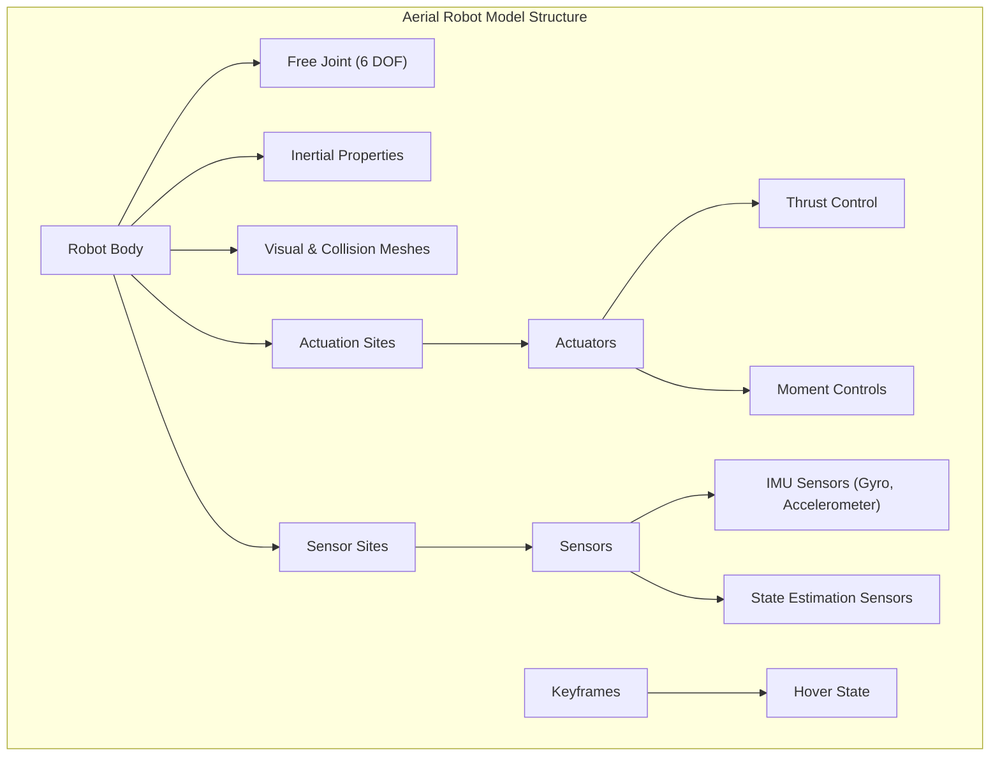
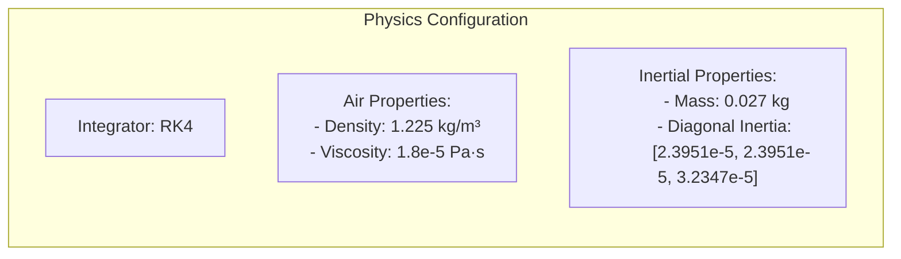
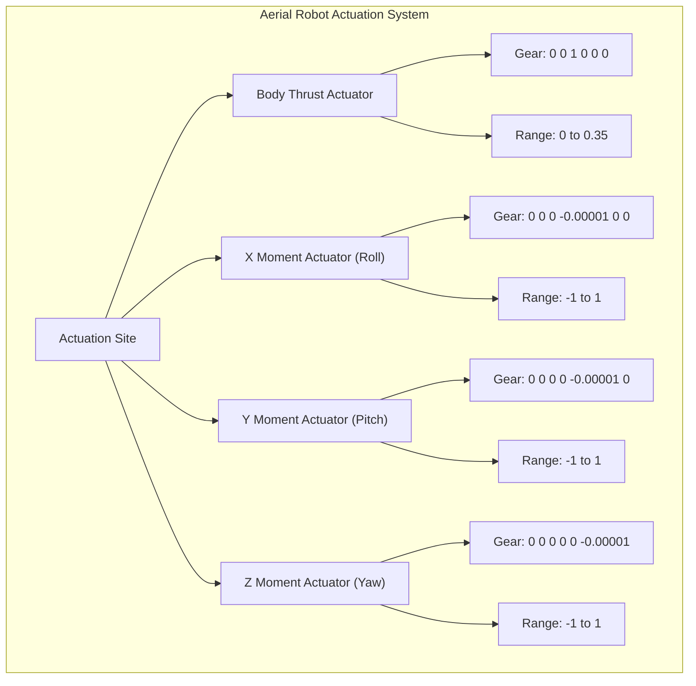
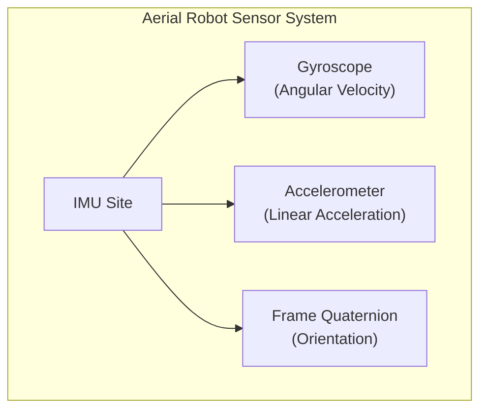

<!-- source: DeepWiki mcp.deepwiki.com · repo google-deepmind/mujoco_menagerie · page 7 Aerial Robots · fetched 2026-10-26 -->

# Aerial Robots

Relevant source files

The following files were used as context for generating this wiki page:

- [bitcraze_crazyflie_2/LICENSE](bitcraze_crazyflie_2/LICENSE)
- [bitcraze_crazyflie_2/README.md](bitcraze_crazyflie_2/README.md)
- [bitcraze_crazyflie_2/cf2.png](bitcraze_crazyflie_2/cf2.png)
- [bitcraze_crazyflie_2/cf2.xml](bitcraze_crazyflie_2/cf2.xml)

## Purpose and Scope

This document provides an overview of aerial robot models available in the MuJoCo Menagerie repository. These models represent unmanned aerial vehicles (UAVs) that can be simulated in the MuJoCo physics engine. Currently, the collection includes one quadrotor model, the Bitcraze Crazyflie 2. This page explains the general structure of aerial robot models and their implementation details, while specific model information can be found in the dedicated sub-pages.

For information about other robot categories, please refer to the related pages:
- For legged robots, see [Quadruped Robots](#3)
- For arm manipulators, see [Manipulator Arms](#4)
- For mobile ground robots, see [Mobile Platforms](#6)

Sources: [bitcraze_crazyflie_2/README.md:1-27]()

## Overview of Aerial Models

The aerial robot models in MuJoCo Menagerie are designed to accurately represent the physical and dynamic properties of their real-world counterparts. These models feature:

1. **Accurate Mass Properties**: Inertial parameters derived from manufacturer datasheets and academic research
2. **Detailed Mesh Geometry**: Visual and collision meshes converted from original CAD files
3. **Realistic Aerodynamics**: Basic aerodynamic effects modeled through MuJoCo's density and viscosity settings
4. **Control Interfaces**: Actuators that match the control inputs of the real robots
5. **Sensor Simulation**: Virtual sensors that correspond to on-board IMUs and other sensors

The following diagram illustrates the general structure of aerial robot models in the collection:

Sources: [bitcraze_crazyflie_2/cf2.xml:1-133]()

## Models in Collection

### Bitcraze Crazyflie 2

The Bitcraze Crazyflie 2 is a small, lightweight quadrotor platform popular in research and education. The model in MuJoCo Menagerie is a simplified representation derived from the publicly available ROS description, converted to MJCF format.

For detailed information about this model, see [Bitcraze Crazyflie 2](#7.1).

Sources: [bitcraze_crazyflie_2/README.md:5-9]()

## Model Implementation Details

### Physics Configuration

Aerial models in MuJoCo require specific physics settings to simulate flight dynamics. These include:

- **Integration Method**: RK4 (4th-order Runge-Kutta) for numerical accuracy
- **Fluid Properties**: Air density and viscosity settings to model aerodynamic effects
- **Inertial Properties**: Carefully calibrated mass and inertia values

Example from the Crazyflie 2 configuration:

Sources: [bitcraze_crazyflie_2/cf2.xml:1-4](), [bitcraze_crazyflie_2/cf2.xml:71]()

### Actuation System

Aerial robots in the collection use a simplified actuation model that captures the essential control inputs while abstracting the underlying propulsion system details:

This actuation system provides four control inputs:
1. **Body Thrust**: Vertical force along the body's z-axis
2. **X Moment**: Roll control (rotation around x-axis)
3. **Y Moment**: Pitch control (rotation around y-axis) 
4. **Z Moment**: Yaw control (rotation around z-axis)

Sources: [bitcraze_crazyflie_2/cf2.xml:117-122](), [bitcraze_crazyflie_2/README.md:22]()

### Sensor System

Aerial robot models include simulated sensors that correspond to the real robot's onboard sensing capabilities:

These sensors provide:
- **Gyroscope**: Angular velocity measurements around the three body axes
- **Accelerometer**: Linear acceleration measurements along the three body axes
- **Frame Quaternion**: Orientation of the robot relative to the world frame

Sources: [bitcraze_crazyflie_2/cf2.xml:124-128]()

### Mesh and Visual Representation

Aerial robot models include detailed mesh representations for both visual rendering and collision detection:

| Component Type | Purpose | Implementation |
|----------------|---------|----------------|
| Visual Meshes | Rendering for visualization | Separate meshes with materials for different components |
| Collision Meshes | Physics collision detection | Simplified geometry for computational efficiency |

The meshes are typically converted from CAD files through a process involving:
1. Conversion from original format (e.g., DAE) to OBJ format
2. Processing with tools like obj2mjcf
3. Organization into visual and collision components

Sources: [bitcraze_crazyflie_2/README.md:15-17](), [bitcraze_crazyflie_2/cf2.xml:18-66](), [bitcraze_crazyflie_2/cf2.xml:73-111]()

## Model Usage

### Keyframe States

Aerial models include predefined keyframe states that can be used to initialize the simulation in a stable configuration:

| Keyframe | Description | Parameters |
|----------|-------------|------------|
| hover | Stable hover position | Position: (0, 0, 0.1), Orientation: (1, 0, 0, 0), Control: (0.26487, 0, 0, 0) |

These keyframes provide convenient starting points for simulations and demonstrations.

Sources: [bitcraze_crazyflie_2/cf2.xml:130-132]()

### Control Interfaces

To control aerial robots in simulation, users can apply control signals to the actuators:

- **Direct Control**: Setting actuator values directly (e.g., thrust and moments)
- **Higher-Level Control**: Implementing feedback controllers that compute actuator values based on desired position, velocity, or attitude

Example control mapping for the Crazyflie 2:

| Control Input | Actuator | Effect |
|---------------|----------|--------|
| body_thrust | Vertical force | Controls altitude |
| x_moment | Roll torque | Controls lateral motion |
| y_moment | Pitch torque | Controls forward/backward motion |
| z_moment | Yaw torque | Controls heading |

Sources: [bitcraze_crazyflie_2/cf2.xml:117-122]()

## Development and Maintenance

### Model Creation Process

The aerial robot models are created through a systematic process:

1. **Source Acquisition**: Obtaining CAD files or URDF descriptions from manufacturers or public repositories
2. **Mesh Processing**: Converting and simplifying meshes for MuJoCo compatibility
3. **Parameter Identification**: Setting accurate mass, inertia, and actuation parameters
4. **Model Validation**: Testing the model behavior against real-world data
5. **Documentation**: Creating comprehensive documentation of the model's properties and usage

Sources: [bitcraze_crazyflie_2/README.md:15-23]()

### Licensing

Aerial robot models in the collection are typically released under open-source licenses. For example, the Bitcraze Crazyflie 2 model is released under the MIT License, which allows for free use, modification, and distribution.

Sources: [bitcraze_crazyflie_2/LICENSE:1-10](), [bitcraze_crazyflie_2/README.md:25-27]()

---

