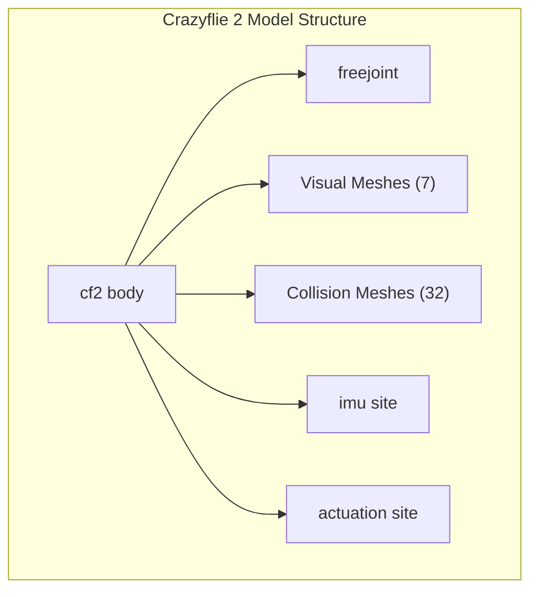
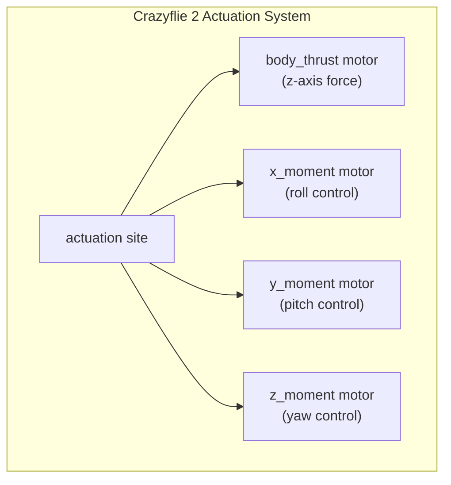
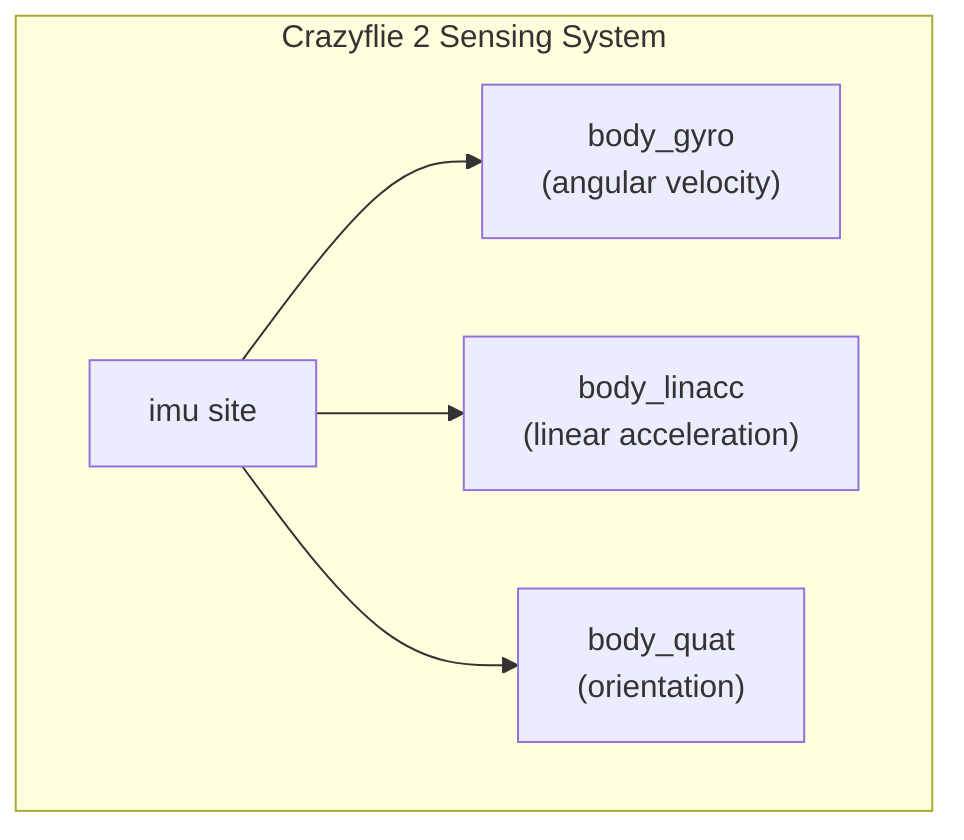
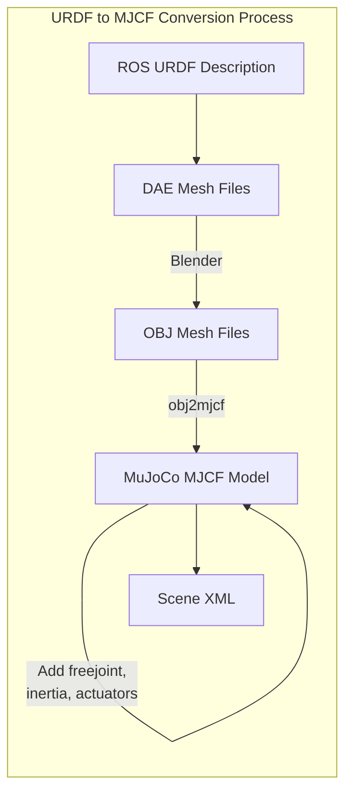
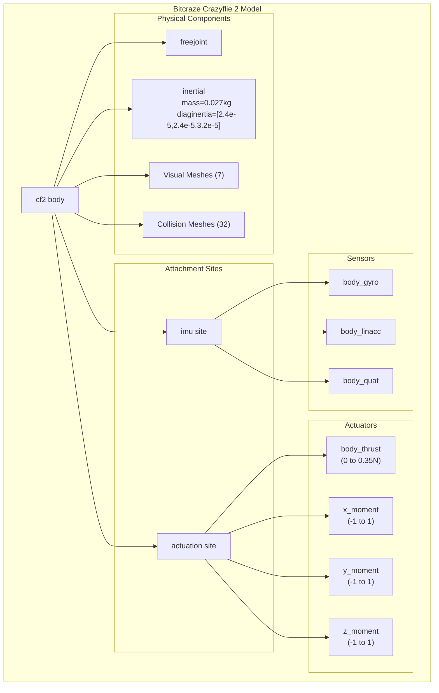

<!-- source: DeepWiki mcp.deepwiki.com · repo google-deepmind/mujoco_menagerie · page 7.1 Bitcraze Crazyflie 2 · fetched 2026-10-26 -->

# Bitcraze Crazyflie 2

Relevant source files

The following files were used as context for generating this wiki page:

- [bitcraze_crazyflie_2/LICENSE](bitcraze_crazyflie_2/LICENSE)
- [bitcraze_crazyflie_2/README.md](bitcraze_crazyflie_2/README.md)
- [bitcraze_crazyflie_2/cf2.png](bitcraze_crazyflie_2/cf2.png)
- [bitcraze_crazyflie_2/cf2.xml](bitcraze_crazyflie_2/cf2.xml)

## Purpose and Scope

This document provides detailed technical information about the Bitcraze Crazyflie 2 quadrotor model implemented in MuJoCo Menagerie. It covers the model's structure, physical properties, actuation system, and sensing capabilities, specifically focusing on the MJCF representation used for simulation in MuJoCo. This documentation is intended for users who want to understand or utilize the Crazyflie 2 model for robotics research and simulation.

Sources: [bitcraze_crazyflie_2/README.md:1-14]()

## Model Overview

The Bitcraze Crazyflie 2 is a small, lightweight quadrotor drone model that has been converted from the publicly available ROS description to MuJoCo's MJCF format. The model requires MuJoCo 2.2.2 or later for proper operation. It features a detailed visual representation with collision meshes, accurate inertial properties, and a simplified actuation system.

Key specifications:
- Mass: 0.027 kg (27 grams)
- Inertia tensor (diagonal): [2.3951e-5, 2.3951e-5, 3.2347e-5] kg⋅m²
- Origin-centered inertial frame

The model uses the RK4 integrator with standard atmospheric properties:
- Air density: 1.225 kg/m³
- Air viscosity: 1.8e-5 Pa⋅s

Sources: [bitcraze_crazyflie_2/README.md:5-9](), [bitcraze_crazyflie_2/cf2.xml:1-4](), [bitcraze_crazyflie_2/cf2.xml:71]()

## Model Structure

### Physical Components

The Crazyflie 2 model consists of a single rigid body with detailed visual and collision meshes. The model includes:
- 7 visual mesh components with different materials for realistic appearance
- 32 collision mesh components for accurate physical interaction
- A free joint allowing full 6-DOF motion
- Attachment sites for sensors and actuators

The model's physical structure is defined as follows:

Sources: [bitcraze_crazyflie_2/cf2.xml:68-114]()

### Mesh Components

The model uses multiple mesh files to represent both visual appearance and collision geometry:
- Visual meshes (7 components): Represent different parts of the drone with various materials
- Collision meshes (32 components): Used for physical interaction simulation

Materials used in the visual representation include:
- `propeller_plastic`: For the propellers
- `medium_gloss_plastic`: For certain body components 
- `polished_gold`: For metallic-appearing elements
- `body_frame_plastic`: For the main frame
- And others for detailed visual fidelity

Sources: [bitcraze_crazyflie_2/cf2.xml:17-66](), [bitcraze_crazyflie_2/cf2.xml:73-79]()

## Actuation System

The Crazyflie 2 model uses a simplified actuation approach, with four actuators representing the combined effects of the four propellers:

1. `body_thrust`: Represents the total thrust force along the z-axis (0 to 0.35 N)
2. `x_moment`: Controls roll rotation (-1 to 1, scaled by 1e-5 Nm)
3. `y_moment`: Controls pitch rotation (-1 to 1, scaled by 1e-5 Nm)
4. `z_moment`: Controls yaw rotation (-1 to 1, scaled by 1e-5 Nm)

All actuators are attached to the "actuation" site located at the drone's center of mass.

The actuation system is designed to represent the combined effect of the four physical motors and propellers rather than modeling them individually, which simplifies the model while preserving accurate dynamic behavior.

Sources: [bitcraze_crazyflie_2/cf2.xml:117-122](), [bitcraze_crazyflie_2/README.md:22]()

## Sensing Capabilities

The model includes three sensor types attached to the "imu" site:

1. `body_gyro`: Gyroscope sensor for angular velocity measurement
2. `body_linacc`: Accelerometer for linear acceleration measurement
3. `body_quat`: Quaternion sensor for orientation measurement

These sensors simulate the IMU (Inertial Measurement Unit) capabilities of the physical Crazyflie 2 drone, providing feedback necessary for stabilization and control algorithms.

Sources: [bitcraze_crazyflie_2/cf2.xml:124-128]()

## Model Usage and Keyframes

The model includes a predefined "hover" keyframe that positions the drone at a height of 0.1 meters with appropriate control inputs to maintain stable hovering:
- Position: [0, 0, 0.1]
- Orientation: [1, 0, 0, 0] (quaternion)
- Control values: [0.26487, 0, 0, 0]

This keyframe can be used as a starting point for simulation or to reset the drone to a stable hovering state.

Sources: [bitcraze_crazyflie_2/cf2.xml:130-132]()

## Model Conversion Process

The Crazyflie 2 model was converted from URDF to MJCF format through the following process:

1. Converting DAE mesh files to OBJ format using Blender
2. Processing the OBJ files with obj2mjcf tool
3. Adding a freejoint and lighting elements
4. Setting inertial properties based on the manufacturer's datasheet and MIT's system identification research
5. Adding thrust and moment actuators at the inertial frame
6. Creating a scene file with environmental elements

Sources: [bitcraze_crazyflie_2/README.md:15-24]()

## Complete Model Diagram

Sources: [bitcraze_crazyflie_2/cf2.xml:1-133]()

## License

The Bitcraze Crazyflie 2 model is released under the MIT License, allowing for free use, modification, and distribution with proper attribution.

Sources: [bitcraze_crazyflie_2/LICENSE:1-9](), [bitcraze_crazyflie_2/README.md:25-27]()

---

