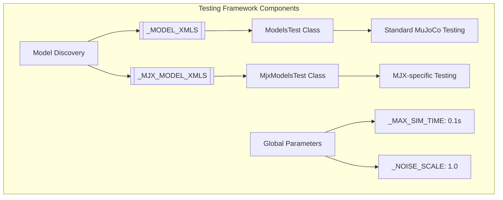
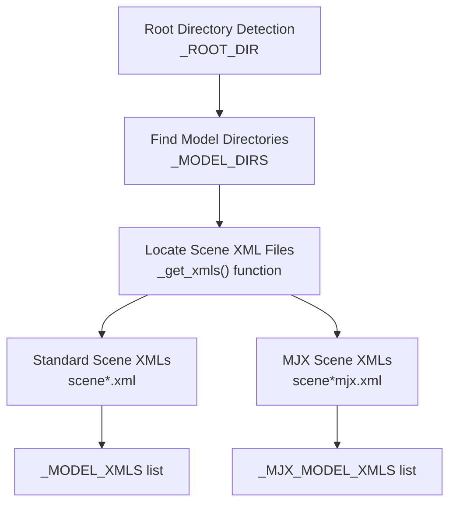
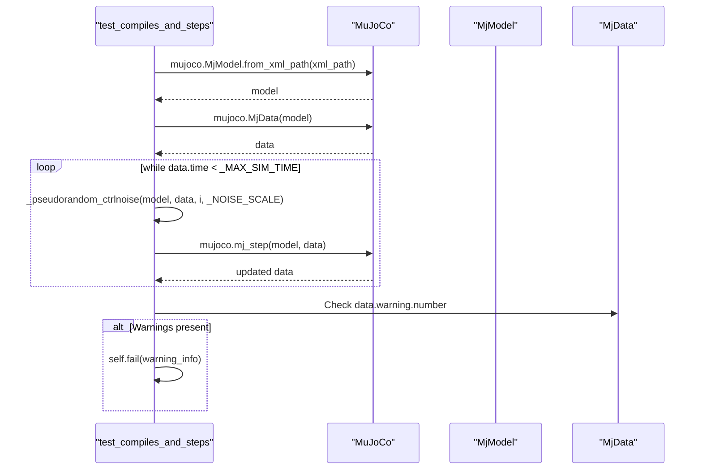
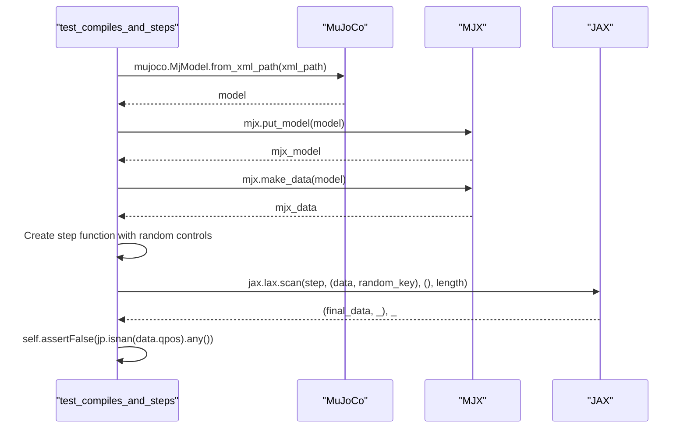
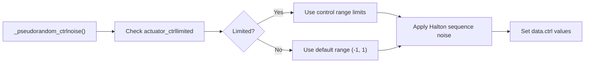
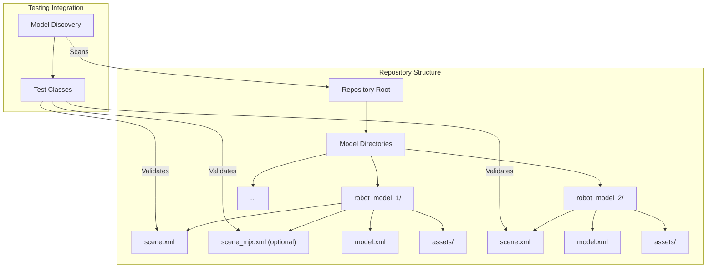

<!-- source: DeepWiki mcp.deepwiki.com · repo google-deepmind/mujoco_menagerie · page 8 Testing Framework · fetched 2026-10-26 -->

# Testing Framework

<details>
<summary>Relevant source files</summary>

The following files were used as context for generating this wiki page:

- [hello_robot_stretch/README.md](hello_robot_stretch/README.md)
- [hello_robot_stretch/stretch.xml](hello_robot_stretch/stretch.xml)
- [hello_robot_stretch_3/README.md](hello_robot_stretch_3/README.md)
- [hello_robot_stretch_3/stretch.xml](hello_robot_stretch_3/stretch.xml)
- [test/model_test.py](test/model_test.py)
- [test/requirements.txt](test/requirements.txt)

</details>


## Purpose and Scope

The Testing Framework provides an automated validation system for all robot models in the MuJoCo Menagerie repository. It ensures that each model can be properly loaded, compiled, and simulated without errors or warnings. The framework includes separate testing processes for both standard MuJoCo models and models compatible with MJX (the JAX-based implementation of MuJoCo).

Sources: [test/model_test.py:14-15]()

## Framework Overview

The testing system consists of two primary components:

1. A model discovery mechanism that automatically locates all robot models in the repository
2. Testing classes that validate both standard MuJoCo models and MJX-compatible models

### Testing Framework Architecture



Sources: [test/model_test.py:29-33](), [test/model_test.py:42-48]()

## Model Discovery

The testing framework automatically discovers models to test by scanning the repository structure. It uses a root directory reference and pattern matching to find model XML files.

### Directory Scanning Logic



Sources: [test/model_test.py:29-33](), [test/model_test.py:35-43]()

The model discovery process functions as follows:

1. The framework identifies the root directory of the repository
2. It collects all top-level directories as potential model directories
3. For each directory, it searches for:
   - Standard scene files matching the pattern `scene*.xml`
   - MJX-compatible scene files matching the pattern `scene*mjx.xml`
4. The discovery results are stored in two lists for testing:
   - `_MODEL_XMLS` for standard MuJoCo models
   - `_MJX_MODEL_XMLS` for MJX-compatible models

Sources: [test/model_test.py:35-43]()

## Test Classes

The testing framework defines two main test classes that handle different types of model validation:

### ModelsTest Class

The `ModelsTest` class validates standard MuJoCo models by:

1. Loading the model XML file
2. Creating an MjData instance
3. Running simulation steps with pseudorandom control inputs
4. Checking for any MuJoCo warnings that occurred during simulation

```python
class ModelsTest(parameterized.TestCase):
    """Tests that MuJoCo models load and do not emit warnings."""
    
    @parameterized.named_parameters(_MODEL_XMLS)
    def test_compiles_and_steps(self, xml_path: pathlib.Path) -> None:
        # Load the model, run simulation, check for warnings
```

Sources: [test/model_test.py:68-86]()

### MjxModelsTest Class

The `MjxModelsTest` class validates MJX-compatible models by:

1. Loading the model XML file
2. Converting it to an MJX model
3. Running simulation steps using JAX's scan operation
4. Checking for NaN values in the simulation results

```python
class MjxModelsTest(parameterized.TestCase):
    """Tests that MJX models load and do not return NaNs."""
    
    @parameterized.named_parameters(_MJX_MODEL_XMLS)
    def test_compiles_and_steps(self, xml_path: pathlib.Path) -> None:
        # Load model, convert to MJX, run simulation, check for NaNs
```

Sources: [test/model_test.py:89-123]()

## Simulation Process

### Standard MuJoCo Simulation Test

For standard MuJoCo models, the testing process follows this sequence:



Sources: [test/model_test.py:72-86]()

### MJX Simulation Test

For MJX-compatible models, the testing process differs to account for JAX's functional programming approach:



Sources: [test/model_test.py:93-123]()

## Control Input Generation

Both test classes use techniques to generate control inputs to exercise the models during testing:

### Pseudorandom Control for Standard MuJoCo

The standard MuJoCo test uses a deterministic pseudorandom control input generator based on the Halton sequence:



Sources: [test/model_test.py:51-65]()

### Random Control for MJX

The MJX test uses JAX's random number generation to create control inputs:

```python
# Control range determination
ctrlrange = jp.where(
    model.actuator_ctrllimited[:, None],
    model.actuator_ctrlrange,
    jp.array([-10.0, 10.0]),
)

# Random control generation in step function
ctrl = jax.random.uniform(
    key,
    shape=(model.nu,),
    minval=ctrlrange[:, 0],
    maxval=ctrlrange[:, 1],
)
```

Sources: [test/model_test.py:97-111]()

## Test Parameters

The testing framework uses several global parameters to configure the testing process:

| Parameter | Value | Description |
|-----------|-------|-------------|
| `_MAX_SIM_TIME` | 0.1 | Maximum simulation duration in seconds |
| `_NOISE_SCALE` | 1.0 | Scale factor for pseudorandom control noise |

Sources: [test/model_test.py:46-48]()

## Dependencies

The testing framework has several dependencies specified in the requirements file:

| Dependency | Version | Purpose |
|------------|---------|---------|
| mujoco | >=3.2.0 | Core MuJoCo physics engine |
| mujoco-mjx | - | JAX-based implementation of MuJoCo |
| absl-py | - | Google's Abseil Python Common Libraries (for testing utilities) |
| pytest-xdist | - | Pytest plugin for distributed testing |

Sources: [test/requirements.txt:1-4]()

## Usage in the Repository

To run the tests, you would typically:

1. Install the required dependencies:
   ```bash
   pip install -r test/requirements.txt
   ```

2. Run the tests:
   ```bash
   python -m test.model_test
   ```

The tests will automatically discover all models in the repository and validate them according to the standards described above.

Sources: [test/model_test.py:125-126]()

## Integration with Repository Structure

The testing framework is designed to work with the standard model directory structure in the MuJoCo Menagerie repository:



The testing framework is structured to automatically adapt to new models added to the repository without requiring changes to the test code itself, as long as the new models follow the established directory structure pattern.

Sources: [test/model_test.py:29-43](), [hello_robot_stretch/README.md:6-11](), [hello_robot_stretch_3/README.md:6-12]()

---

