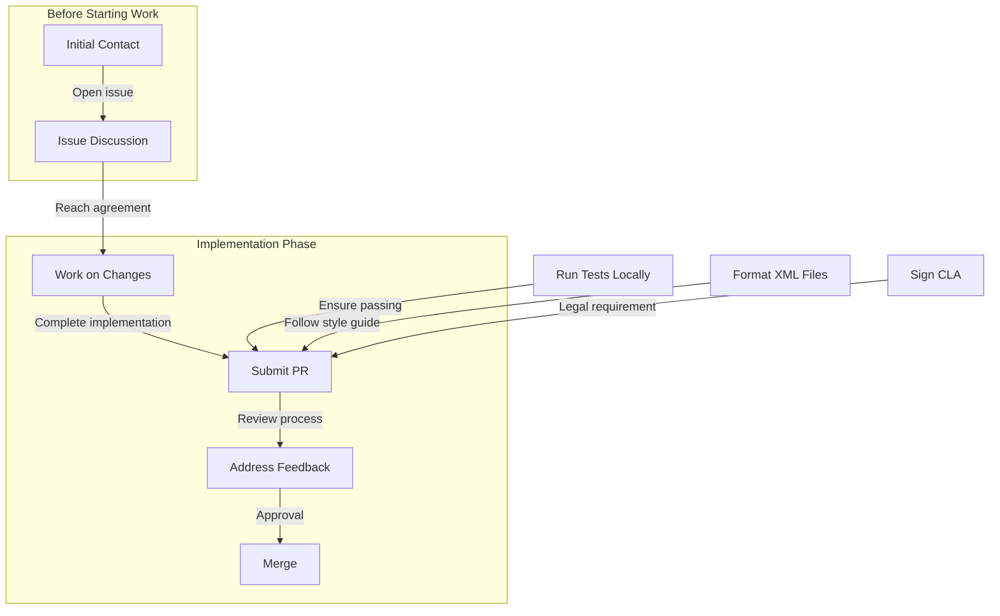
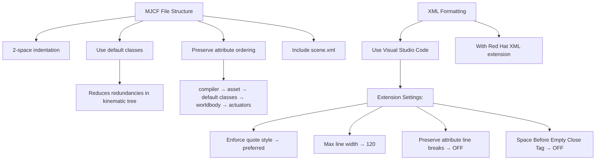
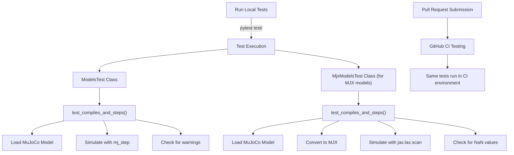
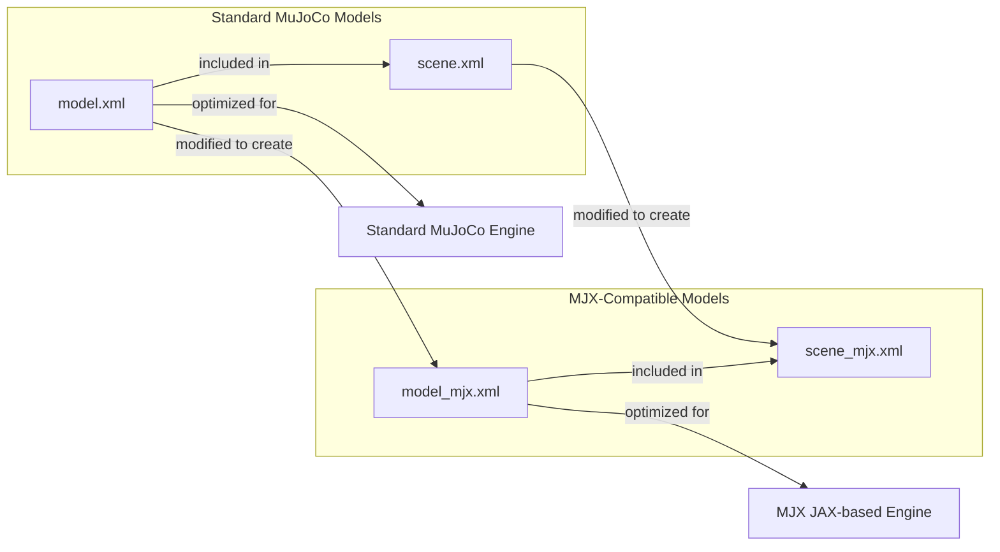
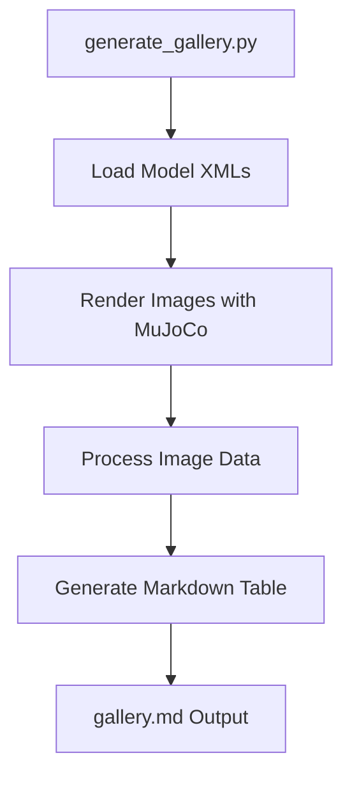

<!-- source: DeepWiki mcp.deepwiki.com · repo google-deepmind/mujoco_menagerie · page 9 Contributing · fetched 2026-10-26 -->

# Contributing

<details>
<summary>Relevant source files</summary>

The following files were used as context for generating this wiki page:

- [CONTRIBUTING.md](CONTRIBUTING.md)
- [FAQ.md](FAQ.md)
- [README.md](README.md)
- [assets/agilex_piper-piper.png](assets/agilex_piper-piper.png)
- [assets/booster_t1-t1.png](assets/booster_t1-t1.png)
- [franka_emika_panda/README.md](franka_emika_panda/README.md)
- [franka_emika_panda/mjx_panda.xml](franka_emika_panda/mjx_panda.xml)
- [franka_emika_panda/mjx_scene.xml](franka_emika_panda/mjx_scene.xml)
- [franka_emika_panda/mjx_single_cube.xml](franka_emika_panda/mjx_single_cube.xml)
- [generate_gallery.py](generate_gallery.py)

</details>


This page provides guidelines for contributing to the MuJoCo Menagerie repository. It covers the contribution process, model standards, testing requirements, and legal considerations. MuJoCo Menagerie is a collection of high-quality robot models for the MuJoCo physics engine, curated by Google DeepMind.

## Purpose and Scope of Contributions

MuJoCo Menagerie aims to be a community-driven collection of high-quality robot models that continuously improves over time. The repository welcomes three primary types of contributions:

1. **Bug fixes** for existing models
2. **Improvements** to model realism (e.g., through system identification)
3. **New models** that expand the collection

All contributions must adhere to [Google's Open Source Community Guidelines](https://opensource.google/conduct/).

Sources: [CONTRIBUTING.md:1-12](), [README.md:143-167]()

## Contribution Process

The contribution process follows a standard open-source workflow with some specific requirements to ensure model quality.

### Diagram: Contribution Workflow



Sources: [CONTRIBUTING.md:14-24]()

### Initial Contact

Before starting work on any contribution, especially major ones, first open an issue in the [GitHub repository](https://github.com/google-deepmind/mujoco_menagerie/issues). This helps:

- Coordinate efforts and avoid duplicate work
- Ensure your contribution aligns with the repository's goals
- Get early feedback on your approach

Only begin implementation after reaching an agreement on the proposed changes.

Sources: [CONTRIBUTING.md:17-20]()

### Pull Request Submission

Once you've completed your implementation:

1. Ensure all tests pass locally
2. Format your XML files according to the style guidelines
3. Submit a [pull request](https://github.com/google-deepmind/mujoco_menagerie/pulls)
4. Sign the Contributor License Agreement (CLA) if you haven't already
5. Address any feedback during the review process

Sources: [CONTRIBUTING.md:22-24](), [CONTRIBUTING.md:67-77]()

## Model Quality Standards

MuJoCo Menagerie maintains a grading system to help users understand the quality of each model. This system emphasizes the goal of making models as realistic as possible over time.

### Model Quality Grading

| Grade | Description |
|-------|-------------|
| A+    | Values are the product of proper system identification |
| A     | Values are realistic, but have not been properly identified |
| B     | Stable, but some values are unrealistic |
| C     | Conditionally stable, can be significantly improved |

Sources: [README.md:155-161]()

## XML Style Guidelines

Consistency in MJCF (XML) files is important for readability and maintainability of the repository. The following diagram illustrates key style elements:

### Diagram: XML Style Structure



Sources: [CONTRIBUTING.md:27-51]()

### Key Style Points

1. Use 2-space indentation
2. Make use of default classes to reduce redundancies in the kinematic tree
3. Follow consistent attribute ordering:
   - compiler
   - asset and default class definitions
   - worldbody and actuators
4. Always include a `scene.xml` that includes the model

### Formatting Tool

The repository uses Visual Studio Code with the XML Language Support by Red Hat extension for consistent formatting. Configure the extension with these settings:

- Enforce quote style: preferred
- Max line width: 120
- Preserve attribute line breaks: OFF
- Space Before Empty Close Tag: OFF

After configuration, format documents using the "Format Document" command.

Sources: [CONTRIBUTING.md:39-51]()

## Model Directory Structure

All models in the MuJoCo Menagerie follow a consistent directory structure to ensure ease of use and integration.

### Diagram: Model Directory Structure

```mermaid
graph TD
    ModelDir["Robot Model Directory"] --> Assets["assets/"]
    ModelDir --> ModelXML["model.xml"]
    ModelDir --> SceneXML["scene.xml"]
    ModelDir --> License["LICENSE"]
    ModelDir --> ReadmeMD["README.md"]
    ModelDir --> MJXModel["model_mjx.xml (optional)"]
    ModelDir --> MJXScene["scene_mjx.xml (optional)"]
    ModelDir --> ModelPNG["model.png"]
    
    Assets --> Meshes["Mesh files (.obj/.stl)"]
    Assets --> Textures["Texture files"]
    
    ModelXML --> KinematicTree["Robot kinematic tree"]
    ModelXML --> NoOtherEntities["No other entities in tree"]
    
    SceneXML --> IncludeModel["Includes model.xml"]
    SceneXML --> Environment["Plane, light sources, etc."]
    
    MJXModel --> MJXCompatibility["MJX-compatible version"]
    MJXScene --> IncludeMJXModel["Includes model_mjx.xml"]
    
    ReadmeMD --> ModelDescription["Model description"]
    ReadmeMD --> DerivationSteps["URDF → MJCF steps"]
    
    License --> CopyrightInfo["Copyright and license info"]
```



Sources: [README.md:63-99](), [franka_emika_panda/README.md:1-54]()

### Key Components

- `assets/`: Contains 3D meshes (.stl or .obj) used for visual and collision purposes
- `model.xml`: The main MJCF definition of the model (contains only the robot, no environment)
- `scene.xml`: Includes `model.xml` and adds environment elements like a plane and light source
- `LICENSE`: Describes the copyright and licensing terms for the model
- `README.md`: Contains detailed documentation of how the model was generated
- `model_mjx.xml` and `scene_mjx.xml`: Optional MJX-compatible versions (when available)
- `model.png`: A rendered image of the model in its scene

Sources: [README.md:82-99](), [franka_emika_panda/README.md:42-54]()

## Testing Contributions

Before submitting a pull request, you should verify that your model passes the basic tests. The testing framework ensures that models can be loaded and simulated without stability issues.

### Diagram: Testing Process



Sources: [CONTRIBUTING.md:53-65]()

### Running Tests Locally

To test your changes locally before submitting a PR:

```bash
pytest test/
```

This tests all models by:
1. Loading each model
2. Simulating it for a fixed duration
3. Checking for simulation instabilities

The same tests will run on GitHub CI when you open your PR.

Sources: [CONTRIBUTING.md:55-65]()

## MJX Compatibility

Some models in the repository have MJX-compatible versions. MJX is a JAX-based implementation of MuJoCo that enables GPU acceleration and automatic differentiation.

### Diagram: MJX Model Relationship



Sources: [README.md:89-95](), [franka_emika_panda/README.md:43-54](), [franka_emika_panda/mjx_panda.xml:1-258](), [franka_emika_panda/mjx_scene.xml:1-33]()

### MJX Model Creation Process

When creating an MJX-compatible version of a model, common adaptations include:

1. Modifying collision geometries (often simplifying to reduce computational load)
2. Tuning solver parameters for performance
3. Adjusting actuator parameters for more stable simulation
4. Adding necessary sites for functionality
5. Modifying tendons and actuators as needed

Sources: [franka_emika_panda/README.md:46-54]()

## Contributor License Agreement

Contributions to the MuJoCo Menagerie repository must be accompanied by a Contributor License Agreement (CLA). This gives Google permission to use and redistribute your contributions as part of the project.

### CLA Process

1. Visit [https://cla.developers.google.com/](https://cla.developers.google.com/) to see your current agreements or sign a new one.
2. You generally only need to submit a CLA once, so if you've already submitted one for another Google project, you likely don't need to do it again.

Sources: [CONTRIBUTING.md:67-77]()

## Gallery Generation

The repository includes a script to generate a gallery of model images for the README. While not directly related to contributing new models, understanding this process can be helpful if you're submitting a PR that should be reflected in the gallery.

### Diagram: Gallery Generation Process



Sources: [generate_gallery.py:1-482]()