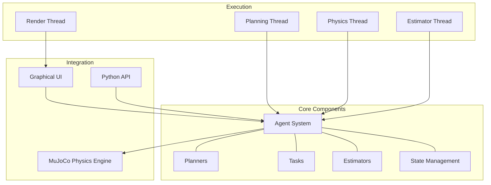
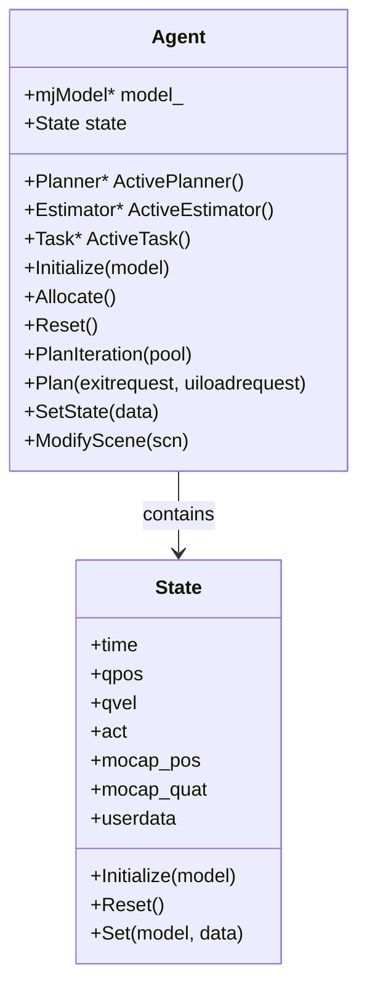
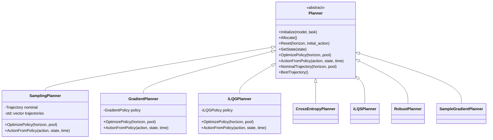
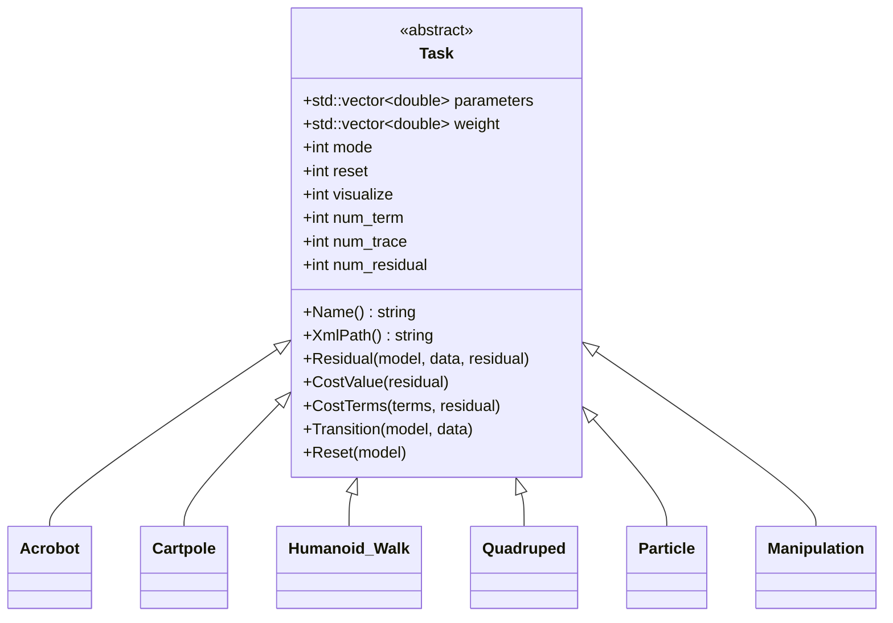
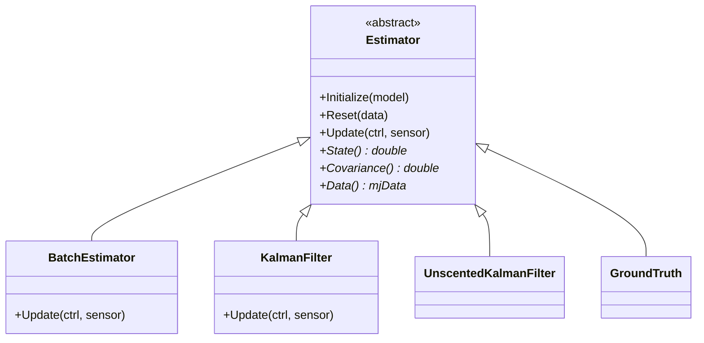
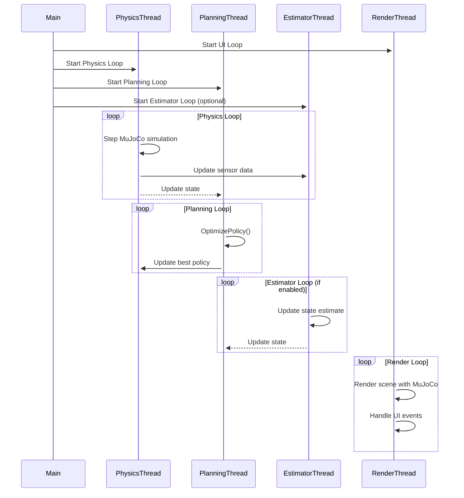
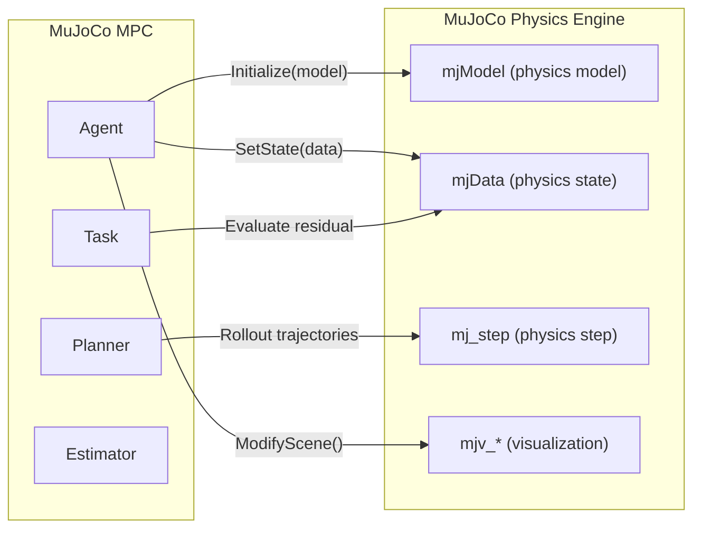
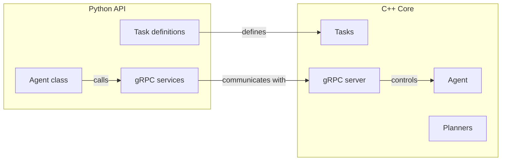

<!-- source: DeepWiki mcp.deepwiki.com · repo google-deepmind/mujoco_mpc · page 1 Overview · fetched 2026-10-26 -->

# Overview

Relevant source files

The following files were used as context for generating this wiki page:

- [README.md](README.md)
- [mjpc/CMakeLists.txt](mjpc/CMakeLists.txt)
- [mjpc/agent.cc](mjpc/agent.cc)
- [mjpc/agent.h](mjpc/agent.h)
- [mjpc/app.cc](mjpc/app.cc)
- [mjpc/app.h](mjpc/app.h)
- [mjpc/interface.cc](mjpc/interface.cc)
- [mjpc/interface.h](mjpc/interface.h)
- [mjpc/main.cc](mjpc/main.cc)
- [mjpc/planners/include.cc](mjpc/planners/include.cc)
- [mjpc/planners/planner.cc](mjpc/planners/planner.cc)
- [mjpc/simulate.cc](mjpc/simulate.cc)
- [mjpc/simulate.h](mjpc/simulate.h)
- [mjpc/tasks/tasks.cc](mjpc/tasks/tasks.cc)
- [mjpc/tasks/tasks.h](mjpc/tasks/tasks.h)
- [python/setup.py](python/setup.py)

MuJoCo MPC (MJPC) is a comprehensive framework developed by Google DeepMind for real-time Model Predictive Control (MPC) using the MuJoCo physics engine. It provides an interactive application and software stack that enables researchers and engineers to author, solve, and visualize complex robotics tasks with different planning algorithms. This page provides a high-level overview of the system architecture, core components, and execution model.

## Purpose and Core Capabilities

MuJoCo MPC serves as:
1. An interactive application for testing and visualizing MPC solutions
2. A software framework for implementing custom MPC problems
3. A testbed for comparing different planning algorithms on robotics tasks

The framework supports multiple planning methods including:
- Sampling-based planners (Predictive Sampling, Cross Entropy)
- Derivative-based planners (iLQG, Gradient Descent)
- Hybrid approaches (Sample Gradient)

Sources: [README.md:14-21](), [mjpc/planners/include.cc:30-37]()

## System Architecture

The system is built around several key components that work together to provide the MPC functionality:

Sources: [mjpc/agent.h:44-256](), [mjpc/app.cc:483-502]()

## Core Components in Detail

### Agent System

The Agent is the central orchestrator of the MPC process. It:
- Initializes and manages the models, planners, estimators, and tasks
- Coordinates the planning and execution loops
- Handles state transitions and updates
- Provides visualization and UI elements

The Agent class maintains the planning model, state information, and references to the active planner, estimator, and task. It provides methods for initialization, memory allocation, and resetting the system, as well as for planning iterations and state updates.

Sources: [mjpc/agent.h:44-256](), [mjpc/agent.cc:60-164]()

### Planning System

MuJoCo MPC includes several planning algorithms, each implemented as a subclass of the `Planner` base class:

The different planners implement various optimization strategies:
- **SamplingPlanner**: Generates random action sequences and selects the best
- **GradientPlanner**: Uses gradient information to optimize action sequences
- **iLQGPlanner**: Implements iterative Linear Quadratic Gaussian control
- **iLQSPlanner**: Iterative Linear Quadratic regulator for constrained systems
- **CrossEntropyPlanner**: Uses the Cross Entropy Method for sampling
- **RobustPlanner**: Adds robustness to other planners
- **SampleGradientPlanner**: Combines sampling and gradient-based approaches

Sources: [mjpc/planners/include.cc:30-53](), [mjpc/CMakeLists.txt:84-120]()

### Task System

Tasks define the objectives and environments for the MPC problem:

MJPC includes over 20 pre-defined tasks covering a wide range of robotics problems:
- Basic control (Cartpole, Acrobot, Particle)
- Locomotion (Humanoid walking, Quadruped)
- Manipulation (Bimanual handover, reorientation)
- Complex coordination (Rubik's cube, Shadow hand)

Each task defines:
- A residual function that computes the cost/objective
- Transition logic for managing task phases
- Visualization elements for the UI
- Task-specific parameters and weights

Sources: [mjpc/tasks/tasks.cc:46-73](), [mjpc/CMakeLists.txt:37-84]()

### Estimator System

Estimators provide state estimation capabilities when direct state measurement isn't available:

The available estimators include:
- **BatchEstimator**: Performs batch estimation
- **KalmanFilter**: Standard Kalman Filter implementation
- **UnscentedKalmanFilter**: Unscented Kalman Filter for nonlinear systems
- **GroundTruth**: Uses direct state information (no estimation)

Sources: [mjpc/CMakeLists.txt:123-131](), [mjpc/agent.cc:120-126]()

## Execution Model

MuJoCo MPC employs a multi-threaded architecture to efficiently handle planning, physics simulation, state estimation, and rendering:

The system operates with the following threads:
1. **Physics Thread**: Runs the MuJoCo simulation at a high frequency
2. **Planning Thread**: Continuously optimizes the control policy
3. **Estimator Thread** (optional): Updates state estimates from sensor data
4. **Render Thread**: Handles UI and visualization

Thread synchronization is carefully managed to ensure efficient operation without deadlocks.

Sources: [mjpc/app.cc:128-386](), [mjpc/agent.cc:359-371]()

## Integration with MuJoCo

MuJoCo MPC tightly integrates with the MuJoCo physics engine:

Key integration points include:
- Using MuJoCo's `mjModel` to define the physics model
- Using `mjData` to track the physics state
- Using MuJoCo's `mj_step` function for forward simulation
- Using MuJoCo's visualization functions for rendering
- Adding callbacks for controllers and sensors

Sources: [mjpc/agent.cc:69-114](), [mjpc/app.cc:84-103]()

## Python API

MuJoCo MPC also provides a Python API for use in Python applications:

The Python API:
- Uses gRPC to communicate with the C++ core
- Provides a similar interface to the C++ API
- Allows for task definition and control from Python
- Enables integration with other Python libraries

Sources: [python/setup.py:15-315](), [README.md:157-198]()

## Summary

MuJoCo MPC provides a comprehensive framework for implementing Model Predictive Control for robotics applications using the MuJoCo physics engine. Its modular architecture allows for easy extension with new planners, tasks, and estimators, while its multi-threaded execution model ensures efficient real-time performance. The system can be used both as an interactive application through its GUI and as a software library through its C++ and Python APIs.

---

