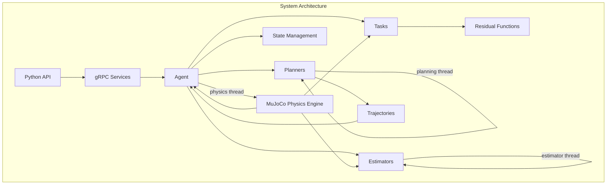
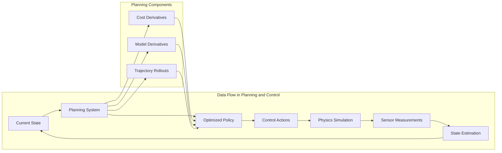
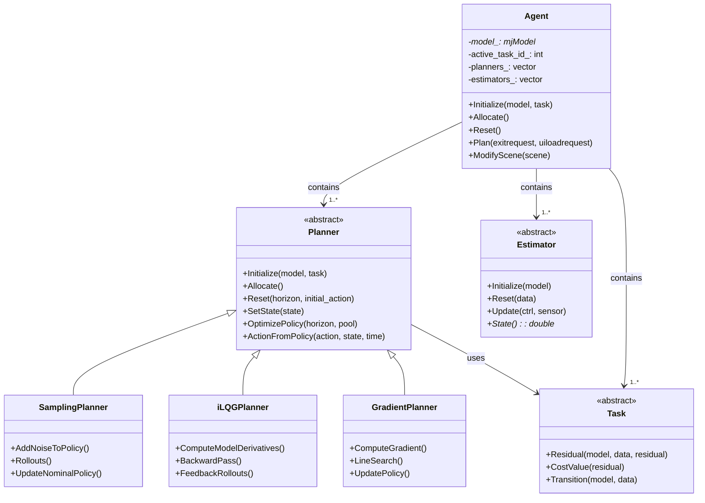
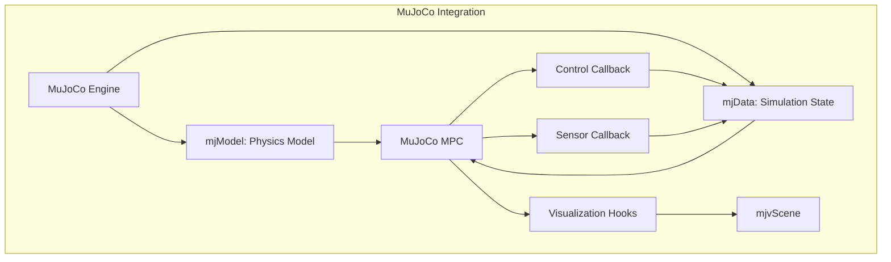
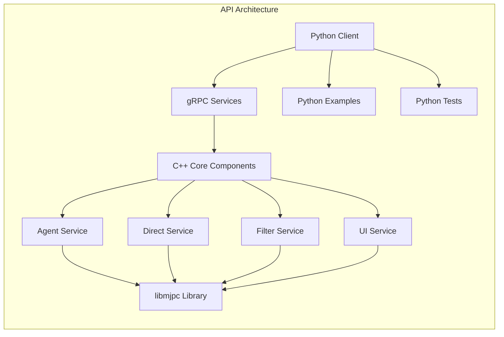
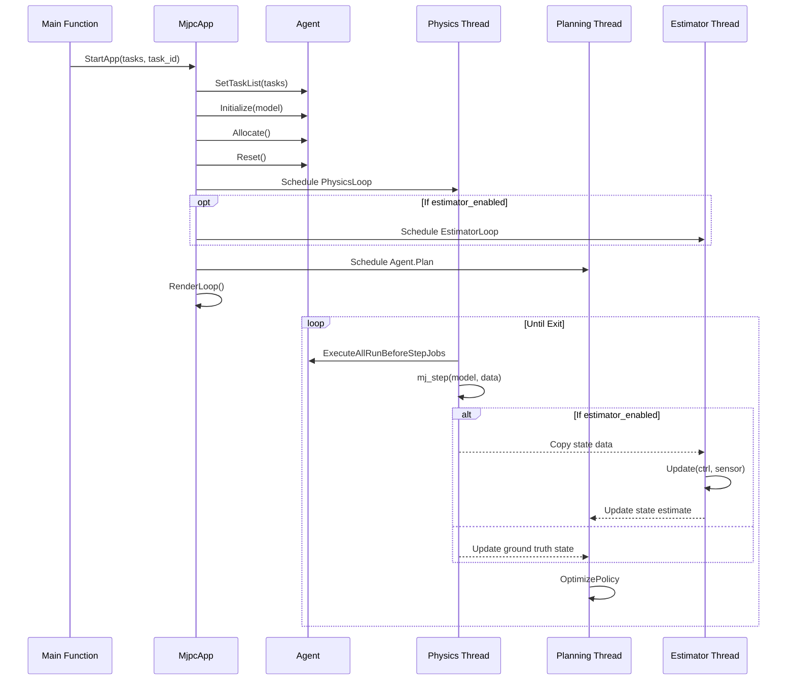

<!-- source: DeepWiki mcp.deepwiki.com · repo google-deepmind/mujoco_mpc · page 2 System Architecture · fetched 2026-10-26 -->

# System Architecture

Relevant source files

The following files were used as context for generating this wiki page:

- [mjpc/agent.cc](mjpc/agent.cc)
- [mjpc/agent.h](mjpc/agent.h)
- [mjpc/app.cc](mjpc/app.cc)
- [mjpc/app.h](mjpc/app.h)
- [mjpc/estimators/estimator.h](mjpc/estimators/estimator.h)
- [mjpc/main.cc](mjpc/main.cc)
- [mjpc/planners/gradient/planner.cc](mjpc/planners/gradient/planner.cc)
- [mjpc/planners/gradient/planner.h](mjpc/planners/gradient/planner.h)
- [mjpc/planners/ilqg/planner.cc](mjpc/planners/ilqg/planner.cc)
- [mjpc/planners/ilqg/planner.h](mjpc/planners/ilqg/planner.h)
- [mjpc/planners/ilqs/planner.cc](mjpc/planners/ilqs/planner.cc)
- [mjpc/planners/ilqs/planner.h](mjpc/planners/ilqs/planner.h)
- [mjpc/planners/planner.cc](mjpc/planners/planner.cc)
- [mjpc/planners/planner.h](mjpc/planners/planner.h)
- [mjpc/planners/sampling/planner.cc](mjpc/planners/sampling/planner.cc)
- [mjpc/planners/sampling/planner.h](mjpc/planners/sampling/planner.h)
- [mjpc/simulate.cc](mjpc/simulate.cc)
- [mjpc/simulate.h](mjpc/simulate.h)
- [mjpc/test/utilities/utilities_test.cc](mjpc/test/utilities/utilities_test.cc)
- [mjpc/utilities.cc](mjpc/utilities.cc)
- [mjpc/utilities.h](mjpc/utilities.h)

The MuJoCo MPC framework provides a comprehensive architecture for implementing Model Predictive Control (MPC) for robotics applications, built on top of the MuJoCo physics simulation engine. This document describes the overall system architecture, including component relationships, threading model, and data flow mechanisms.

For information about specific implementations of planners, see [Planners](#4), and for information about state estimation, see [Estimators](#5).

## Core Architecture

The MuJoCo MPC system is built around several key components that work together to enable efficient planning and control:

The architecture follows a modular design with clear separation of concerns:

1. **Agent**: The central coordination component that manages planning, estimation, and task execution.
2. **Planners**: Implement optimization algorithms for trajectory generation.
3. **Estimators**: Handle state estimation from noisy observations.
4. **Tasks**: Define objectives and environments through residual functions.
5. **State Management**: Represents and tracks the system state.
6. **MuJoCo Integration**: Provides the physics simulation backend.

Sources: [mjpc/agent.h:45-176](mjpc/agent.h:45-176), [mjpc/agent.cc:46-118](mjpc/agent.cc:46-118), [mjpc/app.cc:389-508](mjpc/app.cc:389-508)

## Threading Model

MuJoCo MPC employs a multi-threaded architecture to enable parallel processing of different system components:

```mermaid
flowchart TD
    subgraph "Thread Architecture"
        PT["Physics Thread"]
        PLT["Planning Thread"]
        ET["Estimator Thread"]
        RP["Render/UI Thread"]
        
        PT -- "state data" --> ET
        ET -- "state estimate" --> PLT
        PLT -- "policy" --> PT
        RP -- "visualization" --> PT
    end
    
    subgraph "Thread Activities"
        PT --> PTActs["Physics Simulation
                     Control Application
                     Task Transitions"]
        PLT --> PLTActs["Policy Optimization
                       Trajectory Rollouts
                       Cost Evaluation"]
        ET --> ETActs["State Estimation
                     Sensor Fusion
                     Uncertainty Tracking"]
    end
```

The system operates with these key threads:

1. **Physics Thread**: Manages the MuJoCo simulation, applies control actions, and handles state transitions. This thread is responsible for the core simulation loop and ensuring real-time performance.

2. **Planning Thread**: Optimizes the control policy based on current state estimates. The planning thread can spawn multiple worker threads to parallelize trajectory rollouts and gradient computations.

3. **Estimator Thread**: Processes sensor data to estimate the system state, handling noisy observations and maintaining uncertainty estimates. This thread can be disabled when ground truth state information is available.

4. **Render/UI Thread**: Handles visualization and user interface updates, including trajectory visualization and performance plots.

Thread synchronization is managed through mutexes and atomic operations to ensure data consistency while allowing concurrent execution.

Sources: [mjpc/app.cc:129-387](mjpc/app.cc:129-387), [mjpc/agent.cc:359-376](mjpc/agent.cc:359-376), [mjpc/agent.cc:373-393](mjpc/agent.cc:373-393)

## Data Flow

The data flow in MuJoCo MPC follows a cyclic pattern that enables closed-loop control:

Key aspects of the data flow:

1. **State Representation**: The system state includes position, velocity, and actuation states, stored in the `State` class.

2. **Policy Optimization**: Planners use the current state to optimize a policy through various algorithms (sampling-based, gradient-based, etc.).

3. **Action Execution**: The optimized policy generates control actions that are applied to the simulated (or real) system.

4. **Feedback Loop**: The system's response to actions is measured, estimated, and fed back into the planning process.

5. **Residual Functions**: Tasks define objective functions that map state and action trajectories to costs, which guide the optimization process.

Data is passed between threads using thread-safe mechanisms, with careful consideration for when data is accessed and modified.

Sources: [mjpc/utilities.h:77-122](mjpc/utilities.h:77-122), [mjpc/agent.cc:284-356](mjpc/agent.cc:284-356), [mjpc/planners/sampling/planner.cc:155-222](mjpc/planners/sampling/planner.cc:155-222)

## Component Relationships

The relationships between components are carefully designed to enable flexible and extensible control:

Key design aspects:

1. **Polymorphic Components**: Planners, estimators, and tasks are defined through abstract interfaces, allowing for multiple implementations and runtime selection.

2. **Shared Resources**: Components share access to MuJoCo models and data, with appropriate synchronization.

3. **Extension Points**: The architecture allows adding new planners, estimators, and tasks without modifying core components.

4. **Configuration System**: Components can be configured through model parameters, making it easy to customize behavior.

Sources: [mjpc/agent.h:45-176](mjpc/agent.h:45-176), [mjpc/planners/planner.h:31-102](mjpc/planners/planner.h:31-102), [mjpc/estimators/estimator.h:32-98](mjpc/estimators/estimator.h:32-98)

## Integration with MuJoCo

The system integrates deeply with the MuJoCo physics engine, leveraging its capabilities for simulation and gradient computation:

Key integration points:

1. **Physics Models**: The system uses MuJoCo's XML model format for defining robot kinematics, dynamics, and environment properties.

2. **Callbacks**: Custom control and sensor callbacks integrate MPC policies and objective functions with MuJoCo's simulation.

3. **Differentiation**: MuJoCo's finite differencing facilities are used to compute dynamics derivatives for optimization.

4. **Visualization**: The system extends MuJoCo's visualization to display trajectories, state estimates, and performance metrics.

5. **State Management**: MuJoCo's state representation (positions, velocities, actuator states) is mapped to the system's internal state representation.

The integration allows leveraging MuJoCo's efficiency and accuracy while adding sophisticated planning and control capabilities.

Sources: [mjpc/utilities.cc:59-75](mjpc/utilities.cc:59-75), [mjpc/app.cc:79-102](mjpc/app.cc:79-102), [mjpc/app.cc:105-126](mjpc/app.cc:105-126)

## Python API and gRPC Services

The system provides a Python API for ease of use, implemented through gRPC services:

The API architecture enables:

1. **Language-Independent Interface**: The gRPC interface allows controlling the system from Python and potentially other languages.

2. **High-Performance Core**: Performance-critical components remain in C++ while providing a user-friendly interface.

3. **Testing and Examples**: The Python API makes it easier to create tests and usage examples.

4. **Remote Operation**: gRPC services can be deployed remotely, allowing separation of computation and visualization.

This architecture makes the system accessible to researchers and users who prefer Python while maintaining the performance benefits of C++.

Sources: [mjpc/app.cc:30-54](mjpc/app.cc:30-54), [mjpc/app.cc:389-508](mjpc/app.cc:389-508)

## System Configuration and Initialization

The system initialization flow establishes all components and their relationships:

Key initialization steps:

1. **Task Configuration**: Tasks are loaded and configured, defining objectives and environments.

2. **Model Loading**: MuJoCo models are loaded from XML files or created programmatically.

3. **Component Initialization**: The agent, planners, estimators, and state representations are initialized.

4. **Thread Setup**: Threads for physics, planning, estimation, and rendering are created and started.

5. **Configuration Parameters**: Parameters from the MuJoCo model customize component behavior.

The initialization process is designed to be flexible, allowing for runtime reconfiguration and model loading.

Sources: [mjpc/main.cc:40-70](mjpc/main.cc:40-70), [mjpc/app.cc:389-456](mjpc/app.cc:389-456), [mjpc/agent.cc:70-118](mjpc/agent.cc:70-118)

## Performance Considerations

The architecture incorporates several features to ensure high performance:

1. **Parallel Processing**: Multi-threading enables concurrent physics simulation, planning, and estimation.

2. **Efficient Rollouts**: Trajectory rollouts are parallelized using thread pools.

3. **Memory Management**: Careful allocation and reuse of memory reduces overhead.

4. **Adaptive Complexity**: Planning complexity adapts based on available time and computational resources.

5. **Configurable Precision**: Trade-offs between accuracy and speed can be configured.

These considerations make the system suitable for real-time control applications, where computational efficiency is crucial.

Sources: [mjpc/agent.cc:283-356](mjpc/agent.cc:283-356), [mjpc/planners/sampling/planner.cc:155-222](mjpc/planners/sampling/planner.cc:155-222), [mjpc/threadpool.h](mjpc/threadpool.h)

## Summary Table of Key Components

| Component | Purpose | Key Classes | Responsibilities |
|-----------|---------|-------------|------------------|
| Agent | System orchestration | `Agent` | Coordinate planning, estimation, and execution |
| Planners | Trajectory optimization | `SamplingPlanner`, `iLQGPlanner`, `GradientPlanner` | Generate optimal control actions |
| Estimators | State estimation | `GroundTruth`, `BatchEstimator` | Estimate system state from observations |
| Tasks | Define objectives | `Task` | Specify cost functions and transitions |
| Threading | Parallel execution | `ThreadPool` | Manage concurrent processing |
| MuJoCo Integration | Physics simulation | `mjModel`, `mjData` | Simulate system dynamics |
| Python API | User interface | gRPC services | Provide programmatic access |

The MuJoCo MPC architecture provides a flexible, efficient framework for implementing model predictive control, with multiple planning and estimation algorithms, support for various tasks, and integration with the MuJoCo physics engine. This modular design enables both research experimentation and practical applications in robotics control.

---

